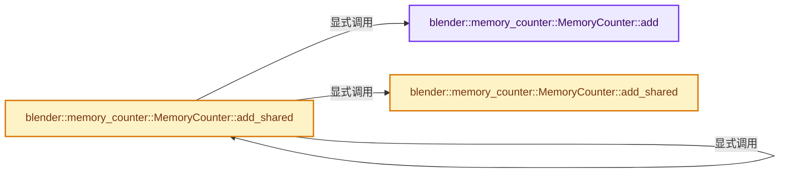

# 实现依赖专题：source/blender/blenlib/intern/memory_counter.cc

[实现依赖导航](../../README.md) · [符号索引](../../../00-课程指南/02-源码与提交索引/符号依赖与实现索引.md)

本专题从正文实际调用进入，集中保存共享实现。函数有稳定锚点，可从调用处直接跳到对应完整函数；递归与互相调用通过回链组织。

## 本文件的实现关系




## 完整成员与函数实现

<a id="f-b875c2cf95d527c4"></a>

### `blender::memory_counter::MemoryCounter::add`

实现位置：[source/blender/blenlib/intern/memory_counter.cc](../../../../../../../source/blender/blenlib/intern/memory_counter.cc) · L15—L18。

接口参数：

- `const int64_t bytes`

**教学注释版**

<!-- annotated:77468d9a502225 -->

```cpp
void MemoryCounter::add(const int64_t bytes)
{
  count_.total_bytes += bytes;
}
```

<details>
<summary>核对原始源码：source/blender/blenlib/intern/memory_counter.cc · L15—L18</summary>

<!-- original:77468d9a502225:source/blender/blenlib/intern/memory_counter.cc:15:18 -->

```cpp
void MemoryCounter::add(const int64_t bytes)
{
  count_.total_bytes += bytes;
}
```

</details>

**沿实际写入检查状态**

- `count_.total_bytes += bytes;`

**继续追踪实现**

本实现没有需要继续展开的显式调用；检查返回表达式、对象转换和调用者前置条件。

<a id="f-0a7db687f64344cf"></a>

### `blender::memory_counter::MemoryCounter::add_shared`

实现位置：[source/blender/blenlib/intern/memory_counter.cc](../../../../../../../source/blender/blenlib/intern/memory_counter.cc) · L20—L36。

接口参数：

- `const ImplicitSharingInfo *sharing_info`
- `const FunctionRef<void(MemoryCounter &memory)> count_fn`
- `MemoryCounter &memory`

**教学注释版**

<!-- annotated:98ba61343cd629 -->

```cpp
void MemoryCounter::add_shared(const ImplicitSharingInfo *sharing_info,
                               const FunctionRef<void(MemoryCounter &memory)> count_fn)
{
  if (!sharing_info) {
    /* Data is not actually shared. */
    count_fn(*this);
    return;
  }
  if (!count_.handled_shared_data.add_as(sharing_info)) {
    /* Data was counted before, avoid counting it again. */
    return;
  }
  // [讲解] sharing_info->add_weak_user：维护对控制信息的弱使用关系。
  sharing_info->add_weak_user();
  /* Count into the `this` for now. In the future we could pass in a separate #MemoryCounter here
   * if we needed to know the amount of memory used by each shared data. */
  count_fn(*this);
}
```

<details>
<summary>核对原始源码：source/blender/blenlib/intern/memory_counter.cc · L20—L36</summary>

<!-- original:98ba61343cd629:source/blender/blenlib/intern/memory_counter.cc:20:36 -->

```cpp
void MemoryCounter::add_shared(const ImplicitSharingInfo *sharing_info,
                               const FunctionRef<void(MemoryCounter &memory)> count_fn)
{
  if (!sharing_info) {
    /* Data is not actually shared. */
    count_fn(*this);
    return;
  }
  if (!count_.handled_shared_data.add_as(sharing_info)) {
    /* Data was counted before, avoid counting it again. */
    return;
  }
  sharing_info->add_weak_user();
  /* Count into the `this` for now. In the future we could pass in a separate #MemoryCounter here
   * if we needed to know the amount of memory used by each shared data. */
  count_fn(*this);
}
```

</details>

**继续追踪实现**

- `count_fn` → [调用协议](../../../00-课程指南/01-路线与规范/模板宏与动态分派协议.md)：局部可调用对象，须结合其初始化与捕获环境。调用位置L25。
- `count_.handled_shared_data.add_as` → [调用协议](../../../00-课程指南/01-路线与规范/模板宏与动态分派协议.md)：接收对象类型依赖auto、返回值或模板实例；不按同名猜测目标。调用位置L28。
- `sharing_info->add_weak_user` → [blender::ImplicitSharingInfo::add_weak_user · L105](../../../06-隐式共享与缓存系统/01-所有权与写时复制.md#f-b7fa994ae87eec42)。

<a id="f-63a65a1c4c176990"></a>

### `blender::memory_counter::MemoryCounter::add_shared`

实现位置：[source/blender/blenlib/intern/memory_counter.cc](../../../../../../../source/blender/blenlib/intern/memory_counter.cc) · L38—L41。

接口参数：

- `const ImplicitSharingInfo *sharing_info`
- `const int64_t bytes`

**教学注释版**

<!-- annotated:3f37631408875d -->

```cpp
void MemoryCounter::add_shared(const ImplicitSharingInfo *sharing_info, const int64_t bytes)
{
  this->add_shared(sharing_info, [&](MemoryCounter &shared_memory) { shared_memory.add(bytes); });
}
```

<details>
<summary>核对原始源码：source/blender/blenlib/intern/memory_counter.cc · L38—L41</summary>

<!-- original:3f37631408875d:source/blender/blenlib/intern/memory_counter.cc:38:41 -->

```cpp
void MemoryCounter::add_shared(const ImplicitSharingInfo *sharing_info, const int64_t bytes)
{
  this->add_shared(sharing_info, [&](MemoryCounter &shared_memory) { shared_memory.add(bytes); });
}
```

</details>

**继续追踪实现**

- `this->add_shared` → [blender::memory_counter::MemoryCounter::add_shared · L20](memory_counter.cc.md#f-0a7db687f64344cf)；[blender::memory_counter::MemoryCounter::add_shared · L38](memory_counter.cc.md#f-63a65a1c4c176990)。同名重载需按实参类型选择。
- `shared_memory.add` → [blender::memory_counter::MemoryCounter::add · L15](memory_counter.cc.md#f-b875c2cf95d527c4)。
