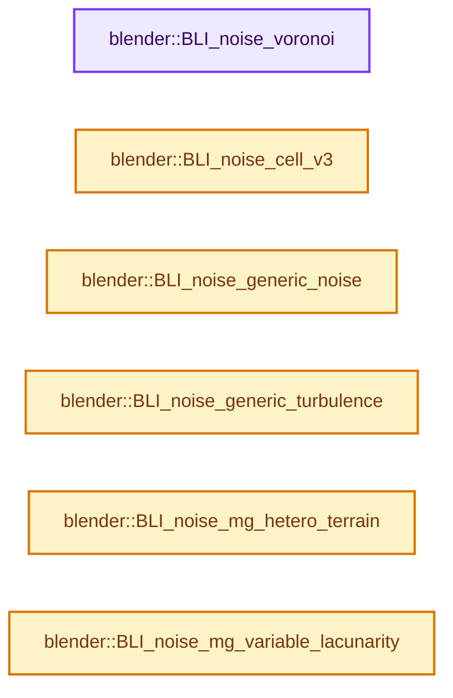
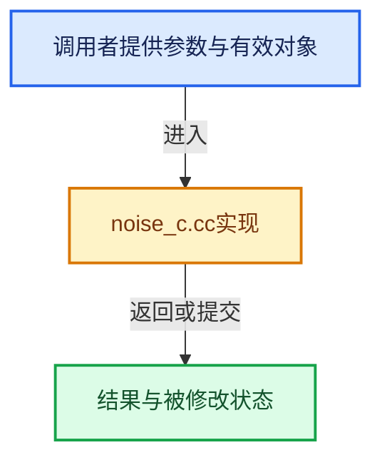

# 实现依赖专题：source/blender/blenlib/intern/noise_c.cc

[实现依赖导航](../../README.md) · [符号索引](../../../00-课程指南/02-源码与提交索引/符号依赖与实现索引.md)

本专题从正文实际调用进入，集中保存共享实现。函数有稳定锚点，可从调用处直接跳到对应完整函数；递归与互相调用通过回链组织。

## 本文件的实现关系






<a id="m-13828a474326"></a>

## 宏 `HASHPNT`

<!-- annotated:1da58c78adf490 -->

```cpp
#define HASHPNT(x, y, z) hashpntf + 3 * hash[(hash[(hash[(z) & 255] + (y)) & 255] + (x)) & 255]
static const float hashpntf[768] = {
```

<details>
<summary>核对原始源码：source/blender/blenlib/intern/noise_c.cc · L32—L33</summary>

<!-- original:1da58c78adf490:source/blender/blenlib/intern/noise_c.cc:32:33 -->

```cpp
#define HASHPNT(x, y, z) hashpntf + 3 * hash[(hash[(hash[(z) & 255] + (y)) & 255] + (x)) & 255]
static const float hashpntf[768] = {
```

</details>

宏在预处理阶段展开，参数替换、重复求值和条件编译应直接从该定义检查。与普通函数不同，宏不会自动提供参数类型检查；构建配置选择哪个定义需结合外围条件。

<a id="m-058ce7ddf428"></a>

## 宏 `hash`

<!-- annotated:d6b94e8e16004b -->

```cpp
#define hash BLI_noise_hash_uchar_512

```

<details>
<summary>核对原始源码：source/blender/blenlib/intern/noise_c.cc · L156—L157</summary>

<!-- original:d6b94e8e16004b:source/blender/blenlib/intern/noise_c.cc:156:157 -->

```cpp
#define hash BLI_noise_hash_uchar_512

```

</details>

宏在预处理阶段展开，参数替换、重复求值和条件编译应直接从该定义检查。与普通函数不同，宏不会自动提供参数类型检查；构建配置选择哪个定义需结合外围条件。

## 完整成员与函数实现

<a id="f-c92e23f49bb3c61d"></a>

### `blender::BLI_noise_voronoi`

实现位置：[source/blender/blenlib/intern/noise_c.cc](../../../../../../../source/blender/blenlib/intern/noise_c.cc) · L917—L1008。

接口参数：

- `float x`
- `float y`
- `float z`
- `float *da`
- `float *pa`
- `float me`
- `int dtype`

**教学注释版**

<!-- annotated:daccc749defc00 -->

```cpp
void BLI_noise_voronoi(float x, float y, float z, float *da, float *pa, float me, int dtype)
{
  float (*distfunc)(float, float, float, float);
  switch (dtype) {
    case 1:
      distfunc = dist_Squared;
      break;
    case 2:
      distfunc = dist_Manhattan;
      break;
    case 3:
      distfunc = dist_Chebychev;
      break;
    case 4:
      distfunc = dist_MinkovskyH;
      break;
    case 5:
      distfunc = dist_Minkovsky4;
      break;
    case 6:
      distfunc = dist_Minkovsky;
      break;
    case 0:
    default:
      distfunc = dist_Real;
      break;
  }

  int xi = int(floor(x));
  int yi = int(floor(y));
  int zi = int(floor(z));
  da[0] = da[1] = da[2] = da[3] = 1e10f;
  for (int xx = xi - 1; xx <= xi + 1; xx++) {
    for (int yy = yi - 1; yy <= yi + 1; yy++) {
      for (int zz = zi - 1; zz <= zi + 1; zz++) {
        const float *p = HASHPNT(xx, yy, zz);
        float xd = x - (p[0] + xx);
        float yd = y - (p[1] + yy);
        float zd = z - (p[2] + zz);
        float d = distfunc(xd, yd, zd, me);
        if (d < da[0]) {
          da[3] = da[2];
          da[2] = da[1];
          da[1] = da[0];
          da[0] = d;
          pa[9] = pa[6];
          pa[10] = pa[7];
          pa[11] = pa[8];
          pa[6] = pa[3];
          pa[7] = pa[4];
          pa[8] = pa[5];
          pa[3] = pa[0];
          pa[4] = pa[1];
          pa[5] = pa[2];
          pa[0] = p[0] + xx;
          pa[1] = p[1] + yy;
          pa[2] = p[2] + zz;
        }
        else if (d < da[1]) {
          da[3] = da[2];
          da[2] = da[1];
          da[1] = d;
          pa[9] = pa[6];
          pa[10] = pa[7];
          pa[11] = pa[8];
          pa[6] = pa[3];
          pa[7] = pa[4];
          pa[8] = pa[5];
          pa[3] = p[0] + xx;
          pa[4] = p[1] + yy;
          pa[5] = p[2] + zz;
        }
        else if (d < da[2]) {
          da[3] = da[2];
          da[2] = d;
          pa[9] = pa[6];
          pa[10] = pa[7];
          pa[11] = pa[8];
          pa[6] = p[0] + xx;
          pa[7] = p[1] + yy;
          pa[8] = p[2] + zz;
        }
        else if (d < da[3]) {
          da[3] = d;
          pa[9] = p[0] + xx;
          pa[10] = p[1] + yy;
          pa[11] = p[2] + zz;
        }
      }
    }
  }
}
```

<details>
<summary>核对原始源码：source/blender/blenlib/intern/noise_c.cc · L917—L1008</summary>

<!-- original:daccc749defc00:source/blender/blenlib/intern/noise_c.cc:917:1008 -->

```cpp
void BLI_noise_voronoi(float x, float y, float z, float *da, float *pa, float me, int dtype)
{
  float (*distfunc)(float, float, float, float);
  switch (dtype) {
    case 1:
      distfunc = dist_Squared;
      break;
    case 2:
      distfunc = dist_Manhattan;
      break;
    case 3:
      distfunc = dist_Chebychev;
      break;
    case 4:
      distfunc = dist_MinkovskyH;
      break;
    case 5:
      distfunc = dist_Minkovsky4;
      break;
    case 6:
      distfunc = dist_Minkovsky;
      break;
    case 0:
    default:
      distfunc = dist_Real;
      break;
  }

  int xi = int(floor(x));
  int yi = int(floor(y));
  int zi = int(floor(z));
  da[0] = da[1] = da[2] = da[3] = 1e10f;
  for (int xx = xi - 1; xx <= xi + 1; xx++) {
    for (int yy = yi - 1; yy <= yi + 1; yy++) {
      for (int zz = zi - 1; zz <= zi + 1; zz++) {
        const float *p = HASHPNT(xx, yy, zz);
        float xd = x - (p[0] + xx);
        float yd = y - (p[1] + yy);
        float zd = z - (p[2] + zz);
        float d = distfunc(xd, yd, zd, me);
        if (d < da[0]) {
          da[3] = da[2];
          da[2] = da[1];
          da[1] = da[0];
          da[0] = d;
          pa[9] = pa[6];
          pa[10] = pa[7];
          pa[11] = pa[8];
          pa[6] = pa[3];
          pa[7] = pa[4];
          pa[8] = pa[5];
          pa[3] = pa[0];
          pa[4] = pa[1];
          pa[5] = pa[2];
          pa[0] = p[0] + xx;
          pa[1] = p[1] + yy;
          pa[2] = p[2] + zz;
        }
        else if (d < da[1]) {
          da[3] = da[2];
          da[2] = da[1];
          da[1] = d;
          pa[9] = pa[6];
          pa[10] = pa[7];
          pa[11] = pa[8];
          pa[6] = pa[3];
          pa[7] = pa[4];
          pa[8] = pa[5];
          pa[3] = p[0] + xx;
          pa[4] = p[1] + yy;
          pa[5] = p[2] + zz;
        }
        else if (d < da[2]) {
          da[3] = da[2];
          da[2] = d;
          pa[9] = pa[6];
          pa[10] = pa[7];
          pa[11] = pa[8];
          pa[6] = p[0] + xx;
          pa[7] = p[1] + yy;
          pa[8] = p[2] + zz;
        }
        else if (d < da[3]) {
          da[3] = d;
          pa[9] = p[0] + xx;
          pa[10] = p[1] + yy;
          pa[11] = p[2] + zz;
        }
      }
    }
  }
}
```

</details>

**沿实际写入检查状态**

- `distfunc = dist_Squared;`
- `distfunc = dist_Manhattan;`
- `distfunc = dist_Chebychev;`
- `distfunc = dist_MinkovskyH;`
- `distfunc = dist_Minkovsky4;`
- `distfunc = dist_Minkovsky;`
- `distfunc = dist_Real;`
- `da[0] = da[1] = da[2] = da[3] = 1e10f;`
- `da[3] = da[2];`
- `da[2] = da[1];`
- `da[1] = da[0];`
- `da[0] = d;`
- `pa[9] = pa[6];`
- `pa[10] = pa[7];`
- `pa[11] = pa[8];`
- `pa[6] = pa[3];`
- `pa[7] = pa[4];`
- `pa[8] = pa[5];`
- `pa[3] = pa[0];`
- `pa[4] = pa[1];`
- `pa[5] = pa[2];`
- `pa[0] = p[0] + xx;`
- `pa[1] = p[1] + yy;`
- `pa[2] = p[2] + zz;`
- `da[1] = d;`
- `pa[3] = p[0] + xx;`
- `pa[4] = p[1] + yy;`
- `pa[5] = p[2] + zz;`
- `da[2] = d;`
- `pa[6] = p[0] + xx;`
- `pa[7] = p[1] + yy;`
- `pa[8] = p[2] + zz;`
- `da[3] = d;`
- `pa[9] = p[0] + xx;`
- `pa[10] = p[1] + yy;`
- `pa[11] = p[2] + zz;`

**继续追踪实现**

- `floor` → [外部契约](https://eel.is/c++draft/)：这个边界按实际表达式及所属类型核对参数、返回值、寿命与失败行为。这里提供接口入口，不声称已解释该第三方版本的内部实现。
- `HASHPNT` → [HASHPNT · L32](noise_c.cc.md#m-13828a474326)。宏定义由构建条件选择。
- `distfunc` → [调用协议](../../../00-课程指南/01-路线与规范/模板宏与动态分派协议.md)：局部可调用对象，须结合其初始化与捕获环境。调用位置L956。

<a id="f-67bebe3166706f71"></a>

### `blender::BLI_noise_cell_v3`

实现位置：[source/blender/blenlib/intern/noise_c.cc](../../../../../../../source/blender/blenlib/intern/noise_c.cc) · L1133—L1147。

接口参数：

- `float x`
- `float y`
- `float z`
- `float r_ca[3]`

**教学注释版**

<!-- annotated:e5c388fa6a96ac -->

```cpp
void BLI_noise_cell_v3(float x, float y, float z, float r_ca[3])
{
  /* avoid precision issues on unit coordinates */
  x = (x + 0.000001f) * 1.00001f;
  y = (y + 0.000001f) * 1.00001f;
  z = (z + 0.000001f) * 1.00001f;

  int xi = int(floor(x));
  int yi = int(floor(y));
  int zi = int(floor(z));
  const float *p = HASHPNT(xi, yi, zi);
  r_ca[0] = p[0];
  r_ca[1] = p[1];
  r_ca[2] = p[2];
}
```

<details>
<summary>核对原始源码：source/blender/blenlib/intern/noise_c.cc · L1133—L1147</summary>

<!-- original:e5c388fa6a96ac:source/blender/blenlib/intern/noise_c.cc:1133:1147 -->

```cpp
void BLI_noise_cell_v3(float x, float y, float z, float r_ca[3])
{
  /* avoid precision issues on unit coordinates */
  x = (x + 0.000001f) * 1.00001f;
  y = (y + 0.000001f) * 1.00001f;
  z = (z + 0.000001f) * 1.00001f;

  int xi = int(floor(x));
  int yi = int(floor(y));
  int zi = int(floor(z));
  const float *p = HASHPNT(xi, yi, zi);
  r_ca[0] = p[0];
  r_ca[1] = p[1];
  r_ca[2] = p[2];
}
```

</details>

**沿实际写入检查状态**

- `x = (x + 0.000001f) * 1.00001f;`
- `y = (y + 0.000001f) * 1.00001f;`
- `z = (z + 0.000001f) * 1.00001f;`
- `r_ca[0] = p[0];`
- `r_ca[1] = p[1];`
- `r_ca[2] = p[2];`

**继续追踪实现**

- `floor` → [外部契约](https://eel.is/c++draft/)：这个边界按实际表达式及所属类型核对参数、返回值、寿命与失败行为。这里提供接口入口，不声称已解释该第三方版本的内部实现。
- `HASHPNT` → [HASHPNT · L32](noise_c.cc.md#m-13828a474326)。宏定义由构建条件选择。

<a id="f-719c032123ea9e4d"></a>

### `blender::BLI_noise_generic_noise`

实现位置：[source/blender/blenlib/intern/noise_c.cc](../../../../../../../source/blender/blenlib/intern/noise_c.cc) · L1155—L1210。

接口参数：

- `float noisesize`
- `float x`
- `float y`
- `float z`
- `bool hard`
- `int noisebasis`

**教学注释版**

<!-- annotated:552f4f30013bfb -->

```cpp
float BLI_noise_generic_noise(
    float noisesize, float x, float y, float z, bool hard, int noisebasis)
{
  float (*noisefunc)(float, float, float);

  switch (noisebasis) {
    case 1:
      noisefunc = orgPerlinNoiseU;
      break;
    case 2:
      noisefunc = newPerlinU;
      break;
    case 3:
      noisefunc = voronoi_F1;
      break;
    case 4:
      noisefunc = voronoi_F2;
      break;
    case 5:
      noisefunc = voronoi_F3;
      break;
    case 6:
      noisefunc = voronoi_F4;
      break;
    case 7:
      noisefunc = voronoi_F1F2;
      break;
    case 8:
      noisefunc = voronoi_Cr;
      break;
    case 14:
      noisefunc = BLI_cellNoiseU;
      break;
    case 0:
    default: {
      noisefunc = orgBlenderNoise;
      /* add one to make return value same as BLI_noise_hnoise */
      x += 1;
      y += 1;
      z += 1;
      break;
    }
  }

  if (noisesize != 0.0f) {
    noisesize = 1.0f / noisesize;
    x *= noisesize;
    y *= noisesize;
    z *= noisesize;
  }

  if (hard) {
    return fabsf(2.0f * noisefunc(x, y, z) - 1.0f);
  }
  return noisefunc(x, y, z);
}
```

<details>
<summary>核对原始源码：source/blender/blenlib/intern/noise_c.cc · L1155—L1210</summary>

<!-- original:552f4f30013bfb:source/blender/blenlib/intern/noise_c.cc:1155:1210 -->

```cpp
float BLI_noise_generic_noise(
    float noisesize, float x, float y, float z, bool hard, int noisebasis)
{
  float (*noisefunc)(float, float, float);

  switch (noisebasis) {
    case 1:
      noisefunc = orgPerlinNoiseU;
      break;
    case 2:
      noisefunc = newPerlinU;
      break;
    case 3:
      noisefunc = voronoi_F1;
      break;
    case 4:
      noisefunc = voronoi_F2;
      break;
    case 5:
      noisefunc = voronoi_F3;
      break;
    case 6:
      noisefunc = voronoi_F4;
      break;
    case 7:
      noisefunc = voronoi_F1F2;
      break;
    case 8:
      noisefunc = voronoi_Cr;
      break;
    case 14:
      noisefunc = BLI_cellNoiseU;
      break;
    case 0:
    default: {
      noisefunc = orgBlenderNoise;
      /* add one to make return value same as BLI_noise_hnoise */
      x += 1;
      y += 1;
      z += 1;
      break;
    }
  }

  if (noisesize != 0.0f) {
    noisesize = 1.0f / noisesize;
    x *= noisesize;
    y *= noisesize;
    z *= noisesize;
  }

  if (hard) {
    return fabsf(2.0f * noisefunc(x, y, z) - 1.0f);
  }
  return noisefunc(x, y, z);
}
```

</details>

**沿实际写入检查状态**

- `noisefunc = orgPerlinNoiseU;`
- `noisefunc = newPerlinU;`
- `noisefunc = voronoi_F1;`
- `noisefunc = voronoi_F2;`
- `noisefunc = voronoi_F3;`
- `noisefunc = voronoi_F4;`
- `noisefunc = voronoi_F1F2;`
- `noisefunc = voronoi_Cr;`
- `noisefunc = BLI_cellNoiseU;`
- `noisefunc = orgBlenderNoise;`
- `x += 1;`
- `y += 1;`
- `z += 1;`
- `noisesize = 1.0f / noisesize;`
- `x *= noisesize;`
- `y *= noisesize;`
- `z *= noisesize;`

**结果出口**

- `return fabsf(2.0f * noisefunc(x, y, z) - 1.0f);`
- `return noisefunc(x, y, z);`

**继续追踪实现**

- `fabsf` → [fabsf · L21](../../07-Intern运行时与平台/cycles/kernel/svm/radial_tiling_shared.h.md#m-02cc4c69cfb3)；[fabsf · L43](../../07-Intern运行时与平台/cycles/kernel/svm/radial_tiling_shared.h.md#m-04effe61803b)；[fabsf · L74](../../07-Intern运行时与平台/cycles/kernel/svm/radial_tiling_shared.h.md#m-927dd4eba7dc)；[fabsf · L25](radial_tiling_shared.hh.md#m-8348d6b3d08f)；[fabsf · L47](radial_tiling_shared.hh.md#m-13b7e0b6d84f)；[fabsf · L78](radial_tiling_shared.hh.md#m-326c83464a0d)；[fabsf · L21](../../07-Intern运行时与平台/cycles/kernel/osl/shaders/node_radial_tiling_shared.h.md#m-7c3ee12fc119)；[fabsf · L43](../../07-Intern运行时与平台/cycles/kernel/osl/shaders/node_radial_tiling_shared.h.md#m-9112db0e2dd1)；[fabsf · L74](../../07-Intern运行时与平台/cycles/kernel/osl/shaders/node_radial_tiling_shared.h.md#m-ee4e61908a6f)；[fabsf · L167](../../07-Intern运行时与平台/cycles/kernel/device/oneapi/compat.h.md#m-b039ee6c1601)；[fabsf · L265](../../07-Intern运行时与平台/cycles/kernel/device/metal/compat.h.md#m-6b21869e9f3f)。宏定义由构建条件选择。
- `noisefunc` → [调用协议](../../../00-课程指南/01-路线与规范/模板宏与动态分派协议.md)：局部可调用对象，须结合其初始化与捕获环境。调用位置L1207。

<a id="f-de528bb4e81cd83e"></a>

### `blender::BLI_noise_generic_turbulence`

实现位置：[source/blender/blenlib/intern/noise_c.cc](../../../../../../../source/blender/blenlib/intern/noise_c.cc) · L1212—L1272。

接口参数：

- `float noisesize`
- `float x`
- `float y`
- `float z`
- `int oct`
- `bool hard`
- `int noisebasis`

**教学注释版**

<!-- annotated:4f978b3b587061 -->

```cpp
float BLI_noise_generic_turbulence(
    float noisesize, float x, float y, float z, int oct, bool hard, int noisebasis)
{
  float (*noisefunc)(float, float, float);
  switch (noisebasis) {
    case 1:
      noisefunc = orgPerlinNoiseU;
      break;
    case 2:
      noisefunc = newPerlinU;
      break;
    case 3:
      noisefunc = voronoi_F1;
      break;
    case 4:
      noisefunc = voronoi_F2;
      break;
    case 5:
      noisefunc = voronoi_F3;
      break;
    case 6:
      noisefunc = voronoi_F4;
      break;
    case 7:
      noisefunc = voronoi_F1F2;
      break;
    case 8:
      noisefunc = voronoi_Cr;
      break;
    case 14:
      noisefunc = BLI_cellNoiseU;
      break;
    case 0:
    default:
      noisefunc = orgBlenderNoise;
      x += 1;
      y += 1;
      z += 1;
      break;
  }

  if (noisesize != 0.0f) {
    noisesize = 1.0f / noisesize;
    x *= noisesize;
    y *= noisesize;
    z *= noisesize;
  }

  float sum = 0, amp = 1, fscale = 1;
  for (int i = 0; i <= oct; i++, amp *= 0.5f, fscale *= 2.0f) {
    float t = noisefunc(fscale * x, fscale * y, fscale * z);
    if (hard) {
      t = fabsf(2.0f * t - 1.0f);
    }
    sum += t * amp;
  }

  sum *= float(1 << oct) / float((1 << (oct + 1)) - 1);

  return sum;
}
```

<details>
<summary>核对原始源码：source/blender/blenlib/intern/noise_c.cc · L1212—L1272</summary>

<!-- original:4f978b3b587061:source/blender/blenlib/intern/noise_c.cc:1212:1272 -->

```cpp
float BLI_noise_generic_turbulence(
    float noisesize, float x, float y, float z, int oct, bool hard, int noisebasis)
{
  float (*noisefunc)(float, float, float);
  switch (noisebasis) {
    case 1:
      noisefunc = orgPerlinNoiseU;
      break;
    case 2:
      noisefunc = newPerlinU;
      break;
    case 3:
      noisefunc = voronoi_F1;
      break;
    case 4:
      noisefunc = voronoi_F2;
      break;
    case 5:
      noisefunc = voronoi_F3;
      break;
    case 6:
      noisefunc = voronoi_F4;
      break;
    case 7:
      noisefunc = voronoi_F1F2;
      break;
    case 8:
      noisefunc = voronoi_Cr;
      break;
    case 14:
      noisefunc = BLI_cellNoiseU;
      break;
    case 0:
    default:
      noisefunc = orgBlenderNoise;
      x += 1;
      y += 1;
      z += 1;
      break;
  }

  if (noisesize != 0.0f) {
    noisesize = 1.0f / noisesize;
    x *= noisesize;
    y *= noisesize;
    z *= noisesize;
  }

  float sum = 0, amp = 1, fscale = 1;
  for (int i = 0; i <= oct; i++, amp *= 0.5f, fscale *= 2.0f) {
    float t = noisefunc(fscale * x, fscale * y, fscale * z);
    if (hard) {
      t = fabsf(2.0f * t - 1.0f);
    }
    sum += t * amp;
  }

  sum *= float(1 << oct) / float((1 << (oct + 1)) - 1);

  return sum;
}
```

</details>

**沿实际写入检查状态**

- `noisefunc = orgPerlinNoiseU;`
- `noisefunc = newPerlinU;`
- `noisefunc = voronoi_F1;`
- `noisefunc = voronoi_F2;`
- `noisefunc = voronoi_F3;`
- `noisefunc = voronoi_F4;`
- `noisefunc = voronoi_F1F2;`
- `noisefunc = voronoi_Cr;`
- `noisefunc = BLI_cellNoiseU;`
- `noisefunc = orgBlenderNoise;`
- `x += 1;`
- `y += 1;`
- `z += 1;`
- `noisesize = 1.0f / noisesize;`
- `x *= noisesize;`
- `y *= noisesize;`
- `z *= noisesize;`
- `t = fabsf(2.0f * t - 1.0f);`
- `sum += t * amp;`
- `sum *= float(1 << oct) / float((1 << (oct + 1)) - 1);`

**结果出口**

- `return sum;`

**继续追踪实现**

- `noisefunc` → [调用协议](../../../00-课程指南/01-路线与规范/模板宏与动态分派协议.md)：局部可调用对象，须结合其初始化与捕获环境。调用位置L1262。
- `fabsf` → [fabsf · L21](../../07-Intern运行时与平台/cycles/kernel/svm/radial_tiling_shared.h.md#m-02cc4c69cfb3)；[fabsf · L43](../../07-Intern运行时与平台/cycles/kernel/svm/radial_tiling_shared.h.md#m-04effe61803b)；[fabsf · L74](../../07-Intern运行时与平台/cycles/kernel/svm/radial_tiling_shared.h.md#m-927dd4eba7dc)；[fabsf · L25](radial_tiling_shared.hh.md#m-8348d6b3d08f)；[fabsf · L47](radial_tiling_shared.hh.md#m-13b7e0b6d84f)；[fabsf · L78](radial_tiling_shared.hh.md#m-326c83464a0d)；[fabsf · L21](../../07-Intern运行时与平台/cycles/kernel/osl/shaders/node_radial_tiling_shared.h.md#m-7c3ee12fc119)；[fabsf · L43](../../07-Intern运行时与平台/cycles/kernel/osl/shaders/node_radial_tiling_shared.h.md#m-9112db0e2dd1)；[fabsf · L74](../../07-Intern运行时与平台/cycles/kernel/osl/shaders/node_radial_tiling_shared.h.md#m-ee4e61908a6f)；[fabsf · L167](../../07-Intern运行时与平台/cycles/kernel/device/oneapi/compat.h.md#m-b039ee6c1601)；[fabsf · L265](../../07-Intern运行时与平台/cycles/kernel/device/metal/compat.h.md#m-6b21869e9f3f)。宏定义由构建条件选择。

<a id="f-a28b05e10b73633d"></a>

### `blender::BLI_noise_mg_hetero_terrain`

实现位置：[source/blender/blenlib/intern/noise_c.cc](../../../../../../../source/blender/blenlib/intern/noise_c.cc) · L1393—L1461。

接口参数：

- `float x`
- `float y`
- `float z`
- `float H`
- `float lacunarity`
- `float octaves`
- `float offset`
- `int noisebasis`

**教学注释版**

<!-- annotated:c941e74416beb0 -->

```cpp
float BLI_noise_mg_hetero_terrain(float x,
                                  float y,
                                  float z,
                                  float H,
                                  float lacunarity,
                                  float octaves,
                                  float offset,
                                  int noisebasis)
{
  float (*noisefunc)(float, float, float);
  switch (noisebasis) {
    case 1:
      noisefunc = orgPerlinNoise;
      break;
    case 2:
      noisefunc = newPerlin;
      break;
    case 3:
      noisefunc = voronoi_F1S;
      break;
    case 4:
      noisefunc = voronoi_F2S;
      break;
    case 5:
      noisefunc = voronoi_F3S;
      break;
    case 6:
      noisefunc = voronoi_F4S;
      break;
    case 7:
      noisefunc = voronoi_F1F2S;
      break;
    case 8:
      noisefunc = voronoi_CrS;
      break;
    case 14:
      noisefunc = BLI_noise_cell;
      break;
    case 0:
    default: {
      noisefunc = orgBlenderNoiseS;
      break;
    }
  }

  /* first unscaled octave of function; later octaves are scaled */
  float value = offset + noisefunc(x, y, z);
  x *= lacunarity;
  y *= lacunarity;
  z *= lacunarity;

  float pwHL = powf(lacunarity, -H);
  float pwr = pwHL; /* starts with i=1 instead of 0 */
  for (int i = 1; i < int(octaves); i++) {
    float increment = (noisefunc(x, y, z) + offset) * pwr * value;
    value += increment;
    pwr *= pwHL;
    x *= lacunarity;
    y *= lacunarity;
    z *= lacunarity;
  }

  float rmd = octaves - floorf(octaves);
  if (rmd != 0.0f) {
    float increment = (noisefunc(x, y, z) + offset) * pwr * value;
    value += rmd * increment;
  }
  return value;
}
```

<details>
<summary>核对原始源码：source/blender/blenlib/intern/noise_c.cc · L1393—L1461</summary>

<!-- original:c941e74416beb0:source/blender/blenlib/intern/noise_c.cc:1393:1461 -->

```cpp
float BLI_noise_mg_hetero_terrain(float x,
                                  float y,
                                  float z,
                                  float H,
                                  float lacunarity,
                                  float octaves,
                                  float offset,
                                  int noisebasis)
{
  float (*noisefunc)(float, float, float);
  switch (noisebasis) {
    case 1:
      noisefunc = orgPerlinNoise;
      break;
    case 2:
      noisefunc = newPerlin;
      break;
    case 3:
      noisefunc = voronoi_F1S;
      break;
    case 4:
      noisefunc = voronoi_F2S;
      break;
    case 5:
      noisefunc = voronoi_F3S;
      break;
    case 6:
      noisefunc = voronoi_F4S;
      break;
    case 7:
      noisefunc = voronoi_F1F2S;
      break;
    case 8:
      noisefunc = voronoi_CrS;
      break;
    case 14:
      noisefunc = BLI_noise_cell;
      break;
    case 0:
    default: {
      noisefunc = orgBlenderNoiseS;
      break;
    }
  }

  /* first unscaled octave of function; later octaves are scaled */
  float value = offset + noisefunc(x, y, z);
  x *= lacunarity;
  y *= lacunarity;
  z *= lacunarity;

  float pwHL = powf(lacunarity, -H);
  float pwr = pwHL; /* starts with i=1 instead of 0 */
  for (int i = 1; i < int(octaves); i++) {
    float increment = (noisefunc(x, y, z) + offset) * pwr * value;
    value += increment;
    pwr *= pwHL;
    x *= lacunarity;
    y *= lacunarity;
    z *= lacunarity;
  }

  float rmd = octaves - floorf(octaves);
  if (rmd != 0.0f) {
    float increment = (noisefunc(x, y, z) + offset) * pwr * value;
    value += rmd * increment;
  }
  return value;
}
```

</details>

**沿实际写入检查状态**

- `noisefunc = orgPerlinNoise;`
- `noisefunc = newPerlin;`
- `noisefunc = voronoi_F1S;`
- `noisefunc = voronoi_F2S;`
- `noisefunc = voronoi_F3S;`
- `noisefunc = voronoi_F4S;`
- `noisefunc = voronoi_F1F2S;`
- `noisefunc = voronoi_CrS;`
- `noisefunc = BLI_noise_cell;`
- `noisefunc = orgBlenderNoiseS;`
- `x *= lacunarity;`
- `y *= lacunarity;`
- `z *= lacunarity;`
- `value += increment;`
- `pwr *= pwHL;`
- `value += rmd * increment;`

**结果出口**

- `return value;`

**继续追踪实现**

- `noisefunc` → [调用协议](../../../00-课程指南/01-路线与规范/模板宏与动态分派协议.md)：局部可调用对象，须结合其初始化与捕获环境。调用位置L1439。
- `powf` → [powf · L188](../../07-Intern运行时与平台/cycles/kernel/device/oneapi/compat.h.md#m-d8a2a165b5d3)；[powf · L264](../../07-Intern运行时与平台/cycles/kernel/device/metal/compat.h.md#m-3de6a9230b53)；[powf · L95](../../07-Intern运行时与平台/cycles/kernel/device/hip/compat.h.md#m-22a964b66221)；[powf · L93](../../07-Intern运行时与平台/cycles/kernel/device/cuda/compat.h.md#m-64340c9f6eb3)。宏定义由构建条件选择。
- `floorf` → [floorf · L22](../../07-Intern运行时与平台/cycles/kernel/svm/radial_tiling_shared.h.md#m-fb64dda1b0f0)；[floorf · L44](../../07-Intern运行时与平台/cycles/kernel/svm/radial_tiling_shared.h.md#m-25e4a157b53d)；[floorf · L75](../../07-Intern运行时与平台/cycles/kernel/svm/radial_tiling_shared.h.md#m-e128f662cbe8)；[floorf · L26](radial_tiling_shared.hh.md#m-ebadf845d492)；[floorf · L48](radial_tiling_shared.hh.md#m-efe0b148573a)；[floorf · L79](radial_tiling_shared.hh.md#m-9df2f26758e8)；[floorf · L22](../../07-Intern运行时与平台/cycles/kernel/osl/shaders/node_radial_tiling_shared.h.md#m-6b2e29ad4b19)；[floorf · L44](../../07-Intern运行时与平台/cycles/kernel/osl/shaders/node_radial_tiling_shared.h.md#m-f90222d9b445)；[floorf · L75](../../07-Intern运行时与平台/cycles/kernel/osl/shaders/node_radial_tiling_shared.h.md#m-938380992bb5)；[floorf · L172](../../07-Intern运行时与平台/cycles/kernel/device/oneapi/compat.h.md#m-176475a253a6)；[floorf · L270](../../07-Intern运行时与平台/cycles/kernel/device/metal/compat.h.md#m-fb37dbc77698)；[floorf · L49](../../08-其他Blender模块/gpu/GPU_shader_shared_utils.hh.md#m-e7115fdd7560)；[floorf · L70](../../08-其他Blender模块/gpu/GPU_shader_shared_utils.hh.md#m-aee5f6a438e4)。宏定义由构建条件选择。

<a id="f-5efa2ba0d6ae3791"></a>

### `blender::BLI_noise_mg_variable_lacunarity`

实现位置：[source/blender/blenlib/intern/noise_c.cc](../../../../../../../source/blender/blenlib/intern/noise_c.cc) · L1608—L1691。

接口参数：

- `float x`
- `float y`
- `float z`
- `float distortion`
- `int nbas1`
- `int nbas2`

**教学注释版**

<!-- annotated:510e986d3ff327 -->

```cpp
float BLI_noise_mg_variable_lacunarity(
    float x, float y, float z, float distortion, int nbas1, int nbas2)
{
  float (*noisefunc1)(float, float, float);
  switch (nbas1) {
    case 1:
      noisefunc1 = orgPerlinNoise;
      break;
    case 2:
      noisefunc1 = newPerlin;
      break;
    case 3:
      noisefunc1 = voronoi_F1S;
      break;
    case 4:
      noisefunc1 = voronoi_F2S;
      break;
    case 5:
      noisefunc1 = voronoi_F3S;
      break;
    case 6:
      noisefunc1 = voronoi_F4S;
      break;
    case 7:
      noisefunc1 = voronoi_F1F2S;
      break;
    case 8:
      noisefunc1 = voronoi_CrS;
      break;
    case 14:
      noisefunc1 = BLI_noise_cell;
      break;
    case 0:
    default: {
      noisefunc1 = orgBlenderNoiseS;
      break;
    }
  }

  float (*noisefunc2)(float, float, float);
  switch (nbas2) {
    case 1:
      noisefunc2 = orgPerlinNoise;
      break;
    case 2:
      noisefunc2 = newPerlin;
      break;
    case 3:
      noisefunc2 = voronoi_F1S;
      break;
    case 4:
      noisefunc2 = voronoi_F2S;
      break;
    case 5:
      noisefunc2 = voronoi_F3S;
      break;
    case 6:
      noisefunc2 = voronoi_F4S;
      break;
    case 7:
      noisefunc2 = voronoi_F1F2S;
      break;
    case 8:
      noisefunc2 = voronoi_CrS;
      break;
    case 14:
      noisefunc2 = BLI_noise_cell;
      break;
    case 0:
    default: {
      noisefunc2 = orgBlenderNoiseS;
      break;
    }
  }

  /* get a random vector and scale the randomization */
  float rv[3] = {
      rv[0] = noisefunc1(x + 13.5f, y + 13.5f, z + 13.5f) * distortion,
      rv[1] = noisefunc1(x, y, z) * distortion,
      rv[2] = noisefunc1(x - 13.5f, y - 13.5f, z - 13.5f) * distortion,
  };

  return noisefunc2(x + rv[0], y + rv[1], z + rv[2]); /* distorted-domain noise */
}
```

<details>
<summary>核对原始源码：source/blender/blenlib/intern/noise_c.cc · L1608—L1691</summary>

<!-- original:510e986d3ff327:source/blender/blenlib/intern/noise_c.cc:1608:1691 -->

```cpp
float BLI_noise_mg_variable_lacunarity(
    float x, float y, float z, float distortion, int nbas1, int nbas2)
{
  float (*noisefunc1)(float, float, float);
  switch (nbas1) {
    case 1:
      noisefunc1 = orgPerlinNoise;
      break;
    case 2:
      noisefunc1 = newPerlin;
      break;
    case 3:
      noisefunc1 = voronoi_F1S;
      break;
    case 4:
      noisefunc1 = voronoi_F2S;
      break;
    case 5:
      noisefunc1 = voronoi_F3S;
      break;
    case 6:
      noisefunc1 = voronoi_F4S;
      break;
    case 7:
      noisefunc1 = voronoi_F1F2S;
      break;
    case 8:
      noisefunc1 = voronoi_CrS;
      break;
    case 14:
      noisefunc1 = BLI_noise_cell;
      break;
    case 0:
    default: {
      noisefunc1 = orgBlenderNoiseS;
      break;
    }
  }

  float (*noisefunc2)(float, float, float);
  switch (nbas2) {
    case 1:
      noisefunc2 = orgPerlinNoise;
      break;
    case 2:
      noisefunc2 = newPerlin;
      break;
    case 3:
      noisefunc2 = voronoi_F1S;
      break;
    case 4:
      noisefunc2 = voronoi_F2S;
      break;
    case 5:
      noisefunc2 = voronoi_F3S;
      break;
    case 6:
      noisefunc2 = voronoi_F4S;
      break;
    case 7:
      noisefunc2 = voronoi_F1F2S;
      break;
    case 8:
      noisefunc2 = voronoi_CrS;
      break;
    case 14:
      noisefunc2 = BLI_noise_cell;
      break;
    case 0:
    default: {
      noisefunc2 = orgBlenderNoiseS;
      break;
    }
  }

  /* get a random vector and scale the randomization */
  float rv[3] = {
      rv[0] = noisefunc1(x + 13.5f, y + 13.5f, z + 13.5f) * distortion,
      rv[1] = noisefunc1(x, y, z) * distortion,
      rv[2] = noisefunc1(x - 13.5f, y - 13.5f, z - 13.5f) * distortion,
  };

  return noisefunc2(x + rv[0], y + rv[1], z + rv[2]); /* distorted-domain noise */
}
```

</details>

**沿实际写入检查状态**

- `noisefunc1 = orgPerlinNoise;`
- `noisefunc1 = newPerlin;`
- `noisefunc1 = voronoi_F1S;`
- `noisefunc1 = voronoi_F2S;`
- `noisefunc1 = voronoi_F3S;`
- `noisefunc1 = voronoi_F4S;`
- `noisefunc1 = voronoi_F1F2S;`
- `noisefunc1 = voronoi_CrS;`
- `noisefunc1 = BLI_noise_cell;`
- `noisefunc1 = orgBlenderNoiseS;`
- `noisefunc2 = orgPerlinNoise;`
- `noisefunc2 = newPerlin;`
- `noisefunc2 = voronoi_F1S;`
- `noisefunc2 = voronoi_F2S;`
- `noisefunc2 = voronoi_F3S;`
- `noisefunc2 = voronoi_F4S;`
- `noisefunc2 = voronoi_F1F2S;`
- `noisefunc2 = voronoi_CrS;`
- `noisefunc2 = BLI_noise_cell;`
- `noisefunc2 = orgBlenderNoiseS;`
- `rv[0] = noisefunc1(x + 13.5f, y + 13.5f, z + 13.5f) * distortion,`
- `rv[1] = noisefunc1(x, y, z) * distortion,`
- `rv[2] = noisefunc1(x - 13.5f, y - 13.5f, z - 13.5f) * distortion,`

**结果出口**

- `return noisefunc2(x + rv[0], y + rv[1], z + rv[2]); /* distorted-domain noise */`

**继续追踪实现**

- `noisefunc1` → [调用协议](../../../00-课程指南/01-路线与规范/模板宏与动态分派协议.md)：局部可调用对象，须结合其初始化与捕获环境。调用位置L1685。
- `noisefunc2` → [调用协议](../../../00-课程指南/01-路线与规范/模板宏与动态分派协议.md)：局部可调用对象，须结合其初始化与捕获环境。调用位置L1690。
