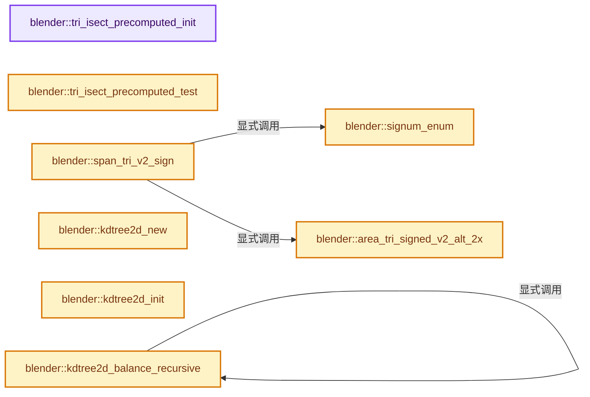
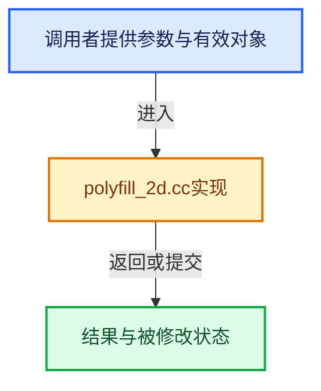

# 实现依赖专题：source/blender/blenlib/intern/polyfill_2d.cc

[实现依赖导航](../../README.md) · [符号索引](../../../00-课程指南/02-源码与提交索引/符号依赖与实现索引.md)

本专题从正文实际调用进入，集中保存共享实现。函数有稳定锚点，可从调用处直接跳到对应完整函数；递归与互相调用通过回链组织。

## 本文件的实现关系






## 相关类型布局与成员入口

<a id="t-e36dd05514cc"></a>

### `blender::PolyIndexFlag`

原始声明：[source/blender/blenlib/intern/polyfill_2d.cc](../../../../../../../source/blender/blenlib/intern/polyfill_2d.cc) · L142—L148。

以下保留类的数据声明与编译条件，成员函数实现通过后面的精确链接阅读。

<!-- annotated:ad86689133cb56 -->

```cpp
enum class PolyIndexFlag : uint8_t {
  /**
   * When set, the triangle has changed since caching. A dirty index cache can still be re-used,
   * however upon failure a full lookup is necessary.
   */
  IndexCacheDirty = 1 << 0,
};
```

<details>
<summary>核对原始源码：source/blender/blenlib/intern/polyfill_2d.cc · L142—L148</summary>

<!-- original:ad86689133cb56:source/blender/blenlib/intern/polyfill_2d.cc:142:148 -->

```cpp
enum class PolyIndexFlag : uint8_t {
  /**
   * When set, the triangle has changed since caching. A dirty index cache can still be re-used,
   * however upon failure a full lookup is necessary.
   */
  IndexCacheDirty = 1 << 0,
};
```

</details>


## 完整成员与函数实现

<a id="f-50cda390af7a81a6"></a>

### `blender::tri_isect_precomputed_init`

实现位置：[source/blender/blenlib/intern/polyfill_2d.cc](../../../../../../../source/blender/blenlib/intern/polyfill_2d.cc) · L199—L207。

接口参数：

- `TriIsectPrecomputed *t`
- `const float *const vs[3]`

**教学注释版**

<!-- annotated:c4d970e6b65575 -->

```cpp
static void tri_isect_precomputed_init(TriIsectPrecomputed *t, const float *const vs[3])
{
  sub_v2_v2v2(t->edge[0], vs[1], vs[0]);
  sub_v2_v2v2(t->edge[1], vs[2], vs[1]);
  sub_v2_v2v2(t->edge[2], vs[0], vs[2]);
  t->c[0] = (t->edge[0][0] * vs[0][1]) - (vs[0][0] * t->edge[0][1]);
  t->c[1] = (t->edge[1][0] * vs[1][1]) - (vs[1][0] * t->edge[1][1]);
  t->c[2] = (t->edge[2][0] * vs[2][1]) - (vs[2][0] * t->edge[2][1]);
}
```

<details>
<summary>核对原始源码：source/blender/blenlib/intern/polyfill_2d.cc · L199—L207</summary>

<!-- original:c4d970e6b65575:source/blender/blenlib/intern/polyfill_2d.cc:199:207 -->

```cpp
static void tri_isect_precomputed_init(TriIsectPrecomputed *t, const float *const vs[3])
{
  sub_v2_v2v2(t->edge[0], vs[1], vs[0]);
  sub_v2_v2v2(t->edge[1], vs[2], vs[1]);
  sub_v2_v2v2(t->edge[2], vs[0], vs[2]);
  t->c[0] = (t->edge[0][0] * vs[0][1]) - (vs[0][0] * t->edge[0][1]);
  t->c[1] = (t->edge[1][0] * vs[1][1]) - (vs[1][0] * t->edge[1][1]);
  t->c[2] = (t->edge[2][0] * vs[2][1]) - (vs[2][0] * t->edge[2][1]);
}
```

</details>

**沿实际写入检查状态**

- `t->c[0] = (t->edge[0][0] * vs[0][1]) - (vs[0][0] * t->edge[0][1]);`
- `t->c[1] = (t->edge[1][0] * vs[1][1]) - (vs[1][0] * t->edge[1][1]);`
- `t->c[2] = (t->edge[2][0] * vs[2][1]) - (vs[2][0] * t->edge[2][1]);`

**继续追踪实现**

- `sub_v2_v2v2` → [blender::sub_v2_v2v2 · L335](math_vector_inline.cc.md#f-f37d18ab53de26ca)。

<a id="f-fca28a10fbbfb4c8"></a>

### `blender::tri_isect_precomputed_test`

实现位置：[source/blender/blenlib/intern/polyfill_2d.cc](../../../../../../../source/blender/blenlib/intern/polyfill_2d.cc) · L215—L220。

接口参数：

- `const TriIsectPrecomputed *t`
- `const float co[2]`

**教学注释版**

<!-- annotated:b0ab8b2f02c30e -->

```cpp
static bool tri_isect_precomputed_test(const TriIsectPrecomputed *t, const float co[2])
{
  return ((t->edge[1][1] * co[0]) - (t->edge[1][0] * co[1]) + t->c[1] >= 0.0f) &&
         ((t->edge[2][1] * co[0]) - (t->edge[2][0] * co[1]) + t->c[2] >= 0.0f) &&
         ((t->edge[0][1] * co[0]) - (t->edge[0][0] * co[1]) + t->c[0] >= 0.0f);
}
```

<details>
<summary>核对原始源码：source/blender/blenlib/intern/polyfill_2d.cc · L215—L220</summary>

<!-- original:b0ab8b2f02c30e:source/blender/blenlib/intern/polyfill_2d.cc:215:220 -->

```cpp
static bool tri_isect_precomputed_test(const TriIsectPrecomputed *t, const float co[2])
{
  return ((t->edge[1][1] * co[0]) - (t->edge[1][0] * co[1]) + t->c[1] >= 0.0f) &&
         ((t->edge[2][1] * co[0]) - (t->edge[2][0] * co[1]) + t->c[2] >= 0.0f) &&
         ((t->edge[0][1] * co[0]) - (t->edge[0][0] * co[1]) + t->c[0] >= 0.0f);
}
```

</details>

**结果出口**

- `return ((t->edge[1][1] * co[0]) - (t->edge[1][0] * co[1]) + t->c[1] >= 0.0f) &&`

**继续追踪实现**

本实现没有需要继续展开的显式调用；检查返回表达式、对象转换和调用者前置条件。

<a id="f-3ed5a0dcf02e9996"></a>

### `blender::signum_enum`

实现位置：[source/blender/blenlib/intern/polyfill_2d.cc](../../../../../../../source/blender/blenlib/intern/polyfill_2d.cc) · L241—L250。

接口参数：

- `float a`

**教学注释版**

<!-- annotated:efbed9cb5dd5b7 -->

```cpp
BLI_INLINE eSign signum_enum(float a)
{
  if (a > 0.0f) {
    return CONVEX;
  }
  if (a == 0.0f) [[unlikely]] {
    return TANGENTIAL;
  }
  return CONCAVE;
}
```

<details>
<summary>核对原始源码：source/blender/blenlib/intern/polyfill_2d.cc · L241—L250</summary>

<!-- original:efbed9cb5dd5b7:source/blender/blenlib/intern/polyfill_2d.cc:241:250 -->

```cpp
BLI_INLINE eSign signum_enum(float a)
{
  if (a > 0.0f) {
    return CONVEX;
  }
  if (a == 0.0f) [[unlikely]] {
    return TANGENTIAL;
  }
  return CONCAVE;
}
```

</details>

**结果出口**

- `return CONVEX;`
- `return TANGENTIAL;`
- `return CONCAVE;`

**继续追踪实现**

本实现没有需要继续展开的显式调用；检查返回表达式、对象转换和调用者前置条件。

<a id="f-3aa24762b8a8b59f"></a>

### `blender::area_tri_signed_v2_alt_2x`

实现位置：[source/blender/blenlib/intern/polyfill_2d.cc](../../../../../../../source/blender/blenlib/intern/polyfill_2d.cc) · L258—L264。

接口参数：

- `const float v1[2]`
- `const float v2[2]`
- `const float v3[2]`

**教学注释版**

<!-- annotated:2079c9b88ed467 -->

```cpp
BLI_INLINE float area_tri_signed_v2_alt_2x(const float v1[2], const float v2[2], const float v3[2])
{
  float d2[2], d3[2];
  sub_v2_v2v2(d2, v2, v1);
  sub_v2_v2v2(d3, v3, v1);
  return (d2[0] * d3[1]) - (d3[0] * d2[1]);
}
```

<details>
<summary>核对原始源码：source/blender/blenlib/intern/polyfill_2d.cc · L258—L264</summary>

<!-- original:2079c9b88ed467:source/blender/blenlib/intern/polyfill_2d.cc:258:264 -->

```cpp
BLI_INLINE float area_tri_signed_v2_alt_2x(const float v1[2], const float v2[2], const float v3[2])
{
  float d2[2], d3[2];
  sub_v2_v2v2(d2, v2, v1);
  sub_v2_v2v2(d3, v3, v1);
  return (d2[0] * d3[1]) - (d3[0] * d2[1]);
}
```

</details>

**结果出口**

- `return (d2[0] * d3[1]) - (d3[0] * d2[1]);`

**继续追踪实现**

- `sub_v2_v2v2` → [blender::sub_v2_v2v2 · L335](math_vector_inline.cc.md#f-f37d18ab53de26ca)。

<a id="f-6297a468338fd1df"></a>

### `blender::span_tri_v2_sign`

实现位置：[source/blender/blenlib/intern/polyfill_2d.cc](../../../../../../../source/blender/blenlib/intern/polyfill_2d.cc) · L266—L269。

接口参数：

- `const float v1[2]`
- `const float v2[2]`
- `const float v3[2]`

**教学注释版**

<!-- annotated:f633c0001a65f7 -->

```cpp
static eSign span_tri_v2_sign(const float v1[2], const float v2[2], const float v3[2])
{
  return signum_enum(area_tri_signed_v2_alt_2x(v3, v2, v1));
}
```

<details>
<summary>核对原始源码：source/blender/blenlib/intern/polyfill_2d.cc · L266—L269</summary>

<!-- original:f633c0001a65f7:source/blender/blenlib/intern/polyfill_2d.cc:266:269 -->

```cpp
static eSign span_tri_v2_sign(const float v1[2], const float v2[2], const float v3[2])
{
  return signum_enum(area_tri_signed_v2_alt_2x(v3, v2, v1));
}
```

</details>

**结果出口**

- `return signum_enum(area_tri_signed_v2_alt_2x(v3, v2, v1));`

**继续追踪实现**

- `signum_enum` → [blender::signum_enum · L241](polyfill_2d.cc.md#f-3ed5a0dcf02e9996)。
- `area_tri_signed_v2_alt_2x` → [blender::area_tri_signed_v2_alt_2x · L258](polyfill_2d.cc.md#f-3aa24762b8a8b59f)。

<a id="f-6e5ca6426492a35d"></a>

### `blender::kdtree2d_new`

实现位置：[source/blender/blenlib/intern/polyfill_2d.cc](../../../../../../../source/blender/blenlib/intern/polyfill_2d.cc) · L278—L285。

接口参数：

- `KDTree2D *tree`
- `uint32_t tot`
- `const float (*coords)[2]`

**教学注释版**

<!-- annotated:b648fc52928a8d -->

```cpp
static void kdtree2d_new(KDTree2D *tree, uint32_t tot, const float (*coords)[2])
{
  /* set by caller */
  // tree->nodes = nodes;
  tree->coords = coords;
  tree->root = KDNODE_UNSET;
  tree->node_num = tot;
}
```

<details>
<summary>核对原始源码：source/blender/blenlib/intern/polyfill_2d.cc · L278—L285</summary>

<!-- original:b648fc52928a8d:source/blender/blenlib/intern/polyfill_2d.cc:278:285 -->

```cpp
static void kdtree2d_new(KDTree2D *tree, uint32_t tot, const float (*coords)[2])
{
  /* set by caller */
  // tree->nodes = nodes;
  tree->coords = coords;
  tree->root = KDNODE_UNSET;
  tree->node_num = tot;
}
```

</details>

**沿实际写入检查状态**

- `tree->coords = coords;`
- `tree->root = KDNODE_UNSET;`
- `tree->node_num = tot;`

**继续追踪实现**

本实现没有需要继续展开的显式调用；检查返回表达式、对象转换和调用者前置条件。

<a id="f-5e3037c5dcfd1fd5"></a>

### `blender::kdtree2d_init`

实现位置：[source/blender/blenlib/intern/polyfill_2d.cc](../../../../../../../source/blender/blenlib/intern/polyfill_2d.cc) · L290—L306。

接口参数：

- `KDTree2D *tree`
- `const uint32_t coords_num`
- `const PolyIndex *indices`

**教学注释版**

<!-- annotated:3d0b189d5ce380 -->

```cpp
static void kdtree2d_init(KDTree2D *tree, const uint32_t coords_num, const PolyIndex *indices)
{
  KDTreeNode2D *node;
  uint32_t i;

  for (i = 0, node = tree->nodes; i < coords_num; i++) {
    if (indices[i].sign != CONVEX) {
      node->neg = node->pos = KDNODE_UNSET;
      node->index = indices[i].index;
      node->axis = 0;
      node->flag = 0;
      node++;
    }
  }

  BLI_assert(tree->node_num == uint32_t(node - tree->nodes));
}
```

<details>
<summary>核对原始源码：source/blender/blenlib/intern/polyfill_2d.cc · L290—L306</summary>

<!-- original:3d0b189d5ce380:source/blender/blenlib/intern/polyfill_2d.cc:290:306 -->

```cpp
static void kdtree2d_init(KDTree2D *tree, const uint32_t coords_num, const PolyIndex *indices)
{
  KDTreeNode2D *node;
  uint32_t i;

  for (i = 0, node = tree->nodes; i < coords_num; i++) {
    if (indices[i].sign != CONVEX) {
      node->neg = node->pos = KDNODE_UNSET;
      node->index = indices[i].index;
      node->axis = 0;
      node->flag = 0;
      node++;
    }
  }

  BLI_assert(tree->node_num == uint32_t(node - tree->nodes));
}
```

</details>

**沿实际写入检查状态**

- `node->neg = node->pos = KDNODE_UNSET;`
- `node->index = indices[i].index;`
- `node->axis = 0;`
- `node->flag = 0;`

**继续追踪实现**

- `BLI_assert` → [BLI_assert · L48](../BLI_assert.hh.md#m-57a88495704d)；[BLI_assert · L63](../BLI_assert.hh.md#m-d07050020cb5)。宏定义由构建条件选择。

<a id="f-cbc38fea6a0f78cf"></a>

### `blender::kdtree2d_balance_recursive`

实现位置：[source/blender/blenlib/intern/polyfill_2d.cc](../../../../../../../source/blender/blenlib/intern/polyfill_2d.cc) · L308—L364。

接口参数：

- `KDTreeNode2D *nodes`
- `uint32_t node_num`
- `axis_t axis`
- `const float (*coords)[2]`
- `const uint32_t ofs`

**教学注释版**

<!-- annotated:21c540b2800968 -->

```cpp
static uint32_t kdtree2d_balance_recursive(KDTreeNode2D *nodes,
                                           uint32_t node_num,
                                           axis_t axis,
                                           const float (*coords)[2],
                                           const uint32_t ofs)
{
  KDTreeNode2D *node;
  uint32_t neg, pos, median, i, j;

  if (node_num <= 0) {
    return KDNODE_UNSET;
  }
  if (node_num == 1) {
    return 0 + ofs;
  }

  /* Quick-sort style sorting around median. */
  neg = 0;
  pos = node_num - 1;
  median = node_num / 2;

  while (pos > neg) {
    const float co = coords[nodes[pos].index][axis];
    i = neg - 1;
    j = pos;

    while (true) {
      while (coords[nodes[++i].index][axis] < co) { /* pass */
      }
      while (coords[nodes[--j].index][axis] > co && j > neg) { /* pass */
      }

      if (i >= j) {
        break;
      }
      SWAP(KDTreeNode2D_head, *(KDTreeNode2D_head *)&nodes[i], *(KDTreeNode2D_head *)&nodes[j]);
    }

    SWAP(KDTreeNode2D_head, *(KDTreeNode2D_head *)&nodes[i], *(KDTreeNode2D_head *)&nodes[pos]);
    if (i >= median) {
      pos = i - 1;
    }
    if (i <= median) {
      neg = i + 1;
    }
  }

  /* Set node and sort sub-nodes. */
  node = &nodes[median];
  node->axis = axis;
  axis = !axis;
  node->neg = kdtree2d_balance_recursive(nodes, median, axis, coords, ofs);
  node->pos = kdtree2d_balance_recursive(
      &nodes[median + 1], (node_num - (median + 1)), axis, coords, (median + 1) + ofs);

  return median + ofs;
}
```

<details>
<summary>核对原始源码：source/blender/blenlib/intern/polyfill_2d.cc · L308—L364</summary>

<!-- original:21c540b2800968:source/blender/blenlib/intern/polyfill_2d.cc:308:364 -->

```cpp
static uint32_t kdtree2d_balance_recursive(KDTreeNode2D *nodes,
                                           uint32_t node_num,
                                           axis_t axis,
                                           const float (*coords)[2],
                                           const uint32_t ofs)
{
  KDTreeNode2D *node;
  uint32_t neg, pos, median, i, j;

  if (node_num <= 0) {
    return KDNODE_UNSET;
  }
  if (node_num == 1) {
    return 0 + ofs;
  }

  /* Quick-sort style sorting around median. */
  neg = 0;
  pos = node_num - 1;
  median = node_num / 2;

  while (pos > neg) {
    const float co = coords[nodes[pos].index][axis];
    i = neg - 1;
    j = pos;

    while (true) {
      while (coords[nodes[++i].index][axis] < co) { /* pass */
      }
      while (coords[nodes[--j].index][axis] > co && j > neg) { /* pass */
      }

      if (i >= j) {
        break;
      }
      SWAP(KDTreeNode2D_head, *(KDTreeNode2D_head *)&nodes[i], *(KDTreeNode2D_head *)&nodes[j]);
    }

    SWAP(KDTreeNode2D_head, *(KDTreeNode2D_head *)&nodes[i], *(KDTreeNode2D_head *)&nodes[pos]);
    if (i >= median) {
      pos = i - 1;
    }
    if (i <= median) {
      neg = i + 1;
    }
  }

  /* Set node and sort sub-nodes. */
  node = &nodes[median];
  node->axis = axis;
  axis = !axis;
  node->neg = kdtree2d_balance_recursive(nodes, median, axis, coords, ofs);
  node->pos = kdtree2d_balance_recursive(
      &nodes[median + 1], (node_num - (median + 1)), axis, coords, (median + 1) + ofs);

  return median + ofs;
}
```

</details>

**沿实际写入检查状态**

- `neg = 0;`
- `pos = node_num - 1;`
- `median = node_num / 2;`
- `i = neg - 1;`
- `j = pos;`
- `pos = i - 1;`
- `neg = i + 1;`
- `node = &nodes[median];`
- `node->axis = axis;`
- `axis = !axis;`
- `node->neg = kdtree2d_balance_recursive(nodes, median, axis, coords, ofs);`
- `node->pos = kdtree2d_balance_recursive(`

**结果出口**

- `return KDNODE_UNSET;`
- `return 0 + ofs;`
- `return median + ofs;`

**继续追踪实现**

- `SWAP` → [SWAP · L76](hash_md5.cc.md#m-563d890521e7)；[SWAP · L50](../BLI_utildefines.hh.md#m-5df6b380a0ac)。宏定义由构建条件选择。
- `kdtree2d_balance_recursive` → [blender::kdtree2d_balance_recursive · L308](polyfill_2d.cc.md#f-cbc38fea6a0f78cf)。

<a id="f-fb01ea21434f22be"></a>

### `blender::kdtree2d_balance`

实现位置：[source/blender/blenlib/intern/polyfill_2d.cc](../../../../../../../source/blender/blenlib/intern/polyfill_2d.cc) · L366—L369。

接口参数：

- `KDTree2D *tree`

**教学注释版**

<!-- annotated:0a7b820740f0d6 -->

```cpp
static void kdtree2d_balance(KDTree2D *tree)
{
  tree->root = kdtree2d_balance_recursive(tree->nodes, tree->node_num, 0, tree->coords, 0);
}
```

<details>
<summary>核对原始源码：source/blender/blenlib/intern/polyfill_2d.cc · L366—L369</summary>

<!-- original:0a7b820740f0d6:source/blender/blenlib/intern/polyfill_2d.cc:366:369 -->

```cpp
static void kdtree2d_balance(KDTree2D *tree)
{
  tree->root = kdtree2d_balance_recursive(tree->nodes, tree->node_num, 0, tree->coords, 0);
}
```

</details>

**沿实际写入检查状态**

- `tree->root = kdtree2d_balance_recursive(tree->nodes, tree->node_num, 0, tree->coords, 0);`

**继续追踪实现**

- `kdtree2d_balance_recursive` → [blender::kdtree2d_balance_recursive · L308](polyfill_2d.cc.md#f-cbc38fea6a0f78cf)。

<a id="f-2e6c402e0c0726cf"></a>

### `blender::kdtree2d_init_mapping`

实现位置：[source/blender/blenlib/intern/polyfill_2d.cc](../../../../../../../source/blender/blenlib/intern/polyfill_2d.cc) · L371—L390。

接口参数：

- `KDTree2D *tree`

**教学注释版**

<!-- annotated:873559fdcace04 -->

```cpp
static void kdtree2d_init_mapping(KDTree2D *tree)
{
  uint32_t i;
  KDTreeNode2D *node;

  for (i = 0, node = tree->nodes; i < tree->node_num; i++, node++) {
    if (node->neg != KDNODE_UNSET) {
      tree->nodes[node->neg].parent = i;
    }
    if (node->pos != KDNODE_UNSET) {
      tree->nodes[node->pos].parent = i;
    }

    /* build map */
    BLI_assert(tree->nodes_map[node->index] == KDNODE_UNSET);
    tree->nodes_map[node->index] = i;
  }

  tree->nodes[tree->root].parent = KDNODE_UNSET;
}
```

<details>
<summary>核对原始源码：source/blender/blenlib/intern/polyfill_2d.cc · L371—L390</summary>

<!-- original:873559fdcace04:source/blender/blenlib/intern/polyfill_2d.cc:371:390 -->

```cpp
static void kdtree2d_init_mapping(KDTree2D *tree)
{
  uint32_t i;
  KDTreeNode2D *node;

  for (i = 0, node = tree->nodes; i < tree->node_num; i++, node++) {
    if (node->neg != KDNODE_UNSET) {
      tree->nodes[node->neg].parent = i;
    }
    if (node->pos != KDNODE_UNSET) {
      tree->nodes[node->pos].parent = i;
    }

    /* build map */
    BLI_assert(tree->nodes_map[node->index] == KDNODE_UNSET);
    tree->nodes_map[node->index] = i;
  }

  tree->nodes[tree->root].parent = KDNODE_UNSET;
}
```

</details>

**沿实际写入检查状态**

- `tree->nodes[node->neg].parent = i;`
- `tree->nodes[node->pos].parent = i;`
- `tree->nodes_map[node->index] = i;`
- `tree->nodes[tree->root].parent = KDNODE_UNSET;`

**继续追踪实现**

- `BLI_assert` → [BLI_assert · L48](../BLI_assert.hh.md#m-57a88495704d)；[BLI_assert · L63](../BLI_assert.hh.md#m-d07050020cb5)。宏定义由构建条件选择。

<a id="f-bd90c4eee2d0884c"></a>

### `blender::kdtree2d_node_remove`

实现位置：[source/blender/blenlib/intern/polyfill_2d.cc](../../../../../../../source/blender/blenlib/intern/polyfill_2d.cc) · L392—L455。

接口参数：

- `KDTree2D *tree`
- `uint32_t index`

**教学注释版**

<!-- annotated:82d1618ac8940c -->

```cpp
static void kdtree2d_node_remove(KDTree2D *tree, uint32_t index)
{
  uint32_t node_index = tree->nodes_map[index];
  KDTreeNode2D *node;

  if (node_index == KDNODE_UNSET) {
    return;
  }

  tree->nodes_map[index] = KDNODE_UNSET;

  node = &tree->nodes[node_index];
  tree->node_num -= 1;

  BLI_assert((node->flag & KDNODE_FLAG_REMOVED) == 0);
  node->flag |= KDNODE_FLAG_REMOVED;

  /* Walk up the tree, performing two operations to keep the tree compact:
   * - Disconnect: Remove childless nodes from their parent.
   * - Collapse: When a node has exactly one child, connect that child
   *   directly to the grandparent, bypassing this removed node.
   *
   * Note that while this isn't a replacement for re-balancing,
   * given the nature of polygon filling and it's use of the KD-tree
   * the overhead of the rebalancing can't be justified.
   * Only perform KD-tree manipulations that can be done efficiently as part of removal. */
  while (node->parent != KDNODE_UNSET) {
    uint32_t node_child;
    if (node->neg == KDNODE_UNSET) {
      node_child = node->pos;
    }
    else if (node->pos == KDNODE_UNSET) {
      node_child = node->neg;
    }
    else {
      /* Both children set, nothing to collapse. */
      break;
    }

    /* Update parent's reference to this node:
     * - If one child exists: collapse by connecting child directly to grandparent,
     *   bypassing this removed node and shortening the tree path.
     * - If no children: disconnect entirely (set parent's reference to #KDNODE_UNSET). */
    BLI_assert(uint32_t(node - tree->nodes) == node_index);
    KDTreeNode2D *node_parent = &tree->nodes[node->parent];
    if (node_parent->neg == node_index) {
      node_parent->neg = node_child;
    }
    else {
      BLI_assert(node_parent->pos == node_index);
      node_parent->pos = node_child;
    }

    if (node_child != KDNODE_UNSET) {
      tree->nodes[node_child].parent = node->parent;
    }

    if ((node_parent->flag & KDNODE_FLAG_REMOVED) == 0) {
      break;
    }
    node_index = node->parent;
    node = node_parent;
  }
}
```

<details>
<summary>核对原始源码：source/blender/blenlib/intern/polyfill_2d.cc · L392—L455</summary>

<!-- original:82d1618ac8940c:source/blender/blenlib/intern/polyfill_2d.cc:392:455 -->

```cpp
static void kdtree2d_node_remove(KDTree2D *tree, uint32_t index)
{
  uint32_t node_index = tree->nodes_map[index];
  KDTreeNode2D *node;

  if (node_index == KDNODE_UNSET) {
    return;
  }

  tree->nodes_map[index] = KDNODE_UNSET;

  node = &tree->nodes[node_index];
  tree->node_num -= 1;

  BLI_assert((node->flag & KDNODE_FLAG_REMOVED) == 0);
  node->flag |= KDNODE_FLAG_REMOVED;

  /* Walk up the tree, performing two operations to keep the tree compact:
   * - Disconnect: Remove childless nodes from their parent.
   * - Collapse: When a node has exactly one child, connect that child
   *   directly to the grandparent, bypassing this removed node.
   *
   * Note that while this isn't a replacement for re-balancing,
   * given the nature of polygon filling and it's use of the KD-tree
   * the overhead of the rebalancing can't be justified.
   * Only perform KD-tree manipulations that can be done efficiently as part of removal. */
  while (node->parent != KDNODE_UNSET) {
    uint32_t node_child;
    if (node->neg == KDNODE_UNSET) {
      node_child = node->pos;
    }
    else if (node->pos == KDNODE_UNSET) {
      node_child = node->neg;
    }
    else {
      /* Both children set, nothing to collapse. */
      break;
    }

    /* Update parent's reference to this node:
     * - If one child exists: collapse by connecting child directly to grandparent,
     *   bypassing this removed node and shortening the tree path.
     * - If no children: disconnect entirely (set parent's reference to #KDNODE_UNSET). */
    BLI_assert(uint32_t(node - tree->nodes) == node_index);
    KDTreeNode2D *node_parent = &tree->nodes[node->parent];
    if (node_parent->neg == node_index) {
      node_parent->neg = node_child;
    }
    else {
      BLI_assert(node_parent->pos == node_index);
      node_parent->pos = node_child;
    }

    if (node_child != KDNODE_UNSET) {
      tree->nodes[node_child].parent = node->parent;
    }

    if ((node_parent->flag & KDNODE_FLAG_REMOVED) == 0) {
      break;
    }
    node_index = node->parent;
    node = node_parent;
  }
}
```

</details>

**沿实际写入检查状态**

- `tree->nodes_map[index] = KDNODE_UNSET;`
- `node = &tree->nodes[node_index];`
- `tree->node_num -= 1;`
- `node->flag |= KDNODE_FLAG_REMOVED;`
- `node_child = node->pos;`
- `node_child = node->neg;`
- `node_parent->neg = node_child;`
- `node_parent->pos = node_child;`
- `tree->nodes[node_child].parent = node->parent;`
- `node_index = node->parent;`
- `node = node_parent;`

**继续追踪实现**

- `BLI_assert` → [BLI_assert · L48](../BLI_assert.hh.md#m-57a88495704d)；[BLI_assert · L63](../BLI_assert.hh.md#m-d07050020cb5)。宏定义由构建条件选择。

<a id="f-c5f19c75db5d1ea9"></a>

### `blender::kdtree2d_isect_tri_recursive`

实现位置：[source/blender/blenlib/intern/polyfill_2d.cc](../../../../../../../source/blender/blenlib/intern/polyfill_2d.cc) · L460—L526。

接口参数：

- `const KDTree2D *tree`
- `const uint32_t tri_index[3]`
- `USE_PRECOMPUTED_ISECT
                                              const TriIsectPrecomputed *tri_isect`
- `const float *tri_coords[3]`
- `const float tri_center[2]`
- `const KDRange2D bounds[2]`
- `const KDTreeNode2D *node`

**教学注释版**

<!-- annotated:279766ee63fe98 -->

```cpp
static uint32_t kdtree2d_isect_tri_recursive(const KDTree2D *tree,
                                             const uint32_t tri_index[3],
#  ifdef USE_PRECOMPUTED_ISECT
                                             const TriIsectPrecomputed *tri_isect,
#  else
                                             const float *tri_coords[3],
#  endif
                                             const float tri_center[2],
                                             const KDRange2D bounds[2],
                                             const KDTreeNode2D *node)
{
  const float *co = tree->coords[node->index];

  if ((node->flag & KDNODE_FLAG_REMOVED) == 0) {
#  ifdef USE_PRECOMPUTED_ISECT
    if (tri_isect_precomputed_test(tri_isect, co))
#  else
    /* Check `tri_coords[1], tri_coords[2]` first as it's the "opposite edge"
     * (`next` and `prev` in triangle terms) which fails most often for random points. */
    if ((span_tri_v2_sign(tri_coords[1], tri_coords[2], co) != CONCAVE) &&
        (span_tri_v2_sign(tri_coords[2], tri_coords[0], co) != CONCAVE) &&
        (span_tri_v2_sign(tri_coords[0], tri_coords[1], co) != CONCAVE))
#  endif
    {
      if (!ELEM(node->index, tri_index[0], tri_index[1], tri_index[2])) {
        return node->index;
      }
    }
  }

#  ifdef USE_PRECOMPUTED_ISECT
#    define KDTREE2D_ISECT_ARGS tree, tri_index, tri_isect, tri_center, bounds
#  else
#    define KDTREE2D_ISECT_ARGS tree, tri_index, tri_coords, tri_center, bounds
#  endif

#  define KDTREE2D_ISECT_TRI_RECURSE_NEG \
    (((node->neg != KDNODE_UNSET) && (co[node->axis] >= bounds[node->axis].min)) ? \
         kdtree2d_isect_tri_recursive(KDTREE2D_ISECT_ARGS, &tree->nodes[node->neg]) : \
         KDNODE_UNSET)
#  define KDTREE2D_ISECT_TRI_RECURSE_POS \
    (((node->pos != KDNODE_UNSET) && (co[node->axis] <= bounds[node->axis].max)) ? \
         kdtree2d_isect_tri_recursive(KDTREE2D_ISECT_ARGS, &tree->nodes[node->pos]) : \
         KDNODE_UNSET)

  uint32_t result;
  if (tri_center[node->axis] > co[node->axis]) {
    result = KDTREE2D_ISECT_TRI_RECURSE_POS;
    if (result == KDNODE_UNSET) {
      result = KDTREE2D_ISECT_TRI_RECURSE_NEG;
    }
  }
  else {
    result = KDTREE2D_ISECT_TRI_RECURSE_NEG;
    if (result == KDNODE_UNSET) {
      result = KDTREE2D_ISECT_TRI_RECURSE_POS;
    }
  }

#  undef KDTREE2D_ISECT_TRI_RECURSE_NEG
#  undef KDTREE2D_ISECT_TRI_RECURSE_POS
#  undef KDTREE2D_ISECT_ARGS

  BLI_assert(node->index != KDNODE_UNSET);

  return result;
}
```

<details>
<summary>核对原始源码：source/blender/blenlib/intern/polyfill_2d.cc · L460—L526</summary>

<!-- original:279766ee63fe98:source/blender/blenlib/intern/polyfill_2d.cc:460:526 -->

```cpp
static uint32_t kdtree2d_isect_tri_recursive(const KDTree2D *tree,
                                             const uint32_t tri_index[3],
#  ifdef USE_PRECOMPUTED_ISECT
                                             const TriIsectPrecomputed *tri_isect,
#  else
                                             const float *tri_coords[3],
#  endif
                                             const float tri_center[2],
                                             const KDRange2D bounds[2],
                                             const KDTreeNode2D *node)
{
  const float *co = tree->coords[node->index];

  if ((node->flag & KDNODE_FLAG_REMOVED) == 0) {
#  ifdef USE_PRECOMPUTED_ISECT
    if (tri_isect_precomputed_test(tri_isect, co))
#  else
    /* Check `tri_coords[1], tri_coords[2]` first as it's the "opposite edge"
     * (`next` and `prev` in triangle terms) which fails most often for random points. */
    if ((span_tri_v2_sign(tri_coords[1], tri_coords[2], co) != CONCAVE) &&
        (span_tri_v2_sign(tri_coords[2], tri_coords[0], co) != CONCAVE) &&
        (span_tri_v2_sign(tri_coords[0], tri_coords[1], co) != CONCAVE))
#  endif
    {
      if (!ELEM(node->index, tri_index[0], tri_index[1], tri_index[2])) {
        return node->index;
      }
    }
  }

#  ifdef USE_PRECOMPUTED_ISECT
#    define KDTREE2D_ISECT_ARGS tree, tri_index, tri_isect, tri_center, bounds
#  else
#    define KDTREE2D_ISECT_ARGS tree, tri_index, tri_coords, tri_center, bounds
#  endif

#  define KDTREE2D_ISECT_TRI_RECURSE_NEG \
    (((node->neg != KDNODE_UNSET) && (co[node->axis] >= bounds[node->axis].min)) ? \
         kdtree2d_isect_tri_recursive(KDTREE2D_ISECT_ARGS, &tree->nodes[node->neg]) : \
         KDNODE_UNSET)
#  define KDTREE2D_ISECT_TRI_RECURSE_POS \
    (((node->pos != KDNODE_UNSET) && (co[node->axis] <= bounds[node->axis].max)) ? \
         kdtree2d_isect_tri_recursive(KDTREE2D_ISECT_ARGS, &tree->nodes[node->pos]) : \
         KDNODE_UNSET)

  uint32_t result;
  if (tri_center[node->axis] > co[node->axis]) {
    result = KDTREE2D_ISECT_TRI_RECURSE_POS;
    if (result == KDNODE_UNSET) {
      result = KDTREE2D_ISECT_TRI_RECURSE_NEG;
    }
  }
  else {
    result = KDTREE2D_ISECT_TRI_RECURSE_NEG;
    if (result == KDNODE_UNSET) {
      result = KDTREE2D_ISECT_TRI_RECURSE_POS;
    }
  }

#  undef KDTREE2D_ISECT_TRI_RECURSE_NEG
#  undef KDTREE2D_ISECT_TRI_RECURSE_POS
#  undef KDTREE2D_ISECT_ARGS

  BLI_assert(node->index != KDNODE_UNSET);

  return result;
}
```

</details>

**沿实际写入检查状态**

- `result = KDTREE2D_ISECT_TRI_RECURSE_POS;`
- `result = KDTREE2D_ISECT_TRI_RECURSE_NEG;`

**结果出口**

- `return node->index;`
- `return result;`

**继续追踪实现**

- `tri_isect_precomputed_test` → [blender::tri_isect_precomputed_test · L215](polyfill_2d.cc.md#f-fca28a10fbbfb4c8)。
- `span_tri_v2_sign` → [blender::span_tri_v2_sign · L266](polyfill_2d.cc.md#f-6297a468338fd1df)。
- `ELEM` → [ELEM · L88](../../07-Intern运行时与平台/ghost/intern/GHOST_utildefines.hh.md#m-d28724a15928)；[ELEM · L135](../BLI_utildefines.hh.md#m-d6572de7cae0)。宏定义由构建条件选择。
- `BLI_assert` → [BLI_assert · L48](../BLI_assert.hh.md#m-57a88495704d)；[BLI_assert · L63](../BLI_assert.hh.md#m-d07050020cb5)。宏定义由构建条件选择。

<a id="f-2a2e4dcb0a56c8cb"></a>

### `blender::kdtree2d_isect_tri_single`

实现位置：[source/blender/blenlib/intern/polyfill_2d.cc](../../../../../../../source/blender/blenlib/intern/polyfill_2d.cc) · L533—L562。

接口参数：

- `const KDTree2D *tree`
- `const uint32_t tri_index[3]`
- `const uint32_t test_index`

**教学注释版**

<!-- annotated:d73fa7badcfb56 -->

```cpp
static bool kdtree2d_isect_tri_single(const KDTree2D *tree,
                                      const uint32_t tri_index[3],
                                      const uint32_t test_index)
{
  /* Check if the vertex is still in the tree and not one of the triangle vertices. */
  if ((tree->nodes_map[test_index] != KDNODE_UNSET) &&
      !ELEM(test_index, tri_index[0], tri_index[1], tri_index[2]))
  {
    const float *v1 = tree->coords[tri_index[0]];
    const float *v2 = tree->coords[tri_index[1]];
    const float *v3 = tree->coords[tri_index[2]];
    const float *co = tree->coords[test_index];

#    ifdef USE_PRECOMPUTED_ISECT
    const float *vs[3] = {v1, v2, v3};
    TriIsectPrecomputed tri_isect;
    tri_isect_precomputed_init(&tri_isect, vs);
    if (tri_isect_precomputed_test(&tri_isect, co))
#    else
    /* Check (v2, v3) first - the "opposite edge" (`next` and `prev`) fails most often. */
    if ((span_tri_v2_sign(v2, v3, co) != CONCAVE) && (span_tri_v2_sign(v3, v1, co) != CONCAVE) &&
        (span_tri_v2_sign(v1, v2, co) != CONCAVE))
#    endif
    {
      return true;
    }
  }

  return false;
}
```

<details>
<summary>核对原始源码：source/blender/blenlib/intern/polyfill_2d.cc · L533—L562</summary>

<!-- original:d73fa7badcfb56:source/blender/blenlib/intern/polyfill_2d.cc:533:562 -->

```cpp
static bool kdtree2d_isect_tri_single(const KDTree2D *tree,
                                      const uint32_t tri_index[3],
                                      const uint32_t test_index)
{
  /* Check if the vertex is still in the tree and not one of the triangle vertices. */
  if ((tree->nodes_map[test_index] != KDNODE_UNSET) &&
      !ELEM(test_index, tri_index[0], tri_index[1], tri_index[2]))
  {
    const float *v1 = tree->coords[tri_index[0]];
    const float *v2 = tree->coords[tri_index[1]];
    const float *v3 = tree->coords[tri_index[2]];
    const float *co = tree->coords[test_index];

#    ifdef USE_PRECOMPUTED_ISECT
    const float *vs[3] = {v1, v2, v3};
    TriIsectPrecomputed tri_isect;
    tri_isect_precomputed_init(&tri_isect, vs);
    if (tri_isect_precomputed_test(&tri_isect, co))
#    else
    /* Check (v2, v3) first - the "opposite edge" (`next` and `prev`) fails most often. */
    if ((span_tri_v2_sign(v2, v3, co) != CONCAVE) && (span_tri_v2_sign(v3, v1, co) != CONCAVE) &&
        (span_tri_v2_sign(v1, v2, co) != CONCAVE))
#    endif
    {
      return true;
    }
  }

  return false;
}
```

</details>

**结果出口**

- `return true;`
- `return false;`

**继续追踪实现**

- `ELEM` → [ELEM · L88](../../07-Intern运行时与平台/ghost/intern/GHOST_utildefines.hh.md#m-d28724a15928)；[ELEM · L135](../BLI_utildefines.hh.md#m-d6572de7cae0)。宏定义由构建条件选择。
- `tri_isect_precomputed_init` → [blender::tri_isect_precomputed_init · L199](polyfill_2d.cc.md#f-50cda390af7a81a6)。
- `tri_isect_precomputed_test` → [blender::tri_isect_precomputed_test · L215](polyfill_2d.cc.md#f-fca28a10fbbfb4c8)。
- `span_tri_v2_sign` → [blender::span_tri_v2_sign · L266](polyfill_2d.cc.md#f-6297a468338fd1df)。

<a id="f-f4a60b14d467dfc1"></a>

### `blender::kdtree2d_isect_tri`

实现位置：[source/blender/blenlib/intern/polyfill_2d.cc](../../../../../../../source/blender/blenlib/intern/polyfill_2d.cc) · L568—L601。

接口参数：

- `KDTree2D *tree`
- `const uint32_t ind[3]`

**教学注释版**

<!-- annotated:8deb466d471b9f -->

```cpp
static uint32_t kdtree2d_isect_tri(KDTree2D *tree, const uint32_t ind[3])
{
  const float *vs[3] = {
      tree->coords[ind[0]],
      tree->coords[ind[1]],
      tree->coords[ind[2]],
  };

  const KDRange2D bounds[2] = {
      // [讲解] std::min：按比较关系选取较小值；截断范围时还需先满足非负和可表示范围，min本身不会证明边界安全。
      {std::min({vs[0][0], vs[1][0], vs[2][0]}), std::max({vs[0][0], vs[1][0], vs[2][0]})},
      // [讲解] std::max：按比较关系选取较大值。本讲解中的增长公式同时满足最低请求和几何增长；若保存返回引用，还需注意实参寿命。
      {std::min({vs[0][1], vs[1][1], vs[2][1]}), std::max({vs[0][1], vs[1][1], vs[2][1]})},
  };

  const float tri_center[2] = {
      (vs[0][0] + vs[1][0] + vs[2][0]) * (1.0f / 3.0f),
      (vs[0][1] + vs[1][1] + vs[2][1]) * (1.0f / 3.0f),
  };

#  ifdef USE_PRECOMPUTED_ISECT
  TriIsectPrecomputed tri_isect;
  tri_isect_precomputed_init(&tri_isect, vs);
#  endif

  return kdtree2d_isect_tri_recursive(tree,
                                      ind,
#  ifdef USE_PRECOMPUTED_ISECT
                                      &tri_isect,
#  else
                                      vs,
#  endif
                                      tri_center,
                                      bounds,
                                      &tree->nodes[tree->root]);
}
```

<details>
<summary>核对原始源码：source/blender/blenlib/intern/polyfill_2d.cc · L568—L601</summary>

<!-- original:8deb466d471b9f:source/blender/blenlib/intern/polyfill_2d.cc:568:601 -->

```cpp
static uint32_t kdtree2d_isect_tri(KDTree2D *tree, const uint32_t ind[3])
{
  const float *vs[3] = {
      tree->coords[ind[0]],
      tree->coords[ind[1]],
      tree->coords[ind[2]],
  };

  const KDRange2D bounds[2] = {
      {std::min({vs[0][0], vs[1][0], vs[2][0]}), std::max({vs[0][0], vs[1][0], vs[2][0]})},
      {std::min({vs[0][1], vs[1][1], vs[2][1]}), std::max({vs[0][1], vs[1][1], vs[2][1]})},
  };

  const float tri_center[2] = {
      (vs[0][0] + vs[1][0] + vs[2][0]) * (1.0f / 3.0f),
      (vs[0][1] + vs[1][1] + vs[2][1]) * (1.0f / 3.0f),
  };

#  ifdef USE_PRECOMPUTED_ISECT
  TriIsectPrecomputed tri_isect;
  tri_isect_precomputed_init(&tri_isect, vs);
#  endif

  return kdtree2d_isect_tri_recursive(tree,
                                      ind,
#  ifdef USE_PRECOMPUTED_ISECT
                                      &tri_isect,
#  else
                                      vs,
#  endif
                                      tri_center,
                                      bounds,
                                      &tree->nodes[tree->root]);
}
```

</details>

**结果出口**

- `return kdtree2d_isect_tri_recursive(tree,`

**继续追踪实现**

- `std::min` → [外部契约](https://eel.is/c++draft/alg.min.max)：按比较关系选取较小值；截断范围时还需先满足非负和可表示范围，min本身不会证明边界安全。
- `std::max` → [外部契约](https://eel.is/c++draft/alg.min.max)：按比较关系选取较大值。本讲解中的增长公式同时满足最低请求和几何增长；若保存返回引用，还需注意实参寿命。
- `tri_isect_precomputed_init` → [blender::tri_isect_precomputed_init · L199](polyfill_2d.cc.md#f-50cda390af7a81a6)。
- `kdtree2d_isect_tri_recursive` → [blender::kdtree2d_isect_tri_recursive · L460](polyfill_2d.cc.md#f-c5f19c75db5d1ea9)。

<a id="f-2e469b4f5ce2c9b4"></a>

### `blender::pf_tri_add`

实现位置：[source/blender/blenlib/intern/polyfill_2d.cc](../../../../../../../source/blender/blenlib/intern/polyfill_2d.cc) · L605—L608。

接口参数：

- `PolyFill *pf`

**教学注释版**

<!-- annotated:aa2f31ada17a98 -->

```cpp
static uint32_t *pf_tri_add(PolyFill *pf)
{
  return pf->tris[pf->tris_num++];
}
```

<details>
<summary>核对原始源码：source/blender/blenlib/intern/polyfill_2d.cc · L605—L608</summary>

<!-- original:aa2f31ada17a98:source/blender/blenlib/intern/polyfill_2d.cc:605:608 -->

```cpp
static uint32_t *pf_tri_add(PolyFill *pf)
{
  return pf->tris[pf->tris_num++];
}
```

</details>

**结果出口**

- `return pf->tris[pf->tris_num++];`

**继续追踪实现**

本实现没有需要继续展开的显式调用；检查返回表达式、对象转换和调用者前置条件。

<a id="f-ed09e68999a3fb13"></a>

### `blender::pf_coord_remove`

实现位置：[source/blender/blenlib/intern/polyfill_2d.cc](../../../../../../../source/blender/blenlib/intern/polyfill_2d.cc) · L610—L631。

接口参数：

- `PolyFill *pf`
- `PolyIndex *pi`

**教学注释版**

<!-- annotated:438cf474e4dd00 -->

```cpp
static void pf_coord_remove(PolyFill *pf, PolyIndex *pi)
{
#ifdef USE_KDTREE
  /* avoid double lookups, since convex coords are ignored when testing intersections */
  if (pf->kdtree.node_num) {
    kdtree2d_node_remove(&pf->kdtree, pi->index);
  }
#endif /* USE_KDTREE */

  pi->next->prev = pi->prev;
  pi->prev->next = pi->next;

  if (pf->indices == pi) [[unlikely]] {
    pf->indices = pi->next;
  }
#ifndef NDEBUG
  pi->index = uint32_t(-1);
  pi->next = pi->prev = nullptr;
#endif /* !NDEBUG */

  pf->coords_num -= 1;
}
```

<details>
<summary>核对原始源码：source/blender/blenlib/intern/polyfill_2d.cc · L610—L631</summary>

<!-- original:438cf474e4dd00:source/blender/blenlib/intern/polyfill_2d.cc:610:631 -->

```cpp
static void pf_coord_remove(PolyFill *pf, PolyIndex *pi)
{
#ifdef USE_KDTREE
  /* avoid double lookups, since convex coords are ignored when testing intersections */
  if (pf->kdtree.node_num) {
    kdtree2d_node_remove(&pf->kdtree, pi->index);
  }
#endif /* USE_KDTREE */

  pi->next->prev = pi->prev;
  pi->prev->next = pi->next;

  if (pf->indices == pi) [[unlikely]] {
    pf->indices = pi->next;
  }
#ifndef NDEBUG
  pi->index = uint32_t(-1);
  pi->next = pi->prev = nullptr;
#endif /* !NDEBUG */

  pf->coords_num -= 1;
}
```

</details>

**沿实际写入检查状态**

- `pi->next->prev = pi->prev;`
- `pi->prev->next = pi->next;`
- `pf->indices = pi->next;`
- `pi->index = uint32_t(-1);`
- `pi->next = pi->prev = nullptr;`
- `pf->coords_num -= 1;`

**继续追踪实现**

- `kdtree2d_node_remove` → [blender::kdtree2d_node_remove · L392](polyfill_2d.cc.md#f-bd90c4eee2d0884c)。

<a id="f-f031be30f52cef48"></a>

### `blender::pf_triangulate`

实现位置：[source/blender/blenlib/intern/polyfill_2d.cc](../../../../../../../source/blender/blenlib/intern/polyfill_2d.cc) · L633—L740。

接口参数：

- `PolyFill *pf`

**教学注释版**

<!-- annotated:a8a458d11ee747 -->

```cpp
static void pf_triangulate(PolyFill *pf)
{
  /* localize */
  PolyIndex *pi_ear;

#ifdef USE_CLIP_EVEN
  PolyIndex *pi_ear_init = pf->indices;
#endif
#ifdef USE_CLIP_SWEEP
  bool reverse = false;
#endif

  while (pf->coords_num > 3) {
    PolyIndex *pi_prev, *pi_next;
    eSign sign_orig_prev, sign_orig_next;

    pi_ear = pf_ear_tip_find(pf
#ifdef USE_CLIP_EVEN
                             ,
                             pi_ear_init
#endif
#ifdef USE_CLIP_SWEEP
                             ,
                             reverse
#endif
    );

#ifdef USE_CONVEX_SKIP
    if (pi_ear->sign != CONVEX) {
      pf->coords_num_concave -= 1;
    }
#endif

    pi_prev = pi_ear->prev;
    pi_next = pi_ear->next;

    pf_ear_tip_cut(pf, pi_ear);

#ifdef USE_KDTREE_INDEX_CACHE
    /* Tag neighbors to indicate their triangles changed, cached index needs verification. */
    pi_prev->flag |= PolyIndexFlag::IndexCacheDirty;
    pi_next->flag |= PolyIndexFlag::IndexCacheDirty;
#endif

    /* The type of the two vertices adjacent to the clipped vertex may have changed. */
    sign_orig_prev = pi_prev->sign;
    sign_orig_next = pi_next->sign;

    /* check if any verts became convex the (else if)
     * case is highly unlikely but may happen with degenerate polygons */
    if (sign_orig_prev != CONVEX) {
      pf_coord_sign_calc(pf, pi_prev);
#ifdef USE_CONVEX_SKIP
      if (pi_prev->sign == CONVEX) {
        pf->coords_num_concave -= 1;
#  ifdef USE_KDTREE
        kdtree2d_node_remove(&pf->kdtree, pi_prev->index);
#  endif
      }
#endif
    }
    if (sign_orig_next != CONVEX) {
      pf_coord_sign_calc(pf, pi_next);
#ifdef USE_CONVEX_SKIP
      if (pi_next->sign == CONVEX) {
        pf->coords_num_concave -= 1;
#  ifdef USE_KDTREE
        kdtree2d_node_remove(&pf->kdtree, pi_next->index);
#  endif
      }
#endif
    }

#ifdef USE_CLIP_EVEN
#  ifdef USE_CLIP_SWEEP
    pi_ear_init = reverse ? pi_prev->prev : pi_next->next;
#  else
    pi_ear_init = pi_next->next;
#  endif
#endif

#ifdef USE_CLIP_EVEN
#  ifdef USE_CLIP_SWEEP
    if (pi_ear_init->sign != CONVEX) {
      /* take the extra step since this ear isn't a good candidate */
      pi_ear_init = reverse ? pi_ear_init->prev : pi_ear_init->next;
      reverse = !reverse;
    }
#  endif
#else
#  ifdef USE_CLIP_SWEEP
    if ((reverse ? pi_prev->prev : pi_next->next)->sign != CONVEX) {
      reverse = !reverse;
    }
#  endif
#endif
  }

  if (pf->coords_num == 3) {
    uint32_t *tri = pf_tri_add(pf);
    pi_ear = pf->indices;
    tri[0] = pi_ear->index;
    pi_ear = pi_ear->next;
    tri[1] = pi_ear->index;
    pi_ear = pi_ear->next;
    tri[2] = pi_ear->index;
  }
}
```

<details>
<summary>核对原始源码：source/blender/blenlib/intern/polyfill_2d.cc · L633—L740</summary>

<!-- original:a8a458d11ee747:source/blender/blenlib/intern/polyfill_2d.cc:633:740 -->

```cpp
static void pf_triangulate(PolyFill *pf)
{
  /* localize */
  PolyIndex *pi_ear;

#ifdef USE_CLIP_EVEN
  PolyIndex *pi_ear_init = pf->indices;
#endif
#ifdef USE_CLIP_SWEEP
  bool reverse = false;
#endif

  while (pf->coords_num > 3) {
    PolyIndex *pi_prev, *pi_next;
    eSign sign_orig_prev, sign_orig_next;

    pi_ear = pf_ear_tip_find(pf
#ifdef USE_CLIP_EVEN
                             ,
                             pi_ear_init
#endif
#ifdef USE_CLIP_SWEEP
                             ,
                             reverse
#endif
    );

#ifdef USE_CONVEX_SKIP
    if (pi_ear->sign != CONVEX) {
      pf->coords_num_concave -= 1;
    }
#endif

    pi_prev = pi_ear->prev;
    pi_next = pi_ear->next;

    pf_ear_tip_cut(pf, pi_ear);

#ifdef USE_KDTREE_INDEX_CACHE
    /* Tag neighbors to indicate their triangles changed, cached index needs verification. */
    pi_prev->flag |= PolyIndexFlag::IndexCacheDirty;
    pi_next->flag |= PolyIndexFlag::IndexCacheDirty;
#endif

    /* The type of the two vertices adjacent to the clipped vertex may have changed. */
    sign_orig_prev = pi_prev->sign;
    sign_orig_next = pi_next->sign;

    /* check if any verts became convex the (else if)
     * case is highly unlikely but may happen with degenerate polygons */
    if (sign_orig_prev != CONVEX) {
      pf_coord_sign_calc(pf, pi_prev);
#ifdef USE_CONVEX_SKIP
      if (pi_prev->sign == CONVEX) {
        pf->coords_num_concave -= 1;
#  ifdef USE_KDTREE
        kdtree2d_node_remove(&pf->kdtree, pi_prev->index);
#  endif
      }
#endif
    }
    if (sign_orig_next != CONVEX) {
      pf_coord_sign_calc(pf, pi_next);
#ifdef USE_CONVEX_SKIP
      if (pi_next->sign == CONVEX) {
        pf->coords_num_concave -= 1;
#  ifdef USE_KDTREE
        kdtree2d_node_remove(&pf->kdtree, pi_next->index);
#  endif
      }
#endif
    }

#ifdef USE_CLIP_EVEN
#  ifdef USE_CLIP_SWEEP
    pi_ear_init = reverse ? pi_prev->prev : pi_next->next;
#  else
    pi_ear_init = pi_next->next;
#  endif
#endif

#ifdef USE_CLIP_EVEN
#  ifdef USE_CLIP_SWEEP
    if (pi_ear_init->sign != CONVEX) {
      /* take the extra step since this ear isn't a good candidate */
      pi_ear_init = reverse ? pi_ear_init->prev : pi_ear_init->next;
      reverse = !reverse;
    }
#  endif
#else
#  ifdef USE_CLIP_SWEEP
    if ((reverse ? pi_prev->prev : pi_next->next)->sign != CONVEX) {
      reverse = !reverse;
    }
#  endif
#endif
  }

  if (pf->coords_num == 3) {
    uint32_t *tri = pf_tri_add(pf);
    pi_ear = pf->indices;
    tri[0] = pi_ear->index;
    pi_ear = pi_ear->next;
    tri[1] = pi_ear->index;
    pi_ear = pi_ear->next;
    tri[2] = pi_ear->index;
  }
}
```

</details>

**沿实际写入检查状态**

- `pi_ear = pf_ear_tip_find(pf`
- `pf->coords_num_concave -= 1;`
- `pi_prev = pi_ear->prev;`
- `pi_next = pi_ear->next;`
- `pi_prev->flag |= PolyIndexFlag::IndexCacheDirty;`
- `pi_next->flag |= PolyIndexFlag::IndexCacheDirty;`
- `sign_orig_prev = pi_prev->sign;`
- `sign_orig_next = pi_next->sign;`
- `pi_ear_init = reverse ? pi_prev->prev : pi_next->next;`
- `pi_ear_init = pi_next->next;`
- `pi_ear_init = reverse ? pi_ear_init->prev : pi_ear_init->next;`
- `reverse = !reverse;`
- `pi_ear = pf->indices;`
- `tri[0] = pi_ear->index;`
- `pi_ear = pi_ear->next;`
- `tri[1] = pi_ear->index;`
- `tri[2] = pi_ear->index;`

**继续追踪实现**

- `pf_ear_tip_find` → [blender::pf_ear_tip_find · L753](polyfill_2d.cc.md#f-73ade73cf6e204e3)。
- `pf_ear_tip_cut` → [blender::pf_ear_tip_cut · L961](polyfill_2d.cc.md#f-5e399dd2521ace2c)。
- `pf_coord_sign_calc` → [blender::pf_coord_sign_calc · L745](polyfill_2d.cc.md#f-ae304f716f6efdfe)。
- `kdtree2d_node_remove` → [blender::kdtree2d_node_remove · L392](polyfill_2d.cc.md#f-bd90c4eee2d0884c)。
- `pf_tri_add` → [blender::pf_tri_add · L605](polyfill_2d.cc.md#f-2e469b4f5ce2c9b4)。

<a id="f-ae304f716f6efdfe"></a>

### `blender::pf_coord_sign_calc`

实现位置：[source/blender/blenlib/intern/polyfill_2d.cc](../../../../../../../source/blender/blenlib/intern/polyfill_2d.cc) · L745—L751。

接口参数：

- `const PolyFill *pf`
- `PolyIndex *pi`

**教学注释版**

<!-- annotated:749f0c6f43b584 -->

```cpp
static void pf_coord_sign_calc(const PolyFill *pf, PolyIndex *pi)
{
  /* localize */
  const float (*coords)[2] = pf->coords;

  pi->sign = span_tri_v2_sign(coords[pi->prev->index], coords[pi->index], coords[pi->next->index]);
}
```

<details>
<summary>核对原始源码：source/blender/blenlib/intern/polyfill_2d.cc · L745—L751</summary>

<!-- original:749f0c6f43b584:source/blender/blenlib/intern/polyfill_2d.cc:745:751 -->

```cpp
static void pf_coord_sign_calc(const PolyFill *pf, PolyIndex *pi)
{
  /* localize */
  const float (*coords)[2] = pf->coords;

  pi->sign = span_tri_v2_sign(coords[pi->prev->index], coords[pi->index], coords[pi->next->index]);
}
```

</details>

**沿实际写入检查状态**

- `pi->sign = span_tri_v2_sign(coords[pi->prev->index], coords[pi->index], coords[pi->next->index]);`

**继续追踪实现**

- `span_tri_v2_sign` → [blender::span_tri_v2_sign · L266](polyfill_2d.cc.md#f-6297a468338fd1df)。

<a id="f-73ade73cf6e204e3"></a>

### `blender::pf_ear_tip_find`

实现位置：[source/blender/blenlib/intern/polyfill_2d.cc](../../../../../../../source/blender/blenlib/intern/polyfill_2d.cc) · L753—L838。

接口参数：

- `PolyFill *pf`
- `PolyIndex *pi_ear_init`
- `bool reverse`

**教学注释版**

<!-- annotated:54f4c2ded2dd99 -->

```cpp
static PolyIndex *pf_ear_tip_find(PolyFill *pf
#ifdef USE_CLIP_EVEN
                                  ,
                                  PolyIndex *pi_ear_init
#endif
#ifdef USE_CLIP_SWEEP
                                  ,
                                  bool reverse
#endif
)
{
  /* localize */
  const uint32_t coords_num = pf->coords_num;
  PolyIndex *pi_ear;

  uint32_t i;

  /* Use two passes when looking for an ear.
   *
   * - The first pass only picks *good* (concave) choices.
   *   For polygons which aren't degenerate this works well
   *   since it avoids creating any zero area faces.
   *
   * - The second pass is only met if no concave choices are possible,
   *   so the cost of a second pass is only incurred for degenerate polygons.
   *   In this case accept zero area faces as better alternatives aren't available.
   *
   * See: #103913 for reference.
   *
   * NOTE: these passes draw a distinction between zero area faces and concave
   * which is susceptible minor differences in float precision
   * (since #TANGENTIAL compares with 0.0f).
   *
   * While it's possible to compute an error threshold and run a pass that picks
   * ears which are more likely not to appear as zero area from a users perspective,
   * this API prioritizes performance (for real-time updates).
   * Higher quality tessellation can always be achieved using #BLI_polyfill_beautify.
   */
  for (eSign sign_accept = CONVEX; sign_accept >= TANGENTIAL; sign_accept--) {
#ifdef USE_CLIP_EVEN
    pi_ear = pi_ear_init;
#else
    pi_ear = pf->indices;
#endif
    i = coords_num;
    while (i--) {
      if (pf_ear_tip_check(pf, pi_ear, sign_accept)) {
        return pi_ear;
      }
#ifdef USE_CLIP_SWEEP
      pi_ear = reverse ? pi_ear->prev : pi_ear->next;
#else
      pi_ear = pi_ear->next;
#endif
    }
  }

  /* Desperate mode: if no vertex is an ear tip,
   * we are dealing with a degenerate polygon (e.g. nearly collinear).
   * Note that the input was not necessarily degenerate,
   * but we could have made it so by clipping some valid ears.
   *
   * Idea taken from Martin Held, "FIST: Fast industrial-strength triangulation of polygons",
   * Algorithmica (1998),
   * http://citeseerx.ist.psu.edu/viewdoc/summary?doi=10.1.1.115.291
   *
   * Return a convex or tangential vertex if one exists.
   */

#ifdef USE_CLIP_EVEN
  pi_ear = pi_ear_init;
#else
  pi_ear = pf->indices;
#endif

  i = coords_num;
  while (i--) {
    if (pi_ear->sign != CONCAVE) {
      return pi_ear;
    }
    pi_ear = pi_ear->next;
  }

  /* If all vertices are concave, just return the last one. */
  return pi_ear;
}
```

<details>
<summary>核对原始源码：source/blender/blenlib/intern/polyfill_2d.cc · L753—L838</summary>

<!-- original:54f4c2ded2dd99:source/blender/blenlib/intern/polyfill_2d.cc:753:838 -->

```cpp
static PolyIndex *pf_ear_tip_find(PolyFill *pf
#ifdef USE_CLIP_EVEN
                                  ,
                                  PolyIndex *pi_ear_init
#endif
#ifdef USE_CLIP_SWEEP
                                  ,
                                  bool reverse
#endif
)
{
  /* localize */
  const uint32_t coords_num = pf->coords_num;
  PolyIndex *pi_ear;

  uint32_t i;

  /* Use two passes when looking for an ear.
   *
   * - The first pass only picks *good* (concave) choices.
   *   For polygons which aren't degenerate this works well
   *   since it avoids creating any zero area faces.
   *
   * - The second pass is only met if no concave choices are possible,
   *   so the cost of a second pass is only incurred for degenerate polygons.
   *   In this case accept zero area faces as better alternatives aren't available.
   *
   * See: #103913 for reference.
   *
   * NOTE: these passes draw a distinction between zero area faces and concave
   * which is susceptible minor differences in float precision
   * (since #TANGENTIAL compares with 0.0f).
   *
   * While it's possible to compute an error threshold and run a pass that picks
   * ears which are more likely not to appear as zero area from a users perspective,
   * this API prioritizes performance (for real-time updates).
   * Higher quality tessellation can always be achieved using #BLI_polyfill_beautify.
   */
  for (eSign sign_accept = CONVEX; sign_accept >= TANGENTIAL; sign_accept--) {
#ifdef USE_CLIP_EVEN
    pi_ear = pi_ear_init;
#else
    pi_ear = pf->indices;
#endif
    i = coords_num;
    while (i--) {
      if (pf_ear_tip_check(pf, pi_ear, sign_accept)) {
        return pi_ear;
      }
#ifdef USE_CLIP_SWEEP
      pi_ear = reverse ? pi_ear->prev : pi_ear->next;
#else
      pi_ear = pi_ear->next;
#endif
    }
  }

  /* Desperate mode: if no vertex is an ear tip,
   * we are dealing with a degenerate polygon (e.g. nearly collinear).
   * Note that the input was not necessarily degenerate,
   * but we could have made it so by clipping some valid ears.
   *
   * Idea taken from Martin Held, "FIST: Fast industrial-strength triangulation of polygons",
   * Algorithmica (1998),
   * http://citeseerx.ist.psu.edu/viewdoc/summary?doi=10.1.1.115.291
   *
   * Return a convex or tangential vertex if one exists.
   */

#ifdef USE_CLIP_EVEN
  pi_ear = pi_ear_init;
#else
  pi_ear = pf->indices;
#endif

  i = coords_num;
  while (i--) {
    if (pi_ear->sign != CONCAVE) {
      return pi_ear;
    }
    pi_ear = pi_ear->next;
  }

  /* If all vertices are concave, just return the last one. */
  return pi_ear;
}
```

</details>

**沿实际写入检查状态**

- `pi_ear = pi_ear_init;`
- `pi_ear = pf->indices;`
- `i = coords_num;`
- `pi_ear = reverse ? pi_ear->prev : pi_ear->next;`
- `pi_ear = pi_ear->next;`

**结果出口**

- `return pi_ear;`

**继续追踪实现**

- `pf_ear_tip_check` → [blender::pf_ear_tip_check · L840](polyfill_2d.cc.md#f-ac6077196c1bd597)。

<a id="f-ac6077196c1bd597"></a>

### `blender::pf_ear_tip_check`

实现位置：[source/blender/blenlib/intern/polyfill_2d.cc](../../../../../../../source/blender/blenlib/intern/polyfill_2d.cc) · L840—L959。

接口参数：

- `PolyFill *pf`
- `PolyIndex *pi_ear_tip`
- `const eSign sign_accept`

**教学注释版**

<!-- annotated:7631871b8fc35c -->

```cpp
static bool pf_ear_tip_check(PolyFill *pf, PolyIndex *pi_ear_tip, const eSign sign_accept)
{
#ifndef USE_KDTREE
  /* localize */
  const float (*coords)[2] = pf->coords;
  PolyIndex *pi_curr;

  const float *v1, *v2, *v3;
#endif

#if defined(USE_CONVEX_SKIP) && !defined(USE_KDTREE)
  uint32_t coords_num_concave_checked = 0;
#endif

#ifdef USE_CONVEX_SKIP

#  ifdef USE_CONVEX_SKIP_TEST
  /* check if counting is wrong */
  {
    uint32_t coords_num_concave_test = 0;
    PolyIndex *pi_iter = pi_ear_tip;
    do {
      if (pi_iter->sign != CONVEX) {
        coords_num_concave_test += 1;
      }
    } while ((pi_iter = pi_iter->next) != pi_ear_tip);
    BLI_assert(coords_num_concave_test == pf->coords_num_concave);
  }
#  endif

  /* fast-path for circles */
  if (pf->coords_num_concave == 0) {
    return true;
  }
#endif

  if (pi_ear_tip->sign != sign_accept) [[unlikely]] {
    return false;
  }

#ifdef USE_KDTREE
  {
    const uint32_t ind[3] = {pi_ear_tip->index, pi_ear_tip->next->index, pi_ear_tip->prev->index};

#  ifdef USE_KDTREE_INDEX_CACHE
    const uint32_t cached_hit = pi_ear_tip->index_last_hit;
    if (cached_hit != KDTREE_INDEX_CACHE_UNSET) {
      if ((pi_ear_tip->flag & PolyIndexFlag::IndexCacheDirty) == PolyIndexFlag(0)) {
        /* Triangle unchanged since caching - the last hit is guaranteed to remain intersecting,
         * provided it's still in the tree and therefor concave.
         * Note that technically the removed point still intersects,
         * it's just that in the case it's removed this code should match the behavior
         * of the un-cached #KDTree lookup.
         * In practice this should only occur with polygons that overlap themselves. */
        if (pf->kdtree.nodes_map[cached_hit] != KDNODE_UNSET) {
          return false;
        }
      }
      else {
        /* Triangle changed (flagged dirty). Verify cached vertex still blocks. */
        if (kdtree2d_isect_tri_single(&pf->kdtree, ind, cached_hit)) {
          /* Still blocks, clear dirty flag. */
          pi_ear_tip->flag &= ~PolyIndexFlag::IndexCacheDirty;
          return false;
        }
        /* Cache miss: fall through to full search. */
      }
    }
#  endif /* USE_KDTREE_INDEX_CACHE */

    const uint32_t hit = kdtree2d_isect_tri(&pf->kdtree, ind);
    if (hit != KDNODE_UNSET) {
#  ifdef USE_KDTREE_INDEX_CACHE
      pi_ear_tip->index_last_hit = hit;
      pi_ear_tip->flag &= ~PolyIndexFlag::IndexCacheDirty;
#  endif
      return false;
    }
  }
#else

  v1 = coords[pi_ear_tip->prev->index];
  v2 = coords[pi_ear_tip->index];
  v3 = coords[pi_ear_tip->next->index];

  /* Check if any point is inside the triangle formed by previous, current and next vertices.
   * Only consider vertices that are not part of this triangle,
   * or else we'll always find one inside. */

  for (pi_curr = pi_ear_tip->next->next; pi_curr != pi_ear_tip->prev; pi_curr = pi_curr->next) {
    /* Concave vertices can obviously be inside the candidate ear,
     * but so can tangential vertices if they coincide with one of the triangle's vertices. */
    if (pi_curr->sign != CONVEX) {
      const float *v = coords[pi_curr->index];
      /* Because the polygon has clockwise winding order,
       * the area sign will be positive if the point is strictly inside.
       * It will be 0 on the edge, which we want to include as well. */

      /* NOTE: check (v3, v1) first since it fails _far_ more often than the other 2 checks
       * (those fail equally).
       * It's logical - the chance is low that points exist on the
       * same side as the ear we're clipping off. */
      if ((span_tri_v2_sign(v3, v1, v) != CONCAVE) && (span_tri_v2_sign(v1, v2, v) != CONCAVE) &&
          (span_tri_v2_sign(v2, v3, v) != CONCAVE))
      {
        return false;
      }

#  ifdef USE_CONVEX_SKIP
      coords_num_concave_checked += 1;
      if (coords_num_concave_checked == pf->coords_num_concave) {
        break;
      }
#  endif
    }
  }
#endif /* USE_KDTREE */

  return true;
}
```

<details>
<summary>核对原始源码：source/blender/blenlib/intern/polyfill_2d.cc · L840—L959</summary>

<!-- original:7631871b8fc35c:source/blender/blenlib/intern/polyfill_2d.cc:840:959 -->

```cpp
static bool pf_ear_tip_check(PolyFill *pf, PolyIndex *pi_ear_tip, const eSign sign_accept)
{
#ifndef USE_KDTREE
  /* localize */
  const float (*coords)[2] = pf->coords;
  PolyIndex *pi_curr;

  const float *v1, *v2, *v3;
#endif

#if defined(USE_CONVEX_SKIP) && !defined(USE_KDTREE)
  uint32_t coords_num_concave_checked = 0;
#endif

#ifdef USE_CONVEX_SKIP

#  ifdef USE_CONVEX_SKIP_TEST
  /* check if counting is wrong */
  {
    uint32_t coords_num_concave_test = 0;
    PolyIndex *pi_iter = pi_ear_tip;
    do {
      if (pi_iter->sign != CONVEX) {
        coords_num_concave_test += 1;
      }
    } while ((pi_iter = pi_iter->next) != pi_ear_tip);
    BLI_assert(coords_num_concave_test == pf->coords_num_concave);
  }
#  endif

  /* fast-path for circles */
  if (pf->coords_num_concave == 0) {
    return true;
  }
#endif

  if (pi_ear_tip->sign != sign_accept) [[unlikely]] {
    return false;
  }

#ifdef USE_KDTREE
  {
    const uint32_t ind[3] = {pi_ear_tip->index, pi_ear_tip->next->index, pi_ear_tip->prev->index};

#  ifdef USE_KDTREE_INDEX_CACHE
    const uint32_t cached_hit = pi_ear_tip->index_last_hit;
    if (cached_hit != KDTREE_INDEX_CACHE_UNSET) {
      if ((pi_ear_tip->flag & PolyIndexFlag::IndexCacheDirty) == PolyIndexFlag(0)) {
        /* Triangle unchanged since caching - the last hit is guaranteed to remain intersecting,
         * provided it's still in the tree and therefor concave.
         * Note that technically the removed point still intersects,
         * it's just that in the case it's removed this code should match the behavior
         * of the un-cached #KDTree lookup.
         * In practice this should only occur with polygons that overlap themselves. */
        if (pf->kdtree.nodes_map[cached_hit] != KDNODE_UNSET) {
          return false;
        }
      }
      else {
        /* Triangle changed (flagged dirty). Verify cached vertex still blocks. */
        if (kdtree2d_isect_tri_single(&pf->kdtree, ind, cached_hit)) {
          /* Still blocks, clear dirty flag. */
          pi_ear_tip->flag &= ~PolyIndexFlag::IndexCacheDirty;
          return false;
        }
        /* Cache miss: fall through to full search. */
      }
    }
#  endif /* USE_KDTREE_INDEX_CACHE */

    const uint32_t hit = kdtree2d_isect_tri(&pf->kdtree, ind);
    if (hit != KDNODE_UNSET) {
#  ifdef USE_KDTREE_INDEX_CACHE
      pi_ear_tip->index_last_hit = hit;
      pi_ear_tip->flag &= ~PolyIndexFlag::IndexCacheDirty;
#  endif
      return false;
    }
  }
#else

  v1 = coords[pi_ear_tip->prev->index];
  v2 = coords[pi_ear_tip->index];
  v3 = coords[pi_ear_tip->next->index];

  /* Check if any point is inside the triangle formed by previous, current and next vertices.
   * Only consider vertices that are not part of this triangle,
   * or else we'll always find one inside. */

  for (pi_curr = pi_ear_tip->next->next; pi_curr != pi_ear_tip->prev; pi_curr = pi_curr->next) {
    /* Concave vertices can obviously be inside the candidate ear,
     * but so can tangential vertices if they coincide with one of the triangle's vertices. */
    if (pi_curr->sign != CONVEX) {
      const float *v = coords[pi_curr->index];
      /* Because the polygon has clockwise winding order,
       * the area sign will be positive if the point is strictly inside.
       * It will be 0 on the edge, which we want to include as well. */

      /* NOTE: check (v3, v1) first since it fails _far_ more often than the other 2 checks
       * (those fail equally).
       * It's logical - the chance is low that points exist on the
       * same side as the ear we're clipping off. */
      if ((span_tri_v2_sign(v3, v1, v) != CONCAVE) && (span_tri_v2_sign(v1, v2, v) != CONCAVE) &&
          (span_tri_v2_sign(v2, v3, v) != CONCAVE))
      {
        return false;
      }

#  ifdef USE_CONVEX_SKIP
      coords_num_concave_checked += 1;
      if (coords_num_concave_checked == pf->coords_num_concave) {
        break;
      }
#  endif
    }
  }
#endif /* USE_KDTREE */

  return true;
}
```

</details>

**沿实际写入检查状态**

- `coords_num_concave_test += 1;`
- `pi_ear_tip->flag &= ~PolyIndexFlag::IndexCacheDirty;`
- `pi_ear_tip->index_last_hit = hit;`
- `v1 = coords[pi_ear_tip->prev->index];`
- `v2 = coords[pi_ear_tip->index];`
- `v3 = coords[pi_ear_tip->next->index];`
- `coords_num_concave_checked += 1;`

**结果出口**

- `return true;`
- `return false;`

**继续追踪实现**

- `BLI_assert` → [BLI_assert · L48](../BLI_assert.hh.md#m-57a88495704d)；[BLI_assert · L63](../BLI_assert.hh.md#m-d07050020cb5)。宏定义由构建条件选择。
- `PolyIndexFlag` → [blender::PolyIndexFlag](polyfill_2d.cc.md#t-e36dd05514cc)。
- `kdtree2d_isect_tri_single` → [blender::kdtree2d_isect_tri_single · L533](polyfill_2d.cc.md#f-2a2e4dcb0a56c8cb)。
- `kdtree2d_isect_tri` → [blender::kdtree2d_isect_tri · L568](polyfill_2d.cc.md#f-f4a60b14d467dfc1)。
- `span_tri_v2_sign` → [blender::span_tri_v2_sign · L266](polyfill_2d.cc.md#f-6297a468338fd1df)。

<a id="f-5e399dd2521ace2c"></a>

### `blender::pf_ear_tip_cut`

实现位置：[source/blender/blenlib/intern/polyfill_2d.cc](../../../../../../../source/blender/blenlib/intern/polyfill_2d.cc) · L961—L970。

接口参数：

- `PolyFill *pf`
- `PolyIndex *pi_ear_tip`

**教学注释版**

<!-- annotated:61dbdb281566ac -->

```cpp
static void pf_ear_tip_cut(PolyFill *pf, PolyIndex *pi_ear_tip)
{
  uint32_t *tri = pf_tri_add(pf);

  tri[0] = pi_ear_tip->prev->index;
  tri[1] = pi_ear_tip->index;
  tri[2] = pi_ear_tip->next->index;

  pf_coord_remove(pf, pi_ear_tip);
}
```

<details>
<summary>核对原始源码：source/blender/blenlib/intern/polyfill_2d.cc · L961—L970</summary>

<!-- original:61dbdb281566ac:source/blender/blenlib/intern/polyfill_2d.cc:961:970 -->

```cpp
static void pf_ear_tip_cut(PolyFill *pf, PolyIndex *pi_ear_tip)
{
  uint32_t *tri = pf_tri_add(pf);

  tri[0] = pi_ear_tip->prev->index;
  tri[1] = pi_ear_tip->index;
  tri[2] = pi_ear_tip->next->index;

  pf_coord_remove(pf, pi_ear_tip);
}
```

</details>

**沿实际写入检查状态**

- `tri[0] = pi_ear_tip->prev->index;`
- `tri[1] = pi_ear_tip->index;`
- `tri[2] = pi_ear_tip->next->index;`

**继续追踪实现**

- `pf_tri_add` → [blender::pf_tri_add · L605](polyfill_2d.cc.md#f-2e469b4f5ce2c9b4)。
- `pf_coord_remove` → [blender::pf_coord_remove · L610](polyfill_2d.cc.md#f-ed09e68999a3fb13)。

<a id="f-a39f92bab9710e0f"></a>

### `blender::polyfill_prepare`

实现位置：[source/blender/blenlib/intern/polyfill_2d.cc](../../../../../../../source/blender/blenlib/intern/polyfill_2d.cc) · L975—L1046。

接口参数：

- `PolyFill *pf`
- `const float (*coords)[2]`
- `const uint32_t coords_num`
- `int coords_sign`
- `uint32_t (*r_tris)[3]`
- `PolyIndex *r_indices`

**教学注释版**

<!-- annotated:dd7ad3b0400e8c -->

```cpp
static void polyfill_prepare(PolyFill *pf,
                             const float (*coords)[2],
                             const uint32_t coords_num,
                             int coords_sign,
                             uint32_t (*r_tris)[3],
                             PolyIndex *r_indices)
{
  /* localize */
  PolyIndex *indices = r_indices;

  uint32_t i;

  /* assign all polyfill members here */
  pf->indices = r_indices;
  pf->coords = coords;
  pf->coords_num = coords_num;
#ifdef USE_CONVEX_SKIP
  pf->coords_num_concave = 0;
#endif
  pf->tris = r_tris;
  pf->tris_num = 0;

  if (coords_sign == 0) {
    coords_sign = (cross_poly_v2(coords, coords_num) <= 0.0f) ? 1 : -1;
  }
  else {
    /* check we're passing in correct args */
#ifdef USE_STRICT_ASSERT
#  ifndef NDEBUG
    if (coords_sign == 1) {
      BLI_assert(cross_poly_v2(coords, coords_num) <= 0.0f);
    }
    else {
      BLI_assert(cross_poly_v2(coords, coords_num) >= 0.0f);
    }
#  endif
#endif
  }

  if (coords_sign == 1) {
    for (i = 0; i < coords_num; i++) {
      indices[i].next = &indices[i + 1];
      indices[i].prev = &indices[i - 1];
      indices[i].index = i;
    }
  }
  else {
    /* reversed */
    uint32_t n = coords_num - 1;
    for (i = 0; i < coords_num; i++) {
      indices[i].next = &indices[i + 1];
      indices[i].prev = &indices[i - 1];
      indices[i].index = (n - i);
    }
  }
  indices[0].prev = &indices[coords_num - 1];
  indices[coords_num - 1].next = &indices[0];

  for (i = 0; i < coords_num; i++) {
    PolyIndex *pi = &indices[i];
    pf_coord_sign_calc(pf, pi);
#ifdef USE_CONVEX_SKIP
    if (pi->sign != CONVEX) {
      pf->coords_num_concave += 1;
    }
#endif
#ifdef USE_KDTREE_INDEX_CACHE
    pi->flag = PolyIndexFlag(0);
    pi->index_last_hit = KDTREE_INDEX_CACHE_UNSET;
#endif
  }
}
```

<details>
<summary>核对原始源码：source/blender/blenlib/intern/polyfill_2d.cc · L975—L1046</summary>

<!-- original:dd7ad3b0400e8c:source/blender/blenlib/intern/polyfill_2d.cc:975:1046 -->

```cpp
static void polyfill_prepare(PolyFill *pf,
                             const float (*coords)[2],
                             const uint32_t coords_num,
                             int coords_sign,
                             uint32_t (*r_tris)[3],
                             PolyIndex *r_indices)
{
  /* localize */
  PolyIndex *indices = r_indices;

  uint32_t i;

  /* assign all polyfill members here */
  pf->indices = r_indices;
  pf->coords = coords;
  pf->coords_num = coords_num;
#ifdef USE_CONVEX_SKIP
  pf->coords_num_concave = 0;
#endif
  pf->tris = r_tris;
  pf->tris_num = 0;

  if (coords_sign == 0) {
    coords_sign = (cross_poly_v2(coords, coords_num) <= 0.0f) ? 1 : -1;
  }
  else {
    /* check we're passing in correct args */
#ifdef USE_STRICT_ASSERT
#  ifndef NDEBUG
    if (coords_sign == 1) {
      BLI_assert(cross_poly_v2(coords, coords_num) <= 0.0f);
    }
    else {
      BLI_assert(cross_poly_v2(coords, coords_num) >= 0.0f);
    }
#  endif
#endif
  }

  if (coords_sign == 1) {
    for (i = 0; i < coords_num; i++) {
      indices[i].next = &indices[i + 1];
      indices[i].prev = &indices[i - 1];
      indices[i].index = i;
    }
  }
  else {
    /* reversed */
    uint32_t n = coords_num - 1;
    for (i = 0; i < coords_num; i++) {
      indices[i].next = &indices[i + 1];
      indices[i].prev = &indices[i - 1];
      indices[i].index = (n - i);
    }
  }
  indices[0].prev = &indices[coords_num - 1];
  indices[coords_num - 1].next = &indices[0];

  for (i = 0; i < coords_num; i++) {
    PolyIndex *pi = &indices[i];
    pf_coord_sign_calc(pf, pi);
#ifdef USE_CONVEX_SKIP
    if (pi->sign != CONVEX) {
      pf->coords_num_concave += 1;
    }
#endif
#ifdef USE_KDTREE_INDEX_CACHE
    pi->flag = PolyIndexFlag(0);
    pi->index_last_hit = KDTREE_INDEX_CACHE_UNSET;
#endif
  }
}
```

</details>

**沿实际写入检查状态**

- `pf->indices = r_indices;`
- `pf->coords = coords;`
- `pf->coords_num = coords_num;`
- `pf->coords_num_concave = 0;`
- `pf->tris = r_tris;`
- `pf->tris_num = 0;`
- `coords_sign = (cross_poly_v2(coords, coords_num) <= 0.0f) ? 1 : -1;`
- `indices[i].next = &indices[i + 1];`
- `indices[i].prev = &indices[i - 1];`
- `indices[i].index = i;`
- `indices[i].index = (n - i);`
- `indices[0].prev = &indices[coords_num - 1];`
- `pf->coords_num_concave += 1;`
- `pi->flag = PolyIndexFlag(0);`
- `pi->index_last_hit = KDTREE_INDEX_CACHE_UNSET;`

**继续追踪实现**

- `cross_poly_v2` → [blender::cross_poly_v2 · L153](math_geom.cc.md#f-8812c9f84a991b4f)。
- `BLI_assert` → [BLI_assert · L48](../BLI_assert.hh.md#m-57a88495704d)；[BLI_assert · L63](../BLI_assert.hh.md#m-d07050020cb5)。宏定义由构建条件选择。
- `pf_coord_sign_calc` → [blender::pf_coord_sign_calc · L745](polyfill_2d.cc.md#f-ae304f716f6efdfe)。
- `PolyIndexFlag` → [blender::PolyIndexFlag](polyfill_2d.cc.md#t-e36dd05514cc)。

<a id="f-22b9e557cc1f7dd4"></a>

### `blender::polyfill_calc`

实现位置：[source/blender/blenlib/intern/polyfill_2d.cc](../../../../../../../source/blender/blenlib/intern/polyfill_2d.cc) · L1048—L1063。

接口参数：

- `PolyFill *pf`

**教学注释版**

<!-- annotated:0cbb4aacaf0984 -->

```cpp
static void polyfill_calc(PolyFill *pf)
{
#ifdef USE_KDTREE
#  ifdef USE_CONVEX_SKIP
  if (pf->coords_num_concave)
#  endif
  {
    kdtree2d_new(&pf->kdtree, pf->coords_num_concave, pf->coords);
    kdtree2d_init(&pf->kdtree, pf->coords_num, pf->indices);
    kdtree2d_balance(&pf->kdtree);
    kdtree2d_init_mapping(&pf->kdtree);
  }
#endif

  pf_triangulate(pf);
}
```

<details>
<summary>核对原始源码：source/blender/blenlib/intern/polyfill_2d.cc · L1048—L1063</summary>

<!-- original:0cbb4aacaf0984:source/blender/blenlib/intern/polyfill_2d.cc:1048:1063 -->

```cpp
static void polyfill_calc(PolyFill *pf)
{
#ifdef USE_KDTREE
#  ifdef USE_CONVEX_SKIP
  if (pf->coords_num_concave)
#  endif
  {
    kdtree2d_new(&pf->kdtree, pf->coords_num_concave, pf->coords);
    kdtree2d_init(&pf->kdtree, pf->coords_num, pf->indices);
    kdtree2d_balance(&pf->kdtree);
    kdtree2d_init_mapping(&pf->kdtree);
  }
#endif

  pf_triangulate(pf);
}
```

</details>

**继续追踪实现**

- `kdtree2d_new` → [blender::kdtree2d_new · L278](polyfill_2d.cc.md#f-6e5ca6426492a35d)。
- `kdtree2d_init` → [blender::kdtree2d_init · L290](polyfill_2d.cc.md#f-5e3037c5dcfd1fd5)。
- `kdtree2d_balance` → [blender::kdtree2d_balance · L366](polyfill_2d.cc.md#f-fb01ea21434f22be)。
- `kdtree2d_init_mapping` → [blender::kdtree2d_init_mapping · L371](polyfill_2d.cc.md#f-2e6c402e0c0726cf)。
- `pf_triangulate` → [blender::pf_triangulate · L633](polyfill_2d.cc.md#f-f031be30f52cef48)。

<a id="f-85769b09e7961330"></a>

### `blender::BLI_polyfill_calc_arena`

实现位置：[source/blender/blenlib/intern/polyfill_2d.cc](../../../../../../../source/blender/blenlib/intern/polyfill_2d.cc) · L1065—L1110。

接口参数：

- `const float (*coords)[2]`
- `const uint32_t coords_num`
- `const int coords_sign`
- `uint32_t (*r_tris)[3]`
- `MemArena *arena`

**教学注释版**

<!-- annotated:e034f6ad821849 -->

```cpp
void BLI_polyfill_calc_arena(const float (*coords)[2],
                             const uint32_t coords_num,
                             const int coords_sign,
                             uint32_t (*r_tris)[3],

                             MemArena *arena)
{
  PolyFill pf;
  PolyIndex *indices = static_cast<PolyIndex *>(
      BLI_memarena_alloc(arena, sizeof(*indices) * coords_num));

#ifdef DEBUG_TIME
  TIMEIT_START(polyfill2d);
#endif

  polyfill_prepare(&pf,
                   coords,
                   coords_num,
                   coords_sign,
                   r_tris,
                   /* cache */
                   indices);

#ifdef USE_KDTREE
  if (pf.coords_num_concave) {
    pf.kdtree.nodes = static_cast<KDTreeNode2D *>(
        BLI_memarena_alloc(arena, sizeof(*pf.kdtree.nodes) * pf.coords_num_concave));
    pf.kdtree.nodes_map = static_cast<uint32_t *>(
        // [讲解] memset：填充字节，不调用T构造函数，也不保证任意类型的全零表示是合法或期望值。
        memset(BLI_memarena_alloc(arena, sizeof(*pf.kdtree.nodes_map) * coords_num),
               0xff,
               sizeof(*pf.kdtree.nodes_map) * coords_num));
  }
  else {
    pf.kdtree.node_num = 0;
  }
#endif

  polyfill_calc(&pf);

  /* indices are no longer needed,
   * caller can clear arena */

#ifdef DEBUG_TIME
  TIMEIT_END(polyfill2d);
#endif
}
```

<details>
<summary>核对原始源码：source/blender/blenlib/intern/polyfill_2d.cc · L1065—L1110</summary>

<!-- original:e034f6ad821849:source/blender/blenlib/intern/polyfill_2d.cc:1065:1110 -->

```cpp
void BLI_polyfill_calc_arena(const float (*coords)[2],
                             const uint32_t coords_num,
                             const int coords_sign,
                             uint32_t (*r_tris)[3],

                             MemArena *arena)
{
  PolyFill pf;
  PolyIndex *indices = static_cast<PolyIndex *>(
      BLI_memarena_alloc(arena, sizeof(*indices) * coords_num));

#ifdef DEBUG_TIME
  TIMEIT_START(polyfill2d);
#endif

  polyfill_prepare(&pf,
                   coords,
                   coords_num,
                   coords_sign,
                   r_tris,
                   /* cache */
                   indices);

#ifdef USE_KDTREE
  if (pf.coords_num_concave) {
    pf.kdtree.nodes = static_cast<KDTreeNode2D *>(
        BLI_memarena_alloc(arena, sizeof(*pf.kdtree.nodes) * pf.coords_num_concave));
    pf.kdtree.nodes_map = static_cast<uint32_t *>(
        memset(BLI_memarena_alloc(arena, sizeof(*pf.kdtree.nodes_map) * coords_num),
               0xff,
               sizeof(*pf.kdtree.nodes_map) * coords_num));
  }
  else {
    pf.kdtree.node_num = 0;
  }
#endif

  polyfill_calc(&pf);

  /* indices are no longer needed,
   * caller can clear arena */

#ifdef DEBUG_TIME
  TIMEIT_END(polyfill2d);
#endif
}
```

</details>

**沿实际写入检查状态**

- `pf.kdtree.nodes = static_cast<KDTreeNode2D *>(`
- `pf.kdtree.nodes_map = static_cast<uint32_t *>(`
- `pf.kdtree.node_num = 0;`

**继续追踪实现**

- `BLI_memarena_alloc` → [blender::BLI_memarena_alloc · L125](BLI_memarena.cc.md#f-ae79828c3629e134)。
- `TIMEIT_START` → [TIMEIT_START · L15](../BLI_time_utildefines.hh.md#m-646b4fe09e37)。宏定义由构建条件选择。
- `polyfill_prepare` → [blender::polyfill_prepare · L975](polyfill_2d.cc.md#f-a39f92bab9710e0f)。
- `memset` → [外部契约](https://eel.is/c++draft/cstring.syn)：填充字节，不调用T构造函数，也不保证任意类型的全零表示是合法或期望值。
- `polyfill_calc` → [blender::polyfill_calc · L1048](polyfill_2d.cc.md#f-22b9e557cc1f7dd4)。
- `TIMEIT_END` → [TIMEIT_END · L38](../BLI_time_utildefines.hh.md#m-6e76ec35c4d4)。宏定义由构建条件选择。

<a id="f-88f1e5fb26ac2298"></a>

### `blender::BLI_polyfill_calc`

实现位置：[source/blender/blenlib/intern/polyfill_2d.cc](../../../../../../../source/blender/blenlib/intern/polyfill_2d.cc) · L1112—L1164。

接口参数：

- `const float (*coords)[2]`
- `const uint32_t coords_num`
- `const int coords_sign`
- `uint32_t (*r_tris)[3]`

**教学注释版**

<!-- annotated:7d1222543badaa -->

```cpp
void BLI_polyfill_calc(const float (*coords)[2],
                       const uint32_t coords_num,
                       const int coords_sign,
                       uint32_t (*r_tris)[3])
{
  /* Fall back to heap memory for large allocations.
   * Avoid running out of stack memory on systems with 512kb stack (macOS).
   * This happens at around 13,000 points, use a much lower value to be safe. */
  if (coords_num > 8192) [[unlikely]] {
    /* The buffer size only accounts for the index allocation,
     * worst case we do two allocations when concave, while we should try to be efficient,
     * any caller that relies on this frequently should use #BLI_polyfill_calc_arena directly. */
    MemArena *arena = BLI_memarena_new(sizeof(PolyIndex) * coords_num, __func__);
    BLI_polyfill_calc_arena(coords, coords_num, coords_sign, r_tris, arena);
    BLI_memarena_free(arena);
    return;
  }

  PolyFill pf;
  PolyIndex *indices = static_cast<PolyIndex *>(BLI_array_alloca(indices, coords_num));

#ifdef DEBUG_TIME
  TIMEIT_START(polyfill2d);
#endif

  polyfill_prepare(&pf,
                   coords,
                   coords_num,
                   coords_sign,
                   r_tris,
                   /* cache */
                   indices);

#ifdef USE_KDTREE
  if (pf.coords_num_concave) {
    pf.kdtree.nodes = static_cast<KDTreeNode2D *>(
        BLI_array_alloca(pf.kdtree.nodes, pf.coords_num_concave));
    pf.kdtree.nodes_map = static_cast<uint32_t *>(
        // [讲解] memset：填充字节，不调用T构造函数，也不保证任意类型的全零表示是合法或期望值。
        memset(BLI_array_alloca(pf.kdtree.nodes_map, coords_num),
               0xff,
               sizeof(*pf.kdtree.nodes_map) * coords_num));
  }
  else {
    pf.kdtree.node_num = 0;
  }
#endif

  polyfill_calc(&pf);

#ifdef DEBUG_TIME
  TIMEIT_END(polyfill2d);
#endif
}
```

<details>
<summary>核对原始源码：source/blender/blenlib/intern/polyfill_2d.cc · L1112—L1164</summary>

<!-- original:7d1222543badaa:source/blender/blenlib/intern/polyfill_2d.cc:1112:1164 -->

```cpp
void BLI_polyfill_calc(const float (*coords)[2],
                       const uint32_t coords_num,
                       const int coords_sign,
                       uint32_t (*r_tris)[3])
{
  /* Fall back to heap memory for large allocations.
   * Avoid running out of stack memory on systems with 512kb stack (macOS).
   * This happens at around 13,000 points, use a much lower value to be safe. */
  if (coords_num > 8192) [[unlikely]] {
    /* The buffer size only accounts for the index allocation,
     * worst case we do two allocations when concave, while we should try to be efficient,
     * any caller that relies on this frequently should use #BLI_polyfill_calc_arena directly. */
    MemArena *arena = BLI_memarena_new(sizeof(PolyIndex) * coords_num, __func__);
    BLI_polyfill_calc_arena(coords, coords_num, coords_sign, r_tris, arena);
    BLI_memarena_free(arena);
    return;
  }

  PolyFill pf;
  PolyIndex *indices = static_cast<PolyIndex *>(BLI_array_alloca(indices, coords_num));

#ifdef DEBUG_TIME
  TIMEIT_START(polyfill2d);
#endif

  polyfill_prepare(&pf,
                   coords,
                   coords_num,
                   coords_sign,
                   r_tris,
                   /* cache */
                   indices);

#ifdef USE_KDTREE
  if (pf.coords_num_concave) {
    pf.kdtree.nodes = static_cast<KDTreeNode2D *>(
        BLI_array_alloca(pf.kdtree.nodes, pf.coords_num_concave));
    pf.kdtree.nodes_map = static_cast<uint32_t *>(
        memset(BLI_array_alloca(pf.kdtree.nodes_map, coords_num),
               0xff,
               sizeof(*pf.kdtree.nodes_map) * coords_num));
  }
  else {
    pf.kdtree.node_num = 0;
  }
#endif

  polyfill_calc(&pf);

#ifdef DEBUG_TIME
  TIMEIT_END(polyfill2d);
#endif
}
```

</details>

**沿实际写入检查状态**

- `pf.kdtree.nodes = static_cast<KDTreeNode2D *>(`
- `pf.kdtree.nodes_map = static_cast<uint32_t *>(`
- `pf.kdtree.node_num = 0;`

**继续追踪实现**

- `BLI_memarena_new` → [blender::BLI_memarena_new · L73](BLI_memarena.cc.md#f-590ef4f6ab548c98)。
- `BLI_polyfill_calc_arena` → [blender::BLI_polyfill_calc_arena · L1065](polyfill_2d.cc.md#f-85769b09e7961330)。
- `BLI_memarena_free` → [blender::BLI_memarena_free · L103](BLI_memarena.cc.md#f-a655794ad41d1bdf)。
- `BLI_array_alloca` → [BLI_array_alloca · L18](../BLI_alloca.hh.md#m-6f2643116b59)。宏定义由构建条件选择。
- `TIMEIT_START` → [TIMEIT_START · L15](../BLI_time_utildefines.hh.md#m-646b4fe09e37)。宏定义由构建条件选择。
- `polyfill_prepare` → [blender::polyfill_prepare · L975](polyfill_2d.cc.md#f-a39f92bab9710e0f)。
- `memset` → [外部契约](https://eel.is/c++draft/cstring.syn)：填充字节，不调用T构造函数，也不保证任意类型的全零表示是合法或期望值。
- `polyfill_calc` → [blender::polyfill_calc · L1048](polyfill_2d.cc.md#f-22b9e557cc1f7dd4)。
- `TIMEIT_END` → [TIMEIT_END · L38](../BLI_time_utildefines.hh.md#m-6e76ec35c4d4)。宏定义由构建条件选择。
