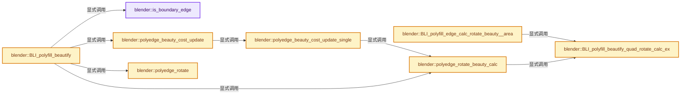
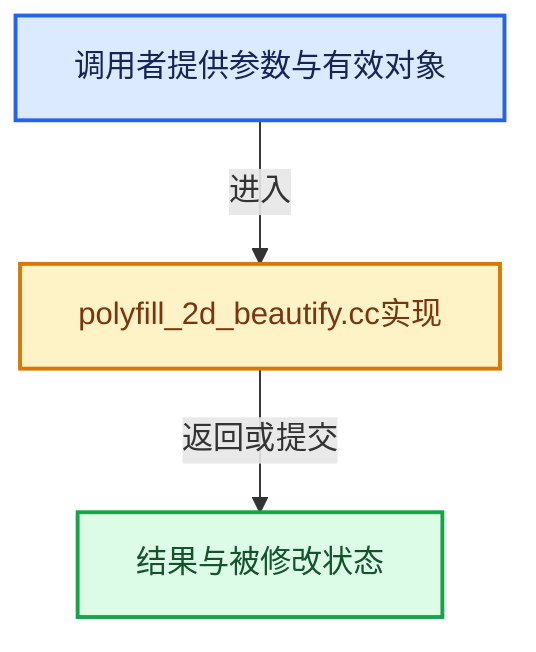

# 实现依赖专题：source/blender/blenlib/intern/polyfill_2d_beautify.cc

[实现依赖导航](../../README.md) · [符号索引](../../../00-课程指南/02-源码与提交索引/符号依赖与实现索引.md)

本专题从正文实际调用进入，集中保存共享实现。函数有稳定锚点，可从调用处直接跳到对应完整函数；递归与互相调用通过回链组织。

## 本文件的实现关系






## 完整成员与函数实现

<a id="f-23e7fcdd1cfd33ee"></a>

### `blender::is_boundary_edge`

实现位置：[source/blender/blenlib/intern/polyfill_2d_beautify.cc](../../../../../../../source/blender/blenlib/intern/polyfill_2d_beautify.cc) · L83—L87。

接口参数：

- `uint i_a`
- `uint i_b`
- `const uint coord_last`

**教学注释版**

<!-- annotated:2258d06f5772e2 -->

```cpp
BLI_INLINE bool is_boundary_edge(uint i_a, uint i_b, const uint coord_last)
{
  BLI_assert(i_a < i_b);
  return ((i_a + 1 == i_b) || UNLIKELY((i_a == 0) && (i_b == coord_last)));
}
```

<details>
<summary>核对原始源码：source/blender/blenlib/intern/polyfill_2d_beautify.cc · L83—L87</summary>

<!-- original:2258d06f5772e2:source/blender/blenlib/intern/polyfill_2d_beautify.cc:83:87 -->

```cpp
BLI_INLINE bool is_boundary_edge(uint i_a, uint i_b, const uint coord_last)
{
  BLI_assert(i_a < i_b);
  return ((i_a + 1 == i_b) || UNLIKELY((i_a == 0) && (i_b == coord_last)));
}
```

</details>

**结果出口**

- `return ((i_a + 1 == i_b) || UNLIKELY((i_a == 0) && (i_b == coord_last)));`

**继续追踪实现**

- `BLI_assert` → [BLI_assert · L48](../BLI_assert.hh.md#m-57a88495704d)；[BLI_assert · L63](../BLI_assert.hh.md#m-d07050020cb5)。宏定义由构建条件选择。
- `UNLIKELY` → [UNLIKELY · L52](../../07-Intern运行时与平台/guardedalloc/intern/mallocn_intern.hh.md#m-b66d81651173)；[UNLIKELY · L55](../../07-Intern运行时与平台/guardedalloc/intern/mallocn_intern.hh.md#m-43069123e9fe)；[UNLIKELY · L108](../../07-Intern运行时与平台/cycles/util/defines.h.md#m-c50729f638e8)；[UNLIKELY · L111](../../07-Intern运行时与平台/cycles/util/defines.h.md#m-08e633831622)；[UNLIKELY · L25](math_base_inline.cc.md#m-beab6e34c61e)；[UNLIKELY · L27](math_base_inline.cc.md#m-9b279ffdd95b)；[UNLIKELY · L544](../BLI_utildefines.hh.md#m-74644b8209a0)；[UNLIKELY · L547](../BLI_utildefines.hh.md#m-3a47ebab6298)。宏定义由构建条件选择。

<a id="f-ab4be2d68aabacd1"></a>

### `blender::BLI_polyfill_beautify_quad_rotate_calc_ex`

实现位置：[source/blender/blenlib/intern/polyfill_2d_beautify.cc](../../../../../../../source/blender/blenlib/intern/polyfill_2d_beautify.cc) · L88—L180。

接口参数：

- `const float v1[2]`
- `const float v2[2]`
- `const float v3[2]`
- `const float v4[2]`
- `const bool lock_degenerate`
- `float *r_area`

**教学注释版**

<!-- annotated:c41d155f166aab -->

```cpp
float BLI_polyfill_beautify_quad_rotate_calc_ex(const float v1[2],
                                                const float v2[2],
                                                const float v3[2],
                                                const float v4[2],
                                                const bool lock_degenerate,
                                                float *r_area)
{
  /* not a loop (only to be able to break out) */
  do {
    /* Allow very small faces to be considered non-zero. */
    const float eps_zero_area = 1e-12f;
    const float area_2x_234 = cross_tri_v2(v2, v3, v4);
    const float area_2x_241 = cross_tri_v2(v2, v4, v1);

    const float area_2x_123 = cross_tri_v2(v1, v2, v3);
    const float area_2x_134 = cross_tri_v2(v1, v3, v4);

    BLI_assert((ELEM(v1, v2, v3, v4) == false) && (ELEM(v2, v1, v3, v4) == false) &&
               (ELEM(v3, v1, v2, v4) == false) && (ELEM(v4, v1, v2, v3) == false));

    if (r_area) {
      *r_area = (fabsf(area_2x_234) + fabsf(area_2x_241) +
                 /* Include both pairs for predictable results. */
                 fabsf(area_2x_123) + fabsf(area_2x_134)) /
                8.0f;
    }

    /*
     * Test for unusable (1-3) state.
     * - Area sign flipping to check faces aren't going to point in opposite directions.
     * - Area epsilon check that the one of the faces won't be zero area.
     */
    if ((area_2x_123 >= 0.0f) != (area_2x_134 >= 0.0f)) {
      break;
    }
    if ((fabsf(area_2x_123) <= eps_zero_area) || (fabsf(area_2x_134) <= eps_zero_area)) {
      break;
    }

    /* Test for unusable (2-4) state (same as above). */
    if ((area_2x_234 >= 0.0f) != (area_2x_241 >= 0.0f)) {
      if (lock_degenerate) {
        break;
      }

      return -FLT_MAX; /* always rotate */
    }
    if ((fabsf(area_2x_234) <= eps_zero_area) || (fabsf(area_2x_241) <= eps_zero_area)) {
      return -FLT_MAX; /* always rotate */
    }

    {
      /* testing rule: the area divided by the perimeter,
       * check if (1-3) beats the existing (2-4) edge rotation */
      float area_a, area_b;
      float prim_a, prim_b;
      float fac_24, fac_13;

      float len_12, len_23, len_34, len_41, len_24, len_13;

      /* edges around the quad */
      len_12 = len_v2v2(v1, v2);
      len_23 = len_v2v2(v2, v3);
      len_34 = len_v2v2(v3, v4);
      len_41 = len_v2v2(v4, v1);
      /* edges crossing the quad interior */
      len_13 = len_v2v2(v1, v3);
      len_24 = len_v2v2(v2, v4);

      /* NOTE: area is in fact (area * 2),
       * but in this case its OK, since we're comparing ratios */

      /* edge (2-4), current state */
      area_a = fabsf(area_2x_234);
      area_b = fabsf(area_2x_241);
      prim_a = len_23 + len_34 + len_24;
      prim_b = len_41 + len_12 + len_24;
      fac_24 = (area_a / prim_a) + (area_b / prim_b);

      /* edge (1-3), new state */
      area_a = fabsf(area_2x_123);
      area_b = fabsf(area_2x_134);
      prim_a = len_12 + len_23 + len_13;
      prim_b = len_34 + len_41 + len_13;
      fac_13 = (area_a / prim_a) + (area_b / prim_b);

      /* negative number if (1-3) is an improved state */
      return fac_24 - fac_13;
    }
  } while (false);

  return FLT_MAX;
}
```

<details>
<summary>核对原始源码：source/blender/blenlib/intern/polyfill_2d_beautify.cc · L88—L180</summary>

<!-- original:c41d155f166aab:source/blender/blenlib/intern/polyfill_2d_beautify.cc:88:180 -->

```cpp
float BLI_polyfill_beautify_quad_rotate_calc_ex(const float v1[2],
                                                const float v2[2],
                                                const float v3[2],
                                                const float v4[2],
                                                const bool lock_degenerate,
                                                float *r_area)
{
  /* not a loop (only to be able to break out) */
  do {
    /* Allow very small faces to be considered non-zero. */
    const float eps_zero_area = 1e-12f;
    const float area_2x_234 = cross_tri_v2(v2, v3, v4);
    const float area_2x_241 = cross_tri_v2(v2, v4, v1);

    const float area_2x_123 = cross_tri_v2(v1, v2, v3);
    const float area_2x_134 = cross_tri_v2(v1, v3, v4);

    BLI_assert((ELEM(v1, v2, v3, v4) == false) && (ELEM(v2, v1, v3, v4) == false) &&
               (ELEM(v3, v1, v2, v4) == false) && (ELEM(v4, v1, v2, v3) == false));

    if (r_area) {
      *r_area = (fabsf(area_2x_234) + fabsf(area_2x_241) +
                 /* Include both pairs for predictable results. */
                 fabsf(area_2x_123) + fabsf(area_2x_134)) /
                8.0f;
    }

    /*
     * Test for unusable (1-3) state.
     * - Area sign flipping to check faces aren't going to point in opposite directions.
     * - Area epsilon check that the one of the faces won't be zero area.
     */
    if ((area_2x_123 >= 0.0f) != (area_2x_134 >= 0.0f)) {
      break;
    }
    if ((fabsf(area_2x_123) <= eps_zero_area) || (fabsf(area_2x_134) <= eps_zero_area)) {
      break;
    }

    /* Test for unusable (2-4) state (same as above). */
    if ((area_2x_234 >= 0.0f) != (area_2x_241 >= 0.0f)) {
      if (lock_degenerate) {
        break;
      }

      return -FLT_MAX; /* always rotate */
    }
    if ((fabsf(area_2x_234) <= eps_zero_area) || (fabsf(area_2x_241) <= eps_zero_area)) {
      return -FLT_MAX; /* always rotate */
    }

    {
      /* testing rule: the area divided by the perimeter,
       * check if (1-3) beats the existing (2-4) edge rotation */
      float area_a, area_b;
      float prim_a, prim_b;
      float fac_24, fac_13;

      float len_12, len_23, len_34, len_41, len_24, len_13;

      /* edges around the quad */
      len_12 = len_v2v2(v1, v2);
      len_23 = len_v2v2(v2, v3);
      len_34 = len_v2v2(v3, v4);
      len_41 = len_v2v2(v4, v1);
      /* edges crossing the quad interior */
      len_13 = len_v2v2(v1, v3);
      len_24 = len_v2v2(v2, v4);

      /* NOTE: area is in fact (area * 2),
       * but in this case its OK, since we're comparing ratios */

      /* edge (2-4), current state */
      area_a = fabsf(area_2x_234);
      area_b = fabsf(area_2x_241);
      prim_a = len_23 + len_34 + len_24;
      prim_b = len_41 + len_12 + len_24;
      fac_24 = (area_a / prim_a) + (area_b / prim_b);

      /* edge (1-3), new state */
      area_a = fabsf(area_2x_123);
      area_b = fabsf(area_2x_134);
      prim_a = len_12 + len_23 + len_13;
      prim_b = len_34 + len_41 + len_13;
      fac_13 = (area_a / prim_a) + (area_b / prim_b);

      /* negative number if (1-3) is an improved state */
      return fac_24 - fac_13;
    }
  } while (false);

  return FLT_MAX;
}
```

</details>

**沿实际写入检查状态**

- `len_12 = len_v2v2(v1, v2);`
- `len_23 = len_v2v2(v2, v3);`
- `len_34 = len_v2v2(v3, v4);`
- `len_41 = len_v2v2(v4, v1);`
- `len_13 = len_v2v2(v1, v3);`
- `len_24 = len_v2v2(v2, v4);`
- `area_a = fabsf(area_2x_234);`
- `area_b = fabsf(area_2x_241);`
- `prim_a = len_23 + len_34 + len_24;`
- `prim_b = len_41 + len_12 + len_24;`
- `fac_24 = (area_a / prim_a) + (area_b / prim_b);`
- `area_a = fabsf(area_2x_123);`
- `area_b = fabsf(area_2x_134);`
- `prim_a = len_12 + len_23 + len_13;`
- `prim_b = len_34 + len_41 + len_13;`
- `fac_13 = (area_a / prim_a) + (area_b / prim_b);`

**结果出口**

- `return -FLT_MAX; /* always rotate */`
- `return fac_24 - fac_13;`
- `return FLT_MAX;`

**继续追踪实现**

- `cross_tri_v2` → [blender::cross_tri_v2 · L24](math_geom_inline.cc.md#f-fcd2bb2eeabb870e)。
- `BLI_assert` → [BLI_assert · L48](../BLI_assert.hh.md#m-57a88495704d)；[BLI_assert · L63](../BLI_assert.hh.md#m-d07050020cb5)。宏定义由构建条件选择。
- `ELEM` → [ELEM · L88](../../07-Intern运行时与平台/ghost/intern/GHOST_utildefines.hh.md#m-d28724a15928)；[ELEM · L135](../BLI_utildefines.hh.md#m-d6572de7cae0)。宏定义由构建条件选择。
- `fabsf` → [fabsf · L21](../../07-Intern运行时与平台/cycles/kernel/svm/radial_tiling_shared.h.md#m-02cc4c69cfb3)；[fabsf · L43](../../07-Intern运行时与平台/cycles/kernel/svm/radial_tiling_shared.h.md#m-04effe61803b)；[fabsf · L74](../../07-Intern运行时与平台/cycles/kernel/svm/radial_tiling_shared.h.md#m-927dd4eba7dc)；[fabsf · L25](radial_tiling_shared.hh.md#m-8348d6b3d08f)；[fabsf · L47](radial_tiling_shared.hh.md#m-13b7e0b6d84f)；[fabsf · L78](radial_tiling_shared.hh.md#m-326c83464a0d)；[fabsf · L21](../../07-Intern运行时与平台/cycles/kernel/osl/shaders/node_radial_tiling_shared.h.md#m-7c3ee12fc119)；[fabsf · L43](../../07-Intern运行时与平台/cycles/kernel/osl/shaders/node_radial_tiling_shared.h.md#m-9112db0e2dd1)；[fabsf · L74](../../07-Intern运行时与平台/cycles/kernel/osl/shaders/node_radial_tiling_shared.h.md#m-ee4e61908a6f)；[fabsf · L167](../../07-Intern运行时与平台/cycles/kernel/device/oneapi/compat.h.md#m-b039ee6c1601)；[fabsf · L265](../../07-Intern运行时与平台/cycles/kernel/device/metal/compat.h.md#m-6b21869e9f3f)。宏定义由构建条件选择。
- `len_v2v2` → [blender::len_v2v2 · L754](math_vector_inline.cc.md#f-e133b1d4b907e65b)。

<a id="f-4ca59348ff5a1727"></a>

### `blender::BLI_polyfill_edge_calc_rotate_beauty__area`

实现位置：[source/blender/blenlib/intern/polyfill_2d_beautify.cc](../../../../../../../source/blender/blenlib/intern/polyfill_2d_beautify.cc) · L182—L250。

接口参数：

- `const float v1[3]`
- `const float v2[3]`
- `const float v3[3]`
- `const float v4[3]`
- `const bool lock_degenerate`

**教学注释版**

<!-- annotated:ca7af4d02762a3 -->

```cpp
float BLI_polyfill_edge_calc_rotate_beauty__area(const float v1[3],
                                                 const float v2[3],
                                                 const float v3[3],
                                                 const float v4[3],
                                                 const bool lock_degenerate)
{
  /* not a loop (only to be able to break out) */
  do {
    float v1_xy[2], v2_xy[2], v3_xy[2], v4_xy[2];

    /* first get the 2d values */
    {
      const float eps = 1e-5f;
      float no_a[3], no_b[3];
      float no[3];
      float axis_mat[3][3];
      float no_scale;
      cross_tri_v3(no_a, v2, v3, v4);
      cross_tri_v3(no_b, v2, v4, v1);

      // printf("%p %p %p %p - %p %p\n", v1, v2, v3, v4, e->l->f, e->l->radial_next->f);
      BLI_assert((ELEM(v1, v2, v3, v4) == false) && (ELEM(v2, v1, v3, v4) == false) &&
                 (ELEM(v3, v1, v2, v4) == false) && (ELEM(v4, v1, v2, v3) == false));

      add_v3_v3v3(no, no_a, no_b);
      if ((no_scale = normalize_v3(no)) == 0.0f) [[unlikely]] {
        break;
      }

      axis_dominant_v3_to_m3(axis_mat, no);
      mul_v2_m3v3(v1_xy, axis_mat, v1);
      mul_v2_m3v3(v2_xy, axis_mat, v2);
      mul_v2_m3v3(v3_xy, axis_mat, v3);
      mul_v2_m3v3(v4_xy, axis_mat, v4);

      /**
       * Check if input faces are already flipped.
       * Logic for 'signum_i' addition is:
       *
       * Accept:
       * - (1, 1) or (-1, -1): same side (common case).
       * - (-1/1, 0): one degenerate, OK since we may rotate into a valid state.
       *
       * Ignore:
       * - (-1, 1): opposite winding, ignore.
       * - ( 0, 0): both degenerate, ignore.
       *
       * \note The cross product is divided by 'no_scale'
       * so the rotation calculation is scale independent.
       */
      if (!(signum_i_ex(cross_tri_v2(v2_xy, v3_xy, v4_xy) / no_scale, eps) +
            signum_i_ex(cross_tri_v2(v2_xy, v4_xy, v1_xy) / no_scale, eps)))
      {
        break;
      }
    }

    /**
     * Important to lock degenerate here,
     * since the triangle pars will be projected into different 2D spaces.
     * Allowing to rotate out of a degenerate state can flip the faces
     * (when performed iteratively).
     */
    return BLI_polyfill_beautify_quad_rotate_calc_ex(
        v1_xy, v2_xy, v3_xy, v4_xy, lock_degenerate, nullptr);
  } while (false);

  return FLT_MAX;
}
```

<details>
<summary>核对原始源码：source/blender/blenlib/intern/polyfill_2d_beautify.cc · L182—L250</summary>

<!-- original:ca7af4d02762a3:source/blender/blenlib/intern/polyfill_2d_beautify.cc:182:250 -->

```cpp
float BLI_polyfill_edge_calc_rotate_beauty__area(const float v1[3],
                                                 const float v2[3],
                                                 const float v3[3],
                                                 const float v4[3],
                                                 const bool lock_degenerate)
{
  /* not a loop (only to be able to break out) */
  do {
    float v1_xy[2], v2_xy[2], v3_xy[2], v4_xy[2];

    /* first get the 2d values */
    {
      const float eps = 1e-5f;
      float no_a[3], no_b[3];
      float no[3];
      float axis_mat[3][3];
      float no_scale;
      cross_tri_v3(no_a, v2, v3, v4);
      cross_tri_v3(no_b, v2, v4, v1);

      // printf("%p %p %p %p - %p %p\n", v1, v2, v3, v4, e->l->f, e->l->radial_next->f);
      BLI_assert((ELEM(v1, v2, v3, v4) == false) && (ELEM(v2, v1, v3, v4) == false) &&
                 (ELEM(v3, v1, v2, v4) == false) && (ELEM(v4, v1, v2, v3) == false));

      add_v3_v3v3(no, no_a, no_b);
      if ((no_scale = normalize_v3(no)) == 0.0f) [[unlikely]] {
        break;
      }

      axis_dominant_v3_to_m3(axis_mat, no);
      mul_v2_m3v3(v1_xy, axis_mat, v1);
      mul_v2_m3v3(v2_xy, axis_mat, v2);
      mul_v2_m3v3(v3_xy, axis_mat, v3);
      mul_v2_m3v3(v4_xy, axis_mat, v4);

      /**
       * Check if input faces are already flipped.
       * Logic for 'signum_i' addition is:
       *
       * Accept:
       * - (1, 1) or (-1, -1): same side (common case).
       * - (-1/1, 0): one degenerate, OK since we may rotate into a valid state.
       *
       * Ignore:
       * - (-1, 1): opposite winding, ignore.
       * - ( 0, 0): both degenerate, ignore.
       *
       * \note The cross product is divided by 'no_scale'
       * so the rotation calculation is scale independent.
       */
      if (!(signum_i_ex(cross_tri_v2(v2_xy, v3_xy, v4_xy) / no_scale, eps) +
            signum_i_ex(cross_tri_v2(v2_xy, v4_xy, v1_xy) / no_scale, eps)))
      {
        break;
      }
    }

    /**
     * Important to lock degenerate here,
     * since the triangle pars will be projected into different 2D spaces.
     * Allowing to rotate out of a degenerate state can flip the faces
     * (when performed iteratively).
     */
    return BLI_polyfill_beautify_quad_rotate_calc_ex(
        v1_xy, v2_xy, v3_xy, v4_xy, lock_degenerate, nullptr);
  } while (false);

  return FLT_MAX;
}
```

</details>

**结果出口**

- `return BLI_polyfill_beautify_quad_rotate_calc_ex(`
- `return FLT_MAX;`

**继续追踪实现**

- `cross_tri_v3` → [blender::cross_tri_v3 · L30](math_geom.cc.md#f-c6ea7f9c0e64c80d)。
- `BLI_assert` → [BLI_assert · L48](../BLI_assert.hh.md#m-57a88495704d)；[BLI_assert · L63](../BLI_assert.hh.md#m-d07050020cb5)。宏定义由构建条件选择。
- `ELEM` → [ELEM · L88](../../07-Intern运行时与平台/ghost/intern/GHOST_utildefines.hh.md#m-d28724a15928)；[ELEM · L135](../BLI_utildefines.hh.md#m-d6572de7cae0)。宏定义由构建条件选择。
- `add_v3_v3v3` → [blender::add_v3_v3v3 · L300](math_vector_inline.cc.md#f-7343b459d0d3db69)。
- `normalize_v3` → [blender::normalize_v3 · L933](math_vector_inline.cc.md#f-5f3257e657ef732c)。
- `axis_dominant_v3_to_m3` → [blender::axis_dominant_v3_to_m3 · L3702](math_geom.cc.md#f-3e28943552d479d7)。
- `mul_v2_m3v3` → [blender::mul_v2_m3v3 · L844](math_matrix_c.cc.md#f-2550a487d003ca6b)。
- `signum_i_ex` → [blender::signum_i_ex · L541](math_base_inline.cc.md#f-e7ba7f1755670349)。
- `cross_tri_v2` → [blender::cross_tri_v2 · L24](math_geom_inline.cc.md#f-fcd2bb2eeabb870e)。
- `BLI_polyfill_beautify_quad_rotate_calc_ex` → [blender::BLI_polyfill_beautify_quad_rotate_calc_ex · L88](polyfill_2d_beautify.cc.md#f-ab4be2d68aabacd1)。

<a id="f-3dea720992fb3a8f"></a>

### `blender::polyedge_rotate_beauty_calc`

实现位置：[source/blender/blenlib/intern/polyfill_2d_beautify.cc](../../../../../../../source/blender/blenlib/intern/polyfill_2d_beautify.cc) · L252—L270。

接口参数：

- `const float (*coords)[2]`
- `const HalfEdge *edges`
- `const HalfEdge *e_a`
- `float *r_area`

**教学注释版**

<!-- annotated:805097c1678002 -->

```cpp
static float polyedge_rotate_beauty_calc(const float (*coords)[2],
                                         const HalfEdge *edges,
                                         const HalfEdge *e_a,
                                         float *r_area)
{
  const HalfEdge *e_b = &edges[e_a->e_radial];

  const HalfEdge *e_a_other = &edges[edges[e_a->e_next].e_next];
  const HalfEdge *e_b_other = &edges[edges[e_b->e_next].e_next];

  const float *v1, *v2, *v3, *v4;

  v1 = coords[e_a_other->v];
  v2 = coords[e_a->v];
  v3 = coords[e_b_other->v];
  v4 = coords[e_b->v];

  return BLI_polyfill_beautify_quad_rotate_calc_ex(v1, v2, v3, v4, false, r_area);
}
```

<details>
<summary>核对原始源码：source/blender/blenlib/intern/polyfill_2d_beautify.cc · L252—L270</summary>

<!-- original:805097c1678002:source/blender/blenlib/intern/polyfill_2d_beautify.cc:252:270 -->

```cpp
static float polyedge_rotate_beauty_calc(const float (*coords)[2],
                                         const HalfEdge *edges,
                                         const HalfEdge *e_a,
                                         float *r_area)
{
  const HalfEdge *e_b = &edges[e_a->e_radial];

  const HalfEdge *e_a_other = &edges[edges[e_a->e_next].e_next];
  const HalfEdge *e_b_other = &edges[edges[e_b->e_next].e_next];

  const float *v1, *v2, *v3, *v4;

  v1 = coords[e_a_other->v];
  v2 = coords[e_a->v];
  v3 = coords[e_b_other->v];
  v4 = coords[e_b->v];

  return BLI_polyfill_beautify_quad_rotate_calc_ex(v1, v2, v3, v4, false, r_area);
}
```

</details>

**沿实际写入检查状态**

- `v1 = coords[e_a_other->v];`
- `v2 = coords[e_a->v];`
- `v3 = coords[e_b_other->v];`
- `v4 = coords[e_b->v];`

**结果出口**

- `return BLI_polyfill_beautify_quad_rotate_calc_ex(v1, v2, v3, v4, false, r_area);`

**继续追踪实现**

- `BLI_polyfill_beautify_quad_rotate_calc_ex` → [blender::BLI_polyfill_beautify_quad_rotate_calc_ex · L88](polyfill_2d_beautify.cc.md#f-ab4be2d68aabacd1)。

<a id="f-6de1b5d45319704a"></a>

### `blender::polyedge_beauty_cost_update_single`

实现位置：[source/blender/blenlib/intern/polyfill_2d_beautify.cc](../../../../../../../source/blender/blenlib/intern/polyfill_2d_beautify.cc) · L272—L300。

接口参数：

- `const float (*coords)[2]`
- `const HalfEdge *edges`
- `HalfEdge *e`
- `Heap *eheap`
- `HeapNode **eheap_table`

**教学注释版**

<!-- annotated:10540ca251b1db -->

```cpp
static void polyedge_beauty_cost_update_single(const float (*coords)[2],
                                               const HalfEdge *edges,
                                               HalfEdge *e,
                                               Heap *eheap,
                                               HeapNode **eheap_table)
{
  const uint i = e->base_index;
  /* recalculate edge */
  float area;
  const float cost = polyedge_rotate_beauty_calc(coords, edges, e, &area);
  /* We can get cases where both choices generate very small negative costs,
   * which leads to infinite loop. Anyway, costs above that are not worth recomputing,
   * maybe we could even optimize it to a smaller limit?
   * Actually, FLT_EPSILON is too small in some cases, 1e-6f seems to work OK hopefully?
   * See #43578, #49478.
   *
   * In fact a larger epsilon can still fail when the area of the face is very large,
   * now the epsilon is scaled by the face area.
   * See #56532. */
  if (cost < -1e-6f * max_ff(area, 1.0f)) {
    BLI_heap_insert_or_update(eheap, &eheap_table[i], cost, e);
  }
  else {
    if (eheap_table[i]) {
      BLI_heap_remove(eheap, eheap_table[i]);
      eheap_table[i] = nullptr;
    }
  }
}
```

<details>
<summary>核对原始源码：source/blender/blenlib/intern/polyfill_2d_beautify.cc · L272—L300</summary>

<!-- original:10540ca251b1db:source/blender/blenlib/intern/polyfill_2d_beautify.cc:272:300 -->

```cpp
static void polyedge_beauty_cost_update_single(const float (*coords)[2],
                                               const HalfEdge *edges,
                                               HalfEdge *e,
                                               Heap *eheap,
                                               HeapNode **eheap_table)
{
  const uint i = e->base_index;
  /* recalculate edge */
  float area;
  const float cost = polyedge_rotate_beauty_calc(coords, edges, e, &area);
  /* We can get cases where both choices generate very small negative costs,
   * which leads to infinite loop. Anyway, costs above that are not worth recomputing,
   * maybe we could even optimize it to a smaller limit?
   * Actually, FLT_EPSILON is too small in some cases, 1e-6f seems to work OK hopefully?
   * See #43578, #49478.
   *
   * In fact a larger epsilon can still fail when the area of the face is very large,
   * now the epsilon is scaled by the face area.
   * See #56532. */
  if (cost < -1e-6f * max_ff(area, 1.0f)) {
    BLI_heap_insert_or_update(eheap, &eheap_table[i], cost, e);
  }
  else {
    if (eheap_table[i]) {
      BLI_heap_remove(eheap, eheap_table[i]);
      eheap_table[i] = nullptr;
    }
  }
}
```

</details>

**沿实际写入检查状态**

- `eheap_table[i] = nullptr;`

**继续追踪实现**

- `polyedge_rotate_beauty_calc` → [blender::polyedge_rotate_beauty_calc · L252](polyfill_2d_beautify.cc.md#f-3dea720992fb3a8f)。
- `max_ff` → [blender::max_ff · L325](math_base_inline.cc.md#f-05a351a3afd7dc2a)。
- `BLI_heap_insert_or_update` → [blender::BLI_heap_insert_or_update · L261](BLI_heap.cc.md#f-23bdfc00946eb15b)。
- `BLI_heap_remove` → [blender::BLI_heap_remove · L309](BLI_heap.cc.md#f-73577ad583f99473)。

<a id="f-76633745eb400382"></a>

### `blender::polyedge_beauty_cost_update`

实现位置：[source/blender/blenlib/intern/polyfill_2d_beautify.cc](../../../../../../../source/blender/blenlib/intern/polyfill_2d_beautify.cc) · L302—L318。

接口参数：

- `const float (*coords)[2]`
- `HalfEdge *edges`
- `HalfEdge *e`
- `Heap *eheap`
- `HeapNode **eheap_table`

**教学注释版**

<!-- annotated:a84dd501c7ad8b -->

```cpp
static void polyedge_beauty_cost_update(
    const float (*coords)[2], HalfEdge *edges, HalfEdge *e, Heap *eheap, HeapNode **eheap_table)
{
  HalfEdge *e_arr[4];
  e_arr[0] = &edges[e->e_next];
  e_arr[1] = &edges[e_arr[0]->e_next];

  e = &edges[e->e_radial];
  e_arr[2] = &edges[e->e_next];
  e_arr[3] = &edges[e_arr[2]->e_next];

  for (uint i = 0; i < 4; i++) {
    if (e_arr[i] && e_arr[i]->base_index != UINT_MAX) {
      polyedge_beauty_cost_update_single(coords, edges, e_arr[i], eheap, eheap_table);
    }
  }
}
```

<details>
<summary>核对原始源码：source/blender/blenlib/intern/polyfill_2d_beautify.cc · L302—L318</summary>

<!-- original:a84dd501c7ad8b:source/blender/blenlib/intern/polyfill_2d_beautify.cc:302:318 -->

```cpp
static void polyedge_beauty_cost_update(
    const float (*coords)[2], HalfEdge *edges, HalfEdge *e, Heap *eheap, HeapNode **eheap_table)
{
  HalfEdge *e_arr[4];
  e_arr[0] = &edges[e->e_next];
  e_arr[1] = &edges[e_arr[0]->e_next];

  e = &edges[e->e_radial];
  e_arr[2] = &edges[e->e_next];
  e_arr[3] = &edges[e_arr[2]->e_next];

  for (uint i = 0; i < 4; i++) {
    if (e_arr[i] && e_arr[i]->base_index != UINT_MAX) {
      polyedge_beauty_cost_update_single(coords, edges, e_arr[i], eheap, eheap_table);
    }
  }
}
```

</details>

**沿实际写入检查状态**

- `e_arr[0] = &edges[e->e_next];`
- `e_arr[1] = &edges[e_arr[0]->e_next];`
- `e = &edges[e->e_radial];`
- `e_arr[2] = &edges[e->e_next];`
- `e_arr[3] = &edges[e_arr[2]->e_next];`

**继续追踪实现**

- `polyedge_beauty_cost_update_single` → [blender::polyedge_beauty_cost_update_single · L272](polyfill_2d_beautify.cc.md#f-6de1b5d45319704a)。

<a id="f-6b03f3c81556f0ef"></a>

### `blender::polyedge_rotate`

实现位置：[source/blender/blenlib/intern/polyfill_2d_beautify.cc](../../../../../../../source/blender/blenlib/intern/polyfill_2d_beautify.cc) · L320—L364。

接口参数：

- `HalfEdge *edges`
- `const HalfEdge *e`

**教学注释版**

<!-- annotated:bcde5f49666003 -->

```cpp
static void polyedge_rotate(HalfEdge *edges, const HalfEdge *e)
{
  /**
   * CCW winding, rotate internal edge to new vertical state.
   *
   * \code{.unparsed}
   *   Before         After
   *      X             X
   *     / \           /|\
   *  e4/   \e5     e4/ | \e5
   *   / e3  \       /  |  \
   * X ------- X -> X e0|e3 X
   *   \ e0  /       \  |  /
   *  e2\   /e1     e2\ | /e1
   *     \ /           \|/
   *      X             X
   * \endcode
   */
  HalfEdge *ed[6];
  uint ed_index[6];

  ed_index[0] = uint(e - edges);
  ed[0] = &edges[ed_index[0]];
  ed_index[1] = ed[0]->e_next;
  ed[1] = &edges[ed_index[1]];
  ed_index[2] = ed[1]->e_next;
  ed[2] = &edges[ed_index[2]];

  ed_index[3] = e->e_radial;
  ed[3] = &edges[ed_index[3]];
  ed_index[4] = ed[3]->e_next;
  ed[4] = &edges[ed_index[4]];
  ed_index[5] = ed[4]->e_next;
  ed[5] = &edges[ed_index[5]];

  ed[0]->e_next = ed_index[2];
  ed[1]->e_next = ed_index[3];
  ed[2]->e_next = ed_index[4];
  ed[3]->e_next = ed_index[5];
  ed[4]->e_next = ed_index[0];
  ed[5]->e_next = ed_index[1];

  ed[0]->v = ed[5]->v;
  ed[3]->v = ed[2]->v;
}
```

<details>
<summary>核对原始源码：source/blender/blenlib/intern/polyfill_2d_beautify.cc · L320—L364</summary>

<!-- original:bcde5f49666003:source/blender/blenlib/intern/polyfill_2d_beautify.cc:320:364 -->

```cpp
static void polyedge_rotate(HalfEdge *edges, const HalfEdge *e)
{
  /**
   * CCW winding, rotate internal edge to new vertical state.
   *
   * \code{.unparsed}
   *   Before         After
   *      X             X
   *     / \           /|\
   *  e4/   \e5     e4/ | \e5
   *   / e3  \       /  |  \
   * X ------- X -> X e0|e3 X
   *   \ e0  /       \  |  /
   *  e2\   /e1     e2\ | /e1
   *     \ /           \|/
   *      X             X
   * \endcode
   */
  HalfEdge *ed[6];
  uint ed_index[6];

  ed_index[0] = uint(e - edges);
  ed[0] = &edges[ed_index[0]];
  ed_index[1] = ed[0]->e_next;
  ed[1] = &edges[ed_index[1]];
  ed_index[2] = ed[1]->e_next;
  ed[2] = &edges[ed_index[2]];

  ed_index[3] = e->e_radial;
  ed[3] = &edges[ed_index[3]];
  ed_index[4] = ed[3]->e_next;
  ed[4] = &edges[ed_index[4]];
  ed_index[5] = ed[4]->e_next;
  ed[5] = &edges[ed_index[5]];

  ed[0]->e_next = ed_index[2];
  ed[1]->e_next = ed_index[3];
  ed[2]->e_next = ed_index[4];
  ed[3]->e_next = ed_index[5];
  ed[4]->e_next = ed_index[0];
  ed[5]->e_next = ed_index[1];

  ed[0]->v = ed[5]->v;
  ed[3]->v = ed[2]->v;
}
```

</details>

**沿实际写入检查状态**

- `ed_index[0] = uint(e - edges);`
- `ed[0] = &edges[ed_index[0]];`
- `ed_index[1] = ed[0]->e_next;`
- `ed[1] = &edges[ed_index[1]];`
- `ed_index[2] = ed[1]->e_next;`
- `ed[2] = &edges[ed_index[2]];`
- `ed_index[3] = e->e_radial;`
- `ed[3] = &edges[ed_index[3]];`
- `ed_index[4] = ed[3]->e_next;`
- `ed[4] = &edges[ed_index[4]];`
- `ed_index[5] = ed[4]->e_next;`
- `ed[5] = &edges[ed_index[5]];`
- `ed[0]->e_next = ed_index[2];`
- `ed[1]->e_next = ed_index[3];`
- `ed[2]->e_next = ed_index[4];`
- `ed[3]->e_next = ed_index[5];`
- `ed[4]->e_next = ed_index[0];`
- `ed[5]->e_next = ed_index[1];`
- `ed[0]->v = ed[5]->v;`
- `ed[3]->v = ed[2]->v;`

**继续追踪实现**

本实现没有需要继续展开的显式调用；检查返回表达式、对象转换和调用者前置条件。

<a id="f-ac60e49e1ca03e85"></a>

### `blender::BLI_polyfill_beautify`

实现位置：[source/blender/blenlib/intern/polyfill_2d_beautify.cc](../../../../../../../source/blender/blenlib/intern/polyfill_2d_beautify.cc) · L366—L487。

接口参数：

- `const float (*coords)[2]`
- `const uint coords_num`
- `uint (*tris)[3]`
- `MemArena *arena`
- `Heap *eheap`

**教学注释版**

<!-- annotated:af6c5ce6310dd1 -->

```cpp
void BLI_polyfill_beautify(const float (*coords)[2],
                           const uint coords_num,
                           uint (*tris)[3],

                           /* structs for reuse */
                           MemArena *arena,
                           Heap *eheap)
{
  const uint coord_last = coords_num - 1;
  const uint tris_len = coords_num - 2;
  /* internal edges only (between 2 tris) */
  const uint edges_len = tris_len - 1;

  HeapNode **eheap_table;

  const uint half_edges_len = 3 * tris_len;
  HalfEdge *half_edges = static_cast<HalfEdge *>(
      BLI_memarena_alloc(arena, sizeof(*half_edges) * half_edges_len));
  OrderEdge *order_edges = static_cast<OrderEdge *>(
      BLI_memarena_alloc(arena, sizeof(OrderEdge) * 2 * edges_len));
  uint order_edges_len = 0;

  /* first build edges */
  for (uint i = 0; i < tris_len; i++) {
    for (uint j_curr = 0, j_prev = 2; j_curr < 3; j_prev = j_curr++) {
      const uint e_index_prev = (i * 3) + j_prev;
      const uint e_index_curr = (i * 3) + j_curr;

      half_edges[e_index_prev].v = tris[i][j_prev];
      half_edges[e_index_prev].e_next = e_index_curr;
      half_edges[e_index_prev].e_radial = UINT_MAX;
      half_edges[e_index_prev].base_index = UINT_MAX;

      uint e_pair[2] = {tris[i][j_prev], tris[i][j_curr]};
      if (e_pair[0] > e_pair[1]) {
        SWAP(uint, e_pair[0], e_pair[1]);
      }

      /* ensure internal edges. */
      if (!is_boundary_edge(e_pair[0], e_pair[1], coord_last)) {
        order_edges[order_edges_len].verts[0] = e_pair[0];
        order_edges[order_edges_len].verts[1] = e_pair[1];
        order_edges[order_edges_len].e_half = e_index_prev;
        order_edges_len += 1;
      }
    }
  }
  BLI_assert(edges_len * 2 == order_edges_len);

  qsort(order_edges, order_edges_len, sizeof(OrderEdge), oedge_cmp);

  for (uint i = 0, base_index = 0; i < order_edges_len; base_index++) {
    const OrderEdge *oe_a = &order_edges[i++];
    const OrderEdge *oe_b = &order_edges[i++];
    BLI_assert(oe_a->verts[0] == oe_b->verts[0] && oe_a->verts[1] == oe_b->verts[1]);
    half_edges[oe_a->e_half].e_radial = oe_b->e_half;
    half_edges[oe_b->e_half].e_radial = oe_a->e_half;
    half_edges[oe_a->e_half].base_index = base_index;
    half_edges[oe_b->e_half].base_index = base_index;
  }
  /* order_edges could be freed now. */

  /* Now perform iterative rotations. */
#if 0
  eheap_table = BLI_memarena_alloc(arena, sizeof(HeapNode *) * size_t(edges_len));
#else
  /* We can re-use this since its big enough. */
  eheap_table = reinterpret_cast<HeapNode **>(order_edges);
  order_edges = nullptr;
#endif

  /* Build heap. */
  {
    HalfEdge *e = half_edges;
    for (uint i = 0; i < half_edges_len; i++, e++) {
      /* Accounts for boundary edged too (UINT_MAX). */
      if (e->e_radial < i) {
        const float cost = polyedge_rotate_beauty_calc(coords, half_edges, e, nullptr);
        if (cost < 0.0f) {
          eheap_table[e->base_index] = BLI_heap_insert(eheap, cost, e);
        }
        else {
          eheap_table[e->base_index] = nullptr;
        }
      }
    }
  }

  while (BLI_heap_is_empty(eheap) == false) {
    HalfEdge *e = static_cast<HalfEdge *>(BLI_heap_pop_min(eheap));
    eheap_table[e->base_index] = nullptr;

    polyedge_rotate(half_edges, e);

    /* recalculate faces connected on the heap */
    polyedge_beauty_cost_update(coords, half_edges, e, eheap, eheap_table);
  }

  BLI_heap_clear(eheap, nullptr);

  // MEM_delete(eheap_table); /* arena */

  /* Get triangles from half edge. */
  uint tri_index = 0;
  for (uint i = 0; i < half_edges_len; i++) {
    HalfEdge *e = &half_edges[i];
    if (e->v != UINT_MAX) {
      uint *tri = tris[tri_index++];

      tri[0] = e->v;
      e->v = UINT_MAX;

      e = &half_edges[e->e_next];
      tri[1] = e->v;
      e->v = UINT_MAX;

      e = &half_edges[e->e_next];
      tri[2] = e->v;
      e->v = UINT_MAX;
    }
  }
}
```

<details>
<summary>核对原始源码：source/blender/blenlib/intern/polyfill_2d_beautify.cc · L366—L487</summary>

<!-- original:af6c5ce6310dd1:source/blender/blenlib/intern/polyfill_2d_beautify.cc:366:487 -->

```cpp
void BLI_polyfill_beautify(const float (*coords)[2],
                           const uint coords_num,
                           uint (*tris)[3],

                           /* structs for reuse */
                           MemArena *arena,
                           Heap *eheap)
{
  const uint coord_last = coords_num - 1;
  const uint tris_len = coords_num - 2;
  /* internal edges only (between 2 tris) */
  const uint edges_len = tris_len - 1;

  HeapNode **eheap_table;

  const uint half_edges_len = 3 * tris_len;
  HalfEdge *half_edges = static_cast<HalfEdge *>(
      BLI_memarena_alloc(arena, sizeof(*half_edges) * half_edges_len));
  OrderEdge *order_edges = static_cast<OrderEdge *>(
      BLI_memarena_alloc(arena, sizeof(OrderEdge) * 2 * edges_len));
  uint order_edges_len = 0;

  /* first build edges */
  for (uint i = 0; i < tris_len; i++) {
    for (uint j_curr = 0, j_prev = 2; j_curr < 3; j_prev = j_curr++) {
      const uint e_index_prev = (i * 3) + j_prev;
      const uint e_index_curr = (i * 3) + j_curr;

      half_edges[e_index_prev].v = tris[i][j_prev];
      half_edges[e_index_prev].e_next = e_index_curr;
      half_edges[e_index_prev].e_radial = UINT_MAX;
      half_edges[e_index_prev].base_index = UINT_MAX;

      uint e_pair[2] = {tris[i][j_prev], tris[i][j_curr]};
      if (e_pair[0] > e_pair[1]) {
        SWAP(uint, e_pair[0], e_pair[1]);
      }

      /* ensure internal edges. */
      if (!is_boundary_edge(e_pair[0], e_pair[1], coord_last)) {
        order_edges[order_edges_len].verts[0] = e_pair[0];
        order_edges[order_edges_len].verts[1] = e_pair[1];
        order_edges[order_edges_len].e_half = e_index_prev;
        order_edges_len += 1;
      }
    }
  }
  BLI_assert(edges_len * 2 == order_edges_len);

  qsort(order_edges, order_edges_len, sizeof(OrderEdge), oedge_cmp);

  for (uint i = 0, base_index = 0; i < order_edges_len; base_index++) {
    const OrderEdge *oe_a = &order_edges[i++];
    const OrderEdge *oe_b = &order_edges[i++];
    BLI_assert(oe_a->verts[0] == oe_b->verts[0] && oe_a->verts[1] == oe_b->verts[1]);
    half_edges[oe_a->e_half].e_radial = oe_b->e_half;
    half_edges[oe_b->e_half].e_radial = oe_a->e_half;
    half_edges[oe_a->e_half].base_index = base_index;
    half_edges[oe_b->e_half].base_index = base_index;
  }
  /* order_edges could be freed now. */

  /* Now perform iterative rotations. */
#if 0
  eheap_table = BLI_memarena_alloc(arena, sizeof(HeapNode *) * size_t(edges_len));
#else
  /* We can re-use this since its big enough. */
  eheap_table = reinterpret_cast<HeapNode **>(order_edges);
  order_edges = nullptr;
#endif

  /* Build heap. */
  {
    HalfEdge *e = half_edges;
    for (uint i = 0; i < half_edges_len; i++, e++) {
      /* Accounts for boundary edged too (UINT_MAX). */
      if (e->e_radial < i) {
        const float cost = polyedge_rotate_beauty_calc(coords, half_edges, e, nullptr);
        if (cost < 0.0f) {
          eheap_table[e->base_index] = BLI_heap_insert(eheap, cost, e);
        }
        else {
          eheap_table[e->base_index] = nullptr;
        }
      }
    }
  }

  while (BLI_heap_is_empty(eheap) == false) {
    HalfEdge *e = static_cast<HalfEdge *>(BLI_heap_pop_min(eheap));
    eheap_table[e->base_index] = nullptr;

    polyedge_rotate(half_edges, e);

    /* recalculate faces connected on the heap */
    polyedge_beauty_cost_update(coords, half_edges, e, eheap, eheap_table);
  }

  BLI_heap_clear(eheap, nullptr);

  // MEM_delete(eheap_table); /* arena */

  /* Get triangles from half edge. */
  uint tri_index = 0;
  for (uint i = 0; i < half_edges_len; i++) {
    HalfEdge *e = &half_edges[i];
    if (e->v != UINT_MAX) {
      uint *tri = tris[tri_index++];

      tri[0] = e->v;
      e->v = UINT_MAX;

      e = &half_edges[e->e_next];
      tri[1] = e->v;
      e->v = UINT_MAX;

      e = &half_edges[e->e_next];
      tri[2] = e->v;
      e->v = UINT_MAX;
    }
  }
}
```

</details>

**沿实际写入检查状态**

- `half_edges[e_index_prev].v = tris[i][j_prev];`
- `half_edges[e_index_prev].e_next = e_index_curr;`
- `half_edges[e_index_prev].e_radial = UINT_MAX;`
- `half_edges[e_index_prev].base_index = UINT_MAX;`
- `order_edges[order_edges_len].verts[0] = e_pair[0];`
- `order_edges[order_edges_len].verts[1] = e_pair[1];`
- `order_edges[order_edges_len].e_half = e_index_prev;`
- `order_edges_len += 1;`
- `half_edges[oe_a->e_half].e_radial = oe_b->e_half;`
- `half_edges[oe_b->e_half].e_radial = oe_a->e_half;`
- `half_edges[oe_a->e_half].base_index = base_index;`
- `half_edges[oe_b->e_half].base_index = base_index;`
- `eheap_table = BLI_memarena_alloc(arena, sizeof(HeapNode *) * size_t(edges_len));`
- `eheap_table = reinterpret_cast<HeapNode **>(order_edges);`
- `order_edges = nullptr;`
- `eheap_table[e->base_index] = BLI_heap_insert(eheap, cost, e);`
- `eheap_table[e->base_index] = nullptr;`
- `tri[0] = e->v;`
- `e->v = UINT_MAX;`
- `e = &half_edges[e->e_next];`
- `tri[1] = e->v;`
- `tri[2] = e->v;`

**继续追踪实现**

- `BLI_memarena_alloc` → [blender::BLI_memarena_alloc · L125](BLI_memarena.cc.md#f-ae79828c3629e134)。
- `SWAP` → [SWAP · L76](hash_md5.cc.md#m-563d890521e7)；[SWAP · L50](../BLI_utildefines.hh.md#m-5df6b380a0ac)。宏定义由构建条件选择。
- `is_boundary_edge` → [blender::is_boundary_edge · L83](polyfill_2d_beautify.cc.md#f-23e7fcdd1cfd33ee)。
- `BLI_assert` → [BLI_assert · L48](../BLI_assert.hh.md#m-57a88495704d)；[BLI_assert · L63](../BLI_assert.hh.md#m-d07050020cb5)。宏定义由构建条件选择。
- `qsort` → [调用协议](../../../00-课程指南/01-路线与规范/模板宏与动态分派协议.md)：函数指针、局部可调用对象或未展开的宏；必须结合调用者环境。调用位置L415。
- `polyedge_rotate_beauty_calc` → [blender::polyedge_rotate_beauty_calc · L252](polyfill_2d_beautify.cc.md#f-3dea720992fb3a8f)。
- `BLI_heap_insert` → [blender::BLI_heap_insert · L236](BLI_heap.cc.md#f-fd05ef9c93ed9d92)。
- `BLI_heap_is_empty` → [blender::BLI_heap_is_empty · L271](BLI_heap.cc.md#f-91631934a9f3b1cc)。
- `BLI_heap_pop_min` → [blender::BLI_heap_pop_min · L293](BLI_heap.cc.md#f-eab86680abd97371)。
- `polyedge_rotate` → [blender::polyedge_rotate · L320](polyfill_2d_beautify.cc.md#f-6b03f3c81556f0ef)。
- `polyedge_beauty_cost_update` → [blender::polyedge_beauty_cost_update · L302](polyfill_2d_beautify.cc.md#f-76633745eb400382)。
- `BLI_heap_clear` → [blender::BLI_heap_clear · L215](BLI_heap.cc.md#f-eb6568190dc1e41d)。
