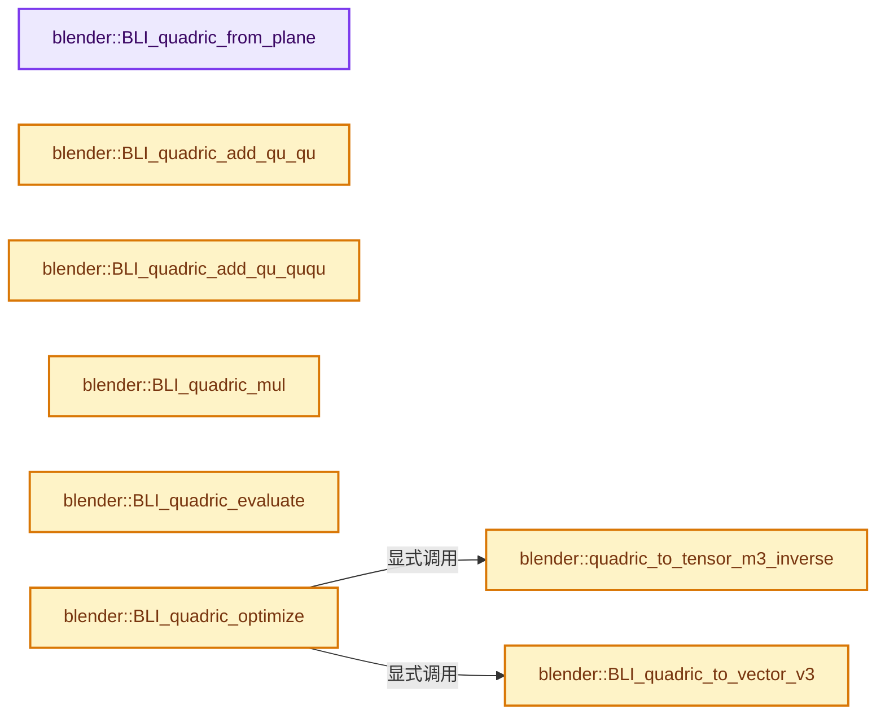
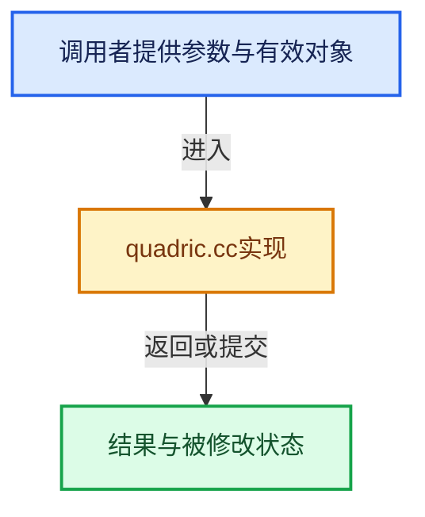

# 实现依赖专题：source/blender/blenlib/intern/quadric.cc

[实现依赖导航](../../README.md) · [符号索引](../../../00-课程指南/02-源码与提交索引/符号依赖与实现索引.md)

本专题从正文实际调用进入，集中保存共享实现。函数有稳定锚点，可从调用处直接跳到对应完整函数；递归与互相调用通过回链组织。

## 本文件的实现关系






## 完整成员与函数实现

<a id="f-b0559a1aaabcc477"></a>

### `blender::BLI_quadric_from_plane`

实现位置：[source/blender/blenlib/intern/quadric.cc](../../../../../../../source/blender/blenlib/intern/quadric.cc) · L33—L48。

接口参数：

- `Quadric *q`
- `const double v[4]`

**教学注释版**

<!-- annotated:484ad47d3b5d65 -->

```cpp
void BLI_quadric_from_plane(Quadric *q, const double v[4])
{
  q->a2 = v[0] * v[0];
  q->b2 = v[1] * v[1];
  q->c2 = v[2] * v[2];

  q->ab = v[0] * v[1];
  q->ac = v[0] * v[2];
  q->bc = v[1] * v[2];

  q->ad = v[0] * v[3];
  q->bd = v[1] * v[3];
  q->cd = v[2] * v[3];

  q->d2 = v[3] * v[3];
}
```

<details>
<summary>核对原始源码：source/blender/blenlib/intern/quadric.cc · L33—L48</summary>

<!-- original:484ad47d3b5d65:source/blender/blenlib/intern/quadric.cc:33:48 -->

```cpp
void BLI_quadric_from_plane(Quadric *q, const double v[4])
{
  q->a2 = v[0] * v[0];
  q->b2 = v[1] * v[1];
  q->c2 = v[2] * v[2];

  q->ab = v[0] * v[1];
  q->ac = v[0] * v[2];
  q->bc = v[1] * v[2];

  q->ad = v[0] * v[3];
  q->bd = v[1] * v[3];
  q->cd = v[2] * v[3];

  q->d2 = v[3] * v[3];
}
```

</details>

**沿实际写入检查状态**

- `q->a2 = v[0] * v[0];`
- `q->b2 = v[1] * v[1];`
- `q->c2 = v[2] * v[2];`
- `q->ab = v[0] * v[1];`
- `q->ac = v[0] * v[2];`
- `q->bc = v[1] * v[2];`
- `q->ad = v[0] * v[3];`
- `q->bd = v[1] * v[3];`
- `q->cd = v[2] * v[3];`
- `q->d2 = v[3] * v[3];`

**继续追踪实现**

本实现没有需要继续展开的显式调用；检查返回表达式、对象转换和调用者前置条件。

<a id="f-5012f11b78be9b34"></a>

### `blender::quadric_to_tensor_m3_inverse`

实现位置：[source/blender/blenlib/intern/quadric.cc](../../../../../../../source/blender/blenlib/intern/quadric.cc) · L78—L103。

接口参数：

- `const Quadric *q`
- `double m[3][3]`
- `double epsilon`

**教学注释版**

<!-- annotated:bdd57e3c7f6f90 -->

```cpp
static bool quadric_to_tensor_m3_inverse(const Quadric *q, double m[3][3], double epsilon)
{
  const double det = (q->a2 * (q->b2 * q->c2 - q->bc * q->bc) -
                      q->ab * (q->ab * q->c2 - q->ac * q->bc) +
                      q->ac * (q->ab * q->bc - q->ac * q->b2));

  if (fabs(det) > epsilon) {
    const double invdet = 1.0 / det;

    m[0][0] = (q->b2 * q->c2 - q->bc * q->bc) * invdet;
    m[1][0] = (q->bc * q->ac - q->ab * q->c2) * invdet;
    m[2][0] = (q->ab * q->bc - q->b2 * q->ac) * invdet;

    m[0][1] = (q->ac * q->bc - q->ab * q->c2) * invdet;
    m[1][1] = (q->a2 * q->c2 - q->ac * q->ac) * invdet;
    m[2][1] = (q->ab * q->ac - q->a2 * q->bc) * invdet;

    m[0][2] = (q->ab * q->bc - q->ac * q->b2) * invdet;
    m[1][2] = (q->ac * q->ab - q->a2 * q->bc) * invdet;
    m[2][2] = (q->a2 * q->b2 - q->ab * q->ab) * invdet;

    return true;
  }

  return false;
}
```

<details>
<summary>核对原始源码：source/blender/blenlib/intern/quadric.cc · L78—L103</summary>

<!-- original:bdd57e3c7f6f90:source/blender/blenlib/intern/quadric.cc:78:103 -->

```cpp
static bool quadric_to_tensor_m3_inverse(const Quadric *q, double m[3][3], double epsilon)
{
  const double det = (q->a2 * (q->b2 * q->c2 - q->bc * q->bc) -
                      q->ab * (q->ab * q->c2 - q->ac * q->bc) +
                      q->ac * (q->ab * q->bc - q->ac * q->b2));

  if (fabs(det) > epsilon) {
    const double invdet = 1.0 / det;

    m[0][0] = (q->b2 * q->c2 - q->bc * q->bc) * invdet;
    m[1][0] = (q->bc * q->ac - q->ab * q->c2) * invdet;
    m[2][0] = (q->ab * q->bc - q->b2 * q->ac) * invdet;

    m[0][1] = (q->ac * q->bc - q->ab * q->c2) * invdet;
    m[1][1] = (q->a2 * q->c2 - q->ac * q->ac) * invdet;
    m[2][1] = (q->ab * q->ac - q->a2 * q->bc) * invdet;

    m[0][2] = (q->ab * q->bc - q->ac * q->b2) * invdet;
    m[1][2] = (q->ac * q->ab - q->a2 * q->bc) * invdet;
    m[2][2] = (q->a2 * q->b2 - q->ab * q->ab) * invdet;

    return true;
  }

  return false;
}
```

</details>

**沿实际写入检查状态**

- `m[0][0] = (q->b2 * q->c2 - q->bc * q->bc) * invdet;`
- `m[1][0] = (q->bc * q->ac - q->ab * q->c2) * invdet;`
- `m[2][0] = (q->ab * q->bc - q->b2 * q->ac) * invdet;`
- `m[0][1] = (q->ac * q->bc - q->ab * q->c2) * invdet;`
- `m[1][1] = (q->a2 * q->c2 - q->ac * q->ac) * invdet;`
- `m[2][1] = (q->ab * q->ac - q->a2 * q->bc) * invdet;`
- `m[0][2] = (q->ab * q->bc - q->ac * q->b2) * invdet;`
- `m[1][2] = (q->ac * q->ab - q->a2 * q->bc) * invdet;`
- `m[2][2] = (q->a2 * q->b2 - q->ab * q->ab) * invdet;`

**结果出口**

- `return true;`
- `return false;`

**继续追踪实现**

- `fabs` → [外部契约](https://eel.is/c++draft/)：这个边界按实际表达式及所属类型核对参数、返回值、寿命与失败行为。这里提供接口入口，不声称已解释该第三方版本的内部实现。

<a id="f-09cc8b0df89bd647"></a>

### `blender::BLI_quadric_to_vector_v3`

实现位置：[source/blender/blenlib/intern/quadric.cc](../../../../../../../source/blender/blenlib/intern/quadric.cc) · L105—L110。

接口参数：

- `const Quadric *q`
- `double v[3]`

**教学注释版**

<!-- annotated:b8dd9d5d178bc0 -->

```cpp
void BLI_quadric_to_vector_v3(const Quadric *q, double v[3])
{
  v[0] = q->ad;
  v[1] = q->bd;
  v[2] = q->cd;
}
```

<details>
<summary>核对原始源码：source/blender/blenlib/intern/quadric.cc · L105—L110</summary>

<!-- original:b8dd9d5d178bc0:source/blender/blenlib/intern/quadric.cc:105:110 -->

```cpp
void BLI_quadric_to_vector_v3(const Quadric *q, double v[3])
{
  v[0] = q->ad;
  v[1] = q->bd;
  v[2] = q->cd;
}
```

</details>

**沿实际写入检查状态**

- `v[0] = q->ad;`
- `v[1] = q->bd;`
- `v[2] = q->cd;`

**继续追踪实现**

本实现没有需要继续展开的显式调用；检查返回表达式、对象转换和调用者前置条件。

<a id="f-756e24f67a667014"></a>

### `blender::BLI_quadric_add_qu_qu`

实现位置：[source/blender/blenlib/intern/quadric.cc](../../../../../../../source/blender/blenlib/intern/quadric.cc) · L117—L122。

接口参数：

- `Quadric *a`
- `const Quadric *b`

**教学注释版**

<!-- annotated:489257f5aacce1 -->

```cpp
void BLI_quadric_add_qu_qu(Quadric *a, const Quadric *b)
{
  add_vn_vn_d(reinterpret_cast<double *>(a),
              reinterpret_cast<double *>(const_cast<Quadric *>(b)),
              QUADRIC_FLT_TOT);
}
```

<details>
<summary>核对原始源码：source/blender/blenlib/intern/quadric.cc · L117—L122</summary>

<!-- original:489257f5aacce1:source/blender/blenlib/intern/quadric.cc:117:122 -->

```cpp
void BLI_quadric_add_qu_qu(Quadric *a, const Quadric *b)
{
  add_vn_vn_d(reinterpret_cast<double *>(a),
              reinterpret_cast<double *>(const_cast<Quadric *>(b)),
              QUADRIC_FLT_TOT);
}
```

</details>

**继续追踪实现**

- `add_vn_vn_d` → [blender::add_vn_vn_d · L982](math_vector.cc.md#f-042dd1d6e77cca11)。

<a id="f-16f2cddabe308a3a"></a>

### `blender::BLI_quadric_add_qu_ququ`

实现位置：[source/blender/blenlib/intern/quadric.cc](../../../../../../../source/blender/blenlib/intern/quadric.cc) · L124—L130。

接口参数：

- `Quadric *r`
- `const Quadric *a`
- `const Quadric *b`

**教学注释版**

<!-- annotated:d2a86273e94338 -->

```cpp
void BLI_quadric_add_qu_ququ(Quadric *r, const Quadric *a, const Quadric *b)
{
  add_vn_vnvn_d(reinterpret_cast<double *>(r),
                reinterpret_cast<const double *>(a),
                reinterpret_cast<const double *>(b),
                QUADRIC_FLT_TOT);
}
```

<details>
<summary>核对原始源码：source/blender/blenlib/intern/quadric.cc · L124—L130</summary>

<!-- original:d2a86273e94338:source/blender/blenlib/intern/quadric.cc:124:130 -->

```cpp
void BLI_quadric_add_qu_ququ(Quadric *r, const Quadric *a, const Quadric *b)
{
  add_vn_vnvn_d(reinterpret_cast<double *>(r),
                reinterpret_cast<const double *>(a),
                reinterpret_cast<const double *>(b),
                QUADRIC_FLT_TOT);
}
```

</details>

**继续追踪实现**

- `add_vn_vnvn_d` → [blender::add_vn_vnvn_d · L992](math_vector.cc.md#f-7f12c1832ccd59dc)。

<a id="f-b18c18d5809dc014"></a>

### `blender::BLI_quadric_mul`

实现位置：[source/blender/blenlib/intern/quadric.cc](../../../../../../../source/blender/blenlib/intern/quadric.cc) · L132—L135。

接口参数：

- `Quadric *a`
- `const double scalar`

**教学注释版**

<!-- annotated:6f3880730ad7aa -->

```cpp
void BLI_quadric_mul(Quadric *a, const double scalar)
{
  mul_vn_db(reinterpret_cast<double *>(a), QUADRIC_FLT_TOT, scalar);
}
```

<details>
<summary>核对原始源码：source/blender/blenlib/intern/quadric.cc · L132—L135</summary>

<!-- original:6f3880730ad7aa:source/blender/blenlib/intern/quadric.cc:132:135 -->

```cpp
void BLI_quadric_mul(Quadric *a, const double scalar)
{
  mul_vn_db(reinterpret_cast<double *>(a), QUADRIC_FLT_TOT, scalar);
}
```

</details>

**继续追踪实现**

- `mul_vn_db` → [blender::mul_vn_db · L1006](math_vector.cc.md#f-0ea0b91896242562)。

<a id="f-6e7601f05dc5b201"></a>

### `blender::BLI_quadric_evaluate`

实现位置：[source/blender/blenlib/intern/quadric.cc](../../../../../../../source/blender/blenlib/intern/quadric.cc) · L137—L147。

接口参数：

- `const Quadric *q`
- `const double v[3]`

**教学注释版**

<!-- annotated:9d60733f66087f -->

```cpp
double BLI_quadric_evaluate(const Quadric *q, const double v[3])
{
  const double v00 = v[0] * v[0], v01 = v[0] * v[1], v02 = v[0] * v[2];
  const double v11 = v[1] * v[1], v12 = v[1] * v[2];
  const double v22 = v[2] * v[2];
  return ((q->a2 * v00) + (q->ab * 2 * v01) + (q->ac * 2 * v02) + (q->ad * 2 * v[0]) + /* a */
          (q->b2 * v11) + (q->bc * 2 * v12) + (q->bd * 2 * v[1]) +                     /* b */
          (q->c2 * v22) + (q->cd * 2 * v[2]) +                                         /* c */
          (q->d2)                                                                      /* d */
  );
}
```

<details>
<summary>核对原始源码：source/blender/blenlib/intern/quadric.cc · L137—L147</summary>

<!-- original:9d60733f66087f:source/blender/blenlib/intern/quadric.cc:137:147 -->

```cpp
double BLI_quadric_evaluate(const Quadric *q, const double v[3])
{
  const double v00 = v[0] * v[0], v01 = v[0] * v[1], v02 = v[0] * v[2];
  const double v11 = v[1] * v[1], v12 = v[1] * v[2];
  const double v22 = v[2] * v[2];
  return ((q->a2 * v00) + (q->ab * 2 * v01) + (q->ac * 2 * v02) + (q->ad * 2 * v[0]) + /* a */
          (q->b2 * v11) + (q->bc * 2 * v12) + (q->bd * 2 * v[1]) +                     /* b */
          (q->c2 * v22) + (q->cd * 2 * v[2]) +                                         /* c */
          (q->d2)                                                                      /* d */
  );
}
```

</details>

**结果出口**

- `return ((q->a2 * v00) + (q->ab * 2 * v01) + (q->ac * 2 * v02) + (q->ad * 2 * v[0]) + /* a */`

**继续追踪实现**

本实现没有需要继续展开的显式调用；检查返回表达式、对象转换和调用者前置条件。

<a id="f-d48ffeaf983259a9"></a>

### `blender::BLI_quadric_optimize`

实现位置：[source/blender/blenlib/intern/quadric.cc](../../../../../../../source/blender/blenlib/intern/quadric.cc) · L149—L161。

接口参数：

- `const Quadric *q`
- `double v[3]`
- `const double epsilon`

**教学注释版**

<!-- annotated:46f00f12b7226b -->

```cpp
bool BLI_quadric_optimize(const Quadric *q, double v[3], const double epsilon)
{
  double m[3][3];

  if (quadric_to_tensor_m3_inverse(q, m, epsilon)) {
    BLI_quadric_to_vector_v3(q, v);
    mul_m3_v3_db(m, v);
    negate_v3_db(v);
    return true;
  }

  return false;
}
```

<details>
<summary>核对原始源码：source/blender/blenlib/intern/quadric.cc · L149—L161</summary>

<!-- original:46f00f12b7226b:source/blender/blenlib/intern/quadric.cc:149:161 -->

```cpp
bool BLI_quadric_optimize(const Quadric *q, double v[3], const double epsilon)
{
  double m[3][3];

  if (quadric_to_tensor_m3_inverse(q, m, epsilon)) {
    BLI_quadric_to_vector_v3(q, v);
    mul_m3_v3_db(m, v);
    negate_v3_db(v);
    return true;
  }

  return false;
}
```

</details>

**结果出口**

- `return true;`
- `return false;`

**继续追踪实现**

- `quadric_to_tensor_m3_inverse` → [blender::quadric_to_tensor_m3_inverse · L78](quadric.cc.md#f-5012f11b78be9b34)。
- `BLI_quadric_to_vector_v3` → [blender::BLI_quadric_to_vector_v3 · L105](quadric.cc.md#f-09cc8b0df89bd647)。
- `mul_m3_v3_db` → [blender::mul_m3_v3_db · L858](math_matrix_c.cc.md#f-43fdea44d1fe3ffd)。
- `negate_v3_db` → [blender::negate_v3_db · L601](math_vector_inline.cc.md#f-3616882f5bda4cd2)。
