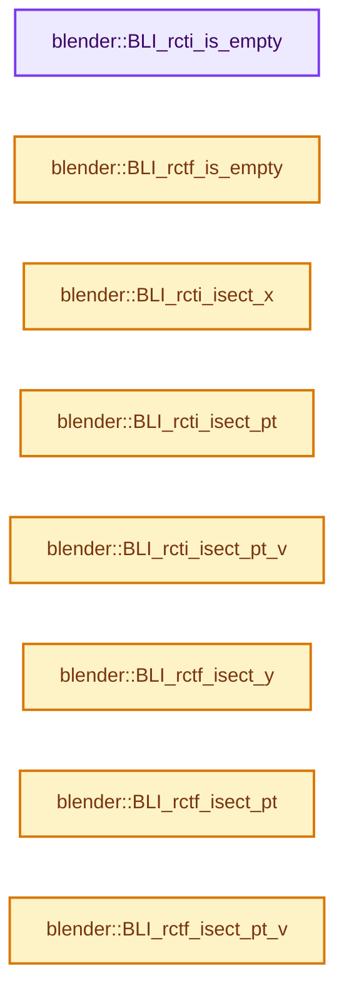
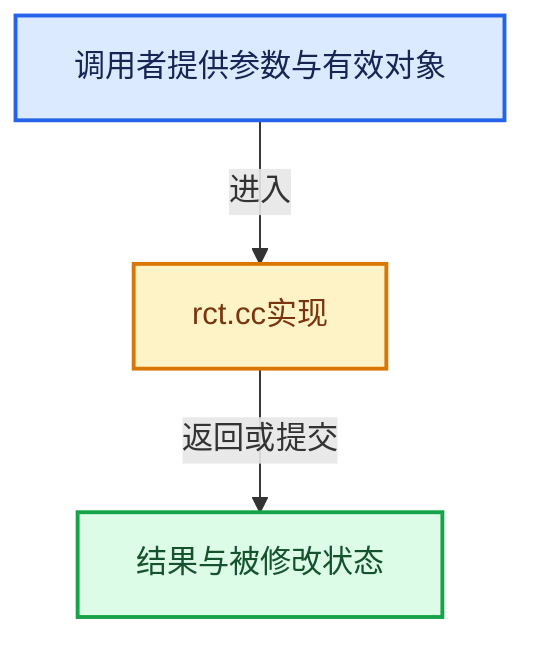

# 实现依赖专题：source/blender/blenlib/intern/rct.cc

[实现依赖导航](../../README.md) · [符号索引](../../../00-课程指南/02-源码与提交索引/符号依赖与实现索引.md)

本专题从正文实际调用进入，集中保存共享实现。函数有稳定锚点，可从调用处直接跳到对应完整函数；递归与互相调用通过回链组织。

## 本文件的实现关系






<a id="m-57b28d5c8428"></a>

## 宏 `ROTATE_SINCOS`

<!-- annotated:a3c4b2a5b5fe1c -->

```cpp
#define ROTATE_SINCOS(r_vec, mat2, vec) \
  { \
    (r_vec)[0] = (mat2)[1] * (vec)[0] + (+(mat2)[0]) * (vec)[1]; \
    (r_vec)[1] = (mat2)[0] * (vec)[0] + (-(mat2)[1]) * (vec)[1]; \
  } \
  ((void)0)

```

<details>
<summary>核对原始源码：source/blender/blenlib/intern/rct.cc · L1112—L1118</summary>

<!-- original:a3c4b2a5b5fe1c:source/blender/blenlib/intern/rct.cc:1112:1118 -->

```cpp
#define ROTATE_SINCOS(r_vec, mat2, vec) \
  { \
    (r_vec)[0] = (mat2)[1] * (vec)[0] + (+(mat2)[0]) * (vec)[1]; \
    (r_vec)[1] = (mat2)[0] * (vec)[0] + (-(mat2)[1]) * (vec)[1]; \
  } \
  ((void)0)

```

</details>

宏在预处理阶段展开，参数替换、重复求值和条件编译应直接从该定义检查。与普通函数不同，宏不会自动提供参数类型检查；构建配置选择哪个定义需结合外围条件。

## 完整成员与函数实现

<a id="f-c3e23a3e0854d170"></a>

### `blender::BLI_rcti_is_empty`

实现位置：[source/blender/blenlib/intern/rct.cc](../../../../../../../source/blender/blenlib/intern/rct.cc) · L29—L32。

接口参数：

- `const rcti *rect`

**教学注释版**

<!-- annotated:d8e44364341934 -->

```cpp
bool BLI_rcti_is_empty(const rcti *rect)
{
  return ((rect->xmax <= rect->xmin) || (rect->ymax <= rect->ymin));
}
```

<details>
<summary>核对原始源码：source/blender/blenlib/intern/rct.cc · L29—L32</summary>

<!-- original:d8e44364341934:source/blender/blenlib/intern/rct.cc:29:32 -->

```cpp
bool BLI_rcti_is_empty(const rcti *rect)
{
  return ((rect->xmax <= rect->xmin) || (rect->ymax <= rect->ymin));
}
```

</details>

**结果出口**

- `return ((rect->xmax <= rect->xmin) || (rect->ymax <= rect->ymin));`

**继续追踪实现**

本实现没有需要继续展开的显式调用；检查返回表达式、对象转换和调用者前置条件。

<a id="f-06ec53bf739a52ad"></a>

### `blender::BLI_rctf_is_empty`

实现位置：[source/blender/blenlib/intern/rct.cc](../../../../../../../source/blender/blenlib/intern/rct.cc) · L34—L37。

接口参数：

- `const rctf *rect`

**教学注释版**

<!-- annotated:123370ed046359 -->

```cpp
bool BLI_rctf_is_empty(const rctf *rect)
{
  return ((rect->xmax <= rect->xmin) || (rect->ymax <= rect->ymin));
}
```

<details>
<summary>核对原始源码：source/blender/blenlib/intern/rct.cc · L34—L37</summary>

<!-- original:123370ed046359:source/blender/blenlib/intern/rct.cc:34:37 -->

```cpp
bool BLI_rctf_is_empty(const rctf *rect)
{
  return ((rect->xmax <= rect->xmin) || (rect->ymax <= rect->ymin));
}
```

</details>

**结果出口**

- `return ((rect->xmax <= rect->xmin) || (rect->ymax <= rect->ymin));`

**继续追踪实现**

本实现没有需要继续展开的显式调用；检查返回表达式、对象转换和调用者前置条件。

<a id="f-d5dd2154649e0916"></a>

### `blender::BLI_rcti_isect_x`

实现位置：[source/blender/blenlib/intern/rct.cc](../../../../../../../source/blender/blenlib/intern/rct.cc) · L39—L48。

接口参数：

- `const rcti *rect`
- `const int x`

**教学注释版**

<!-- annotated:269731b98af16d -->

```cpp
bool BLI_rcti_isect_x(const rcti *rect, const int x)
{
  if (x < rect->xmin) {
    return false;
  }
  if (x > rect->xmax) {
    return false;
  }
  return true;
}
```

<details>
<summary>核对原始源码：source/blender/blenlib/intern/rct.cc · L39—L48</summary>

<!-- original:269731b98af16d:source/blender/blenlib/intern/rct.cc:39:48 -->

```cpp
bool BLI_rcti_isect_x(const rcti *rect, const int x)
{
  if (x < rect->xmin) {
    return false;
  }
  if (x > rect->xmax) {
    return false;
  }
  return true;
}
```

</details>

**结果出口**

- `return false;`
- `return true;`

**继续追踪实现**

本实现没有需要继续展开的显式调用；检查返回表达式、对象转换和调用者前置条件。

<a id="f-9e89b79c8d771c1b"></a>

### `blender::BLI_rcti_isect_pt`

实现位置：[source/blender/blenlib/intern/rct.cc](../../../../../../../source/blender/blenlib/intern/rct.cc) · L61—L76。

接口参数：

- `const rcti *rect`
- `const int x`
- `const int y`

**教学注释版**

<!-- annotated:0c0d47ec4ead8e -->

```cpp
bool BLI_rcti_isect_pt(const rcti *rect, const int x, const int y)
{
  if (x < rect->xmin) {
    return false;
  }
  if (x > rect->xmax) {
    return false;
  }
  if (y < rect->ymin) {
    return false;
  }
  if (y > rect->ymax) {
    return false;
  }
  return true;
}
```

<details>
<summary>核对原始源码：source/blender/blenlib/intern/rct.cc · L61—L76</summary>

<!-- original:0c0d47ec4ead8e:source/blender/blenlib/intern/rct.cc:61:76 -->

```cpp
bool BLI_rcti_isect_pt(const rcti *rect, const int x, const int y)
{
  if (x < rect->xmin) {
    return false;
  }
  if (x > rect->xmax) {
    return false;
  }
  if (y < rect->ymin) {
    return false;
  }
  if (y > rect->ymax) {
    return false;
  }
  return true;
}
```

</details>

**结果出口**

- `return false;`
- `return true;`

**继续追踪实现**

本实现没有需要继续展开的显式调用；检查返回表达式、对象转换和调用者前置条件。

<a id="f-fbeeea057dda9fad"></a>

### `blender::BLI_rcti_isect_pt_v`

实现位置：[source/blender/blenlib/intern/rct.cc](../../../../../../../source/blender/blenlib/intern/rct.cc) · L78—L93。

接口参数：

- `const rcti *rect`
- `const int xy[2]`

**教学注释版**

<!-- annotated:2e798c6e15e1b2 -->

```cpp
bool BLI_rcti_isect_pt_v(const rcti *rect, const int xy[2])
{
  if (xy[0] < rect->xmin) {
    return false;
  }
  if (xy[0] > rect->xmax) {
    return false;
  }
  if (xy[1] < rect->ymin) {
    return false;
  }
  if (xy[1] > rect->ymax) {
    return false;
  }
  return true;
}
```

<details>
<summary>核对原始源码：source/blender/blenlib/intern/rct.cc · L78—L93</summary>

<!-- original:2e798c6e15e1b2:source/blender/blenlib/intern/rct.cc:78:93 -->

```cpp
bool BLI_rcti_isect_pt_v(const rcti *rect, const int xy[2])
{
  if (xy[0] < rect->xmin) {
    return false;
  }
  if (xy[0] > rect->xmax) {
    return false;
  }
  if (xy[1] < rect->ymin) {
    return false;
  }
  if (xy[1] > rect->ymax) {
    return false;
  }
  return true;
}
```

</details>

**结果出口**

- `return false;`
- `return true;`

**继续追踪实现**

本实现没有需要继续展开的显式调用；检查返回表达式、对象转换和调用者前置条件。

<a id="f-e657e202e7509e10"></a>

### `blender::BLI_rctf_isect_y`

实现位置：[source/blender/blenlib/intern/rct.cc](../../../../../../../source/blender/blenlib/intern/rct.cc) · L106—L115。

接口参数：

- `const rctf *rect`
- `const float y`

**教学注释版**

<!-- annotated:7678e827b832c7 -->

```cpp
bool BLI_rctf_isect_y(const rctf *rect, const float y)
{
  if (y < rect->ymin) {
    return false;
  }
  if (y > rect->ymax) {
    return false;
  }
  return true;
}
```

<details>
<summary>核对原始源码：source/blender/blenlib/intern/rct.cc · L106—L115</summary>

<!-- original:7678e827b832c7:source/blender/blenlib/intern/rct.cc:106:115 -->

```cpp
bool BLI_rctf_isect_y(const rctf *rect, const float y)
{
  if (y < rect->ymin) {
    return false;
  }
  if (y > rect->ymax) {
    return false;
  }
  return true;
}
```

</details>

**结果出口**

- `return false;`
- `return true;`

**继续追踪实现**

本实现没有需要继续展开的显式调用；检查返回表达式、对象转换和调用者前置条件。

<a id="f-b77b2af9325e2cfe"></a>

### `blender::BLI_rctf_isect_pt`

实现位置：[source/blender/blenlib/intern/rct.cc](../../../../../../../source/blender/blenlib/intern/rct.cc) · L117—L132。

接口参数：

- `const rctf *rect`
- `const float x`
- `const float y`

**教学注释版**

<!-- annotated:3ea21987291949 -->

```cpp
bool BLI_rctf_isect_pt(const rctf *rect, const float x, const float y)
{
  if (x < rect->xmin) {
    return false;
  }
  if (x > rect->xmax) {
    return false;
  }
  if (y < rect->ymin) {
    return false;
  }
  if (y > rect->ymax) {
    return false;
  }
  return true;
}
```

<details>
<summary>核对原始源码：source/blender/blenlib/intern/rct.cc · L117—L132</summary>

<!-- original:3ea21987291949:source/blender/blenlib/intern/rct.cc:117:132 -->

```cpp
bool BLI_rctf_isect_pt(const rctf *rect, const float x, const float y)
{
  if (x < rect->xmin) {
    return false;
  }
  if (x > rect->xmax) {
    return false;
  }
  if (y < rect->ymin) {
    return false;
  }
  if (y > rect->ymax) {
    return false;
  }
  return true;
}
```

</details>

**结果出口**

- `return false;`
- `return true;`

**继续追踪实现**

本实现没有需要继续展开的显式调用；检查返回表达式、对象转换和调用者前置条件。

<a id="f-8bb03412979bff63"></a>

### `blender::BLI_rctf_isect_pt_v`

实现位置：[source/blender/blenlib/intern/rct.cc](../../../../../../../source/blender/blenlib/intern/rct.cc) · L134—L149。

接口参数：

- `const rctf *rect`
- `const float xy[2]`

**教学注释版**

<!-- annotated:85398cf9b7edc9 -->

```cpp
bool BLI_rctf_isect_pt_v(const rctf *rect, const float xy[2])
{
  if (xy[0] < rect->xmin) {
    return false;
  }
  if (xy[0] > rect->xmax) {
    return false;
  }
  if (xy[1] < rect->ymin) {
    return false;
  }
  if (xy[1] > rect->ymax) {
    return false;
  }
  return true;
}
```

<details>
<summary>核对原始源码：source/blender/blenlib/intern/rct.cc · L134—L149</summary>

<!-- original:85398cf9b7edc9:source/blender/blenlib/intern/rct.cc:134:149 -->

```cpp
bool BLI_rctf_isect_pt_v(const rctf *rect, const float xy[2])
{
  if (xy[0] < rect->xmin) {
    return false;
  }
  if (xy[0] > rect->xmax) {
    return false;
  }
  if (xy[1] < rect->ymin) {
    return false;
  }
  if (xy[1] > rect->ymax) {
    return false;
  }
  return true;
}
```

</details>

**结果出口**

- `return false;`
- `return true;`

**继续追踪实现**

本实现没有需要继续展开的显式调用；检查返回表达式、对象转换和调用者前置条件。

<a id="f-45be445adf152df9"></a>

### `blender::BLI_rcti_length_x`

实现位置：[source/blender/blenlib/intern/rct.cc](../../../../../../../source/blender/blenlib/intern/rct.cc) · L151—L160。

接口参数：

- `const rcti *rect`
- `const int x`

**教学注释版**

<!-- annotated:eff8c4c9085666 -->

```cpp
int BLI_rcti_length_x(const rcti *rect, const int x)
{
  if (x < rect->xmin) {
    return rect->xmin - x;
  }
  if (x > rect->xmax) {
    return x - rect->xmax;
  }
  return 0;
}
```

<details>
<summary>核对原始源码：source/blender/blenlib/intern/rct.cc · L151—L160</summary>

<!-- original:eff8c4c9085666:source/blender/blenlib/intern/rct.cc:151:160 -->

```cpp
int BLI_rcti_length_x(const rcti *rect, const int x)
{
  if (x < rect->xmin) {
    return rect->xmin - x;
  }
  if (x > rect->xmax) {
    return x - rect->xmax;
  }
  return 0;
}
```

</details>

**结果出口**

- `return rect->xmin - x;`
- `return x - rect->xmax;`
- `return 0;`

**继续追踪实现**

本实现没有需要继续展开的显式调用；检查返回表达式、对象转换和调用者前置条件。

<a id="f-37fac252d9d6ac15"></a>

### `blender::BLI_rcti_length_y`

实现位置：[source/blender/blenlib/intern/rct.cc](../../../../../../../source/blender/blenlib/intern/rct.cc) · L162—L171。

接口参数：

- `const rcti *rect`
- `const int y`

**教学注释版**

<!-- annotated:d07b1368d6f90f -->

```cpp
int BLI_rcti_length_y(const rcti *rect, const int y)
{
  if (y < rect->ymin) {
    return rect->ymin - y;
  }
  if (y > rect->ymax) {
    return y - rect->ymax;
  }
  return 0;
}
```

<details>
<summary>核对原始源码：source/blender/blenlib/intern/rct.cc · L162—L171</summary>

<!-- original:d07b1368d6f90f:source/blender/blenlib/intern/rct.cc:162:171 -->

```cpp
int BLI_rcti_length_y(const rcti *rect, const int y)
{
  if (y < rect->ymin) {
    return rect->ymin - y;
  }
  if (y > rect->ymax) {
    return y - rect->ymax;
  }
  return 0;
}
```

</details>

**结果出口**

- `return rect->ymin - y;`
- `return y - rect->ymax;`
- `return 0;`

**继续追踪实现**

本实现没有需要继续展开的显式调用；检查返回表达式、对象转换和调用者前置条件。

<a id="f-5f256c2a069da23e"></a>

### `blender::BLI_rctf_inside_rctf`

实现位置：[source/blender/blenlib/intern/rct.cc](../../../../../../../source/blender/blenlib/intern/rct.cc) · L195—L199。

接口参数：

- `const rctf *rct_a`
- `const rctf *rct_b`

**教学注释版**

<!-- annotated:140ce9c7c42842 -->

```cpp
bool BLI_rctf_inside_rctf(const rctf *rct_a, const rctf *rct_b)
{
  return ((rct_a->xmin <= rct_b->xmin) && (rct_a->xmax >= rct_b->xmax) &&
          (rct_a->ymin <= rct_b->ymin) && (rct_a->ymax >= rct_b->ymax));
}
```

<details>
<summary>核对原始源码：source/blender/blenlib/intern/rct.cc · L195—L199</summary>

<!-- original:140ce9c7c42842:source/blender/blenlib/intern/rct.cc:195:199 -->

```cpp
bool BLI_rctf_inside_rctf(const rctf *rct_a, const rctf *rct_b)
{
  return ((rct_a->xmin <= rct_b->xmin) && (rct_a->xmax >= rct_b->xmax) &&
          (rct_a->ymin <= rct_b->ymin) && (rct_a->ymax >= rct_b->ymax));
}
```

</details>

**结果出口**

- `return ((rct_a->xmin <= rct_b->xmin) && (rct_a->xmax >= rct_b->xmax) &&`

**继续追踪实现**

本实现没有需要继续展开的显式调用；检查返回表达式、对象转换和调用者前置条件。

<a id="f-88996451d7f75ae4"></a>

### `blender::BLI_rcti_inside_rcti`

实现位置：[source/blender/blenlib/intern/rct.cc](../../../../../../../source/blender/blenlib/intern/rct.cc) · L200—L204。

接口参数：

- `const rcti *rct_a`
- `const rcti *rct_b`

**教学注释版**

<!-- annotated:91e5f0b242690d -->

```cpp
bool BLI_rcti_inside_rcti(const rcti *rct_a, const rcti *rct_b)
{
  return ((rct_a->xmin <= rct_b->xmin) && (rct_a->xmax >= rct_b->xmax) &&
          (rct_a->ymin <= rct_b->ymin) && (rct_a->ymax >= rct_b->ymax));
}
```

<details>
<summary>核对原始源码：source/blender/blenlib/intern/rct.cc · L200—L204</summary>

<!-- original:91e5f0b242690d:source/blender/blenlib/intern/rct.cc:200:204 -->

```cpp
bool BLI_rcti_inside_rcti(const rcti *rct_a, const rcti *rct_b)
{
  return ((rct_a->xmin <= rct_b->xmin) && (rct_a->xmax >= rct_b->xmax) &&
          (rct_a->ymin <= rct_b->ymin) && (rct_a->ymax >= rct_b->ymax));
}
```

</details>

**结果出口**

- `return ((rct_a->xmin <= rct_b->xmin) && (rct_a->xmax >= rct_b->xmax) &&`

**继续追踪实现**

本实现没有需要继续展开的显式调用；检查返回表达式、对象转换和调用者前置条件。

<a id="f-c8d34602143e648d"></a>

### `blender::isect_segments_fl`

实现位置：[source/blender/blenlib/intern/rct.cc](../../../../../../../source/blender/blenlib/intern/rct.cc) · L222—L238。

接口参数：

- `const float v1[2]`
- `const float v2[2]`
- `const float v3[2]`
- `const float v4[2]`

**教学注释版**

<!-- annotated:2acc2c7b98f8c7 -->

```cpp
static int isect_segments_fl(const float v1[2],
                             const float v2[2],
                             const float v3[2],
                             const float v4[2])
{
  const double div = double((v2[0] - v1[0]) * (v4[1] - v3[1]) - (v2[1] - v1[1]) * (v4[0] - v3[0]));
  if (div == 0.0) {
    return 1; /* co-linear */
  }

  const double lambda = double((v1[1] - v3[1]) * (v4[0] - v3[0]) -
                               (v1[0] - v3[0]) * (v4[1] - v3[1])) /
                        div;
  const double mu = double((v1[1] - v3[1]) * (v2[0] - v1[0]) - (v1[0] - v3[0]) * (v2[1] - v1[1])) /
                    div;
  return (lambda >= 0.0 && lambda <= 1.0 && mu >= 0.0 && mu <= 1.0);
}
```

<details>
<summary>核对原始源码：source/blender/blenlib/intern/rct.cc · L222—L238</summary>

<!-- original:2acc2c7b98f8c7:source/blender/blenlib/intern/rct.cc:222:238 -->

```cpp
static int isect_segments_fl(const float v1[2],
                             const float v2[2],
                             const float v3[2],
                             const float v4[2])
{
  const double div = double((v2[0] - v1[0]) * (v4[1] - v3[1]) - (v2[1] - v1[1]) * (v4[0] - v3[0]));
  if (div == 0.0) {
    return 1; /* co-linear */
  }

  const double lambda = double((v1[1] - v3[1]) * (v4[0] - v3[0]) -
                               (v1[0] - v3[0]) * (v4[1] - v3[1])) /
                        div;
  const double mu = double((v1[1] - v3[1]) * (v2[0] - v1[0]) - (v1[0] - v3[0]) * (v2[1] - v1[1])) /
                    div;
  return (lambda >= 0.0 && lambda <= 1.0 && mu >= 0.0 && mu <= 1.0);
}
```

</details>

**结果出口**

- `return 1; /* co-linear */`
- `return (lambda >= 0.0 && lambda <= 1.0 && mu >= 0.0 && mu <= 1.0);`

**继续追踪实现**

本实现没有需要继续展开的显式调用；检查返回表达式、对象转换和调用者前置条件。

<a id="f-9d6e18bf365d3f21"></a>

### `blender::BLI_rctf_isect_segment`

实现位置：[source/blender/blenlib/intern/rct.cc](../../../../../../../source/blender/blenlib/intern/rct.cc) · L286—L330。

接口参数：

- `const rctf *rect`
- `const float s1[2]`
- `const float s2[2]`

**教学注释版**

<!-- annotated:2eea9d82199386 -->

```cpp
bool BLI_rctf_isect_segment(const rctf *rect, const float s1[2], const float s2[2])
{
  /* first do outside-bounds check for both points of the segment */
  if (s1[0] < rect->xmin && s2[0] < rect->xmin) {
    return false;
  }
  if (s1[0] > rect->xmax && s2[0] > rect->xmax) {
    return false;
  }
  if (s1[1] < rect->ymin && s2[1] < rect->ymin) {
    return false;
  }
  if (s1[1] > rect->ymax && s2[1] > rect->ymax) {
    return false;
  }

  /* if either points intersect then we definitely intersect */
  if (BLI_rctf_isect_pt_v(rect, s1) || BLI_rctf_isect_pt_v(rect, s2)) {
    return true;
  }

  /* both points are outside but may intersect the rect */
  float tvec1[2];
  float tvec2[2];
  /* diagonal: `[/]` */
  tvec1[0] = rect->xmin;
  tvec1[1] = rect->ymin;
  tvec2[0] = rect->xmax;
  tvec2[1] = rect->ymax;
  if (isect_segments_fl(s1, s2, tvec1, tvec2)) {
    return true;
  }

  /* diagonal: `[\]` */
  tvec1[0] = rect->xmin;
  tvec1[1] = rect->ymax;
  tvec2[0] = rect->xmax;
  tvec2[1] = rect->ymin;
  if (isect_segments_fl(s1, s2, tvec1, tvec2)) {
    return true;
  }

  /* no intersection */
  return false;
}
```

<details>
<summary>核对原始源码：source/blender/blenlib/intern/rct.cc · L286—L330</summary>

<!-- original:2eea9d82199386:source/blender/blenlib/intern/rct.cc:286:330 -->

```cpp
bool BLI_rctf_isect_segment(const rctf *rect, const float s1[2], const float s2[2])
{
  /* first do outside-bounds check for both points of the segment */
  if (s1[0] < rect->xmin && s2[0] < rect->xmin) {
    return false;
  }
  if (s1[0] > rect->xmax && s2[0] > rect->xmax) {
    return false;
  }
  if (s1[1] < rect->ymin && s2[1] < rect->ymin) {
    return false;
  }
  if (s1[1] > rect->ymax && s2[1] > rect->ymax) {
    return false;
  }

  /* if either points intersect then we definitely intersect */
  if (BLI_rctf_isect_pt_v(rect, s1) || BLI_rctf_isect_pt_v(rect, s2)) {
    return true;
  }

  /* both points are outside but may intersect the rect */
  float tvec1[2];
  float tvec2[2];
  /* diagonal: `[/]` */
  tvec1[0] = rect->xmin;
  tvec1[1] = rect->ymin;
  tvec2[0] = rect->xmax;
  tvec2[1] = rect->ymax;
  if (isect_segments_fl(s1, s2, tvec1, tvec2)) {
    return true;
  }

  /* diagonal: `[\]` */
  tvec1[0] = rect->xmin;
  tvec1[1] = rect->ymax;
  tvec2[0] = rect->xmax;
  tvec2[1] = rect->ymin;
  if (isect_segments_fl(s1, s2, tvec1, tvec2)) {
    return true;
  }

  /* no intersection */
  return false;
}
```

</details>

**沿实际写入检查状态**

- `tvec1[0] = rect->xmin;`
- `tvec1[1] = rect->ymin;`
- `tvec2[0] = rect->xmax;`
- `tvec2[1] = rect->ymax;`
- `tvec1[1] = rect->ymax;`
- `tvec2[1] = rect->ymin;`

**结果出口**

- `return false;`
- `return true;`

**继续追踪实现**

- `BLI_rctf_isect_pt_v` → [blender::BLI_rctf_isect_pt_v · L134](rct.cc.md#f-8bb03412979bff63)。
- `isect_segments_fl` → [blender::isect_segments_fl · L222](rct.cc.md#f-c8d34602143e648d)。

<a id="f-902e680b44d2836a"></a>

### `blender::BLI_rctf_union`

实现位置：[source/blender/blenlib/intern/rct.cc](../../../../../../../source/blender/blenlib/intern/rct.cc) · L374—L388。

接口参数：

- `rctf *rct_a`
- `const rctf *rct_b`

**教学注释版**

<!-- annotated:d17e8856883a4c -->

```cpp
void BLI_rctf_union(rctf *rct_a, const rctf *rct_b)
{
  if (rct_a->xmin > rct_b->xmin) {
    rct_a->xmin = rct_b->xmin;
  }
  if (rct_a->xmax < rct_b->xmax) {
    rct_a->xmax = rct_b->xmax;
  }
  if (rct_a->ymin > rct_b->ymin) {
    rct_a->ymin = rct_b->ymin;
  }
  if (rct_a->ymax < rct_b->ymax) {
    rct_a->ymax = rct_b->ymax;
  }
}
```

<details>
<summary>核对原始源码：source/blender/blenlib/intern/rct.cc · L374—L388</summary>

<!-- original:d17e8856883a4c:source/blender/blenlib/intern/rct.cc:374:388 -->

```cpp
void BLI_rctf_union(rctf *rct_a, const rctf *rct_b)
{
  if (rct_a->xmin > rct_b->xmin) {
    rct_a->xmin = rct_b->xmin;
  }
  if (rct_a->xmax < rct_b->xmax) {
    rct_a->xmax = rct_b->xmax;
  }
  if (rct_a->ymin > rct_b->ymin) {
    rct_a->ymin = rct_b->ymin;
  }
  if (rct_a->ymax < rct_b->ymax) {
    rct_a->ymax = rct_b->ymax;
  }
}
```

</details>

**沿实际写入检查状态**

- `rct_a->xmin = rct_b->xmin;`
- `rct_a->xmax = rct_b->xmax;`
- `rct_a->ymin = rct_b->ymin;`
- `rct_a->ymax = rct_b->ymax;`

**继续追踪实现**

本实现没有需要继续展开的显式调用；检查返回表达式、对象转换和调用者前置条件。

<a id="f-7309aa09333d3736"></a>

### `blender::BLI_rctf_init`

实现位置：[source/blender/blenlib/intern/rct.cc](../../../../../../../source/blender/blenlib/intern/rct.cc) · L418—L426。

接口参数：

- `rctf *rect`
- `float xmin`
- `float xmax`
- `float ymin`
- `float ymax`

**教学注释版**

<!-- annotated:af94897f2b0d81 -->

```cpp
void BLI_rctf_init(rctf *rect, float xmin, float xmax, float ymin, float ymax)
{
  rect->xmin = xmin;
  rect->xmax = xmax;
  rect->ymin = ymin;
  rect->ymax = ymax;

  BLI_rctf_sanitize(rect);
}
```

<details>
<summary>核对原始源码：source/blender/blenlib/intern/rct.cc · L418—L426</summary>

<!-- original:af94897f2b0d81:source/blender/blenlib/intern/rct.cc:418:426 -->

```cpp
void BLI_rctf_init(rctf *rect, float xmin, float xmax, float ymin, float ymax)
{
  rect->xmin = xmin;
  rect->xmax = xmax;
  rect->ymin = ymin;
  rect->ymax = ymax;

  BLI_rctf_sanitize(rect);
}
```

</details>

**沿实际写入检查状态**

- `rect->xmin = xmin;`
- `rect->xmax = xmax;`
- `rect->ymin = ymin;`
- `rect->ymax = ymax;`

**继续追踪实现**

- `BLI_rctf_sanitize` → [blender::BLI_rctf_sanitize · L448](rct.cc.md#f-a3d7c50f7f61c3c8)。

<a id="f-c75659264970b4d1"></a>

### `blender::BLI_rcti_init`

实现位置：[source/blender/blenlib/intern/rct.cc](../../../../../../../source/blender/blenlib/intern/rct.cc) · L428—L436。

接口参数：

- `rcti *rect`
- `int xmin`
- `int xmax`
- `int ymin`
- `int ymax`

**教学注释版**

<!-- annotated:8df84fe344f890 -->

```cpp
void BLI_rcti_init(rcti *rect, int xmin, int xmax, int ymin, int ymax)
{
  rect->xmin = xmin;
  rect->xmax = xmax;
  rect->ymin = ymin;
  rect->ymax = ymax;

  BLI_rcti_sanitize(rect);
}
```

<details>
<summary>核对原始源码：source/blender/blenlib/intern/rct.cc · L428—L436</summary>

<!-- original:8df84fe344f890:source/blender/blenlib/intern/rct.cc:428:436 -->

```cpp
void BLI_rcti_init(rcti *rect, int xmin, int xmax, int ymin, int ymax)
{
  rect->xmin = xmin;
  rect->xmax = xmax;
  rect->ymin = ymin;
  rect->ymax = ymax;

  BLI_rcti_sanitize(rect);
}
```

</details>

**沿实际写入检查状态**

- `rect->xmin = xmin;`
- `rect->xmax = xmax;`
- `rect->ymin = ymin;`
- `rect->ymax = ymax;`

**继续追踪实现**

- `BLI_rcti_sanitize` → [blender::BLI_rcti_sanitize · L460](rct.cc.md#f-09bc2c66cb95dde8)。

<a id="f-e92e6fc0be3052ca"></a>

### `blender::BLI_rctf_is_valid`

实现位置：[source/blender/blenlib/intern/rct.cc](../../../../../../../source/blender/blenlib/intern/rct.cc) · L438—L441。

接口参数：

- `const rctf *rect`

**教学注释版**

<!-- annotated:ac26a00b544064 -->

```cpp
bool BLI_rctf_is_valid(const rctf *rect)
{
  return (rect->xmin <= rect->xmax) && (rect->ymin <= rect->ymax);
}
```

<details>
<summary>核对原始源码：source/blender/blenlib/intern/rct.cc · L438—L441</summary>

<!-- original:ac26a00b544064:source/blender/blenlib/intern/rct.cc:438:441 -->

```cpp
bool BLI_rctf_is_valid(const rctf *rect)
{
  return (rect->xmin <= rect->xmax) && (rect->ymin <= rect->ymax);
}
```

</details>

**结果出口**

- `return (rect->xmin <= rect->xmax) && (rect->ymin <= rect->ymax);`

**继续追踪实现**

本实现没有需要继续展开的显式调用；检查返回表达式、对象转换和调用者前置条件。

<a id="f-81856f2f7ec4fd9d"></a>

### `blender::BLI_rcti_is_valid`

实现位置：[source/blender/blenlib/intern/rct.cc](../../../../../../../source/blender/blenlib/intern/rct.cc) · L443—L446。

接口参数：

- `const rcti *rect`

**教学注释版**

<!-- annotated:e757dd1ec26144 -->

```cpp
bool BLI_rcti_is_valid(const rcti *rect)
{
  return (rect->xmin <= rect->xmax) && (rect->ymin <= rect->ymax);
}
```

<details>
<summary>核对原始源码：source/blender/blenlib/intern/rct.cc · L443—L446</summary>

<!-- original:e757dd1ec26144:source/blender/blenlib/intern/rct.cc:443:446 -->

```cpp
bool BLI_rcti_is_valid(const rcti *rect)
{
  return (rect->xmin <= rect->xmax) && (rect->ymin <= rect->ymax);
}
```

</details>

**结果出口**

- `return (rect->xmin <= rect->xmax) && (rect->ymin <= rect->ymax);`

**继续追踪实现**

本实现没有需要继续展开的显式调用；检查返回表达式、对象转换和调用者前置条件。

<a id="f-a3d7c50f7f61c3c8"></a>

### `blender::BLI_rctf_sanitize`

实现位置：[source/blender/blenlib/intern/rct.cc](../../../../../../../source/blender/blenlib/intern/rct.cc) · L448—L458。

接口参数：

- `rctf *rect`

**教学注释版**

<!-- annotated:daf8c622f1ed76 -->

```cpp
void BLI_rctf_sanitize(rctf *rect)
{
  if (rect->xmin > rect->xmax) {
    SWAP(float, rect->xmin, rect->xmax);
  }
  if (rect->ymin > rect->ymax) {
    SWAP(float, rect->ymin, rect->ymax);
  }

  BLI_assert(BLI_rctf_is_valid(rect));
}
```

<details>
<summary>核对原始源码：source/blender/blenlib/intern/rct.cc · L448—L458</summary>

<!-- original:daf8c622f1ed76:source/blender/blenlib/intern/rct.cc:448:458 -->

```cpp
void BLI_rctf_sanitize(rctf *rect)
{
  if (rect->xmin > rect->xmax) {
    SWAP(float, rect->xmin, rect->xmax);
  }
  if (rect->ymin > rect->ymax) {
    SWAP(float, rect->ymin, rect->ymax);
  }

  BLI_assert(BLI_rctf_is_valid(rect));
}
```

</details>

**继续追踪实现**

- `BLI_assert` → [BLI_assert · L48](../BLI_assert.hh.md#m-57a88495704d)；[BLI_assert · L63](../BLI_assert.hh.md#m-d07050020cb5)。宏定义由构建条件选择。
- `BLI_rctf_is_valid` → [blender::BLI_rctf_is_valid · L438](rct.cc.md#f-e92e6fc0be3052ca)。

<a id="f-09bc2c66cb95dde8"></a>

### `blender::BLI_rcti_sanitize`

实现位置：[source/blender/blenlib/intern/rct.cc](../../../../../../../source/blender/blenlib/intern/rct.cc) · L460—L470。

接口参数：

- `rcti *rect`

**教学注释版**

<!-- annotated:721365d2527378 -->

```cpp
void BLI_rcti_sanitize(rcti *rect)
{
  if (rect->xmin > rect->xmax) {
    SWAP(int, rect->xmin, rect->xmax);
  }
  if (rect->ymin > rect->ymax) {
    SWAP(int, rect->ymin, rect->ymax);
  }

  BLI_assert(BLI_rcti_is_valid(rect));
}
```

<details>
<summary>核对原始源码：source/blender/blenlib/intern/rct.cc · L460—L470</summary>

<!-- original:721365d2527378:source/blender/blenlib/intern/rct.cc:460:470 -->

```cpp
void BLI_rcti_sanitize(rcti *rect)
{
  if (rect->xmin > rect->xmax) {
    SWAP(int, rect->xmin, rect->xmax);
  }
  if (rect->ymin > rect->ymax) {
    SWAP(int, rect->ymin, rect->ymax);
  }

  BLI_assert(BLI_rcti_is_valid(rect));
}
```

</details>

**继续追踪实现**

- `BLI_assert` → [BLI_assert · L48](../BLI_assert.hh.md#m-57a88495704d)；[BLI_assert · L63](../BLI_assert.hh.md#m-d07050020cb5)。宏定义由构建条件选择。
- `BLI_rcti_is_valid` → [blender::BLI_rcti_is_valid · L443](rct.cc.md#f-81856f2f7ec4fd9d)。

<a id="f-081cdb72e525536c"></a>

### `blender::BLI_rcti_init_minmax`

实现位置：[source/blender/blenlib/intern/rct.cc](../../../../../../../source/blender/blenlib/intern/rct.cc) · L488—L492。

接口参数：

- `rcti *rect`

**教学注释版**

<!-- annotated:29ed1c82c788e5 -->

```cpp
void BLI_rcti_init_minmax(rcti *rect)
{
  rect->xmin = rect->ymin = INT_MAX;
  rect->xmax = rect->ymax = INT_MIN;
}
```

<details>
<summary>核对原始源码：source/blender/blenlib/intern/rct.cc · L488—L492</summary>

<!-- original:29ed1c82c788e5:source/blender/blenlib/intern/rct.cc:488:492 -->

```cpp
void BLI_rcti_init_minmax(rcti *rect)
{
  rect->xmin = rect->ymin = INT_MAX;
  rect->xmax = rect->ymax = INT_MIN;
}
```

</details>

**沿实际写入检查状态**

- `rect->xmin = rect->ymin = INT_MAX;`
- `rect->xmax = rect->ymax = INT_MIN;`

**继续追踪实现**

本实现没有需要继续展开的显式调用；检查返回表达式、对象转换和调用者前置条件。

<a id="f-a1101189089d570a"></a>

### `blender::BLI_rctf_init_minmax`

实现位置：[source/blender/blenlib/intern/rct.cc](../../../../../../../source/blender/blenlib/intern/rct.cc) · L494—L498。

接口参数：

- `rctf *rect`

**教学注释版**

<!-- annotated:b71541417bc5bb -->

```cpp
void BLI_rctf_init_minmax(rctf *rect)
{
  rect->xmin = rect->ymin = FLT_MAX;
  rect->xmax = rect->ymax = -FLT_MAX;
}
```

<details>
<summary>核对原始源码：source/blender/blenlib/intern/rct.cc · L494—L498</summary>

<!-- original:b71541417bc5bb:source/blender/blenlib/intern/rct.cc:494:498 -->

```cpp
void BLI_rctf_init_minmax(rctf *rect)
{
  rect->xmin = rect->ymin = FLT_MAX;
  rect->xmax = rect->ymax = -FLT_MAX;
}
```

</details>

**沿实际写入检查状态**

- `rect->xmin = rect->ymin = FLT_MAX;`
- `rect->xmax = rect->ymax = -FLT_MAX;`

**继续追踪实现**

本实现没有需要继续展开的显式调用；检查返回表达式、对象转换和调用者前置条件。

<a id="f-5925ec804e8ca708"></a>

### `blender::BLI_rcti_do_minmax_rcti`

实现位置：[source/blender/blenlib/intern/rct.cc](../../../../../../../source/blender/blenlib/intern/rct.cc) · L516—L522。

接口参数：

- `rcti *rect`
- `const rcti *other`

**教学注释版**

<!-- annotated:0dfec641441810 -->

```cpp
void BLI_rcti_do_minmax_rcti(rcti *rect, const rcti *other)
{
  rect->xmin = min_ii(rect->xmin, other->xmin);
  rect->xmax = max_ii(rect->xmax, other->xmax);
  rect->ymin = min_ii(rect->ymin, other->ymin);
  rect->ymax = max_ii(rect->ymax, other->ymax);
}
```

<details>
<summary>核对原始源码：source/blender/blenlib/intern/rct.cc · L516—L522</summary>

<!-- original:0dfec641441810:source/blender/blenlib/intern/rct.cc:516:522 -->

```cpp
void BLI_rcti_do_minmax_rcti(rcti *rect, const rcti *other)
{
  rect->xmin = min_ii(rect->xmin, other->xmin);
  rect->xmax = max_ii(rect->xmax, other->xmax);
  rect->ymin = min_ii(rect->ymin, other->ymin);
  rect->ymax = max_ii(rect->ymax, other->ymax);
}
```

</details>

**沿实际写入检查状态**

- `rect->xmin = min_ii(rect->xmin, other->xmin);`
- `rect->xmax = max_ii(rect->xmax, other->xmax);`
- `rect->ymin = min_ii(rect->ymin, other->ymin);`
- `rect->ymax = max_ii(rect->ymax, other->ymax);`

**继续追踪实现**

- `min_ii` → [blender::min_ii · L364](math_base_inline.cc.md#f-30336db35b2810b8)。
- `max_ii` → [blender::max_ii · L368](math_base_inline.cc.md#f-c45aa7b373adb94c)。

<a id="f-5a2e903df9abfc95"></a>

### `blender::BLI_rctf_transform_pt_v`

实现位置：[source/blender/blenlib/intern/rct.cc](../../../../../../../source/blender/blenlib/intern/rct.cc) · L540—L550。

接口参数：

- `const rctf *dst`
- `const rctf *src`
- `float xy_dst[2]`
- `const float xy_src[2]`

**教学注释版**

<!-- annotated:8d78cf98360358 -->

```cpp
void BLI_rctf_transform_pt_v(const rctf *dst,
                             const rctf *src,
                             float xy_dst[2],
                             const float xy_src[2])
{
  xy_dst[0] = ((xy_src[0] - src->xmin) / (src->xmax - src->xmin));
  xy_dst[0] = dst->xmin + ((dst->xmax - dst->xmin) * xy_dst[0]);

  xy_dst[1] = ((xy_src[1] - src->ymin) / (src->ymax - src->ymin));
  xy_dst[1] = dst->ymin + ((dst->ymax - dst->ymin) * xy_dst[1]);
}
```

<details>
<summary>核对原始源码：source/blender/blenlib/intern/rct.cc · L540—L550</summary>

<!-- original:8d78cf98360358:source/blender/blenlib/intern/rct.cc:540:550 -->

```cpp
void BLI_rctf_transform_pt_v(const rctf *dst,
                             const rctf *src,
                             float xy_dst[2],
                             const float xy_src[2])
{
  xy_dst[0] = ((xy_src[0] - src->xmin) / (src->xmax - src->xmin));
  xy_dst[0] = dst->xmin + ((dst->xmax - dst->xmin) * xy_dst[0]);

  xy_dst[1] = ((xy_src[1] - src->ymin) / (src->ymax - src->ymin));
  xy_dst[1] = dst->ymin + ((dst->ymax - dst->ymin) * xy_dst[1]);
}
```

</details>

**沿实际写入检查状态**

- `xy_dst[0] = ((xy_src[0] - src->xmin) / (src->xmax - src->xmin));`
- `xy_dst[0] = dst->xmin + ((dst->xmax - dst->xmin) * xy_dst[0]);`
- `xy_dst[1] = ((xy_src[1] - src->ymin) / (src->ymax - src->ymin));`
- `xy_dst[1] = dst->ymin + ((dst->ymax - dst->ymin) * xy_dst[1]);`

**继续追踪实现**

本实现没有需要继续展开的显式调用；检查返回表达式、对象转换和调用者前置条件。

<a id="f-6a1014b060f5b9a7"></a>

### `blender::BLI_rctf_transform_calc_m4_pivot_min_ex`

实现位置：[source/blender/blenlib/intern/rct.cc](../../../../../../../source/blender/blenlib/intern/rct.cc) · L552—L563。

接口参数：

- `const rctf *dst`
- `const rctf *src`
- `float matrix[4][4]`
- `uint x`
- `uint y`

**教学注释版**

<!-- annotated:ff39dae0b80d49 -->

```cpp
void BLI_rctf_transform_calc_m4_pivot_min_ex(
    const rctf *dst, const rctf *src, float matrix[4][4], uint x, uint y)
{
  BLI_assert(x < 3 && y < 3);

  unit_m4(matrix);

  matrix[x][x] = BLI_rctf_size_x(src) / BLI_rctf_size_x(dst);
  matrix[y][y] = BLI_rctf_size_y(src) / BLI_rctf_size_y(dst);
  matrix[3][x] = (src->xmin - dst->xmin) * matrix[x][x];
  matrix[3][y] = (src->ymin - dst->ymin) * matrix[y][y];
}
```

<details>
<summary>核对原始源码：source/blender/blenlib/intern/rct.cc · L552—L563</summary>

<!-- original:ff39dae0b80d49:source/blender/blenlib/intern/rct.cc:552:563 -->

```cpp
void BLI_rctf_transform_calc_m4_pivot_min_ex(
    const rctf *dst, const rctf *src, float matrix[4][4], uint x, uint y)
{
  BLI_assert(x < 3 && y < 3);

  unit_m4(matrix);

  matrix[x][x] = BLI_rctf_size_x(src) / BLI_rctf_size_x(dst);
  matrix[y][y] = BLI_rctf_size_y(src) / BLI_rctf_size_y(dst);
  matrix[3][x] = (src->xmin - dst->xmin) * matrix[x][x];
  matrix[3][y] = (src->ymin - dst->ymin) * matrix[y][y];
}
```

</details>

**沿实际写入检查状态**

- `matrix[x][x] = BLI_rctf_size_x(src) / BLI_rctf_size_x(dst);`
- `matrix[y][y] = BLI_rctf_size_y(src) / BLI_rctf_size_y(dst);`
- `matrix[3][x] = (src->xmin - dst->xmin) * matrix[x][x];`
- `matrix[3][y] = (src->ymin - dst->ymin) * matrix[y][y];`

**继续追踪实现**

- `BLI_assert` → [BLI_assert · L48](../BLI_assert.hh.md#m-57a88495704d)；[BLI_assert · L63](../BLI_assert.hh.md#m-d07050020cb5)。宏定义由构建条件选择。
- `unit_m4` → [blender::unit_m4 · L55](math_matrix_c.cc.md#f-e6cd812aae119176)。
- `BLI_rctf_size_x` → [blender::BLI_rctf_size_x · L211](../BLI_rect.hh.md#f-017b86a9d189e3ba)。
- `BLI_rctf_size_y` → [blender::BLI_rctf_size_y · L215](../BLI_rect.hh.md#f-6d179bc3c1b71b0e)。

<a id="f-c74bb01ab9b5d2cb"></a>

### `blender::BLI_rctf_transform_calc_m4_pivot_min`

实现位置：[source/blender/blenlib/intern/rct.cc](../../../../../../../source/blender/blenlib/intern/rct.cc) · L565—L568。

接口参数：

- `const rctf *dst`
- `const rctf *src`
- `float matrix[4][4]`

**教学注释版**

<!-- annotated:d6723e6a47a832 -->

```cpp
void BLI_rctf_transform_calc_m4_pivot_min(const rctf *dst, const rctf *src, float matrix[4][4])
{
  BLI_rctf_transform_calc_m4_pivot_min_ex(dst, src, matrix, 0, 1);
}
```

<details>
<summary>核对原始源码：source/blender/blenlib/intern/rct.cc · L565—L568</summary>

<!-- original:d6723e6a47a832:source/blender/blenlib/intern/rct.cc:565:568 -->

```cpp
void BLI_rctf_transform_calc_m4_pivot_min(const rctf *dst, const rctf *src, float matrix[4][4])
{
  BLI_rctf_transform_calc_m4_pivot_min_ex(dst, src, matrix, 0, 1);
}
```

</details>

**继续追踪实现**

- `BLI_rctf_transform_calc_m4_pivot_min_ex` → [blender::BLI_rctf_transform_calc_m4_pivot_min_ex · L552](rct.cc.md#f-6a1014b060f5b9a7)。

<a id="f-31c762127669dc4c"></a>

### `blender::BLI_rcti_translate`

实现位置：[source/blender/blenlib/intern/rct.cc](../../../../../../../source/blender/blenlib/intern/rct.cc) · L580—L586。

接口参数：

- `rcti *rect`
- `int x`
- `int y`

**教学注释版**

<!-- annotated:8a2909d963e1b3 -->

```cpp
void BLI_rcti_translate(rcti *rect, int x, int y)
{
  rect->xmin += x;
  rect->ymin += y;
  rect->xmax += x;
  rect->ymax += y;
}
```

<details>
<summary>核对原始源码：source/blender/blenlib/intern/rct.cc · L580—L586</summary>

<!-- original:8a2909d963e1b3:source/blender/blenlib/intern/rct.cc:580:586 -->

```cpp
void BLI_rcti_translate(rcti *rect, int x, int y)
{
  rect->xmin += x;
  rect->ymin += y;
  rect->xmax += x;
  rect->ymax += y;
}
```

</details>

**沿实际写入检查状态**

- `rect->xmin += x;`
- `rect->ymin += y;`
- `rect->xmax += x;`
- `rect->ymax += y;`

**继续追踪实现**

本实现没有需要继续展开的显式调用；检查返回表达式、对象转换和调用者前置条件。

<a id="f-529284313e4063a1"></a>

### `blender::BLI_rctf_translate`

实现位置：[source/blender/blenlib/intern/rct.cc](../../../../../../../source/blender/blenlib/intern/rct.cc) · L587—L593。

接口参数：

- `rctf *rect`
- `float x`
- `float y`

**教学注释版**

<!-- annotated:06640802adef3e -->

```cpp
void BLI_rctf_translate(rctf *rect, float x, float y)
{
  rect->xmin += x;
  rect->ymin += y;
  rect->xmax += x;
  rect->ymax += y;
}
```

<details>
<summary>核对原始源码：source/blender/blenlib/intern/rct.cc · L587—L593</summary>

<!-- original:06640802adef3e:source/blender/blenlib/intern/rct.cc:587:593 -->

```cpp
void BLI_rctf_translate(rctf *rect, float x, float y)
{
  rect->xmin += x;
  rect->ymin += y;
  rect->xmax += x;
  rect->ymax += y;
}
```

</details>

**沿实际写入检查状态**

- `rect->xmin += x;`
- `rect->ymin += y;`
- `rect->xmax += x;`
- `rect->ymax += y;`

**继续追踪实现**

本实现没有需要继续展开的显式调用；检查返回表达式、对象转换和调用者前置条件。

<a id="f-999a441fd59980bf"></a>

### `blender::BLI_rctf_mul`

实现位置：[source/blender/blenlib/intern/rct.cc](../../../../../../../source/blender/blenlib/intern/rct.cc) · L602—L608。

接口参数：

- `rctf *rect`
- `const float factor`

**教学注释版**

<!-- annotated:b8517cdb841468 -->

```cpp
void BLI_rctf_mul(rctf *rect, const float factor)
{
  rect->xmin *= factor;
  rect->ymin *= factor;
  rect->xmax *= factor;
  rect->ymax *= factor;
}
```

<details>
<summary>核对原始源码：source/blender/blenlib/intern/rct.cc · L602—L608</summary>

<!-- original:b8517cdb841468:source/blender/blenlib/intern/rct.cc:602:608 -->

```cpp
void BLI_rctf_mul(rctf *rect, const float factor)
{
  rect->xmin *= factor;
  rect->ymin *= factor;
  rect->xmax *= factor;
  rect->ymax *= factor;
}
```

</details>

**沿实际写入检查状态**

- `rect->xmin *= factor;`
- `rect->ymin *= factor;`
- `rect->xmax *= factor;`
- `rect->ymax *= factor;`

**继续追踪实现**

本实现没有需要继续展开的显式调用；检查返回表达式、对象转换和调用者前置条件。

<a id="f-d2f2d0b1e5fa19dc"></a>

### `blender::BLI_rctf_recenter`

实现位置：[source/blender/blenlib/intern/rct.cc](../../../../../../../source/blender/blenlib/intern/rct.cc) · L616—L621。

接口参数：

- `rctf *rect`
- `float x`
- `float y`

**教学注释版**

<!-- annotated:2448e6d8ec5369 -->

```cpp
void BLI_rctf_recenter(rctf *rect, float x, float y)
{
  const float dx = x - BLI_rctf_cent_x(rect);
  const float dy = y - BLI_rctf_cent_y(rect);
  BLI_rctf_translate(rect, dx, dy);
}
```

<details>
<summary>核对原始源码：source/blender/blenlib/intern/rct.cc · L616—L621</summary>

<!-- original:2448e6d8ec5369:source/blender/blenlib/intern/rct.cc:616:621 -->

```cpp
void BLI_rctf_recenter(rctf *rect, float x, float y)
{
  const float dx = x - BLI_rctf_cent_x(rect);
  const float dy = y - BLI_rctf_cent_y(rect);
  BLI_rctf_translate(rect, dx, dy);
}
```

</details>

**继续追踪实现**

- `BLI_rctf_cent_x` → [blender::BLI_rctf_cent_x · L194](../BLI_rect.hh.md#f-521da0a7a262e5c8)。
- `BLI_rctf_cent_y` → [blender::BLI_rctf_cent_y · L198](../BLI_rect.hh.md#f-5881beee11bc3403)。
- `BLI_rctf_translate` → [blender::BLI_rctf_translate · L587](rct.cc.md#f-529284313e4063a1)。

<a id="f-a446bcab5ddf68f8"></a>

### `blender::BLI_rcti_resize`

实现位置：[source/blender/blenlib/intern/rct.cc](../../../../../../../source/blender/blenlib/intern/rct.cc) · L635—L641。

接口参数：

- `rcti *rect`
- `int x`
- `int y`

**教学注释版**

<!-- annotated:33ec299eb93ba7 -->

```cpp
void BLI_rcti_resize(rcti *rect, int x, int y)
{
  rect->xmin = BLI_rcti_cent_x(rect) - (x / 2);
  rect->ymin = BLI_rcti_cent_y(rect) - (y / 2);
  rect->xmax = rect->xmin + x;
  rect->ymax = rect->ymin + y;
}
```

<details>
<summary>核对原始源码：source/blender/blenlib/intern/rct.cc · L635—L641</summary>

<!-- original:33ec299eb93ba7:source/blender/blenlib/intern/rct.cc:635:641 -->

```cpp
void BLI_rcti_resize(rcti *rect, int x, int y)
{
  rect->xmin = BLI_rcti_cent_x(rect) - (x / 2);
  rect->ymin = BLI_rcti_cent_y(rect) - (y / 2);
  rect->xmax = rect->xmin + x;
  rect->ymax = rect->ymin + y;
}
```

</details>

**沿实际写入检查状态**

- `rect->xmin = BLI_rcti_cent_x(rect) - (x / 2);`
- `rect->ymin = BLI_rcti_cent_y(rect) - (y / 2);`
- `rect->xmax = rect->xmin + x;`
- `rect->ymax = rect->ymin + y;`

**继续追踪实现**

- `BLI_rcti_cent_x` → [blender::BLI_rcti_cent_x · L186](../BLI_rect.hh.md#f-069bd0391ae1bb4f)。
- `BLI_rcti_cent_y` → [blender::BLI_rcti_cent_y · L190](../BLI_rect.hh.md#f-de791c2f99e4cf3d)。

<a id="f-8873ddffaa047a5a"></a>

### `blender::BLI_rcti_pad`

实现位置：[source/blender/blenlib/intern/rct.cc](../../../../../../../source/blender/blenlib/intern/rct.cc) · L643—L649。

接口参数：

- `rcti *rect`
- `int pad_x`
- `int pad_y`

**教学注释版**

<!-- annotated:b215d374bd7262 -->

```cpp
void BLI_rcti_pad(rcti *rect, int pad_x, int pad_y)
{
  rect->xmin -= pad_x;
  rect->ymin -= pad_y;
  rect->xmax += pad_x;
  rect->ymax += pad_y;
}
```

<details>
<summary>核对原始源码：source/blender/blenlib/intern/rct.cc · L643—L649</summary>

<!-- original:b215d374bd7262:source/blender/blenlib/intern/rct.cc:643:649 -->

```cpp
void BLI_rcti_pad(rcti *rect, int pad_x, int pad_y)
{
  rect->xmin -= pad_x;
  rect->ymin -= pad_y;
  rect->xmax += pad_x;
  rect->ymax += pad_y;
}
```

</details>

**沿实际写入检查状态**

- `rect->xmin -= pad_x;`
- `rect->ymin -= pad_y;`
- `rect->xmax += pad_x;`
- `rect->ymax += pad_y;`

**继续追踪实现**

本实现没有需要继续展开的显式调用；检查返回表达式、对象转换和调用者前置条件。

<a id="f-3207ef1b8e8a47e2"></a>

### `blender::BLI_rctf_pad`

实现位置：[source/blender/blenlib/intern/rct.cc](../../../../../../../source/blender/blenlib/intern/rct.cc) · L651—L657。

接口参数：

- `rctf *rect`
- `float pad_x`
- `float pad_y`

**教学注释版**

<!-- annotated:d62c140126bc4a -->

```cpp
void BLI_rctf_pad(rctf *rect, float pad_x, float pad_y)
{
  rect->xmin -= pad_x;
  rect->ymin -= pad_y;
  rect->xmax += pad_x;
  rect->ymax += pad_y;
}
```

<details>
<summary>核对原始源码：source/blender/blenlib/intern/rct.cc · L651—L657</summary>

<!-- original:d62c140126bc4a:source/blender/blenlib/intern/rct.cc:651:657 -->

```cpp
void BLI_rctf_pad(rctf *rect, float pad_x, float pad_y)
{
  rect->xmin -= pad_x;
  rect->ymin -= pad_y;
  rect->xmax += pad_x;
  rect->ymax += pad_y;
}
```

</details>

**沿实际写入检查状态**

- `rect->xmin -= pad_x;`
- `rect->ymin -= pad_y;`
- `rect->xmax += pad_x;`
- `rect->ymax += pad_y;`

**继续追踪实现**

本实现没有需要继续展开的显式调用；检查返回表达式、对象转换和调用者前置条件。

<a id="f-934a9f369450f8d5"></a>

### `blender::BLI_rctf_clamp_pt_v`

实现位置：[source/blender/blenlib/intern/rct.cc](../../../../../../../source/blender/blenlib/intern/rct.cc) · L754—L774。

接口参数：

- `const rctf *rect`
- `float xy[2]`

**教学注释版**

<!-- annotated:1b9816d31d07b8 -->

```cpp
bool BLI_rctf_clamp_pt_v(const rctf *rect, float xy[2])
{
  bool changed = false;
  if (xy[0] < rect->xmin) {
    xy[0] = rect->xmin;
    changed = true;
  }
  if (xy[0] > rect->xmax) {
    xy[0] = rect->xmax;
    changed = true;
  }
  if (xy[1] < rect->ymin) {
    xy[1] = rect->ymin;
    changed = true;
  }
  if (xy[1] > rect->ymax) {
    xy[1] = rect->ymax;
    changed = true;
  }
  return changed;
}
```

<details>
<summary>核对原始源码：source/blender/blenlib/intern/rct.cc · L754—L774</summary>

<!-- original:1b9816d31d07b8:source/blender/blenlib/intern/rct.cc:754:774 -->

```cpp
bool BLI_rctf_clamp_pt_v(const rctf *rect, float xy[2])
{
  bool changed = false;
  if (xy[0] < rect->xmin) {
    xy[0] = rect->xmin;
    changed = true;
  }
  if (xy[0] > rect->xmax) {
    xy[0] = rect->xmax;
    changed = true;
  }
  if (xy[1] < rect->ymin) {
    xy[1] = rect->ymin;
    changed = true;
  }
  if (xy[1] > rect->ymax) {
    xy[1] = rect->ymax;
    changed = true;
  }
  return changed;
}
```

</details>

**沿实际写入检查状态**

- `xy[0] = rect->xmin;`
- `changed = true;`
- `xy[0] = rect->xmax;`
- `xy[1] = rect->ymin;`
- `xy[1] = rect->ymax;`

**结果出口**

- `return changed;`

**继续追踪实现**

本实现没有需要继续展开的显式调用；检查返回表达式、对象转换和调用者前置条件。

<a id="f-2569be64f9676d28"></a>

### `blender::BLI_rcti_clamp`

实现位置：[source/blender/blenlib/intern/rct.cc](../../../../../../../source/blender/blenlib/intern/rct.cc) · L840—L880。

接口参数：

- `rcti *rect`
- `const rcti *rect_bounds`
- `int r_xy[2]`

**教学注释版**

<!-- annotated:ed9402c36c6350 -->

```cpp
bool BLI_rcti_clamp(rcti *rect, const rcti *rect_bounds, int r_xy[2])
{
  bool changed = false;

  r_xy[0] = 0;
  r_xy[1] = 0;

  if (rect->xmax > rect_bounds->xmax) {
    int ofs = rect_bounds->xmax - rect->xmax;
    rect->xmin += ofs;
    rect->xmax += ofs;
    r_xy[0] += ofs;
    changed = true;
  }

  if (rect->xmin < rect_bounds->xmin) {
    int ofs = rect_bounds->xmin - rect->xmin;
    rect->xmin += ofs;
    rect->xmax += ofs;
    r_xy[0] += ofs;
    changed = true;
  }

  if (rect->ymin < rect_bounds->ymin) {
    int ofs = rect_bounds->ymin - rect->ymin;
    rect->ymin += ofs;
    rect->ymax += ofs;
    r_xy[1] += ofs;
    changed = true;
  }

  if (rect->ymax > rect_bounds->ymax) {
    int ofs = rect_bounds->ymax - rect->ymax;
    rect->ymin += ofs;
    rect->ymax += ofs;
    r_xy[1] += ofs;
    changed = true;
  }

  return changed;
}
```

<details>
<summary>核对原始源码：source/blender/blenlib/intern/rct.cc · L840—L880</summary>

<!-- original:ed9402c36c6350:source/blender/blenlib/intern/rct.cc:840:880 -->

```cpp
bool BLI_rcti_clamp(rcti *rect, const rcti *rect_bounds, int r_xy[2])
{
  bool changed = false;

  r_xy[0] = 0;
  r_xy[1] = 0;

  if (rect->xmax > rect_bounds->xmax) {
    int ofs = rect_bounds->xmax - rect->xmax;
    rect->xmin += ofs;
    rect->xmax += ofs;
    r_xy[0] += ofs;
    changed = true;
  }

  if (rect->xmin < rect_bounds->xmin) {
    int ofs = rect_bounds->xmin - rect->xmin;
    rect->xmin += ofs;
    rect->xmax += ofs;
    r_xy[0] += ofs;
    changed = true;
  }

  if (rect->ymin < rect_bounds->ymin) {
    int ofs = rect_bounds->ymin - rect->ymin;
    rect->ymin += ofs;
    rect->ymax += ofs;
    r_xy[1] += ofs;
    changed = true;
  }

  if (rect->ymax > rect_bounds->ymax) {
    int ofs = rect_bounds->ymax - rect->ymax;
    rect->ymin += ofs;
    rect->ymax += ofs;
    r_xy[1] += ofs;
    changed = true;
  }

  return changed;
}
```

</details>

**沿实际写入检查状态**

- `r_xy[0] = 0;`
- `r_xy[1] = 0;`
- `rect->xmin += ofs;`
- `rect->xmax += ofs;`
- `r_xy[0] += ofs;`
- `changed = true;`
- `rect->ymin += ofs;`
- `rect->ymax += ofs;`
- `r_xy[1] += ofs;`

**结果出口**

- `return changed;`

**继续追踪实现**

本实现没有需要继续展开的显式调用；检查返回表达式、对象转换和调用者前置条件。

<a id="f-ca13d2ea14373b4e"></a>

### `blender::BLI_rctf_compare`

实现位置：[source/blender/blenlib/intern/rct.cc](../../../../../../../source/blender/blenlib/intern/rct.cc) · L882—L895。

接口参数：

- `const rctf *rect_a`
- `const rctf *rect_b`
- `const float limit`

**教学注释版**

<!-- annotated:d596629f5dc884 -->

```cpp
bool BLI_rctf_compare(const rctf *rect_a, const rctf *rect_b, const float limit)
{
  if (fabsf(rect_a->xmin - rect_b->xmin) <= limit) {
    if (fabsf(rect_a->xmax - rect_b->xmax) <= limit) {
      if (fabsf(rect_a->ymin - rect_b->ymin) <= limit) {
        if (fabsf(rect_a->ymax - rect_b->ymax) <= limit) {
          return true;
        }
      }
    }
  }

  return false;
}
```

<details>
<summary>核对原始源码：source/blender/blenlib/intern/rct.cc · L882—L895</summary>

<!-- original:d596629f5dc884:source/blender/blenlib/intern/rct.cc:882:895 -->

```cpp
bool BLI_rctf_compare(const rctf *rect_a, const rctf *rect_b, const float limit)
{
  if (fabsf(rect_a->xmin - rect_b->xmin) <= limit) {
    if (fabsf(rect_a->xmax - rect_b->xmax) <= limit) {
      if (fabsf(rect_a->ymin - rect_b->ymin) <= limit) {
        if (fabsf(rect_a->ymax - rect_b->ymax) <= limit) {
          return true;
        }
      }
    }
  }

  return false;
}
```

</details>

**结果出口**

- `return true;`
- `return false;`

**继续追踪实现**

- `fabsf` → [fabsf · L21](../../07-Intern运行时与平台/cycles/kernel/svm/radial_tiling_shared.h.md#m-02cc4c69cfb3)；[fabsf · L43](../../07-Intern运行时与平台/cycles/kernel/svm/radial_tiling_shared.h.md#m-04effe61803b)；[fabsf · L74](../../07-Intern运行时与平台/cycles/kernel/svm/radial_tiling_shared.h.md#m-927dd4eba7dc)；[fabsf · L25](radial_tiling_shared.hh.md#m-8348d6b3d08f)；[fabsf · L47](radial_tiling_shared.hh.md#m-13b7e0b6d84f)；[fabsf · L78](radial_tiling_shared.hh.md#m-326c83464a0d)；[fabsf · L21](../../07-Intern运行时与平台/cycles/kernel/osl/shaders/node_radial_tiling_shared.h.md#m-7c3ee12fc119)；[fabsf · L43](../../07-Intern运行时与平台/cycles/kernel/osl/shaders/node_radial_tiling_shared.h.md#m-9112db0e2dd1)；[fabsf · L74](../../07-Intern运行时与平台/cycles/kernel/osl/shaders/node_radial_tiling_shared.h.md#m-ee4e61908a6f)；[fabsf · L167](../../07-Intern运行时与平台/cycles/kernel/device/oneapi/compat.h.md#m-b039ee6c1601)；[fabsf · L265](../../07-Intern运行时与平台/cycles/kernel/device/metal/compat.h.md#m-6b21869e9f3f)。宏定义由构建条件选择。

<a id="f-a238c14d2934c44e"></a>

### `blender::BLI_rcti_isect`

实现位置：[source/blender/blenlib/intern/rct.cc](../../../../../../../source/blender/blenlib/intern/rct.cc) · L941—L968。

接口参数：

- `const rcti *src1`
- `const rcti *src2`
- `rcti *dest`

**教学注释版**

<!-- annotated:b6e1ad69c8b97f -->

```cpp
bool BLI_rcti_isect(const rcti *src1, const rcti *src2, rcti *dest)
{
  int xmin, xmax;
  int ymin, ymax;

  xmin = (src1->xmin) > (src2->xmin) ? (src1->xmin) : (src2->xmin);
  xmax = (src1->xmax) < (src2->xmax) ? (src1->xmax) : (src2->xmax);
  ymin = (src1->ymin) > (src2->ymin) ? (src1->ymin) : (src2->ymin);
  ymax = (src1->ymax) < (src2->ymax) ? (src1->ymax) : (src2->ymax);

  if (xmax >= xmin && ymax >= ymin) {
    if (dest) {
      dest->xmin = xmin;
      dest->xmax = xmax;
      dest->ymin = ymin;
      dest->ymax = ymax;
    }
    return true;
  }

  if (dest) {
    dest->xmin = 0;
    dest->xmax = 0;
    dest->ymin = 0;
    dest->ymax = 0;
  }
  return false;
}
```

<details>
<summary>核对原始源码：source/blender/blenlib/intern/rct.cc · L941—L968</summary>

<!-- original:b6e1ad69c8b97f:source/blender/blenlib/intern/rct.cc:941:968 -->

```cpp
bool BLI_rcti_isect(const rcti *src1, const rcti *src2, rcti *dest)
{
  int xmin, xmax;
  int ymin, ymax;

  xmin = (src1->xmin) > (src2->xmin) ? (src1->xmin) : (src2->xmin);
  xmax = (src1->xmax) < (src2->xmax) ? (src1->xmax) : (src2->xmax);
  ymin = (src1->ymin) > (src2->ymin) ? (src1->ymin) : (src2->ymin);
  ymax = (src1->ymax) < (src2->ymax) ? (src1->ymax) : (src2->ymax);

  if (xmax >= xmin && ymax >= ymin) {
    if (dest) {
      dest->xmin = xmin;
      dest->xmax = xmax;
      dest->ymin = ymin;
      dest->ymax = ymax;
    }
    return true;
  }

  if (dest) {
    dest->xmin = 0;
    dest->xmax = 0;
    dest->ymin = 0;
    dest->ymax = 0;
  }
  return false;
}
```

</details>

**沿实际写入检查状态**

- `xmin = (src1->xmin) > (src2->xmin) ? (src1->xmin) : (src2->xmin);`
- `xmax = (src1->xmax) < (src2->xmax) ? (src1->xmax) : (src2->xmax);`
- `ymin = (src1->ymin) > (src2->ymin) ? (src1->ymin) : (src2->ymin);`
- `ymax = (src1->ymax) < (src2->ymax) ? (src1->ymax) : (src2->ymax);`
- `dest->xmin = xmin;`
- `dest->xmax = xmax;`
- `dest->ymin = ymin;`
- `dest->ymax = ymax;`
- `dest->xmin = 0;`
- `dest->xmax = 0;`
- `dest->ymin = 0;`
- `dest->ymax = 0;`

**结果出口**

- `return true;`
- `return false;`

**继续追踪实现**

本实现没有需要继续展开的显式调用；检查返回表达式、对象转换和调用者前置条件。

<a id="f-cfa441661841e72d"></a>

### `blender::BLI_rcti_rctf_copy`

实现位置：[source/blender/blenlib/intern/rct.cc](../../../../../../../source/blender/blenlib/intern/rct.cc) · L1050—L1056。

接口参数：

- `rcti *dst`
- `const rctf *src`

**教学注释版**

<!-- annotated:fda168ff30967c -->

```cpp
void BLI_rcti_rctf_copy(rcti *dst, const rctf *src)
{
  dst->xmin = floorf(src->xmin + 0.5f);
  dst->xmax = dst->xmin + floorf(BLI_rctf_size_x(src) + 0.5f);
  dst->ymin = floorf(src->ymin + 0.5f);
  dst->ymax = dst->ymin + floorf(BLI_rctf_size_y(src) + 0.5f);
}
```

<details>
<summary>核对原始源码：source/blender/blenlib/intern/rct.cc · L1050—L1056</summary>

<!-- original:fda168ff30967c:source/blender/blenlib/intern/rct.cc:1050:1056 -->

```cpp
void BLI_rcti_rctf_copy(rcti *dst, const rctf *src)
{
  dst->xmin = floorf(src->xmin + 0.5f);
  dst->xmax = dst->xmin + floorf(BLI_rctf_size_x(src) + 0.5f);
  dst->ymin = floorf(src->ymin + 0.5f);
  dst->ymax = dst->ymin + floorf(BLI_rctf_size_y(src) + 0.5f);
}
```

</details>

**沿实际写入检查状态**

- `dst->xmin = floorf(src->xmin + 0.5f);`
- `dst->xmax = dst->xmin + floorf(BLI_rctf_size_x(src) + 0.5f);`
- `dst->ymin = floorf(src->ymin + 0.5f);`
- `dst->ymax = dst->ymin + floorf(BLI_rctf_size_y(src) + 0.5f);`

**继续追踪实现**

- `floorf` → [floorf · L22](../../07-Intern运行时与平台/cycles/kernel/svm/radial_tiling_shared.h.md#m-fb64dda1b0f0)；[floorf · L44](../../07-Intern运行时与平台/cycles/kernel/svm/radial_tiling_shared.h.md#m-25e4a157b53d)；[floorf · L75](../../07-Intern运行时与平台/cycles/kernel/svm/radial_tiling_shared.h.md#m-e128f662cbe8)；[floorf · L26](radial_tiling_shared.hh.md#m-ebadf845d492)；[floorf · L48](radial_tiling_shared.hh.md#m-efe0b148573a)；[floorf · L79](radial_tiling_shared.hh.md#m-9df2f26758e8)；[floorf · L22](../../07-Intern运行时与平台/cycles/kernel/osl/shaders/node_radial_tiling_shared.h.md#m-6b2e29ad4b19)；[floorf · L44](../../07-Intern运行时与平台/cycles/kernel/osl/shaders/node_radial_tiling_shared.h.md#m-f90222d9b445)；[floorf · L75](../../07-Intern运行时与平台/cycles/kernel/osl/shaders/node_radial_tiling_shared.h.md#m-938380992bb5)；[floorf · L172](../../07-Intern运行时与平台/cycles/kernel/device/oneapi/compat.h.md#m-176475a253a6)；[floorf · L270](../../07-Intern运行时与平台/cycles/kernel/device/metal/compat.h.md#m-fb37dbc77698)；[floorf · L49](../../08-其他Blender模块/gpu/GPU_shader_shared_utils.hh.md#m-e7115fdd7560)；[floorf · L70](../../08-其他Blender模块/gpu/GPU_shader_shared_utils.hh.md#m-aee5f6a438e4)。宏定义由构建条件选择。
- `BLI_rctf_size_x` → [blender::BLI_rctf_size_x · L211](../BLI_rect.hh.md#f-017b86a9d189e3ba)。
- `BLI_rctf_size_y` → [blender::BLI_rctf_size_y · L215](../BLI_rect.hh.md#f-6d179bc3c1b71b0e)。

<a id="f-11aef2d434ebcf51"></a>

### `blender::BLI_rcti_rctf_copy_floor`

实现位置：[source/blender/blenlib/intern/rct.cc](../../../../../../../source/blender/blenlib/intern/rct.cc) · L1058—L1064。

接口参数：

- `rcti *dst`
- `const rctf *src`

**教学注释版**

<!-- annotated:c7287fb7eff3ce -->

```cpp
void BLI_rcti_rctf_copy_floor(rcti *dst, const rctf *src)
{
  dst->xmin = floorf(src->xmin);
  dst->xmax = floorf(src->xmax);
  dst->ymin = floorf(src->ymin);
  dst->ymax = floorf(src->ymax);
}
```

<details>
<summary>核对原始源码：source/blender/blenlib/intern/rct.cc · L1058—L1064</summary>

<!-- original:c7287fb7eff3ce:source/blender/blenlib/intern/rct.cc:1058:1064 -->

```cpp
void BLI_rcti_rctf_copy_floor(rcti *dst, const rctf *src)
{
  dst->xmin = floorf(src->xmin);
  dst->xmax = floorf(src->xmax);
  dst->ymin = floorf(src->ymin);
  dst->ymax = floorf(src->ymax);
}
```

</details>

**沿实际写入检查状态**

- `dst->xmin = floorf(src->xmin);`
- `dst->xmax = floorf(src->xmax);`
- `dst->ymin = floorf(src->ymin);`
- `dst->ymax = floorf(src->ymax);`

**继续追踪实现**

- `floorf` → [floorf · L22](../../07-Intern运行时与平台/cycles/kernel/svm/radial_tiling_shared.h.md#m-fb64dda1b0f0)；[floorf · L44](../../07-Intern运行时与平台/cycles/kernel/svm/radial_tiling_shared.h.md#m-25e4a157b53d)；[floorf · L75](../../07-Intern运行时与平台/cycles/kernel/svm/radial_tiling_shared.h.md#m-e128f662cbe8)；[floorf · L26](radial_tiling_shared.hh.md#m-ebadf845d492)；[floorf · L48](radial_tiling_shared.hh.md#m-efe0b148573a)；[floorf · L79](radial_tiling_shared.hh.md#m-9df2f26758e8)；[floorf · L22](../../07-Intern运行时与平台/cycles/kernel/osl/shaders/node_radial_tiling_shared.h.md#m-6b2e29ad4b19)；[floorf · L44](../../07-Intern运行时与平台/cycles/kernel/osl/shaders/node_radial_tiling_shared.h.md#m-f90222d9b445)；[floorf · L75](../../07-Intern运行时与平台/cycles/kernel/osl/shaders/node_radial_tiling_shared.h.md#m-938380992bb5)；[floorf · L172](../../07-Intern运行时与平台/cycles/kernel/device/oneapi/compat.h.md#m-176475a253a6)；[floorf · L270](../../07-Intern运行时与平台/cycles/kernel/device/metal/compat.h.md#m-fb37dbc77698)；[floorf · L49](../../08-其他Blender模块/gpu/GPU_shader_shared_utils.hh.md#m-e7115fdd7560)；[floorf · L70](../../08-其他Blender模块/gpu/GPU_shader_shared_utils.hh.md#m-aee5f6a438e4)。宏定义由构建条件选择。

<a id="f-b85ff4b9908e17dd"></a>

### `blender::BLI_rcti_rctf_copy_round`

实现位置：[source/blender/blenlib/intern/rct.cc](../../../../../../../source/blender/blenlib/intern/rct.cc) · L1066—L1072。

接口参数：

- `rcti *dst`
- `const rctf *src`

**教学注释版**

<!-- annotated:7ac37d7f68ba72 -->

```cpp
void BLI_rcti_rctf_copy_round(rcti *dst, const rctf *src)
{
  dst->xmin = floorf(src->xmin + 0.5f);
  dst->xmax = floorf(src->xmax + 0.5f);
  dst->ymin = floorf(src->ymin + 0.5f);
  dst->ymax = floorf(src->ymax + 0.5f);
}
```

<details>
<summary>核对原始源码：source/blender/blenlib/intern/rct.cc · L1066—L1072</summary>

<!-- original:7ac37d7f68ba72:source/blender/blenlib/intern/rct.cc:1066:1072 -->

```cpp
void BLI_rcti_rctf_copy_round(rcti *dst, const rctf *src)
{
  dst->xmin = floorf(src->xmin + 0.5f);
  dst->xmax = floorf(src->xmax + 0.5f);
  dst->ymin = floorf(src->ymin + 0.5f);
  dst->ymax = floorf(src->ymax + 0.5f);
}
```

</details>

**沿实际写入检查状态**

- `dst->xmin = floorf(src->xmin + 0.5f);`
- `dst->xmax = floorf(src->xmax + 0.5f);`
- `dst->ymin = floorf(src->ymin + 0.5f);`
- `dst->ymax = floorf(src->ymax + 0.5f);`

**继续追踪实现**

- `floorf` → [floorf · L22](../../07-Intern运行时与平台/cycles/kernel/svm/radial_tiling_shared.h.md#m-fb64dda1b0f0)；[floorf · L44](../../07-Intern运行时与平台/cycles/kernel/svm/radial_tiling_shared.h.md#m-25e4a157b53d)；[floorf · L75](../../07-Intern运行时与平台/cycles/kernel/svm/radial_tiling_shared.h.md#m-e128f662cbe8)；[floorf · L26](radial_tiling_shared.hh.md#m-ebadf845d492)；[floorf · L48](radial_tiling_shared.hh.md#m-efe0b148573a)；[floorf · L79](radial_tiling_shared.hh.md#m-9df2f26758e8)；[floorf · L22](../../07-Intern运行时与平台/cycles/kernel/osl/shaders/node_radial_tiling_shared.h.md#m-6b2e29ad4b19)；[floorf · L44](../../07-Intern运行时与平台/cycles/kernel/osl/shaders/node_radial_tiling_shared.h.md#m-f90222d9b445)；[floorf · L75](../../07-Intern运行时与平台/cycles/kernel/osl/shaders/node_radial_tiling_shared.h.md#m-938380992bb5)；[floorf · L172](../../07-Intern运行时与平台/cycles/kernel/device/oneapi/compat.h.md#m-176475a253a6)；[floorf · L270](../../07-Intern运行时与平台/cycles/kernel/device/metal/compat.h.md#m-fb37dbc77698)；[floorf · L49](../../08-其他Blender模块/gpu/GPU_shader_shared_utils.hh.md#m-e7115fdd7560)；[floorf · L70](../../08-其他Blender模块/gpu/GPU_shader_shared_utils.hh.md#m-aee5f6a438e4)。宏定义由构建条件选择。

<a id="f-d03f2989bb661594"></a>

### `blender::BLI_rctf_rotate_expand`

实现位置：[source/blender/blenlib/intern/rct.cc](../../../../../../../source/blender/blenlib/intern/rct.cc) · L1119—L1141。

接口参数：

- `rctf *dst`
- `const rctf *src`
- `const float angle`

**教学注释版**

<!-- annotated:2b42b1b16e5aef -->

```cpp
void BLI_rctf_rotate_expand(rctf *dst, const rctf *src, const float angle)
{
  const float mat2[2] = {sinf(angle), cosf(angle)};
  const float cent[2] = {BLI_rctf_cent_x(src), BLI_rctf_cent_y(src)};
  float corner[2], corner_rot[2], corder_max[2];

  /* x is same for both corners */
  corner[0] = src->xmax - cent[0];
  corner[1] = src->ymax - cent[1];
  ROTATE_SINCOS(corner_rot, mat2, corner);
  corder_max[0] = fabsf(corner_rot[0]);
  corder_max[1] = fabsf(corner_rot[1]);

  corner[1] *= -1;
  ROTATE_SINCOS(corner_rot, mat2, corner);
  // [讲解] std::max：按比较关系选取较大值。本讲解中的增长公式同时满足最低请求和几何增长；若保存返回引用，还需注意实参寿命。
  corder_max[0] = std::max(corder_max[0], fabsf(corner_rot[0]));
  corder_max[1] = std::max(corder_max[1], fabsf(corner_rot[1]));

  dst->xmin = cent[0] - corder_max[0];
  dst->xmax = cent[0] + corder_max[0];
  dst->ymin = cent[1] - corder_max[1];
  dst->ymax = cent[1] + corder_max[1];
}
```

<details>
<summary>核对原始源码：source/blender/blenlib/intern/rct.cc · L1119—L1141</summary>

<!-- original:2b42b1b16e5aef:source/blender/blenlib/intern/rct.cc:1119:1141 -->

```cpp
void BLI_rctf_rotate_expand(rctf *dst, const rctf *src, const float angle)
{
  const float mat2[2] = {sinf(angle), cosf(angle)};
  const float cent[2] = {BLI_rctf_cent_x(src), BLI_rctf_cent_y(src)};
  float corner[2], corner_rot[2], corder_max[2];

  /* x is same for both corners */
  corner[0] = src->xmax - cent[0];
  corner[1] = src->ymax - cent[1];
  ROTATE_SINCOS(corner_rot, mat2, corner);
  corder_max[0] = fabsf(corner_rot[0]);
  corder_max[1] = fabsf(corner_rot[1]);

  corner[1] *= -1;
  ROTATE_SINCOS(corner_rot, mat2, corner);
  corder_max[0] = std::max(corder_max[0], fabsf(corner_rot[0]));
  corder_max[1] = std::max(corder_max[1], fabsf(corner_rot[1]));

  dst->xmin = cent[0] - corder_max[0];
  dst->xmax = cent[0] + corder_max[0];
  dst->ymin = cent[1] - corder_max[1];
  dst->ymax = cent[1] + corder_max[1];
}
```

</details>

**沿实际写入检查状态**

- `corner[0] = src->xmax - cent[0];`
- `corner[1] = src->ymax - cent[1];`
- `corder_max[0] = fabsf(corner_rot[0]);`
- `corder_max[1] = fabsf(corner_rot[1]);`
- `corner[1] *= -1;`
- `corder_max[0] = std::max(corder_max[0], fabsf(corner_rot[0]));`
- `corder_max[1] = std::max(corder_max[1], fabsf(corner_rot[1]));`
- `dst->xmin = cent[0] - corder_max[0];`
- `dst->xmax = cent[0] + corder_max[0];`
- `dst->ymin = cent[1] - corder_max[1];`
- `dst->ymax = cent[1] + corder_max[1];`

**继续追踪实现**

- `sinf` → [sinf · L27](../../07-Intern运行时与平台/cycles/kernel/svm/radial_tiling_shared.h.md#m-40547e913688)；[sinf · L49](../../07-Intern运行时与平台/cycles/kernel/svm/radial_tiling_shared.h.md#m-8908e5f49833)；[sinf · L80](../../07-Intern运行时与平台/cycles/kernel/svm/radial_tiling_shared.h.md#m-71130f6adcc4)；[sinf · L31](radial_tiling_shared.hh.md#m-a51a6c88deca)；[sinf · L53](radial_tiling_shared.hh.md#m-9a4db95358ff)；[sinf · L84](radial_tiling_shared.hh.md#m-d26cdafe5b93)；[sinf · L27](../../07-Intern运行时与平台/cycles/kernel/osl/shaders/node_radial_tiling_shared.h.md#m-9f80b4d363af)；[sinf · L49](../../07-Intern运行时与平台/cycles/kernel/osl/shaders/node_radial_tiling_shared.h.md#m-f52c29b37ed1)；[sinf · L80](../../07-Intern运行时与平台/cycles/kernel/osl/shaders/node_radial_tiling_shared.h.md#m-7f1f234ef9ec)；[sinf · L187](../../07-Intern运行时与平台/cycles/kernel/device/oneapi/compat.h.md#m-aab07e522dda)；[sinf · L287](../../07-Intern运行时与平台/cycles/kernel/device/metal/compat.h.md#m-7009b99c07ca)；[sinf · L94](../../07-Intern运行时与平台/cycles/kernel/device/hip/compat.h.md#m-4a1f5d760325)；[sinf · L92](../../07-Intern运行时与平台/cycles/kernel/device/cuda/compat.h.md#m-e63872738f13)；[sinf · L44](../../08-其他Blender模块/gpu/GPU_shader_shared_utils.hh.md#m-a916f31e38c4)；[sinf · L65](../../08-其他Blender模块/gpu/GPU_shader_shared_utils.hh.md#m-268edbf6d41e)。宏定义由构建条件选择。
- `cosf` → [cosf · L20](../../07-Intern运行时与平台/cycles/kernel/svm/radial_tiling_shared.h.md#m-cee9ebf67d86)；[cosf · L42](../../07-Intern运行时与平台/cycles/kernel/svm/radial_tiling_shared.h.md#m-346533627567)；[cosf · L73](../../07-Intern运行时与平台/cycles/kernel/svm/radial_tiling_shared.h.md#m-e01b94a43b72)；[cosf · L24](radial_tiling_shared.hh.md#m-c317cb08dec6)；[cosf · L46](radial_tiling_shared.hh.md#m-93325b515297)；[cosf · L77](radial_tiling_shared.hh.md#m-d3058af0b490)；[cosf · L20](../../07-Intern运行时与平台/cycles/kernel/osl/shaders/node_radial_tiling_shared.h.md#m-4c6aea22a560)；[cosf · L42](../../07-Intern运行时与平台/cycles/kernel/osl/shaders/node_radial_tiling_shared.h.md#m-1fd6a5414477)；[cosf · L73](../../07-Intern运行时与平台/cycles/kernel/osl/shaders/node_radial_tiling_shared.h.md#m-de2402f85270)；[cosf · L186](../../07-Intern运行时与平台/cycles/kernel/device/oneapi/compat.h.md#m-7fdbd99009e0)；[cosf · L288](../../07-Intern运行时与平台/cycles/kernel/device/metal/compat.h.md#m-68fe984e8b68)；[cosf · L93](../../07-Intern运行时与平台/cycles/kernel/device/hip/compat.h.md#m-21bb557a23f1)；[cosf · L91](../../07-Intern运行时与平台/cycles/kernel/device/cuda/compat.h.md#m-7721be419a49)；[cosf · L43](../../08-其他Blender模块/gpu/GPU_shader_shared_utils.hh.md#m-25d02fd11b3b)；[cosf · L64](../../08-其他Blender模块/gpu/GPU_shader_shared_utils.hh.md#m-698fc51ccda3)。宏定义由构建条件选择。
- `BLI_rctf_cent_x` → [blender::BLI_rctf_cent_x · L194](../BLI_rect.hh.md#f-521da0a7a262e5c8)。
- `BLI_rctf_cent_y` → [blender::BLI_rctf_cent_y · L198](../BLI_rect.hh.md#f-5881beee11bc3403)。
- `ROTATE_SINCOS` → [ROTATE_SINCOS · L1112](rct.cc.md#m-57b28d5c8428)。宏定义由构建条件选择。
- `fabsf` → [fabsf · L21](../../07-Intern运行时与平台/cycles/kernel/svm/radial_tiling_shared.h.md#m-02cc4c69cfb3)；[fabsf · L43](../../07-Intern运行时与平台/cycles/kernel/svm/radial_tiling_shared.h.md#m-04effe61803b)；[fabsf · L74](../../07-Intern运行时与平台/cycles/kernel/svm/radial_tiling_shared.h.md#m-927dd4eba7dc)；[fabsf · L25](radial_tiling_shared.hh.md#m-8348d6b3d08f)；[fabsf · L47](radial_tiling_shared.hh.md#m-13b7e0b6d84f)；[fabsf · L78](radial_tiling_shared.hh.md#m-326c83464a0d)；[fabsf · L21](../../07-Intern运行时与平台/cycles/kernel/osl/shaders/node_radial_tiling_shared.h.md#m-7c3ee12fc119)；[fabsf · L43](../../07-Intern运行时与平台/cycles/kernel/osl/shaders/node_radial_tiling_shared.h.md#m-9112db0e2dd1)；[fabsf · L74](../../07-Intern运行时与平台/cycles/kernel/osl/shaders/node_radial_tiling_shared.h.md#m-ee4e61908a6f)；[fabsf · L167](../../07-Intern运行时与平台/cycles/kernel/device/oneapi/compat.h.md#m-b039ee6c1601)；[fabsf · L265](../../07-Intern运行时与平台/cycles/kernel/device/metal/compat.h.md#m-6b21869e9f3f)。宏定义由构建条件选择。
- `std::max` → [外部契约](https://eel.is/c++draft/alg.min.max)：按比较关系选取较大值。本讲解中的增长公式同时满足最低请求和几何增长；若保存返回引用，还需注意实参寿命。

<a id="f-a5cb9fe904176439"></a>

### `blender::BLI_rctf_rotate_expand_around`

实现位置：[source/blender/blenlib/intern/rct.cc](../../../../../../../source/blender/blenlib/intern/rct.cc) · L1145—L1157。

接口参数：

- `rctf *dst`
- `const rctf *src`
- `const float pivot[2]`
- `const float angle`

**教学注释版**

<!-- annotated:0bb4ce0325be93 -->

```cpp
void BLI_rctf_rotate_expand_around(rctf *dst,
                                   const rctf *src,
                                   const float pivot[2],
                                   const float angle)
{
  const float cent[2] = {BLI_rctf_cent_x(src) - pivot[0], BLI_rctf_cent_y(src) - pivot[1]};
  const float sin_a = sinf(angle);
  const float cos_a = cosf(angle);
  const float cent_rot[2] = {cent[0] * cos_a - cent[1] * sin_a, cent[0] * sin_a + cent[1] * cos_a};

  BLI_rctf_rotate_expand(dst, src, angle);
  BLI_rctf_translate(dst, cent_rot[0] - cent[0], cent_rot[1] - cent[1]);
}
```

<details>
<summary>核对原始源码：source/blender/blenlib/intern/rct.cc · L1145—L1157</summary>

<!-- original:0bb4ce0325be93:source/blender/blenlib/intern/rct.cc:1145:1157 -->

```cpp
void BLI_rctf_rotate_expand_around(rctf *dst,
                                   const rctf *src,
                                   const float pivot[2],
                                   const float angle)
{
  const float cent[2] = {BLI_rctf_cent_x(src) - pivot[0], BLI_rctf_cent_y(src) - pivot[1]};
  const float sin_a = sinf(angle);
  const float cos_a = cosf(angle);
  const float cent_rot[2] = {cent[0] * cos_a - cent[1] * sin_a, cent[0] * sin_a + cent[1] * cos_a};

  BLI_rctf_rotate_expand(dst, src, angle);
  BLI_rctf_translate(dst, cent_rot[0] - cent[0], cent_rot[1] - cent[1]);
}
```

</details>

**继续追踪实现**

- `BLI_rctf_cent_x` → [blender::BLI_rctf_cent_x · L194](../BLI_rect.hh.md#f-521da0a7a262e5c8)。
- `BLI_rctf_cent_y` → [blender::BLI_rctf_cent_y · L198](../BLI_rect.hh.md#f-5881beee11bc3403)。
- `sinf` → [sinf · L27](../../07-Intern运行时与平台/cycles/kernel/svm/radial_tiling_shared.h.md#m-40547e913688)；[sinf · L49](../../07-Intern运行时与平台/cycles/kernel/svm/radial_tiling_shared.h.md#m-8908e5f49833)；[sinf · L80](../../07-Intern运行时与平台/cycles/kernel/svm/radial_tiling_shared.h.md#m-71130f6adcc4)；[sinf · L31](radial_tiling_shared.hh.md#m-a51a6c88deca)；[sinf · L53](radial_tiling_shared.hh.md#m-9a4db95358ff)；[sinf · L84](radial_tiling_shared.hh.md#m-d26cdafe5b93)；[sinf · L27](../../07-Intern运行时与平台/cycles/kernel/osl/shaders/node_radial_tiling_shared.h.md#m-9f80b4d363af)；[sinf · L49](../../07-Intern运行时与平台/cycles/kernel/osl/shaders/node_radial_tiling_shared.h.md#m-f52c29b37ed1)；[sinf · L80](../../07-Intern运行时与平台/cycles/kernel/osl/shaders/node_radial_tiling_shared.h.md#m-7f1f234ef9ec)；[sinf · L187](../../07-Intern运行时与平台/cycles/kernel/device/oneapi/compat.h.md#m-aab07e522dda)；[sinf · L287](../../07-Intern运行时与平台/cycles/kernel/device/metal/compat.h.md#m-7009b99c07ca)；[sinf · L94](../../07-Intern运行时与平台/cycles/kernel/device/hip/compat.h.md#m-4a1f5d760325)；[sinf · L92](../../07-Intern运行时与平台/cycles/kernel/device/cuda/compat.h.md#m-e63872738f13)；[sinf · L44](../../08-其他Blender模块/gpu/GPU_shader_shared_utils.hh.md#m-a916f31e38c4)；[sinf · L65](../../08-其他Blender模块/gpu/GPU_shader_shared_utils.hh.md#m-268edbf6d41e)。宏定义由构建条件选择。
- `cosf` → [cosf · L20](../../07-Intern运行时与平台/cycles/kernel/svm/radial_tiling_shared.h.md#m-cee9ebf67d86)；[cosf · L42](../../07-Intern运行时与平台/cycles/kernel/svm/radial_tiling_shared.h.md#m-346533627567)；[cosf · L73](../../07-Intern运行时与平台/cycles/kernel/svm/radial_tiling_shared.h.md#m-e01b94a43b72)；[cosf · L24](radial_tiling_shared.hh.md#m-c317cb08dec6)；[cosf · L46](radial_tiling_shared.hh.md#m-93325b515297)；[cosf · L77](radial_tiling_shared.hh.md#m-d3058af0b490)；[cosf · L20](../../07-Intern运行时与平台/cycles/kernel/osl/shaders/node_radial_tiling_shared.h.md#m-4c6aea22a560)；[cosf · L42](../../07-Intern运行时与平台/cycles/kernel/osl/shaders/node_radial_tiling_shared.h.md#m-1fd6a5414477)；[cosf · L73](../../07-Intern运行时与平台/cycles/kernel/osl/shaders/node_radial_tiling_shared.h.md#m-de2402f85270)；[cosf · L186](../../07-Intern运行时与平台/cycles/kernel/device/oneapi/compat.h.md#m-7fdbd99009e0)；[cosf · L288](../../07-Intern运行时与平台/cycles/kernel/device/metal/compat.h.md#m-68fe984e8b68)；[cosf · L93](../../07-Intern运行时与平台/cycles/kernel/device/hip/compat.h.md#m-21bb557a23f1)；[cosf · L91](../../07-Intern运行时与平台/cycles/kernel/device/cuda/compat.h.md#m-7721be419a49)；[cosf · L43](../../08-其他Blender模块/gpu/GPU_shader_shared_utils.hh.md#m-25d02fd11b3b)；[cosf · L64](../../08-其他Blender模块/gpu/GPU_shader_shared_utils.hh.md#m-698fc51ccda3)。宏定义由构建条件选择。
- `BLI_rctf_rotate_expand` → [blender::BLI_rctf_rotate_expand · L1119](rct.cc.md#f-d03f2989bb661594)。
- `BLI_rctf_translate` → [blender::BLI_rctf_translate · L587](rct.cc.md#f-529284313e4063a1)。
