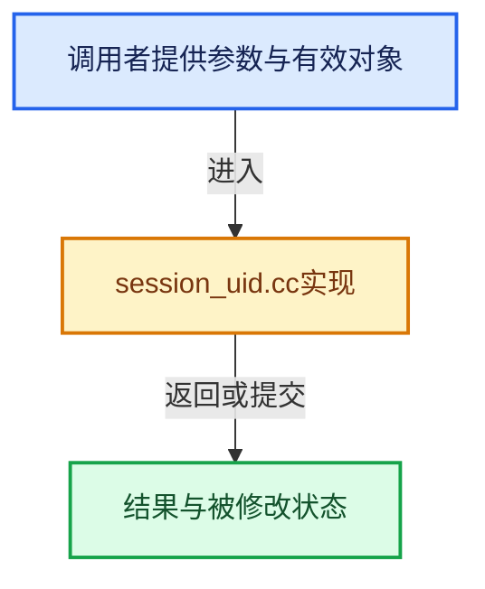

# 实现依赖专题：source/blender/blenlib/intern/session_uid.cc

[实现依赖导航](../../README.md) · [符号索引](../../../00-课程指南/02-源码与提交索引/符号依赖与实现索引.md)

本专题从正文实际调用进入，集中保存共享实现。函数有稳定锚点，可从调用处直接跳到对应完整函数；递归与互相调用通过回链组织。

## 本文件的实现关系





## 完整成员与函数实现

<a id="f-7385fbe8b65b714c"></a>

### `blender::BLI_session_uid_generate`

实现位置：[source/blender/blenlib/intern/session_uid.cc](../../../../../../../source/blender/blenlib/intern/session_uid.cc) · L19—L33。

**教学注释版**

<!-- annotated:9017820479d3b9 -->

```cpp
SessionUID BLI_session_uid_generate()
{
  SessionUID result;
  result.uid_ = atomic_add_and_fetch_uint64(&global_session_uid.uid_, 1);
  if (!result.is_generated()) {
    /* Happens when the UID overflows.
     *
     * Just request the UID once again, hoping that there are not a lot of high-priority threads
     * which will overflow the counter once again between the previous call and this one.
     *
     * NOTE: It is possible to have collisions after such overflow. */
    result.uid_ = atomic_add_and_fetch_uint64(&global_session_uid.uid_, 1);
  }
  return result;
}
```

<details>
<summary>核对原始源码：source/blender/blenlib/intern/session_uid.cc · L19—L33</summary>

<!-- original:9017820479d3b9:source/blender/blenlib/intern/session_uid.cc:19:33 -->

```cpp
SessionUID BLI_session_uid_generate()
{
  SessionUID result;
  result.uid_ = atomic_add_and_fetch_uint64(&global_session_uid.uid_, 1);
  if (!result.is_generated()) {
    /* Happens when the UID overflows.
     *
     * Just request the UID once again, hoping that there are not a lot of high-priority threads
     * which will overflow the counter once again between the previous call and this one.
     *
     * NOTE: It is possible to have collisions after such overflow. */
    result.uid_ = atomic_add_and_fetch_uint64(&global_session_uid.uid_, 1);
  }
  return result;
}
```

</details>

**沿实际写入检查状态**

- `result.uid_ = atomic_add_and_fetch_uint64(&global_session_uid.uid_, 1);`

**结果出口**

- `return result;`

**继续追踪实现**

- `atomic_add_and_fetch_uint64` → [atomic_add_and_fetch_uint64 · L201](../../07-Intern运行时与平台/atomic/intern/atomic_ops_unix.h.md#f-0e7c802ba1d56748)；[atomic_add_and_fetch_uint64 · L293](../../07-Intern运行时与平台/atomic/intern/atomic_ops_unix.h.md#f-0ebba2fb24e8e989)；[atomic_add_and_fetch_uint64 · L63](../../07-Intern运行时与平台/atomic/intern/atomic_ops_msvc.h.md#f-ee2943926eb39bf4)。同名重载需按实参类型选择。
- `result.is_generated` → [blender::SessionUID::is_generated · L50](../../08-其他Blender模块/makesdna/DNA_session_uid_types.h.md#f-3b9ea9edaf7a2745)。
