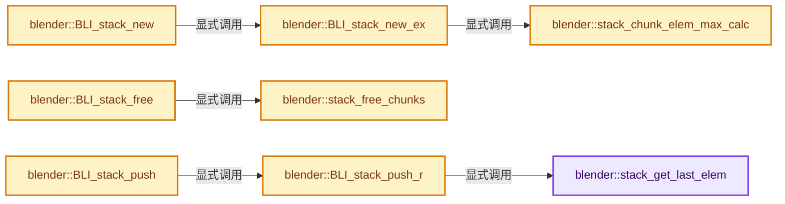
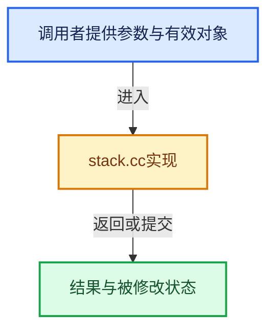

# 实现依赖专题：source/blender/blenlib/intern/stack.cc

[实现依赖导航](../../README.md) · [符号索引](../../../00-课程指南/02-源码与提交索引/符号依赖与实现索引.md)

本专题从正文实际调用进入，集中保存共享实现。函数有稳定锚点，可从调用处直接跳到对应完整函数；递归与互相调用通过回链组织。

## 本文件的实现关系






## 完整成员与函数实现

<a id="f-1357ca6cf12b0ba5"></a>

### `blender::stack_get_last_elem`

实现位置：[source/blender/blenlib/intern/stack.cc](../../../../../../../source/blender/blenlib/intern/stack.cc) · L45—L49。

接口参数：

- `BLI_Stack *stack`

**教学注释版**

<!-- annotated:146c1e76d105ab -->

```cpp
static void *stack_get_last_elem(BLI_Stack *stack)
{
  return (static_cast<char *>((stack)->chunk_curr->data)) +
         ((stack)->elem_size * (stack)->chunk_index);
}
```

<details>
<summary>核对原始源码：source/blender/blenlib/intern/stack.cc · L45—L49</summary>

<!-- original:146c1e76d105ab:source/blender/blenlib/intern/stack.cc:45:49 -->

```cpp
static void *stack_get_last_elem(BLI_Stack *stack)
{
  return (static_cast<char *>((stack)->chunk_curr->data)) +
         ((stack)->elem_size * (stack)->chunk_index);
}
```

</details>

**结果出口**

- `return (static_cast<char *>((stack)->chunk_curr->data)) +`

**继续追踪实现**

本实现没有需要继续展开的显式调用；检查返回表达式、对象转换和调用者前置条件。

<a id="f-2cc71b265af0b2d6"></a>

### `blender::stack_chunk_elem_max_calc`

实现位置：[source/blender/blenlib/intern/stack.cc](../../../../../../../source/blender/blenlib/intern/stack.cc) · L54—L69。

接口参数：

- `const size_t elem_size`
- `size_t chunk_size`

**教学注释版**

<!-- annotated:60f6a7d921a6e2 -->

```cpp
static size_t stack_chunk_elem_max_calc(const size_t elem_size, size_t chunk_size)
{
  /* get at least this number of elems per chunk */
  const size_t elem_size_min = elem_size * CHUNK_ELEM_MIN;

  BLI_assert((elem_size != 0) && (chunk_size != 0));

  while (chunk_size <= elem_size_min) [[unlikely]] {
    chunk_size <<= 1;
  }

  /* account for slop-space */
  chunk_size -= (sizeof(StackChunk) + MEM_SIZE_OVERHEAD);

  return chunk_size / elem_size;
}
```

<details>
<summary>核对原始源码：source/blender/blenlib/intern/stack.cc · L54—L69</summary>

<!-- original:60f6a7d921a6e2:source/blender/blenlib/intern/stack.cc:54:69 -->

```cpp
static size_t stack_chunk_elem_max_calc(const size_t elem_size, size_t chunk_size)
{
  /* get at least this number of elems per chunk */
  const size_t elem_size_min = elem_size * CHUNK_ELEM_MIN;

  BLI_assert((elem_size != 0) && (chunk_size != 0));

  while (chunk_size <= elem_size_min) [[unlikely]] {
    chunk_size <<= 1;
  }

  /* account for slop-space */
  chunk_size -= (sizeof(StackChunk) + MEM_SIZE_OVERHEAD);

  return chunk_size / elem_size;
}
```

</details>

**沿实际写入检查状态**

- `chunk_size -= (sizeof(StackChunk) + MEM_SIZE_OVERHEAD);`

**结果出口**

- `return chunk_size / elem_size;`

**继续追踪实现**

- `BLI_assert` → [BLI_assert · L48](../BLI_assert.hh.md#m-57a88495704d)；[BLI_assert · L63](../BLI_assert.hh.md#m-d07050020cb5)。宏定义由构建条件选择。

<a id="f-4d6da14319597e26"></a>

### `blender::BLI_stack_new_ex`

实现位置：[source/blender/blenlib/intern/stack.cc](../../../../../../../source/blender/blenlib/intern/stack.cc) · L71—L83。

接口参数：

- `const size_t elem_size`
- `const char *description`
- `const size_t chunk_size`

**教学注释版**

<!-- annotated:e1d534937fad33 -->

```cpp
BLI_Stack *BLI_stack_new_ex(const size_t elem_size,
                            const char *description,
                            const size_t chunk_size)
{
  BLI_Stack *stack = MEM_new_zeroed<BLI_Stack>(description);

  stack->chunk_elem_max = stack_chunk_elem_max_calc(elem_size, chunk_size);
  stack->elem_size = elem_size;
  /* force init */
  stack->chunk_index = stack->chunk_elem_max - 1;

  return stack;
}
```

<details>
<summary>核对原始源码：source/blender/blenlib/intern/stack.cc · L71—L83</summary>

<!-- original:e1d534937fad33:source/blender/blenlib/intern/stack.cc:71:83 -->

```cpp
BLI_Stack *BLI_stack_new_ex(const size_t elem_size,
                            const char *description,
                            const size_t chunk_size)
{
  BLI_Stack *stack = MEM_new_zeroed<BLI_Stack>(description);

  stack->chunk_elem_max = stack_chunk_elem_max_calc(elem_size, chunk_size);
  stack->elem_size = elem_size;
  /* force init */
  stack->chunk_index = stack->chunk_elem_max - 1;

  return stack;
}
```

</details>

**沿实际写入检查状态**

- `stack->chunk_elem_max = stack_chunk_elem_max_calc(elem_size, chunk_size);`
- `stack->elem_size = elem_size;`
- `stack->chunk_index = stack->chunk_elem_max - 1;`

**结果出口**

- `return stack;`

**继续追踪实现**

- `MEM_new_zeroed<BLI_Stack>` → [MEM_new_zeroed · L550](../../07-Intern运行时与平台/guardedalloc/MEM_guardedalloc.h.md#f-eeb1e2a7f57dd231)；[MEM_new_zeroed · L114](../../07-Intern运行时与平台/guardedalloc/intern/mallocn.cc.md#f-e04cf01c64c8b180)。同名重载需按实参类型选择。
- `stack_chunk_elem_max_calc` → [blender::stack_chunk_elem_max_calc · L54](stack.cc.md#f-2cc71b265af0b2d6)。

<a id="f-72ccc69502685ca2"></a>

### `blender::BLI_stack_new`

实现位置：[source/blender/blenlib/intern/stack.cc](../../../../../../../source/blender/blenlib/intern/stack.cc) · L85—L88。

接口参数：

- `const size_t elem_size`
- `const char *description`

**教学注释版**

<!-- annotated:31c5b587d0c8b9 -->

```cpp
BLI_Stack *BLI_stack_new(const size_t elem_size, const char *description)
{
  return BLI_stack_new_ex(elem_size, description, CHUNK_SIZE_DEFAULT);
}
```

<details>
<summary>核对原始源码：source/blender/blenlib/intern/stack.cc · L85—L88</summary>

<!-- original:31c5b587d0c8b9:source/blender/blenlib/intern/stack.cc:85:88 -->

```cpp
BLI_Stack *BLI_stack_new(const size_t elem_size, const char *description)
{
  return BLI_stack_new_ex(elem_size, description, CHUNK_SIZE_DEFAULT);
}
```

</details>

**结果出口**

- `return BLI_stack_new_ex(elem_size, description, CHUNK_SIZE_DEFAULT);`

**继续追踪实现**

- `BLI_stack_new_ex` → [blender::BLI_stack_new_ex · L71](stack.cc.md#f-4d6da14319597e26)。

<a id="f-2d22389cb9a53b13"></a>

### `blender::stack_free_chunks`

实现位置：[source/blender/blenlib/intern/stack.cc](../../../../../../../source/blender/blenlib/intern/stack.cc) · L90—L97。

接口参数：

- `StackChunk *data`

**教学注释版**

<!-- annotated:57906a3d6813c2 -->

```cpp
static void stack_free_chunks(StackChunk *data)
{
  while (data) {
    StackChunk *data_next = data->next;
    MEM_delete(data);
    data = data_next;
  }
}
```

<details>
<summary>核对原始源码：source/blender/blenlib/intern/stack.cc · L90—L97</summary>

<!-- original:57906a3d6813c2:source/blender/blenlib/intern/stack.cc:90:97 -->

```cpp
static void stack_free_chunks(StackChunk *data)
{
  while (data) {
    StackChunk *data_next = data->next;
    MEM_delete(data);
    data = data_next;
  }
}
```

</details>

**沿实际写入检查状态**

- `data = data_next;`

**继续追踪实现**

- `MEM_delete` → [MEM_delete · L400](../../07-Intern运行时与平台/guardedalloc/MEM_guardedalloc.h.md#f-9049ffdd1682887c)。

<a id="f-f9bf85f0324bff40"></a>

### `blender::BLI_stack_free`

实现位置：[source/blender/blenlib/intern/stack.cc](../../../../../../../source/blender/blenlib/intern/stack.cc) · L99—L104。

接口参数：

- `BLI_Stack *stack`

**教学注释版**

<!-- annotated:710e11bb54069c -->

```cpp
void BLI_stack_free(BLI_Stack *stack)
{
  stack_free_chunks(stack->chunk_curr);
  stack_free_chunks(stack->chunk_free);
  MEM_delete(stack);
}
```

<details>
<summary>核对原始源码：source/blender/blenlib/intern/stack.cc · L99—L104</summary>

<!-- original:710e11bb54069c:source/blender/blenlib/intern/stack.cc:99:104 -->

```cpp
void BLI_stack_free(BLI_Stack *stack)
{
  stack_free_chunks(stack->chunk_curr);
  stack_free_chunks(stack->chunk_free);
  MEM_delete(stack);
}
```

</details>

**继续追踪实现**

- `stack_free_chunks` → [blender::stack_free_chunks · L90](stack.cc.md#f-2d22389cb9a53b13)。
- `MEM_delete` → [MEM_delete · L400](../../07-Intern运行时与平台/guardedalloc/MEM_guardedalloc.h.md#f-9049ffdd1682887c)。

<a id="f-c3af3ab25f8b7d74"></a>

### `blender::BLI_stack_push_r`

实现位置：[source/blender/blenlib/intern/stack.cc](../../../../../../../source/blender/blenlib/intern/stack.cc) · L106—L133。

接口参数：

- `BLI_Stack *stack`

**教学注释版**

<!-- annotated:a469d708c94a5c -->

```cpp
void *BLI_stack_push_r(BLI_Stack *stack)
{
  stack->chunk_index++;

  if (stack->chunk_index == stack->chunk_elem_max) [[unlikely]] {
    StackChunk *chunk;
    if (stack->chunk_free) {
      chunk = stack->chunk_free;
      stack->chunk_free = chunk->next;
    }
    else {
      chunk = static_cast<StackChunk *>(MEM_new_uninitialized(
          sizeof(*chunk) + (stack->elem_size * stack->chunk_elem_max), __func__));
    }
    chunk->next = stack->chunk_curr;
    stack->chunk_curr = chunk;
    stack->chunk_index = 0;
  }

  BLI_assert(stack->chunk_index < stack->chunk_elem_max);

#ifdef USE_TOTELEM
  stack->elem_num++;
#endif

  /* Return end of stack */
  return stack_get_last_elem(stack);
}
```

<details>
<summary>核对原始源码：source/blender/blenlib/intern/stack.cc · L106—L133</summary>

<!-- original:a469d708c94a5c:source/blender/blenlib/intern/stack.cc:106:133 -->

```cpp
void *BLI_stack_push_r(BLI_Stack *stack)
{
  stack->chunk_index++;

  if (stack->chunk_index == stack->chunk_elem_max) [[unlikely]] {
    StackChunk *chunk;
    if (stack->chunk_free) {
      chunk = stack->chunk_free;
      stack->chunk_free = chunk->next;
    }
    else {
      chunk = static_cast<StackChunk *>(MEM_new_uninitialized(
          sizeof(*chunk) + (stack->elem_size * stack->chunk_elem_max), __func__));
    }
    chunk->next = stack->chunk_curr;
    stack->chunk_curr = chunk;
    stack->chunk_index = 0;
  }

  BLI_assert(stack->chunk_index < stack->chunk_elem_max);

#ifdef USE_TOTELEM
  stack->elem_num++;
#endif

  /* Return end of stack */
  return stack_get_last_elem(stack);
}
```

</details>

**沿实际写入检查状态**

- `chunk = stack->chunk_free;`
- `stack->chunk_free = chunk->next;`
- `chunk = static_cast<StackChunk *>(MEM_new_uninitialized(`
- `chunk->next = stack->chunk_curr;`
- `stack->chunk_curr = chunk;`
- `stack->chunk_index = 0;`

**结果出口**

- `return stack_get_last_elem(stack);`

**继续追踪实现**

- `MEM_new_uninitialized` → [MEM_new_uninitialized · L590](../../07-Intern运行时与平台/guardedalloc/MEM_guardedalloc.h.md#f-c773b2e5b8fe70e4)；[MEM_new_uninitialized · L124](../../07-Intern运行时与平台/guardedalloc/intern/mallocn.cc.md#f-28a7e00a1e67f699)。同名重载需按实参类型选择。
- `BLI_assert` → [BLI_assert · L48](../BLI_assert.hh.md#m-57a88495704d)；[BLI_assert · L63](../BLI_assert.hh.md#m-d07050020cb5)。宏定义由构建条件选择。
- `stack_get_last_elem` → [blender::stack_get_last_elem · L45](stack.cc.md#f-1357ca6cf12b0ba5)。

<a id="f-bb4e354dbf7dfc9f"></a>

### `blender::BLI_stack_push`

实现位置：[source/blender/blenlib/intern/stack.cc](../../../../../../../source/blender/blenlib/intern/stack.cc) · L135—L139。

接口参数：

- `BLI_Stack *stack`
- `const void *src`

**教学注释版**

<!-- annotated:d28820482b39cd -->

```cpp
void BLI_stack_push(BLI_Stack *stack, const void *src)
{
  void *dst = BLI_stack_push_r(stack);
  // [讲解] memcpy：复制字节，源与目标不应重叠。类型生命周期、对齐和可复制表示须由调用者证明，不是任意对象的复制构造。
  memcpy(dst, src, stack->elem_size);
}
```

<details>
<summary>核对原始源码：source/blender/blenlib/intern/stack.cc · L135—L139</summary>

<!-- original:d28820482b39cd:source/blender/blenlib/intern/stack.cc:135:139 -->

```cpp
void BLI_stack_push(BLI_Stack *stack, const void *src)
{
  void *dst = BLI_stack_push_r(stack);
  memcpy(dst, src, stack->elem_size);
}
```

</details>

**继续追踪实现**

- `BLI_stack_push_r` → [blender::BLI_stack_push_r · L106](stack.cc.md#f-c3af3ab25f8b7d74)。
- `memcpy` → [外部契约](https://eel.is/c++draft/cstring.syn)：复制字节，源与目标不应重叠。类型生命周期、对齐和可复制表示须由调用者证明，不是任意对象的复制构造。

<a id="f-0b0b7cc78d801919"></a>

### `blender::BLI_stack_pop`

实现位置：[source/blender/blenlib/intern/stack.cc](../../../../../../../source/blender/blenlib/intern/stack.cc) · L141—L148。

接口参数：

- `BLI_Stack *stack`
- `void *dst`

**教学注释版**

<!-- annotated:53543e54cb3ed9 -->

```cpp
void BLI_stack_pop(BLI_Stack *stack, void *dst)
{
  BLI_assert(BLI_stack_is_empty(stack) == false);

  // [讲解] memcpy：复制字节，源与目标不应重叠。类型生命周期、对齐和可复制表示须由调用者证明，不是任意对象的复制构造。
  memcpy(dst, stack_get_last_elem(stack), stack->elem_size);

  BLI_stack_discard(stack);
}
```

<details>
<summary>核对原始源码：source/blender/blenlib/intern/stack.cc · L141—L148</summary>

<!-- original:53543e54cb3ed9:source/blender/blenlib/intern/stack.cc:141:148 -->

```cpp
void BLI_stack_pop(BLI_Stack *stack, void *dst)
{
  BLI_assert(BLI_stack_is_empty(stack) == false);

  memcpy(dst, stack_get_last_elem(stack), stack->elem_size);

  BLI_stack_discard(stack);
}
```

</details>

**继续追踪实现**

- `BLI_assert` → [BLI_assert · L48](../BLI_assert.hh.md#m-57a88495704d)；[BLI_assert · L63](../BLI_assert.hh.md#m-d07050020cb5)。宏定义由构建条件选择。
- `BLI_stack_is_empty` → [blender::BLI_stack_is_empty · L253](stack.cc.md#f-bf424cdd09c84fd1)。
- `memcpy` → [外部契约](https://eel.is/c++draft/cstring.syn)：复制字节，源与目标不应重叠。类型生命周期、对齐和可复制表示须由调用者证明，不是任意对象的复制构造。
- `stack_get_last_elem` → [blender::stack_get_last_elem · L45](stack.cc.md#f-1357ca6cf12b0ba5)。
- `BLI_stack_discard` → [blender::BLI_stack_discard · L179](stack.cc.md#f-b5f81eeb4bb96ab2)。

<a id="f-ba9a8412053b963f"></a>

### `blender::BLI_stack_pop_n`

实现位置：[source/blender/blenlib/intern/stack.cc](../../../../../../../source/blender/blenlib/intern/stack.cc) · L150—L158。

接口参数：

- `BLI_Stack *stack`
- `void *dst`
- `uint n`

**教学注释版**

<!-- annotated:6df47853174ea6 -->

```cpp
void BLI_stack_pop_n(BLI_Stack *stack, void *dst, uint n)
{
  BLI_assert(n <= BLI_stack_count(stack));

  while (n--) {
    BLI_stack_pop(stack, dst);
    dst = static_cast<void *>(static_cast<char *>(dst) + stack->elem_size);
  }
}
```

<details>
<summary>核对原始源码：source/blender/blenlib/intern/stack.cc · L150—L158</summary>

<!-- original:6df47853174ea6:source/blender/blenlib/intern/stack.cc:150:158 -->

```cpp
void BLI_stack_pop_n(BLI_Stack *stack, void *dst, uint n)
{
  BLI_assert(n <= BLI_stack_count(stack));

  while (n--) {
    BLI_stack_pop(stack, dst);
    dst = static_cast<void *>(static_cast<char *>(dst) + stack->elem_size);
  }
}
```

</details>

**沿实际写入检查状态**

- `dst = static_cast<void *>(static_cast<char *>(dst) + stack->elem_size);`

**继续追踪实现**

- `BLI_assert` → [BLI_assert · L48](../BLI_assert.hh.md#m-57a88495704d)；[BLI_assert · L63](../BLI_assert.hh.md#m-d07050020cb5)。宏定义由构建条件选择。
- `BLI_stack_count` → [blender::BLI_stack_count · L231](stack.cc.md#f-d62c3e1e5663077b)。
- `BLI_stack_pop` → [blender::BLI_stack_pop · L141](stack.cc.md#f-0b0b7cc78d801919)。

<a id="f-b5f81eeb4bb96ab2"></a>

### `blender::BLI_stack_discard`

实现位置：[source/blender/blenlib/intern/stack.cc](../../../../../../../source/blender/blenlib/intern/stack.cc) · L179—L197。

接口参数：

- `BLI_Stack *stack`

**教学注释版**

<!-- annotated:d08edc6b08bd05 -->

```cpp
void BLI_stack_discard(BLI_Stack *stack)
{
  BLI_assert(BLI_stack_is_empty(stack) == false);

#ifdef USE_TOTELEM
  stack->elem_num--;
#endif
  if (--stack->chunk_index == CHUNK_EMPTY) [[unlikely]] {
    StackChunk *chunk_free;

    chunk_free = stack->chunk_curr;
    stack->chunk_curr = stack->chunk_curr->next;

    chunk_free->next = stack->chunk_free;
    stack->chunk_free = chunk_free;

    stack->chunk_index = stack->chunk_elem_max - 1;
  }
}
```

<details>
<summary>核对原始源码：source/blender/blenlib/intern/stack.cc · L179—L197</summary>

<!-- original:d08edc6b08bd05:source/blender/blenlib/intern/stack.cc:179:197 -->

```cpp
void BLI_stack_discard(BLI_Stack *stack)
{
  BLI_assert(BLI_stack_is_empty(stack) == false);

#ifdef USE_TOTELEM
  stack->elem_num--;
#endif
  if (--stack->chunk_index == CHUNK_EMPTY) [[unlikely]] {
    StackChunk *chunk_free;

    chunk_free = stack->chunk_curr;
    stack->chunk_curr = stack->chunk_curr->next;

    chunk_free->next = stack->chunk_free;
    stack->chunk_free = chunk_free;

    stack->chunk_index = stack->chunk_elem_max - 1;
  }
}
```

</details>

**沿实际写入检查状态**

- `chunk_free = stack->chunk_curr;`
- `stack->chunk_curr = stack->chunk_curr->next;`
- `chunk_free->next = stack->chunk_free;`
- `stack->chunk_free = chunk_free;`
- `stack->chunk_index = stack->chunk_elem_max - 1;`

**继续追踪实现**

- `BLI_assert` → [BLI_assert · L48](../BLI_assert.hh.md#m-57a88495704d)；[BLI_assert · L63](../BLI_assert.hh.md#m-d07050020cb5)。宏定义由构建条件选择。
- `BLI_stack_is_empty` → [blender::BLI_stack_is_empty · L253](stack.cc.md#f-bf424cdd09c84fd1)。

<a id="f-d62c3e1e5663077b"></a>

### `blender::BLI_stack_count`

实现位置：[source/blender/blenlib/intern/stack.cc](../../../../../../../source/blender/blenlib/intern/stack.cc) · L231—L251。

接口参数：

- `const BLI_Stack *stack`

**教学注释版**

<!-- annotated:37e8c82ed7fac5 -->

```cpp
size_t BLI_stack_count(const BLI_Stack *stack)
{
#ifdef USE_TOTELEM
  return stack->elem_num;
#else
  StackChunk *data = stack->chunk_curr;
  size_t elem_num = stack->chunk_index + 1;
  size_t i;
  if (elem_num != stack->chunk_elem_max) {
    data = data->next;
  }
  else {
    elem_num = 0;
  }
  for (i = 0; data; data = data->next) {
    i++;
  }
  elem_num += stack->chunk_elem_max * i;
  return elem_num;
#endif
}
```

<details>
<summary>核对原始源码：source/blender/blenlib/intern/stack.cc · L231—L251</summary>

<!-- original:37e8c82ed7fac5:source/blender/blenlib/intern/stack.cc:231:251 -->

```cpp
size_t BLI_stack_count(const BLI_Stack *stack)
{
#ifdef USE_TOTELEM
  return stack->elem_num;
#else
  StackChunk *data = stack->chunk_curr;
  size_t elem_num = stack->chunk_index + 1;
  size_t i;
  if (elem_num != stack->chunk_elem_max) {
    data = data->next;
  }
  else {
    elem_num = 0;
  }
  for (i = 0; data; data = data->next) {
    i++;
  }
  elem_num += stack->chunk_elem_max * i;
  return elem_num;
#endif
}
```

</details>

**沿实际写入检查状态**

- `data = data->next;`
- `elem_num = 0;`
- `elem_num += stack->chunk_elem_max * i;`

**结果出口**

- `return stack->elem_num;`
- `return elem_num;`

**继续追踪实现**

本实现没有需要继续展开的显式调用；检查返回表达式、对象转换和调用者前置条件。

<a id="f-bf424cdd09c84fd1"></a>

### `blender::BLI_stack_is_empty`

实现位置：[source/blender/blenlib/intern/stack.cc](../../../../../../../source/blender/blenlib/intern/stack.cc) · L253—L259。

接口参数：

- `const BLI_Stack *stack`

**教学注释版**

<!-- annotated:0c29587f6a9d23 -->

```cpp
bool BLI_stack_is_empty(const BLI_Stack *stack)
{
#ifdef USE_TOTELEM
  BLI_assert((stack->chunk_curr == nullptr) == (stack->elem_num == 0));
#endif
  return (stack->chunk_curr == nullptr);
}
```

<details>
<summary>核对原始源码：source/blender/blenlib/intern/stack.cc · L253—L259</summary>

<!-- original:0c29587f6a9d23:source/blender/blenlib/intern/stack.cc:253:259 -->

```cpp
bool BLI_stack_is_empty(const BLI_Stack *stack)
{
#ifdef USE_TOTELEM
  BLI_assert((stack->chunk_curr == nullptr) == (stack->elem_num == 0));
#endif
  return (stack->chunk_curr == nullptr);
}
```

</details>

**结果出口**

- `return (stack->chunk_curr == nullptr);`

**继续追踪实现**

- `BLI_assert` → [BLI_assert · L48](../BLI_assert.hh.md#m-57a88495704d)；[BLI_assert · L63](../BLI_assert.hh.md#m-d07050020cb5)。宏定义由构建条件选择。
