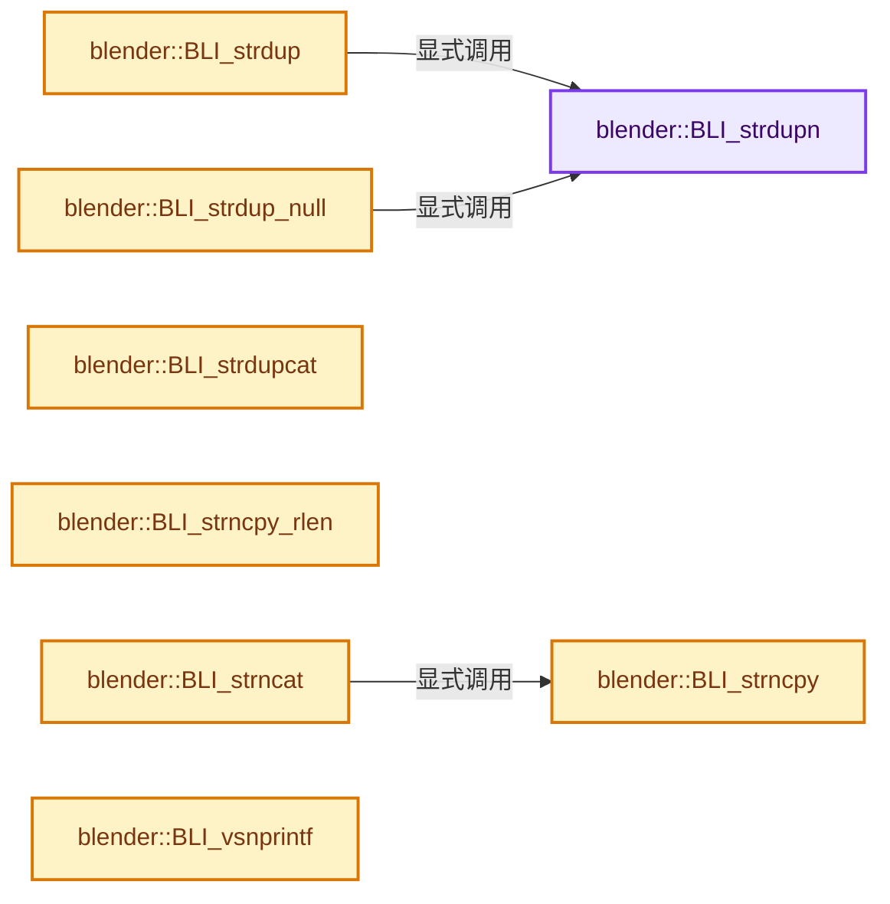
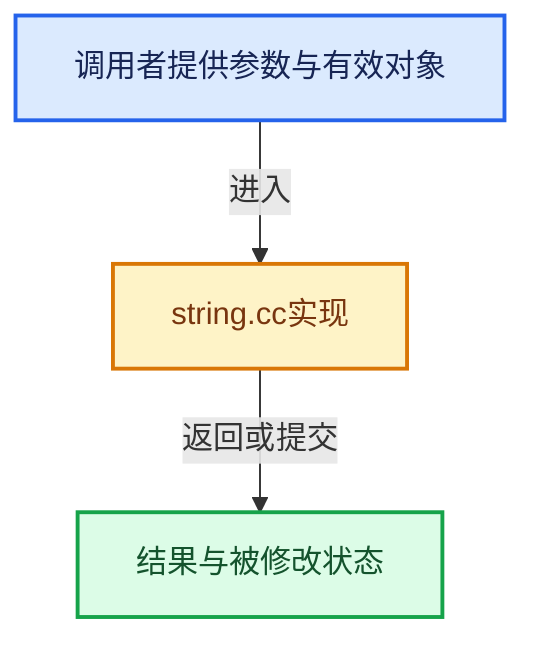

# 实现依赖专题：source/blender/blenlib/intern/string.cc

[实现依赖导航](../../README.md) · [符号索引](../../../00-课程指南/02-源码与提交索引/符号依赖与实现索引.md)

本专题从正文实际调用进入，集中保存共享实现。函数有稳定锚点，可从调用处直接跳到对应完整函数；递归与互相调用通过回链组织。

## 本文件的实现关系






## 完整成员与函数实现

<a id="f-65dc033cf6e67cff"></a>

### `blender::BLI_strdupn`

实现位置：[source/blender/blenlib/intern/string.cc](../../../../../../../source/blender/blenlib/intern/string.cc) · L32—L41。

接口参数：

- `const char *str`
- `const size_t len`

**教学注释版**

<!-- annotated:e8ac65a3ecd092 -->

```cpp
char *BLI_strdupn(const char *str, const size_t len)
{
  BLI_assert_msg(BLI_strnlen(str, len) == len, "strlen(str) must be greater or equal to 'len'!");

  char *n = MEM_new_array_uninitialized<char>(len + 1, "strdup");
  // [讲解] memcpy：复制字节，源与目标不应重叠。类型生命周期、对齐和可复制表示须由调用者证明，不是任意对象的复制构造。
  memcpy(n, str, len);
  n[len] = '\0';

  return n;
}
```

<details>
<summary>核对原始源码：source/blender/blenlib/intern/string.cc · L32—L41</summary>

<!-- original:e8ac65a3ecd092:source/blender/blenlib/intern/string.cc:32:41 -->

```cpp
char *BLI_strdupn(const char *str, const size_t len)
{
  BLI_assert_msg(BLI_strnlen(str, len) == len, "strlen(str) must be greater or equal to 'len'!");

  char *n = MEM_new_array_uninitialized<char>(len + 1, "strdup");
  memcpy(n, str, len);
  n[len] = '\0';

  return n;
}
```

</details>

**沿实际写入检查状态**

- `n[len] = '\0';`

**结果出口**

- `return n;`

**继续追踪实现**

- `BLI_assert_msg` → [BLI_assert_msg · L55](../BLI_assert.hh.md#m-695eed20dceb)；[BLI_assert_msg · L64](../BLI_assert.hh.md#m-7de5563de4db)。宏定义由构建条件选择。
- `BLI_strnlen` → [blender::BLI_strnlen · L919](string.cc.md#f-137cab173af92dd4)。
- `MEM_new_array_uninitialized<char>` → [MEM_new_array_uninitialized · L608](../../07-Intern运行时与平台/guardedalloc/MEM_guardedalloc.h.md#f-b7103eae8eb57b05)；[MEM_new_array_uninitialized · L129](../../07-Intern运行时与平台/guardedalloc/intern/mallocn.cc.md#f-bf6ef4ddcfb6e5df)。同名重载需按实参类型选择。
- `memcpy` → [外部契约](https://eel.is/c++draft/cstring.syn)：复制字节，源与目标不应重叠。类型生命周期、对齐和可复制表示须由调用者证明，不是任意对象的复制构造。

<a id="f-7e6d5c696c20c0e1"></a>

### `blender::BLI_strdup`

实现位置：[source/blender/blenlib/intern/string.cc](../../../../../../../source/blender/blenlib/intern/string.cc) · L43—L46。

接口参数：

- `const char *str`

**教学注释版**

<!-- annotated:c0b775b8fab1a1 -->

```cpp
char *BLI_strdup(const char *str)
{
  return BLI_strdupn(str, strlen(str));
}
```

<details>
<summary>核对原始源码：source/blender/blenlib/intern/string.cc · L43—L46</summary>

<!-- original:c0b775b8fab1a1:source/blender/blenlib/intern/string.cc:43:46 -->

```cpp
char *BLI_strdup(const char *str)
{
  return BLI_strdupn(str, strlen(str));
}
```

</details>

**结果出口**

- `return BLI_strdupn(str, strlen(str));`

**继续追踪实现**

- `BLI_strdupn` → [blender::BLI_strdupn · L32](string.cc.md#f-65dc033cf6e67cff)。
- `strlen` → [外部契约](https://eel.is/c++draft/)：这个边界按实际表达式及所属类型核对参数、返回值、寿命与失败行为。这里提供接口入口，不声称已解释该第三方版本的内部实现。

<a id="f-c1cd7c6336fe3fe0"></a>

### `blender::BLI_strdup_null`

实现位置：[source/blender/blenlib/intern/string.cc](../../../../../../../source/blender/blenlib/intern/string.cc) · L48—L51。

接口参数：

- `const char *str`

**教学注释版**

<!-- annotated:85d11143534625 -->

```cpp
char *BLI_strdup_null(const char *str)
{
  return (str != nullptr) ? BLI_strdupn(str, strlen(str)) : nullptr;
}
```

<details>
<summary>核对原始源码：source/blender/blenlib/intern/string.cc · L48—L51</summary>

<!-- original:85d11143534625:source/blender/blenlib/intern/string.cc:48:51 -->

```cpp
char *BLI_strdup_null(const char *str)
{
  return (str != nullptr) ? BLI_strdupn(str, strlen(str)) : nullptr;
}
```

</details>

**结果出口**

- `return (str != nullptr) ? BLI_strdupn(str, strlen(str)) : nullptr;`

**继续追踪实现**

- `BLI_strdupn` → [blender::BLI_strdupn · L32](string.cc.md#f-65dc033cf6e67cff)。
- `strlen` → [外部契约](https://eel.is/c++draft/)：这个边界按实际表达式及所属类型核对参数、返回值、寿命与失败行为。这里提供接口入口，不声称已解释该第三方版本的内部实现。

<a id="f-900012b477ce45da"></a>

### `blender::BLI_strdupcat`

实现位置：[source/blender/blenlib/intern/string.cc](../../../../../../../source/blender/blenlib/intern/string.cc) · L53—L68。

接口参数：

- `const char *__restrict str1`
- `const char *__restrict str2`

**教学注释版**

<!-- annotated:507987e2efdbbc -->

```cpp
char *BLI_strdupcat(const char *__restrict str1, const char *__restrict str2)
{
  /* Include the null terminator of `str2` only. */
  const size_t str1_len = strlen(str1);
  const size_t str2_len = strlen(str2) + 1;
  char *str, *s;

  str = MEM_new_array_zeroed<char>(str1_len + str2_len, "strdupcat");
  s = str;

  // [讲解] memcpy：复制字节，源与目标不应重叠。类型生命周期、对齐和可复制表示须由调用者证明，不是任意对象的复制构造。
  memcpy(s, str1, str1_len); /* NOLINT: bugprone-not-null-terminated-result */
  s += str1_len;
  memcpy(s, str2, str2_len);

  return str;
}
```

<details>
<summary>核对原始源码：source/blender/blenlib/intern/string.cc · L53—L68</summary>

<!-- original:507987e2efdbbc:source/blender/blenlib/intern/string.cc:53:68 -->

```cpp
char *BLI_strdupcat(const char *__restrict str1, const char *__restrict str2)
{
  /* Include the null terminator of `str2` only. */
  const size_t str1_len = strlen(str1);
  const size_t str2_len = strlen(str2) + 1;
  char *str, *s;

  str = MEM_new_array_zeroed<char>(str1_len + str2_len, "strdupcat");
  s = str;

  memcpy(s, str1, str1_len); /* NOLINT: bugprone-not-null-terminated-result */
  s += str1_len;
  memcpy(s, str2, str2_len);

  return str;
}
```

</details>

**沿实际写入检查状态**

- `str = MEM_new_array_zeroed<char>(str1_len + str2_len, "strdupcat");`
- `s = str;`
- `s += str1_len;`

**结果出口**

- `return str;`

**继续追踪实现**

- `strlen` → [外部契约](https://eel.is/c++draft/)：这个边界按实际表达式及所属类型核对参数、返回值、寿命与失败行为。这里提供接口入口，不声称已解释该第三方版本的内部实现。
- `MEM_new_array_zeroed<char>` → [MEM_new_array_zeroed · L566](../../07-Intern运行时与平台/guardedalloc/MEM_guardedalloc.h.md#f-3a0cf63fb5216500)；[MEM_new_array_zeroed · L119](../../07-Intern运行时与平台/guardedalloc/intern/mallocn.cc.md#f-6825557da566fdbe)。同名重载需按实参类型选择。
- `memcpy` → [外部契约](https://eel.is/c++draft/cstring.syn)：复制字节，源与目标不应重叠。类型生命周期、对齐和可复制表示须由调用者证明，不是任意对象的复制构造。

<a id="f-6324147b0d116da1"></a>

### `blender::BLI_strncpy`

实现位置：[source/blender/blenlib/intern/string.cc](../../../../../../../source/blender/blenlib/intern/string.cc) · L70—L80。

接口参数：

- `char *__restrict dst`
- `const char *__restrict src`
- `const size_t dst_maxncpy`

**教学注释版**

<!-- annotated:56e3acf0e90c70 -->

```cpp
char *BLI_strncpy(char *__restrict dst, const char *__restrict src, const size_t dst_maxncpy)
{
  BLI_string_debug_size(dst, dst_maxncpy);

  BLI_assert(dst_maxncpy != 0);
  size_t srclen = BLI_strnlen(src, dst_maxncpy - 1);

  // [讲解] memcpy：复制字节，源与目标不应重叠。类型生命周期、对齐和可复制表示须由调用者证明，不是任意对象的复制构造。
  memcpy(dst, src, srclen);
  dst[srclen] = '\0';
  return dst;
}
```

<details>
<summary>核对原始源码：source/blender/blenlib/intern/string.cc · L70—L80</summary>

<!-- original:56e3acf0e90c70:source/blender/blenlib/intern/string.cc:70:80 -->

```cpp
char *BLI_strncpy(char *__restrict dst, const char *__restrict src, const size_t dst_maxncpy)
{
  BLI_string_debug_size(dst, dst_maxncpy);

  BLI_assert(dst_maxncpy != 0);
  size_t srclen = BLI_strnlen(src, dst_maxncpy - 1);

  memcpy(dst, src, srclen);
  dst[srclen] = '\0';
  return dst;
}
```

</details>

**沿实际写入检查状态**

- `dst[srclen] = '\0';`

**结果出口**

- `return dst;`

**继续追踪实现**

- `BLI_string_debug_size` → [BLI_string_debug_size · L666](../BLI_string.hh.md#m-b560dcb5e1df)；[BLI_string_debug_size · L673](../BLI_string.hh.md#m-6b2ed5aaa6e2)。宏定义由构建条件选择。
- `BLI_assert` → [BLI_assert · L48](../BLI_assert.hh.md#m-57a88495704d)；[BLI_assert · L63](../BLI_assert.hh.md#m-d07050020cb5)。宏定义由构建条件选择。
- `BLI_strnlen` → [blender::BLI_strnlen · L919](string.cc.md#f-137cab173af92dd4)。
- `memcpy` → [外部契约](https://eel.is/c++draft/cstring.syn)：复制字节，源与目标不应重叠。类型生命周期、对齐和可复制表示须由调用者证明，不是任意对象的复制构造。

<a id="f-41d02d7e241b0968"></a>

### `blender::BLI_strncpy_rlen`

实现位置：[source/blender/blenlib/intern/string.cc](../../../../../../../source/blender/blenlib/intern/string.cc) · L121—L131。

接口参数：

- `char *__restrict dst`
- `const char *__restrict src`
- `const size_t dst_maxncpy`

**教学注释版**

<!-- annotated:d9ffb046034da1 -->

```cpp
size_t BLI_strncpy_rlen(char *__restrict dst, const char *__restrict src, const size_t dst_maxncpy)
{
  BLI_string_debug_size(dst, dst_maxncpy);

  size_t srclen = BLI_strnlen(src, dst_maxncpy - 1);
  BLI_assert(dst_maxncpy != 0);

  // [讲解] memcpy：复制字节，源与目标不应重叠。类型生命周期、对齐和可复制表示须由调用者证明，不是任意对象的复制构造。
  memcpy(dst, src, srclen);
  dst[srclen] = '\0';
  return srclen;
}
```

<details>
<summary>核对原始源码：source/blender/blenlib/intern/string.cc · L121—L131</summary>

<!-- original:d9ffb046034da1:source/blender/blenlib/intern/string.cc:121:131 -->

```cpp
size_t BLI_strncpy_rlen(char *__restrict dst, const char *__restrict src, const size_t dst_maxncpy)
{
  BLI_string_debug_size(dst, dst_maxncpy);

  size_t srclen = BLI_strnlen(src, dst_maxncpy - 1);
  BLI_assert(dst_maxncpy != 0);

  memcpy(dst, src, srclen);
  dst[srclen] = '\0';
  return srclen;
}
```

</details>

**沿实际写入检查状态**

- `dst[srclen] = '\0';`

**结果出口**

- `return srclen;`

**继续追踪实现**

- `BLI_string_debug_size` → [BLI_string_debug_size · L666](../BLI_string.hh.md#m-b560dcb5e1df)；[BLI_string_debug_size · L673](../BLI_string.hh.md#m-6b2ed5aaa6e2)。宏定义由构建条件选择。
- `BLI_strnlen` → [blender::BLI_strnlen · L919](string.cc.md#f-137cab173af92dd4)。
- `BLI_assert` → [BLI_assert · L48](../BLI_assert.hh.md#m-57a88495704d)；[BLI_assert · L63](../BLI_assert.hh.md#m-d07050020cb5)。宏定义由构建条件选择。
- `memcpy` → [外部契约](https://eel.is/c++draft/cstring.syn)：复制字节，源与目标不应重叠。类型生命周期、对齐和可复制表示须由调用者证明，不是任意对象的复制构造。

<a id="f-8f546ae4d50426b0"></a>

### `blender::BLI_strncat`

实现位置：[source/blender/blenlib/intern/string.cc](../../../../../../../source/blender/blenlib/intern/string.cc) · L139—L148。

接口参数：

- `char *__restrict dst`
- `const char *__restrict src`
- `const size_t dst_maxncpy`

**教学注释版**

<!-- annotated:a60d6bfb36c2d4 -->

```cpp
char *BLI_strncat(char *__restrict dst, const char *__restrict src, const size_t dst_maxncpy)
{
  BLI_string_debug_size(dst, dst_maxncpy);

  size_t len = BLI_strnlen(dst, dst_maxncpy);
  if (len < dst_maxncpy) {
    BLI_strncpy(dst + len, src, dst_maxncpy - len);
  }
  return dst;
}
```

<details>
<summary>核对原始源码：source/blender/blenlib/intern/string.cc · L139—L148</summary>

<!-- original:a60d6bfb36c2d4:source/blender/blenlib/intern/string.cc:139:148 -->

```cpp
char *BLI_strncat(char *__restrict dst, const char *__restrict src, const size_t dst_maxncpy)
{
  BLI_string_debug_size(dst, dst_maxncpy);

  size_t len = BLI_strnlen(dst, dst_maxncpy);
  if (len < dst_maxncpy) {
    BLI_strncpy(dst + len, src, dst_maxncpy - len);
  }
  return dst;
}
```

</details>

**结果出口**

- `return dst;`

**继续追踪实现**

- `BLI_string_debug_size` → [BLI_string_debug_size · L666](../BLI_string.hh.md#m-b560dcb5e1df)；[BLI_string_debug_size · L673](../BLI_string.hh.md#m-6b2ed5aaa6e2)。宏定义由构建条件选择。
- `BLI_strnlen` → [blender::BLI_strnlen · L919](string.cc.md#f-137cab173af92dd4)。
- `BLI_strncpy` → [blender::BLI_strncpy · L70](string.cc.md#f-6324147b0d116da1)。

<a id="f-d45d394926a58fc3"></a>

### `blender::BLI_vsnprintf`

实现位置：[source/blender/blenlib/intern/string.cc](../../../../../../../source/blender/blenlib/intern/string.cc) · L156—L176。

接口参数：

- `char *__restrict dst`
- `size_t dst_maxncpy`
- `const char *__restrict format`
- `va_list arg`

**教学注释版**

<!-- annotated:ea83d57b8e884d -->

```cpp
size_t BLI_vsnprintf(char *__restrict dst,
                     size_t dst_maxncpy,
                     const char *__restrict format,
                     va_list arg)
{
  BLI_string_debug_size(dst, dst_maxncpy);

  BLI_assert(dst != nullptr);
  BLI_assert(dst_maxncpy > 0);
  BLI_assert(format != nullptr);

  const size_t n = size_t(vsnprintf(dst, dst_maxncpy, format, arg));
  if (n < dst_maxncpy) {
    dst[n] = '\0';
  }
  else {
    dst[dst_maxncpy - 1] = '\0';
  }

  return n;
}
```

<details>
<summary>核对原始源码：source/blender/blenlib/intern/string.cc · L156—L176</summary>

<!-- original:ea83d57b8e884d:source/blender/blenlib/intern/string.cc:156:176 -->

```cpp
size_t BLI_vsnprintf(char *__restrict dst,
                     size_t dst_maxncpy,
                     const char *__restrict format,
                     va_list arg)
{
  BLI_string_debug_size(dst, dst_maxncpy);

  BLI_assert(dst != nullptr);
  BLI_assert(dst_maxncpy > 0);
  BLI_assert(format != nullptr);

  const size_t n = size_t(vsnprintf(dst, dst_maxncpy, format, arg));
  if (n < dst_maxncpy) {
    dst[n] = '\0';
  }
  else {
    dst[dst_maxncpy - 1] = '\0';
  }

  return n;
}
```

</details>

**沿实际写入检查状态**

- `dst[n] = '\0';`

**结果出口**

- `return n;`

**继续追踪实现**

- `BLI_string_debug_size` → [BLI_string_debug_size · L666](../BLI_string.hh.md#m-b560dcb5e1df)；[BLI_string_debug_size · L673](../BLI_string.hh.md#m-6b2ed5aaa6e2)。宏定义由构建条件选择。
- `BLI_assert` → [BLI_assert · L48](../BLI_assert.hh.md#m-57a88495704d)；[BLI_assert · L63](../BLI_assert.hh.md#m-d07050020cb5)。宏定义由构建条件选择。
- `vsnprintf` → [外部契约](https://eel.is/c++draft/)：这个边界按实际表达式及所属类型核对参数、返回值、寿命与失败行为。这里提供接口入口，不声称已解释该第三方版本的内部实现。

<a id="f-67ac1748ab118838"></a>

### `blender::BLI_vsnprintf_rlen`

实现位置：[source/blender/blenlib/intern/string.cc](../../../../../../../source/blender/blenlib/intern/string.cc) · L178—L199。

接口参数：

- `char *__restrict dst`
- `size_t dst_maxncpy`
- `const char *__restrict format`
- `va_list arg`

**教学注释版**

<!-- annotated:7bf865f5a8e0f3 -->

```cpp
size_t BLI_vsnprintf_rlen(char *__restrict dst,
                          size_t dst_maxncpy,
                          const char *__restrict format,
                          va_list arg)
{
  BLI_string_debug_size(dst, dst_maxncpy);

  BLI_assert(dst != nullptr);
  BLI_assert(dst_maxncpy > 0);
  BLI_assert(format != nullptr);

  size_t n = size_t(vsnprintf(dst, dst_maxncpy, format, arg));
  if (n < dst_maxncpy) {
    /* pass */
  }
  else {
    n = dst_maxncpy - 1;
  }
  dst[n] = '\0';

  return n;
}
```

<details>
<summary>核对原始源码：source/blender/blenlib/intern/string.cc · L178—L199</summary>

<!-- original:7bf865f5a8e0f3:source/blender/blenlib/intern/string.cc:178:199 -->

```cpp
size_t BLI_vsnprintf_rlen(char *__restrict dst,
                          size_t dst_maxncpy,
                          const char *__restrict format,
                          va_list arg)
{
  BLI_string_debug_size(dst, dst_maxncpy);

  BLI_assert(dst != nullptr);
  BLI_assert(dst_maxncpy > 0);
  BLI_assert(format != nullptr);

  size_t n = size_t(vsnprintf(dst, dst_maxncpy, format, arg));
  if (n < dst_maxncpy) {
    /* pass */
  }
  else {
    n = dst_maxncpy - 1;
  }
  dst[n] = '\0';

  return n;
}
```

</details>

**沿实际写入检查状态**

- `n = dst_maxncpy - 1;`
- `dst[n] = '\0';`

**结果出口**

- `return n;`

**继续追踪实现**

- `BLI_string_debug_size` → [BLI_string_debug_size · L666](../BLI_string.hh.md#m-b560dcb5e1df)；[BLI_string_debug_size · L673](../BLI_string.hh.md#m-6b2ed5aaa6e2)。宏定义由构建条件选择。
- `BLI_assert` → [BLI_assert · L48](../BLI_assert.hh.md#m-57a88495704d)；[BLI_assert · L63](../BLI_assert.hh.md#m-d07050020cb5)。宏定义由构建条件选择。
- `vsnprintf` → [外部契约](https://eel.is/c++draft/)：这个边界按实际表达式及所属类型核对参数、返回值、寿命与失败行为。这里提供接口入口，不声称已解释该第三方版本的内部实现。

<a id="f-c4de2f0e81459332"></a>

### `blender::BLI_snprintf`

实现位置：[source/blender/blenlib/intern/string.cc](../../../../../../../source/blender/blenlib/intern/string.cc) · L201—L211。

接口参数：

- `char *__restrict dst`
- `size_t dst_maxncpy`
- `const char *__restrict format`

**教学注释版**

<!-- annotated:b7b4bf07377d43 -->

```cpp
size_t BLI_snprintf(char *__restrict dst, size_t dst_maxncpy, const char *__restrict format, ...)
{
  BLI_string_debug_size(dst, dst_maxncpy);

  va_list arg;
  va_start(arg, format);
  const size_t n = BLI_vsnprintf(dst, dst_maxncpy, format, arg);
  va_end(arg);

  return n;
}
```

<details>
<summary>核对原始源码：source/blender/blenlib/intern/string.cc · L201—L211</summary>

<!-- original:b7b4bf07377d43:source/blender/blenlib/intern/string.cc:201:211 -->

```cpp
size_t BLI_snprintf(char *__restrict dst, size_t dst_maxncpy, const char *__restrict format, ...)
{
  BLI_string_debug_size(dst, dst_maxncpy);

  va_list arg;
  va_start(arg, format);
  const size_t n = BLI_vsnprintf(dst, dst_maxncpy, format, arg);
  va_end(arg);

  return n;
}
```

</details>

**结果出口**

- `return n;`

**继续追踪实现**

- `BLI_string_debug_size` → [BLI_string_debug_size · L666](../BLI_string.hh.md#m-b560dcb5e1df)；[BLI_string_debug_size · L673](../BLI_string.hh.md#m-6b2ed5aaa6e2)。宏定义由构建条件选择。
- `va_start` → [调用协议](../../../00-课程指南/01-路线与规范/模板宏与动态分派协议.md)：函数指针、局部可调用对象或未展开的宏；必须结合调用者环境。调用位置L206。
- `BLI_vsnprintf` → [blender::BLI_vsnprintf · L156](string.cc.md#f-d45d394926a58fc3)。
- `va_end` → [调用协议](../../../00-课程指南/01-路线与规范/模板宏与动态分派协议.md)：函数指针、局部可调用对象或未展开的宏；必须结合调用者环境。调用位置L208。

<a id="f-935c2eb6daad7a3a"></a>

### `blender::BLI_snprintf_rlen`

实现位置：[source/blender/blenlib/intern/string.cc](../../../../../../../source/blender/blenlib/intern/string.cc) · L213—L226。

接口参数：

- `char *__restrict dst`
- `size_t dst_maxncpy`
- `const char *__restrict format`

**教学注释版**

<!-- annotated:20ef17e9d7615b -->

```cpp
size_t BLI_snprintf_rlen(char *__restrict dst,
                         size_t dst_maxncpy,
                         const char *__restrict format,
                         ...)
{
  BLI_string_debug_size(dst, dst_maxncpy);

  va_list arg;
  va_start(arg, format);
  const size_t n = BLI_vsnprintf_rlen(dst, dst_maxncpy, format, arg);
  va_end(arg);

  return n;
}
```

<details>
<summary>核对原始源码：source/blender/blenlib/intern/string.cc · L213—L226</summary>

<!-- original:20ef17e9d7615b:source/blender/blenlib/intern/string.cc:213:226 -->

```cpp
size_t BLI_snprintf_rlen(char *__restrict dst,
                         size_t dst_maxncpy,
                         const char *__restrict format,
                         ...)
{
  BLI_string_debug_size(dst, dst_maxncpy);

  va_list arg;
  va_start(arg, format);
  const size_t n = BLI_vsnprintf_rlen(dst, dst_maxncpy, format, arg);
  va_end(arg);

  return n;
}
```

</details>

**结果出口**

- `return n;`

**继续追踪实现**

- `BLI_string_debug_size` → [BLI_string_debug_size · L666](../BLI_string.hh.md#m-b560dcb5e1df)；[BLI_string_debug_size · L673](../BLI_string.hh.md#m-6b2ed5aaa6e2)。宏定义由构建条件选择。
- `va_start` → [调用协议](../../../00-课程指南/01-路线与规范/模板宏与动态分派协议.md)：函数指针、局部可调用对象或未展开的宏；必须结合调用者环境。调用位置L221。
- `BLI_vsnprintf_rlen` → [blender::BLI_vsnprintf_rlen · L178](string.cc.md#f-67ac1748ab118838)。
- `va_end` → [调用协议](../../../00-课程指南/01-路线与规范/模板宏与动态分派协议.md)：函数指针、局部可调用对象或未展开的宏；必须结合调用者环境。调用位置L223。

<a id="f-1385b6093dcbd514"></a>

### `blender::BLI_vsprintfN_with_buffer`

实现位置：[source/blender/blenlib/intern/string.cc](../../../../../../../source/blender/blenlib/intern/string.cc) · L263—L294。

接口参数：

- `char *fixed_buf`
- `size_t fixed_buf_maxncpy`
- `size_t *result_len`
- `const char *__restrict format`
- `va_list args`

**教学注释版**

<!-- annotated:e70152591620c7 -->

```cpp
char *BLI_vsprintfN_with_buffer(char *fixed_buf,
                                size_t fixed_buf_maxncpy,
                                size_t *result_len,
                                const char *__restrict format,
                                va_list args)
{
  va_list args_copy;
  va_copy(args_copy, args);
  int retval = vsnprintf(fixed_buf, fixed_buf_maxncpy, format, args_copy);
  va_end(args_copy);
  if (retval < 0) [[unlikely]] {
    /* Return an empty string as there was an error there is no valid output. */
    *result_len = 0;
    if (fixed_buf_maxncpy == 0) [[unlikely]] {
      return MEM_new_array_zeroed<char>(1, __func__);
    }
    *fixed_buf = '\0';
    return fixed_buf;
  }
  *result_len = size_t(retval);
  if (size_t(retval) < fixed_buf_maxncpy) {
    return fixed_buf;
  }

  /* `retval` doesn't include null terminator. */
  const size_t size = size_t(retval) + 1;
  char *result = MEM_new_array_uninitialized<char>(size, __func__);
  retval = vsnprintf(result, size, format, args);
  BLI_assert(size_t(retval + 1) == size);
  UNUSED_VARS_NDEBUG(retval);
  return result;
}
```

<details>
<summary>核对原始源码：source/blender/blenlib/intern/string.cc · L263—L294</summary>

<!-- original:e70152591620c7:source/blender/blenlib/intern/string.cc:263:294 -->

```cpp
char *BLI_vsprintfN_with_buffer(char *fixed_buf,
                                size_t fixed_buf_maxncpy,
                                size_t *result_len,
                                const char *__restrict format,
                                va_list args)
{
  va_list args_copy;
  va_copy(args_copy, args);
  int retval = vsnprintf(fixed_buf, fixed_buf_maxncpy, format, args_copy);
  va_end(args_copy);
  if (retval < 0) [[unlikely]] {
    /* Return an empty string as there was an error there is no valid output. */
    *result_len = 0;
    if (fixed_buf_maxncpy == 0) [[unlikely]] {
      return MEM_new_array_zeroed<char>(1, __func__);
    }
    *fixed_buf = '\0';
    return fixed_buf;
  }
  *result_len = size_t(retval);
  if (size_t(retval) < fixed_buf_maxncpy) {
    return fixed_buf;
  }

  /* `retval` doesn't include null terminator. */
  const size_t size = size_t(retval) + 1;
  char *result = MEM_new_array_uninitialized<char>(size, __func__);
  retval = vsnprintf(result, size, format, args);
  BLI_assert(size_t(retval + 1) == size);
  UNUSED_VARS_NDEBUG(retval);
  return result;
}
```

</details>

**沿实际写入检查状态**

- `retval = vsnprintf(result, size, format, args);`

**结果出口**

- `return MEM_new_array_zeroed<char>(1, __func__);`
- `return fixed_buf;`
- `return result;`

**继续追踪实现**

- `va_copy` → [调用协议](../../../00-课程指南/01-路线与规范/模板宏与动态分派协议.md)：函数指针、局部可调用对象或未展开的宏；必须结合调用者环境。调用位置L270。
- `vsnprintf` → [外部契约](https://eel.is/c++draft/)：这个边界按实际表达式及所属类型核对参数、返回值、寿命与失败行为。这里提供接口入口，不声称已解释该第三方版本的内部实现。
- `va_end` → [调用协议](../../../00-课程指南/01-路线与规范/模板宏与动态分派协议.md)：函数指针、局部可调用对象或未展开的宏；必须结合调用者环境。调用位置L272。
- `MEM_new_array_zeroed<char>` → [MEM_new_array_zeroed · L566](../../07-Intern运行时与平台/guardedalloc/MEM_guardedalloc.h.md#f-3a0cf63fb5216500)；[MEM_new_array_zeroed · L119](../../07-Intern运行时与平台/guardedalloc/intern/mallocn.cc.md#f-6825557da566fdbe)。同名重载需按实参类型选择。
- `MEM_new_array_uninitialized<char>` → [MEM_new_array_uninitialized · L608](../../07-Intern运行时与平台/guardedalloc/MEM_guardedalloc.h.md#f-b7103eae8eb57b05)；[MEM_new_array_uninitialized · L129](../../07-Intern运行时与平台/guardedalloc/intern/mallocn.cc.md#f-bf6ef4ddcfb6e5df)。同名重载需按实参类型选择。
- `BLI_assert` → [BLI_assert · L48](../BLI_assert.hh.md#m-57a88495704d)；[BLI_assert · L63](../BLI_assert.hh.md#m-d07050020cb5)。宏定义由构建条件选择。
- `UNUSED_VARS_NDEBUG` → [UNUSED_VARS_NDEBUG · L526](../BLI_utildefines.hh.md#m-fea439f7d366)；[UNUSED_VARS_NDEBUG · L528](../BLI_utildefines.hh.md#m-a8f8cfac06c0)。宏定义由构建条件选择。

<a id="f-bfbc2f7076298fc0"></a>

### `blender::BLI_sprintfN`

实现位置：[source/blender/blenlib/intern/string.cc](../../../../../../../source/blender/blenlib/intern/string.cc) · L296—L312。

接口参数：

- `const char *__restrict format`

**教学注释版**

<!-- annotated:18b3dab80976fe -->

```cpp
char *BLI_sprintfN(const char *__restrict format, ...)
{
  char fixed_buf[256];
  size_t result_len;
  va_list args;
  va_start(args, format);
  char *result = BLI_vsprintfN_with_buffer(
      fixed_buf, sizeof(fixed_buf), &result_len, format, args);
  va_end(args);
  if (result != fixed_buf) {
    return result;
  }
  size_t size = result_len + 1;
  result = MEM_new_array_uninitialized<char>(size, __func__);
  // [讲解] memcpy：复制字节，源与目标不应重叠。类型生命周期、对齐和可复制表示须由调用者证明，不是任意对象的复制构造。
  memcpy(result, fixed_buf, size);
  return result;
}
```

<details>
<summary>核对原始源码：source/blender/blenlib/intern/string.cc · L296—L312</summary>

<!-- original:18b3dab80976fe:source/blender/blenlib/intern/string.cc:296:312 -->

```cpp
char *BLI_sprintfN(const char *__restrict format, ...)
{
  char fixed_buf[256];
  size_t result_len;
  va_list args;
  va_start(args, format);
  char *result = BLI_vsprintfN_with_buffer(
      fixed_buf, sizeof(fixed_buf), &result_len, format, args);
  va_end(args);
  if (result != fixed_buf) {
    return result;
  }
  size_t size = result_len + 1;
  result = MEM_new_array_uninitialized<char>(size, __func__);
  memcpy(result, fixed_buf, size);
  return result;
}
```

</details>

**沿实际写入检查状态**

- `result = MEM_new_array_uninitialized<char>(size, __func__);`

**结果出口**

- `return result;`

**继续追踪实现**

- `va_start` → [调用协议](../../../00-课程指南/01-路线与规范/模板宏与动态分派协议.md)：函数指针、局部可调用对象或未展开的宏；必须结合调用者环境。调用位置L301。
- `BLI_vsprintfN_with_buffer` → [blender::BLI_vsprintfN_with_buffer · L263](string.cc.md#f-1385b6093dcbd514)。
- `va_end` → [调用协议](../../../00-课程指南/01-路线与规范/模板宏与动态分派协议.md)：函数指针、局部可调用对象或未展开的宏；必须结合调用者环境。调用位置L304。
- `MEM_new_array_uninitialized<char>` → [MEM_new_array_uninitialized · L608](../../07-Intern运行时与平台/guardedalloc/MEM_guardedalloc.h.md#f-b7103eae8eb57b05)；[MEM_new_array_uninitialized · L129](../../07-Intern运行时与平台/guardedalloc/intern/mallocn.cc.md#f-bf6ef4ddcfb6e5df)。同名重载需按实参类型选择。
- `memcpy` → [外部契约](https://eel.is/c++draft/cstring.syn)：复制字节，源与目标不应重叠。类型生命周期、对齐和可复制表示须由调用者证明，不是任意对象的复制构造。

<a id="f-f9f2b319f94c0309"></a>

### `blender::BLI_vsprintfN`

实现位置：[source/blender/blenlib/intern/string.cc](../../../../../../../source/blender/blenlib/intern/string.cc) · L314—L327。

接口参数：

- `const char *__restrict format`
- `va_list args`

**教学注释版**

<!-- annotated:0af1bdcde5b3c2 -->

```cpp
char *BLI_vsprintfN(const char *__restrict format, va_list args)
{
  char fixed_buf[256];
  size_t result_len;
  char *result = BLI_vsprintfN_with_buffer(
      fixed_buf, sizeof(fixed_buf), &result_len, format, args);
  if (result != fixed_buf) {
    return result;
  }
  size_t size = result_len + 1;
  result = MEM_new_array_zeroed<char>(size, __func__);
  // [讲解] memcpy：复制字节，源与目标不应重叠。类型生命周期、对齐和可复制表示须由调用者证明，不是任意对象的复制构造。
  memcpy(result, fixed_buf, size);
  return result;
}
```

<details>
<summary>核对原始源码：source/blender/blenlib/intern/string.cc · L314—L327</summary>

<!-- original:0af1bdcde5b3c2:source/blender/blenlib/intern/string.cc:314:327 -->

```cpp
char *BLI_vsprintfN(const char *__restrict format, va_list args)
{
  char fixed_buf[256];
  size_t result_len;
  char *result = BLI_vsprintfN_with_buffer(
      fixed_buf, sizeof(fixed_buf), &result_len, format, args);
  if (result != fixed_buf) {
    return result;
  }
  size_t size = result_len + 1;
  result = MEM_new_array_zeroed<char>(size, __func__);
  memcpy(result, fixed_buf, size);
  return result;
}
```

</details>

**沿实际写入检查状态**

- `result = MEM_new_array_zeroed<char>(size, __func__);`

**结果出口**

- `return result;`

**继续追踪实现**

- `BLI_vsprintfN_with_buffer` → [blender::BLI_vsprintfN_with_buffer · L263](string.cc.md#f-1385b6093dcbd514)。
- `MEM_new_array_zeroed<char>` → [MEM_new_array_zeroed · L566](../../07-Intern运行时与平台/guardedalloc/MEM_guardedalloc.h.md#f-3a0cf63fb5216500)；[MEM_new_array_zeroed · L119](../../07-Intern运行时与平台/guardedalloc/intern/mallocn.cc.md#f-6825557da566fdbe)。同名重载需按实参类型选择。
- `memcpy` → [外部契约](https://eel.is/c++draft/cstring.syn)：复制字节，源与目标不应重叠。类型生命周期、对齐和可复制表示须由调用者证明，不是任意对象的复制构造。

<a id="f-ade392f6fb397ef6"></a>

### `blender::BLI_str_escape`

实现位置：[source/blender/blenlib/intern/string.cc](../../../../../../../source/blender/blenlib/intern/string.cc) · L335—L364。

接口参数：

- `char *__restrict dst`
- `StringRef src`
- `const size_t dst_maxncpy`

**教学注释版**

<!-- annotated:095c6ba8dfb9f4 -->

```cpp
size_t BLI_str_escape(char *__restrict dst, StringRef src, const size_t dst_maxncpy)
{
  BLI_assert(dst_maxncpy != 0);
  BLI_string_debug_size(dst, dst_maxncpy);

  size_t dst_len = 0;
  int64_t src_idx = 0;
  for (; (dst_len < dst_maxncpy) && (src_idx < src.size()); src_idx++, dst++, dst_len++) {
    char c = src[src_idx];
    if (ELEM(c, '\\', '"') ||                       /* Use as-is. */
        ((c == '\t') && ((void)(c = 't'), true)) || /* Tab. */
        ((c == '\n') && ((void)(c = 'n'), true)) || /* Newline. */
        ((c == '\r') && ((void)(c = 'r'), true)) || /* Carriage return. */
        ((c == '\a') && ((void)(c = 'a'), true)) || /* Bell. */
        ((c == '\b') && ((void)(c = 'b'), true)) || /* Backspace. */
        ((c == '\f') && ((void)(c = 'f'), true)))   /* Form-feed. */
    {
      if (dst_len + 1 >= dst_maxncpy) [[unlikely]] {
        /* Not enough space to escape. */
        break;
      }
      *dst++ = '\\';
      dst_len++;
    }
    *dst = c;
  }
  *dst = '\0';

  return dst_len;
}
```

<details>
<summary>核对原始源码：source/blender/blenlib/intern/string.cc · L335—L364</summary>

<!-- original:095c6ba8dfb9f4:source/blender/blenlib/intern/string.cc:335:364 -->

```cpp
size_t BLI_str_escape(char *__restrict dst, StringRef src, const size_t dst_maxncpy)
{
  BLI_assert(dst_maxncpy != 0);
  BLI_string_debug_size(dst, dst_maxncpy);

  size_t dst_len = 0;
  int64_t src_idx = 0;
  for (; (dst_len < dst_maxncpy) && (src_idx < src.size()); src_idx++, dst++, dst_len++) {
    char c = src[src_idx];
    if (ELEM(c, '\\', '"') ||                       /* Use as-is. */
        ((c == '\t') && ((void)(c = 't'), true)) || /* Tab. */
        ((c == '\n') && ((void)(c = 'n'), true)) || /* Newline. */
        ((c == '\r') && ((void)(c = 'r'), true)) || /* Carriage return. */
        ((c == '\a') && ((void)(c = 'a'), true)) || /* Bell. */
        ((c == '\b') && ((void)(c = 'b'), true)) || /* Backspace. */
        ((c == '\f') && ((void)(c = 'f'), true)))   /* Form-feed. */
    {
      if (dst_len + 1 >= dst_maxncpy) [[unlikely]] {
        /* Not enough space to escape. */
        break;
      }
      *dst++ = '\\';
      dst_len++;
    }
    *dst = c;
  }
  *dst = '\0';

  return dst_len;
}
```

</details>

**结果出口**

- `return dst_len;`

**继续追踪实现**

- `BLI_assert` → [BLI_assert · L48](../BLI_assert.hh.md#m-57a88495704d)；[BLI_assert · L63](../BLI_assert.hh.md#m-d07050020cb5)。宏定义由构建条件选择。
- `BLI_string_debug_size` → [BLI_string_debug_size · L666](../BLI_string.hh.md#m-b560dcb5e1df)；[BLI_string_debug_size · L673](../BLI_string.hh.md#m-6b2ed5aaa6e2)。宏定义由构建条件选择。
- `src.size` → [blender::Bounds<T>::size · L543](../../../12-空间数据结构与几何算法/07-Bounds与BVH对比.md#f-fcce88c0824fcd97)；[blender::GVArrayImpl::size · L651](../../../04-虚拟数组与索引选择/05-GVArray运行时类型.md#f-f23d3d1f3b110f1e)；[blender::GVArrayCommon::size · L759](../../../04-虚拟数组与索引选择/05-GVArray运行时类型.md#f-0856784f4e4fd3c9)；[blender::StringRefBase::size · L196](../../../01-基础容器与现代CPP/15-StringRef字符串视图.md#f-60d4631c74931d2e)；[blender::KDTreeNew<T>::size · L493](../../../12-空间数据结构与几何算法/05-K近邻与范围查询.md#f-233c05ce6d5c8d39)；[blender::MainAllIDsIterator::size · L1291](../../02-BKE几何与数据/intern/main.cc.md#f-520d1311c646452f)；[blender::GLSourcesBaked::size · L1541](../../08-其他Blender模块/gpu/opengl/gl_shader.cc.md#f-5b5b539d533c6792)。同名重载需按实参类型选择。
- `ELEM` → [ELEM · L88](../../07-Intern运行时与平台/ghost/intern/GHOST_utildefines.hh.md#m-d28724a15928)；[ELEM · L135](../BLI_utildefines.hh.md#m-d6572de7cae0)。宏定义由构建条件选择。

<a id="f-56725a2c129075c6"></a>

### `blender::BLI_str_escape`

实现位置：[source/blender/blenlib/intern/string.cc](../../../../../../../source/blender/blenlib/intern/string.cc) · L366—L377。

接口参数：

- `StringRef str`

**教学注释版**

<!-- annotated:386cd843515546 -->

```cpp
std::string BLI_str_escape(StringRef str)
{
  if (str.is_empty()) {
    return {};
  }
  const size_t max_result_size = size_t(str.size()) * 2 + 1;
  std::string result;
  result.resize(max_result_size);
  const size_t result_size = BLI_str_escape(result.data(), str, max_result_size);
  result.resize(result_size);
  return result;
}
```

<details>
<summary>核对原始源码：source/blender/blenlib/intern/string.cc · L366—L377</summary>

<!-- original:386cd843515546:source/blender/blenlib/intern/string.cc:366:377 -->

```cpp
std::string BLI_str_escape(StringRef str)
{
  if (str.is_empty()) {
    return {};
  }
  const size_t max_result_size = size_t(str.size()) * 2 + 1;
  std::string result;
  result.resize(max_result_size);
  const size_t result_size = BLI_str_escape(result.data(), str, max_result_size);
  result.resize(result_size);
  return result;
}
```

</details>

**结果出口**

- `return {};`
- `return result;`

**继续追踪实现**

- `str.is_empty` → [blender::Bounds<T>::is_empty · L533](../../../12-空间数据结构与几何算法/07-Bounds与BVH对比.md#f-55ac376b3d0a0944)；[blender::GVArrayCommon::is_empty · L767](../../../04-虚拟数组与索引选择/05-GVArray运行时类型.md#f-c1da602ffc5555f9)；[blender::StringRefBase::is_empty · L201](../../../01-基础容器与现代CPP/15-StringRef字符串视图.md#f-9f6c3d2da1cb1796)；[blender::KDTreeNew<T>::is_empty · L498](../../../12-空间数据结构与几何算法/05-K近邻与范围查询.md#f-67f0ff91cf00b00b)。同名重载需按实参类型选择。
- `str.size` → [blender::Bounds<T>::size · L543](../../../12-空间数据结构与几何算法/07-Bounds与BVH对比.md#f-fcce88c0824fcd97)；[blender::GVArrayImpl::size · L651](../../../04-虚拟数组与索引选择/05-GVArray运行时类型.md#f-f23d3d1f3b110f1e)；[blender::GVArrayCommon::size · L759](../../../04-虚拟数组与索引选择/05-GVArray运行时类型.md#f-0856784f4e4fd3c9)；[blender::StringRefBase::size · L196](../../../01-基础容器与现代CPP/15-StringRef字符串视图.md#f-60d4631c74931d2e)；[blender::KDTreeNew<T>::size · L493](../../../12-空间数据结构与几何算法/05-K近邻与范围查询.md#f-233c05ce6d5c8d39)；[blender::MainAllIDsIterator::size · L1291](../../02-BKE几何与数据/intern/main.cc.md#f-520d1311c646452f)；[blender::GLSourcesBaked::size · L1541](../../08-其他Blender模块/gpu/opengl/gl_shader.cc.md#f-5b5b539d533c6792)。同名重载需按实参类型选择。
- `result.resize` → [外部契约](https://eel.is/c++draft/)：这个边界按实际表达式及所属类型核对参数、返回值、寿命与失败行为。这里提供接口入口，不声称已解释该第三方版本的内部实现。
- `BLI_str_escape` → [blender::BLI_str_escape · L335](string.cc.md#f-ade392f6fb397ef6)；[blender::BLI_str_escape · L366](string.cc.md#f-56725a2c129075c6)。同名重载需按实参类型选择。
- `result.data` → [外部契约](https://eel.is/c++draft/)：这个边界按实际表达式及所属类型核对参数、返回值、寿命与失败行为。这里提供接口入口，不声称已解释该第三方版本的内部实现。

<a id="f-ca4629c0de34660e"></a>

### `blender::str_unescape_pair`

实现位置：[source/blender/blenlib/intern/string.cc](../../../../../../../source/blender/blenlib/intern/string.cc) · L379—L398。

接口参数：

- `char c_next`
- `char *r_out`

**教学注释版**

<!-- annotated:5ee6093a30f33d -->

```cpp
BLI_INLINE bool str_unescape_pair(char c_next, char *r_out)
{
#define CASE_PAIR(value_src, value_dst) \
  case value_src: { \
    *r_out = value_dst; \
    return true; \
  }
  switch (c_next) {
    CASE_PAIR('"', '"');   /* Quote. */
    CASE_PAIR('\\', '\\'); /* Backslash. */
    CASE_PAIR('t', '\t');  /* Tab. */
    CASE_PAIR('n', '\n');  /* Newline. */
    CASE_PAIR('r', '\r');  /* Carriage return. */
    CASE_PAIR('a', '\a');  /* Bell. */
    CASE_PAIR('b', '\b');  /* Backspace. */
    CASE_PAIR('f', '\f');  /* Form-feed. */
  }
#undef CASE_PAIR
  return false;
}
```

<details>
<summary>核对原始源码：source/blender/blenlib/intern/string.cc · L379—L398</summary>

<!-- original:5ee6093a30f33d:source/blender/blenlib/intern/string.cc:379:398 -->

```cpp
BLI_INLINE bool str_unescape_pair(char c_next, char *r_out)
{
#define CASE_PAIR(value_src, value_dst) \
  case value_src: { \
    *r_out = value_dst; \
    return true; \
  }
  switch (c_next) {
    CASE_PAIR('"', '"');   /* Quote. */
    CASE_PAIR('\\', '\\'); /* Backslash. */
    CASE_PAIR('t', '\t');  /* Tab. */
    CASE_PAIR('n', '\n');  /* Newline. */
    CASE_PAIR('r', '\r');  /* Carriage return. */
    CASE_PAIR('a', '\a');  /* Bell. */
    CASE_PAIR('b', '\b');  /* Backspace. */
    CASE_PAIR('f', '\f');  /* Form-feed. */
  }
#undef CASE_PAIR
  return false;
}
```

</details>

**结果出口**

- `return true; \`
- `return false;`

**继续追踪实现**

- `CASE_PAIR` → [调用协议](../../../00-课程指南/01-路线与规范/模板宏与动态分派协议.md)：函数指针、局部可调用对象或未展开的宏；必须结合调用者环境。调用位置L387。

<a id="f-6a4c6453d71ee6ca"></a>

### `blender::BLI_str_unescape_ex`

实现位置：[source/blender/blenlib/intern/string.cc](../../../../../../../source/blender/blenlib/intern/string.cc) · L400—L426。

接口参数：

- `char *__restrict dst`
- `const char *__restrict src`
- `const size_t src_maxncpy`
- `const size_t dst_maxncpy`
- `bool *r_is_complete`

**教学注释版**

<!-- annotated:49a10f74e077f5 -->

```cpp
size_t BLI_str_unescape_ex(char *__restrict dst,
                           const char *__restrict src,
                           const size_t src_maxncpy,
                           /* Additional arguments to #BLI_str_unescape */
                           const size_t dst_maxncpy,
                           bool *r_is_complete)
{
  BLI_string_debug_size(dst, dst_maxncpy);

  size_t len = 0;
  bool is_complete = true;
  const size_t max_strlen = dst_maxncpy - 1; /* Account for trailing zero byte. */
  for (const char *src_end = src + src_maxncpy; (src < src_end) && *src; src++) {
    if (len == max_strlen) [[unlikely]] {
      is_complete = false;
      break;
    }
    char c = *src;
    if (UNLIKELY(c == '\\') && str_unescape_pair(*(src + 1), &c)) {
      src++;
    }
    dst[len++] = c;
  }
  dst[len] = 0;
  *r_is_complete = is_complete;
  return len;
}
```

<details>
<summary>核对原始源码：source/blender/blenlib/intern/string.cc · L400—L426</summary>

<!-- original:49a10f74e077f5:source/blender/blenlib/intern/string.cc:400:426 -->

```cpp
size_t BLI_str_unescape_ex(char *__restrict dst,
                           const char *__restrict src,
                           const size_t src_maxncpy,
                           /* Additional arguments to #BLI_str_unescape */
                           const size_t dst_maxncpy,
                           bool *r_is_complete)
{
  BLI_string_debug_size(dst, dst_maxncpy);

  size_t len = 0;
  bool is_complete = true;
  const size_t max_strlen = dst_maxncpy - 1; /* Account for trailing zero byte. */
  for (const char *src_end = src + src_maxncpy; (src < src_end) && *src; src++) {
    if (len == max_strlen) [[unlikely]] {
      is_complete = false;
      break;
    }
    char c = *src;
    if (UNLIKELY(c == '\\') && str_unescape_pair(*(src + 1), &c)) {
      src++;
    }
    dst[len++] = c;
  }
  dst[len] = 0;
  *r_is_complete = is_complete;
  return len;
}
```

</details>

**沿实际写入检查状态**

- `is_complete = false;`
- `dst[len] = 0;`

**结果出口**

- `return len;`

**继续追踪实现**

- `BLI_string_debug_size` → [BLI_string_debug_size · L666](../BLI_string.hh.md#m-b560dcb5e1df)；[BLI_string_debug_size · L673](../BLI_string.hh.md#m-6b2ed5aaa6e2)。宏定义由构建条件选择。
- `UNLIKELY` → [UNLIKELY · L52](../../07-Intern运行时与平台/guardedalloc/intern/mallocn_intern.hh.md#m-b66d81651173)；[UNLIKELY · L55](../../07-Intern运行时与平台/guardedalloc/intern/mallocn_intern.hh.md#m-43069123e9fe)；[UNLIKELY · L108](../../07-Intern运行时与平台/cycles/util/defines.h.md#m-c50729f638e8)；[UNLIKELY · L111](../../07-Intern运行时与平台/cycles/util/defines.h.md#m-08e633831622)；[UNLIKELY · L25](math_base_inline.cc.md#m-beab6e34c61e)；[UNLIKELY · L27](math_base_inline.cc.md#m-9b279ffdd95b)；[UNLIKELY · L544](../BLI_utildefines.hh.md#m-74644b8209a0)；[UNLIKELY · L547](../BLI_utildefines.hh.md#m-3a47ebab6298)。宏定义由构建条件选择。
- `str_unescape_pair` → [blender::str_unescape_pair · L379](string.cc.md#f-ca4629c0de34660e)。

<a id="f-15c9c9e5a203af4e"></a>

### `blender::BLI_str_unescape`

实现位置：[source/blender/blenlib/intern/string.cc](../../../../../../../source/blender/blenlib/intern/string.cc) · L428—L442。

接口参数：

- `char *__restrict dst`
- `const char *__restrict src`
- `const size_t src_maxncpy`

**教学注释版**

<!-- annotated:fc76b2c483add8 -->

```cpp
size_t BLI_str_unescape(char *__restrict dst, const char *__restrict src, const size_t src_maxncpy)
{
  BLI_string_debug_size(dst, src_maxncpy); /* `dst` must be at least as big as `src`. */

  size_t len = 0;
  for (const char *src_end = src + src_maxncpy; (src < src_end) && *src; src++) {
    char c = *src;
    if (UNLIKELY(c == '\\') && str_unescape_pair(*(src + 1), &c)) {
      src++;
    }
    dst[len++] = c;
  }
  dst[len] = 0;
  return len;
}
```

<details>
<summary>核对原始源码：source/blender/blenlib/intern/string.cc · L428—L442</summary>

<!-- original:fc76b2c483add8:source/blender/blenlib/intern/string.cc:428:442 -->

```cpp
size_t BLI_str_unescape(char *__restrict dst, const char *__restrict src, const size_t src_maxncpy)
{
  BLI_string_debug_size(dst, src_maxncpy); /* `dst` must be at least as big as `src`. */

  size_t len = 0;
  for (const char *src_end = src + src_maxncpy; (src < src_end) && *src; src++) {
    char c = *src;
    if (UNLIKELY(c == '\\') && str_unescape_pair(*(src + 1), &c)) {
      src++;
    }
    dst[len++] = c;
  }
  dst[len] = 0;
  return len;
}
```

</details>

**沿实际写入检查状态**

- `dst[len] = 0;`

**结果出口**

- `return len;`

**继续追踪实现**

- `BLI_string_debug_size` → [BLI_string_debug_size · L666](../BLI_string.hh.md#m-b560dcb5e1df)；[BLI_string_debug_size · L673](../BLI_string.hh.md#m-6b2ed5aaa6e2)。宏定义由构建条件选择。
- `UNLIKELY` → [UNLIKELY · L52](../../07-Intern运行时与平台/guardedalloc/intern/mallocn_intern.hh.md#m-b66d81651173)；[UNLIKELY · L55](../../07-Intern运行时与平台/guardedalloc/intern/mallocn_intern.hh.md#m-43069123e9fe)；[UNLIKELY · L108](../../07-Intern运行时与平台/cycles/util/defines.h.md#m-c50729f638e8)；[UNLIKELY · L111](../../07-Intern运行时与平台/cycles/util/defines.h.md#m-08e633831622)；[UNLIKELY · L25](math_base_inline.cc.md#m-beab6e34c61e)；[UNLIKELY · L27](math_base_inline.cc.md#m-9b279ffdd95b)；[UNLIKELY · L544](../BLI_utildefines.hh.md#m-74644b8209a0)；[UNLIKELY · L547](../BLI_utildefines.hh.md#m-3a47ebab6298)。宏定义由构建条件选择。
- `str_unescape_pair` → [blender::str_unescape_pair · L379](string.cc.md#f-ca4629c0de34660e)。

<a id="f-b971b60f6d94ca3c"></a>

### `blender::BLI_str_escape_find_quote`

实现位置：[source/blender/blenlib/intern/string.cc](../../../../../../../source/blender/blenlib/intern/string.cc) · L444—L454。

接口参数：

- `const char *str`

**教学注释版**

<!-- annotated:04217904033bbd -->

```cpp
const char *BLI_str_escape_find_quote(const char *str)
{
  bool escape = false;
  while (*str && (*str != '"' || escape)) {
    /* A pair of back-slashes represents a single back-slash,
     * only use a single back-slash for escaping. */
    escape = (escape == false) && (*str == '\\');
    str++;
  }
  return (*str == '"') ? str : nullptr;
}
```

<details>
<summary>核对原始源码：source/blender/blenlib/intern/string.cc · L444—L454</summary>

<!-- original:04217904033bbd:source/blender/blenlib/intern/string.cc:444:454 -->

```cpp
const char *BLI_str_escape_find_quote(const char *str)
{
  bool escape = false;
  while (*str && (*str != '"' || escape)) {
    /* A pair of back-slashes represents a single back-slash,
     * only use a single back-slash for escaping. */
    escape = (escape == false) && (*str == '\\');
    str++;
  }
  return (*str == '"') ? str : nullptr;
}
```

</details>

**沿实际写入检查状态**

- `escape = (escape == false) && (*str == '\\');`

**结果出口**

- `return (*str == '"') ? str : nullptr;`

**继续追踪实现**

本实现没有需要继续展开的显式调用；检查返回表达式、对象转换和调用者前置条件。

<a id="f-d3ec2ba969e79095"></a>

### `blender::BLI_str_quoted_substr_range`

实现位置：[source/blender/blenlib/intern/string.cc](../../../../../../../source/blender/blenlib/intern/string.cc) · L462—L495。

接口参数：

- `const char *__restrict str`
- `const char *__restrict prefix`
- `int *__restrict r_start`
- `int *__restrict r_end`

**教学注释版**

<!-- annotated:60721903684f6a -->

```cpp
bool BLI_str_quoted_substr_range(const char *__restrict str,
                                 const char *__restrict prefix,
                                 int *__restrict r_start,
                                 int *__restrict r_end)
{
  const char *str_start = strstr(str, prefix);
  if (str_start == nullptr) {
    return false;
  }
  const size_t prefix_len = strlen(prefix);
  if (prefix_len == 0) [[unlikely]] {
    BLI_assert_msg(0,
                   "Zero length prefix passed in, "
                   "caller must prevent this from happening!");
    return false;
  }
  BLI_assert_msg(prefix[prefix_len - 1] != '"',
                 "Prefix includes trailing quote, "
                 "caller must prevent this from happening!");

  str_start += prefix_len;
  if (*str_start != '\"') [[unlikely]] {
    return false;
  }
  str_start += 1;
  const char *str_end = BLI_str_escape_find_quote(str_start);
  if (str_end == nullptr) [[unlikely]] {
    return false;
  }

  *r_start = int(str_start - str);
  *r_end = int(str_end - str);
  return true;
}
```

<details>
<summary>核对原始源码：source/blender/blenlib/intern/string.cc · L462—L495</summary>

<!-- original:60721903684f6a:source/blender/blenlib/intern/string.cc:462:495 -->

```cpp
bool BLI_str_quoted_substr_range(const char *__restrict str,
                                 const char *__restrict prefix,
                                 int *__restrict r_start,
                                 int *__restrict r_end)
{
  const char *str_start = strstr(str, prefix);
  if (str_start == nullptr) {
    return false;
  }
  const size_t prefix_len = strlen(prefix);
  if (prefix_len == 0) [[unlikely]] {
    BLI_assert_msg(0,
                   "Zero length prefix passed in, "
                   "caller must prevent this from happening!");
    return false;
  }
  BLI_assert_msg(prefix[prefix_len - 1] != '"',
                 "Prefix includes trailing quote, "
                 "caller must prevent this from happening!");

  str_start += prefix_len;
  if (*str_start != '\"') [[unlikely]] {
    return false;
  }
  str_start += 1;
  const char *str_end = BLI_str_escape_find_quote(str_start);
  if (str_end == nullptr) [[unlikely]] {
    return false;
  }

  *r_start = int(str_start - str);
  *r_end = int(str_end - str);
  return true;
}
```

</details>

**沿实际写入检查状态**

- `str_start += prefix_len;`
- `str_start += 1;`

**结果出口**

- `return false;`
- `return true;`

**继续追踪实现**

- `strstr` → [调用协议](../../../00-课程指南/01-路线与规范/模板宏与动态分派协议.md)：函数指针、局部可调用对象或未展开的宏；必须结合调用者环境。调用位置L467。
- `strlen` → [外部契约](https://eel.is/c++draft/)：这个边界按实际表达式及所属类型核对参数、返回值、寿命与失败行为。这里提供接口入口，不声称已解释该第三方版本的内部实现。
- `BLI_assert_msg` → [BLI_assert_msg · L55](../BLI_assert.hh.md#m-695eed20dceb)；[BLI_assert_msg · L64](../BLI_assert.hh.md#m-7de5563de4db)。宏定义由构建条件选择。
- `BLI_str_escape_find_quote` → [blender::BLI_str_escape_find_quote · L444](string.cc.md#f-b971b60f6d94ca3c)。

<a id="f-1f02ab716623972c"></a>

### `blender::BLI_str_quoted_substr`

实现位置：[source/blender/blenlib/intern/string.cc](../../../../../../../source/blender/blenlib/intern/string.cc) · L527—L545。

接口参数：

- `const char *__restrict str`
- `const char *__restrict prefix`
- `char *result`
- `size_t result_maxncpy`

**教学注释版**

<!-- annotated:55ded2b75693b3 -->

```cpp
bool BLI_str_quoted_substr(const char *__restrict str,
                           const char *__restrict prefix,
                           char *result,
                           size_t result_maxncpy)
{
  BLI_string_debug_size(result, result_maxncpy);

  int start_match_ofs, end_match_ofs;
  if (!BLI_str_quoted_substr_range(str, prefix, &start_match_ofs, &end_match_ofs)) {
    return false;
  }
  const size_t escaped_len = size_t(end_match_ofs - start_match_ofs);
  bool is_complete;
  BLI_str_unescape_ex(result, str + start_match_ofs, escaped_len, result_maxncpy, &is_complete);
  if (is_complete == false) {
    *result = '\0';
  }
  return is_complete;
}
```

<details>
<summary>核对原始源码：source/blender/blenlib/intern/string.cc · L527—L545</summary>

<!-- original:55ded2b75693b3:source/blender/blenlib/intern/string.cc:527:545 -->

```cpp
bool BLI_str_quoted_substr(const char *__restrict str,
                           const char *__restrict prefix,
                           char *result,
                           size_t result_maxncpy)
{
  BLI_string_debug_size(result, result_maxncpy);

  int start_match_ofs, end_match_ofs;
  if (!BLI_str_quoted_substr_range(str, prefix, &start_match_ofs, &end_match_ofs)) {
    return false;
  }
  const size_t escaped_len = size_t(end_match_ofs - start_match_ofs);
  bool is_complete;
  BLI_str_unescape_ex(result, str + start_match_ofs, escaped_len, result_maxncpy, &is_complete);
  if (is_complete == false) {
    *result = '\0';
  }
  return is_complete;
}
```

</details>

**结果出口**

- `return false;`
- `return is_complete;`

**继续追踪实现**

- `BLI_string_debug_size` → [BLI_string_debug_size · L666](../BLI_string.hh.md#m-b560dcb5e1df)；[BLI_string_debug_size · L673](../BLI_string.hh.md#m-6b2ed5aaa6e2)。宏定义由构建条件选择。
- `BLI_str_quoted_substr_range` → [blender::BLI_str_quoted_substr_range · L462](string.cc.md#f-d3ec2ba969e79095)。
- `BLI_str_unescape_ex` → [blender::BLI_str_unescape_ex · L400](string.cc.md#f-6a4c6453d71ee6ca)。

<a id="f-df629e7079ec951d"></a>

### `blender::BLI_strcaseeq`

实现位置：[source/blender/blenlib/intern/string.cc](../../../../../../../source/blender/blenlib/intern/string.cc) · L553—L556。

接口参数：

- `const char *a`
- `const char *b`

**教学注释版**

<!-- annotated:3e9308e55ae167 -->

```cpp
int BLI_strcaseeq(const char *a, const char *b)
{
  return (BLI_strcasecmp(a, b) == 0);
}
```

<details>
<summary>核对原始源码：source/blender/blenlib/intern/string.cc · L553—L556</summary>

<!-- original:3e9308e55ae167:source/blender/blenlib/intern/string.cc:553:556 -->

```cpp
int BLI_strcaseeq(const char *a, const char *b)
{
  return (BLI_strcasecmp(a, b) == 0);
}
```

</details>

**结果出口**

- `return (BLI_strcasecmp(a, b) == 0);`

**继续追踪实现**

- `BLI_strcasecmp` → [blender::BLI_strcasecmp · L643](string.cc.md#f-4d435afbbbd61278)。

<a id="f-4da372dc496a9c1f"></a>

### `blender::BLI_strcasestr`

实现位置：[source/blender/blenlib/intern/string.cc](../../../../../../../source/blender/blenlib/intern/string.cc) · L558—L577。

接口参数：

- `const char *s`
- `const char *find`

**教学注释版**

<!-- annotated:ae926d2c262bd9 -->

```cpp
char *BLI_strcasestr(const char *s, const char *find)
{
  char c, sc;
  size_t len;

  if ((c = *find++) != 0) {
    c = char(tolower(c));
    len = strlen(find);
    do {
      do {
        if ((sc = *s++) == 0) {
          return nullptr;
        }
        sc = char(tolower(sc));
      } while (sc != c);
    } while (BLI_strncasecmp(s, find, len) != 0);
    s--;
  }
  return (const_cast<char *>(s));
}
```

<details>
<summary>核对原始源码：source/blender/blenlib/intern/string.cc · L558—L577</summary>

<!-- original:ae926d2c262bd9:source/blender/blenlib/intern/string.cc:558:577 -->

```cpp
char *BLI_strcasestr(const char *s, const char *find)
{
  char c, sc;
  size_t len;

  if ((c = *find++) != 0) {
    c = char(tolower(c));
    len = strlen(find);
    do {
      do {
        if ((sc = *s++) == 0) {
          return nullptr;
        }
        sc = char(tolower(sc));
      } while (sc != c);
    } while (BLI_strncasecmp(s, find, len) != 0);
    s--;
  }
  return (const_cast<char *>(s));
}
```

</details>

**沿实际写入检查状态**

- `c = char(tolower(c));`
- `len = strlen(find);`
- `sc = char(tolower(sc));`

**结果出口**

- `return nullptr;`
- `return (const_cast<char *>(s));`

**继续追踪实现**

- `tolower` → [调用协议](../../../00-课程指南/01-路线与规范/模板宏与动态分派协议.md)：函数指针、局部可调用对象或未展开的宏；必须结合调用者环境。调用位置L564。
- `strlen` → [外部契约](https://eel.is/c++draft/)：这个边界按实际表达式及所属类型核对参数、返回值、寿命与失败行为。这里提供接口入口，不声称已解释该第三方版本的内部实现。
- `BLI_strncasecmp` → [blender::BLI_strncasecmp · L666](string.cc.md#f-2717709f54ae1964)。

<a id="f-a90b31cb354bb342"></a>

### `blender::BLI_string_max_possible_word_count`

实现位置：[source/blender/blenlib/intern/string.cc](../../../../../../../source/blender/blenlib/intern/string.cc) · L579—L582。

接口参数：

- `const int str_len`

**教学注释版**

<!-- annotated:b585bab4b8c03a -->

```cpp
int BLI_string_max_possible_word_count(const int str_len)
{
  return (str_len / 2) + 1;
}
```

<details>
<summary>核对原始源码：source/blender/blenlib/intern/string.cc · L579—L582</summary>

<!-- original:b585bab4b8c03a:source/blender/blenlib/intern/string.cc:579:582 -->

```cpp
int BLI_string_max_possible_word_count(const int str_len)
{
  return (str_len / 2) + 1;
}
```

</details>

**结果出口**

- `return (str_len / 2) + 1;`

**继续追踪实现**

本实现没有需要继续展开的显式调用；检查返回表达式、对象转换和调用者前置条件。

<a id="f-8978fdd24255c357"></a>

### `blender::BLI_strncasestr`

实现位置：[source/blender/blenlib/intern/string.cc](../../../../../../../source/blender/blenlib/intern/string.cc) · L612—L641。

接口参数：

- `const char *s`
- `const char *find`
- `size_t len`

**教学注释版**

<!-- annotated:7431cb453f3468 -->

```cpp
char *BLI_strncasestr(const char *s, const char *find, size_t len)
{
  char c, sc;

  if ((c = *find++) != 0) {
    c = char(tolower(c));
    if (len > 1) {
      do {
        do {
          if ((sc = *s++) == 0) {
            return nullptr;
          }
          sc = char(tolower(sc));
        } while (sc != c);
      } while (BLI_strncasecmp(s, find, len - 1) != 0);
    }
    else {
      {
        do {
          if ((sc = *s++) == 0) {
            return nullptr;
          }
          sc = char(tolower(sc));
        } while (sc != c);
      }
    }
    s--;
  }
  return (const_cast<char *>(s));
}
```

<details>
<summary>核对原始源码：source/blender/blenlib/intern/string.cc · L612—L641</summary>

<!-- original:7431cb453f3468:source/blender/blenlib/intern/string.cc:612:641 -->

```cpp
char *BLI_strncasestr(const char *s, const char *find, size_t len)
{
  char c, sc;

  if ((c = *find++) != 0) {
    c = char(tolower(c));
    if (len > 1) {
      do {
        do {
          if ((sc = *s++) == 0) {
            return nullptr;
          }
          sc = char(tolower(sc));
        } while (sc != c);
      } while (BLI_strncasecmp(s, find, len - 1) != 0);
    }
    else {
      {
        do {
          if ((sc = *s++) == 0) {
            return nullptr;
          }
          sc = char(tolower(sc));
        } while (sc != c);
      }
    }
    s--;
  }
  return (const_cast<char *>(s));
}
```

</details>

**沿实际写入检查状态**

- `c = char(tolower(c));`
- `sc = char(tolower(sc));`

**结果出口**

- `return nullptr;`
- `return (const_cast<char *>(s));`

**继续追踪实现**

- `tolower` → [调用协议](../../../00-课程指南/01-路线与规范/模板宏与动态分派协议.md)：函数指针、局部可调用对象或未展开的宏；必须结合调用者环境。调用位置L617。
- `BLI_strncasecmp` → [blender::BLI_strncasecmp · L666](string.cc.md#f-2717709f54ae1964)。

<a id="f-4d435afbbbd61278"></a>

### `blender::BLI_strcasecmp`

实现位置：[source/blender/blenlib/intern/string.cc](../../../../../../../source/blender/blenlib/intern/string.cc) · L643—L664。

接口参数：

- `const char *s1`
- `const char *s2`

**教学注释版**

<!-- annotated:908fca43a1a104 -->

```cpp
int BLI_strcasecmp(const char *s1, const char *s2)
{
  int i;
  char c1, c2;

  for (i = 0;; i++) {
    c1 = char(tolower(s1[i]));
    c2 = char(tolower(s2[i]));

    if (c1 < c2) {
      return -1;
    }
    if (c1 > c2) {
      return 1;
    }
    if (c1 == 0) {
      break;
    }
  }

  return 0;
}
```

<details>
<summary>核对原始源码：source/blender/blenlib/intern/string.cc · L643—L664</summary>

<!-- original:908fca43a1a104:source/blender/blenlib/intern/string.cc:643:664 -->

```cpp
int BLI_strcasecmp(const char *s1, const char *s2)
{
  int i;
  char c1, c2;

  for (i = 0;; i++) {
    c1 = char(tolower(s1[i]));
    c2 = char(tolower(s2[i]));

    if (c1 < c2) {
      return -1;
    }
    if (c1 > c2) {
      return 1;
    }
    if (c1 == 0) {
      break;
    }
  }

  return 0;
}
```

</details>

**沿实际写入检查状态**

- `c1 = char(tolower(s1[i]));`
- `c2 = char(tolower(s2[i]));`

**结果出口**

- `return -1;`
- `return 1;`
- `return 0;`

**继续追踪实现**

- `tolower` → [调用协议](../../../00-课程指南/01-路线与规范/模板宏与动态分派协议.md)：函数指针、局部可调用对象或未展开的宏；必须结合调用者环境。调用位置L649。

<a id="f-2717709f54ae1964"></a>

### `blender::BLI_strncasecmp`

实现位置：[source/blender/blenlib/intern/string.cc](../../../../../../../source/blender/blenlib/intern/string.cc) · L666—L687。

接口参数：

- `const char *s1`
- `const char *s2`
- `size_t len`

**教学注释版**

<!-- annotated:bc1e36d695f790 -->

```cpp
int BLI_strncasecmp(const char *s1, const char *s2, size_t len)
{
  size_t i;
  char c1, c2;

  for (i = 0; i < len; i++) {
    c1 = char(tolower(s1[i]));
    c2 = char(tolower(s2[i]));

    if (c1 < c2) {
      return -1;
    }
    if (c1 > c2) {
      return 1;
    }
    if (c1 == 0) {
      break;
    }
  }

  return 0;
}
```

<details>
<summary>核对原始源码：source/blender/blenlib/intern/string.cc · L666—L687</summary>

<!-- original:bc1e36d695f790:source/blender/blenlib/intern/string.cc:666:687 -->

```cpp
int BLI_strncasecmp(const char *s1, const char *s2, size_t len)
{
  size_t i;
  char c1, c2;

  for (i = 0; i < len; i++) {
    c1 = char(tolower(s1[i]));
    c2 = char(tolower(s2[i]));

    if (c1 < c2) {
      return -1;
    }
    if (c1 > c2) {
      return 1;
    }
    if (c1 == 0) {
      break;
    }
  }

  return 0;
}
```

</details>

**沿实际写入检查状态**

- `c1 = char(tolower(s1[i]));`
- `c2 = char(tolower(s2[i]));`

**结果出口**

- `return -1;`
- `return 1;`
- `return 0;`

**继续追踪实现**

- `tolower` → [调用协议](../../../00-课程指南/01-路线与规范/模板宏与动态分派协议.md)：函数指针、局部可调用对象或未展开的宏；必须结合调用者环境。调用位置L672。

<a id="f-445c516c6655a756"></a>

### `blender::BLI_str_startswith`

实现位置：[source/blender/blenlib/intern/string.cc](../../../../../../../source/blender/blenlib/intern/string.cc) · L880—L889。

接口参数：

- `const char *__restrict str`
- `const char *__restrict start`

**教学注释版**

<!-- annotated:51e193faa87d06 -->

```cpp
bool BLI_str_startswith(const char *__restrict str, const char *__restrict start)
{
  for (; *str && *start; str++, start++) {
    if (*str != *start) {
      return false;
    }
  }

  return (*start == '\0');
}
```

<details>
<summary>核对原始源码：source/blender/blenlib/intern/string.cc · L880—L889</summary>

<!-- original:51e193faa87d06:source/blender/blenlib/intern/string.cc:880:889 -->

```cpp
bool BLI_str_startswith(const char *__restrict str, const char *__restrict start)
{
  for (; *str && *start; str++, start++) {
    if (*str != *start) {
      return false;
    }
  }

  return (*start == '\0');
}
```

</details>

**结果出口**

- `return false;`
- `return (*start == '\0');`

**继续追踪实现**

本实现没有需要继续展开的显式调用；检查返回表达式、对象转换和调用者前置条件。

<a id="f-d7b46cc5bfbeaad4"></a>

### `blender::BLI_strn_endswith`

实现位置：[source/blender/blenlib/intern/string.cc](../../../../../../../source/blender/blenlib/intern/string.cc) · L891—L905。

接口参数：

- `const char *__restrict str`
- `const char *__restrict end`
- `size_t str_len`

**教学注释版**

<!-- annotated:df3394426e2ea1 -->

```cpp
bool BLI_strn_endswith(const char *__restrict str, const char *__restrict end, size_t str_len)
{
  size_t end_len = strlen(end);

  if (end_len <= str_len) {
    const char *iter = &str[str_len - end_len];
    while (*iter) {
      if (*iter++ != *end++) {
        return false;
      }
    }
    return true;
  }
  return false;
}
```

<details>
<summary>核对原始源码：source/blender/blenlib/intern/string.cc · L891—L905</summary>

<!-- original:df3394426e2ea1:source/blender/blenlib/intern/string.cc:891:905 -->

```cpp
bool BLI_strn_endswith(const char *__restrict str, const char *__restrict end, size_t str_len)
{
  size_t end_len = strlen(end);

  if (end_len <= str_len) {
    const char *iter = &str[str_len - end_len];
    while (*iter) {
      if (*iter++ != *end++) {
        return false;
      }
    }
    return true;
  }
  return false;
}
```

</details>

**结果出口**

- `return false;`
- `return true;`

**继续追踪实现**

- `strlen` → [外部契约](https://eel.is/c++draft/)：这个边界按实际表达式及所属类型核对参数、返回值、寿命与失败行为。这里提供接口入口，不声称已解释该第三方版本的内部实现。

<a id="f-2bf007208258ff88"></a>

### `blender::BLI_str_endswith`

实现位置：[source/blender/blenlib/intern/string.cc](../../../../../../../source/blender/blenlib/intern/string.cc) · L907—L911。

接口参数：

- `const char *__restrict str`
- `const char *__restrict end`

**教学注释版**

<!-- annotated:6cdf3db3ea27fa -->

```cpp
bool BLI_str_endswith(const char *__restrict str, const char *__restrict end)
{
  const size_t str_len = strlen(str);
  return BLI_strn_endswith(str, end, str_len);
}
```

<details>
<summary>核对原始源码：source/blender/blenlib/intern/string.cc · L907—L911</summary>

<!-- original:6cdf3db3ea27fa:source/blender/blenlib/intern/string.cc:907:911 -->

```cpp
bool BLI_str_endswith(const char *__restrict str, const char *__restrict end)
{
  const size_t str_len = strlen(str);
  return BLI_strn_endswith(str, end, str_len);
}
```

</details>

**结果出口**

- `return BLI_strn_endswith(str, end, str_len);`

**继续追踪实现**

- `strlen` → [外部契约](https://eel.is/c++draft/)：这个边界按实际表达式及所属类型核对参数、返回值、寿命与失败行为。这里提供接口入口，不声称已解释该第三方版本的内部实现。
- `BLI_strn_endswith` → [blender::BLI_strn_endswith · L891](string.cc.md#f-d7b46cc5bfbeaad4)。

<a id="f-137cab173af92dd4"></a>

### `blender::BLI_strnlen`

实现位置：[source/blender/blenlib/intern/string.cc](../../../../../../../source/blender/blenlib/intern/string.cc) · L919—L929。

接口参数：

- `const char *str`
- `const size_t maxlen`

**教学注释版**

<!-- annotated:25f99d388f3233 -->

```cpp
size_t BLI_strnlen(const char *str, const size_t maxlen)
{
  size_t len;

  for (len = 0; len < maxlen; len++, str++) {
    if (!*str) {
      break;
    }
  }
  return len;
}
```

<details>
<summary>核对原始源码：source/blender/blenlib/intern/string.cc · L919—L929</summary>

<!-- original:25f99d388f3233:source/blender/blenlib/intern/string.cc:919:929 -->

```cpp
size_t BLI_strnlen(const char *str, const size_t maxlen)
{
  size_t len;

  for (len = 0; len < maxlen; len++, str++) {
    if (!*str) {
      break;
    }
  }
  return len;
}
```

</details>

**结果出口**

- `return len;`

**继续追踪实现**

本实现没有需要继续展开的显式调用；检查返回表达式、对象转换和调用者前置条件。

<a id="f-4bb521134836e649"></a>

### `blender::BLI_strchr_or_end`

实现位置：[source/blender/blenlib/intern/string.cc](../../../../../../../source/blender/blenlib/intern/string.cc) · L937—L944。

接口参数：

- `const char *str`
- `const char ch`

**教学注释版**

<!-- annotated:84ab9786df9471 -->

```cpp
const char *BLI_strchr_or_end(const char *str, const char ch)
{
  const char *p = str;
  while (!ELEM(*p, ch, '\0')) {
    p++;
  }
  return p;
}
```

<details>
<summary>核对原始源码：source/blender/blenlib/intern/string.cc · L937—L944</summary>

<!-- original:84ab9786df9471:source/blender/blenlib/intern/string.cc:937:944 -->

```cpp
const char *BLI_strchr_or_end(const char *str, const char ch)
{
  const char *p = str;
  while (!ELEM(*p, ch, '\0')) {
    p++;
  }
  return p;
}
```

</details>

**结果出口**

- `return p;`

**继续追踪实现**

- `ELEM` → [ELEM · L88](../../07-Intern运行时与平台/ghost/intern/GHOST_utildefines.hh.md#m-d28724a15928)；[ELEM · L135](../BLI_utildefines.hh.md#m-d6572de7cae0)。宏定义由构建条件选择。

<a id="f-a15248ee9c758182"></a>

### `blender::BLI_tolower_ascii`

实现位置：[source/blender/blenlib/intern/string.cc](../../../../../../../source/blender/blenlib/intern/string.cc) · L952—L955。

接口参数：

- `const char c`

**教学注释版**

<!-- annotated:54486877042ddb -->

```cpp
char BLI_tolower_ascii(const char c)
{
  return (c >= 'A' && c <= 'Z') ? c + ('a' - 'A') : c;
}
```

<details>
<summary>核对原始源码：source/blender/blenlib/intern/string.cc · L952—L955</summary>

<!-- original:54486877042ddb:source/blender/blenlib/intern/string.cc:952:955 -->

```cpp
char BLI_tolower_ascii(const char c)
{
  return (c >= 'A' && c <= 'Z') ? c + ('a' - 'A') : c;
}
```

</details>

**结果出口**

- `return (c >= 'A' && c <= 'Z') ? c + ('a' - 'A') : c;`

**继续追踪实现**

本实现没有需要继续展开的显式调用；检查返回表达式、对象转换和调用者前置条件。

<a id="f-bfa38e4de1c7c76b"></a>

### `blender::BLI_toupper_ascii`

实现位置：[source/blender/blenlib/intern/string.cc](../../../../../../../source/blender/blenlib/intern/string.cc) · L957—L960。

接口参数：

- `const char c`

**教学注释版**

<!-- annotated:f213a90fd2219c -->

```cpp
char BLI_toupper_ascii(const char c)
{
  return (c >= 'a' && c <= 'z') ? c - ('a' - 'A') : c;
}
```

<details>
<summary>核对原始源码：source/blender/blenlib/intern/string.cc · L957—L960</summary>

<!-- original:f213a90fd2219c:source/blender/blenlib/intern/string.cc:957:960 -->

```cpp
char BLI_toupper_ascii(const char c)
{
  return (c >= 'a' && c <= 'z') ? c - ('a' - 'A') : c;
}
```

</details>

**结果出口**

- `return (c >= 'a' && c <= 'z') ? c - ('a' - 'A') : c;`

**继续追踪实现**

本实现没有需要继续展开的显式调用；检查返回表达式、对象转换和调用者前置条件。

<a id="f-a2721b5a991b6953"></a>

### `blender::BLI_str_tolower_ascii`

实现位置：[source/blender/blenlib/intern/string.cc](../../../../../../../source/blender/blenlib/intern/string.cc) · L962—L969。

接口参数：

- `char *str`
- `const size_t len`

**教学注释版**

<!-- annotated:d42b401664b886 -->

```cpp
void BLI_str_tolower_ascii(char *str, const size_t len)
{
  size_t i;

  for (i = 0; (i < len) && str[i]; i++) {
    str[i] = BLI_tolower_ascii(str[i]);
  }
}
```

<details>
<summary>核对原始源码：source/blender/blenlib/intern/string.cc · L962—L969</summary>

<!-- original:d42b401664b886:source/blender/blenlib/intern/string.cc:962:969 -->

```cpp
void BLI_str_tolower_ascii(char *str, const size_t len)
{
  size_t i;

  for (i = 0; (i < len) && str[i]; i++) {
    str[i] = BLI_tolower_ascii(str[i]);
  }
}
```

</details>

**沿实际写入检查状态**

- `str[i] = BLI_tolower_ascii(str[i]);`

**继续追踪实现**

- `BLI_tolower_ascii` → [blender::BLI_tolower_ascii · L952](string.cc.md#f-a15248ee9c758182)。

<a id="f-530c9e8677e0ea3a"></a>

### `blender::BLI_str_toupper_ascii`

实现位置：[source/blender/blenlib/intern/string.cc](../../../../../../../source/blender/blenlib/intern/string.cc) · L971—L978。

接口参数：

- `char *str`
- `const size_t len`

**教学注释版**

<!-- annotated:2e47c905288d79 -->

```cpp
void BLI_str_toupper_ascii(char *str, const size_t len)
{
  size_t i;

  for (i = 0; (i < len) && str[i]; i++) {
    str[i] = BLI_toupper_ascii(str[i]);
  }
}
```

<details>
<summary>核对原始源码：source/blender/blenlib/intern/string.cc · L971—L978</summary>

<!-- original:2e47c905288d79:source/blender/blenlib/intern/string.cc:971:978 -->

```cpp
void BLI_str_toupper_ascii(char *str, const size_t len)
{
  size_t i;

  for (i = 0; (i < len) && str[i]; i++) {
    str[i] = BLI_toupper_ascii(str[i]);
  }
}
```

</details>

**沿实际写入检查状态**

- `str[i] = BLI_toupper_ascii(str[i]);`

**继续追踪实现**

- `BLI_toupper_ascii` → [blender::BLI_toupper_ascii · L957](string.cc.md#f-bfa38e4de1c7c76b)。

<a id="f-a5b252149629da29"></a>

### `blender::BLI_str_rstrip`

实现位置：[source/blender/blenlib/intern/string.cc](../../../../../../../source/blender/blenlib/intern/string.cc) · L986—L996。

接口参数：

- `char *str`

**教学注释版**

<!-- annotated:33a115171e97d9 -->

```cpp
void BLI_str_rstrip(char *str)
{
  for (int i = int(strlen(str)) - 1; i >= 0; i--) {
    if (isspace(str[i])) {
      str[i] = '\0';
    }
    else {
      break;
    }
  }
}
```

<details>
<summary>核对原始源码：source/blender/blenlib/intern/string.cc · L986—L996</summary>

<!-- original:33a115171e97d9:source/blender/blenlib/intern/string.cc:986:996 -->

```cpp
void BLI_str_rstrip(char *str)
{
  for (int i = int(strlen(str)) - 1; i >= 0; i--) {
    if (isspace(str[i])) {
      str[i] = '\0';
    }
    else {
      break;
    }
  }
}
```

</details>

**沿实际写入检查状态**

- `str[i] = '\0';`

**继续追踪实现**

- `strlen` → [外部契约](https://eel.is/c++draft/)：这个边界按实际表达式及所属类型核对参数、返回值、寿命与失败行为。这里提供接口入口，不声称已解释该第三方版本的内部实现。
- `isspace` → [调用协议](../../../00-课程指南/01-路线与规范/模板宏与动态分派协议.md)：函数指针、局部可调用对象或未展开的宏；必须结合调用者环境。调用位置L989。

<a id="f-448dad0f7b1f2ea7"></a>

### `blender::BLI_str_rstrip_float_zero`

实现位置：[source/blender/blenlib/intern/string.cc](../../../../../../../source/blender/blenlib/intern/string.cc) · L998—L1016。

接口参数：

- `char *str`
- `const char pad`

**教学注释版**

<!-- annotated:fee1ea21cdc6b6 -->

```cpp
int BLI_str_rstrip_float_zero(char *str, const char pad)
{
  char *p = strchr(str, '.');
  int totstrip = 0;
  if (p) {
    char *end_p;
    p++;                         /* position at first decimal place */
    end_p = p + (strlen(p) - 1); /* position at last character */
    if (end_p > p) {
      while (end_p != p && *end_p == '0') {
        *end_p = pad;
        end_p--;
        totstrip++;
      }
    }
  }

  return totstrip;
}
```

<details>
<summary>核对原始源码：source/blender/blenlib/intern/string.cc · L998—L1016</summary>

<!-- original:fee1ea21cdc6b6:source/blender/blenlib/intern/string.cc:998:1016 -->

```cpp
int BLI_str_rstrip_float_zero(char *str, const char pad)
{
  char *p = strchr(str, '.');
  int totstrip = 0;
  if (p) {
    char *end_p;
    p++;                         /* position at first decimal place */
    end_p = p + (strlen(p) - 1); /* position at last character */
    if (end_p > p) {
      while (end_p != p && *end_p == '0') {
        *end_p = pad;
        end_p--;
        totstrip++;
      }
    }
  }

  return totstrip;
}
```

</details>

**沿实际写入检查状态**

- `end_p = p + (strlen(p) - 1); /* position at last character */`

**结果出口**

- `return totstrip;`

**继续追踪实现**

- `strchr` → [调用协议](../../../00-课程指南/01-路线与规范/模板宏与动态分派协议.md)：函数指针、局部可调用对象或未展开的宏；必须结合调用者环境。调用位置L1000。
- `strlen` → [外部契约](https://eel.is/c++draft/)：这个边界按实际表达式及所属类型核对参数、返回值、寿命与失败行为。这里提供接口入口，不声称已解释该第三方版本的内部实现。

<a id="f-ae9f19be9c3dfcec"></a>

### `blender::BLI_str_rstrip_digits`

实现位置：[source/blender/blenlib/intern/string.cc](../../../../../../../source/blender/blenlib/intern/string.cc) · L1018—L1028。

接口参数：

- `char *str`

**教学注释版**

<!-- annotated:48e8a7a0c1c71d -->

```cpp
int BLI_str_rstrip_digits(char *str)
{
  int totstrip = 0;
  int str_len = int(strlen(str));
  while (str_len > 0 && isdigit(str[str_len - 1])) {
    --str_len;
    str[str_len] = '\0';
    totstrip++;
  }
  return totstrip;
}
```

<details>
<summary>核对原始源码：source/blender/blenlib/intern/string.cc · L1018—L1028</summary>

<!-- original:48e8a7a0c1c71d:source/blender/blenlib/intern/string.cc:1018:1028 -->

```cpp
int BLI_str_rstrip_digits(char *str)
{
  int totstrip = 0;
  int str_len = int(strlen(str));
  while (str_len > 0 && isdigit(str[str_len - 1])) {
    --str_len;
    str[str_len] = '\0';
    totstrip++;
  }
  return totstrip;
}
```

</details>

**沿实际写入检查状态**

- `str[str_len] = '\0';`

**结果出口**

- `return totstrip;`

**继续追踪实现**

- `strlen` → [外部契约](https://eel.is/c++draft/)：这个边界按实际表达式及所属类型核对参数、返回值、寿命与失败行为。这里提供接口入口，不声称已解释该第三方版本的内部实现。
- `isdigit` → [调用协议](../../../00-课程指南/01-路线与规范/模板宏与动态分派协议.md)：函数指针、局部可调用对象或未展开的宏；必须结合调用者环境。调用位置L1022。

<a id="f-c07d84522fbd234b"></a>

### `blender::BLI_str_partition`

实现位置：[source/blender/blenlib/intern/string.cc](../../../../../../../source/blender/blenlib/intern/string.cc) · L1036—L1039。

接口参数：

- `const char *str`
- `const char delim[]`
- `const char **sep`
- `const char **suf`

**教学注释版**

<!-- annotated:8d09df6258499d -->

```cpp
size_t BLI_str_partition(const char *str, const char delim[], const char **sep, const char **suf)
{
  return BLI_str_partition_ex(str, nullptr, delim, sep, suf, false);
}
```

<details>
<summary>核对原始源码：source/blender/blenlib/intern/string.cc · L1036—L1039</summary>

<!-- original:8d09df6258499d:source/blender/blenlib/intern/string.cc:1036:1039 -->

```cpp
size_t BLI_str_partition(const char *str, const char delim[], const char **sep, const char **suf)
{
  return BLI_str_partition_ex(str, nullptr, delim, sep, suf, false);
}
```

</details>

**结果出口**

- `return BLI_str_partition_ex(str, nullptr, delim, sep, suf, false);`

**继续追踪实现**

- `BLI_str_partition_ex` → [blender::BLI_str_partition_ex · L1046](string.cc.md#f-45e5d1fbeee9fe3a)。

<a id="f-45e5d1fbeee9fe3a"></a>

### `blender::BLI_str_partition_ex`

实现位置：[source/blender/blenlib/intern/string.cc](../../../../../../../source/blender/blenlib/intern/string.cc) · L1046—L1093。

接口参数：

- `const char *str`
- `const char *end`
- `const char delim[]`
- `const char **sep`
- `const char **suf`
- `const bool from_right`

**教学注释版**

<!-- annotated:45686f60709223 -->

```cpp
size_t BLI_str_partition_ex(const char *str,
                            const char *end,
                            const char delim[],
                            const char **sep,
                            const char **suf,
                            const bool from_right)
{
  const char *d;

  BLI_assert(end == nullptr || end > str);

  *sep = *suf = nullptr;

  for (d = delim; *d != '\0'; d++) {
    const char *tmp;

    if (end) {
      if (from_right) {
        for (tmp = end - 1; (tmp >= str) && (*tmp != *d); tmp--) {
          /* pass */
        }
        if (tmp < str) {
          tmp = nullptr;
        }
      }
      else {
        tmp = strchr(str, *d);
        if (tmp >= end) {
          tmp = nullptr;
        }
      }
    }
    else {
      tmp = (from_right) ? strrchr(str, *d) : strchr(str, *d);
    }

    if (tmp && (from_right ? (*sep < tmp) : (!*sep || *sep > tmp))) {
      *sep = tmp;
    }
  }

  if (*sep) {
    *suf = *sep + 1;
    return size_t(*sep - str);
  }

  return end ? size_t(end - str) : strlen(str);
}
```

<details>
<summary>核对原始源码：source/blender/blenlib/intern/string.cc · L1046—L1093</summary>

<!-- original:45686f60709223:source/blender/blenlib/intern/string.cc:1046:1093 -->

```cpp
size_t BLI_str_partition_ex(const char *str,
                            const char *end,
                            const char delim[],
                            const char **sep,
                            const char **suf,
                            const bool from_right)
{
  const char *d;

  BLI_assert(end == nullptr || end > str);

  *sep = *suf = nullptr;

  for (d = delim; *d != '\0'; d++) {
    const char *tmp;

    if (end) {
      if (from_right) {
        for (tmp = end - 1; (tmp >= str) && (*tmp != *d); tmp--) {
          /* pass */
        }
        if (tmp < str) {
          tmp = nullptr;
        }
      }
      else {
        tmp = strchr(str, *d);
        if (tmp >= end) {
          tmp = nullptr;
        }
      }
    }
    else {
      tmp = (from_right) ? strrchr(str, *d) : strchr(str, *d);
    }

    if (tmp && (from_right ? (*sep < tmp) : (!*sep || *sep > tmp))) {
      *sep = tmp;
    }
  }

  if (*sep) {
    *suf = *sep + 1;
    return size_t(*sep - str);
  }

  return end ? size_t(end - str) : strlen(str);
}
```

</details>

**沿实际写入检查状态**

- `tmp = nullptr;`
- `tmp = strchr(str, *d);`
- `tmp = (from_right) ? strrchr(str, *d) : strchr(str, *d);`

**结果出口**

- `return size_t(*sep - str);`
- `return end ? size_t(end - str) : strlen(str);`

**继续追踪实现**

- `BLI_assert` → [BLI_assert · L48](../BLI_assert.hh.md#m-57a88495704d)；[BLI_assert · L63](../BLI_assert.hh.md#m-d07050020cb5)。宏定义由构建条件选择。
- `strchr` → [调用协议](../../../00-课程指南/01-路线与规范/模板宏与动态分派协议.md)：函数指针、局部可调用对象或未展开的宏；必须结合调用者环境。调用位置L1072。
- `strrchr` → [调用协议](../../../00-课程指南/01-路线与规范/模板宏与动态分派协议.md)：函数指针、局部可调用对象或未展开的宏；必须结合调用者环境。调用位置L1079。
- `strlen` → [外部契约](https://eel.is/c++draft/)：这个边界按实际表达式及所属类型核对参数、返回值、寿命与失败行为。这里提供接口入口，不声称已解释该第三方版本的内部实现。

<a id="f-3c49366fc536cd4f"></a>

### `blender::BLI_string_find_split_words`

实现位置：[source/blender/blenlib/intern/string.cc](../../../../../../../source/blender/blenlib/intern/string.cc) · L1095—L1128。

接口参数：

- `const char *str`
- `const size_t str_maxlen`
- `const char delim`
- `int r_words[][2]`
- `int words_max`

**教学注释版**

<!-- annotated:ea28e4334bc8df -->

```cpp
int BLI_string_find_split_words(
    const char *str, const size_t str_maxlen, const char delim, int r_words[][2], int words_max)
{
  int n = 0, i;
  bool charsearch = true;

  /* Skip leading spaces */
  for (i = 0; (i < int(str_maxlen)) && (str[i] != '\0'); i++) {
    if (str[i] != delim) {
      break;
    }
  }

  for (; (i < int(str_maxlen)) && (str[i] != '\0') && (n < words_max); i++) {
    if ((str[i] != delim) && (charsearch == true)) {
      r_words[n][0] = i;
      charsearch = false;
    }
    else {
      if ((str[i] == delim) && (charsearch == false)) {
        r_words[n][1] = i - r_words[n][0];
        n++;
        charsearch = true;
      }
    }
  }

  if (charsearch == false) {
    r_words[n][1] = i - r_words[n][0];
    n++;
  }

  return n;
}
```

<details>
<summary>核对原始源码：source/blender/blenlib/intern/string.cc · L1095—L1128</summary>

<!-- original:ea28e4334bc8df:source/blender/blenlib/intern/string.cc:1095:1128 -->

```cpp
int BLI_string_find_split_words(
    const char *str, const size_t str_maxlen, const char delim, int r_words[][2], int words_max)
{
  int n = 0, i;
  bool charsearch = true;

  /* Skip leading spaces */
  for (i = 0; (i < int(str_maxlen)) && (str[i] != '\0'); i++) {
    if (str[i] != delim) {
      break;
    }
  }

  for (; (i < int(str_maxlen)) && (str[i] != '\0') && (n < words_max); i++) {
    if ((str[i] != delim) && (charsearch == true)) {
      r_words[n][0] = i;
      charsearch = false;
    }
    else {
      if ((str[i] == delim) && (charsearch == false)) {
        r_words[n][1] = i - r_words[n][0];
        n++;
        charsearch = true;
      }
    }
  }

  if (charsearch == false) {
    r_words[n][1] = i - r_words[n][0];
    n++;
  }

  return n;
}
```

</details>

**沿实际写入检查状态**

- `r_words[n][0] = i;`
- `charsearch = false;`
- `r_words[n][1] = i - r_words[n][0];`
- `charsearch = true;`

**结果出口**

- `return n;`

**继续追踪实现**

本实现没有需要继续展开的显式调用；检查返回表达式、对象转换和调用者前置条件。

<a id="f-5e0d6af0be8549be"></a>

### `blender::BLI_str_format_byte_unit`

实现位置：[source/blender/blenlib/intern/string.cc](../../../../../../../source/blender/blenlib/intern/string.cc) · L1214—L1242。

接口参数：

- `char dst[BLI_STR_FORMAT_INT64_BYTE_UNIT_SIZE]`
- `long long int bytes`
- `const bool base_10`

**教学注释版**

<!-- annotated:0dbfd741acd837 -->

```cpp
void BLI_str_format_byte_unit(char dst[BLI_STR_FORMAT_INT64_BYTE_UNIT_SIZE],
                              long long int bytes,
                              const bool base_10)
{
  const size_t dst_maxncpy = BLI_STR_FORMAT_INT64_BYTE_UNIT_SIZE;
  BLI_string_debug_size(dst, dst_maxncpy);

  double bytes_converted = double(bytes);
  int order = 0;
  int decimals;
  const int base = base_10 ? 1000 : 1024;
  const char *units_base_10[] = {"B", "KB", "MB", "GB", "TB", "PB"};
  const char *units_base_2[] = {"B", "KiB", "MiB", "GiB", "TiB", "PiB"};
  const int units_num = int(ARRAY_SIZE(units_base_2));

  BLI_STATIC_ASSERT(ARRAY_SIZE(units_base_2) == ARRAY_SIZE(units_base_10), "array size mismatch");

  while ((fabs(bytes_converted) >= base) && ((order + 1) < units_num)) {
    bytes_converted /= base;
    order++;
  }
  // [讲解] std::max：按比较关系选取较大值。本讲解中的增长公式同时满足最低请求和几何增长；若保存返回引用，还需注意实参寿命。
  decimals = std::max(order - 1, 0);

  /* Format value first, stripping away floating zeroes. */
  size_t len = BLI_snprintf_rlen(dst, dst_maxncpy, "%.*f", decimals, bytes_converted);
  len -= size_t(BLI_str_rstrip_float_zero(dst, '\0'));
  dst[len++] = ' ';
  BLI_strncpy(dst + len, base_10 ? units_base_10[order] : units_base_2[order], dst_maxncpy - len);
}
```

<details>
<summary>核对原始源码：source/blender/blenlib/intern/string.cc · L1214—L1242</summary>

<!-- original:0dbfd741acd837:source/blender/blenlib/intern/string.cc:1214:1242 -->

```cpp
void BLI_str_format_byte_unit(char dst[BLI_STR_FORMAT_INT64_BYTE_UNIT_SIZE],
                              long long int bytes,
                              const bool base_10)
{
  const size_t dst_maxncpy = BLI_STR_FORMAT_INT64_BYTE_UNIT_SIZE;
  BLI_string_debug_size(dst, dst_maxncpy);

  double bytes_converted = double(bytes);
  int order = 0;
  int decimals;
  const int base = base_10 ? 1000 : 1024;
  const char *units_base_10[] = {"B", "KB", "MB", "GB", "TB", "PB"};
  const char *units_base_2[] = {"B", "KiB", "MiB", "GiB", "TiB", "PiB"};
  const int units_num = int(ARRAY_SIZE(units_base_2));

  BLI_STATIC_ASSERT(ARRAY_SIZE(units_base_2) == ARRAY_SIZE(units_base_10), "array size mismatch");

  while ((fabs(bytes_converted) >= base) && ((order + 1) < units_num)) {
    bytes_converted /= base;
    order++;
  }
  decimals = std::max(order - 1, 0);

  /* Format value first, stripping away floating zeroes. */
  size_t len = BLI_snprintf_rlen(dst, dst_maxncpy, "%.*f", decimals, bytes_converted);
  len -= size_t(BLI_str_rstrip_float_zero(dst, '\0'));
  dst[len++] = ' ';
  BLI_strncpy(dst + len, base_10 ? units_base_10[order] : units_base_2[order], dst_maxncpy - len);
}
```

</details>

**沿实际写入检查状态**

- `decimals = std::max(order - 1, 0);`
- `len -= size_t(BLI_str_rstrip_float_zero(dst, '\0'));`

**继续追踪实现**

- `BLI_string_debug_size` → [BLI_string_debug_size · L666](../BLI_string.hh.md#m-b560dcb5e1df)；[BLI_string_debug_size · L673](../BLI_string.hh.md#m-6b2ed5aaa6e2)。宏定义由构建条件选择。
- `ARRAY_SIZE` → [blender::ARRAY_SIZE · L608](../BLI_utildefines.hh.md#f-eaec3a7e47b85c7c)。
- `BLI_STATIC_ASSERT` → [BLI_STATIC_ASSERT · L68](../BLI_assert.hh.md#m-2847bd43464c)；[BLI_STATIC_ASSERT · L37](../../08-其他Blender模块/gpu/GPU_shader_shared_utils.hh.md#m-84775b53af8c)；[BLI_STATIC_ASSERT · L58](../../08-其他Blender模块/gpu/GPU_shader_shared_utils.hh.md#m-4227322768f0)。宏定义由构建条件选择。
- `fabs` → [外部契约](https://eel.is/c++draft/)：这个边界按实际表达式及所属类型核对参数、返回值、寿命与失败行为。这里提供接口入口，不声称已解释该第三方版本的内部实现。
- `std::max` → [外部契约](https://eel.is/c++draft/alg.min.max)：按比较关系选取较大值。本讲解中的增长公式同时满足最低请求和几何增长；若保存返回引用，还需注意实参寿命。
- `BLI_snprintf_rlen` → [blender::BLI_snprintf_rlen · L213](string.cc.md#f-935c2eb6daad7a3a)。
- `BLI_str_rstrip_float_zero` → [blender::BLI_str_rstrip_float_zero · L998](string.cc.md#f-448dad0f7b1f2ea7)。
- `BLI_strncpy` → [blender::BLI_strncpy · L70](string.cc.md#f-6324147b0d116da1)。

<a id="f-7b0e5ec36aefb7f9"></a>

### `blender::BLI_string_debug_size_after_nil`

实现位置：[source/blender/blenlib/intern/string.cc](../../../../../../../source/blender/blenlib/intern/string.cc) · L1341—L1348。

接口参数：

- `char *str`
- `size_t str_maxncpy`

**教学注释版**

<!-- annotated:e4a7d8f950560d -->

```cpp
void BLI_string_debug_size_after_nil(char *str, size_t str_maxncpy)
{
  /* Step over the nil, into the character afterwards. */
  size_t str_tail = BLI_strnlen(str, str_maxncpy) + 2;
  if (str_tail < str_maxncpy) {
    BLI_string_debug_size(str + str_tail, str_maxncpy - str_tail);
  }
}
```

<details>
<summary>核对原始源码：source/blender/blenlib/intern/string.cc · L1341—L1348</summary>

<!-- original:e4a7d8f950560d:source/blender/blenlib/intern/string.cc:1341:1348 -->

```cpp
void BLI_string_debug_size_after_nil(char *str, size_t str_maxncpy)
{
  /* Step over the nil, into the character afterwards. */
  size_t str_tail = BLI_strnlen(str, str_maxncpy) + 2;
  if (str_tail < str_maxncpy) {
    BLI_string_debug_size(str + str_tail, str_maxncpy - str_tail);
  }
}
```

</details>

**继续追踪实现**

- `BLI_strnlen` → [blender::BLI_strnlen · L919](string.cc.md#f-137cab173af92dd4)。
- `BLI_string_debug_size` → [BLI_string_debug_size · L666](../BLI_string.hh.md#m-b560dcb5e1df)；[BLI_string_debug_size · L673](../BLI_string.hh.md#m-6b2ed5aaa6e2)。宏定义由构建条件选择。
