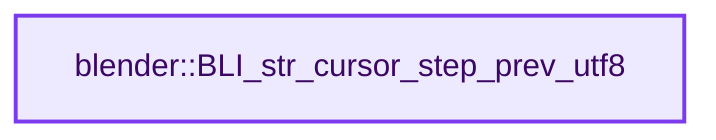
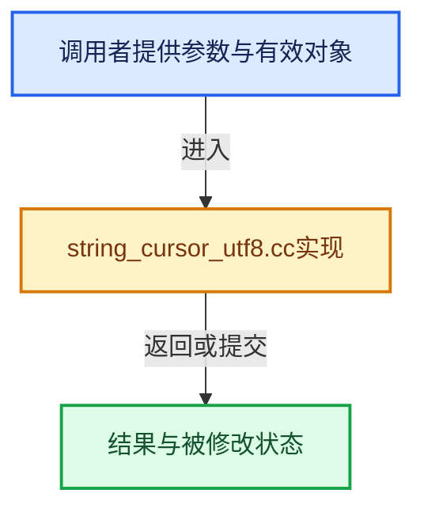

# 实现依赖专题：source/blender/blenlib/intern/string_cursor_utf8.cc

[实现依赖导航](../../README.md) · [符号索引](../../../00-课程指南/02-源码与提交索引/符号依赖与实现索引.md)

本专题从正文实际调用进入，集中保存共享实现。函数有稳定锚点，可从调用处直接跳到对应完整函数；递归与互相调用通过回链组织。

## 本文件的实现关系






## 完整成员与函数实现

<a id="f-a1e64edfe848a3ef"></a>

### `blender::BLI_str_cursor_step_prev_utf8`

实现位置：[source/blender/blenlib/intern/string_cursor_utf8.cc](../../../../../../../source/blender/blenlib/intern/string_cursor_utf8.cc) · L162—L179。

接口参数：

- `const char *str`
- `const int str_maxlen`
- `int *pos`

**教学注释版**

<!-- annotated:49dde803273644 -->

```cpp
bool BLI_str_cursor_step_prev_utf8(const char *str, const int str_maxlen, int *pos)
{
  /* NOTE: Keep in sync with #BLI_str_cursor_step_prev_utf32. */
  BLI_assert(str_maxlen >= 0);
  BLI_assert(*pos >= 0);

  if ((*pos > 0) && (*pos <= str_maxlen)) {
    const char *str_pos = str + *pos;
    const char *str_prev = str_pos;
    do {
      str_prev = BLI_str_find_prev_char_utf8(str_prev, str);
    } while ((str_prev > str) && (BLI_str_utf8_char_width_or_error(str_prev) == 0));
    *pos -= int(str_pos - str_prev);
    return true;
  }

  return false;
}
```

<details>
<summary>核对原始源码：source/blender/blenlib/intern/string_cursor_utf8.cc · L162—L179</summary>

<!-- original:49dde803273644:source/blender/blenlib/intern/string_cursor_utf8.cc:162:179 -->

```cpp
bool BLI_str_cursor_step_prev_utf8(const char *str, const int str_maxlen, int *pos)
{
  /* NOTE: Keep in sync with #BLI_str_cursor_step_prev_utf32. */
  BLI_assert(str_maxlen >= 0);
  BLI_assert(*pos >= 0);

  if ((*pos > 0) && (*pos <= str_maxlen)) {
    const char *str_pos = str + *pos;
    const char *str_prev = str_pos;
    do {
      str_prev = BLI_str_find_prev_char_utf8(str_prev, str);
    } while ((str_prev > str) && (BLI_str_utf8_char_width_or_error(str_prev) == 0));
    *pos -= int(str_pos - str_prev);
    return true;
  }

  return false;
}
```

</details>

**沿实际写入检查状态**

- `str_prev = BLI_str_find_prev_char_utf8(str_prev, str);`

**结果出口**

- `return true;`
- `return false;`

**继续追踪实现**

- `BLI_assert` → [BLI_assert · L48](../BLI_assert.hh.md#m-57a88495704d)；[BLI_assert · L63](../BLI_assert.hh.md#m-d07050020cb5)。宏定义由构建条件选择。
- `BLI_str_find_prev_char_utf8` → [blender::BLI_str_find_prev_char_utf8 · L1292](string_utf8.cc.md#f-d91f9e45917dd05c)。
- `BLI_str_utf8_char_width_or_error` → [blender::BLI_str_utf8_char_width_or_error · L650](string_utf8.cc.md#f-0ee28402fda78152)。
