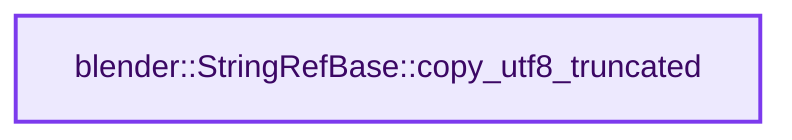
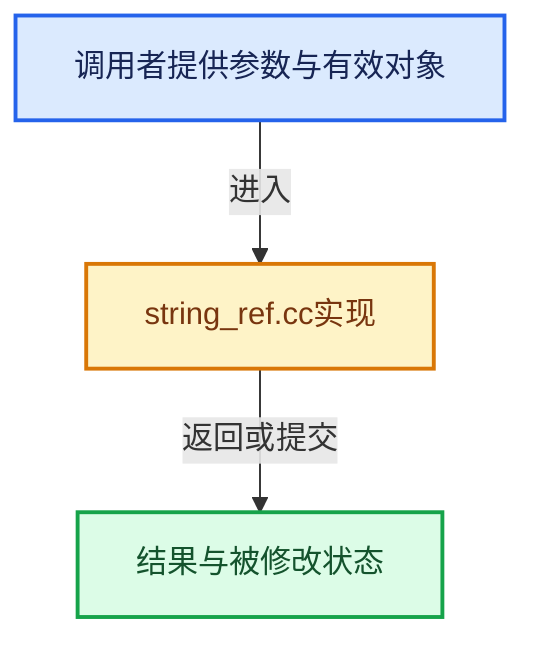

# 实现依赖专题：source/blender/blenlib/intern/string_ref.cc

[实现依赖导航](../../README.md) · [符号索引](../../../00-课程指南/02-源码与提交索引/符号依赖与实现索引.md)

本专题从正文实际调用进入，集中保存共享实现。函数有稳定锚点，可从调用处直接跳到对应完整函数；递归与互相调用通过回链组织。

## 本文件的实现关系






## 完整成员与函数实现

<a id="f-5d01486bac37768d"></a>

### `blender::StringRefBase::copy_utf8_truncated`

实现位置：[source/blender/blenlib/intern/string_ref.cc](../../../../../../../source/blender/blenlib/intern/string_ref.cc) · L28—L45。

接口参数：

- `char *dst`
- `const int64_t dst_size`

**教学注释版**

<!-- annotated:04fdf97f461b72 -->

```cpp
void StringRefBase::copy_utf8_truncated(char *dst, const int64_t dst_size) const
{
  /* Destination must at least hold the null terminator. */
  BLI_assert(dst_size >= 1);
  /* The current #StringRef is assumed to contain valid UTF8. */
  BLI_assert(!data_ || BLI_str_utf8_invalid_byte(data_, size_) == -1);

  /* Common case when the string can just be copied over entirely. */
  if (size_ < dst_size) {
    this->copy_unsafe(dst);
    return;
  }

  // [讲解] std::min：按比较关系选取较小值；截断范围时还需先满足非负和可表示范围，min本身不会证明边界安全。
  const int64_t max_copy_num_without_terminator = std::min(size_, dst_size - 1);
  const size_t new_len = BLI_strncpy_utf8_rlen_unterminated(
      dst, data_, max_copy_num_without_terminator);
  dst[new_len] = '\0';
}
```

<details>
<summary>核对原始源码：source/blender/blenlib/intern/string_ref.cc · L28—L45</summary>

<!-- original:04fdf97f461b72:source/blender/blenlib/intern/string_ref.cc:28:45 -->

```cpp
void StringRefBase::copy_utf8_truncated(char *dst, const int64_t dst_size) const
{
  /* Destination must at least hold the null terminator. */
  BLI_assert(dst_size >= 1);
  /* The current #StringRef is assumed to contain valid UTF8. */
  BLI_assert(!data_ || BLI_str_utf8_invalid_byte(data_, size_) == -1);

  /* Common case when the string can just be copied over entirely. */
  if (size_ < dst_size) {
    this->copy_unsafe(dst);
    return;
  }

  const int64_t max_copy_num_without_terminator = std::min(size_, dst_size - 1);
  const size_t new_len = BLI_strncpy_utf8_rlen_unterminated(
      dst, data_, max_copy_num_without_terminator);
  dst[new_len] = '\0';
}
```

</details>

**沿实际写入检查状态**

- `dst[new_len] = '\0';`

**继续追踪实现**

- `BLI_assert` → [BLI_assert · L48](../BLI_assert.hh.md#m-57a88495704d)；[BLI_assert · L63](../BLI_assert.hh.md#m-d07050020cb5)。宏定义由构建条件选择。
- `BLI_str_utf8_invalid_byte` → [blender::BLI_str_utf8_invalid_byte · L154](string_utf8.cc.md#f-070246b555fffcce)。
- `this->copy_unsafe` → [blender::StringRefBase::copy_unsafe · L248](../../../01-基础容器与现代CPP/15-StringRef字符串视图.md#f-0616684a44814e0a)。
- `std::min` → [外部契约](https://eel.is/c++draft/alg.min.max)：按比较关系选取较小值；截断范围时还需先满足非负和可表示范围，min本身不会证明边界安全。
- `BLI_strncpy_utf8_rlen_unterminated` → [blender::BLI_strncpy_utf8_rlen_unterminated · L426](string_utf8.cc.md#f-397d44fc26b55aad)。
