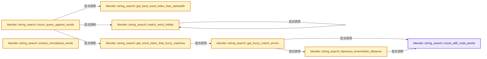
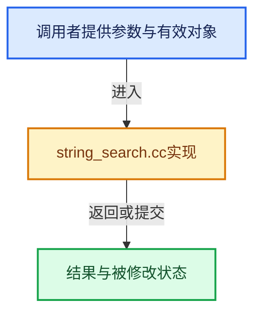

# 实现依赖专题：source/blender/blenlib/intern/string_search.cc

[实现依赖导航](../../README.md) · [符号索引](../../../00-课程指南/02-源码与提交索引/符号依赖与实现索引.md)

本专题从正文实际调用进入，集中保存共享实现。函数有稳定锚点，可从调用处直接跳到对应完整函数；递归与互相调用通过回链组织。

## 本文件的实现关系






## 完整成员与函数实现

<a id="f-dd6c0ac091e924b4"></a>

### `blender::string_search::count_utf8_code_points`

实现位置：[source/blender/blenlib/intern/string_search.cc](../../../../../../../source/blender/blenlib/intern/string_search.cc) · L26—L29。

接口参数：

- `StringRef str`

**教学注释版**

<!-- annotated:ca500ea5134c8e -->

```cpp
static int64_t count_utf8_code_points(StringRef str)
{
  return int64_t(BLI_strnlen_utf8(str.data(), size_t(str.size())));
}
```

<details>
<summary>核对原始源码：source/blender/blenlib/intern/string_search.cc · L26—L29</summary>

<!-- original:ca500ea5134c8e:source/blender/blenlib/intern/string_search.cc:26:29 -->

```cpp
static int64_t count_utf8_code_points(StringRef str)
{
  return int64_t(BLI_strnlen_utf8(str.data(), size_t(str.size())));
}
```

</details>

**结果出口**

- `return int64_t(BLI_strnlen_utf8(str.data(), size_t(str.size())));`

**继续追踪实现**

- `BLI_strnlen_utf8` → [blender::BLI_strnlen_utf8 · L530](string_utf8.cc.md#f-208947d9b3303d64)。
- `str.data` → [调用协议](../../../00-课程指南/01-路线与规范/模板宏与动态分派协议.md)：由接收对象具体类型或运行时策略提供实现。调用位置L28。
- `str.size` → [调用协议](../../../00-课程指南/01-路线与规范/模板宏与动态分派协议.md)：由接收对象具体类型或运行时策略提供实现。调用位置L28。

<a id="f-a458d56572bf3d1d"></a>

### `blender::string_search::damerau_levenshtein_distance`

实现位置：[source/blender/blenlib/intern/string_search.cc](../../../../../../../source/blender/blenlib/intern/string_search.cc) · L31—L92。

接口参数：

- `StringRef a`
- `StringRef b`

**教学注释版**

<!-- annotated:c6d3076a5f0a83 -->

```cpp
int damerau_levenshtein_distance(StringRef a, StringRef b)
{
  constexpr int deletion_cost = 1;
  constexpr int insertion_cost = 1;
  constexpr int substitution_cost = 1;
  constexpr int transposition_cost = 1;

  const int size_a = count_utf8_code_points(a);
  const int size_b = count_utf8_code_points(b);

  /* Instead of keeping the entire table in memory, only keep three rows. The algorithm only
   * accesses these rows and nothing older.
   * All three rows are usually allocated on the stack. At most a single heap allocation is done,
   * if the reserved stack space is too small. */
  const int row_length = size_b + 1;
  Array<int, 64> rows(row_length * 3);

  /* Store rows as spans so that it is cheap to swap them. */
  // [讲解] rows.data：提供数组的借用访问入口。
  MutableSpan v0{rows.data() + row_length * 0, row_length};
  MutableSpan v1{rows.data() + row_length * 1, row_length};
  MutableSpan v2{rows.data() + row_length * 2, row_length};

  /* Only v1 needs to be initialized. */
  for (const int i : IndexRange(row_length)) {
    v1[i] = i * insertion_cost;
  }

  uint32_t prev_unicode_a;
  size_t offset_a = 0;
  for (const int i : IndexRange(size_a)) {
    v2[0] = (i + 1) * deletion_cost;

    const uint32_t unicode_a = BLI_str_utf8_as_unicode_step_safe(a.data(), a.size(), &offset_a);

    uint32_t prev_unicode_b;
    size_t offset_b = 0;
    for (const int j : IndexRange(size_b)) {
      const uint32_t unicode_b = BLI_str_utf8_as_unicode_step_safe(b.data(), b.size(), &offset_b);

      /* Check how costly the different operations would be and pick the cheapest - the one with
       * minimal cost. */
      // [讲解] std::min：按比较关系选取较小值；截断范围时还需先满足非负和可表示范围，min本身不会证明边界安全。
      int new_cost = std::min({v1[j + 1] + deletion_cost,
                               v2[j] + insertion_cost,
                               v1[j] + (unicode_a != unicode_b) * substitution_cost});
      if (i > 0 && j > 0) {
        if (unicode_a == prev_unicode_b && prev_unicode_a == unicode_b) {
          new_cost = std::min(new_cost, v0[j - 1] + transposition_cost);
        }
      }

      v2[j + 1] = new_cost;
      prev_unicode_b = unicode_b;
    }

    /* Swap the three rows, so that the next row can be computed. */
    std::tie(v0, v1, v2) = std::tuple<MutableSpan<int>, MutableSpan<int>, MutableSpan<int>>(
        v1, v2, v0);
    prev_unicode_a = unicode_a;
  }

  // [讲解] v1.last：按视图边界访问元素。
  return v1.last();
}
```

<details>
<summary>核对原始源码：source/blender/blenlib/intern/string_search.cc · L31—L92</summary>

<!-- original:c6d3076a5f0a83:source/blender/blenlib/intern/string_search.cc:31:92 -->

```cpp
int damerau_levenshtein_distance(StringRef a, StringRef b)
{
  constexpr int deletion_cost = 1;
  constexpr int insertion_cost = 1;
  constexpr int substitution_cost = 1;
  constexpr int transposition_cost = 1;

  const int size_a = count_utf8_code_points(a);
  const int size_b = count_utf8_code_points(b);

  /* Instead of keeping the entire table in memory, only keep three rows. The algorithm only
   * accesses these rows and nothing older.
   * All three rows are usually allocated on the stack. At most a single heap allocation is done,
   * if the reserved stack space is too small. */
  const int row_length = size_b + 1;
  Array<int, 64> rows(row_length * 3);

  /* Store rows as spans so that it is cheap to swap them. */
  MutableSpan v0{rows.data() + row_length * 0, row_length};
  MutableSpan v1{rows.data() + row_length * 1, row_length};
  MutableSpan v2{rows.data() + row_length * 2, row_length};

  /* Only v1 needs to be initialized. */
  for (const int i : IndexRange(row_length)) {
    v1[i] = i * insertion_cost;
  }

  uint32_t prev_unicode_a;
  size_t offset_a = 0;
  for (const int i : IndexRange(size_a)) {
    v2[0] = (i + 1) * deletion_cost;

    const uint32_t unicode_a = BLI_str_utf8_as_unicode_step_safe(a.data(), a.size(), &offset_a);

    uint32_t prev_unicode_b;
    size_t offset_b = 0;
    for (const int j : IndexRange(size_b)) {
      const uint32_t unicode_b = BLI_str_utf8_as_unicode_step_safe(b.data(), b.size(), &offset_b);

      /* Check how costly the different operations would be and pick the cheapest - the one with
       * minimal cost. */
      int new_cost = std::min({v1[j + 1] + deletion_cost,
                               v2[j] + insertion_cost,
                               v1[j] + (unicode_a != unicode_b) * substitution_cost});
      if (i > 0 && j > 0) {
        if (unicode_a == prev_unicode_b && prev_unicode_a == unicode_b) {
          new_cost = std::min(new_cost, v0[j - 1] + transposition_cost);
        }
      }

      v2[j + 1] = new_cost;
      prev_unicode_b = unicode_b;
    }

    /* Swap the three rows, so that the next row can be computed. */
    std::tie(v0, v1, v2) = std::tuple<MutableSpan<int>, MutableSpan<int>, MutableSpan<int>>(
        v1, v2, v0);
    prev_unicode_a = unicode_a;
  }

  return v1.last();
}
```

</details>

**沿实际写入检查状态**

- `v1[i] = i * insertion_cost;`
- `v2[0] = (i + 1) * deletion_cost;`
- `new_cost = std::min(new_cost, v0[j - 1] + transposition_cost);`
- `prev_unicode_b = unicode_b;`
- `prev_unicode_a = unicode_a;`

**结果出口**

- `return v1.last();`

**继续追踪实现**

- `count_utf8_code_points` → [blender::string_search::count_utf8_code_points · L26](string_search.cc.md#f-dd6c0ac091e924b4)。
- `rows.data` → [blender::Array::data · L323](../../../01-基础容器与现代CPP/08-Array复制移动与销毁.md#f-95648c799002f4ba)；[blender::Array::data · L327](../../../01-基础容器与现代CPP/08-Array复制移动与销毁.md#f-50c18301f8c40f9e)。同名重载需按实参类型选择。
- `IndexRange` → [blender::IndexRange](../BLI_index_range.hh.md#t-caa3466d6776)；[blender::gpu::shader::parser::IndexRange](../../08-其他Blender模块/gpu/shader_tool/utils.hh.md#t-82d2bd4ea71c)；[blender::IndexRange](../../08-其他Blender模块/makesdna/DNA_node_types.h.md#t-0448cc889d39)。
- `BLI_str_utf8_as_unicode_step_safe` → [blender::BLI_str_utf8_as_unicode_step_safe · L1138](string_utf8.cc.md#f-9cd1556ac128b983)。
- `a.data` → [调用协议](../../../00-课程指南/01-路线与规范/模板宏与动态分派协议.md)：由接收对象具体类型或运行时策略提供实现。调用位置L63。
- `a.size` → [调用协议](../../../00-课程指南/01-路线与规范/模板宏与动态分派协议.md)：由接收对象具体类型或运行时策略提供实现。调用位置L63。
- `b.data` → [调用协议](../../../00-课程指南/01-路线与规范/模板宏与动态分派协议.md)：由接收对象具体类型或运行时策略提供实现。调用位置L68。
- `b.size` → [调用协议](../../../00-课程指南/01-路线与规范/模板宏与动态分派协议.md)：由接收对象具体类型或运行时策略提供实现。调用位置L68。
- `std::min` → [外部契约](https://eel.is/c++draft/alg.min.max)：按比较关系选取较小值；截断范围时还需先满足非负和可表示范围，min本身不会证明边界安全。
- `std::tie` → [外部契约](https://eel.is/c++draft/)：这个边界按实际表达式及所属类型核对参数、返回值、寿命与失败行为。这里提供接口入口，不声称已解释该第三方版本的内部实现。
- `std::tuple<MutableSpan<int>, MutableSpan<int>, MutableSpan<int>>` → [外部契约](https://eel.is/c++draft/)：这个边界按实际表达式及所属类型核对参数、返回值、寿命与失败行为。这里提供接口入口，不声称已解释该第三方版本的内部实现。
- `v1.last` → [blender::MutableSpan::last · L695](../../../01-基础容器与现代CPP/06-MutableSpan可写视图.md#f-73191eeabe29aab7)。

<a id="f-5a4540a64cc22ecf"></a>

### `blender::string_search::get_fuzzy_match_errors`

实现位置：[source/blender/blenlib/intern/string_search.cc](../../../../../../../source/blender/blenlib/intern/string_search.cc) · L94—L159。

接口参数：

- `StringRef query`
- `StringRef full`

**教学注释版**

<!-- annotated:bb8df6d3045330 -->

```cpp
int get_fuzzy_match_errors(StringRef query, StringRef full)
{
  /* If it is a perfect partial match, return immediately. */
  if (full.find(query) != StringRef::not_found) {
    return 0;
  }

  const int query_size = count_utf8_code_points(query);
  const int full_size = count_utf8_code_points(full);

  /* If there is only a single character which is not in the full string, this is not a match. */
  if (query_size == 1) {
    return -1;
  }
  BLI_assert(query.size() >= 2);

  /* Allow more errors when the size grows larger. */
  const int max_errors = query_size <= 1 ? 0 : query_size / 8 + 1;

  /* If the query is too large, this cannot be a match. */
  if (query_size - full_size > max_errors) {
    return -1;
  }

  const uint32_t query_first_unicode = BLI_str_utf8_as_unicode_safe(query.data());
  const uint32_t query_second_unicode = BLI_str_utf8_as_unicode_safe(
      query.data() + BLI_str_utf8_size_safe(query.data()));

  const char *full_begin = full.begin();
  const char *full_end = full.end();

  const char *window_begin = full_begin;
  const char *window_end = window_begin;
  // [讲解] std::min：按比较关系选取较小值；截断范围时还需先满足非负和可表示范围，min本身不会证明边界安全。
  const int window_size = std::min(query_size + max_errors, full_size);
  // [讲解] std::max：按比较关系选取较大值。本讲解中的增长公式同时满足最低请求和几何增长；若保存返回引用，还需注意实参寿命。
  const int extra_chars = std::max(window_size - query_size, 0);
  const int max_acceptable_distance = max_errors + extra_chars;

  for (int i = 0; i < window_size; i++) {
    window_end += BLI_str_utf8_size_safe(window_end);
  }

  while (true) {
    StringRef window{window_begin, window_end};
    const uint32_t window_begin_unicode = BLI_str_utf8_as_unicode_safe(window_begin);
    int distance = 0;
    /* Expect that the first or second character of the query is correct. This helps to avoid
     * computing the more expensive distance function. */
    if (ELEM(window_begin_unicode, query_first_unicode, query_second_unicode)) {
      distance = damerau_levenshtein_distance(query, window);
      if (distance <= max_acceptable_distance) {
        return distance;
      }
    }
    if (window_end == full_end) {
      return -1;
    }

    /* When the distance is way too large, we can skip a couple of code points, because the
     * distance can't possibly become as short as required. */
    const int window_offset = std::max(1, distance / 2);
    for (int i = 0; i < window_offset && window_end < full_end; i++) {
      window_begin += BLI_str_utf8_size_safe(window_begin);
      window_end += BLI_str_utf8_size_safe(window_end);
    }
  }
}
```

<details>
<summary>核对原始源码：source/blender/blenlib/intern/string_search.cc · L94—L159</summary>

<!-- original:bb8df6d3045330:source/blender/blenlib/intern/string_search.cc:94:159 -->

```cpp
int get_fuzzy_match_errors(StringRef query, StringRef full)
{
  /* If it is a perfect partial match, return immediately. */
  if (full.find(query) != StringRef::not_found) {
    return 0;
  }

  const int query_size = count_utf8_code_points(query);
  const int full_size = count_utf8_code_points(full);

  /* If there is only a single character which is not in the full string, this is not a match. */
  if (query_size == 1) {
    return -1;
  }
  BLI_assert(query.size() >= 2);

  /* Allow more errors when the size grows larger. */
  const int max_errors = query_size <= 1 ? 0 : query_size / 8 + 1;

  /* If the query is too large, this cannot be a match. */
  if (query_size - full_size > max_errors) {
    return -1;
  }

  const uint32_t query_first_unicode = BLI_str_utf8_as_unicode_safe(query.data());
  const uint32_t query_second_unicode = BLI_str_utf8_as_unicode_safe(
      query.data() + BLI_str_utf8_size_safe(query.data()));

  const char *full_begin = full.begin();
  const char *full_end = full.end();

  const char *window_begin = full_begin;
  const char *window_end = window_begin;
  const int window_size = std::min(query_size + max_errors, full_size);
  const int extra_chars = std::max(window_size - query_size, 0);
  const int max_acceptable_distance = max_errors + extra_chars;

  for (int i = 0; i < window_size; i++) {
    window_end += BLI_str_utf8_size_safe(window_end);
  }

  while (true) {
    StringRef window{window_begin, window_end};
    const uint32_t window_begin_unicode = BLI_str_utf8_as_unicode_safe(window_begin);
    int distance = 0;
    /* Expect that the first or second character of the query is correct. This helps to avoid
     * computing the more expensive distance function. */
    if (ELEM(window_begin_unicode, query_first_unicode, query_second_unicode)) {
      distance = damerau_levenshtein_distance(query, window);
      if (distance <= max_acceptable_distance) {
        return distance;
      }
    }
    if (window_end == full_end) {
      return -1;
    }

    /* When the distance is way too large, we can skip a couple of code points, because the
     * distance can't possibly become as short as required. */
    const int window_offset = std::max(1, distance / 2);
    for (int i = 0; i < window_offset && window_end < full_end; i++) {
      window_begin += BLI_str_utf8_size_safe(window_begin);
      window_end += BLI_str_utf8_size_safe(window_end);
    }
  }
}
```

</details>

**沿实际写入检查状态**

- `window_end += BLI_str_utf8_size_safe(window_end);`
- `distance = damerau_levenshtein_distance(query, window);`
- `window_begin += BLI_str_utf8_size_safe(window_begin);`

**结果出口**

- `return 0;`
- `return -1;`
- `return distance;`

**继续追踪实现**

- `full.find` → [调用协议](../../../00-课程指南/01-路线与规范/模板宏与动态分派协议.md)：由接收对象具体类型或运行时策略提供实现。调用位置L97。
- `count_utf8_code_points` → [blender::string_search::count_utf8_code_points · L26](string_search.cc.md#f-dd6c0ac091e924b4)。
- `BLI_assert` → [BLI_assert · L48](../BLI_assert.hh.md#m-57a88495704d)；[BLI_assert · L63](../BLI_assert.hh.md#m-d07050020cb5)。宏定义由构建条件选择。
- `query.size` → [调用协议](../../../00-课程指南/01-路线与规范/模板宏与动态分派协议.md)：由接收对象具体类型或运行时策略提供实现。调用位置L108。
- `BLI_str_utf8_as_unicode_safe` → [blender::BLI_str_utf8_as_unicode_safe · L1105](string_utf8.cc.md#f-384d343348fb3f24)。
- `query.data` → [调用协议](../../../00-课程指南/01-路线与规范/模板宏与动态分派协议.md)：由接收对象具体类型或运行时策略提供实现。调用位置L118。
- `BLI_str_utf8_size_safe` → [blender::BLI_str_utf8_size_safe · L1086](string_utf8.cc.md#f-e7f7516484b0e7cd)。
- `full.begin` → [调用协议](../../../00-课程指南/01-路线与规范/模板宏与动态分派协议.md)：由接收对象具体类型或运行时策略提供实现。调用位置L122。
- `full.end` → [调用协议](../../../00-课程指南/01-路线与规范/模板宏与动态分派协议.md)：由接收对象具体类型或运行时策略提供实现。调用位置L123。
- `std::min` → [外部契约](https://eel.is/c++draft/alg.min.max)：按比较关系选取较小值；截断范围时还需先满足非负和可表示范围，min本身不会证明边界安全。
- `std::max` → [外部契约](https://eel.is/c++draft/alg.min.max)：按比较关系选取较大值。本讲解中的增长公式同时满足最低请求和几何增长；若保存返回引用，还需注意实参寿命。
- `ELEM` → [ELEM · L88](../../07-Intern运行时与平台/ghost/intern/GHOST_utildefines.hh.md#m-d28724a15928)；[ELEM · L135](../BLI_utildefines.hh.md#m-d6572de7cae0)。宏定义由构建条件选择。
- `damerau_levenshtein_distance` → [blender::string_search::damerau_levenshtein_distance · L31](string_search.cc.md#f-a458d56572bf3d1d)。

<a id="f-136dec325025e7f5"></a>

### `blender::string_search::match_word_initials`

实现位置：[source/blender/blenlib/intern/string_search.cc](../../../../../../../source/blender/blenlib/intern/string_search.cc) · L190—L257。

接口参数：

- `StringRef query`
- `const SearchItem &item`
- `const Span<int> word_match_map`
- `int start = 0`

**教学注释版**

<!-- annotated:28995e9fd14c63 -->

```cpp
static std::optional<InitialsMatch> match_word_initials(StringRef query,
                                                        const SearchItem &item,
                                                        const Span<int> word_match_map,
                                                        int start = 0)
{
  const Span<StringRef> words = item.normalized_words;
  // [讲解] words.size：查询视图长度或生成对应有效索引区间。
  if (start >= words.size()) {
    return std::nullopt;
  }

  InitialsMatch match;

  size_t query_index = 0;
  int word_index = start;
  size_t char_index = 0;

  int first_found_word_index = -1;

  while (query_index < query.size()) {
    const uint query_unicode = BLI_str_utf8_as_unicode_step_safe(
        query.data(), query.size(), &query_index);
    while (true) {
      /* We are at the end of words, no complete match has been found yet. */
      if (word_index >= words.size()) {
        if (first_found_word_index >= 0) {
          /* Try starting to match at another word. In some cases one can still find matches this
           * way. */
          return match_word_initials(query, item, word_match_map, first_found_word_index + 1);
        }
        return std::nullopt;
      }

      /* Skip words that the caller does not want us to use. */
      if (word_match_map[word_index] != unused_word) {
        word_index++;
        BLI_assert(char_index == 0);
        continue;
      }

      StringRef word = words[word_index];
      /* Try to match the current character with the current word. */
      if (int(char_index) < word.size()) {
        const uint32_t char_unicode = BLI_str_utf8_as_unicode_step_safe(
            word.data(), word.size(), &char_index);
        if (query_unicode == char_unicode) {
          match.matched_word_indices.append(word_index);
          if (first_found_word_index == -1) {
            first_found_word_index = word_index;
          }
          break;
        }
      }

      /* Could not find a match in the current word, go to the beginning of the next word. */
      word_index += 1;
      char_index = 0;
    }
  }
  /* Check if we can find a better match that starts at a later word. */
  if (std::optional<InitialsMatch> sub_match = match_word_initials(
          query, item, word_match_map, first_found_word_index + 1))
  {
    if (sub_match->better_than(match, item)) {
      return sub_match;
    }
  }
  return match;
}
```

<details>
<summary>核对原始源码：source/blender/blenlib/intern/string_search.cc · L190—L257</summary>

<!-- original:28995e9fd14c63:source/blender/blenlib/intern/string_search.cc:190:257 -->

```cpp
static std::optional<InitialsMatch> match_word_initials(StringRef query,
                                                        const SearchItem &item,
                                                        const Span<int> word_match_map,
                                                        int start = 0)
{
  const Span<StringRef> words = item.normalized_words;
  if (start >= words.size()) {
    return std::nullopt;
  }

  InitialsMatch match;

  size_t query_index = 0;
  int word_index = start;
  size_t char_index = 0;

  int first_found_word_index = -1;

  while (query_index < query.size()) {
    const uint query_unicode = BLI_str_utf8_as_unicode_step_safe(
        query.data(), query.size(), &query_index);
    while (true) {
      /* We are at the end of words, no complete match has been found yet. */
      if (word_index >= words.size()) {
        if (first_found_word_index >= 0) {
          /* Try starting to match at another word. In some cases one can still find matches this
           * way. */
          return match_word_initials(query, item, word_match_map, first_found_word_index + 1);
        }
        return std::nullopt;
      }

      /* Skip words that the caller does not want us to use. */
      if (word_match_map[word_index] != unused_word) {
        word_index++;
        BLI_assert(char_index == 0);
        continue;
      }

      StringRef word = words[word_index];
      /* Try to match the current character with the current word. */
      if (int(char_index) < word.size()) {
        const uint32_t char_unicode = BLI_str_utf8_as_unicode_step_safe(
            word.data(), word.size(), &char_index);
        if (query_unicode == char_unicode) {
          match.matched_word_indices.append(word_index);
          if (first_found_word_index == -1) {
            first_found_word_index = word_index;
          }
          break;
        }
      }

      /* Could not find a match in the current word, go to the beginning of the next word. */
      word_index += 1;
      char_index = 0;
    }
  }
  /* Check if we can find a better match that starts at a later word. */
  if (std::optional<InitialsMatch> sub_match = match_word_initials(
          query, item, word_match_map, first_found_word_index + 1))
  {
    if (sub_match->better_than(match, item)) {
      return sub_match;
    }
  }
  return match;
}
```

</details>

**沿实际写入检查状态**

- `first_found_word_index = word_index;`
- `word_index += 1;`
- `char_index = 0;`

**结果出口**

- `return std::nullopt;`
- `return match_word_initials(query, item, word_match_map, first_found_word_index + 1);`
- `return sub_match;`
- `return match;`

**继续追踪实现**

- `words.size` → [blender::Span::size · L256](../../../01-基础容器与现代CPP/05-Span只读连续视图.md#f-5f80fa006089c998)。
- `query.size` → [调用协议](../../../00-课程指南/01-路线与规范/模板宏与动态分派协议.md)：由接收对象具体类型或运行时策略提供实现。调用位置L208。
- `BLI_str_utf8_as_unicode_step_safe` → [blender::BLI_str_utf8_as_unicode_step_safe · L1138](string_utf8.cc.md#f-9cd1556ac128b983)。
- `query.data` → [调用协议](../../../00-课程指南/01-路线与规范/模板宏与动态分派协议.md)：由接收对象具体类型或运行时策略提供实现。调用位置L210。
- `match_word_initials` → [blender::string_search::match_word_initials · L190](string_search.cc.md#f-136dec325025e7f5)。
- `BLI_assert` → [BLI_assert · L48](../BLI_assert.hh.md#m-57a88495704d)；[BLI_assert · L63](../BLI_assert.hh.md#m-d07050020cb5)。宏定义由构建条件选择。
- `word.size` → [调用协议](../../../00-课程指南/01-路线与规范/模板宏与动态分派协议.md)：由接收对象具体类型或运行时策略提供实现。调用位置L231。
- `word.data` → [调用协议](../../../00-课程指南/01-路线与规范/模板宏与动态分派协议.md)：由接收对象具体类型或运行时策略提供实现。调用位置L233。
- `match.matched_word_indices.append` → [调用协议](../../../00-课程指南/01-路线与规范/模板宏与动态分派协议.md)：接收对象类型依赖auto、返回值或模板实例；不按同名猜测目标。调用位置L235。
- `sub_match->better_than` → [外部契约](https://eel.is/c++draft/)：这个边界按实际表达式及所属类型核对参数、返回值、寿命与失败行为。这里提供接口入口，不声称已解释该第三方版本的内部实现。

<a id="f-8b2ee489517f0709"></a>

### `blender::string_search::get_best_word_index_that_startswith`

实现位置：[source/blender/blenlib/intern/string_search.cc](../../../../../../../source/blender/blenlib/intern/string_search.cc) · L262—L316。

接口参数：

- `StringRef query`
- `const SearchItem &item`
- `Span<int> word_match_map`
- `Span<StringRef> remaining_query_words`

**教学注释版**

<!-- annotated:d1b7546e7b9f54 -->

```cpp
static int get_best_word_index_that_startswith(StringRef query,
                                               const SearchItem &item,
                                               Span<int> word_match_map,
                                               Span<StringRef> remaining_query_words)
{
  /* If there is another word in the remaining full query that contains the current word, we have
   * to pick the shortest word. If we pick a longer one, it can happen that the other query word
   * does not have a match anymore. This can lead to a situation where a query does not match
   * itself anymore.
   *
   * E.g. the full query `T > Test` wouldn't match itself anymore if `Test` has a higher weight.
   * That's because the `T` would be matched with the `Test`, but then `Test` can't match `Test`
   * anymore because that's taken up already.
   *
   * If we don't have to pick the shortest match for correctness, pick the one with the largest
   * weight instead.
   */
  bool use_shortest_match = false;
  for (const StringRef other_word : remaining_query_words) {
    if (other_word.startswith(query)) {
      use_shortest_match = true;
      break;
    }
  }

  int best_word_size = INT32_MAX;
  int best_word_index = -1;
  bool best_word_in_main_group = false;
  for (const int i : item.normalized_words.index_range()) {
    if (word_match_map[i] != unused_word) {
      continue;
    }
    StringRef word = item.normalized_words[i];
    const bool word_in_main_group = item.word_group_ids[i] == item.main_group_id;
    if (word.startswith(query)) {
      bool found_new_best = false;
      if (use_shortest_match) {
        if (word.size() < best_word_size) {
          found_new_best = true;
        }
      }
      else {
        if (!best_word_in_main_group) {
          found_new_best = true;
        }
      }
      if (found_new_best) {
        best_word_index = i;
        best_word_size = word.size();
        best_word_in_main_group = word_in_main_group;
      }
    }
  }
  return best_word_index;
}
```

<details>
<summary>核对原始源码：source/blender/blenlib/intern/string_search.cc · L262—L316</summary>

<!-- original:d1b7546e7b9f54:source/blender/blenlib/intern/string_search.cc:262:316 -->

```cpp
static int get_best_word_index_that_startswith(StringRef query,
                                               const SearchItem &item,
                                               Span<int> word_match_map,
                                               Span<StringRef> remaining_query_words)
{
  /* If there is another word in the remaining full query that contains the current word, we have
   * to pick the shortest word. If we pick a longer one, it can happen that the other query word
   * does not have a match anymore. This can lead to a situation where a query does not match
   * itself anymore.
   *
   * E.g. the full query `T > Test` wouldn't match itself anymore if `Test` has a higher weight.
   * That's because the `T` would be matched with the `Test`, but then `Test` can't match `Test`
   * anymore because that's taken up already.
   *
   * If we don't have to pick the shortest match for correctness, pick the one with the largest
   * weight instead.
   */
  bool use_shortest_match = false;
  for (const StringRef other_word : remaining_query_words) {
    if (other_word.startswith(query)) {
      use_shortest_match = true;
      break;
    }
  }

  int best_word_size = INT32_MAX;
  int best_word_index = -1;
  bool best_word_in_main_group = false;
  for (const int i : item.normalized_words.index_range()) {
    if (word_match_map[i] != unused_word) {
      continue;
    }
    StringRef word = item.normalized_words[i];
    const bool word_in_main_group = item.word_group_ids[i] == item.main_group_id;
    if (word.startswith(query)) {
      bool found_new_best = false;
      if (use_shortest_match) {
        if (word.size() < best_word_size) {
          found_new_best = true;
        }
      }
      else {
        if (!best_word_in_main_group) {
          found_new_best = true;
        }
      }
      if (found_new_best) {
        best_word_index = i;
        best_word_size = word.size();
        best_word_in_main_group = word_in_main_group;
      }
    }
  }
  return best_word_index;
}
```

</details>

**沿实际写入检查状态**

- `use_shortest_match = true;`
- `found_new_best = true;`
- `best_word_index = i;`
- `best_word_size = word.size();`
- `best_word_in_main_group = word_in_main_group;`

**结果出口**

- `return best_word_index;`

**继续追踪实现**

- `other_word.startswith` → [调用协议](../../../00-课程指南/01-路线与规范/模板宏与动态分派协议.md)：接收对象类型依赖auto、返回值或模板实例；不按同名猜测目标。调用位置L281。
- `item.normalized_words.index_range` → [调用协议](../../../00-课程指南/01-路线与规范/模板宏与动态分派协议.md)：接收对象类型依赖auto、返回值或模板实例；不按同名猜测目标。调用位置L290。
- `word.startswith` → [blender::StringRefBase::startswith · L269](../../../01-基础容器与现代CPP/15-StringRef字符串视图.md#f-78237ccfe249bfa5)。
- `word.size` → [调用协议](../../../00-课程指南/01-路线与规范/模板宏与动态分派协议.md)：由接收对象具体类型或运行时策略提供实现。调用位置L299。

<a id="f-1342330c61856bea"></a>

### `blender::string_search::get_word_index_that_fuzzy_matches`

实现位置：[source/blender/blenlib/intern/string_search.cc](../../../../../../../source/blender/blenlib/intern/string_search.cc) · L318—L335。

接口参数：

- `StringRef query`
- `Span<StringRef> words`
- `Span<int> word_match_map`
- `int *r_error_count`

**教学注释版**

<!-- annotated:0468ade57bbfe9 -->

```cpp
static int get_word_index_that_fuzzy_matches(StringRef query,
                                             Span<StringRef> words,
                                             Span<int> word_match_map,
                                             int *r_error_count)
{
  // [讲解] words.index_range：查询视图长度或生成对应有效索引区间。
  for (const int i : words.index_range()) {
    if (word_match_map[i] != unused_word) {
      continue;
    }
    StringRef word = words[i];
    const int error_count = get_fuzzy_match_errors(query, word);
    if (error_count >= 0) {
      *r_error_count = error_count;
      return i;
    }
  }
  return -1;
}
```

<details>
<summary>核对原始源码：source/blender/blenlib/intern/string_search.cc · L318—L335</summary>

<!-- original:0468ade57bbfe9:source/blender/blenlib/intern/string_search.cc:318:335 -->

```cpp
static int get_word_index_that_fuzzy_matches(StringRef query,
                                             Span<StringRef> words,
                                             Span<int> word_match_map,
                                             int *r_error_count)
{
  for (const int i : words.index_range()) {
    if (word_match_map[i] != unused_word) {
      continue;
    }
    StringRef word = words[i];
    const int error_count = get_fuzzy_match_errors(query, word);
    if (error_count >= 0) {
      *r_error_count = error_count;
      return i;
    }
  }
  return -1;
}
```

</details>

**结果出口**

- `return i;`
- `return -1;`

**继续追踪实现**

- `words.index_range` → [blender::Span::index_range · L405](../../../01-基础容器与现代CPP/05-Span只读连续视图.md#f-caaa9b06e13e53e0)。
- `get_fuzzy_match_errors` → [blender::string_search::get_fuzzy_match_errors · L94](string_search.cc.md#f-5a4540a64cc22ecf)。

<a id="f-e3ae7c7b27a79833"></a>

### `blender::string_search::score_query_against_words`

实现位置：[source/blender/blenlib/intern/string_search.cc](../../../../../../../source/blender/blenlib/intern/string_search.cc) · L341—L414。

接口参数：

- `Span<StringRef> query_words`
- `const SearchItem &item`

**教学注释版**

<!-- annotated:c5a5046a801221 -->

```cpp
static std::optional<float> score_query_against_words(Span<StringRef> query_words,
                                                      const SearchItem &item)
{
  /* A mapping from #result_words to #query_words. It's mainly used to determine if a word has been
   * matched already to avoid matching it again. */
  Array<int, 64> word_match_map(item.normalized_words.size(), unused_word);

  /* Start with some high score, because otherwise the final score might become negative. */
  float total_match_score = item.is_deprecated ? 500 : 1000;

  // [讲解] query_words.index_range：查询视图长度或生成对应有效索引区间。
  for (const int query_word_index : query_words.index_range()) {
    const StringRef query_word = query_words[query_word_index];
    {
      /* Check if any result word begins with the query word. */
      const int word_index = get_best_word_index_that_startswith(
          // [讲解] query_words.drop_front：从两端裁去或选取一定数量元素形成新视图。
          query_word, item, word_match_map, query_words.drop_front(query_word_index + 1));
      if (word_index >= 0) {
        /* Give a match in a main group higher priority. */
        const bool is_main_group = item.word_group_ids[word_index] == item.main_group_id;
        total_match_score += is_main_group ? 10 : 9;
        word_match_map[word_index] = query_word_index;
        continue;
      }
    }
    {
      /* Try to match against word initials. */
      if (std::optional<InitialsMatch> match = match_word_initials(
              query_word, item, word_match_map))
      {
        /* If the all matched words are in the main group, give the match a higher priority. */
        bool all_main_group_matches = match->count_main_group_matches(item) ==
                                      match->matched_word_indices.size();
        total_match_score += all_main_group_matches ? 4 : 3;
        for (const int i : match->matched_word_indices) {
          word_match_map[i] = query_word_index;
        }
        continue;
      }
    }
    {
      /* Fuzzy match against words. */
      int error_count = 0;
      const int word_index = get_word_index_that_fuzzy_matches(
          query_word, item.normalized_words, word_match_map, &error_count);
      if (word_index >= 0) {
        total_match_score += 3 - error_count;
        word_match_map[word_index] = query_word_index;
        continue;
      }
    }

    /* Couldn't match query word with anything. */
    return std::nullopt;
  }

  {
    /* Add penalty when query words are not in the correct order. */
    Vector<int> match_indices;
    for (const int index : word_match_map) {
      if (index != unused_word) {
        // [讲解] match_indices.append：在尾部建立新元素，必要时先扩大存储。
        match_indices.append(index);
      }
    }
    if (!match_indices.is_empty()) {
      // [讲解] match_indices.size：用end_减begin_得到活元素数量。
      for (const int i : IndexRange(match_indices.size() - 1)) {
        if (match_indices[i] > match_indices[i + 1]) {
          total_match_score -= 1;
        }
      }
    }
  }

  return total_match_score;
}
```

<details>
<summary>核对原始源码：source/blender/blenlib/intern/string_search.cc · L341—L414</summary>

<!-- original:c5a5046a801221:source/blender/blenlib/intern/string_search.cc:341:414 -->

```cpp
static std::optional<float> score_query_against_words(Span<StringRef> query_words,
                                                      const SearchItem &item)
{
  /* A mapping from #result_words to #query_words. It's mainly used to determine if a word has been
   * matched already to avoid matching it again. */
  Array<int, 64> word_match_map(item.normalized_words.size(), unused_word);

  /* Start with some high score, because otherwise the final score might become negative. */
  float total_match_score = item.is_deprecated ? 500 : 1000;

  for (const int query_word_index : query_words.index_range()) {
    const StringRef query_word = query_words[query_word_index];
    {
      /* Check if any result word begins with the query word. */
      const int word_index = get_best_word_index_that_startswith(
          query_word, item, word_match_map, query_words.drop_front(query_word_index + 1));
      if (word_index >= 0) {
        /* Give a match in a main group higher priority. */
        const bool is_main_group = item.word_group_ids[word_index] == item.main_group_id;
        total_match_score += is_main_group ? 10 : 9;
        word_match_map[word_index] = query_word_index;
        continue;
      }
    }
    {
      /* Try to match against word initials. */
      if (std::optional<InitialsMatch> match = match_word_initials(
              query_word, item, word_match_map))
      {
        /* If the all matched words are in the main group, give the match a higher priority. */
        bool all_main_group_matches = match->count_main_group_matches(item) ==
                                      match->matched_word_indices.size();
        total_match_score += all_main_group_matches ? 4 : 3;
        for (const int i : match->matched_word_indices) {
          word_match_map[i] = query_word_index;
        }
        continue;
      }
    }
    {
      /* Fuzzy match against words. */
      int error_count = 0;
      const int word_index = get_word_index_that_fuzzy_matches(
          query_word, item.normalized_words, word_match_map, &error_count);
      if (word_index >= 0) {
        total_match_score += 3 - error_count;
        word_match_map[word_index] = query_word_index;
        continue;
      }
    }

    /* Couldn't match query word with anything. */
    return std::nullopt;
  }

  {
    /* Add penalty when query words are not in the correct order. */
    Vector<int> match_indices;
    for (const int index : word_match_map) {
      if (index != unused_word) {
        match_indices.append(index);
      }
    }
    if (!match_indices.is_empty()) {
      for (const int i : IndexRange(match_indices.size() - 1)) {
        if (match_indices[i] > match_indices[i + 1]) {
          total_match_score -= 1;
        }
      }
    }
  }

  return total_match_score;
}
```

</details>

**沿实际写入检查状态**

- `total_match_score += is_main_group ? 10 : 9;`
- `word_match_map[word_index] = query_word_index;`
- `total_match_score += all_main_group_matches ? 4 : 3;`
- `word_match_map[i] = query_word_index;`
- `total_match_score += 3 - error_count;`
- `total_match_score -= 1;`

**结果出口**

- `return std::nullopt;`
- `return total_match_score;`

**继续追踪实现**

- `item.normalized_words.size` → [调用协议](../../../00-课程指南/01-路线与规范/模板宏与动态分派协议.md)：接收对象类型依赖auto、返回值或模板实例；不按同名猜测目标。调用位置L346。
- `query_words.index_range` → [blender::Span::index_range · L405](../../../01-基础容器与现代CPP/05-Span只读连续视图.md#f-caaa9b06e13e53e0)。
- `get_best_word_index_that_startswith` → [blender::string_search::get_best_word_index_that_startswith · L262](string_search.cc.md#f-8b2ee489517f0709)。
- `query_words.drop_front` → [blender::Span::drop_front · L175](../../../01-基础容器与现代CPP/05-Span只读连续视图.md#f-932897accbde3413)。
- `match_word_initials` → [blender::string_search::match_word_initials · L190](string_search.cc.md#f-136dec325025e7f5)。
- `match->count_main_group_matches` → [外部契约](https://eel.is/c++draft/)：这个边界按实际表达式及所属类型核对参数、返回值、寿命与失败行为。这里提供接口入口，不声称已解释该第三方版本的内部实现。
- `match->matched_word_indices.size` → [调用协议](../../../00-课程指南/01-路线与规范/模板宏与动态分派协议.md)：接收对象类型依赖auto、返回值或模板实例；不按同名猜测目标。调用位置L372。
- `get_word_index_that_fuzzy_matches` → [blender::string_search::get_word_index_that_fuzzy_matches · L318](string_search.cc.md#f-1342330c61856bea)。
- `match_indices.append` → [blender::Vector::append · L498](../../../01-基础容器与现代CPP/11-Vector插入删除与重排.md#f-5bde268a69e443ec)；[blender::Vector::append · L502](../../../01-基础容器与现代CPP/11-Vector插入删除与重排.md#f-591e0b15e6308532)。同名重载需按实参类型选择。
- `match_indices.is_empty` → [blender::Vector::is_empty · L792](../../../01-基础容器与现代CPP/11-Vector插入删除与重排.md#f-937bbd9cb80bdcc8)。
- `IndexRange` → [blender::IndexRange](../BLI_index_range.hh.md#t-caa3466d6776)；[blender::gpu::shader::parser::IndexRange](../../08-其他Blender模块/gpu/shader_tool/utils.hh.md#t-82d2bd4ea71c)；[blender::IndexRange](../../08-其他Blender模块/makesdna/DNA_node_types.h.md#t-0448cc889d39)。
- `match_indices.size` → [blender::Vector::size · L780](../../../01-基础容器与现代CPP/11-Vector插入删除与重排.md#f-714773731767349c)。

<a id="f-ec92f9e703529ab2"></a>

### `blender::string_search::extract_normalized_words`

实现位置：[source/blender/blenlib/intern/string_search.cc](../../../../../../../source/blender/blenlib/intern/string_search.cc) · L416—L484。

接口参数：

- `StringRef str`
- `LinearAllocator<> &allocator`
- `Vector<StringRef, 64> &r_words`
- `Vector<int, 64> &r_word_group_ids`

**教学注释版**

<!-- annotated:6662c77ebea46d -->

```cpp
void extract_normalized_words(StringRef str,
                              LinearAllocator<> &allocator,
                              Vector<StringRef, 64> &r_words,
                              Vector<int, 64> &r_word_group_ids)
{
  const uint32_t unicode_space = uint32_t(' ');
  const uint32_t unicode_dash = uint32_t('-');
  const uint32_t unicode_underscore = uint32_t('_');
  const uint32_t unicode_slash = uint32_t('/');
  const uint32_t unicode_right_triangle = UI_MENU_ARROW_SEP_UNICODE;

  BLI_assert(unicode_space == BLI_str_utf8_as_unicode_safe(" "));
  BLI_assert(unicode_dash == BLI_str_utf8_as_unicode_safe("-"));
  BLI_assert(unicode_underscore == BLI_str_utf8_as_unicode_safe("_"));
  BLI_assert(unicode_slash == BLI_str_utf8_as_unicode_safe("/"));
  BLI_assert(unicode_right_triangle == BLI_str_utf8_as_unicode_safe(UI_MENU_ARROW_SEP));

  auto is_separator = [&](uint32_t unicode) {
    return ELEM(unicode,
                unicode_space,
                unicode_dash,
                unicode_underscore,
                unicode_slash,
                unicode_right_triangle);
  };

  Vector<int, 64> section_indices;

  /* Make a copy of the string so that we can edit it. */
  StringRef str_copy = allocator.copy_string(str);
  char *mutable_copy = const_cast<char *>(str_copy.data());
  const size_t str_size_in_bytes = size_t(str.size());
  BLI_str_tolower_ascii(mutable_copy, str_size_in_bytes);

  /* Iterate over all unicode code points to split individual words. */
  int group_id = 0;
  bool is_in_word = false;
  size_t word_start = 0;
  size_t offset = 0;
  while (offset < str_size_in_bytes) {
    size_t size = offset;
    uint32_t unicode = BLI_str_utf8_as_unicode_step_safe(str.data(), str.size(), &size);
    size -= offset;
    if (is_separator(unicode)) {
      if (is_in_word) {
        const StringRef word = str_copy.substr(int(word_start), int(offset - word_start));
        // [讲解] r_words.append：在尾部建立新元素，必要时先扩大存储。
        r_words.append(word);
        r_word_group_ids.append(group_id);
        is_in_word = false;
      }
    }
    else {
      if (!is_in_word) {
        word_start = offset;
        is_in_word = true;
      }
    }
    if (unicode == unicode_right_triangle) {
      group_id++;
    }
    offset += size;
  }
  /* If the last word is not followed by a separator, it has to be handled separately. */
  if (is_in_word) {
    const StringRef word = str_copy.drop_prefix(int(word_start));
    r_words.append(word);
    r_word_group_ids.append(group_id);
  }
}
```

<details>
<summary>核对原始源码：source/blender/blenlib/intern/string_search.cc · L416—L484</summary>

<!-- original:6662c77ebea46d:source/blender/blenlib/intern/string_search.cc:416:484 -->

```cpp
void extract_normalized_words(StringRef str,
                              LinearAllocator<> &allocator,
                              Vector<StringRef, 64> &r_words,
                              Vector<int, 64> &r_word_group_ids)
{
  const uint32_t unicode_space = uint32_t(' ');
  const uint32_t unicode_dash = uint32_t('-');
  const uint32_t unicode_underscore = uint32_t('_');
  const uint32_t unicode_slash = uint32_t('/');
  const uint32_t unicode_right_triangle = UI_MENU_ARROW_SEP_UNICODE;

  BLI_assert(unicode_space == BLI_str_utf8_as_unicode_safe(" "));
  BLI_assert(unicode_dash == BLI_str_utf8_as_unicode_safe("-"));
  BLI_assert(unicode_underscore == BLI_str_utf8_as_unicode_safe("_"));
  BLI_assert(unicode_slash == BLI_str_utf8_as_unicode_safe("/"));
  BLI_assert(unicode_right_triangle == BLI_str_utf8_as_unicode_safe(UI_MENU_ARROW_SEP));

  auto is_separator = [&](uint32_t unicode) {
    return ELEM(unicode,
                unicode_space,
                unicode_dash,
                unicode_underscore,
                unicode_slash,
                unicode_right_triangle);
  };

  Vector<int, 64> section_indices;

  /* Make a copy of the string so that we can edit it. */
  StringRef str_copy = allocator.copy_string(str);
  char *mutable_copy = const_cast<char *>(str_copy.data());
  const size_t str_size_in_bytes = size_t(str.size());
  BLI_str_tolower_ascii(mutable_copy, str_size_in_bytes);

  /* Iterate over all unicode code points to split individual words. */
  int group_id = 0;
  bool is_in_word = false;
  size_t word_start = 0;
  size_t offset = 0;
  while (offset < str_size_in_bytes) {
    size_t size = offset;
    uint32_t unicode = BLI_str_utf8_as_unicode_step_safe(str.data(), str.size(), &size);
    size -= offset;
    if (is_separator(unicode)) {
      if (is_in_word) {
        const StringRef word = str_copy.substr(int(word_start), int(offset - word_start));
        r_words.append(word);
        r_word_group_ids.append(group_id);
        is_in_word = false;
      }
    }
    else {
      if (!is_in_word) {
        word_start = offset;
        is_in_word = true;
      }
    }
    if (unicode == unicode_right_triangle) {
      group_id++;
    }
    offset += size;
  }
  /* If the last word is not followed by a separator, it has to be handled separately. */
  if (is_in_word) {
    const StringRef word = str_copy.drop_prefix(int(word_start));
    r_words.append(word);
    r_word_group_ids.append(group_id);
  }
}
```

</details>

**沿实际写入检查状态**

- `size -= offset;`
- `is_in_word = false;`
- `word_start = offset;`
- `is_in_word = true;`
- `offset += size;`

**结果出口**

- `return ELEM(unicode,`

**继续追踪实现**

- `BLI_assert` → [BLI_assert · L48](../BLI_assert.hh.md#m-57a88495704d)；[BLI_assert · L63](../BLI_assert.hh.md#m-d07050020cb5)。宏定义由构建条件选择。
- `BLI_str_utf8_as_unicode_safe` → [blender::BLI_str_utf8_as_unicode_safe · L1105](string_utf8.cc.md#f-384d343348fb3f24)。
- `ELEM` → [ELEM · L88](../../07-Intern运行时与平台/ghost/intern/GHOST_utildefines.hh.md#m-d28724a15928)；[ELEM · L135](../BLI_utildefines.hh.md#m-d6572de7cae0)。宏定义由构建条件选择。
- `allocator.copy_string` → [blender::LinearAllocator::copy_string · L174](../../../03-内存分配与运行时类型/03-LinearAllocator分配与扩展.md#f-78f19108ed967ade)。
- `str_copy.data` → [调用协议](../../../00-课程指南/01-路线与规范/模板宏与动态分派协议.md)：由接收对象具体类型或运行时策略提供实现。调用位置L446。
- `str.size` → [调用协议](../../../00-课程指南/01-路线与规范/模板宏与动态分派协议.md)：由接收对象具体类型或运行时策略提供实现。调用位置L447。
- `BLI_str_tolower_ascii` → [blender::BLI_str_tolower_ascii · L962](string.cc.md#f-a2721b5a991b6953)。
- `BLI_str_utf8_as_unicode_step_safe` → [blender::BLI_str_utf8_as_unicode_step_safe · L1138](string_utf8.cc.md#f-9cd1556ac128b983)。
- `str.data` → [调用协议](../../../00-课程指南/01-路线与规范/模板宏与动态分派协议.md)：由接收对象具体类型或运行时策略提供实现。调用位置L457。
- `is_separator` → [调用协议](../../../00-课程指南/01-路线与规范/模板宏与动态分派协议.md)：局部可调用对象，须结合其初始化与捕获环境。调用位置L459。
- `str_copy.substr` → [调用协议](../../../00-课程指南/01-路线与规范/模板宏与动态分派协议.md)：由接收对象具体类型或运行时策略提供实现。调用位置L461。
- `r_words.append` → [blender::Vector::append · L498](../../../01-基础容器与现代CPP/11-Vector插入删除与重排.md#f-5bde268a69e443ec)；[blender::Vector::append · L502](../../../01-基础容器与现代CPP/11-Vector插入删除与重排.md#f-591e0b15e6308532)。同名重载需按实参类型选择。
- `r_word_group_ids.append` → [blender::Vector::append · L498](../../../01-基础容器与现代CPP/11-Vector插入删除与重排.md#f-5bde268a69e443ec)；[blender::Vector::append · L502](../../../01-基础容器与现代CPP/11-Vector插入删除与重排.md#f-591e0b15e6308532)。同名重载需按实参类型选择。
- `str_copy.drop_prefix` → [blender::StringRef::drop_prefix · L578](../../../01-基础容器与现代CPP/15-StringRef字符串视图.md#f-d6d7a931996e7e19)。

<a id="f-03ffbe945f17fdb5"></a>

### `blender::string_search::StringSearchBase::add_impl`

实现位置：[source/blender/blenlib/intern/string_search.cc](../../../../../../../source/blender/blenlib/intern/string_search.cc) · L486—L533。

接口参数：

- `const StringRef str`
- `void *user_data`
- `const float weight`

**教学注释版**

<!-- annotated:3c6b9b007d2826 -->

```cpp
void StringSearchBase::add_impl(const StringRef str, void *user_data, const float weight)
{
  BLI_assert(BLI_str_utf8_invalid_byte(str.data(), str.size()) == -1);
  Vector<StringRef, 64> words;
  Vector<int, 64> word_group_ids;
  string_search::extract_normalized_words(str, allocator_, words, word_group_ids);
  const int recent_time = recent_cache_ ?
                              recent_cache_->logical_time_by_str.lookup_default(str, -1) :
                              -1;
  int main_group_id = 0;
  if (!word_group_ids.is_empty()) {
    switch (main_words_heuristic_) {
      case MainWordsHeuristic::FirstGroup: {
        main_group_id = 0;
        break;
      }
      case MainWordsHeuristic::LastGroup: {
        // [讲解] word_group_ids.last：访问有效范围首端或末端元素。
        main_group_id = word_group_ids.last();
        break;
      }
      case MainWordsHeuristic::All: {
        main_group_id = 0;
        word_group_ids.fill(0);
        break;
      }
    }
  }

  int main_group_length = 0;
  for (const int i : words.index_range()) {
    if (word_group_ids[i] == main_group_id) {
      main_group_length += int(words[i].size());
    }
  }

  /* Not checking for the "D" to avoid problems with upper/lower-case. */
  const bool is_deprecated = str.find("eprecated") != StringRef::not_found;

  items_.append({user_data,
                 // [讲解] words.as_span：构造对当前有效元素区间的借用视图。
                 allocator_.construct_array_copy(words.as_span()),
                 allocator_.construct_array_copy(word_group_ids.as_span()),
                 main_group_id,
                 main_group_length,
                 int(str.size()),
                 weight,
                 recent_time,
                 is_deprecated});
}
```

<details>
<summary>核对原始源码：source/blender/blenlib/intern/string_search.cc · L486—L533</summary>

<!-- original:3c6b9b007d2826:source/blender/blenlib/intern/string_search.cc:486:533 -->

```cpp
void StringSearchBase::add_impl(const StringRef str, void *user_data, const float weight)
{
  BLI_assert(BLI_str_utf8_invalid_byte(str.data(), str.size()) == -1);
  Vector<StringRef, 64> words;
  Vector<int, 64> word_group_ids;
  string_search::extract_normalized_words(str, allocator_, words, word_group_ids);
  const int recent_time = recent_cache_ ?
                              recent_cache_->logical_time_by_str.lookup_default(str, -1) :
                              -1;
  int main_group_id = 0;
  if (!word_group_ids.is_empty()) {
    switch (main_words_heuristic_) {
      case MainWordsHeuristic::FirstGroup: {
        main_group_id = 0;
        break;
      }
      case MainWordsHeuristic::LastGroup: {
        main_group_id = word_group_ids.last();
        break;
      }
      case MainWordsHeuristic::All: {
        main_group_id = 0;
        word_group_ids.fill(0);
        break;
      }
    }
  }

  int main_group_length = 0;
  for (const int i : words.index_range()) {
    if (word_group_ids[i] == main_group_id) {
      main_group_length += int(words[i].size());
    }
  }

  /* Not checking for the "D" to avoid problems with upper/lower-case. */
  const bool is_deprecated = str.find("eprecated") != StringRef::not_found;

  items_.append({user_data,
                 allocator_.construct_array_copy(words.as_span()),
                 allocator_.construct_array_copy(word_group_ids.as_span()),
                 main_group_id,
                 main_group_length,
                 int(str.size()),
                 weight,
                 recent_time,
                 is_deprecated});
}
```

</details>

**沿实际写入检查状态**

- `main_group_id = 0;`
- `main_group_id = word_group_ids.last();`
- `main_group_length += int(words[i].size());`

**继续追踪实现**

- `BLI_assert` → [BLI_assert · L48](../BLI_assert.hh.md#m-57a88495704d)；[BLI_assert · L63](../BLI_assert.hh.md#m-d07050020cb5)。宏定义由构建条件选择。
- `BLI_str_utf8_invalid_byte` → [blender::BLI_str_utf8_invalid_byte · L154](string_utf8.cc.md#f-070246b555fffcce)。
- `str.data` → [调用协议](../../../00-课程指南/01-路线与规范/模板宏与动态分派协议.md)：由接收对象具体类型或运行时策略提供实现。调用位置L488。
- `str.size` → [调用协议](../../../00-课程指南/01-路线与规范/模板宏与动态分派协议.md)：由接收对象具体类型或运行时策略提供实现。调用位置L488。
- `string_search::extract_normalized_words` → [blender::string_search::extract_normalized_words · L416](string_search.cc.md#f-ec92f9e703529ab2)。
- `recent_cache_->logical_time_by_str.lookup_default` → [调用协议](../../../00-课程指南/01-路线与规范/模板宏与动态分派协议.md)：接收对象类型依赖auto、返回值或模板实例；不按同名猜测目标。调用位置L493。
- `word_group_ids.is_empty` → [blender::Vector::is_empty · L792](../../../01-基础容器与现代CPP/11-Vector插入删除与重排.md#f-937bbd9cb80bdcc8)。
- `word_group_ids.last` → [blender::Vector::last · L749](../../../01-基础容器与现代CPP/11-Vector插入删除与重排.md#f-d32e1fd895e766b4)；[blender::Vector::last · L755](../../../01-基础容器与现代CPP/11-Vector插入删除与重排.md#f-66b262993c080d9d)。同名重载需按实参类型选择。
- `word_group_ids.fill` → [blender::Vector::fill · L946](../../../01-基础容器与现代CPP/12-Vector异常安全与边界.md#f-da02b30aee138d05)。
- `words.index_range` → [blender::Vector::index_range · L1026](../../../01-基础容器与现代CPP/12-Vector异常安全与边界.md#f-ac29cf36ef185ab9)。
- `words[i].size` → [调用协议](../../../00-课程指南/01-路线与规范/模板宏与动态分派协议.md)：接收对象类型依赖auto、返回值或模板实例；不按同名猜测目标。调用位置L517。
- `str.find` → [调用协议](../../../00-课程指南/01-路线与规范/模板宏与动态分派协议.md)：由接收对象具体类型或运行时策略提供实现。调用位置L522。
- `items_.append` → [调用协议](../../../00-课程指南/01-路线与规范/模板宏与动态分派协议.md)：接收对象类型依赖auto、返回值或模板实例；不按同名猜测目标。调用位置L524。
- `allocator_.construct_array_copy` → [调用协议](../../../00-课程指南/01-路线与规范/模板宏与动态分派协议.md)：接收对象类型依赖auto、返回值或模板实例；不按同名猜测目标。调用位置L525。
- `words.as_span` → [blender::Vector::as_span · L390](../../../01-基础容器与现代CPP/10-Vector扩容与增长.md#f-e2eed03cefcdd2ff)。
- `word_group_ids.as_span` → [blender::Vector::as_span · L390](../../../01-基础容器与现代CPP/10-Vector扩容与增长.md#f-e2eed03cefcdd2ff)。

<a id="f-a0533db004f0e157"></a>

### `blender::string_search::StringSearchBase::query_impl`

实现位置：[source/blender/blenlib/intern/string_search.cc](../../../../../../../source/blender/blenlib/intern/string_search.cc) · L535—L610。

接口参数：

- `const StringRef query`

**教学注释版**

<!-- annotated:e1013204187fcc -->

```cpp
Vector<void *> StringSearchBase::query_impl(const StringRef query) const
{
  LinearAllocator<> allocator;
  Vector<StringRef, 64> query_words;
  /* This is just a dummy value that is not used for the query. */
  Vector<int, 64> word_group_ids;
  string_search::extract_normalized_words(query, allocator, query_words, word_group_ids);

  /* Compute score of every result. */
  Array<std::optional<float>> all_scores(items_.size());
  threading::parallel_for(items_.index_range(), 256, [&](const IndexRange range) {
    for (const int i : range) {
      const SearchItem &item = items_[i];
      const std::optional<float> score = string_search::score_query_against_words(query_words,
                                                                                  item);
      all_scores[i] = score;
    }
  });
  MultiValueMap<float, int> result_indices_by_score;
  for (const int i : items_.index_range()) {
    const std::optional<float> score = all_scores[i];
    if (score.has_value()) {
      result_indices_by_score.add(*score, i);
    }
  }

  Vector<float> found_scores;
  for (const float score : result_indices_by_score.keys()) {
    // [讲解] found_scores.append：在尾部建立新元素，必要时先扩大存储。
    found_scores.append(score);
  }
  std::ranges::sort(found_scores, std::greater<>());

  /* Add results to output vector in correct order. First come the results with the best match
   * score. Results with the same score are in the order they have been added to the search. */
  Vector<int> sorted_result_indices;
  for (const float score : found_scores) {
    MutableSpan<int> indices = result_indices_by_score.lookup(score);
    if (score == found_scores[0]) {
      if (!query.is_empty()) {
        /* Sort items with best score by length. Shorter items are more likely the ones you are
         * looking for. This also ensures that exact matches will be at the top, even if the query
         * is a sub-string of another item. */
        std::ranges::sort(indices, [&](int a, int b) {
          const SearchItem &item_a = items_[a];
          const SearchItem &item_b = items_[b];
          /* The length of the main group has priority over the total length. */
          return item_a.main_group_length < item_b.main_group_length ||
                 (item_a.main_group_length == item_b.main_group_length &&
                  item_a.total_length < item_b.total_length);
        });
        /* Prefer items with larger weights. Use `stable_sort` so that if the weights are the same,
         * the order won't be changed. */
        // [讲解] indices.begin：返回借用范围的地址。
        std::stable_sort(indices.begin(), indices.end(), [&](int a, int b) {
          return items_[a].weight > items_[b].weight;
        });
      }
      /* If the query gets longer, it's less likely that accessing recent items is desired. Better
       * always show the best match in this case. */
      if (query.size() <= 1) {
        /* Prefer items that have been selected recently. */
        // [讲解] indices.end：返回借用范围的地址。
        std::stable_sort(indices.begin(), indices.end(), [&](int a, int b) {
          return items_[a].recent_time > items_[b].recent_time;
        });
      }
    }
    // [讲解] sorted_result_indices.extend：将一段来源元素加入尾部。
    sorted_result_indices.extend(indices);
  }

  // [讲解] sorted_result_indices.size：用end_减begin_得到活元素数量。
  Vector<void *> sorted_data(sorted_result_indices.size());
  for (const int i : sorted_result_indices.index_range()) {
    const int result_index = sorted_result_indices[i];
    const SearchItem &item = items_[result_index];
    sorted_data[i] = item.user_data;
  }
  return sorted_data;
}
```

<details>
<summary>核对原始源码：source/blender/blenlib/intern/string_search.cc · L535—L610</summary>

<!-- original:e1013204187fcc:source/blender/blenlib/intern/string_search.cc:535:610 -->

```cpp
Vector<void *> StringSearchBase::query_impl(const StringRef query) const
{
  LinearAllocator<> allocator;
  Vector<StringRef, 64> query_words;
  /* This is just a dummy value that is not used for the query. */
  Vector<int, 64> word_group_ids;
  string_search::extract_normalized_words(query, allocator, query_words, word_group_ids);

  /* Compute score of every result. */
  Array<std::optional<float>> all_scores(items_.size());
  threading::parallel_for(items_.index_range(), 256, [&](const IndexRange range) {
    for (const int i : range) {
      const SearchItem &item = items_[i];
      const std::optional<float> score = string_search::score_query_against_words(query_words,
                                                                                  item);
      all_scores[i] = score;
    }
  });
  MultiValueMap<float, int> result_indices_by_score;
  for (const int i : items_.index_range()) {
    const std::optional<float> score = all_scores[i];
    if (score.has_value()) {
      result_indices_by_score.add(*score, i);
    }
  }

  Vector<float> found_scores;
  for (const float score : result_indices_by_score.keys()) {
    found_scores.append(score);
  }
  std::ranges::sort(found_scores, std::greater<>());

  /* Add results to output vector in correct order. First come the results with the best match
   * score. Results with the same score are in the order they have been added to the search. */
  Vector<int> sorted_result_indices;
  for (const float score : found_scores) {
    MutableSpan<int> indices = result_indices_by_score.lookup(score);
    if (score == found_scores[0]) {
      if (!query.is_empty()) {
        /* Sort items with best score by length. Shorter items are more likely the ones you are
         * looking for. This also ensures that exact matches will be at the top, even if the query
         * is a sub-string of another item. */
        std::ranges::sort(indices, [&](int a, int b) {
          const SearchItem &item_a = items_[a];
          const SearchItem &item_b = items_[b];
          /* The length of the main group has priority over the total length. */
          return item_a.main_group_length < item_b.main_group_length ||
                 (item_a.main_group_length == item_b.main_group_length &&
                  item_a.total_length < item_b.total_length);
        });
        /* Prefer items with larger weights. Use `stable_sort` so that if the weights are the same,
         * the order won't be changed. */
        std::stable_sort(indices.begin(), indices.end(), [&](int a, int b) {
          return items_[a].weight > items_[b].weight;
        });
      }
      /* If the query gets longer, it's less likely that accessing recent items is desired. Better
       * always show the best match in this case. */
      if (query.size() <= 1) {
        /* Prefer items that have been selected recently. */
        std::stable_sort(indices.begin(), indices.end(), [&](int a, int b) {
          return items_[a].recent_time > items_[b].recent_time;
        });
      }
    }
    sorted_result_indices.extend(indices);
  }

  Vector<void *> sorted_data(sorted_result_indices.size());
  for (const int i : sorted_result_indices.index_range()) {
    const int result_index = sorted_result_indices[i];
    const SearchItem &item = items_[result_index];
    sorted_data[i] = item.user_data;
  }
  return sorted_data;
}
```

</details>

**沿实际写入检查状态**

- `all_scores[i] = score;`
- `sorted_data[i] = item.user_data;`

**结果出口**

- `return item_a.main_group_length < item_b.main_group_length ||`
- `return items_[a].weight > items_[b].weight;`
- `return items_[a].recent_time > items_[b].recent_time;`
- `return sorted_data;`

**继续追踪实现**

- `string_search::extract_normalized_words` → [blender::string_search::extract_normalized_words · L416](string_search.cc.md#f-ec92f9e703529ab2)。
- `items_.size` → [调用协议](../../../00-课程指南/01-路线与规范/模板宏与动态分派协议.md)：接收对象类型依赖auto、返回值或模板实例；不按同名猜测目标。调用位置L544。
- `threading::parallel_for` → [blender::threading::parallel_for · L68](../../../11-Depsgraph与并行任务系统/07-任务池与TBB接入.md#f-838294754c24426c)。
- `items_.index_range` → [调用协议](../../../00-课程指南/01-路线与规范/模板宏与动态分派协议.md)：接收对象类型依赖auto、返回值或模板实例；不按同名猜测目标。调用位置L545。
- `string_search::score_query_against_words` → [blender::string_search::score_query_against_words · L341](string_search.cc.md#f-e3ae7c7b27a79833)。
- `score.has_value` → [外部契约](https://eel.is/c++draft/)：这个边界按实际表达式及所属类型核对参数、返回值、寿命与失败行为。这里提供接口入口，不声称已解释该第三方版本的内部实现。
- `result_indices_by_score.add` → [blender::MultiValueMap::add · L41](../../../02-哈希表与关联数据结构/09-MultiValueMap一键多值.md#f-63372b49311db5a5)；[blender::MultiValueMap::add · L45](../../../02-哈希表与关联数据结构/09-MultiValueMap一键多值.md#f-05dd4addb1fcb0b0)；[blender::MultiValueMap::add · L49](../../../02-哈希表与关联数据结构/09-MultiValueMap一键多值.md#f-c897543def377b93)；[blender::MultiValueMap::add · L53](../../../02-哈希表与关联数据结构/09-MultiValueMap一键多值.md#f-3cf2c275172b7900)。同名重载需按实参类型选择。
- `result_indices_by_score.keys` → [blender::MultiValueMap::keys · L155](../../../02-哈希表与关联数据结构/09-MultiValueMap一键多值.md#f-18aa5e87c3129d25)。
- `found_scores.append` → [blender::Vector::append · L498](../../../01-基础容器与现代CPP/11-Vector插入删除与重排.md#f-5bde268a69e443ec)；[blender::Vector::append · L502](../../../01-基础容器与现代CPP/11-Vector插入删除与重排.md#f-591e0b15e6308532)。同名重载需按实参类型选择。
- `std::ranges::sort` → [外部契约](https://eel.is/c++draft/)：这个边界按实际表达式及所属类型核对参数、返回值、寿命与失败行为。这里提供接口入口，不声称已解释该第三方版本的内部实现。
- `std::greater<>` → [外部契约](https://eel.is/c++draft/)：这个边界按实际表达式及所属类型核对参数、返回值、寿命与失败行为。这里提供接口入口，不声称已解释该第三方版本的内部实现。
- `result_indices_by_score.lookup` → [blender::MultiValueMap::lookup · L90](../../../02-哈希表与关联数据结构/09-MultiValueMap一键多值.md#f-f383a2c94301a8b5)；[blender::MultiValueMap::lookup · L106](../../../02-哈希表与关联数据结构/09-MultiValueMap一键多值.md#f-d41a0c2c200fd60f)。同名重载需按实参类型选择。
- `query.is_empty` → [调用协议](../../../00-课程指南/01-路线与规范/模板宏与动态分派协议.md)：由接收对象具体类型或运行时策略提供实现。调用位置L573。
- `std::stable_sort` → [外部契约](https://eel.is/c++draft/)：这个边界按实际表达式及所属类型核对参数、返回值、寿命与失败行为。这里提供接口入口，不声称已解释该第三方版本的内部实现。
- `indices.begin` → [blender::MutableSpan::begin · L550](../../../01-基础容器与现代CPP/06-MutableSpan可写视图.md#f-02a6b28889d59da1)；[blender::gpu::shader::parser::MutableSpan::begin · L97](../../08-其他Blender模块/gpu/shader_tool/utils.hh.md#f-707ab8fcbd90899b)；[blender::gpu::shader::parser::MutableSpan::begin · L106](../../08-其他Blender模块/gpu/shader_tool/utils.hh.md#f-24291c7b5f37860b)。同名重载需按实参类型选择。
- `indices.end` → [blender::MutableSpan::end · L554](../../../01-基础容器与现代CPP/06-MutableSpan可写视图.md#f-4bf60034b9ddbc44)；[blender::gpu::shader::parser::MutableSpan::end · L101](../../08-其他Blender模块/gpu/shader_tool/utils.hh.md#f-21cd00bb95944779)；[blender::gpu::shader::parser::MutableSpan::end · L110](../../08-其他Blender模块/gpu/shader_tool/utils.hh.md#f-b75205cae5a07f2c)。同名重载需按实参类型选择。
- `query.size` → [调用协议](../../../00-课程指南/01-路线与规范/模板宏与动态分派协议.md)：由接收对象具体类型或运行时策略提供实现。调用位置L593。
- `sorted_result_indices.extend` → [blender::Vector::extend · L595](../../../01-基础容器与现代CPP/11-Vector插入删除与重排.md#f-fe6fcb7d09beded9)；[blender::Vector::extend · L599](../../../01-基础容器与现代CPP/11-Vector插入删除与重排.md#f-40095c219019e2f9)；[blender::Vector::extend · L613](../../../01-基础容器与现代CPP/11-Vector插入删除与重排.md#f-4d2e556cd7412fe4)；[blender::Vector::extend · L650](../../../01-基础容器与现代CPP/11-Vector插入删除与重排.md#f-ae44ad8b3f05b082)。同名重载需按实参类型选择。
- `sorted_result_indices.size` → [blender::Vector::size · L780](../../../01-基础容器与现代CPP/11-Vector插入删除与重排.md#f-714773731767349c)。
- `sorted_result_indices.index_range` → [blender::Vector::index_range · L1026](../../../01-基础容器与现代CPP/12-Vector异常安全与边界.md#f-ac29cf36ef185ab9)。
