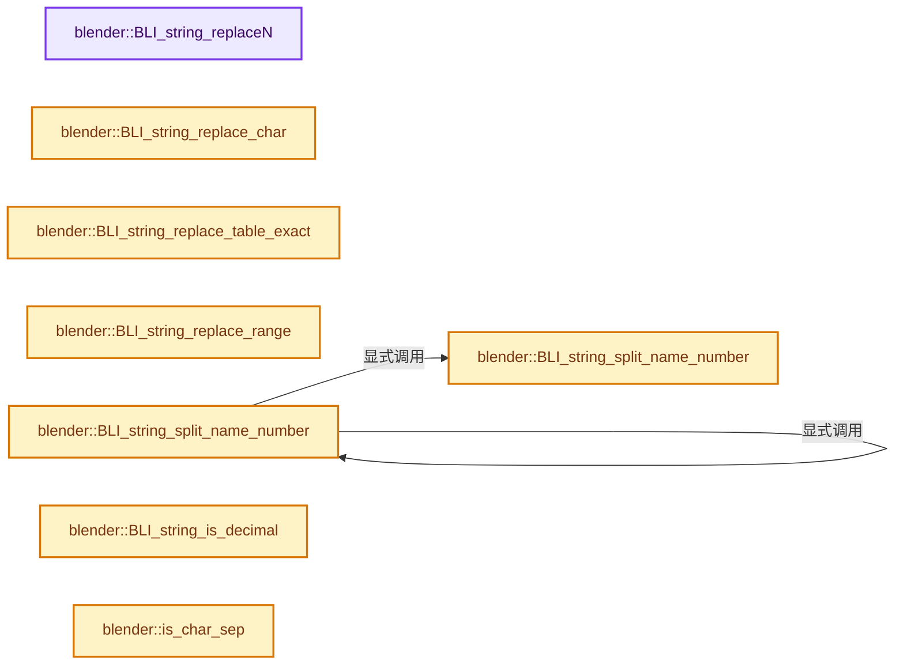
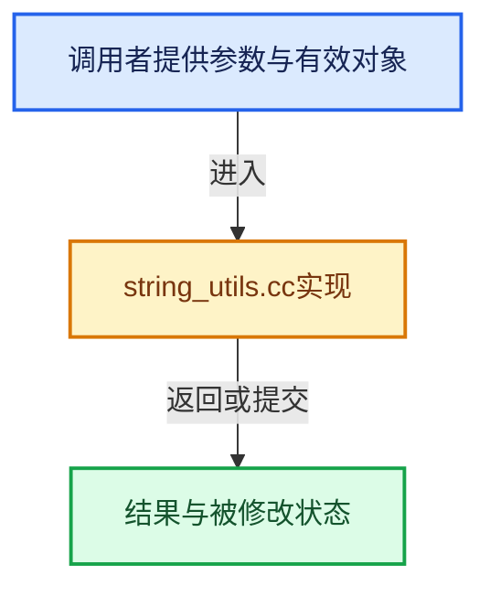

# 实现依赖专题：source/blender/blenlib/intern/string_utils.cc

[实现依赖导航](../../README.md) · [符号索引](../../../00-课程指南/02-源码与提交索引/符号依赖与实现索引.md)

本专题从正文实际调用进入，集中保存共享实现。函数有稳定锚点，可从调用处直接跳到对应完整函数；递归与互相调用通过回链组织。

## 本文件的实现关系






## 完整成员与函数实现

<a id="f-839ddd92c1c06244"></a>

### `blender::BLI_string_replaceN`

实现位置：[source/blender/blenlib/intern/string_utils.cc](../../../../../../../source/blender/blenlib/intern/string_utils.cc) · L39—L92。

接口参数：

- `const char *__restrict str`
- `const char *__restrict substr_old`
- `const char *__restrict substr_new`

**教学注释版**

<!-- annotated:7171852ead9a39 -->

```cpp
char *BLI_string_replaceN(const char *__restrict str,
                          const char *__restrict substr_old,
                          const char *__restrict substr_new)
{
  DynStr *ds = nullptr;
  size_t len_old = strlen(substr_old);
  const char *match;

  BLI_assert(substr_old[0] != '\0');

  /* While we can still find a match for the old sub-string that we're searching for,
   * keep dicing and replacing. */
  while ((match = strstr(str, substr_old))) {
    /* the assembly buffer only gets created when we actually need to rebuild the string */
    if (ds == nullptr) {
      ds = BLI_dynstr_new();
    }

    /* If the match position does not match the current position in the string,
     * copy the text up to this position and advance the current position in the string. */
    if (str != match) {
      /* Add the segment of the string from `str` to match to the buffer,
       * then restore the value at match. */
      BLI_dynstr_nappend(ds, str, int(match - str));

      /* now our current position should be set on the start of the match */
      str = match;
    }

    /* Add the replacement text to the accumulation buffer. */
    BLI_dynstr_append(ds, substr_new);

    /* Advance the current position of the string up to the end of the replaced segment. */
    str += len_old;
  }

  /* Finish off and return a new string that has had all occurrences of. */
  if (ds) {
    char *str_new;

    /* Add what's left of the string to the assembly buffer
     * - we've been adjusting `str` to point at the end of the replaced segments. */
    BLI_dynstr_append(ds, str);

    /* Convert to new c-string (MEM_new'd), and free the buffer. */
    str_new = BLI_dynstr_get_cstring(ds);
    BLI_dynstr_free(ds);

    return str_new;
  }
  /* Just create a new copy of the entire string - we avoid going through the assembly buffer
   * for what should be a bit more efficiency. */
  return BLI_strdup(str);
}
```

<details>
<summary>核对原始源码：source/blender/blenlib/intern/string_utils.cc · L39—L92</summary>

<!-- original:7171852ead9a39:source/blender/blenlib/intern/string_utils.cc:39:92 -->

```cpp
char *BLI_string_replaceN(const char *__restrict str,
                          const char *__restrict substr_old,
                          const char *__restrict substr_new)
{
  DynStr *ds = nullptr;
  size_t len_old = strlen(substr_old);
  const char *match;

  BLI_assert(substr_old[0] != '\0');

  /* While we can still find a match for the old sub-string that we're searching for,
   * keep dicing and replacing. */
  while ((match = strstr(str, substr_old))) {
    /* the assembly buffer only gets created when we actually need to rebuild the string */
    if (ds == nullptr) {
      ds = BLI_dynstr_new();
    }

    /* If the match position does not match the current position in the string,
     * copy the text up to this position and advance the current position in the string. */
    if (str != match) {
      /* Add the segment of the string from `str` to match to the buffer,
       * then restore the value at match. */
      BLI_dynstr_nappend(ds, str, int(match - str));

      /* now our current position should be set on the start of the match */
      str = match;
    }

    /* Add the replacement text to the accumulation buffer. */
    BLI_dynstr_append(ds, substr_new);

    /* Advance the current position of the string up to the end of the replaced segment. */
    str += len_old;
  }

  /* Finish off and return a new string that has had all occurrences of. */
  if (ds) {
    char *str_new;

    /* Add what's left of the string to the assembly buffer
     * - we've been adjusting `str` to point at the end of the replaced segments. */
    BLI_dynstr_append(ds, str);

    /* Convert to new c-string (MEM_new'd), and free the buffer. */
    str_new = BLI_dynstr_get_cstring(ds);
    BLI_dynstr_free(ds);

    return str_new;
  }
  /* Just create a new copy of the entire string - we avoid going through the assembly buffer
   * for what should be a bit more efficiency. */
  return BLI_strdup(str);
}
```

</details>

**沿实际写入检查状态**

- `ds = BLI_dynstr_new();`
- `str = match;`
- `str += len_old;`
- `str_new = BLI_dynstr_get_cstring(ds);`

**结果出口**

- `return str_new;`
- `return BLI_strdup(str);`

**继续追踪实现**

- `strlen` → [外部契约](https://eel.is/c++draft/)：这个边界按实际表达式及所属类型核对参数、返回值、寿命与失败行为。这里提供接口入口，不声称已解释该第三方版本的内部实现。
- `BLI_assert` → [BLI_assert · L48](../BLI_assert.hh.md#m-57a88495704d)；[BLI_assert · L63](../BLI_assert.hh.md#m-d07050020cb5)。宏定义由构建条件选择。
- `strstr` → [调用协议](../../../00-课程指南/01-路线与规范/模板宏与动态分派协议.md)：函数指针、局部可调用对象或未展开的宏；必须结合调用者环境。调用位置L51。
- `BLI_dynstr_new` → [blender::BLI_dynstr_new · L39](BLI_dynstr.cc.md#f-175f7e29ab0bb527)。
- `BLI_dynstr_nappend` → [blender::BLI_dynstr_nappend · L77](BLI_dynstr.cc.md#f-c848f55debb777f1)。
- `BLI_dynstr_append` → [blender::BLI_dynstr_append · L58](BLI_dynstr.cc.md#f-5cdd0abfaf808d5e)。
- `BLI_dynstr_get_cstring` → [blender::BLI_dynstr_get_cstring · L145](BLI_dynstr.cc.md#f-96bf160f2e4e8179)。
- `BLI_dynstr_free` → [blender::BLI_dynstr_free · L170](BLI_dynstr.cc.md#f-9c73673642d1e91f)。
- `BLI_strdup` → [blender::BLI_strdup · L43](string.cc.md#f-7e6d5c696c20c0e1)。

<a id="f-3e3aac364a1bfdfa"></a>

### `blender::BLI_string_replace_char`

实现位置：[source/blender/blenlib/intern/string_utils.cc](../../../../../../../source/blender/blenlib/intern/string_utils.cc) · L113—L121。

接口参数：

- `char *str`
- `char src`
- `char dst`

**教学注释版**

<!-- annotated:5dca0d4991d733 -->

```cpp
void BLI_string_replace_char(char *str, char src, char dst)
{
  while (*str) {
    if (*str == src) {
      *str = dst;
    }
    str++;
  }
}
```

<details>
<summary>核对原始源码：source/blender/blenlib/intern/string_utils.cc · L113—L121</summary>

<!-- original:5dca0d4991d733:source/blender/blenlib/intern/string_utils.cc:113:121 -->

```cpp
void BLI_string_replace_char(char *str, char src, char dst)
{
  while (*str) {
    if (*str == src) {
      *str = dst;
    }
    str++;
  }
}
```

</details>

**继续追踪实现**

本实现没有需要继续展开的显式调用；检查返回表达式、对象转换和调用者前置条件。

<a id="f-e66794301af00968"></a>

### `blender::BLI_string_replace_table_exact`

实现位置：[source/blender/blenlib/intern/string_utils.cc](../../../../../../../source/blender/blenlib/intern/string_utils.cc) · L123—L137。

接口参数：

- `char *string`
- `const size_t string_maxncpy`
- `const char *replace_table[][2]`
- `int replace_table_len`

**教学注释版**

<!-- annotated:ed0f6e3395b9da -->

```cpp
bool BLI_string_replace_table_exact(char *string,
                                    const size_t string_maxncpy,
                                    const char *replace_table[][2],
                                    int replace_table_len)
{
  BLI_string_debug_size_after_nil(string, string_maxncpy);

  for (int i = 0; i < replace_table_len; i++) {
    if (STREQ(string, replace_table[i][0])) {
      BLI_strncpy(string, replace_table[i][1], string_maxncpy);
      return true;
    }
  }
  return false;
}
```

<details>
<summary>核对原始源码：source/blender/blenlib/intern/string_utils.cc · L123—L137</summary>

<!-- original:ed0f6e3395b9da:source/blender/blenlib/intern/string_utils.cc:123:137 -->

```cpp
bool BLI_string_replace_table_exact(char *string,
                                    const size_t string_maxncpy,
                                    const char *replace_table[][2],
                                    int replace_table_len)
{
  BLI_string_debug_size_after_nil(string, string_maxncpy);

  for (int i = 0; i < replace_table_len; i++) {
    if (STREQ(string, replace_table[i][0])) {
      BLI_strncpy(string, replace_table[i][1], string_maxncpy);
      return true;
    }
  }
  return false;
}
```

</details>

**结果出口**

- `return true;`
- `return false;`

**继续追踪实现**

- `BLI_string_debug_size_after_nil` → [blender::BLI_string_debug_size_after_nil · L1341](string.cc.md#f-7b0e5ec36aefb7f9)。
- `STREQ` → [STREQ · L112](../../07-Intern运行时与平台/ghost/intern/GHOST_utildefines.hh.md#m-9549fb6aafd2)；[STREQ · L451](../BLI_utildefines.hh.md#m-c7b745bcfad2)；[STREQ · L55](../../07-Intern运行时与平台/clog/clog.cc.md#m-96e78f386894)。宏定义由构建条件选择。
- `BLI_strncpy` → [blender::BLI_strncpy · L70](string.cc.md#f-6324147b0d116da1)。

<a id="f-7c2708998c2b1d3a"></a>

### `blender::BLI_string_replace_range`

实现位置：[source/blender/blenlib/intern/string_utils.cc](../../../../../../../source/blender/blenlib/intern/string_utils.cc) · L139—L186。

接口参数：

- `char *string`
- `size_t string_maxncpy`
- `int src_beg`
- `int src_end`
- `const char *dst`

**教学注释版**

<!-- annotated:ee92cb54da32b7 -->

```cpp
size_t BLI_string_replace_range(
    char *string, size_t string_maxncpy, int src_beg, int src_end, const char *dst)
{
  int string_len = int(strlen(string));
  BLI_assert(src_beg <= src_end);
  BLI_assert(src_end <= string_len);
  const int src_len = src_end - src_beg;
  int dst_len = int(strlen(dst));

  if (src_len < dst_len) {
    /* Grow, first handle special cases. */

    /* Special case, the src_end is entirely clipped. */
    if (int(string_maxncpy) <= src_beg + dst_len) [[unlikely]] {
      /* There is only room for the destination. */
      dst_len = (int(string_maxncpy) - src_beg) - 1;
      string_len = src_end;
      string[string_len] = '\0';
    }

    const int ofs = dst_len - src_len;
    /* Clip the string when inserting the destination string exceeds `string_maxncpy`. */
    if (string_len + ofs >= int(string_maxncpy)) {
      string_len = (int(string_maxncpy) - ofs) - 1;
      string[string_len] = '\0';
      BLI_assert(src_end <= string_len);
    }

    /* Grow. */
    // [讲解] memmove：复制可能重叠的字节区间；允许字节重叠不代表自动满足任意C++对象的移动构造契约。
    memmove(string + (src_end + ofs), string + src_end, size_t(string_len - src_end) + 1);
    string_len += ofs;
  }
  else if (src_len > dst_len) {
    /* Shrink. */
    const int ofs = src_len - dst_len;
    memmove(string + (src_end - ofs), string + src_end, size_t(string_len - src_end) + 1);
    string_len -= ofs;
  }
  else { /* Simple case, no resizing. */
    BLI_assert(src_len == dst_len);
  }

  if (dst_len > 0) {
    // [讲解] memcpy：复制字节，源与目标不应重叠。类型生命周期、对齐和可复制表示须由调用者证明，不是任意对象的复制构造。
    memcpy(string + src_beg, dst, size_t(dst_len));
  }
  BLI_assert(string[string_len] == '\0');
  return size_t(string_len);
}
```

<details>
<summary>核对原始源码：source/blender/blenlib/intern/string_utils.cc · L139—L186</summary>

<!-- original:ee92cb54da32b7:source/blender/blenlib/intern/string_utils.cc:139:186 -->

```cpp
size_t BLI_string_replace_range(
    char *string, size_t string_maxncpy, int src_beg, int src_end, const char *dst)
{
  int string_len = int(strlen(string));
  BLI_assert(src_beg <= src_end);
  BLI_assert(src_end <= string_len);
  const int src_len = src_end - src_beg;
  int dst_len = int(strlen(dst));

  if (src_len < dst_len) {
    /* Grow, first handle special cases. */

    /* Special case, the src_end is entirely clipped. */
    if (int(string_maxncpy) <= src_beg + dst_len) [[unlikely]] {
      /* There is only room for the destination. */
      dst_len = (int(string_maxncpy) - src_beg) - 1;
      string_len = src_end;
      string[string_len] = '\0';
    }

    const int ofs = dst_len - src_len;
    /* Clip the string when inserting the destination string exceeds `string_maxncpy`. */
    if (string_len + ofs >= int(string_maxncpy)) {
      string_len = (int(string_maxncpy) - ofs) - 1;
      string[string_len] = '\0';
      BLI_assert(src_end <= string_len);
    }

    /* Grow. */
    memmove(string + (src_end + ofs), string + src_end, size_t(string_len - src_end) + 1);
    string_len += ofs;
  }
  else if (src_len > dst_len) {
    /* Shrink. */
    const int ofs = src_len - dst_len;
    memmove(string + (src_end - ofs), string + src_end, size_t(string_len - src_end) + 1);
    string_len -= ofs;
  }
  else { /* Simple case, no resizing. */
    BLI_assert(src_len == dst_len);
  }

  if (dst_len > 0) {
    memcpy(string + src_beg, dst, size_t(dst_len));
  }
  BLI_assert(string[string_len] == '\0');
  return size_t(string_len);
}
```

</details>

**沿实际写入检查状态**

- `dst_len = (int(string_maxncpy) - src_beg) - 1;`
- `string_len = src_end;`
- `string[string_len] = '\0';`
- `string_len = (int(string_maxncpy) - ofs) - 1;`
- `string_len += ofs;`
- `string_len -= ofs;`

**结果出口**

- `return size_t(string_len);`

**继续追踪实现**

- `strlen` → [外部契约](https://eel.is/c++draft/)：这个边界按实际表达式及所属类型核对参数、返回值、寿命与失败行为。这里提供接口入口，不声称已解释该第三方版本的内部实现。
- `BLI_assert` → [BLI_assert · L48](../BLI_assert.hh.md#m-57a88495704d)；[BLI_assert · L63](../BLI_assert.hh.md#m-d07050020cb5)。宏定义由构建条件选择。
- `memmove` → [外部契约](https://eel.is/c++draft/cstring.syn)：复制可能重叠的字节区间；允许字节重叠不代表自动满足任意C++对象的移动构造契约。
- `memcpy` → [外部契约](https://eel.is/c++draft/cstring.syn)：复制字节，源与目标不应重叠。类型生命周期、对齐和可复制表示须由调用者证明，不是任意对象的复制构造。

<a id="f-a94e773e26eb8221"></a>

### `blender::BLI_string_split_name_number`

实现位置：[source/blender/blenlib/intern/string_utils.cc](../../../../../../../source/blender/blenlib/intern/string_utils.cc) · L190—L216。

接口参数：

- `const StringRef name_full`
- `const char delim`
- `int &r_number`

**教学注释版**

<!-- annotated:a4068fa7592931 -->

```cpp
StringRef BLI_string_split_name_number(const StringRef name_full, const char delim, int &r_number)
{
  const int64_t delim_index = name_full.rfind(delim);
  r_number = 0;
  if (delim_index == StringRef::not_found) {
    return name_full;
  }

  StringRef name_base = name_full.substr(0, delim_index);

  if (delim_index < name_full.size() - 1) {
    const StringRef num_str = name_full.substr(delim_index + 1);
    if (!std::all_of(num_str.begin(), num_str.end(), ::isdigit)) {
      return name_full;
    }
    /* Converting numerical suffix to an int, can overflow for large numbers. */
    try {
      r_number = std::stoi(num_str);
      return name_base;
    }
    catch (std::out_of_range const & /*ex*/) {
      r_number = 0;
    }
  }

  return name_full;
}
```

<details>
<summary>核对原始源码：source/blender/blenlib/intern/string_utils.cc · L190—L216</summary>

<!-- original:a4068fa7592931:source/blender/blenlib/intern/string_utils.cc:190:216 -->

```cpp
StringRef BLI_string_split_name_number(const StringRef name_full, const char delim, int &r_number)
{
  const int64_t delim_index = name_full.rfind(delim);
  r_number = 0;
  if (delim_index == StringRef::not_found) {
    return name_full;
  }

  StringRef name_base = name_full.substr(0, delim_index);

  if (delim_index < name_full.size() - 1) {
    const StringRef num_str = name_full.substr(delim_index + 1);
    if (!std::all_of(num_str.begin(), num_str.end(), ::isdigit)) {
      return name_full;
    }
    /* Converting numerical suffix to an int, can overflow for large numbers. */
    try {
      r_number = std::stoi(num_str);
      return name_base;
    }
    catch (std::out_of_range const & /*ex*/) {
      r_number = 0;
    }
  }

  return name_full;
}
```

</details>

**沿实际写入检查状态**

- `r_number = 0;`
- `r_number = std::stoi(num_str);`

**结果出口**

- `return name_full;`
- `return name_base;`

**继续追踪实现**

- `name_full.rfind` → [blender::StringRefBase::rfind · L351](../../../01-基础容器与现代CPP/15-StringRef字符串视图.md#f-27776ce224b75211)；[blender::StringRefBase::rfind · L357](../../../01-基础容器与现代CPP/15-StringRef字符串视图.md#f-6c36f5dbd6a83083)。同名重载需按实参类型选择。
- `name_full.substr` → [blender::StringRefBase::substr · L303](../../../01-基础容器与现代CPP/15-StringRef字符串视图.md#f-cc876508a516d26d)。
- `name_full.size` → [blender::Bounds<T>::size · L543](../../../12-空间数据结构与几何算法/07-Bounds与BVH对比.md#f-fcce88c0824fcd97)；[blender::GVArrayImpl::size · L651](../../../04-虚拟数组与索引选择/05-GVArray运行时类型.md#f-f23d3d1f3b110f1e)；[blender::GVArrayCommon::size · L759](../../../04-虚拟数组与索引选择/05-GVArray运行时类型.md#f-0856784f4e4fd3c9)；[blender::StringRefBase::size · L196](../../../01-基础容器与现代CPP/15-StringRef字符串视图.md#f-60d4631c74931d2e)；[blender::KDTreeNew<T>::size · L493](../../../12-空间数据结构与几何算法/05-K近邻与范围查询.md#f-233c05ce6d5c8d39)；[blender::MainAllIDsIterator::size · L1291](../../02-BKE几何与数据/intern/main.cc.md#f-520d1311c646452f)；[blender::GLSourcesBaked::size · L1541](../../08-其他Blender模块/gpu/opengl/gl_shader.cc.md#f-5b5b539d533c6792)。同名重载需按实参类型选择。
- `std::all_of` → [外部契约](https://eel.is/c++draft/)：这个边界按实际表达式及所属类型核对参数、返回值、寿命与失败行为。这里提供接口入口，不声称已解释该第三方版本的内部实现。
- `num_str.begin` → [blender::StringRefBase::begin · L233](../../../01-基础容器与现代CPP/15-StringRef字符串视图.md#f-0fa50fe40314532d)。
- `num_str.end` → [blender::StringRefBase::end · L238](../../../01-基础容器与现代CPP/15-StringRef字符串视图.md#f-6197aad1986222a5)；[blender::GreasePencilFrame::end · L1077](../../02-BKE几何与数据/BKE_grease_pencil.hh.md#f-1293ef8adad46989)。同名重载需按实参类型选择。
- `std::stoi` → [外部契约](https://eel.is/c++draft/)：这个边界按实际表达式及所属类型核对参数、返回值、寿命与失败行为。这里提供接口入口，不声称已解释该第三方版本的内部实现。

<a id="f-b2b541e978f36495"></a>

### `blender::BLI_string_split_name_number`

实现位置：[source/blender/blenlib/intern/string_utils.cc](../../../../../../../source/blender/blenlib/intern/string_utils.cc) · L218—L226。

接口参数：

- `const char *name`
- `const char delim`
- `char *r_name_left`
- `int *r_number`

**教学注释版**

<!-- annotated:33b410820ba289 -->

```cpp
size_t BLI_string_split_name_number(const char *name,
                                    const char delim,
                                    char *r_name_left,
                                    int *r_number)
{
  const std::string name_base = BLI_string_split_name_number(name, delim, *r_number);
  BLI_strncpy(r_name_left, name_base.c_str(), name_base.size() + 1);
  return name_base.size();
}
```

<details>
<summary>核对原始源码：source/blender/blenlib/intern/string_utils.cc · L218—L226</summary>

<!-- original:33b410820ba289:source/blender/blenlib/intern/string_utils.cc:218:226 -->

```cpp
size_t BLI_string_split_name_number(const char *name,
                                    const char delim,
                                    char *r_name_left,
                                    int *r_number)
{
  const std::string name_base = BLI_string_split_name_number(name, delim, *r_number);
  BLI_strncpy(r_name_left, name_base.c_str(), name_base.size() + 1);
  return name_base.size();
}
```

</details>

**结果出口**

- `return name_base.size();`

**继续追踪实现**

- `BLI_string_split_name_number` → [blender::BLI_string_split_name_number · L190](string_utils.cc.md#f-a94e773e26eb8221)；[blender::BLI_string_split_name_number · L218](string_utils.cc.md#f-b2b541e978f36495)。同名重载需按实参类型选择。
- `BLI_strncpy` → [blender::BLI_strncpy · L70](string.cc.md#f-6324147b0d116da1)。
- `name_base.c_str` → [外部契约](https://eel.is/c++draft/)：这个边界按实际表达式及所属类型核对参数、返回值、寿命与失败行为。这里提供接口入口，不声称已解释该第三方版本的内部实现。
- `name_base.size` → [外部契约](https://eel.is/c++draft/)：这个边界按实际表达式及所属类型核对参数、返回值、寿命与失败行为。这里提供接口入口，不声称已解释该第三方版本的内部实现。

<a id="f-8fb1a1e100d4d690"></a>

### `blender::BLI_string_is_decimal`

实现位置：[source/blender/blenlib/intern/string_utils.cc](../../../../../../../source/blender/blenlib/intern/string_utils.cc) · L228—L241。

接口参数：

- `const char *string`

**教学注释版**

<!-- annotated:6b0d14c1da07b3 -->

```cpp
bool BLI_string_is_decimal(const char *string)
{
  if (*string == '\0') {
    return false;
  }

  /* Keep iterating over the string until a non-digit is found. */
  while (isdigit(*string)) {
    string++;
  }

  /* If the non-digit we found is the terminating \0, everything was digits. */
  return *string == '\0';
}
```

<details>
<summary>核对原始源码：source/blender/blenlib/intern/string_utils.cc · L228—L241</summary>

<!-- original:6b0d14c1da07b3:source/blender/blenlib/intern/string_utils.cc:228:241 -->

```cpp
bool BLI_string_is_decimal(const char *string)
{
  if (*string == '\0') {
    return false;
  }

  /* Keep iterating over the string until a non-digit is found. */
  while (isdigit(*string)) {
    string++;
  }

  /* If the non-digit we found is the terminating \0, everything was digits. */
  return *string == '\0';
}
```

</details>

**结果出口**

- `return false;`
- `return *string == '\0';`

**继续追踪实现**

- `isdigit` → [调用协议](../../../00-课程指南/01-路线与规范/模板宏与动态分派协议.md)：函数指针、局部可调用对象或未展开的宏；必须结合调用者环境。调用位置L235。

<a id="f-2100f13b1846fc8e"></a>

### `blender::is_char_sep`

实现位置：[source/blender/blenlib/intern/string_utils.cc](../../../../../../../source/blender/blenlib/intern/string_utils.cc) · L243—L246。

接口参数：

- `const char c`

**教学注释版**

<!-- annotated:8fb08aab24a15c -->

```cpp
static bool is_char_sep(const char c)
{
  return ELEM(c, '.', ' ', '-', '_');
}
```

<details>
<summary>核对原始源码：source/blender/blenlib/intern/string_utils.cc · L243—L246</summary>

<!-- original:8fb08aab24a15c:source/blender/blenlib/intern/string_utils.cc:243:246 -->

```cpp
static bool is_char_sep(const char c)
{
  return ELEM(c, '.', ' ', '-', '_');
}
```

</details>

**结果出口**

- `return ELEM(c, '.', ' ', '-', '_');`

**继续追踪实现**

- `ELEM` → [ELEM · L88](../../07-Intern运行时与平台/ghost/intern/GHOST_utildefines.hh.md#m-d28724a15928)；[ELEM · L135](../BLI_utildefines.hh.md#m-d6572de7cae0)。宏定义由构建条件选择。

<a id="f-9a2252551f4dd7fb"></a>

### `blender::BLI_string_flip_side_name`

实现位置：[source/blender/blenlib/intern/string_utils.cc](../../../../../../../source/blender/blenlib/intern/string_utils.cc) · L297—L417。

接口参数：

- `char *name_dst`
- `const char *name_src`
- `const bool strip_number`
- `const size_t name_dst_maxncpy`

**教学注释版**

<!-- annotated:054bd7dbb9251a -->

```cpp
size_t BLI_string_flip_side_name(char *name_dst,
                                 const char *name_src,
                                 const bool strip_number,
                                 const size_t name_dst_maxncpy)
{
  BLI_string_debug_size(name_dst, name_dst_maxncpy);

  size_t len;
  char *prefix = static_cast<char *>(alloca(name_dst_maxncpy)); /* The part before the facing */
  char *suffix = static_cast<char *>(alloca(name_dst_maxncpy)); /* The part after the facing */
  char *number = static_cast<char *>(alloca(name_dst_maxncpy)); /* The number extension string */
  const char *replace = nullptr;
  char *index = nullptr;
  bool is_set = false;

  *prefix = *suffix = *number = '\0';

  /* always copy the name, since this can be called with an uninitialized string */
  len = BLI_strncpy_utf8_rlen(name_dst, name_src, name_dst_maxncpy);
  if (len < 3) {
    /* We don't support names such as `.R` or `.L`. */
    return len;
  }

  /* We first check the case with a .### extension, let's find the last period */
  if (isdigit(name_dst[len - 1])) {
    index = strrchr(name_dst, '.');   /* Last occurrence. */
    if (index && isdigit(index[1])) { /* Doesn't handle case `bone.1abc2` correct..., whatever! */
      if (strip_number == false) {
        BLI_strncpy_utf8(number, index, name_dst_maxncpy);
      }
      *index = '\0';
      len = size_t(index - name_dst); /* Same as `strlen(name_dst)`. */
    }
  }

  BLI_strncpy_utf8(prefix, name_dst, name_dst_maxncpy);

  /* First case; separator (`.` or `_`) with extensions in `r R l L`. */
  if ((len > 1) && is_char_sep(name_dst[len - 2])) {
    is_set = true;
    switch (name_dst[len - 1]) {
      case 'l':
        prefix[len - 1] = 0;
        replace = "r";
        break;
      case 'r':
        prefix[len - 1] = 0;
        replace = "l";
        break;
      case 'L':
        prefix[len - 1] = 0;
        replace = "R";
        break;
      case 'R':
        prefix[len - 1] = 0;
        replace = "L";
        break;
      default:
        is_set = false;
    }
  }

  /* case; beginning with r R l L, with separator after it */
  if (!is_set && is_char_sep(name_dst[1])) {
    is_set = true;
    switch (name_dst[0]) {
      case 'l':
        replace = "r";
        BLI_strncpy_utf8(suffix, name_dst + 1, name_dst_maxncpy);
        prefix[0] = 0;
        break;
      case 'r':
        replace = "l";
        BLI_strncpy_utf8(suffix, name_dst + 1, name_dst_maxncpy);
        prefix[0] = 0;
        break;
      case 'L':
        replace = "R";
        BLI_strncpy_utf8(suffix, name_dst + 1, name_dst_maxncpy);
        prefix[0] = 0;
        break;
      case 'R':
        replace = "L";
        BLI_strncpy_utf8(suffix, name_dst + 1, name_dst_maxncpy);
        prefix[0] = 0;
        break;
      default:
        is_set = false;
    }
  }

  if (!is_set && len > 5) {
    /* Test for a separator to apply the rule: ultimate left or right. */
    if (((index = BLI_strcasestr(prefix, "right")) == prefix) || (index == prefix + len - 5)) {
      is_set = true;
      if (index[0] == 'r') {
        replace = "left";
      }
      else {
        replace = (index[1] == 'I' ? "LEFT" : "Left");
      }
      *index = 0;
      BLI_strncpy_utf8(suffix, index + 5, name_dst_maxncpy);
    }
    else if (((index = BLI_strcasestr(prefix, "left")) == prefix) || (index == prefix + len - 4)) {
      is_set = true;
      if (index[0] == 'l') {
        replace = "right";
      }
      else {
        replace = (index[1] == 'E' ? "RIGHT" : "Right");
      }
      *index = 0;
      BLI_strncpy_utf8(suffix, index + 4, name_dst_maxncpy);
    }
  }

  return BLI_snprintf_utf8_rlen(
      name_dst, name_dst_maxncpy, "%s%s%s%s", prefix, replace ? replace : "", suffix, number);
}
```

<details>
<summary>核对原始源码：source/blender/blenlib/intern/string_utils.cc · L297—L417</summary>

<!-- original:054bd7dbb9251a:source/blender/blenlib/intern/string_utils.cc:297:417 -->

```cpp
size_t BLI_string_flip_side_name(char *name_dst,
                                 const char *name_src,
                                 const bool strip_number,
                                 const size_t name_dst_maxncpy)
{
  BLI_string_debug_size(name_dst, name_dst_maxncpy);

  size_t len;
  char *prefix = static_cast<char *>(alloca(name_dst_maxncpy)); /* The part before the facing */
  char *suffix = static_cast<char *>(alloca(name_dst_maxncpy)); /* The part after the facing */
  char *number = static_cast<char *>(alloca(name_dst_maxncpy)); /* The number extension string */
  const char *replace = nullptr;
  char *index = nullptr;
  bool is_set = false;

  *prefix = *suffix = *number = '\0';

  /* always copy the name, since this can be called with an uninitialized string */
  len = BLI_strncpy_utf8_rlen(name_dst, name_src, name_dst_maxncpy);
  if (len < 3) {
    /* We don't support names such as `.R` or `.L`. */
    return len;
  }

  /* We first check the case with a .### extension, let's find the last period */
  if (isdigit(name_dst[len - 1])) {
    index = strrchr(name_dst, '.');   /* Last occurrence. */
    if (index && isdigit(index[1])) { /* Doesn't handle case `bone.1abc2` correct..., whatever! */
      if (strip_number == false) {
        BLI_strncpy_utf8(number, index, name_dst_maxncpy);
      }
      *index = '\0';
      len = size_t(index - name_dst); /* Same as `strlen(name_dst)`. */
    }
  }

  BLI_strncpy_utf8(prefix, name_dst, name_dst_maxncpy);

  /* First case; separator (`.` or `_`) with extensions in `r R l L`. */
  if ((len > 1) && is_char_sep(name_dst[len - 2])) {
    is_set = true;
    switch (name_dst[len - 1]) {
      case 'l':
        prefix[len - 1] = 0;
        replace = "r";
        break;
      case 'r':
        prefix[len - 1] = 0;
        replace = "l";
        break;
      case 'L':
        prefix[len - 1] = 0;
        replace = "R";
        break;
      case 'R':
        prefix[len - 1] = 0;
        replace = "L";
        break;
      default:
        is_set = false;
    }
  }

  /* case; beginning with r R l L, with separator after it */
  if (!is_set && is_char_sep(name_dst[1])) {
    is_set = true;
    switch (name_dst[0]) {
      case 'l':
        replace = "r";
        BLI_strncpy_utf8(suffix, name_dst + 1, name_dst_maxncpy);
        prefix[0] = 0;
        break;
      case 'r':
        replace = "l";
        BLI_strncpy_utf8(suffix, name_dst + 1, name_dst_maxncpy);
        prefix[0] = 0;
        break;
      case 'L':
        replace = "R";
        BLI_strncpy_utf8(suffix, name_dst + 1, name_dst_maxncpy);
        prefix[0] = 0;
        break;
      case 'R':
        replace = "L";
        BLI_strncpy_utf8(suffix, name_dst + 1, name_dst_maxncpy);
        prefix[0] = 0;
        break;
      default:
        is_set = false;
    }
  }

  if (!is_set && len > 5) {
    /* Test for a separator to apply the rule: ultimate left or right. */
    if (((index = BLI_strcasestr(prefix, "right")) == prefix) || (index == prefix + len - 5)) {
      is_set = true;
      if (index[0] == 'r') {
        replace = "left";
      }
      else {
        replace = (index[1] == 'I' ? "LEFT" : "Left");
      }
      *index = 0;
      BLI_strncpy_utf8(suffix, index + 5, name_dst_maxncpy);
    }
    else if (((index = BLI_strcasestr(prefix, "left")) == prefix) || (index == prefix + len - 4)) {
      is_set = true;
      if (index[0] == 'l') {
        replace = "right";
      }
      else {
        replace = (index[1] == 'E' ? "RIGHT" : "Right");
      }
      *index = 0;
      BLI_strncpy_utf8(suffix, index + 4, name_dst_maxncpy);
    }
  }

  return BLI_snprintf_utf8_rlen(
      name_dst, name_dst_maxncpy, "%s%s%s%s", prefix, replace ? replace : "", suffix, number);
}
```

</details>

**沿实际写入检查状态**

- `len = BLI_strncpy_utf8_rlen(name_dst, name_src, name_dst_maxncpy);`
- `index = strrchr(name_dst, '.');   /* Last occurrence. */`
- `len = size_t(index - name_dst); /* Same as ˋstrlen(name_dst)ˋ. */`
- `is_set = true;`
- `replace = "r";`
- `replace = "l";`
- `replace = "R";`
- `replace = "L";`
- `is_set = false;`
- `prefix[0] = 0;`
- `replace = "left";`
- `replace = (index[1] == 'I' ? "LEFT" : "Left");`
- `replace = "right";`
- `replace = (index[1] == 'E' ? "RIGHT" : "Right");`

**结果出口**

- `return len;`
- `return BLI_snprintf_utf8_rlen(`

**继续追踪实现**

- `BLI_string_debug_size` → [BLI_string_debug_size · L666](../BLI_string.hh.md#m-b560dcb5e1df)；[BLI_string_debug_size · L673](../BLI_string.hh.md#m-6b2ed5aaa6e2)。宏定义由构建条件选择。
- `alloca` → [alloca · L19](../BLI_compiler_compat.hh.md#m-3f4c0afdcf42)。宏定义由构建条件选择。
- `BLI_strncpy_utf8_rlen` → [blender::BLI_strncpy_utf8_rlen · L414](string_utf8.cc.md#f-7e04b018fd7a0802)。
- `isdigit` → [调用协议](../../../00-课程指南/01-路线与规范/模板宏与动态分派协议.md)：函数指针、局部可调用对象或未展开的宏；必须结合调用者环境。调用位置L322。
- `strrchr` → [调用协议](../../../00-课程指南/01-路线与规范/模板宏与动态分派协议.md)：函数指针、局部可调用对象或未展开的宏；必须结合调用者环境。调用位置L323。
- `BLI_strncpy_utf8` → [blender::BLI_strncpy_utf8 · L404](string_utf8.cc.md#f-ff7c5f28742085a0)。
- `is_char_sep` → [blender::is_char_sep · L243](string_utils.cc.md#f-2100f13b1846fc8e)。
- `BLI_strcasestr` → [blender::BLI_strcasestr · L558](string.cc.md#f-4da372dc496a9c1f)。
- `BLI_snprintf_utf8_rlen` → [blender::BLI_snprintf_utf8_rlen · L612](string_utf8.cc.md#f-b6486dd9f346e964)。

<a id="f-651b82b9010ddef4"></a>

### `blender::BLI_uniquename_cb`

实现位置：[source/blender/blenlib/intern/string_utils.cc](../../../../../../../source/blender/blenlib/intern/string_utils.cc) · L421—L457。

接口参数：

- `FunctionRef<bool(StringRefNull)> unique_check`
- `StringRefNull`
- `const char *defname`
- `char delim`
- `char *name`
- `size_t name_maxncpy`

**教学注释版**

<!-- annotated:2d968e966d6119 -->

```cpp
void BLI_uniquename_cb(FunctionRef<bool(StringRefNull)> unique_check,
                       const char *defname,
                       char delim,
                       char *name,
                       size_t name_maxncpy)
{
  BLI_string_debug_size_after_nil(name, name_maxncpy);

  if (name[0] == '\0') {
    BLI_strncpy_utf8(name, defname, name_maxncpy);
  }

  if (unique_check(name)) {
    char numstr[16];
    char *tempname = static_cast<char *>(alloca(name_maxncpy));
    char *left = static_cast<char *>(alloca(name_maxncpy));
    int number;
    size_t len = BLI_string_split_name_number(name, delim, left, &number);
    do {
      const size_t numlen = SNPRINTF_UTF8(numstr, "%c%03d", delim, ++number);

      /* highly unlikely the string only has enough room for the number
       * but support anyway */
      if ((len == 0) || (numlen + 1 >= name_maxncpy)) [[unlikely]] {
        /* Number is known not to be UTF8. */
        BLI_strncpy(tempname, numstr, name_maxncpy);
      }
      else {
        char *tempname_buf;
        tempname_buf = tempname + BLI_strncpy_utf8_rlen(tempname, left, name_maxncpy - numlen);
        // [讲解] memcpy：复制字节，源与目标不应重叠。类型生命周期、对齐和可复制表示须由调用者证明，不是任意对象的复制构造。
        memcpy(tempname_buf, numstr, numlen + 1);
      }
    } while (unique_check(tempname));
    /* There will always be enough room for this string. */
    BLI_strncpy_utf8(name, tempname, name_maxncpy);
  }
}
```

<details>
<summary>核对原始源码：source/blender/blenlib/intern/string_utils.cc · L421—L457</summary>

<!-- original:2d968e966d6119:source/blender/blenlib/intern/string_utils.cc:421:457 -->

```cpp
void BLI_uniquename_cb(FunctionRef<bool(StringRefNull)> unique_check,
                       const char *defname,
                       char delim,
                       char *name,
                       size_t name_maxncpy)
{
  BLI_string_debug_size_after_nil(name, name_maxncpy);

  if (name[0] == '\0') {
    BLI_strncpy_utf8(name, defname, name_maxncpy);
  }

  if (unique_check(name)) {
    char numstr[16];
    char *tempname = static_cast<char *>(alloca(name_maxncpy));
    char *left = static_cast<char *>(alloca(name_maxncpy));
    int number;
    size_t len = BLI_string_split_name_number(name, delim, left, &number);
    do {
      const size_t numlen = SNPRINTF_UTF8(numstr, "%c%03d", delim, ++number);

      /* highly unlikely the string only has enough room for the number
       * but support anyway */
      if ((len == 0) || (numlen + 1 >= name_maxncpy)) [[unlikely]] {
        /* Number is known not to be UTF8. */
        BLI_strncpy(tempname, numstr, name_maxncpy);
      }
      else {
        char *tempname_buf;
        tempname_buf = tempname + BLI_strncpy_utf8_rlen(tempname, left, name_maxncpy - numlen);
        memcpy(tempname_buf, numstr, numlen + 1);
      }
    } while (unique_check(tempname));
    /* There will always be enough room for this string. */
    BLI_strncpy_utf8(name, tempname, name_maxncpy);
  }
}
```

</details>

**沿实际写入检查状态**

- `tempname_buf = tempname + BLI_strncpy_utf8_rlen(tempname, left, name_maxncpy - numlen);`

**继续追踪实现**

- `BLI_string_debug_size_after_nil` → [blender::BLI_string_debug_size_after_nil · L1341](string.cc.md#f-7b0e5ec36aefb7f9)。
- `BLI_strncpy_utf8` → [blender::BLI_strncpy_utf8 · L404](string_utf8.cc.md#f-ff7c5f28742085a0)。
- `unique_check` → [调用协议](../../../00-课程指南/01-路线与规范/模板宏与动态分派协议.md)：局部可调用对象，须结合其初始化与捕获环境。调用位置L433。
- `alloca` → [alloca · L19](../BLI_compiler_compat.hh.md#m-3f4c0afdcf42)。宏定义由构建条件选择。
- `BLI_string_split_name_number` → [blender::BLI_string_split_name_number · L190](string_utils.cc.md#f-a94e773e26eb8221)；[blender::BLI_string_split_name_number · L218](string_utils.cc.md#f-b2b541e978f36495)。同名重载需按实参类型选择。
- `SNPRINTF_UTF8` → [SNPRINTF_UTF8 · L340](../BLI_string_utf8.hh.md#m-5e57d7a30c64)。宏定义由构建条件选择。
- `BLI_strncpy` → [blender::BLI_strncpy · L70](string.cc.md#f-6324147b0d116da1)。
- `BLI_strncpy_utf8_rlen` → [blender::BLI_strncpy_utf8_rlen · L414](string_utf8.cc.md#f-7e04b018fd7a0802)。
- `memcpy` → [外部契约](https://eel.is/c++draft/cstring.syn)：复制字节，源与目标不应重叠。类型生命周期、对齐和可复制表示须由调用者证明，不是任意对象的复制构造。

<a id="f-0e0b6725b5b90a92"></a>

### `blender::BLI_uniquename_cb`

实现位置：[source/blender/blenlib/intern/string_utils.cc](../../../../../../../source/blender/blenlib/intern/string_utils.cc) · L459—L489。

接口参数：

- `FunctionRef<bool(StringRef)> unique_check`
- `StringRef`
- `const char delim`
- `const StringRef name`

**教学注释版**

<!-- annotated:49b81e38f32142 -->

```cpp
std::string BLI_uniquename_cb(FunctionRef<bool(StringRef)> unique_check,
                              const char delim,
                              const StringRef name)
{
  std::string new_name = name;

  if (!unique_check(new_name)) {
    return new_name;
  }

  int number;
  Array<char> left_buffer(int64_t(new_name.size()) + 1);
  const size_t len = BLI_string_split_name_number(
      // [讲解] left_buffer.data：提供数组的借用访问入口。
      new_name.c_str(), delim, left_buffer.data(), &number);

  const std::string left = left_buffer.data();

  do {
    std::array<char, 16> num_str;
    BLI_snprintf(num_str.data(), num_str.size(), "%c%03d", delim, ++number);

    if (len == 0) {
      new_name = num_str.data();
    }
    else {
      new_name = left + num_str.data();
    }
  } while (unique_check(new_name));

  return new_name;
}
```

<details>
<summary>核对原始源码：source/blender/blenlib/intern/string_utils.cc · L459—L489</summary>

<!-- original:49b81e38f32142:source/blender/blenlib/intern/string_utils.cc:459:489 -->

```cpp
std::string BLI_uniquename_cb(FunctionRef<bool(StringRef)> unique_check,
                              const char delim,
                              const StringRef name)
{
  std::string new_name = name;

  if (!unique_check(new_name)) {
    return new_name;
  }

  int number;
  Array<char> left_buffer(int64_t(new_name.size()) + 1);
  const size_t len = BLI_string_split_name_number(
      new_name.c_str(), delim, left_buffer.data(), &number);

  const std::string left = left_buffer.data();

  do {
    std::array<char, 16> num_str;
    BLI_snprintf(num_str.data(), num_str.size(), "%c%03d", delim, ++number);

    if (len == 0) {
      new_name = num_str.data();
    }
    else {
      new_name = left + num_str.data();
    }
  } while (unique_check(new_name));

  return new_name;
}
```

</details>

**沿实际写入检查状态**

- `new_name = num_str.data();`
- `new_name = left + num_str.data();`

**结果出口**

- `return new_name;`

**继续追踪实现**

- `unique_check` → [调用协议](../../../00-课程指南/01-路线与规范/模板宏与动态分派协议.md)：局部可调用对象，须结合其初始化与捕获环境。调用位置L465。
- `new_name.size` → [外部契约](https://eel.is/c++draft/)：这个边界按实际表达式及所属类型核对参数、返回值、寿命与失败行为。这里提供接口入口，不声称已解释该第三方版本的内部实现。
- `BLI_string_split_name_number` → [blender::BLI_string_split_name_number · L190](string_utils.cc.md#f-a94e773e26eb8221)；[blender::BLI_string_split_name_number · L218](string_utils.cc.md#f-b2b541e978f36495)。同名重载需按实参类型选择。
- `new_name.c_str` → [外部契约](https://eel.is/c++draft/)：这个边界按实际表达式及所属类型核对参数、返回值、寿命与失败行为。这里提供接口入口，不声称已解释该第三方版本的内部实现。
- `left_buffer.data` → [blender::Array::data · L323](../../../01-基础容器与现代CPP/08-Array复制移动与销毁.md#f-95648c799002f4ba)；[blender::Array::data · L327](../../../01-基础容器与现代CPP/08-Array复制移动与销毁.md#f-50c18301f8c40f9e)。同名重载需按实参类型选择。
- `BLI_snprintf` → [blender::BLI_snprintf · L201](string.cc.md#f-c4de2f0e81459332)。
- `num_str.data` → [外部契约](https://eel.is/c++draft/)：这个边界按实际表达式及所属类型核对参数、返回值、寿命与失败行为。这里提供接口入口，不声称已解释该第三方版本的内部实现。
- `num_str.size` → [外部契约](https://eel.is/c++draft/)：这个边界按实际表达式及所属类型核对参数、返回值、寿命与失败行为。这里提供接口入口，不声称已解释该第三方版本的内部实现。

<a id="f-bcf1a000dbfb87d1"></a>

### `blender::BLI_uniquename`

实现位置：[source/blender/blenlib/intern/string_utils.cc](../../../../../../../source/blender/blenlib/intern/string_utils.cc) · L491—L521。

接口参数：

- `const ListBase *list`
- `void *vlink`
- `const char *defname`
- `char delim`
- `int name_offset`
- `size_t name_maxncpy`

**教学注释版**

<!-- annotated:76bbff4fbc63aa -->

```cpp
void BLI_uniquename(const ListBase *list,
                    void *vlink,
                    const char *defname,
                    char delim,
                    int name_offset,
                    size_t name_maxncpy)
{
  BLI_assert(name_maxncpy > 1);

  /* See if we are given an empty string */
  if (ELEM(nullptr, vlink)) {
    return;
  }

  BLI_uniquename_cb(
      [&](const StringRefNull name) {
        for (Link *link = static_cast<Link *>(list->first_); link; link = link->next) {
          if (link != vlink) {
            const char *link_name = POINTER_OFFSET((const char *)link, name_offset);
            if (name == link_name) {
              return true;
            }
          }
        }
        return false;
      },
      defname,
      delim,
      static_cast<char *>(POINTER_OFFSET(vlink, name_offset)),
      name_maxncpy);
}
```

<details>
<summary>核对原始源码：source/blender/blenlib/intern/string_utils.cc · L491—L521</summary>

<!-- original:76bbff4fbc63aa:source/blender/blenlib/intern/string_utils.cc:491:521 -->

```cpp
void BLI_uniquename(const ListBase *list,
                    void *vlink,
                    const char *defname,
                    char delim,
                    int name_offset,
                    size_t name_maxncpy)
{
  BLI_assert(name_maxncpy > 1);

  /* See if we are given an empty string */
  if (ELEM(nullptr, vlink)) {
    return;
  }

  BLI_uniquename_cb(
      [&](const StringRefNull name) {
        for (Link *link = static_cast<Link *>(list->first_); link; link = link->next) {
          if (link != vlink) {
            const char *link_name = POINTER_OFFSET((const char *)link, name_offset);
            if (name == link_name) {
              return true;
            }
          }
        }
        return false;
      },
      defname,
      delim,
      static_cast<char *>(POINTER_OFFSET(vlink, name_offset)),
      name_maxncpy);
}
```

</details>

**结果出口**

- `return true;`
- `return false;`

**继续追踪实现**

- `BLI_assert` → [BLI_assert · L48](../BLI_assert.hh.md#m-57a88495704d)；[BLI_assert · L63](../BLI_assert.hh.md#m-d07050020cb5)。宏定义由构建条件选择。
- `ELEM` → [ELEM · L88](../../07-Intern运行时与平台/ghost/intern/GHOST_utildefines.hh.md#m-d28724a15928)；[ELEM · L135](../BLI_utildefines.hh.md#m-d6572de7cae0)。宏定义由构建条件选择。
- `BLI_uniquename_cb` → [blender::BLI_uniquename_cb · L421](string_utils.cc.md#f-651b82b9010ddef4)；[blender::BLI_uniquename_cb · L459](string_utils.cc.md#f-0e0b6725b5b90a92)。同名重载需按实参类型选择。
- `POINTER_OFFSET` → [POINTER_OFFSET · L316](../BLI_utildefines.hh.md#m-c812e199f26c)。宏定义由构建条件选择。

<a id="f-18d5720c89668ddd"></a>

### `blender::BLI_string_len_array`

实现位置：[source/blender/blenlib/intern/string_utils.cc](../../../../../../../source/blender/blenlib/intern/string_utils.cc) · L523—L530。

接口参数：

- `const char *strings[]`
- `uint strings_num`

**教学注释版**

<!-- annotated:f3e7b8555ce31b -->

```cpp
size_t BLI_string_len_array(const char *strings[], uint strings_num)
{
  size_t total_len = 0;
  for (uint i = 0; i < strings_num; i++) {
    total_len += strlen(strings[i]);
  }
  return total_len;
}
```

<details>
<summary>核对原始源码：source/blender/blenlib/intern/string_utils.cc · L523—L530</summary>

<!-- original:f3e7b8555ce31b:source/blender/blenlib/intern/string_utils.cc:523:530 -->

```cpp
size_t BLI_string_len_array(const char *strings[], uint strings_num)
{
  size_t total_len = 0;
  for (uint i = 0; i < strings_num; i++) {
    total_len += strlen(strings[i]);
  }
  return total_len;
}
```

</details>

**沿实际写入检查状态**

- `total_len += strlen(strings[i]);`

**结果出口**

- `return total_len;`

**继续追踪实现**

- `strlen` → [外部契约](https://eel.is/c++draft/)：这个边界按实际表达式及所属类型核对参数、返回值、寿命与失败行为。这里提供接口入口，不声称已解释该第三方版本的内部实现。

<a id="f-8217b167fda1831b"></a>

### `blender::BLI_string_join_array`

实现位置：[source/blender/blenlib/intern/string_utils.cc](../../../../../../../source/blender/blenlib/intern/string_utils.cc) · L543—L564。

接口参数：

- `char *result`
- `size_t result_maxncpy`
- `const char *strings[]`
- `uint strings_num`

**教学注释版**

<!-- annotated:46aa92f279f5aa -->

```cpp
size_t BLI_string_join_array(char *result,
                             size_t result_maxncpy,
                             const char *strings[],
                             uint strings_num)
{
  BLI_string_debug_size(result, result_maxncpy);

  char *c = result;
  char *c_end = &result[result_maxncpy - 1];
  for (uint i = 0; i < strings_num; i++) {
    const char *p = strings[i];
    while (*p) {
      if (!(c < c_end)) [[unlikely]] {
        i = strings_num; /* Break outer loop. */
        break;
      }
      *c++ = *p++;
    }
  }
  *c = '\0';
  return size_t(c - result);
}
```

<details>
<summary>核对原始源码：source/blender/blenlib/intern/string_utils.cc · L543—L564</summary>

<!-- original:46aa92f279f5aa:source/blender/blenlib/intern/string_utils.cc:543:564 -->

```cpp
size_t BLI_string_join_array(char *result,
                             size_t result_maxncpy,
                             const char *strings[],
                             uint strings_num)
{
  BLI_string_debug_size(result, result_maxncpy);

  char *c = result;
  char *c_end = &result[result_maxncpy - 1];
  for (uint i = 0; i < strings_num; i++) {
    const char *p = strings[i];
    while (*p) {
      if (!(c < c_end)) [[unlikely]] {
        i = strings_num; /* Break outer loop. */
        break;
      }
      *c++ = *p++;
    }
  }
  *c = '\0';
  return size_t(c - result);
}
```

</details>

**沿实际写入检查状态**

- `i = strings_num; /* Break outer loop. */`

**结果出口**

- `return size_t(c - result);`

**继续追踪实现**

- `BLI_string_debug_size` → [BLI_string_debug_size · L666](../BLI_string.hh.md#m-b560dcb5e1df)；[BLI_string_debug_size · L673](../BLI_string.hh.md#m-6b2ed5aaa6e2)。宏定义由构建条件选择。

<a id="f-b12a734662bedd77"></a>

### `blender::BLI_string_join_array_by_sep_char`

实现位置：[source/blender/blenlib/intern/string_utils.cc](../../../../../../../source/blender/blenlib/intern/string_utils.cc) · L566—L591。

接口参数：

- `char *result`
- `size_t result_maxncpy`
- `char sep`
- `const char *strings[]`
- `uint strings_num`

**教学注释版**

<!-- annotated:5f2441c958a648 -->

```cpp
size_t BLI_string_join_array_by_sep_char(
    char *result, size_t result_maxncpy, char sep, const char *strings[], uint strings_num)
{
  BLI_string_debug_size(result, result_maxncpy);

  char *c = result;
  char *c_end = &result[result_maxncpy - 1];
  for (uint i = 0; i < strings_num; i++) {
    if (i != 0) {
      if (!(c < c_end)) [[unlikely]] {
        break;
      }
      *c++ = sep;
    }
    const char *p = strings[i];
    while (*p) {
      if (!(c < c_end)) [[unlikely]] {
        i = strings_num; /* Break outer loop. */
        break;
      }
      *c++ = *p++;
    }
  }
  *c = '\0';
  return size_t(c - result);
}
```

<details>
<summary>核对原始源码：source/blender/blenlib/intern/string_utils.cc · L566—L591</summary>

<!-- original:5f2441c958a648:source/blender/blenlib/intern/string_utils.cc:566:591 -->

```cpp
size_t BLI_string_join_array_by_sep_char(
    char *result, size_t result_maxncpy, char sep, const char *strings[], uint strings_num)
{
  BLI_string_debug_size(result, result_maxncpy);

  char *c = result;
  char *c_end = &result[result_maxncpy - 1];
  for (uint i = 0; i < strings_num; i++) {
    if (i != 0) {
      if (!(c < c_end)) [[unlikely]] {
        break;
      }
      *c++ = sep;
    }
    const char *p = strings[i];
    while (*p) {
      if (!(c < c_end)) [[unlikely]] {
        i = strings_num; /* Break outer loop. */
        break;
      }
      *c++ = *p++;
    }
  }
  *c = '\0';
  return size_t(c - result);
}
```

</details>

**沿实际写入检查状态**

- `i = strings_num; /* Break outer loop. */`

**结果出口**

- `return size_t(c - result);`

**继续追踪实现**

- `BLI_string_debug_size` → [BLI_string_debug_size · L666](../BLI_string.hh.md#m-b560dcb5e1df)；[BLI_string_debug_size · L673](../BLI_string.hh.md#m-6b2ed5aaa6e2)。宏定义由构建条件选择。
