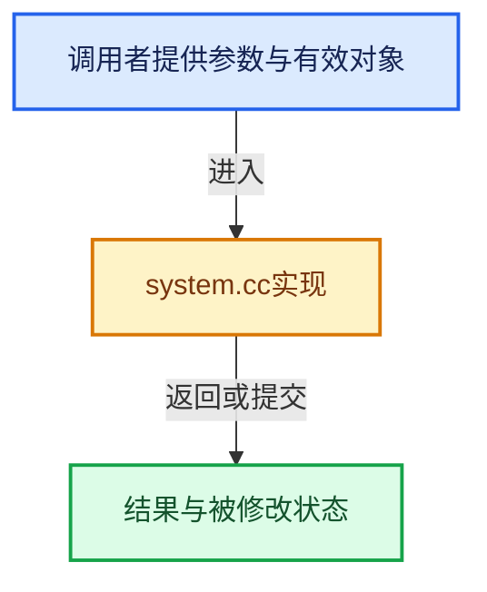

# 实现依赖专题：source/blender/blenlib/intern/system.cc

[实现依赖导航](../../README.md) · [符号索引](../../../00-课程指南/02-源码与提交索引/符号依赖与实现索引.md)

本专题从正文实际调用进入，集中保存共享实现。函数有稳定锚点，可从调用处直接跳到对应完整函数；递归与互相调用通过回链组织。

## 本文件的实现关系





## 完整成员与函数实现

<a id="f-61106ef887053ea2"></a>

### `blender::BLI_system_backtrace_with_os_info`

实现位置：[source/blender/blenlib/intern/system.cc](../../../../../../../source/blender/blenlib/intern/system.cc) · L73—L108。

接口参数：

- `FILE *fp`
- `const void *`

**教学注释版**

<!-- annotated:c5bbf821ed727e -->

```cpp
void BLI_system_backtrace_with_os_info(FILE *fp, const void * /*os_info*/)
{
  /* ----------------------- */
  /* If system as execinfo.h */
#  if defined(HAVE_EXECINFO_H)

#    define SIZE 100
  void *buffer[SIZE];
  int nptrs;
  char **strings;
  int i;

  /* Include a back-trace for good measure.
   *
   * NOTE: often values printed are addresses (no line numbers of function names),
   * this information can be expanded using `addr2line`, a utility is included to
   * conveniently run addr2line on the output generated here:
   *
   *   `./tools/utils/addr2line_backtrace.py --exe=/path/to/blender trace.txt`
   */
  nptrs = backtrace(buffer, SIZE);
  strings = backtrace_symbols(buffer, nptrs);
  for (i = 0; i < nptrs; i++) {
    fputs(strings[i], fp);
    fputc('\n', fp);
  }

  // [讲解] free：归还相匹配的C分配存储，不自动执行C++析构；不可用于Windows的_aligned_malloc结果。
  free(strings);
#    undef SIZE

#  else
  /* --------------------- */
  /* Non MSVC/Apple/Linux. */
  (void)fp;
#  endif
}
```

<details>
<summary>核对原始源码：source/blender/blenlib/intern/system.cc · L73—L108</summary>

<!-- original:c5bbf821ed727e:source/blender/blenlib/intern/system.cc:73:108 -->

```cpp
void BLI_system_backtrace_with_os_info(FILE *fp, const void * /*os_info*/)
{
  /* ----------------------- */
  /* If system as execinfo.h */
#  if defined(HAVE_EXECINFO_H)

#    define SIZE 100
  void *buffer[SIZE];
  int nptrs;
  char **strings;
  int i;

  /* Include a back-trace for good measure.
   *
   * NOTE: often values printed are addresses (no line numbers of function names),
   * this information can be expanded using `addr2line`, a utility is included to
   * conveniently run addr2line on the output generated here:
   *
   *   `./tools/utils/addr2line_backtrace.py --exe=/path/to/blender trace.txt`
   */
  nptrs = backtrace(buffer, SIZE);
  strings = backtrace_symbols(buffer, nptrs);
  for (i = 0; i < nptrs; i++) {
    fputs(strings[i], fp);
    fputc('\n', fp);
  }

  free(strings);
#    undef SIZE

#  else
  /* --------------------- */
  /* Non MSVC/Apple/Linux. */
  (void)fp;
#  endif
}
```

</details>

**沿实际写入检查状态**

- `nptrs = backtrace(buffer, SIZE);`
- `strings = backtrace_symbols(buffer, nptrs);`

**继续追踪实现**

- `backtrace` → [调用协议](../../../00-课程指南/01-路线与规范/模板宏与动态分派协议.md)：函数指针、局部可调用对象或未展开的宏；必须结合调用者环境。调用位置L93。
- `backtrace_symbols` → [调用协议](../../../00-课程指南/01-路线与规范/模板宏与动态分派协议.md)：函数指针、局部可调用对象或未展开的宏；必须结合调用者环境。调用位置L94。
- `fputs` → [调用协议](../../../00-课程指南/01-路线与规范/模板宏与动态分派协议.md)：函数指针、局部可调用对象或未展开的宏；必须结合调用者环境。调用位置L96。
- `fputc` → [调用协议](../../../00-课程指南/01-路线与规范/模板宏与动态分派协议.md)：函数指针、局部可调用对象或未展开的宏；必须结合调用者环境。调用位置L97。
- `free` → [外部契约](https://eel.is/c++draft/c.malloc)：归还相匹配的C分配存储，不自动执行C++析构；不可用于Windows的_aligned_malloc结果。

<a id="f-684f76d53453b8ff"></a>

### `blender::BLI_system_backtrace`

实现位置：[source/blender/blenlib/intern/system.cc](../../../../../../../source/blender/blenlib/intern/system.cc) · L112—L117。

接口参数：

- `FILE *fp`

**教学注释版**

<!-- annotated:2701f8e09aa41e -->

```cpp
void BLI_system_backtrace(FILE *fp)
{
  static Mutex mutex;
  std::scoped_lock lock(mutex);
  BLI_system_backtrace_with_os_info(fp, nullptr);
}
```

<details>
<summary>核对原始源码：source/blender/blenlib/intern/system.cc · L112—L117</summary>

<!-- original:2701f8e09aa41e:source/blender/blenlib/intern/system.cc:112:117 -->

```cpp
void BLI_system_backtrace(FILE *fp)
{
  static Mutex mutex;
  std::scoped_lock lock(mutex);
  BLI_system_backtrace_with_os_info(fp, nullptr);
}
```

</details>

**继续追踪实现**

- `BLI_system_backtrace_with_os_info` → [blender::BLI_system_backtrace_with_os_info · L73](system.cc.md#f-61106ef887053ea2)。
