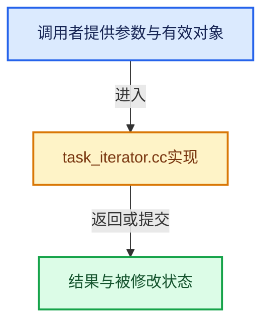

# 实现依赖专题：source/blender/blenlib/intern/task_iterator.cc

[实现依赖导航](../../README.md) · [符号索引](../../../00-课程指南/02-源码与提交索引/符号依赖与实现索引.md)

本专题从正文实际调用进入，集中保存共享实现。函数有稳定锚点，可从调用处直接跳到对应完整函数；递归与互相调用通过回链组织。

## 本文件的实现关系





<a id="m-27afaca34c99"></a>

## 宏 `MALLOCA`

<!-- annotated:789a6ef89af47d -->

```cpp
#define MALLOCA(_size) ((_size) <= 8192) ? alloca(_size) : MEM_new_uninitialized((_size), __func__)
#define MALLOCA_FREE(_mem, _size) \
```

<details>
<summary>核对原始源码：source/blender/blenlib/intern/task_iterator.cc · L26—L27</summary>

<!-- original:789a6ef89af47d:source/blender/blenlib/intern/task_iterator.cc:26:27 -->

```cpp
#define MALLOCA(_size) ((_size) <= 8192) ? alloca(_size) : MEM_new_uninitialized((_size), __func__)
#define MALLOCA_FREE(_mem, _size) \
```

</details>

宏在预处理阶段展开，参数替换、重复求值和条件编译应直接从该定义检查。与普通函数不同，宏不会自动提供参数类型检查；构建配置选择哪个定义需结合外围条件。

<a id="m-10468da36a3f"></a>

## 宏 `MALLOCA_FREE`

<!-- annotated:e592f240e8964f -->

```cpp
#define MALLOCA_FREE(_mem, _size) \
  if (((_mem) != nullptr) && ((_size) > 8192)) { \
    MEM_delete_void(_mem); \
  } \
  ((void)0)

```

<details>
<summary>核对原始源码：source/blender/blenlib/intern/task_iterator.cc · L27—L32</summary>

<!-- original:e592f240e8964f:source/blender/blenlib/intern/task_iterator.cc:27:32 -->

```cpp
#define MALLOCA_FREE(_mem, _size) \
  if (((_mem) != nullptr) && ((_size) > 8192)) { \
    MEM_delete_void(_mem); \
  } \
  ((void)0)

```

</details>

宏在预处理阶段展开，参数替换、重复求值和条件编译应直接从该定义检查。与普通函数不同，宏不会自动提供参数类型检查；构建配置选择哪个定义需结合外围条件。

## 完整成员与函数实现

<a id="f-5cdf188dbaf24c71"></a>

### `blender::BLI_task_parallel_mempool`

实现位置：[source/blender/blenlib/intern/task_iterator.cc](../../../../../../../source/blender/blenlib/intern/task_iterator.cc) · L57—L153。

接口参数：

- `BLI_mempool *mempool`
- `void *userdata`
- `TaskParallelMempoolFunc func`
- `const TaskParallelSettings *settings`

**教学注释版**

<!-- annotated:1ab405cceaec61 -->

```cpp
void BLI_task_parallel_mempool(BLI_mempool *mempool,
                               void *userdata,
                               TaskParallelMempoolFunc func,
                               const TaskParallelSettings *settings)
{
  if (BLI_mempool_len(mempool) == 0) [[unlikely]] {
    return;
  }

  void *userdata_chunk = settings->userdata_chunk;
  const size_t userdata_chunk_size = settings->userdata_chunk_size;
  void *userdata_chunk_array = nullptr;
  const bool use_userdata_chunk = (userdata_chunk_size != 0) && (userdata_chunk != nullptr);

  if (!settings->use_threading) {
    TaskParallelTLS tls = {nullptr};
    if (use_userdata_chunk) {
      if (settings->func_init != nullptr) {
        settings->func_init(userdata, userdata_chunk);
      }
      tls.userdata_chunk = userdata_chunk;
    }

    BLI_mempool_iter iter;
    BLI_mempool_iternew(mempool, &iter);

    void *item;
    while ((item = BLI_mempool_iterstep(&iter))) {
      func(userdata, static_cast<MempoolIterData *>(item), &tls);
    }

    if (use_userdata_chunk) {
      if (settings->func_free != nullptr && userdata_chunk != nullptr) {
        /* `func_free` should only free data that was created during execution of `func`. */
        settings->func_free(userdata, userdata_chunk);
      }
    }

    return;
  }

  ParallelMempoolState state;
  TaskPool *task_pool = BLI_task_pool_create(&state, TASK_PRIORITY_HIGH);
  const int threads_num = BLI_task_scheduler_num_threads();

  /* The idea here is to prevent creating task for each of the loop iterations
   * and instead have tasks which are evenly distributed across CPU cores and
   * pull next item to be crunched using the threaded-aware BLI_mempool_iter.
   */
  const int tasks_num = threads_num + 2;

  state.userdata = userdata;
  state.func = func;

  if (use_userdata_chunk) {
    userdata_chunk_array = MALLOCA(userdata_chunk_size * tasks_num);
  }

  ParallelMempoolTaskData *mempool_iterator_data = mempool_iter_threadsafe_create(
      mempool, size_t(tasks_num));

  for (int i = 0; i < tasks_num; i++) {
    void *userdata_chunk_local = nullptr;
    if (use_userdata_chunk) {
      userdata_chunk_local = static_cast<char *>(userdata_chunk_array) + (userdata_chunk_size * i);
      // [讲解] memcpy：复制字节，源与目标不应重叠。类型生命周期、对齐和可复制表示须由调用者证明，不是任意对象的复制构造。
      memcpy(userdata_chunk_local, userdata_chunk, userdata_chunk_size);
      if (settings->func_init != nullptr) {
        settings->func_init(userdata, userdata_chunk_local);
      }
    }
    mempool_iterator_data[i].tls.userdata_chunk = userdata_chunk_local;

    /* Use this pool's pre-allocated tasks. */
    BLI_task_pool_push(
        task_pool, parallel_mempool_func, &mempool_iterator_data[i], false, nullptr);
  }

  BLI_task_pool_work_and_wait(task_pool);
  BLI_task_pool_free(task_pool);

  if (use_userdata_chunk) {
    if ((settings->func_free != nullptr) || (settings->func_reduce != nullptr)) {
      for (int i = 0; i < tasks_num; i++) {
        if (settings->func_reduce) {
          settings->func_reduce(
              userdata, userdata_chunk, mempool_iterator_data[i].tls.userdata_chunk);
        }
        if (settings->func_free && mempool_iterator_data[i].tls.userdata_chunk != nullptr) {
          settings->func_free(userdata, mempool_iterator_data[i].tls.userdata_chunk);
        }
      }
    }
    MALLOCA_FREE(userdata_chunk_array, userdata_chunk_size * tasks_num);
  }

  mempool_iter_threadsafe_destroy(mempool_iterator_data);
}
```

<details>
<summary>核对原始源码：source/blender/blenlib/intern/task_iterator.cc · L57—L153</summary>

<!-- original:1ab405cceaec61:source/blender/blenlib/intern/task_iterator.cc:57:153 -->

```cpp
void BLI_task_parallel_mempool(BLI_mempool *mempool,
                               void *userdata,
                               TaskParallelMempoolFunc func,
                               const TaskParallelSettings *settings)
{
  if (BLI_mempool_len(mempool) == 0) [[unlikely]] {
    return;
  }

  void *userdata_chunk = settings->userdata_chunk;
  const size_t userdata_chunk_size = settings->userdata_chunk_size;
  void *userdata_chunk_array = nullptr;
  const bool use_userdata_chunk = (userdata_chunk_size != 0) && (userdata_chunk != nullptr);

  if (!settings->use_threading) {
    TaskParallelTLS tls = {nullptr};
    if (use_userdata_chunk) {
      if (settings->func_init != nullptr) {
        settings->func_init(userdata, userdata_chunk);
      }
      tls.userdata_chunk = userdata_chunk;
    }

    BLI_mempool_iter iter;
    BLI_mempool_iternew(mempool, &iter);

    void *item;
    while ((item = BLI_mempool_iterstep(&iter))) {
      func(userdata, static_cast<MempoolIterData *>(item), &tls);
    }

    if (use_userdata_chunk) {
      if (settings->func_free != nullptr && userdata_chunk != nullptr) {
        /* `func_free` should only free data that was created during execution of `func`. */
        settings->func_free(userdata, userdata_chunk);
      }
    }

    return;
  }

  ParallelMempoolState state;
  TaskPool *task_pool = BLI_task_pool_create(&state, TASK_PRIORITY_HIGH);
  const int threads_num = BLI_task_scheduler_num_threads();

  /* The idea here is to prevent creating task for each of the loop iterations
   * and instead have tasks which are evenly distributed across CPU cores and
   * pull next item to be crunched using the threaded-aware BLI_mempool_iter.
   */
  const int tasks_num = threads_num + 2;

  state.userdata = userdata;
  state.func = func;

  if (use_userdata_chunk) {
    userdata_chunk_array = MALLOCA(userdata_chunk_size * tasks_num);
  }

  ParallelMempoolTaskData *mempool_iterator_data = mempool_iter_threadsafe_create(
      mempool, size_t(tasks_num));

  for (int i = 0; i < tasks_num; i++) {
    void *userdata_chunk_local = nullptr;
    if (use_userdata_chunk) {
      userdata_chunk_local = static_cast<char *>(userdata_chunk_array) + (userdata_chunk_size * i);
      memcpy(userdata_chunk_local, userdata_chunk, userdata_chunk_size);
      if (settings->func_init != nullptr) {
        settings->func_init(userdata, userdata_chunk_local);
      }
    }
    mempool_iterator_data[i].tls.userdata_chunk = userdata_chunk_local;

    /* Use this pool's pre-allocated tasks. */
    BLI_task_pool_push(
        task_pool, parallel_mempool_func, &mempool_iterator_data[i], false, nullptr);
  }

  BLI_task_pool_work_and_wait(task_pool);
  BLI_task_pool_free(task_pool);

  if (use_userdata_chunk) {
    if ((settings->func_free != nullptr) || (settings->func_reduce != nullptr)) {
      for (int i = 0; i < tasks_num; i++) {
        if (settings->func_reduce) {
          settings->func_reduce(
              userdata, userdata_chunk, mempool_iterator_data[i].tls.userdata_chunk);
        }
        if (settings->func_free && mempool_iterator_data[i].tls.userdata_chunk != nullptr) {
          settings->func_free(userdata, mempool_iterator_data[i].tls.userdata_chunk);
        }
      }
    }
    MALLOCA_FREE(userdata_chunk_array, userdata_chunk_size * tasks_num);
  }

  mempool_iter_threadsafe_destroy(mempool_iterator_data);
}
```

</details>

**沿实际写入检查状态**

- `tls.userdata_chunk = userdata_chunk;`
- `state.userdata = userdata;`
- `state.func = func;`
- `userdata_chunk_array = MALLOCA(userdata_chunk_size * tasks_num);`
- `userdata_chunk_local = static_cast<char *>(userdata_chunk_array) + (userdata_chunk_size * i);`
- `mempool_iterator_data[i].tls.userdata_chunk = userdata_chunk_local;`

**继续追踪实现**

- `BLI_mempool_len` → [blender::BLI_mempool_len · L525](BLI_mempool.cc.md#f-ec36933b6ebad206)。
- `settings->func_init` → [调用协议](../../../00-课程指南/01-路线与规范/模板宏与动态分派协议.md)：由接收对象具体类型或运行时策略提供实现。调用位置L75。
- `BLI_mempool_iternew` → [blender::BLI_mempool_iternew · L581](BLI_mempool.cc.md#f-df0a4e4833b84605)。
- `BLI_mempool_iterstep` → [blender::BLI_mempool_iterstep · L648](BLI_mempool.cc.md#f-a388cb984a4763d7)；[blender::BLI_mempool_iterstep · L661](BLI_mempool.cc.md#f-9140a42df5c2c177)。同名重载需按实参类型选择。
- `func` → [调用协议](../../../00-课程指南/01-路线与规范/模板宏与动态分派协议.md)：局部可调用对象，须结合其初始化与捕获环境。调用位置L85。
- `settings->func_free` → [调用协议](../../../00-课程指南/01-路线与规范/模板宏与动态分派协议.md)：由接收对象具体类型或运行时策略提供实现。调用位置L91。
- `BLI_task_pool_create` → [BLI_task_pool_create · L404](../../../11-Depsgraph与并行任务系统/07-任务池与TBB接入.md#f-1bbb9c0703fd163c)。
- `BLI_task_scheduler_num_threads` → [blender::BLI_task_scheduler_num_threads · L110](../../../11-Depsgraph与并行任务系统/07-任务池与TBB接入.md#f-3c1a5dc8137998ab)。
- `MALLOCA` → [MALLOCA · L26](task_iterator.cc.md#m-27afaca34c99)。宏定义由构建条件选择。
- `mempool_iter_threadsafe_create` → [blender::mempool_iter_threadsafe_create · L596](BLI_mempool.cc.md#f-9943b8f82f1b3ed5)。
- `memcpy` → [外部契约](https://eel.is/c++draft/cstring.syn)：复制字节，源与目标不应重叠。类型生命周期、对齐和可复制表示须由调用者证明，不是任意对象的复制构造。
- `BLI_task_pool_push` → [BLI_task_pool_push · L446](../../../11-Depsgraph与并行任务系统/07-任务池与TBB接入.md#f-16c248b3ea6653d2)。
- `BLI_task_pool_work_and_wait` → [BLI_task_pool_work_and_wait · L455](../../../11-Depsgraph与并行任务系统/07-任务池与TBB接入.md#f-cece9e6aa22a9121)。
- `BLI_task_pool_free` → [BLI_task_pool_free · L441](../../../11-Depsgraph与并行任务系统/07-任务池与TBB接入.md#f-b9af08e8b1362aaa)。
- `settings->func_reduce` → [调用协议](../../../00-课程指南/01-路线与规范/模板宏与动态分派协议.md)：由接收对象具体类型或运行时策略提供实现。调用位置L141。
- `MALLOCA_FREE` → [MALLOCA_FREE · L27](task_iterator.cc.md#m-10468da36a3f)。宏定义由构建条件选择。
- `mempool_iter_threadsafe_destroy` → [blender::mempool_iter_threadsafe_destroy · L617](BLI_mempool.cc.md#f-5536c3dc115d381d)。
