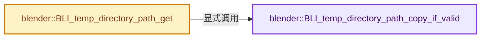
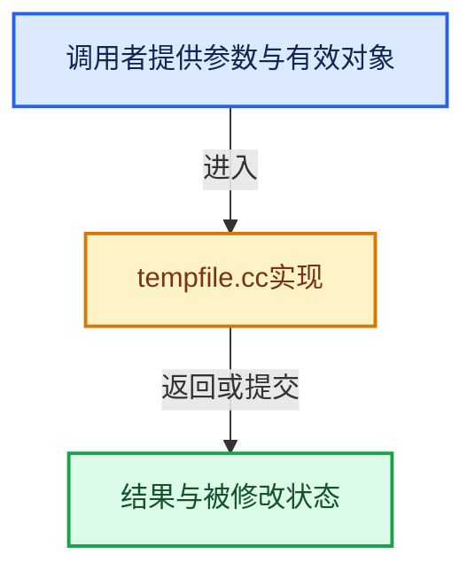

# 实现依赖专题：source/blender/blenlib/intern/tempfile.cc

[实现依赖导航](../../README.md) · [符号索引](../../../00-课程指南/02-源码与提交索引/符号依赖与实现索引.md)

本专题从正文实际调用进入，集中保存共享实现。函数有稳定锚点，可从调用处直接跳到对应完整函数；递归与互相调用通过回链组织。

## 本文件的实现关系






## 完整成员与函数实现

<a id="f-d8f623189a6f5b18"></a>

### `blender::BLI_temp_directory_path_copy_if_valid`

实现位置：[source/blender/blenlib/intern/tempfile.cc](../../../../../../../source/blender/blenlib/intern/tempfile.cc) · L17—L57。

接口参数：

- `char *tempdir`
- `const size_t tempdir_maxncpy`
- `const char *dirpath`

**教学注释版**

<!-- annotated:d5aee730c94410 -->

```cpp
bool BLI_temp_directory_path_copy_if_valid(char *tempdir,
                                           const size_t tempdir_maxncpy,
                                           const char *dirpath)
{
  /* NOTE(@ideasman42): it is *not* the purpose of this function to check that
   * `dirpath` is writable under all circumstances.
   * Only check `dirpath` doesn't resolve to an empty string & points to a directory.
   *
   * While other checks could be added to avoid problems writing temporary files:
   * (read-only, permission failure, out-of-I-nodes, disk-full... etc)
   * it's out of scope for this function as these characteristics can change at run-time.
   * In general temporary file IO should handle failure properly with sufficient user feedback,
   * without attempting to *solve* the problem by anticipating file-system issues ahead of time. */

  /* Disallow paths starting with two forward slashes. While they are valid paths,
   * Blender interprets them as relative in situations relative paths aren't supported,
   * see #95411. */
  while (dirpath[0] == '/' && dirpath[1] == '/') [[unlikely]] {
    dirpath++;
  }
  if (dirpath[0] == '\0') {
    return false;
  }
  if (!BLI_is_dir(dirpath)) {
    return false;
  }

  BLI_strncpy(tempdir, dirpath, tempdir_maxncpy);

  /* Add a trailing slash if needed. */
  BLI_path_slash_ensure(tempdir, tempdir_maxncpy);

  /* There's nothing preventing an environment variable (even preferences) from being CWD relative.
   * This causes:
   * - Asserts in code-paths which expect absolute paths (blend-file IO).
   * - The temporary directory to change if the CWD changes.
   * Avoid issues by ensuring the temporary directory is *never* CWD relative. */
  BLI_path_abs_from_cwd(tempdir, tempdir_maxncpy);

  return true;
}
```

<details>
<summary>核对原始源码：source/blender/blenlib/intern/tempfile.cc · L17—L57</summary>

<!-- original:d5aee730c94410:source/blender/blenlib/intern/tempfile.cc:17:57 -->

```cpp
bool BLI_temp_directory_path_copy_if_valid(char *tempdir,
                                           const size_t tempdir_maxncpy,
                                           const char *dirpath)
{
  /* NOTE(@ideasman42): it is *not* the purpose of this function to check that
   * `dirpath` is writable under all circumstances.
   * Only check `dirpath` doesn't resolve to an empty string & points to a directory.
   *
   * While other checks could be added to avoid problems writing temporary files:
   * (read-only, permission failure, out-of-I-nodes, disk-full... etc)
   * it's out of scope for this function as these characteristics can change at run-time.
   * In general temporary file IO should handle failure properly with sufficient user feedback,
   * without attempting to *solve* the problem by anticipating file-system issues ahead of time. */

  /* Disallow paths starting with two forward slashes. While they are valid paths,
   * Blender interprets them as relative in situations relative paths aren't supported,
   * see #95411. */
  while (dirpath[0] == '/' && dirpath[1] == '/') [[unlikely]] {
    dirpath++;
  }
  if (dirpath[0] == '\0') {
    return false;
  }
  if (!BLI_is_dir(dirpath)) {
    return false;
  }

  BLI_strncpy(tempdir, dirpath, tempdir_maxncpy);

  /* Add a trailing slash if needed. */
  BLI_path_slash_ensure(tempdir, tempdir_maxncpy);

  /* There's nothing preventing an environment variable (even preferences) from being CWD relative.
   * This causes:
   * - Asserts in code-paths which expect absolute paths (blend-file IO).
   * - The temporary directory to change if the CWD changes.
   * Avoid issues by ensuring the temporary directory is *never* CWD relative. */
  BLI_path_abs_from_cwd(tempdir, tempdir_maxncpy);

  return true;
}
```

</details>

**结果出口**

- `return false;`
- `return true;`

**继续追踪实现**

- `BLI_is_dir` → [blender::BLI_is_dir · L457](storage.cc.md#f-eedeb1fd6a515977)。
- `BLI_strncpy` → [blender::BLI_strncpy · L70](string.cc.md#f-6324147b0d116da1)。
- `BLI_path_slash_ensure` → [BLI_path_slash_ensure · L2021](path_utils.cc.md#f-5a6c9abc494fe6dd)。
- `BLI_path_abs_from_cwd` → [BLI_path_abs_from_cwd · L1284](path_utils.cc.md#f-a2be2b889367098e)。

<a id="f-2011e9c2efdc344d"></a>

### `blender::BLI_temp_directory_path_get`

实现位置：[source/blender/blenlib/intern/tempfile.cc](../../../../../../../source/blender/blenlib/intern/tempfile.cc) · L59—L76。

接口参数：

- `char *tempdir`
- `const size_t tempdir_maxncpy`

**教学注释版**

<!-- annotated:b41f9c82f4e64f -->

```cpp
void BLI_temp_directory_path_get(char *tempdir, const size_t tempdir_maxncpy)
{
  tempdir[0] = '\0';

#ifdef WIN32
  const char *env_var = "TEMP";
#else
  const char *env_var = "TMPDIR";
#endif

  if (const char *tempdir_test = BLI_getenv(env_var)) {
    BLI_temp_directory_path_copy_if_valid(tempdir, tempdir_maxncpy, tempdir_test);
  }

  if (tempdir[0] == '\0') {
    BLI_strncpy(tempdir, "/tmp/", tempdir_maxncpy);
  }
}
```

<details>
<summary>核对原始源码：source/blender/blenlib/intern/tempfile.cc · L59—L76</summary>

<!-- original:b41f9c82f4e64f:source/blender/blenlib/intern/tempfile.cc:59:76 -->

```cpp
void BLI_temp_directory_path_get(char *tempdir, const size_t tempdir_maxncpy)
{
  tempdir[0] = '\0';

#ifdef WIN32
  const char *env_var = "TEMP";
#else
  const char *env_var = "TMPDIR";
#endif

  if (const char *tempdir_test = BLI_getenv(env_var)) {
    BLI_temp_directory_path_copy_if_valid(tempdir, tempdir_maxncpy, tempdir_test);
  }

  if (tempdir[0] == '\0') {
    BLI_strncpy(tempdir, "/tmp/", tempdir_maxncpy);
  }
}
```

</details>

**沿实际写入检查状态**

- `tempdir[0] = '\0';`

**继续追踪实现**

- `BLI_getenv` → [BLI_getenv · L1435](path_utils.cc.md#f-c6a0b8b917e9ef4c)。
- `BLI_temp_directory_path_copy_if_valid` → [blender::BLI_temp_directory_path_copy_if_valid · L17](tempfile.cc.md#f-d8f623189a6f5b18)。
- `BLI_strncpy` → [blender::BLI_strncpy · L70](string.cc.md#f-6324147b0d116da1)。
