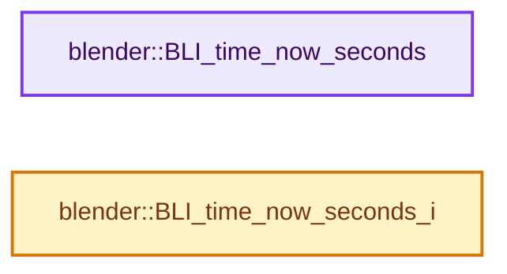
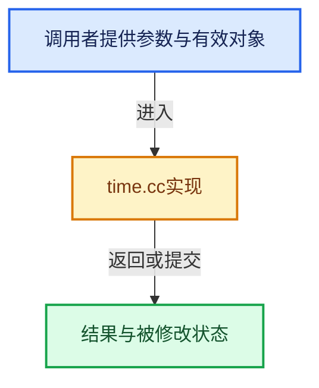

# 实现依赖专题：source/blender/blenlib/intern/time.cc

[实现依赖导航](../../README.md) · [符号索引](../../../00-课程指南/02-源码与提交索引/符号依赖与实现索引.md)

本专题从正文实际调用进入，集中保存共享实现。函数有稳定锚点，可从调用处直接跳到对应完整函数；递归与互相调用通过回链组织。

## 本文件的实现关系






## 完整成员与函数实现

<a id="f-78479f031bcc3c53"></a>

### `blender::BLI_time_now_seconds`

实现位置：[source/blender/blenlib/intern/time.cc](../../../../../../../source/blender/blenlib/intern/time.cc) · L30—L34。

**教学注释版**

<!-- annotated:79acc97497b5e2 -->

```cpp
double BLI_time_now_seconds()
{
  return std::chrono::duration<double>(std::chrono::steady_clock::now().time_since_epoch())
      .count();
}
```

<details>
<summary>核对原始源码：source/blender/blenlib/intern/time.cc · L30—L34</summary>

<!-- original:79acc97497b5e2:source/blender/blenlib/intern/time.cc:30:34 -->

```cpp
double BLI_time_now_seconds()
{
  return std::chrono::duration<double>(std::chrono::steady_clock::now().time_since_epoch())
      .count();
}
```

</details>

**结果出口**

- `return std::chrono::duration<double>(std::chrono::steady_clock::now().time_since_epoch())`

**继续追踪实现**

- `std::chrono::duration<double>(std::chrono::steady_clock::now().time_since_epoch()) .count` → [外部契约](https://eel.is/c++draft/)：这个边界按实际表达式及所属类型核对参数、返回值、寿命与失败行为。这里提供接口入口，不声称已解释该第三方版本的内部实现。
- `std::chrono::duration<double>` → [外部契约](https://eel.is/c++draft/)：这个边界按实际表达式及所属类型核对参数、返回值、寿命与失败行为。这里提供接口入口，不声称已解释该第三方版本的内部实现。
- `std::chrono::steady_clock::now().time_since_epoch` → [外部契约](https://eel.is/c++draft/)：这个边界按实际表达式及所属类型核对参数、返回值、寿命与失败行为。这里提供接口入口，不声称已解释该第三方版本的内部实现。
- `std::chrono::steady_clock::now` → [外部契约](https://eel.is/c++draft/)：这个边界按实际表达式及所属类型核对参数、返回值、寿命与失败行为。这里提供接口入口，不声称已解释该第三方版本的内部实现。

<a id="f-38db665188e3ded7"></a>

### `blender::BLI_time_now_seconds_i`

实现位置：[source/blender/blenlib/intern/time.cc](../../../../../../../source/blender/blenlib/intern/time.cc) · L36—L41。

**教学注释版**

<!-- annotated:94921441a387ba -->

```cpp
int64_t BLI_time_now_seconds_i()
{
  return std::chrono::duration_cast<std::chrono::seconds>(
             std::chrono::steady_clock::now().time_since_epoch())
      .count();
}
```

<details>
<summary>核对原始源码：source/blender/blenlib/intern/time.cc · L36—L41</summary>

<!-- original:94921441a387ba:source/blender/blenlib/intern/time.cc:36:41 -->

```cpp
int64_t BLI_time_now_seconds_i()
{
  return std::chrono::duration_cast<std::chrono::seconds>(
             std::chrono::steady_clock::now().time_since_epoch())
      .count();
}
```

</details>

**结果出口**

- `return std::chrono::duration_cast<std::chrono::seconds>(`

**继续追踪实现**

- `std::chrono::duration_cast<std::chrono::seconds>( std::chrono::steady_clock::now().time_since_epoch()) .count` → [外部契约](https://eel.is/c++draft/)：这个边界按实际表达式及所属类型核对参数、返回值、寿命与失败行为。这里提供接口入口，不声称已解释该第三方版本的内部实现。
- `std::chrono::duration_cast<std::chrono::seconds>` → [外部契约](https://eel.is/c++draft/)：这个边界按实际表达式及所属类型核对参数、返回值、寿命与失败行为。这里提供接口入口，不声称已解释该第三方版本的内部实现。
- `std::chrono::steady_clock::now().time_since_epoch` → [外部契约](https://eel.is/c++draft/)：这个边界按实际表达式及所属类型核对参数、返回值、寿命与失败行为。这里提供接口入口，不声称已解释该第三方版本的内部实现。
- `std::chrono::steady_clock::now` → [外部契约](https://eel.is/c++draft/)：这个边界按实际表达式及所属类型核对参数、返回值、寿命与失败行为。这里提供接口入口，不声称已解释该第三方版本的内部实现。
