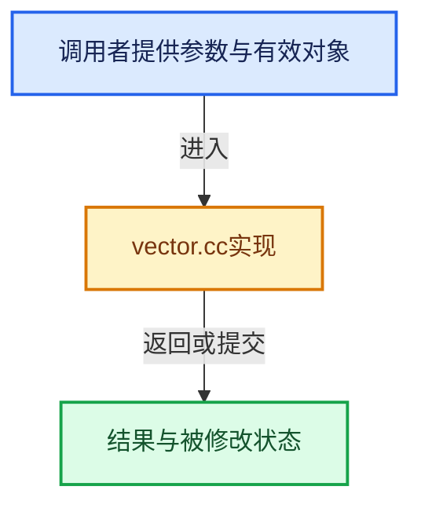

# 实现依赖专题：source/blender/blenlib/intern/vector.cc

[实现依赖导航](../../README.md) · [符号索引](../../../00-课程指南/02-源码与提交索引/符号依赖与实现索引.md)

本专题从正文实际调用进入，集中保存共享实现。函数有稳定锚点，可从调用处直接跳到对应完整函数；递归与互相调用通过回链组织。

## 本文件的实现关系





## 完整成员与函数实现

<a id="f-5d2f397fb7bc8b49"></a>

### `blender::internal::vector_print_stats`

实现位置：[source/blender/blenlib/intern/vector.cc](../../../../../../../source/blender/blenlib/intern/vector.cc) · L16—L32。

接口参数：

- `const char *name`
- `const void *address`
- `int64_t size`
- `int64_t capacity`
- `int64_t inlineCapacity`
- `int64_t memorySize`

**教学注释版**

<!-- annotated:065b9911389d22 -->

```cpp
void internal::vector_print_stats(const char *name,
                                  const void *address,
                                  int64_t size,
                                  int64_t capacity,
                                  int64_t inlineCapacity,
                                  int64_t memorySize)
{
  std::cout << "Vector Stats: " << name << "\n";
  std::cout << "  Address: " << address << "\n";
  std::cout << "  Elements: " << size << "\n";
  std::cout << "  Capacity: " << capacity << "\n";
  std::cout << "  Inline Capacity: " << inlineCapacity << "\n";

  char memory_size_str[BLI_STR_FORMAT_INT64_BYTE_UNIT_SIZE];
  BLI_str_format_byte_unit(memory_size_str, memorySize, true);
  std::cout << "  Size on Stack: " << memory_size_str << "\n";
}
```

<details>
<summary>核对原始源码：source/blender/blenlib/intern/vector.cc · L16—L32</summary>

<!-- original:065b9911389d22:source/blender/blenlib/intern/vector.cc:16:32 -->

```cpp
void internal::vector_print_stats(const char *name,
                                  const void *address,
                                  int64_t size,
                                  int64_t capacity,
                                  int64_t inlineCapacity,
                                  int64_t memorySize)
{
  std::cout << "Vector Stats: " << name << "\n";
  std::cout << "  Address: " << address << "\n";
  std::cout << "  Elements: " << size << "\n";
  std::cout << "  Capacity: " << capacity << "\n";
  std::cout << "  Inline Capacity: " << inlineCapacity << "\n";

  char memory_size_str[BLI_STR_FORMAT_INT64_BYTE_UNIT_SIZE];
  BLI_str_format_byte_unit(memory_size_str, memorySize, true);
  std::cout << "  Size on Stack: " << memory_size_str << "\n";
}
```

</details>

**继续追踪实现**

- `BLI_str_format_byte_unit` → [blender::BLI_str_format_byte_unit · L1214](string.cc.md#f-5e0d6af0be8549be)。
