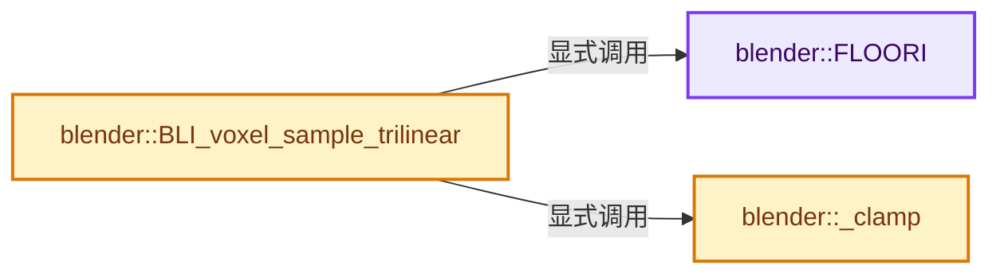
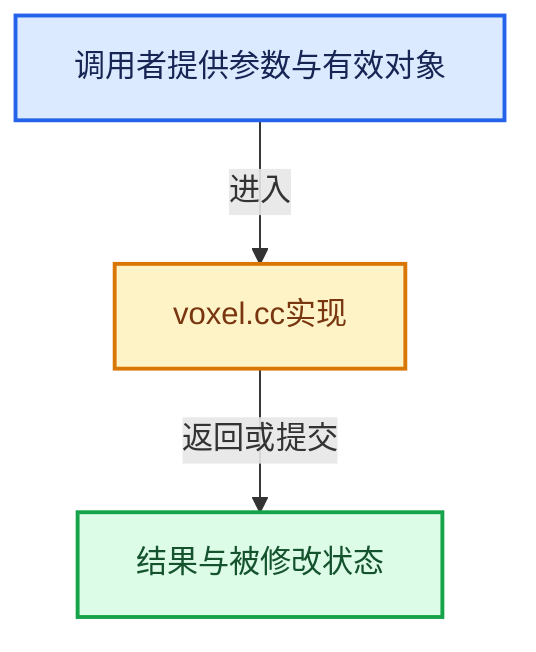

# 实现依赖专题：source/blender/blenlib/intern/voxel.cc

[实现依赖导航](../../README.md) · [符号索引](../../../00-课程指南/02-源码与提交索引/符号依赖与实现索引.md)

本专题从正文实际调用进入，集中保存共享实现。函数有稳定锚点，可从调用处直接跳到对应完整函数；递归与互相调用通过回链组织。

## 本文件的实现关系






## 完整成员与函数实现

<a id="f-4c0630ddf35cea91"></a>

### `blender::FLOORI`

实现位置：[source/blender/blenlib/intern/voxel.cc](../../../../../../../source/blender/blenlib/intern/voxel.cc) · L27—L31。

接口参数：

- `float x`

**教学注释版**

<!-- annotated:549029f38e7af9 -->

```cpp
BLI_INLINE int FLOORI(float x)
{
  const int r = int(x);
  return ((x >= 0.0f) || float(r) == x) ? r : (r - 1);
}
```

<details>
<summary>核对原始源码：source/blender/blenlib/intern/voxel.cc · L27—L31</summary>

<!-- original:549029f38e7af9:source/blender/blenlib/intern/voxel.cc:27:31 -->

```cpp
BLI_INLINE int FLOORI(float x)
{
  const int r = int(x);
  return ((x >= 0.0f) || float(r) == x) ? r : (r - 1);
}
```

</details>

**结果出口**

- `return ((x >= 0.0f) || float(r) == x) ? r : (r - 1);`

**继续追踪实现**

本实现没有需要继续展开的显式调用；检查返回表达式、对象转换和调用者前置条件。

<a id="f-8e9fd213d75a8c66"></a>

### `blender::_clamp`

实现位置：[source/blender/blenlib/intern/voxel.cc](../../../../../../../source/blender/blenlib/intern/voxel.cc) · L41—L44。

接口参数：

- `int a`
- `int b`
- `int c`

**教学注释版**

<!-- annotated:ec89c66a5a24f3 -->

```cpp
BLI_INLINE int64_t _clamp(int a, int b, int c)
{
  return (a < b) ? b : ((a > c) ? c : a);
}
```

<details>
<summary>核对原始源码：source/blender/blenlib/intern/voxel.cc · L41—L44</summary>

<!-- original:ec89c66a5a24f3:source/blender/blenlib/intern/voxel.cc:41:44 -->

```cpp
BLI_INLINE int64_t _clamp(int a, int b, int c)
{
  return (a < b) ? b : ((a > c) ? c : a);
}
```

</details>

**结果出口**

- `return (a < b) ? b : ((a > c) ? c : a);`

**继续追踪实现**

本实现没有需要继续展开的显式调用；检查返回表达式、对象转换和调用者前置条件。

<a id="f-b1894180a8e60128"></a>

### `blender::BLI_voxel_sample_trilinear`

实现位置：[source/blender/blenlib/intern/voxel.cc](../../../../../../../source/blender/blenlib/intern/voxel.cc) · L46—L85。

接口参数：

- `const float *data`
- `const int res[3]`
- `const float co[3]`

**教学注释版**

<!-- annotated:3c94cbfdb4156d -->

```cpp
float BLI_voxel_sample_trilinear(const float *data, const int res[3], const float co[3])
{
  if (data) {

    const float xf = co[0] * float(res[0]) - 0.5f;
    const float yf = co[1] * float(res[1]) - 0.5f;
    const float zf = co[2] * float(res[2]) - 0.5f;

    const int x = FLOORI(xf), y = FLOORI(yf), z = FLOORI(zf);

    const int64_t xc[2] = {
        _clamp(x, 0, res[0] - 1),
        _clamp(x + 1, 0, res[0] - 1),
    };
    const int64_t yc[2] = {
        _clamp(y, 0, res[1] - 1) * res[0],
        _clamp(y + 1, 0, res[1] - 1) * res[0],
    };
    const int64_t zc[2] = {
        _clamp(z, 0, res[2] - 1) * res[0] * res[1],
        _clamp(z + 1, 0, res[2] - 1) * res[0] * res[1],
    };

    const float dx = xf - float(x);
    const float dy = yf - float(y);
    const float dz = zf - float(z);

    const float u[2] = {1.0f - dx, dx};
    const float v[2] = {1.0f - dy, dy};
    const float w[2] = {1.0f - dz, dz};

    return w[0] *
               (v[0] * (u[0] * data[xc[0] + yc[0] + zc[0]] + u[1] * data[xc[1] + yc[0] + zc[0]]) +
                v[1] * (u[0] * data[xc[0] + yc[1] + zc[0]] + u[1] * data[xc[1] + yc[1] + zc[0]])) +
           w[1] *
               (v[0] * (u[0] * data[xc[0] + yc[0] + zc[1]] + u[1] * data[xc[1] + yc[0] + zc[1]]) +
                v[1] * (u[0] * data[xc[0] + yc[1] + zc[1]] + u[1] * data[xc[1] + yc[1] + zc[1]]));
  }
  return 0.0f;
}
```

<details>
<summary>核对原始源码：source/blender/blenlib/intern/voxel.cc · L46—L85</summary>

<!-- original:3c94cbfdb4156d:source/blender/blenlib/intern/voxel.cc:46:85 -->

```cpp
float BLI_voxel_sample_trilinear(const float *data, const int res[3], const float co[3])
{
  if (data) {

    const float xf = co[0] * float(res[0]) - 0.5f;
    const float yf = co[1] * float(res[1]) - 0.5f;
    const float zf = co[2] * float(res[2]) - 0.5f;

    const int x = FLOORI(xf), y = FLOORI(yf), z = FLOORI(zf);

    const int64_t xc[2] = {
        _clamp(x, 0, res[0] - 1),
        _clamp(x + 1, 0, res[0] - 1),
    };
    const int64_t yc[2] = {
        _clamp(y, 0, res[1] - 1) * res[0],
        _clamp(y + 1, 0, res[1] - 1) * res[0],
    };
    const int64_t zc[2] = {
        _clamp(z, 0, res[2] - 1) * res[0] * res[1],
        _clamp(z + 1, 0, res[2] - 1) * res[0] * res[1],
    };

    const float dx = xf - float(x);
    const float dy = yf - float(y);
    const float dz = zf - float(z);

    const float u[2] = {1.0f - dx, dx};
    const float v[2] = {1.0f - dy, dy};
    const float w[2] = {1.0f - dz, dz};

    return w[0] *
               (v[0] * (u[0] * data[xc[0] + yc[0] + zc[0]] + u[1] * data[xc[1] + yc[0] + zc[0]]) +
                v[1] * (u[0] * data[xc[0] + yc[1] + zc[0]] + u[1] * data[xc[1] + yc[1] + zc[0]])) +
           w[1] *
               (v[0] * (u[0] * data[xc[0] + yc[0] + zc[1]] + u[1] * data[xc[1] + yc[0] + zc[1]]) +
                v[1] * (u[0] * data[xc[0] + yc[1] + zc[1]] + u[1] * data[xc[1] + yc[1] + zc[1]]));
  }
  return 0.0f;
}
```

</details>

**结果出口**

- `return w[0] *`
- `return 0.0f;`

**继续追踪实现**

- `FLOORI` → [blender::FLOORI · L27](voxel.cc.md#f-4c0630ddf35cea91)。
- `_clamp` → [blender::_clamp · L41](voxel.cc.md#f-8e9fd213d75a8c66)。
