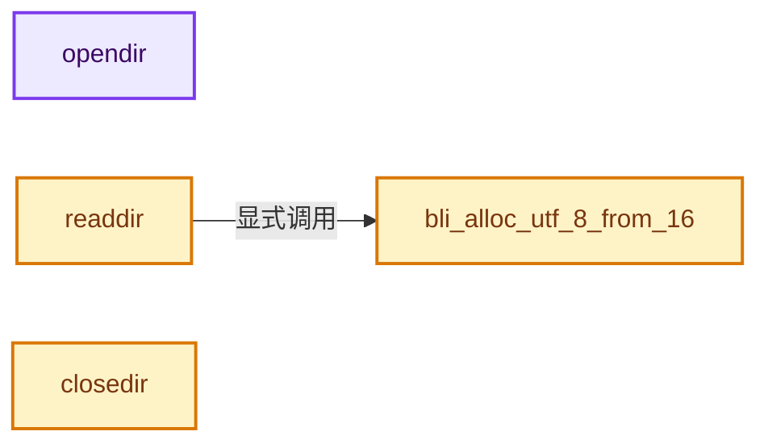
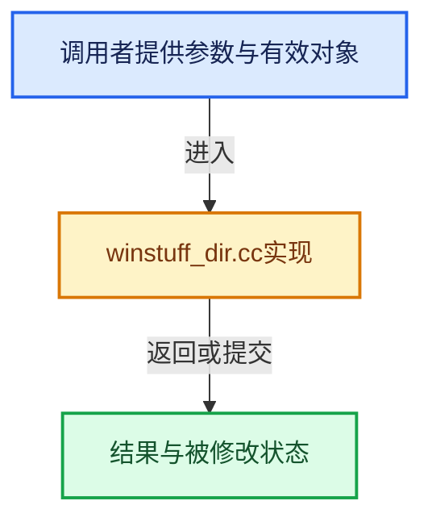

# 实现依赖专题：source/blender/blenlib/intern/winstuff_dir.cc

[实现依赖导航](../../README.md) · [符号索引](../../../00-课程指南/02-源码与提交索引/符号依赖与实现索引.md)

本专题从正文实际调用进入，集中保存共享实现。函数有稳定锚点，可从调用处直接跳到对应完整函数；递归与互相调用通过回链组织。

## 本文件的实现关系






## 完整成员与函数实现

<a id="f-8eddd2c8401dbec3"></a>

### `opendir`

实现位置：[source/blender/blenlib/intern/winstuff_dir.cc](../../../../../../../source/blender/blenlib/intern/winstuff_dir.cc) · L52—L74。

接口参数：

- `const char *path`

**教学注释版**

<!-- annotated:543c055bb49ff2 -->

```cpp
DIR *opendir(const char *path)
{
  wchar_t *path_16 = alloc_utf16_from_8(path, 0);
  int path_len;
  DIR *newd = nullptr;

  if ((GetFileAttributesW(path_16) & FILE_ATTRIBUTE_DIRECTORY) &&
      ((path_len = strlen(path)) < (sizeof(newd->path) - PATH_SUFFIX_LEN)))
  {
    newd = MEM_new_uninitialized<DIR>("opendir");
    newd->handle = INVALID_HANDLE_VALUE;
    // [讲解] memcpy：复制字节，源与目标不应重叠。类型生命周期、对齐和可复制表示须由调用者证明，不是任意对象的复制构造。
    memcpy(newd->path, path, path_len);
    memcpy(newd->path + path_len, PATH_SUFFIX, PATH_SUFFIX_LEN + 1);

    newd->direntry.d_ino = 0;
    newd->direntry.d_off = 0;
    newd->direntry.d_reclen = 0;
    newd->direntry.d_name = nullptr;
  }

  // [讲解] free：归还相匹配的C分配存储，不自动执行C++析构；不可用于Windows的_aligned_malloc结果。
  free(path_16);
  return newd;
}
```

<details>
<summary>核对原始源码：source/blender/blenlib/intern/winstuff_dir.cc · L52—L74</summary>

<!-- original:543c055bb49ff2:source/blender/blenlib/intern/winstuff_dir.cc:52:74 -->

```cpp
DIR *opendir(const char *path)
{
  wchar_t *path_16 = alloc_utf16_from_8(path, 0);
  int path_len;
  DIR *newd = nullptr;

  if ((GetFileAttributesW(path_16) & FILE_ATTRIBUTE_DIRECTORY) &&
      ((path_len = strlen(path)) < (sizeof(newd->path) - PATH_SUFFIX_LEN)))
  {
    newd = MEM_new_uninitialized<DIR>("opendir");
    newd->handle = INVALID_HANDLE_VALUE;
    memcpy(newd->path, path, path_len);
    memcpy(newd->path + path_len, PATH_SUFFIX, PATH_SUFFIX_LEN + 1);

    newd->direntry.d_ino = 0;
    newd->direntry.d_off = 0;
    newd->direntry.d_reclen = 0;
    newd->direntry.d_name = nullptr;
  }

  free(path_16);
  return newd;
}
```

</details>

**沿实际写入检查状态**

- `newd = MEM_new_uninitialized<DIR>("opendir");`
- `newd->handle = INVALID_HANDLE_VALUE;`
- `newd->direntry.d_ino = 0;`
- `newd->direntry.d_off = 0;`
- `newd->direntry.d_reclen = 0;`
- `newd->direntry.d_name = nullptr;`

**结果出口**

- `return newd;`

**继续追踪实现**

- `alloc_utf16_from_8` → [alloc_utf16_from_8 · L294](../../07-Intern运行时与平台/utfconv/utfconv.cc.md#f-78e5de8a178cdc83)。
- `GetFileAttributesW` → [调用协议](../../../00-课程指南/01-路线与规范/模板宏与动态分派协议.md)：函数指针、局部可调用对象或未展开的宏；必须结合调用者环境。调用位置L58。
- `strlen` → [外部契约](https://eel.is/c++draft/)：这个边界按实际表达式及所属类型核对参数、返回值、寿命与失败行为。这里提供接口入口，不声称已解释该第三方版本的内部实现。
- `MEM_new_uninitialized<DIR>` → [MEM_new_uninitialized · L590](../../07-Intern运行时与平台/guardedalloc/MEM_guardedalloc.h.md#f-c773b2e5b8fe70e4)；[MEM_new_uninitialized · L124](../../07-Intern运行时与平台/guardedalloc/intern/mallocn.cc.md#f-28a7e00a1e67f699)。同名重载需按实参类型选择。
- `memcpy` → [外部契约](https://eel.is/c++draft/cstring.syn)：复制字节，源与目标不应重叠。类型生命周期、对齐和可复制表示须由调用者证明，不是任意对象的复制构造。
- `free` → [外部契约](https://eel.is/c++draft/c.malloc)：归还相匹配的C分配存储，不自动执行C++析构；不可用于Windows的_aligned_malloc结果。

<a id="f-e79c3014d9582adf"></a>

### `bli_alloc_utf_8_from_16`

实现位置：[source/blender/blenlib/intern/winstuff_dir.cc](../../../../../../../source/blender/blenlib/intern/winstuff_dir.cc) · L76—L86。

接口参数：

- `wchar_t *in16`
- `size_t add`

**教学注释版**

<!-- annotated:148b7d5e98a5d8 -->

```cpp
static char *bli_alloc_utf_8_from_16(wchar_t *in16, size_t add)
{
  size_t bsize = count_utf_8_from_16(in16);
  char *out8 = nullptr;
  if (!bsize) {
    return nullptr;
  }
  out8 = MEM_new_array_uninitialized<char>(bsize + add, "UTF-8 String");
  conv_utf_16_to_8(in16, out8, bsize);
  return out8;
}
```

<details>
<summary>核对原始源码：source/blender/blenlib/intern/winstuff_dir.cc · L76—L86</summary>

<!-- original:148b7d5e98a5d8:source/blender/blenlib/intern/winstuff_dir.cc:76:86 -->

```cpp
static char *bli_alloc_utf_8_from_16(wchar_t *in16, size_t add)
{
  size_t bsize = count_utf_8_from_16(in16);
  char *out8 = nullptr;
  if (!bsize) {
    return nullptr;
  }
  out8 = MEM_new_array_uninitialized<char>(bsize + add, "UTF-8 String");
  conv_utf_16_to_8(in16, out8, bsize);
  return out8;
}
```

</details>

**沿实际写入检查状态**

- `out8 = MEM_new_array_uninitialized<char>(bsize + add, "UTF-8 String");`

**结果出口**

- `return nullptr;`
- `return out8;`

**继续追踪实现**

- `count_utf_8_from_16` → [count_utf_8_from_16 · L11](../../07-Intern运行时与平台/utfconv/utfconv.cc.md#f-b558572f058113ae)。
- `MEM_new_array_uninitialized<char>` → [MEM_new_array_uninitialized · L608](../../07-Intern运行时与平台/guardedalloc/MEM_guardedalloc.h.md#f-b7103eae8eb57b05)；[MEM_new_array_uninitialized · L129](../../07-Intern运行时与平台/guardedalloc/intern/mallocn.cc.md#f-bf6ef4ddcfb6e5df)。同名重载需按实参类型选择。
- `conv_utf_16_to_8` → [conv_utf_16_to_8 · L116](../../07-Intern运行时与平台/utfconv/utfconv.cc.md#f-a9a82cceffb55796)。

<a id="f-f0893c7b3bd7aa91"></a>

### `readdir`

实现位置：[source/blender/blenlib/intern/winstuff_dir.cc](../../../../../../../source/blender/blenlib/intern/winstuff_dir.cc) · L100—L127。

接口参数：

- `DIR *dp`

**教学注释版**

<!-- annotated:1c7fc8c55f9772 -->

```cpp
struct dirent *readdir(DIR *dp)
{
  if (dp->direntry.d_name) {
    MEM_delete(dp->direntry.d_name);
    dp->direntry.d_name = nullptr;
  }

  if (dp->handle == INVALID_HANDLE_VALUE) {
    wchar_t *path_16 = alloc_utf16_from_8(dp->path, 0);
    dp->handle = FindFirstFileW(path_16, &(dp->data));
    // [讲解] free：归还相匹配的C分配存储，不自动执行C++析构；不可用于Windows的_aligned_malloc结果。
    free(path_16);
    if (dp->handle == INVALID_HANDLE_VALUE) {
      return nullptr;
    }

    dp->direntry.d_name = bli_alloc_utf_8_from_16(dp->data.cFileName, 0);

    return &dp->direntry;
  }
  else if (FindNextFileW(dp->handle, &(dp->data))) {
    dp->direntry.d_name = bli_alloc_utf_8_from_16(dp->data.cFileName, 0);

    return &dp->direntry;
  }
  else {
    return nullptr;
  }
}
```

<details>
<summary>核对原始源码：source/blender/blenlib/intern/winstuff_dir.cc · L100—L127</summary>

<!-- original:1c7fc8c55f9772:source/blender/blenlib/intern/winstuff_dir.cc:100:127 -->

```cpp
struct dirent *readdir(DIR *dp)
{
  if (dp->direntry.d_name) {
    MEM_delete(dp->direntry.d_name);
    dp->direntry.d_name = nullptr;
  }

  if (dp->handle == INVALID_HANDLE_VALUE) {
    wchar_t *path_16 = alloc_utf16_from_8(dp->path, 0);
    dp->handle = FindFirstFileW(path_16, &(dp->data));
    free(path_16);
    if (dp->handle == INVALID_HANDLE_VALUE) {
      return nullptr;
    }

    dp->direntry.d_name = bli_alloc_utf_8_from_16(dp->data.cFileName, 0);

    return &dp->direntry;
  }
  else if (FindNextFileW(dp->handle, &(dp->data))) {
    dp->direntry.d_name = bli_alloc_utf_8_from_16(dp->data.cFileName, 0);

    return &dp->direntry;
  }
  else {
    return nullptr;
  }
}
```

</details>

**沿实际写入检查状态**

- `dp->direntry.d_name = nullptr;`
- `dp->handle = FindFirstFileW(path_16, &(dp->data));`
- `dp->direntry.d_name = bli_alloc_utf_8_from_16(dp->data.cFileName, 0);`

**结果出口**

- `return nullptr;`
- `return &dp->direntry;`

**继续追踪实现**

- `MEM_delete` → [MEM_delete · L400](../../07-Intern运行时与平台/guardedalloc/MEM_guardedalloc.h.md#f-9049ffdd1682887c)。
- `alloc_utf16_from_8` → [alloc_utf16_from_8 · L294](../../07-Intern运行时与平台/utfconv/utfconv.cc.md#f-78e5de8a178cdc83)。
- `FindFirstFileW` → [调用协议](../../../00-课程指南/01-路线与规范/模板宏与动态分派协议.md)：函数指针、局部可调用对象或未展开的宏；必须结合调用者环境。调用位置L109。
- `free` → [外部契约](https://eel.is/c++draft/c.malloc)：归还相匹配的C分配存储，不自动执行C++析构；不可用于Windows的_aligned_malloc结果。
- `bli_alloc_utf_8_from_16` → [bli_alloc_utf_8_from_16 · L76](winstuff_dir.cc.md#f-e79c3014d9582adf)。
- `FindNextFileW` → [调用协议](../../../00-课程指南/01-路线与规范/模板宏与动态分派协议.md)：函数指针、局部可调用对象或未展开的宏；必须结合调用者环境。调用位置L119。

<a id="f-79e13f88b984b0fb"></a>

### `closedir`

实现位置：[source/blender/blenlib/intern/winstuff_dir.cc](../../../../../../../source/blender/blenlib/intern/winstuff_dir.cc) · L129—L141。

接口参数：

- `DIR *dp`

**教学注释版**

<!-- annotated:c2a279f914db7c -->

```cpp
int closedir(DIR *dp)
{
  if (dp->direntry.d_name) {
    MEM_delete(dp->direntry.d_name);
  }
  if (dp->handle != INVALID_HANDLE_VALUE) {
    FindClose(dp->handle);
  }

  MEM_delete(dp);

  return 0;
}
```

<details>
<summary>核对原始源码：source/blender/blenlib/intern/winstuff_dir.cc · L129—L141</summary>

<!-- original:c2a279f914db7c:source/blender/blenlib/intern/winstuff_dir.cc:129:141 -->

```cpp
int closedir(DIR *dp)
{
  if (dp->direntry.d_name) {
    MEM_delete(dp->direntry.d_name);
  }
  if (dp->handle != INVALID_HANDLE_VALUE) {
    FindClose(dp->handle);
  }

  MEM_delete(dp);

  return 0;
}
```

</details>

**结果出口**

- `return 0;`

**继续追踪实现**

- `MEM_delete` → [MEM_delete · L400](../../07-Intern运行时与平台/guardedalloc/MEM_guardedalloc.h.md#f-9049ffdd1682887c)。
- `FindClose` → [调用协议](../../../00-课程指南/01-路线与规范/模板宏与动态分派协议.md)：函数指针、局部可调用对象或未展开的宏；必须结合调用者环境。调用位置L135。
