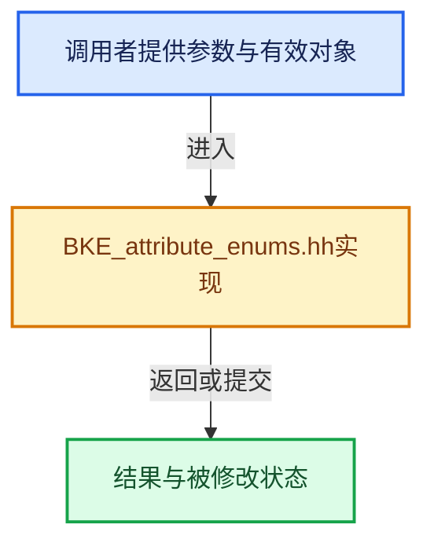

# 实现依赖专题：source/blender/blenkernel/BKE_attribute_enums.hh

[实现依赖导航](../README.md) · [符号索引](../../00-课程指南/02-源码与提交索引/符号依赖与实现索引.md)

本专题从正文实际调用进入，集中保存共享实现。函数有稳定锚点，可从调用处直接跳到对应完整函数；递归与互相调用通过回链组织。

## 本文件的实现关系





## 相关类型布局与成员入口

<a id="t-ab5d7f0de9b9"></a>

### `blender::bke::AttrDomain`

原始声明：[source/blender/blenkernel/BKE_attribute_enums.hh](../../../../../../source/blender/blenkernel/BKE_attribute_enums.hh) · L40—L55。

以下保留类的数据声明与编译条件，成员函数实现通过后面的精确链接阅读。

<!-- annotated:12c8fff77a7aa6 -->

```cpp
enum class AttrDomain : int8_t {
  /* Mesh, Curve or Point Cloud Point. */
  Point = 0,
  /* Mesh Edge. */
  Edge = 1,
  /* Mesh Face. */
  Face = 2,
  /* Mesh Corner. */
  Corner = 3,
  /* A single curve in a larger curve data-block. */
  Curve = 4,
  /* Instance. */
  Instance = 5,
  /* A layer in a grease pencil data-block. */
  Layer = 6,
};
```

<details>
<summary>核对原始源码：source/blender/blenkernel/BKE_attribute_enums.hh · L40—L55</summary>

<!-- original:12c8fff77a7aa6:source/blender/blenkernel/BKE_attribute_enums.hh:40:55 -->

```cpp
enum class AttrDomain : int8_t {
  /* Mesh, Curve or Point Cloud Point. */
  Point = 0,
  /* Mesh Edge. */
  Edge = 1,
  /* Mesh Face. */
  Face = 2,
  /* Mesh Corner. */
  Corner = 3,
  /* A single curve in a larger curve data-block. */
  Curve = 4,
  /* Instance. */
  Instance = 5,
  /* A layer in a grease pencil data-block. */
  Layer = 6,
};
```

</details>


<a id="t-11e6e65d6c5c"></a>

### `blender::bke::AttrDomainSelection`

原始声明：[source/blender/blenkernel/BKE_attribute_enums.hh](../../../../../../source/blender/blenkernel/BKE_attribute_enums.hh) · L58—L68。

以下保留类的数据声明与编译条件，成员函数实现通过后面的精确链接阅读。

<!-- annotated:c0c30a9ced2740 -->

```cpp
enum class AttrDomainSelection : int8_t {
  /* Used to choose automatically based on other data. */
  Auto = -1,
  Point = int8_t(AttrDomain::Point),
  Edge = int8_t(AttrDomain::Edge),
  Face = int8_t(AttrDomain::Face),
  Corner = int8_t(AttrDomain::Corner),
  Curve = int8_t(AttrDomain::Curve),
  Instance = int8_t(AttrDomain::Instance),
  Layer = int8_t(AttrDomain::Layer),
};
```

<details>
<summary>核对原始源码：source/blender/blenkernel/BKE_attribute_enums.hh · L58—L68</summary>

<!-- original:c0c30a9ced2740:source/blender/blenkernel/BKE_attribute_enums.hh:58:68 -->

```cpp
enum class AttrDomainSelection : int8_t {
  /* Used to choose automatically based on other data. */
  Auto = -1,
  Point = int8_t(AttrDomain::Point),
  Edge = int8_t(AttrDomain::Edge),
  Face = int8_t(AttrDomain::Face),
  Corner = int8_t(AttrDomain::Corner),
  Curve = int8_t(AttrDomain::Curve),
  Instance = int8_t(AttrDomain::Instance),
  Layer = int8_t(AttrDomain::Layer),
};
```

</details>


## 完整成员与函数实现
