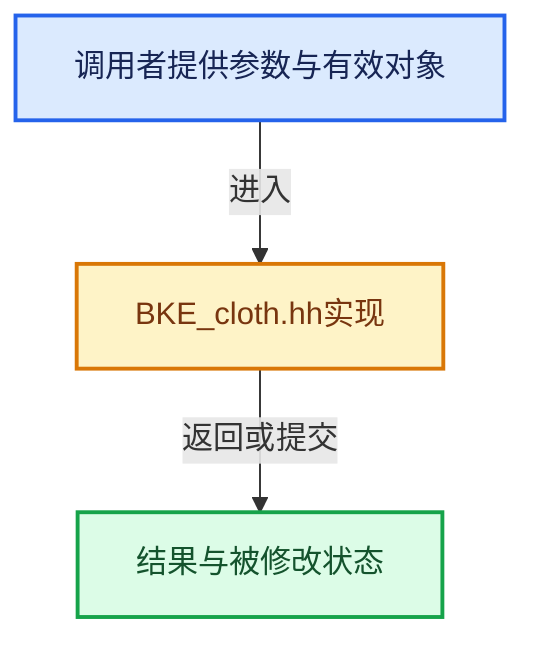

# 实现依赖专题：source/blender/blenkernel/BKE_cloth.hh

[实现依赖导航](../README.md) · [符号索引](../../00-课程指南/02-源码与提交索引/符号依赖与实现索引.md)

本专题从正文实际调用进入，集中保存共享实现。函数有稳定锚点，可从调用处直接跳到对应完整函数；递归与互相调用通过回链组织。

## 本文件的实现关系





<a id="m-b52ddee51698"></a>

## 宏 `VECSUBADDSS`

<!-- annotated:4209f77e5200e8 -->

```cpp
#define VECSUBADDSS(v1, v2, aS, v3, bS) \
  { \
    *(v1) -= *(v2) * aS + *(v3) * bS; \
    *(v1 + 1) -= *(v2 + 1) * aS + *(v3 + 1) * bS; \
    *(v1 + 2) -= *(v2 + 2) * aS + *(v3 + 2) * bS; \
  } \
  ((void)0)
#define VECADDSS(v1, v2, aS, v3, bS) \
```

<details>
<summary>核对原始源码：source/blender/blenkernel/BKE_cloth.hh · L143—L150</summary>

<!-- original:4209f77e5200e8:source/blender/blenkernel/BKE_cloth.hh:143:150 -->

```cpp
#define VECSUBADDSS(v1, v2, aS, v3, bS) \
  { \
    *(v1) -= *(v2) * aS + *(v3) * bS; \
    *(v1 + 1) -= *(v2 + 1) * aS + *(v3 + 1) * bS; \
    *(v1 + 2) -= *(v2 + 2) * aS + *(v3 + 2) * bS; \
  } \
  ((void)0)
#define VECADDSS(v1, v2, aS, v3, bS) \
```

</details>

宏在预处理阶段展开，参数替换、重复求值和条件编译应直接从该定义检查。与普通函数不同，宏不会自动提供参数类型检查；构建配置选择哪个定义需结合外围条件。

<a id="m-310683f0ee7c"></a>

## 宏 `VECADDSS`

<!-- annotated:5b1b065e79a2ad -->

```cpp
#define VECADDSS(v1, v2, aS, v3, bS) \
  { \
    *(v1) = *(v2) * aS + *(v3) * bS; \
    *(v1 + 1) = *(v2 + 1) * aS + *(v3 + 1) * bS; \
    *(v1 + 2) = *(v2 + 2) * aS + *(v3 + 2) * bS; \
  } \
  ((void)0)
#define VECADDS(v1, v2, v3, bS) \
```

<details>
<summary>核对原始源码：source/blender/blenkernel/BKE_cloth.hh · L150—L157</summary>

<!-- original:5b1b065e79a2ad:source/blender/blenkernel/BKE_cloth.hh:150:157 -->

```cpp
#define VECADDSS(v1, v2, aS, v3, bS) \
  { \
    *(v1) = *(v2) * aS + *(v3) * bS; \
    *(v1 + 1) = *(v2 + 1) * aS + *(v3 + 1) * bS; \
    *(v1 + 2) = *(v2 + 2) * aS + *(v3 + 2) * bS; \
  } \
  ((void)0)
#define VECADDS(v1, v2, v3, bS) \
```

</details>

宏在预处理阶段展开，参数替换、重复求值和条件编译应直接从该定义检查。与普通函数不同，宏不会自动提供参数类型检查；构建配置选择哪个定义需结合外围条件。

<a id="m-463ccc9dc8b9"></a>

## 宏 `VECADDS`

<!-- annotated:8d8816ca26ad81 -->

```cpp
#define VECADDS(v1, v2, v3, bS) \
  { \
    *(v1) = *(v2) + *(v3) * bS; \
    *(v1 + 1) = *(v2 + 1) + *(v3 + 1) * bS; \
    *(v1 + 2) = *(v2 + 2) + *(v3 + 2) * bS; \
  } \
  ((void)0)
#define VECSUBMUL(v1, v2, aS) \
```

<details>
<summary>核对原始源码：source/blender/blenkernel/BKE_cloth.hh · L157—L164</summary>

<!-- original:8d8816ca26ad81:source/blender/blenkernel/BKE_cloth.hh:157:164 -->

```cpp
#define VECADDS(v1, v2, v3, bS) \
  { \
    *(v1) = *(v2) + *(v3) * bS; \
    *(v1 + 1) = *(v2 + 1) + *(v3 + 1) * bS; \
    *(v1 + 2) = *(v2 + 2) + *(v3 + 2) * bS; \
  } \
  ((void)0)
#define VECSUBMUL(v1, v2, aS) \
```

</details>

宏在预处理阶段展开，参数替换、重复求值和条件编译应直接从该定义检查。与普通函数不同，宏不会自动提供参数类型检查；构建配置选择哪个定义需结合外围条件。

<a id="m-ff1fd59f7de7"></a>

## 宏 `VECSUBS`

<!-- annotated:d1ec6e32eb0a64 -->

```cpp
#define VECSUBS(v1, v2, v3, bS) \
  { \
    *(v1) = *(v2) - *(v3) * bS; \
    *(v1 + 1) = *(v2 + 1) - *(v3 + 1) * bS; \
    *(v1 + 2) = *(v2 + 2) - *(v3 + 2) * bS; \
  } \
  ((void)0)
#define VECADDMUL(v1, v2, aS) \
```

<details>
<summary>核对原始源码：source/blender/blenkernel/BKE_cloth.hh · L171—L178</summary>

<!-- original:d1ec6e32eb0a64:source/blender/blenkernel/BKE_cloth.hh:171:178 -->

```cpp
#define VECSUBS(v1, v2, v3, bS) \
  { \
    *(v1) = *(v2) - *(v3) * bS; \
    *(v1 + 1) = *(v2 + 1) - *(v3 + 1) * bS; \
    *(v1 + 2) = *(v2 + 2) - *(v3 + 2) * bS; \
  } \
  ((void)0)
#define VECADDMUL(v1, v2, aS) \
```

</details>

宏在预处理阶段展开，参数替换、重复求值和条件编译应直接从该定义检查。与普通函数不同，宏不会自动提供参数类型检查；构建配置选择哪个定义需结合外围条件。

<a id="m-48ab11af3c7e"></a>

## 宏 `VECADDMUL`

<!-- annotated:51bc98da6aa9e2 -->

```cpp
#define VECADDMUL(v1, v2, aS) \
  { \
    *(v1) += *(v2) * aS; \
    *(v1 + 1) += *(v2 + 1) * aS; \
    *(v1 + 2) += *(v2 + 2) * aS; \
  } \
  ((void)0)

```

<details>
<summary>核对原始源码：source/blender/blenkernel/BKE_cloth.hh · L178—L185</summary>

<!-- original:51bc98da6aa9e2:source/blender/blenkernel/BKE_cloth.hh:178:185 -->

```cpp
#define VECADDMUL(v1, v2, aS) \
  { \
    *(v1) += *(v2) * aS; \
    *(v1 + 1) += *(v2 + 1) * aS; \
    *(v1 + 2) += *(v2 + 2) * aS; \
  } \
  ((void)0)

```

</details>

宏在预处理阶段展开，参数替换、重复求值和条件编译应直接从该定义检查。与普通函数不同，宏不会自动提供参数类型检查；构建配置选择哪个定义需结合外围条件。

## 完整成员与函数实现
