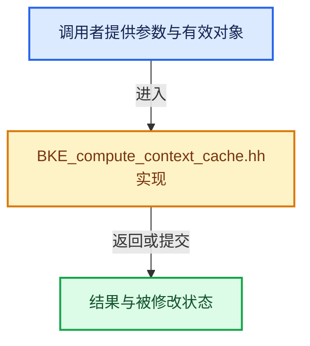

# 实现依赖专题：source/blender/blenkernel/BKE_compute_context_cache.hh

[实现依赖导航](../README.md) · [符号索引](../../00-课程指南/02-源码与提交索引/符号依赖与实现索引.md)

本专题从正文实际调用进入，集中保存共享实现。函数有稳定锚点，可从调用处直接跳到对应完整函数；递归与互相调用通过回链组织。

## 本文件的实现关系





## 完整成员与函数实现

<a id="f-bb4254894ad9d107"></a>

### `blender::bke::ComputeContextCache::for_any_uncached`

实现位置：[source/blender/blenkernel/BKE_compute_context_cache.hh](../../../../../../source/blender/blenkernel/BKE_compute_context_cache.hh) · L105—L111。

**教学注释版**

<!-- annotated:a99110ff0057d7 -->

```cpp
  template<typename T, typename... Args> const T &for_any_uncached(Args &&...args)
  {
    // [讲解] std::forward<Args>：在转发引用中恢复调用者传入的值类别；依赖推导类型，不能与无条件move互换。
    destruct_ptr<T> compute_context = allocator_.construct<T>(std::forward<Args>(args)...);
    const T &result = *compute_context;
    // [讲解] cache_.append：在尾部建立新元素，必要时先扩大存储。
    cache_.append(std::move(compute_context));
    return result;
  }
```

<details>
<summary>核对原始源码：source/blender/blenkernel/BKE_compute_context_cache.hh · L105—L111</summary>

<!-- original:a99110ff0057d7:source/blender/blenkernel/BKE_compute_context_cache.hh:105:111 -->

```cpp
  template<typename T, typename... Args> const T &for_any_uncached(Args &&...args)
  {
    destruct_ptr<T> compute_context = allocator_.construct<T>(std::forward<Args>(args)...);
    const T &result = *compute_context;
    cache_.append(std::move(compute_context));
    return result;
  }
```

</details>

**结果出口**

- `return result;`

**继续追踪实现**

- `allocator_.construct<T>` → [blender::LinearAllocator::construct · L135](../../03-内存分配与运行时类型/02-LinearAllocator布局.md#f-437c16eedf07fa2a)。
- `std::forward<Args>` → [外部契约](https://eel.is/c++draft/utility.forward)：在转发引用中恢复调用者传入的值类别；依赖推导类型，不能与无条件move互换。
- `cache_.append` → [blender::Vector::append · L498](../../01-基础容器与现代CPP/11-Vector插入删除与重排.md#f-5bde268a69e443ec)；[blender::Vector::append · L502](../../01-基础容器与现代CPP/11-Vector插入删除与重排.md#f-591e0b15e6308532)。同名重载需按实参类型选择。
- `std::move` → [外部契约](https://eel.is/c++draft/utility.forward)：把表达式转换成可供移动重载选择的值类别；不保证真的移动，不结束源对象寿命，对const值可能选择复制。
