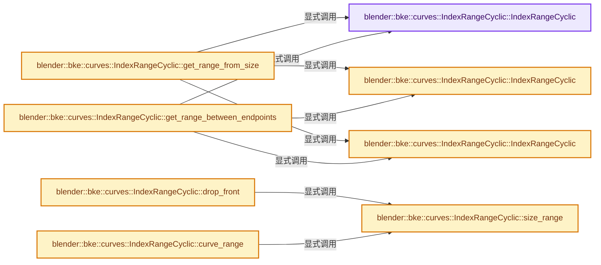
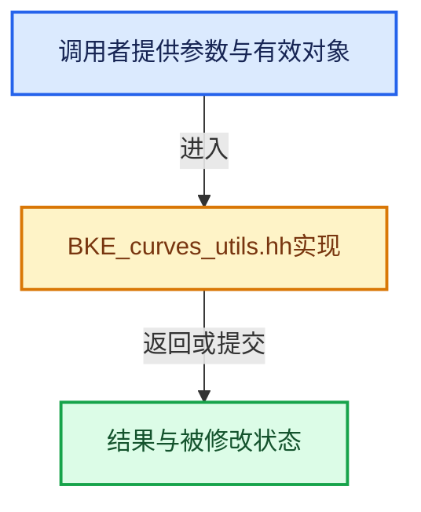

# 实现依赖专题：source/blender/blenkernel/BKE_curves_utils.hh

[实现依赖导航](../README.md) · [符号索引](../../00-课程指南/02-源码与提交索引/符号依赖与实现索引.md)

本专题从正文实际调用进入，集中保存共享实现。函数有稳定锚点，可从调用处直接跳到对应完整函数；递归与互相调用通过回链组织。

## 本文件的实现关系






## 完整成员与函数实现

<a id="f-9b8110a050546767"></a>

### `blender::bke::curves::IndexRangeCyclic::IndexRangeCyclic`

实现位置：[source/blender/blenkernel/BKE_curves_utils.hh](../../../../../../source/blender/blenkernel/BKE_curves_utils.hh) · L96—L96。

**教学注释版**

<!-- annotated:3b85d05861b2be -->

```cpp
  constexpr IndexRangeCyclic() = default;
```

<details>
<summary>核对原始源码：source/blender/blenkernel/BKE_curves_utils.hh · L96—L96</summary>

<!-- original:3b85d05861b2be:source/blender/blenkernel/BKE_curves_utils.hh:96:96 -->

```cpp
  constexpr IndexRangeCyclic() = default;
```

</details>

**继续追踪实现**

本实现没有需要继续展开的显式调用；检查返回表达式、对象转换和调用者前置条件。

<a id="f-fe8d13744d8e5913"></a>

### `blender::bke::curves::IndexRangeCyclic::IndexRangeCyclic`

实现位置：[source/blender/blenkernel/BKE_curves_utils.hh](../../../../../../source/blender/blenkernel/BKE_curves_utils.hh) · L99—L105。

接口参数：

- `const int start`
- `const int end`
- `const int iterable_range_size`
- `const int cycles`

**教学注释版**

<!-- annotated:7f0905a0c729df -->

```cpp
  constexpr IndexRangeCyclic(const int start,
                             const int end,
                             const int iterable_range_size,
                             const int cycles)
      : start_(start), end_(end), range_size_(iterable_range_size), cycles_(cycles)
  {
  }
```

<details>
<summary>核对原始源码：source/blender/blenkernel/BKE_curves_utils.hh · L99—L105</summary>

<!-- original:7f0905a0c729df:source/blender/blenkernel/BKE_curves_utils.hh:99:105 -->

```cpp
  constexpr IndexRangeCyclic(const int start,
                             const int end,
                             const int iterable_range_size,
                             const int cycles)
      : start_(start), end_(end), range_size_(iterable_range_size), cycles_(cycles)
  {
  }
```

</details>

**继续追踪实现**

本实现没有需要继续展开的显式调用；检查返回表达式、对象转换和调用者前置条件。

<a id="f-26e5d04a1261fe73"></a>

### `blender::bke::curves::IndexRangeCyclic::IndexRangeCyclic`

实现位置：[source/blender/blenkernel/BKE_curves_utils.hh](../../../../../../source/blender/blenkernel/BKE_curves_utils.hh) · L110—L116。

接口参数：

- `const int start`
- `const int end`
- `const int iterable_range_size`

**教学注释版**

<!-- annotated:3be717c6ec005f -->

```cpp
  constexpr IndexRangeCyclic(const int start, const int end, const int iterable_range_size)
      : start_(start),
        end_(end == iterable_range_size ? 0 : end),
        range_size_(iterable_range_size),
        cycles_(end < start)
  {
  }
```

<details>
<summary>核对原始源码：source/blender/blenkernel/BKE_curves_utils.hh · L110—L116</summary>

<!-- original:3be717c6ec005f:source/blender/blenkernel/BKE_curves_utils.hh:110:116 -->

```cpp
  constexpr IndexRangeCyclic(const int start, const int end, const int iterable_range_size)
      : start_(start),
        end_(end == iterable_range_size ? 0 : end),
        range_size_(iterable_range_size),
        cycles_(end < start)
  {
  }
```

</details>

**继续追踪实现**

本实现没有需要继续展开的显式调用；检查返回表达式、对象转换和调用者前置条件。

<a id="f-18c0fe79d070a664"></a>

### `blender::bke::curves::IndexRangeCyclic::get_range_from_size`

实现位置：[source/blender/blenkernel/BKE_curves_utils.hh](../../../../../../source/blender/blenkernel/BKE_curves_utils.hh) · L125—L144。

接口参数：

- `const int start_index`
- `const int iterator_size`
- `const int iterable_range_size`

**教学注释版**

<!-- annotated:454a3a80390a6b -->

```cpp
  static IndexRangeCyclic get_range_from_size(const int start_index,
                                              const int iterator_size,
                                              const int iterable_range_size)
  {
    BLI_assert(start_index >= 0);
    BLI_assert(iterator_size >= 0);
    BLI_assert(iterable_range_size > 0);
    const int num_until_loop = iterable_range_size - start_index;
    if (iterator_size < num_until_loop) {
      return IndexRangeCyclic(start_index, start_index + iterator_size, iterable_range_size, 0);
    }

    const int num_remaining = iterator_size - num_until_loop;

    /* Integer division (rounded down). */
    const int num_full_cycles = num_remaining / iterable_range_size;

    const int end_index = num_remaining - num_full_cycles * iterable_range_size;
    return IndexRangeCyclic(start_index, end_index, iterable_range_size, num_full_cycles + 1);
  }
```

<details>
<summary>核对原始源码：source/blender/blenkernel/BKE_curves_utils.hh · L125—L144</summary>

<!-- original:454a3a80390a6b:source/blender/blenkernel/BKE_curves_utils.hh:125:144 -->

```cpp
  static IndexRangeCyclic get_range_from_size(const int start_index,
                                              const int iterator_size,
                                              const int iterable_range_size)
  {
    BLI_assert(start_index >= 0);
    BLI_assert(iterator_size >= 0);
    BLI_assert(iterable_range_size > 0);
    const int num_until_loop = iterable_range_size - start_index;
    if (iterator_size < num_until_loop) {
      return IndexRangeCyclic(start_index, start_index + iterator_size, iterable_range_size, 0);
    }

    const int num_remaining = iterator_size - num_until_loop;

    /* Integer division (rounded down). */
    const int num_full_cycles = num_remaining / iterable_range_size;

    const int end_index = num_remaining - num_full_cycles * iterable_range_size;
    return IndexRangeCyclic(start_index, end_index, iterable_range_size, num_full_cycles + 1);
  }
```

</details>

**结果出口**

- `return IndexRangeCyclic(start_index, start_index + iterator_size, iterable_range_size, 0);`
- `return IndexRangeCyclic(start_index, end_index, iterable_range_size, num_full_cycles + 1);`

**继续追踪实现**

- `BLI_assert` → [BLI_assert · L48](../01-BLI基础库/BLI_assert.hh.md#m-57a88495704d)；[BLI_assert · L63](../01-BLI基础库/BLI_assert.hh.md#m-d07050020cb5)。宏定义由构建条件选择。
- `IndexRangeCyclic` → [blender::bke::curves::IndexRangeCyclic::IndexRangeCyclic · L96](BKE_curves_utils.hh.md#f-9b8110a050546767)；[blender::bke::curves::IndexRangeCyclic::IndexRangeCyclic · L99](BKE_curves_utils.hh.md#f-fe8d13744d8e5913)；[blender::bke::curves::IndexRangeCyclic::IndexRangeCyclic · L110](BKE_curves_utils.hh.md#f-26e5d04a1261fe73)。同名重载需按实参类型选择。

<a id="f-ac6b46300d22aaee"></a>

### `blender::bke::curves::IndexRangeCyclic::get_range_between_endpoints`

实现位置：[source/blender/blenkernel/BKE_curves_utils.hh](../../../../../../source/blender/blenkernel/BKE_curves_utils.hh) · L154—L178。

接口参数：

- `const CurvePoint start_point`
- `const CurvePoint end_point`
- `const int iterable_range_size`

**教学注释版**

<!-- annotated:5fdeb2a4dd8a69 -->

```cpp
  static IndexRangeCyclic get_range_between_endpoints(const CurvePoint start_point,
                                                      const CurvePoint end_point,
                                                      const int iterable_range_size)
  {
    BLI_assert(iterable_range_size > 0);
    const int start_index = start_point.parameter == 0.0 ? start_point.index :
                                                           start_point.next_index;
    int end_index = end_point.parameter == 0.0 ? end_point.index : end_point.next_index;
    int cycles;

    if (end_point.is_controlpoint()) {
      BLI_assert(end_index < iterable_range_size);
      ++end_index;
      if (end_index == iterable_range_size) {
        end_index = 0;
      }
      /* end_point < start_point but parameter is irrelevant (end_point is controlpoint), and loop
       * when equal due to increment. */
      cycles = end_index <= start_index;
    }
    else {
      cycles = end_point < start_point || end_index < start_index;
    }
    return IndexRangeCyclic(start_index, end_index, iterable_range_size, cycles);
  }
```

<details>
<summary>核对原始源码：source/blender/blenkernel/BKE_curves_utils.hh · L154—L178</summary>

<!-- original:5fdeb2a4dd8a69:source/blender/blenkernel/BKE_curves_utils.hh:154:178 -->

```cpp
  static IndexRangeCyclic get_range_between_endpoints(const CurvePoint start_point,
                                                      const CurvePoint end_point,
                                                      const int iterable_range_size)
  {
    BLI_assert(iterable_range_size > 0);
    const int start_index = start_point.parameter == 0.0 ? start_point.index :
                                                           start_point.next_index;
    int end_index = end_point.parameter == 0.0 ? end_point.index : end_point.next_index;
    int cycles;

    if (end_point.is_controlpoint()) {
      BLI_assert(end_index < iterable_range_size);
      ++end_index;
      if (end_index == iterable_range_size) {
        end_index = 0;
      }
      /* end_point < start_point but parameter is irrelevant (end_point is controlpoint), and loop
       * when equal due to increment. */
      cycles = end_index <= start_index;
    }
    else {
      cycles = end_point < start_point || end_index < start_index;
    }
    return IndexRangeCyclic(start_index, end_index, iterable_range_size, cycles);
  }
```

</details>

**沿实际写入检查状态**

- `end_index = 0;`
- `cycles = end_index <= start_index;`
- `cycles = end_point < start_point || end_index < start_index;`

**结果出口**

- `return IndexRangeCyclic(start_index, end_index, iterable_range_size, cycles);`

**继续追踪实现**

- `BLI_assert` → [BLI_assert · L48](../01-BLI基础库/BLI_assert.hh.md#m-57a88495704d)；[BLI_assert · L63](../01-BLI基础库/BLI_assert.hh.md#m-d07050020cb5)。宏定义由构建条件选择。
- `end_point.is_controlpoint` → [blender::bke::curves::CurvePoint::is_controlpoint · L617](BKE_curves_utils.hh.md#f-17251c017f1d7160)。
- `IndexRangeCyclic` → [blender::bke::curves::IndexRangeCyclic::IndexRangeCyclic · L96](BKE_curves_utils.hh.md#f-9b8110a050546767)；[blender::bke::curves::IndexRangeCyclic::IndexRangeCyclic · L99](BKE_curves_utils.hh.md#f-fe8d13744d8e5913)；[blender::bke::curves::IndexRangeCyclic::IndexRangeCyclic · L110](BKE_curves_utils.hh.md#f-26e5d04a1261fe73)。同名重载需按实参类型选择。

<a id="f-781ecfa4904f46c2"></a>

### `blender::bke::curves::IndexRangeCyclic::drop_front`

实现位置：[source/blender/blenkernel/BKE_curves_utils.hh](../../../../../../source/blender/blenkernel/BKE_curves_utils.hh) · L262—L278。

接口参数：

- `const int n = 1`

**教学注释版**

<!-- annotated:8487dfa73bf14d -->

```cpp
  constexpr IndexRangeCyclic drop_front(const int n = 1) const
  {
    BLI_assert(n >= 0);
    int new_start = this->start_ + n;
    int num_cycles = this->cycles_;
    if (this->size_range() <= new_start) {
      const int dropped_cycles = n / this->size_range(); /* Integer division (floor) */
      const int remainder = new_start - this->size_range() * dropped_cycles;
      const bool overflow = remainder >= this->size_range();
      new_start = remainder - (overflow ? this->size_range() : 0);
      num_cycles -= dropped_cycles + int(overflow);
    }
    BLI_assert(num_cycles >= 0);
    BLI_assert(num_cycles > 0 ||
               (new_start <= this->end_ || (this->end_ == 0 && new_start < this->size_range())));
    return {new_start, this->end_, this->range_size_, num_cycles};
  }
```

<details>
<summary>核对原始源码：source/blender/blenkernel/BKE_curves_utils.hh · L262—L278</summary>

<!-- original:8487dfa73bf14d:source/blender/blenkernel/BKE_curves_utils.hh:262:278 -->

```cpp
  constexpr IndexRangeCyclic drop_front(const int n = 1) const
  {
    BLI_assert(n >= 0);
    int new_start = this->start_ + n;
    int num_cycles = this->cycles_;
    if (this->size_range() <= new_start) {
      const int dropped_cycles = n / this->size_range(); /* Integer division (floor) */
      const int remainder = new_start - this->size_range() * dropped_cycles;
      const bool overflow = remainder >= this->size_range();
      new_start = remainder - (overflow ? this->size_range() : 0);
      num_cycles -= dropped_cycles + int(overflow);
    }
    BLI_assert(num_cycles >= 0);
    BLI_assert(num_cycles > 0 ||
               (new_start <= this->end_ || (this->end_ == 0 && new_start < this->size_range())));
    return {new_start, this->end_, this->range_size_, num_cycles};
  }
```

</details>

**沿实际写入检查状态**

- `new_start = remainder - (overflow ? this->size_range() : 0);`
- `num_cycles -= dropped_cycles + int(overflow);`

**结果出口**

- `return {new_start, this->end_, this->range_size_, num_cycles};`

**继续追踪实现**

- `BLI_assert` → [BLI_assert · L48](../01-BLI基础库/BLI_assert.hh.md#m-57a88495704d)；[BLI_assert · L63](../01-BLI基础库/BLI_assert.hh.md#m-d07050020cb5)。宏定义由构建条件选择。
- `this->size_range` → [blender::bke::curves::IndexRangeCyclic::size_range · L328](BKE_curves_utils.hh.md#f-247c792817dac82c)。

<a id="f-9456cf87311ff334"></a>

### `blender::bke::curves::IndexRangeCyclic::curve_range`

实现位置：[source/blender/blenkernel/BKE_curves_utils.hh](../../../../../../source/blender/blenkernel/BKE_curves_utils.hh) · L304—L307。

**教学注释版**

<!-- annotated:23ee514c570fdf -->

```cpp
  constexpr IndexRange curve_range() const
  {
    return IndexRange(0, this->size_range());
  }
```

<details>
<summary>核对原始源码：source/blender/blenkernel/BKE_curves_utils.hh · L304—L307</summary>

<!-- original:23ee514c570fdf:source/blender/blenkernel/BKE_curves_utils.hh:304:307 -->

```cpp
  constexpr IndexRange curve_range() const
  {
    return IndexRange(0, this->size_range());
  }
```

</details>

**结果出口**

- `return IndexRange(0, this->size_range());`

**继续追踪实现**

- `IndexRange` → [blender::IndexRange](../01-BLI基础库/BLI_index_range.hh.md#t-caa3466d6776)；[blender::gpu::shader::parser::IndexRange](../08-其他Blender模块/gpu/shader_tool/utils.hh.md#t-82d2bd4ea71c)；[blender::IndexRange](../08-其他Blender模块/makesdna/DNA_node_types.h.md#t-0448cc889d39)。
- `this->size_range` → [blender::bke::curves::IndexRangeCyclic::size_range · L328](BKE_curves_utils.hh.md#f-247c792817dac82c)。

<a id="f-247c792817dac82c"></a>

### `blender::bke::curves::IndexRangeCyclic::size_range`

实现位置：[source/blender/blenkernel/BKE_curves_utils.hh](../../../../../../source/blender/blenkernel/BKE_curves_utils.hh) · L328—L331。

**教学注释版**

<!-- annotated:3b4f4f41451153 -->

```cpp
  constexpr int size_range() const
  {
    return this->range_size_;
  }
```

<details>
<summary>核对原始源码：source/blender/blenkernel/BKE_curves_utils.hh · L328—L331</summary>

<!-- original:3b4f4f41451153:source/blender/blenkernel/BKE_curves_utils.hh:328:331 -->

```cpp
  constexpr int size_range() const
  {
    return this->range_size_;
  }
```

</details>

**结果出口**

- `return this->range_size_;`

**继续追踪实现**

本实现没有需要继续展开的显式调用；检查返回表达式、对象转换和调用者前置条件。

<a id="f-6409fdd1c01a00c0"></a>

### `blender::bke::curves::IndexRangeCyclic::size_before_loop`

实现位置：[source/blender/blenkernel/BKE_curves_utils.hh](../../../../../../source/blender/blenkernel/BKE_curves_utils.hh) · L336—L339。

**教学注释版**

<!-- annotated:4bff2ac6a80d1f -->

```cpp
  constexpr int size_before_loop() const
  {
    return this->range_size_ - this->start_;
  }
```

<details>
<summary>核对原始源码：source/blender/blenkernel/BKE_curves_utils.hh · L336—L339</summary>

<!-- original:4bff2ac6a80d1f:source/blender/blenkernel/BKE_curves_utils.hh:336:339 -->

```cpp
  constexpr int size_before_loop() const
  {
    return this->range_size_ - this->start_;
  }
```

</details>

**结果出口**

- `return this->range_size_ - this->start_;`

**继续追踪实现**

本实现没有需要继续展开的显式调用；检查返回表达式、对象转换和调用者前置条件。

<a id="f-ac36d14580c74f4c"></a>

### `blender::bke::curves::IndexRangeCyclic::size_after_loop`

实现位置：[source/blender/blenkernel/BKE_curves_utils.hh](../../../../../../source/blender/blenkernel/BKE_curves_utils.hh) · L345—L348。

**教学注释版**

<!-- annotated:536ba8cde17617 -->

```cpp
  constexpr int size_after_loop() const
  {
    return this->end_;
  }
```

<details>
<summary>核对原始源码：source/blender/blenkernel/BKE_curves_utils.hh · L345—L348</summary>

<!-- original:536ba8cde17617:source/blender/blenkernel/BKE_curves_utils.hh:345:348 -->

```cpp
  constexpr int size_after_loop() const
  {
    return this->end_;
  }
```

</details>

**结果出口**

- `return this->end_;`

**继续追踪实现**

本实现没有需要继续展开的显式调用；检查返回表达式、对象转换和调用者前置条件。

<a id="f-c6ea5bc08b7854cc"></a>

### `blender::bke::curves::IndexRangeCyclic::cycles`

实现位置：[source/blender/blenkernel/BKE_curves_utils.hh](../../../../../../source/blender/blenkernel/BKE_curves_utils.hh) · L364—L367。

**教学注释版**

<!-- annotated:68232542d142ec -->

```cpp
  constexpr int cycles() const
  {
    return this->cycles_;
  }
```

<details>
<summary>核对原始源码：source/blender/blenkernel/BKE_curves_utils.hh · L364—L367</summary>

<!-- original:68232542d142ec:source/blender/blenkernel/BKE_curves_utils.hh:364:367 -->

```cpp
  constexpr int cycles() const
  {
    return this->cycles_;
  }
```

</details>

**结果出口**

- `return this->cycles_;`

**继续追踪实现**

本实现没有需要继续展开的显式调用；检查返回表达式、对象转换和调用者前置条件。

<a id="f-cfd4431e623a97b5"></a>

### `blender::bke::curves::IndexRangeCyclic::first`

实现位置：[source/blender/blenkernel/BKE_curves_utils.hh](../../../../../../source/blender/blenkernel/BKE_curves_utils.hh) · L369—L372。

**教学注释版**

<!-- annotated:72d9dc9fea4ca9 -->

```cpp
  constexpr int first() const
  {
    return this->start_;
  }
```

<details>
<summary>核对原始源码：source/blender/blenkernel/BKE_curves_utils.hh · L369—L372</summary>

<!-- original:72d9dc9fea4ca9:source/blender/blenkernel/BKE_curves_utils.hh:369:372 -->

```cpp
  constexpr int first() const
  {
    return this->start_;
  }
```

</details>

**结果出口**

- `return this->start_;`

**继续追踪实现**

本实现没有需要继续展开的显式调用；检查返回表达式、对象转换和调用者前置条件。

<a id="f-9add3ba9c469d085"></a>

### `blender::bke::curves::IndexRangeCyclic::one_after_last`

实现位置：[source/blender/blenkernel/BKE_curves_utils.hh](../../../../../../source/blender/blenkernel/BKE_curves_utils.hh) · L380—L383。

**教学注释版**

<!-- annotated:45edc7e7cc174d -->

```cpp
  constexpr int one_after_last() const
  {
    return this->end_;
  }
```

<details>
<summary>核对原始源码：source/blender/blenkernel/BKE_curves_utils.hh · L380—L383</summary>

<!-- original:45edc7e7cc174d:source/blender/blenkernel/BKE_curves_utils.hh:380:383 -->

```cpp
  constexpr int one_after_last() const
  {
    return this->end_;
  }
```

</details>

**结果出口**

- `return this->end_;`

**继续追踪实现**

本实现没有需要继续展开的显式调用；检查返回表达式、对象转换和调用者前置条件。

<a id="f-f1e0a39a2185c4f1"></a>

### `blender::bke::curves::fill_points`

实现位置：[source/blender/blenkernel/BKE_curves_utils.hh](../../../../../../source/blender/blenkernel/BKE_curves_utils.hh) · L488—L495。

接口参数：

- `const OffsetIndices<int> points_by_curve`
- `const IndexMask &curve_selection`
- `const T &value`
- `MutableSpan<T> dst`

**教学注释版**

<!-- annotated:9141a2bb980786 -->

```cpp
template<typename T>
void fill_points(const OffsetIndices<int> points_by_curve,
                 const IndexMask &curve_selection,
                 const T &value,
                 MutableSpan<T> dst)
{
  fill_points(points_by_curve, curve_selection, &value, dst);
}
```

<details>
<summary>核对原始源码：source/blender/blenkernel/BKE_curves_utils.hh · L488—L495</summary>

<!-- original:9141a2bb980786:source/blender/blenkernel/BKE_curves_utils.hh:488:495 -->

```cpp
template<typename T>
void fill_points(const OffsetIndices<int> points_by_curve,
                 const IndexMask &curve_selection,
                 const T &value,
                 MutableSpan<T> dst)
{
  fill_points(points_by_curve, curve_selection, &value, dst);
}
```

</details>

**继续追踪实现**

- `fill_points` → [blender::bke::curves::fill_points · L488](BKE_curves_utils.hh.md#f-f1e0a39a2185c4f1)。

<a id="f-17251c017f1d7160"></a>

### `blender::bke::curves::CurvePoint::is_controlpoint`

实现位置：[source/blender/blenkernel/BKE_curves_utils.hh](../../../../../../source/blender/blenkernel/BKE_curves_utils.hh) · L617—L620。

**教学注释版**

<!-- annotated:22a5c71c4bb4c7 -->

```cpp
inline bool CurvePoint::is_controlpoint() const
{
  return parameter == 0.0 || parameter == 1.0;
}
```

<details>
<summary>核对原始源码：source/blender/blenkernel/BKE_curves_utils.hh · L617—L620</summary>

<!-- original:22a5c71c4bb4c7:source/blender/blenkernel/BKE_curves_utils.hh:617:620 -->

```cpp
inline bool CurvePoint::is_controlpoint() const
{
  return parameter == 0.0 || parameter == 1.0;
}
```

</details>

**结果出口**

- `return parameter == 0.0 || parameter == 1.0;`

**继续追踪实现**

本实现没有需要继续展开的显式调用；检查返回表达式、对象转换和调用者前置条件。
