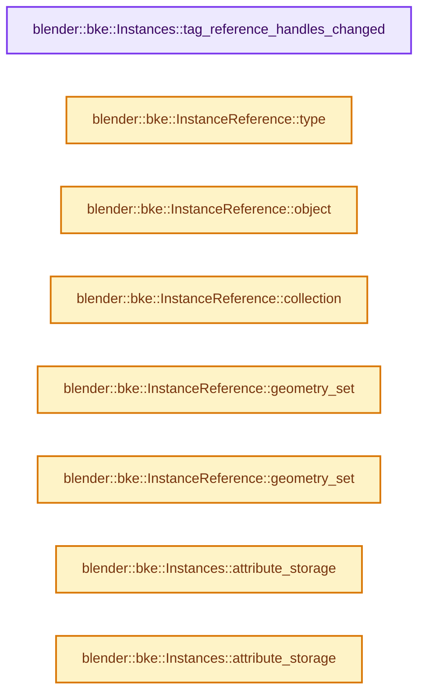

# 实现依赖专题：source/blender/blenkernel/BKE_instances.hh

[实现依赖导航](../README.md) · [符号索引](../../00-课程指南/02-源码与提交索引/符号依赖与实现索引.md)

本专题从正文实际调用进入，集中保存共享实现。函数有稳定锚点，可从调用处直接跳到对应完整函数；递归与互相调用通过回链组织。

## 本文件的实现关系




## 相关类型布局与成员入口

<a id="t-017105a1b260"></a>

### `blender::bke::InstanceReference::Type`

原始声明：[source/blender/blenkernel/BKE_instances.hh](../../../../../../source/blender/blenkernel/BKE_instances.hh) · L58—L68。

以下保留类的数据声明与编译条件，成员函数实现通过后面的精确链接阅读。

<!-- annotated:8fee71b8a0fd3d -->

```cpp
  enum class Type {
    /**
     * An empty instance. This allows an `InstanceReference` to be default constructed without
     * being in an invalid state. There might also be other use cases that we haven't explored
     * much yet (such as changing the instance later on, and "disabling" some instances).
     */
    None,
    Object,
    Collection,
    GeometrySet,
  };
```

<details>
<summary>核对原始源码：source/blender/blenkernel/BKE_instances.hh · L58—L68</summary>

<!-- original:8fee71b8a0fd3d:source/blender/blenkernel/BKE_instances.hh:58:68 -->

```cpp
  enum class Type {
    /**
     * An empty instance. This allows an `InstanceReference` to be default constructed without
     * being in an invalid state. There might also be other use cases that we haven't explored
     * much yet (such as changing the instance later on, and "disabling" some instances).
     */
    None,
    Object,
    Collection,
    GeometrySet,
  };
```

</details>


## 完整成员与函数实现

<a id="f-1e4f8467bc0a8283"></a>

### `blender::bke::Instances::tag_reference_handles_changed`

实现位置：[source/blender/blenkernel/BKE_instances.hh](../../../../../../source/blender/blenkernel/BKE_instances.hh) · L222—L226。

**教学注释版**

<!-- annotated:5cb9244018f349 -->

```cpp
  void tag_reference_handles_changed()
  {
    // [讲解] reference_user_counts_.tag_dirty：让当前对象的派生缓存失效。
    reference_user_counts_.tag_dirty();
    unique_ids_cache_.tag_dirty();
  }
```

<details>
<summary>核对原始源码：source/blender/blenkernel/BKE_instances.hh · L222—L226</summary>

<!-- original:5cb9244018f349:source/blender/blenkernel/BKE_instances.hh:222:226 -->

```cpp
  void tag_reference_handles_changed()
  {
    reference_user_counts_.tag_dirty();
    unique_ids_cache_.tag_dirty();
  }
```

</details>

**继续追踪实现**

- `reference_user_counts_.tag_dirty` → [blender::SharedCache::tag_dirty · L52](../../06-隐式共享与缓存系统/07-SharedCache跨对象复用.md#f-d8ea6f9241ff1ef6)。
- `unique_ids_cache_.tag_dirty` → [blender::SharedCache::tag_dirty · L52](../../06-隐式共享与缓存系统/07-SharedCache跨对象复用.md#f-d8ea6f9241ff1ef6)。

<a id="f-8a88b8335a3ad388"></a>

### `blender::bke::InstanceReference::type`

实现位置：[source/blender/blenkernel/BKE_instances.hh](../../../../../../source/blender/blenkernel/BKE_instances.hh) · L278—L281。

**教学注释版**

<!-- annotated:be4f2df6367487 -->

```cpp
inline InstanceReference::Type InstanceReference::type() const
{
  return type_;
}
```

<details>
<summary>核对原始源码：source/blender/blenkernel/BKE_instances.hh · L278—L281</summary>

<!-- original:be4f2df6367487:source/blender/blenkernel/BKE_instances.hh:278:281 -->

```cpp
inline InstanceReference::Type InstanceReference::type() const
{
  return type_;
}
```

</details>

**结果出口**

- `return type_;`

**继续追踪实现**

本实现没有需要继续展开的显式调用；检查返回表达式、对象转换和调用者前置条件。

<a id="f-67ac8fb7da7a6f9e"></a>

### `blender::bke::InstanceReference::object`

实现位置：[source/blender/blenkernel/BKE_instances.hh](../../../../../../source/blender/blenkernel/BKE_instances.hh) · L283—L287。

**教学注释版**

<!-- annotated:8fe9c4e0110819 -->

```cpp
inline Object &InstanceReference::object() const
{
  BLI_assert(type_ == Type::Object);
  return *static_cast<Object *>(data_);
}
```

<details>
<summary>核对原始源码：source/blender/blenkernel/BKE_instances.hh · L283—L287</summary>

<!-- original:8fe9c4e0110819:source/blender/blenkernel/BKE_instances.hh:283:287 -->

```cpp
inline Object &InstanceReference::object() const
{
  BLI_assert(type_ == Type::Object);
  return *static_cast<Object *>(data_);
}
```

</details>

**结果出口**

- `return *static_cast<Object *>(data_);`

**继续追踪实现**

- `BLI_assert` → [BLI_assert · L48](../01-BLI基础库/BLI_assert.hh.md#m-57a88495704d)；[BLI_assert · L63](../01-BLI基础库/BLI_assert.hh.md#m-d07050020cb5)。宏定义由构建条件选择。

<a id="f-e08e28f7832eac09"></a>

### `blender::bke::InstanceReference::collection`

实现位置：[source/blender/blenkernel/BKE_instances.hh](../../../../../../source/blender/blenkernel/BKE_instances.hh) · L289—L293。

**教学注释版**

<!-- annotated:e720dc839d6b39 -->

```cpp
inline Collection &InstanceReference::collection() const
{
  BLI_assert(type_ == Type::Collection);
  return *static_cast<Collection *>(data_);
}
```

<details>
<summary>核对原始源码：source/blender/blenkernel/BKE_instances.hh · L289—L293</summary>

<!-- original:e720dc839d6b39:source/blender/blenkernel/BKE_instances.hh:289:293 -->

```cpp
inline Collection &InstanceReference::collection() const
{
  BLI_assert(type_ == Type::Collection);
  return *static_cast<Collection *>(data_);
}
```

</details>

**结果出口**

- `return *static_cast<Collection *>(data_);`

**继续追踪实现**

- `BLI_assert` → [BLI_assert · L48](../01-BLI基础库/BLI_assert.hh.md#m-57a88495704d)；[BLI_assert · L63](../01-BLI基础库/BLI_assert.hh.md#m-d07050020cb5)。宏定义由构建条件选择。

<a id="f-39e1851c90d6f6f3"></a>

### `blender::bke::InstanceReference::geometry_set`

实现位置：[source/blender/blenkernel/BKE_instances.hh](../../../../../../source/blender/blenkernel/BKE_instances.hh) · L295—L299。

**教学注释版**

<!-- annotated:7001fa3daab890 -->

```cpp
inline GeometrySet &InstanceReference::geometry_set()
{
  BLI_assert(type_ == Type::GeometrySet);
  return *geometry_set_;
}
```

<details>
<summary>核对原始源码：source/blender/blenkernel/BKE_instances.hh · L295—L299</summary>

<!-- original:7001fa3daab890:source/blender/blenkernel/BKE_instances.hh:295:299 -->

```cpp
inline GeometrySet &InstanceReference::geometry_set()
{
  BLI_assert(type_ == Type::GeometrySet);
  return *geometry_set_;
}
```

</details>

**结果出口**

- `return *geometry_set_;`

**继续追踪实现**

- `BLI_assert` → [BLI_assert · L48](../01-BLI基础库/BLI_assert.hh.md#m-57a88495704d)；[BLI_assert · L63](../01-BLI基础库/BLI_assert.hh.md#m-d07050020cb5)。宏定义由构建条件选择。

<a id="f-3bba5053fead4038"></a>

### `blender::bke::InstanceReference::geometry_set`

实现位置：[source/blender/blenkernel/BKE_instances.hh](../../../../../../source/blender/blenkernel/BKE_instances.hh) · L301—L305。

**教学注释版**

<!-- annotated:1faf0eecc58758 -->

```cpp
inline const GeometrySet &InstanceReference::geometry_set() const
{
  BLI_assert(type_ == Type::GeometrySet);
  return *geometry_set_;
}
```

<details>
<summary>核对原始源码：source/blender/blenkernel/BKE_instances.hh · L301—L305</summary>

<!-- original:1faf0eecc58758:source/blender/blenkernel/BKE_instances.hh:301:305 -->

```cpp
inline const GeometrySet &InstanceReference::geometry_set() const
{
  BLI_assert(type_ == Type::GeometrySet);
  return *geometry_set_;
}
```

</details>

**结果出口**

- `return *geometry_set_;`

**继续追踪实现**

- `BLI_assert` → [BLI_assert · L48](../01-BLI基础库/BLI_assert.hh.md#m-57a88495704d)；[BLI_assert · L63](../01-BLI基础库/BLI_assert.hh.md#m-d07050020cb5)。宏定义由构建条件选择。

<a id="f-91ec507dd8e91a3d"></a>

### `blender::bke::Instances::attribute_storage`

实现位置：[source/blender/blenkernel/BKE_instances.hh](../../../../../../source/blender/blenkernel/BKE_instances.hh) · L307—L310。

**教学注释版**

<!-- annotated:c0ef868e28b916 -->

```cpp
inline AttributeStorage &Instances::attribute_storage()
{
  return attributes_;
}
```

<details>
<summary>核对原始源码：source/blender/blenkernel/BKE_instances.hh · L307—L310</summary>

<!-- original:c0ef868e28b916:source/blender/blenkernel/BKE_instances.hh:307:310 -->

```cpp
inline AttributeStorage &Instances::attribute_storage()
{
  return attributes_;
}
```

</details>

**结果出口**

- `return attributes_;`

**继续追踪实现**

本实现没有需要继续展开的显式调用；检查返回表达式、对象转换和调用者前置条件。

<a id="f-1c0023d35990374b"></a>

### `blender::bke::Instances::attribute_storage`

实现位置：[source/blender/blenkernel/BKE_instances.hh](../../../../../../source/blender/blenkernel/BKE_instances.hh) · L312—L315。

**教学注释版**

<!-- annotated:de07014937a980 -->

```cpp
inline const AttributeStorage &Instances::attribute_storage() const
{
  return attributes_;
}
```

<details>
<summary>核对原始源码：source/blender/blenkernel/BKE_instances.hh · L312—L315</summary>

<!-- original:de07014937a980:source/blender/blenkernel/BKE_instances.hh:312:315 -->

```cpp
inline const AttributeStorage &Instances::attribute_storage() const
{
  return attributes_;
}
```

</details>

**结果出口**

- `return attributes_;`

**继续追踪实现**

本实现没有需要继续展开的显式调用；检查返回表达式、对象转换和调用者前置条件。
