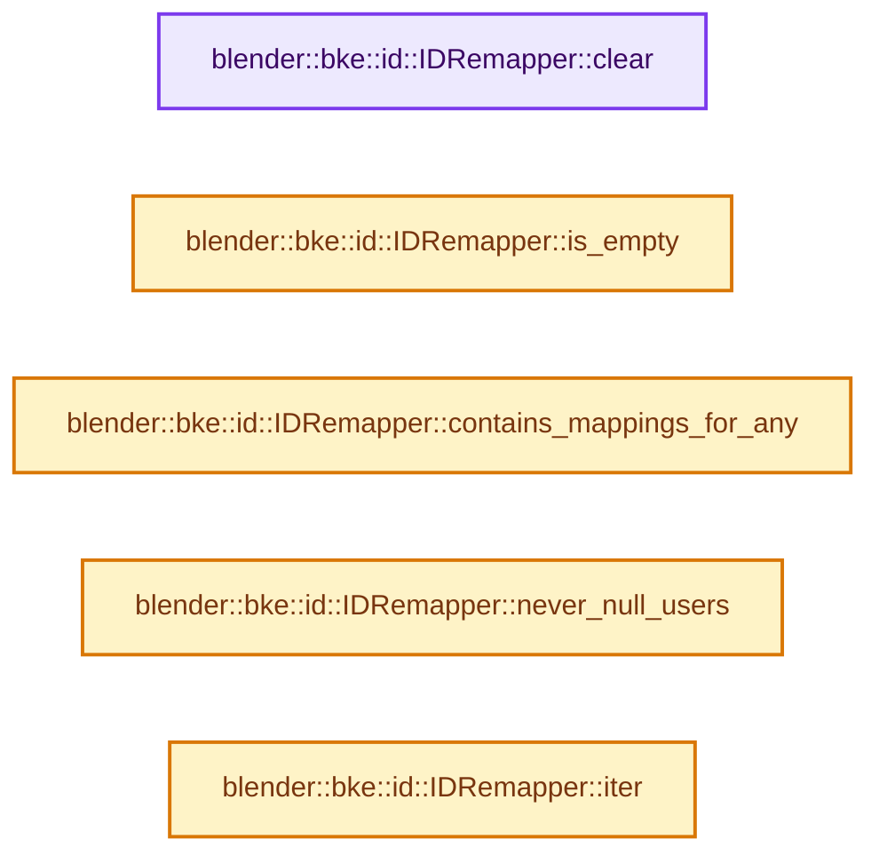
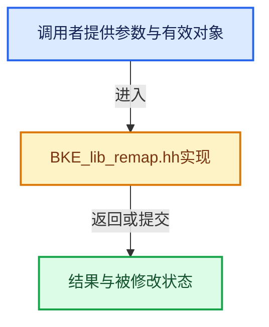

# 实现依赖专题：source/blender/blenkernel/BKE_lib_remap.hh

[实现依赖导航](../README.md) · [符号索引](../../00-课程指南/02-源码与提交索引/符号依赖与实现索引.md)

本专题从正文实际调用进入，集中保存共享实现。函数有稳定锚点，可从调用处直接跳到对应完整函数；递归与互相调用通过回链组织。

## 本文件的实现关系






## 完整成员与函数实现

<a id="f-b65a174cf811d41e"></a>

### `blender::bke::id::IDRemapper::clear`

实现位置：[source/blender/blenkernel/BKE_lib_remap.hh](../../../../../../source/blender/blenkernel/BKE_lib_remap.hh) · L290—L295。

**教学注释版**

<!-- annotated:1df50bf8b2532f -->

```cpp
  void clear()
  {
    // [讲解] mappings_.clear：移除全部活项，并按接口决定是否归还存储。
    mappings_.clear();
    never_null_users_.clear();
    source_types_ = 0;
  }
```

<details>
<summary>核对原始源码：source/blender/blenkernel/BKE_lib_remap.hh · L290—L295</summary>

<!-- original:1df50bf8b2532f:source/blender/blenkernel/BKE_lib_remap.hh:290:295 -->

```cpp
  void clear()
  {
    mappings_.clear();
    never_null_users_.clear();
    source_types_ = 0;
  }
```

</details>

**沿实际写入检查状态**

- `source_types_ = 0;`

**继续追踪实现**

- `mappings_.clear` → [blender::Map::clear · L1038](../../02-哈希表与关联数据结构/06-删除墓碑与值销毁.md#f-c58ca43ed9dafe4a)。
- `never_null_users_.clear` → [blender::Set::clear · L570](../../02-哈希表与关联数据结构/08-Set与集合语义.md#f-ca1071f7960a58f0)。

<a id="f-66141d507b751c46"></a>

### `blender::bke::id::IDRemapper::is_empty`

实现位置：[source/blender/blenkernel/BKE_lib_remap.hh](../../../../../../source/blender/blenkernel/BKE_lib_remap.hh) · L297—L300。

**教学注释版**

<!-- annotated:9905c8c1747ee6 -->

```cpp
  bool is_empty() const
  {
    // [讲解] mappings_.is_empty：查询活项数量或键是否存在。
    return mappings_.is_empty();
  }
```

<details>
<summary>核对原始源码：source/blender/blenkernel/BKE_lib_remap.hh · L297—L300</summary>

<!-- original:9905c8c1747ee6:source/blender/blenkernel/BKE_lib_remap.hh:297:300 -->

```cpp
  bool is_empty() const
  {
    return mappings_.is_empty();
  }
```

</details>

**结果出口**

- `return mappings_.is_empty();`

**继续追踪实现**

- `mappings_.is_empty` → [blender::Map::is_empty · L986](../../02-哈希表与关联数据结构/06-删除墓碑与值销毁.md#f-1f8d9e6725234656)。

<a id="f-3bd488d0f5a6058b"></a>

### `blender::bke::id::IDRemapper::contains_mappings_for_any`

实现位置：[source/blender/blenkernel/BKE_lib_remap.hh](../../../../../../source/blender/blenkernel/BKE_lib_remap.hh) · L302—L305。

接口参数：

- `IDTypeFilter filter`

**教学注释版**

<!-- annotated:9842cc311496fd -->

```cpp
  bool contains_mappings_for_any(IDTypeFilter filter) const
  {
    return (source_types_ & filter) != 0;
  }
```

<details>
<summary>核对原始源码：source/blender/blenkernel/BKE_lib_remap.hh · L302—L305</summary>

<!-- original:9842cc311496fd:source/blender/blenkernel/BKE_lib_remap.hh:302:305 -->

```cpp
  bool contains_mappings_for_any(IDTypeFilter filter) const
  {
    return (source_types_ & filter) != 0;
  }
```

</details>

**结果出口**

- `return (source_types_ & filter) != 0;`

**继续追踪实现**

本实现没有需要继续展开的显式调用；检查返回表达式、对象转换和调用者前置条件。

<a id="f-af72765f076a454b"></a>

### `blender::bke::id::IDRemapper::never_null_users`

实现位置：[source/blender/blenkernel/BKE_lib_remap.hh](../../../../../../source/blender/blenkernel/BKE_lib_remap.hh) · L334—L337。

**教学注释版**

<!-- annotated:52d8bb437cf8e7 -->

```cpp
  const Set<ID *> &never_null_users() const
  {
    return never_null_users_;
  }
```

<details>
<summary>核对原始源码：source/blender/blenkernel/BKE_lib_remap.hh · L334—L337</summary>

<!-- original:52d8bb437cf8e7:source/blender/blenkernel/BKE_lib_remap.hh:334:337 -->

```cpp
  const Set<ID *> &never_null_users() const
  {
    return never_null_users_;
  }
```

</details>

**结果出口**

- `return never_null_users_;`

**继续追踪实现**

本实现没有需要继续展开的显式调用；检查返回表达式、对象转换和调用者前置条件。

<a id="f-6c49bff2f172c121"></a>

### `blender::bke::id::IDRemapper::iter`

实现位置：[source/blender/blenkernel/BKE_lib_remap.hh](../../../../../../source/blender/blenkernel/BKE_lib_remap.hh) · L340—L345。

接口参数：

- `FunctionRef<void(ID *old_id, ID *new_id)> func`
- `ID *old_id`
- `ID *new_id`

**教学注释版**

<!-- annotated:185b6bb1af5be3 -->

```cpp
  void iter(FunctionRef<void(ID *old_id, ID *new_id)> func) const
  {
    for (auto item : mappings_.items()) {
      func(item.key, item.value);
    }
  }
```

<details>
<summary>核对原始源码：source/blender/blenkernel/BKE_lib_remap.hh · L340—L345</summary>

<!-- original:185b6bb1af5be3:source/blender/blenkernel/BKE_lib_remap.hh:340:345 -->

```cpp
  void iter(FunctionRef<void(ID *old_id, ID *new_id)> func) const
  {
    for (auto item : mappings_.items()) {
      func(item.key, item.value);
    }
  }
```

</details>

**继续追踪实现**

- `mappings_.items` → [blender::Map::items · L902](../../02-哈希表与关联数据结构/06-删除墓碑与值销毁.md#f-9ef4f6f70cba8f81)；[blender::Map::items · L913](../../02-哈希表与关联数据结构/06-删除墓碑与值销毁.md#f-0a69f4e73db8973e)；[blender::Map::items · L926](../../02-哈希表与关联数据结构/06-删除墓碑与值销毁.md#f-092add737130dcfb)；[blender::Map::items · L927](../../02-哈希表与关联数据结构/06-删除墓碑与值销毁.md#f-4bfc999f60cdede4)。同名重载需按实参类型选择。
- `func` → [调用协议](../../00-课程指南/01-路线与规范/模板宏与动态分派协议.md)：局部可调用对象，须结合其初始化与捕获环境。调用位置L343。
