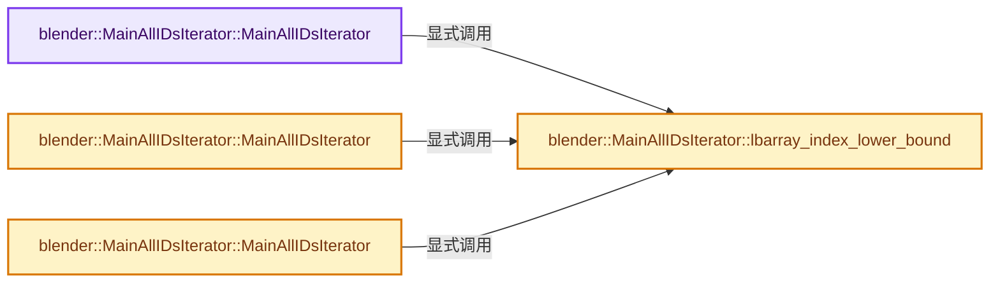
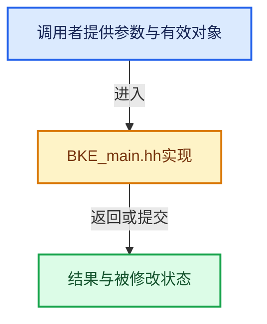

# 实现依赖专题：source/blender/blenkernel/BKE_main.hh

[实现依赖导航](../README.md) · [符号索引](../../00-课程指南/02-源码与提交索引/符号依赖与实现索引.md)

本专题从正文实际调用进入，集中保存共享实现。函数有稳定锚点，可从调用处直接跳到对应完整函数；递归与互相调用通过回链组织。

## 本文件的实现关系






## 相关类型布局与成员入口

<a id="t-1784a0f20281"></a>

### `blender::Key`

原始声明：[source/blender/blenkernel/BKE_main.hh](../../../../../../source/blender/blenkernel/BKE_main.hh) · L61—L61。

以下保留类的数据声明与编译条件，成员函数实现通过后面的精确链接阅读。

<!-- annotated:4d5a5ba7e4c74b -->

```cpp
struct Key;
```

<details>
<summary>核对原始源码：source/blender/blenkernel/BKE_main.hh · L61—L61</summary>

<!-- original:4d5a5ba7e4c74b:source/blender/blenkernel/BKE_main.hh:61:61 -->

```cpp
struct Key;
```

</details>


<a id="t-348ab9627782"></a>

### `blender::Key`

原始声明：[source/blender/blenkernel/BKE_main.hh](../../../../../../source/blender/blenkernel/BKE_main.hh) · L98—L98。

以下保留类的数据声明与编译条件，成员函数实现通过后面的精确链接阅读。

<!-- annotated:85a668d6b64f31 -->

```cpp
struct Key;
```

<details>
<summary>核对原始源码：source/blender/blenkernel/BKE_main.hh · L98—L98</summary>

<!-- original:85a668d6b64f31:source/blender/blenkernel/BKE_main.hh:98:98 -->

```cpp
struct Key;
```

</details>


<a id="m-311e8be07462"></a>

## 宏 `FOREACH_MAIN_LISTBASE_ID_BEGIN`

<!-- annotated:54a28cf942fcc7 -->

```cpp
#define FOREACH_MAIN_LISTBASE_ID_BEGIN(_lb, _id) \
  { \
    ID *_id_next = static_cast<ID *>((_lb)->first_); \
    for ((_id) = _id_next; (_id) != nullptr; (_id) = _id_next) { \
      _id_next = static_cast<ID *>((_id)->next);

```

<details>
<summary>核对原始源码：source/blender/blenkernel/BKE_main.hh · L694—L699</summary>

<!-- original:54a28cf942fcc7:source/blender/blenkernel/BKE_main.hh:694:699 -->

```cpp
#define FOREACH_MAIN_LISTBASE_ID_BEGIN(_lb, _id) \
  { \
    ID *_id_next = static_cast<ID *>((_lb)->first_); \
    for ((_id) = _id_next; (_id) != nullptr; (_id) = _id_next) { \
      _id_next = static_cast<ID *>((_id)->next);

```

</details>

宏在预处理阶段展开，参数替换、重复求值和条件编译应直接从该定义检查。与普通函数不同，宏不会自动提供参数类型检查；构建配置选择哪个定义需结合外围条件。

<a id="m-85586e66025e"></a>

## 宏 `FOREACH_MAIN_LISTBASE_BEGIN`

<!-- annotated:61a6467ad5ac58 -->

```cpp
#define FOREACH_MAIN_LISTBASE_BEGIN(_bmain, _lb) \
  { \
    MainListsArray _lbarray = BKE_main_lists_get(*(_bmain)); \
    size_t _i = _lbarray.size(); \
    while (_i--) { \
      (_lb) = _lbarray[_i];

```

<details>
<summary>核对原始源码：source/blender/blenkernel/BKE_main.hh · L705—L711</summary>

<!-- original:61a6467ad5ac58:source/blender/blenkernel/BKE_main.hh:705:711 -->

```cpp
#define FOREACH_MAIN_LISTBASE_BEGIN(_bmain, _lb) \
  { \
    MainListsArray _lbarray = BKE_main_lists_get(*(_bmain)); \
    size_t _i = _lbarray.size(); \
    while (_i--) { \
      (_lb) = _lbarray[_i];

```

</details>

宏在预处理阶段展开，参数替换、重复求值和条件编译应直接从该定义检查。与普通函数不同，宏不会自动提供参数类型检查；构建配置选择哪个定义需结合外围条件。

<a id="m-66b3928ce408"></a>

## 宏 `FOREACH_MAIN_ID_BEGIN`

<!-- annotated:2758e2a623ada4 -->

```cpp
#define FOREACH_MAIN_ID_BEGIN(_bmain, _id) \
  { \
    ListBaseT<ID> *_lb; \
    FOREACH_MAIN_LISTBASE_BEGIN ((_bmain), _lb) { \
      FOREACH_MAIN_LISTBASE_ID_BEGIN (_lb, (_id))

```

<details>
<summary>核对原始源码：source/blender/blenkernel/BKE_main.hh · L726—L731</summary>

<!-- original:2758e2a623ada4:source/blender/blenkernel/BKE_main.hh:726:731 -->

```cpp
#define FOREACH_MAIN_ID_BEGIN(_bmain, _id) \
  { \
    ListBaseT<ID> *_lb; \
    FOREACH_MAIN_LISTBASE_BEGIN ((_bmain), _lb) { \
      FOREACH_MAIN_LISTBASE_ID_BEGIN (_lb, (_id))

```

</details>

宏在预处理阶段展开，参数替换、重复求值和条件编译应直接从该定义检查。与普通函数不同，宏不会自动提供参数类型检查；构建配置选择哪个定义需结合外围条件。

<a id="m-f0c0a8da9411"></a>

## 宏 `MAIN_VERSION_FILE_ATLEAST`

<!-- annotated:9cef08fc1acc2b -->

```cpp
#define MAIN_VERSION_FILE_ATLEAST(main, ver, subver) \
  ((main)->versionfile > (ver) || \
   ((main)->versionfile == (ver) && (main)->subversionfile >= (subver)))

```

<details>
<summary>核对原始源码：source/blender/blenkernel/BKE_main.hh · L946—L949</summary>

<!-- original:9cef08fc1acc2b:source/blender/blenkernel/BKE_main.hh:946:949 -->

```cpp
#define MAIN_VERSION_FILE_ATLEAST(main, ver, subver) \
  ((main)->versionfile > (ver) || \
   ((main)->versionfile == (ver) && (main)->subversionfile >= (subver)))

```

</details>

宏在预处理阶段展开，参数替换、重复求值和条件编译应直接从该定义检查。与普通函数不同，宏不会自动提供参数类型检查；构建配置选择哪个定义需结合外围条件。

<a id="m-365a875153a5"></a>

## 宏 `MAIN_VERSION_FILE_OLDER`

<!-- annotated:3c549ebbd002d8 -->

```cpp
#define MAIN_VERSION_FILE_OLDER(main, ver, subver) \
  ((main)->versionfile < (ver) || \
   ((main)->versionfile == (ver) && (main)->subversionfile < (subver)))

```

<details>
<summary>核对原始源码：source/blender/blenkernel/BKE_main.hh · L950—L953</summary>

<!-- original:3c549ebbd002d8:source/blender/blenkernel/BKE_main.hh:950:953 -->

```cpp
#define MAIN_VERSION_FILE_OLDER(main, ver, subver) \
  ((main)->versionfile < (ver) || \
   ((main)->versionfile == (ver) && (main)->subversionfile < (subver)))

```

</details>

宏在预处理阶段展开，参数替换、重复求值和条件编译应直接从该定义检查。与普通函数不同，宏不会自动提供参数类型检查；构建配置选择哪个定义需结合外围条件。

<a id="m-fdc26cbc11e2"></a>

## 宏 `MAIN_VERSION_FILE_OLDER_OR_EQUAL`

<!-- annotated:aefe5a9215189d -->

```cpp
#define MAIN_VERSION_FILE_OLDER_OR_EQUAL(main, ver, subver) \
  ((main)->versionfile < (ver) || \
   ((main)->versionfile == (ver) && (main)->subversionfile <= (subver)))

```

<details>
<summary>核对原始源码：source/blender/blenkernel/BKE_main.hh · L954—L957</summary>

<!-- original:aefe5a9215189d:source/blender/blenkernel/BKE_main.hh:954:957 -->

```cpp
#define MAIN_VERSION_FILE_OLDER_OR_EQUAL(main, ver, subver) \
  ((main)->versionfile < (ver) || \
   ((main)->versionfile == (ver) && (main)->subversionfile <= (subver)))

```

</details>

宏在预处理阶段展开，参数替换、重复求值和条件编译应直接从该定义检查。与普通函数不同，宏不会自动提供参数类型检查；构建配置选择哪个定义需结合外围条件。

<a id="m-59e5e606f564"></a>

## 宏 `LIBRARY_VERSION_FILE_ATLEAST`

<!-- annotated:163f953c3a0d71 -->

```cpp
#define LIBRARY_VERSION_FILE_ATLEAST(lib, ver, subver) \
  ((lib)->runtime->versionfile == 0 || (lib)->runtime->versionfile > (ver) || \
   ((lib)->runtime->versionfile == (ver) && (lib)->runtime->subversionfile >= (subver)))

```

<details>
<summary>核对原始源码：source/blender/blenkernel/BKE_main.hh · L963—L966</summary>

<!-- original:163f953c3a0d71:source/blender/blenkernel/BKE_main.hh:963:966 -->

```cpp
#define LIBRARY_VERSION_FILE_ATLEAST(lib, ver, subver) \
  ((lib)->runtime->versionfile == 0 || (lib)->runtime->versionfile > (ver) || \
   ((lib)->runtime->versionfile == (ver) && (lib)->runtime->subversionfile >= (subver)))

```

</details>

宏在预处理阶段展开，参数替换、重复求值和条件编译应直接从该定义检查。与普通函数不同，宏不会自动提供参数类型检查；构建配置选择哪个定义需结合外围条件。

<a id="m-96f509d07a75"></a>

## 宏 `BLEN_THUMB_MEMSIZE`

<!-- annotated:ddc2822735d1f5 -->

```cpp
#define BLEN_THUMB_MEMSIZE(_x, _y) \
  (sizeof(BlendThumbnail) + (size_t(_x) * size_t(_y)) * sizeof(int))
/** Protect against buffer overflow vulnerability & negative sizes. */
```

<details>
<summary>核对原始源码：source/blender/blenkernel/BKE_main.hh · L976—L978</summary>

<!-- original:ddc2822735d1f5:source/blender/blenkernel/BKE_main.hh:976:978 -->

```cpp
#define BLEN_THUMB_MEMSIZE(_x, _y) \
  (sizeof(BlendThumbnail) + (size_t(_x) * size_t(_y)) * sizeof(int))
/** Protect against buffer overflow vulnerability & negative sizes. */
```

</details>

宏在预处理阶段展开，参数替换、重复求值和条件编译应直接从该定义检查。与普通函数不同，宏不会自动提供参数类型检查；构建配置选择哪个定义需结合外围条件。

<a id="m-337aa10941bc"></a>

## 宏 `BLEN_THUMB_MEMSIZE_IS_VALID`

<!-- annotated:208924ff230c29 -->

```cpp
#define BLEN_THUMB_MEMSIZE_IS_VALID(_x, _y) \
  (((_x) > 0 && (_y) > 0) && ((uint64_t)(_x) * (uint64_t)(_y) < (SIZE_MAX / (sizeof(int) * 4))))

```

<details>
<summary>核对原始源码：source/blender/blenkernel/BKE_main.hh · L979—L981</summary>

<!-- original:208924ff230c29:source/blender/blenkernel/BKE_main.hh:979:981 -->

```cpp
#define BLEN_THUMB_MEMSIZE_IS_VALID(_x, _y) \
  (((_x) > 0 && (_y) > 0) && ((uint64_t)(_x) * (uint64_t)(_y) < (SIZE_MAX / (sizeof(int) * 4))))

```

</details>

宏在预处理阶段展开，参数替换、重复求值和条件编译应直接从该定义检查。与普通函数不同，宏不会自动提供参数类型检查；构建配置选择哪个定义需结合外围条件。

## 完整成员与函数实现

<a id="f-87be303bf34eb386"></a>

### `blender::MainAllIDsIterator::MainAllIDsIterator`

实现位置：[source/blender/blenkernel/BKE_main.hh](../../../../../../source/blender/blenkernel/BKE_main.hh) · L839—L843。

**教学注释版**

<!-- annotated:51e5b2d71d8852 -->

```cpp
  MainAllIDsIterator() : lbarray_{}
  {
    curr_lbarray_index_ = lbarray_index_lower_bound();
    ++(*this);
  }
```

<details>
<summary>核对原始源码：source/blender/blenkernel/BKE_main.hh · L839—L843</summary>

<!-- original:51e5b2d71d8852:source/blender/blenkernel/BKE_main.hh:839:843 -->

```cpp
  MainAllIDsIterator() : lbarray_{}
  {
    curr_lbarray_index_ = lbarray_index_lower_bound();
    ++(*this);
  }
```

</details>

**沿实际写入检查状态**

- `curr_lbarray_index_ = lbarray_index_lower_bound();`

**继续追踪实现**

- `lbarray_index_lower_bound` → [blender::MainAllIDsIterator::lbarray_index_lower_bound · L861](BKE_main.hh.md#f-fc852240dee28ed3)。

<a id="f-5e2f0cd0f7fd5620"></a>

### `blender::MainAllIDsIterator::MainAllIDsIterator`

实现位置：[source/blender/blenkernel/BKE_main.hh](../../../../../../source/blender/blenkernel/BKE_main.hh) · L845—L850。

接口参数：

- `MainListsArray &lbarray`
- `const bool reverse_id_type_order = false`

**教学注释版**

<!-- annotated:5ac5d215ee30bf -->

```cpp
  explicit MainAllIDsIterator(MainListsArray &lbarray, const bool reverse_id_type_order = false)
      : lbarray_(lbarray), reverse_id_type_order_(reverse_id_type_order)
  {
    curr_lbarray_index_ = lbarray_index_lower_bound();
    ++(*this);
  }
```

<details>
<summary>核对原始源码：source/blender/blenkernel/BKE_main.hh · L845—L850</summary>

<!-- original:5ac5d215ee30bf:source/blender/blenkernel/BKE_main.hh:845:850 -->

```cpp
  explicit MainAllIDsIterator(MainListsArray &lbarray, const bool reverse_id_type_order = false)
      : lbarray_(lbarray), reverse_id_type_order_(reverse_id_type_order)
  {
    curr_lbarray_index_ = lbarray_index_lower_bound();
    ++(*this);
  }
```

</details>

**沿实际写入检查状态**

- `curr_lbarray_index_ = lbarray_index_lower_bound();`

**继续追踪实现**

- `lbarray_index_lower_bound` → [blender::MainAllIDsIterator::lbarray_index_lower_bound · L861](BKE_main.hh.md#f-fc852240dee28ed3)。

<a id="f-d92ba02aeaeb4ad9"></a>

### `blender::MainAllIDsIterator::MainAllIDsIterator`

实现位置：[source/blender/blenkernel/BKE_main.hh](../../../../../../source/blender/blenkernel/BKE_main.hh) · L852—L857。

接口参数：

- `Main &bmain`
- `const bool reverse_id_type_order = false`

**教学注释版**

<!-- annotated:7bc80160724341 -->

```cpp
  explicit MainAllIDsIterator(Main &bmain, const bool reverse_id_type_order = false)
      : lbarray_(BKE_main_lists_get(bmain)), reverse_id_type_order_(reverse_id_type_order)
  {
    curr_lbarray_index_ = lbarray_index_lower_bound();
    ++(*this);
  }
```

<details>
<summary>核对原始源码：source/blender/blenkernel/BKE_main.hh · L852—L857</summary>

<!-- original:7bc80160724341:source/blender/blenkernel/BKE_main.hh:852:857 -->

```cpp
  explicit MainAllIDsIterator(Main &bmain, const bool reverse_id_type_order = false)
      : lbarray_(BKE_main_lists_get(bmain)), reverse_id_type_order_(reverse_id_type_order)
  {
    curr_lbarray_index_ = lbarray_index_lower_bound();
    ++(*this);
  }
```

</details>

**沿实际写入检查状态**

- `curr_lbarray_index_ = lbarray_index_lower_bound();`

**继续追踪实现**

- `lbarray_index_lower_bound` → [blender::MainAllIDsIterator::lbarray_index_lower_bound · L861](BKE_main.hh.md#f-fc852240dee28ed3)。

<a id="f-fc852240dee28ed3"></a>

### `blender::MainAllIDsIterator::lbarray_index_lower_bound`

实现位置：[source/blender/blenkernel/BKE_main.hh](../../../../../../source/blender/blenkernel/BKE_main.hh) · L861—L864。

**教学注释版**

<!-- annotated:8d623ab309219a -->

```cpp
  int64_t lbarray_index_lower_bound() const
  {
    return reverse_id_type_order_ ? -1 : int64_t(lbarray_.size());
  }
```

<details>
<summary>核对原始源码：source/blender/blenkernel/BKE_main.hh · L861—L864</summary>

<!-- original:8d623ab309219a:source/blender/blenkernel/BKE_main.hh:861:864 -->

```cpp
  int64_t lbarray_index_lower_bound() const
  {
    return reverse_id_type_order_ ? -1 : int64_t(lbarray_.size());
  }
```

</details>

**结果出口**

- `return reverse_id_type_order_ ? -1 : int64_t(lbarray_.size());`

**继续追踪实现**

- `lbarray_.size` → [调用协议](../../00-课程指南/01-路线与规范/模板宏与动态分派协议.md)：由接收对象具体类型或运行时策略提供实现。调用位置L863。
