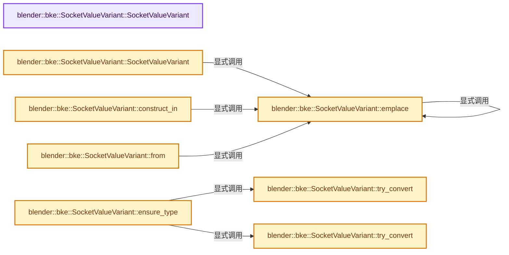
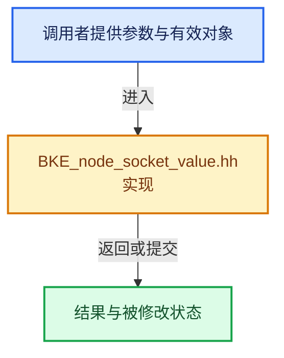

# 实现依赖专题：source/blender/blenkernel/BKE_node_socket_value.hh

[实现依赖导航](../README.md) · [符号索引](../../00-课程指南/02-源码与提交索引/符号依赖与实现索引.md)

本专题从正文实际调用进入，集中保存共享实现。函数有稳定锚点，可从调用处直接跳到对应完整函数；递归与互相调用通过回链组织。

## 本文件的实现关系






## 完整成员与函数实现

<a id="f-a12d4437125f15ca"></a>

### `blender::bke::SocketValueVariant::SocketValueVariant`

实现位置：[source/blender/blenkernel/BKE_node_socket_value.hh](../../../../../../source/blender/blenkernel/BKE_node_socket_value.hh) · L100—L100。

**教学注释版**

<!-- annotated:392554a28a3c3c -->

```cpp
  SocketValueVariant() = default;
```

<details>
<summary>核对原始源码：source/blender/blenkernel/BKE_node_socket_value.hh · L100—L100</summary>

<!-- original:392554a28a3c3c:source/blender/blenkernel/BKE_node_socket_value.hh:100:100 -->

```cpp
  SocketValueVariant() = default;
```

</details>

**继续追踪实现**

本实现没有需要继续展开的显式调用；检查返回表达式、对象转换和调用者前置条件。

<a id="f-ec020790ea374ce3"></a>

### `blender::bke::SocketValueVariant::SocketValueVariant`

实现位置：[source/blender/blenkernel/BKE_node_socket_value.hh](../../../../../../source/blender/blenkernel/BKE_node_socket_value.hh) · L205—L210。

接口参数：

- `T &&value`

**教学注释版**

<!-- annotated:e65e15f15f9379 -->

```cpp
template<typename T>
inline SocketValueVariant::SocketValueVariant(T &&value)
  requires(std::is_trivial_v<std::decay_t<T>> || is_same_any_v<std::decay_t<T>, std::string>)
{
  // [讲解] std::forward<T>：在转发引用中恢复调用者传入的值类别；依赖推导类型，不能与无条件move互换。
  this->emplace<std::decay_t<T>>(std::forward<T>(value));
}
```

<details>
<summary>核对原始源码：source/blender/blenkernel/BKE_node_socket_value.hh · L205—L210</summary>

<!-- original:e65e15f15f9379:source/blender/blenkernel/BKE_node_socket_value.hh:205:210 -->

```cpp
template<typename T>
inline SocketValueVariant::SocketValueVariant(T &&value)
  requires(std::is_trivial_v<std::decay_t<T>> || is_same_any_v<std::decay_t<T>, std::string>)
{
  this->emplace<std::decay_t<T>>(std::forward<T>(value));
}
```

</details>

**继续追踪实现**

- `this->emplace<std::decay_t<T>>` → [blender::bke::SocketValueVariant::emplace · L227](BKE_node_socket_value.hh.md#f-b1c23f5500ae1b73)。
- `std::forward<T>` → [外部契约](https://eel.is/c++draft/utility.forward)：在转发引用中恢复调用者传入的值类别；依赖推导类型，不能与无条件move互换。

<a id="f-4e603749d71cc64b"></a>

### `blender::bke::SocketValueVariant::construct_in`

实现位置：[source/blender/blenkernel/BKE_node_socket_value.hh](../../../../../../source/blender/blenkernel/BKE_node_socket_value.hh) · L212—L218。

接口参数：

- `void *ptr`
- `T &&value`

**教学注释版**

<!-- annotated:78926b4fbace99 -->

```cpp
template<typename T>
inline SocketValueVariant &SocketValueVariant::construct_in(void *ptr, T &&value)
{
  SocketValueVariant *value_variant = new (ptr) SocketValueVariant();
  // [讲解] std::forward<T>：在转发引用中恢复调用者传入的值类别；依赖推导类型，不能与无条件move互换。
  value_variant->emplace<std::decay_t<T>>(std::forward<T>(value));
  return *value_variant;
}
```

<details>
<summary>核对原始源码：source/blender/blenkernel/BKE_node_socket_value.hh · L212—L218</summary>

<!-- original:78926b4fbace99:source/blender/blenkernel/BKE_node_socket_value.hh:212:218 -->

```cpp
template<typename T>
inline SocketValueVariant &SocketValueVariant::construct_in(void *ptr, T &&value)
{
  SocketValueVariant *value_variant = new (ptr) SocketValueVariant();
  value_variant->emplace<std::decay_t<T>>(std::forward<T>(value));
  return *value_variant;
}
```

</details>

**结果出口**

- `return *value_variant;`

**继续追踪实现**

- `value_variant->emplace<std::decay_t<T>>` → [blender::bke::SocketValueVariant::emplace · L227](BKE_node_socket_value.hh.md#f-b1c23f5500ae1b73)。
- `std::forward<T>` → [外部契约](https://eel.is/c++draft/utility.forward)：在转发引用中恢复调用者传入的值类别；依赖推导类型，不能与无条件move互换。

<a id="f-fa3c16e83ef6de45"></a>

### `blender::bke::SocketValueVariant::from`

实现位置：[source/blender/blenkernel/BKE_node_socket_value.hh](../../../../../../source/blender/blenkernel/BKE_node_socket_value.hh) · L220—L225。

接口参数：

- `T &&value`

**教学注释版**

<!-- annotated:f361bbaed26179 -->

```cpp
template<typename T> inline SocketValueVariant SocketValueVariant::from(T &&value)
{
  SocketValueVariant value_variant;
  // [讲解] std::forward<T>：在转发引用中恢复调用者传入的值类别；依赖推导类型，不能与无条件move互换。
  value_variant.emplace<std::decay_t<T>>(std::forward<T>(value));
  return value_variant;
}
```

<details>
<summary>核对原始源码：source/blender/blenkernel/BKE_node_socket_value.hh · L220—L225</summary>

<!-- original:f361bbaed26179:source/blender/blenkernel/BKE_node_socket_value.hh:220:225 -->

```cpp
template<typename T> inline SocketValueVariant SocketValueVariant::from(T &&value)
{
  SocketValueVariant value_variant;
  value_variant.emplace<std::decay_t<T>>(std::forward<T>(value));
  return value_variant;
}
```

</details>

**结果出口**

- `return value_variant;`

**继续追踪实现**

- `value_variant.emplace<std::decay_t<T>>` → [blender::bke::SocketValueVariant::emplace · L227](BKE_node_socket_value.hh.md#f-b1c23f5500ae1b73)。
- `std::forward<T>` → [外部契约](https://eel.is/c++draft/utility.forward)：在转发引用中恢复调用者传入的值类别；依赖推导类型，不能与无条件move互换。

<a id="f-b1c23f5500ae1b73"></a>

### `blender::bke::SocketValueVariant::emplace`

实现位置：[source/blender/blenkernel/BKE_node_socket_value.hh](../../../../../../source/blender/blenkernel/BKE_node_socket_value.hh) · L227—L233。

**教学注释版**

<!-- annotated:cb5a0223302275 -->

```cpp
template<typename T, typename... Args> inline T &SocketValueVariant::emplace(Args &&...args)
{
  using StorageT = to_storage_type<T>;
  // [讲解] std::forward<Args>：在转发引用中恢复调用者传入的值类别；依赖推导类型，不能与无条件move互换。
  StorageT &value = value_.emplace<StorageT>(T(std::forward<Args>(args)...));
  static_assert(sizeof(T) == sizeof(StorageT));
  return reinterpret_cast<T &>(value);
}
```

<details>
<summary>核对原始源码：source/blender/blenkernel/BKE_node_socket_value.hh · L227—L233</summary>

<!-- original:cb5a0223302275:source/blender/blenkernel/BKE_node_socket_value.hh:227:233 -->

```cpp
template<typename T, typename... Args> inline T &SocketValueVariant::emplace(Args &&...args)
{
  using StorageT = to_storage_type<T>;
  StorageT &value = value_.emplace<StorageT>(T(std::forward<Args>(args)...));
  static_assert(sizeof(T) == sizeof(StorageT));
  return reinterpret_cast<T &>(value);
}
```

</details>

**结果出口**

- `return reinterpret_cast<T &>(value);`

**继续追踪实现**

- `value_.emplace<StorageT>` → [blender::bke::SocketValueVariant::emplace · L227](BKE_node_socket_value.hh.md#f-b1c23f5500ae1b73)。
- `T` → [DiagSplit::T · L96](../07-Intern运行时与平台/cycles/subd/split.cpp.md#f-d5d0885c790cc4e4)。
- `std::forward<Args>` → [外部契约](https://eel.is/c++draft/utility.forward)：在转发引用中恢复调用者传入的值类别；依赖推导类型，不能与无条件move互换。

<a id="f-dc6b18e59a681c72"></a>

### `blender::bke::SocketValueVariant::try_convert`

实现位置：[source/blender/blenkernel/BKE_node_socket_value.hh](../../../../../../source/blender/blenkernel/BKE_node_socket_value.hh) · L235—L254。

**教学注释版**

<!-- annotated:864d480b36f790 -->

```cpp
template<typename T> T *SocketValueVariant::try_convert()
{
  using StorageT = to_storage_type<T>;
  if (!value_.has_value()) {
    return nullptr;
  }
  const Info &info = value_.extra_info();
  const CPPType &requested_type = CPPType::get<T>();
  if (info.type == requested_type) {
    return &reinterpret_cast<T &>(value_.get<StorageT>());
  }
  if (info.is_interpretable_as(requested_type, value_)) {
    return &reinterpret_cast<T &>(value_.get<StorageT>());
  }
  if (!info.convert_to(requested_type, value_)) {
    return nullptr;
  }
  BLI_assert(value_.extra_info().is_interpretable_as(requested_type, value_));
  return &reinterpret_cast<T &>(value_.get<StorageT>());
}
```

<details>
<summary>核对原始源码：source/blender/blenkernel/BKE_node_socket_value.hh · L235—L254</summary>

<!-- original:864d480b36f790:source/blender/blenkernel/BKE_node_socket_value.hh:235:254 -->

```cpp
template<typename T> T *SocketValueVariant::try_convert()
{
  using StorageT = to_storage_type<T>;
  if (!value_.has_value()) {
    return nullptr;
  }
  const Info &info = value_.extra_info();
  const CPPType &requested_type = CPPType::get<T>();
  if (info.type == requested_type) {
    return &reinterpret_cast<T &>(value_.get<StorageT>());
  }
  if (info.is_interpretable_as(requested_type, value_)) {
    return &reinterpret_cast<T &>(value_.get<StorageT>());
  }
  if (!info.convert_to(requested_type, value_)) {
    return nullptr;
  }
  BLI_assert(value_.extra_info().is_interpretable_as(requested_type, value_));
  return &reinterpret_cast<T &>(value_.get<StorageT>());
}
```

</details>

**结果出口**

- `return nullptr;`
- `return &reinterpret_cast<T &>(value_.get<StorageT>());`

**继续追踪实现**

- `value_.has_value` → [调用协议](../../00-课程指南/01-路线与规范/模板宏与动态分派协议.md)：由接收对象具体类型或运行时策略提供实现。调用位置L238。
- `value_.extra_info` → [blender::Any::extra_info · L390](../../01-基础容器与现代CPP/17-Any类型擦除存储.md#f-7a560ad93b9c62eb)。
- `CPPType::get<T>` → [blender::bke::SocketValueVariant::get · L340](BKE_node_socket_value.hh.md#f-44fd803c51c13447)；[blender::bke::SocketValueVariant::get · L349](BKE_node_socket_value.hh.md#f-c63e6331bfae49c4)。同名重载需按实参类型选择。
- `value_.get<StorageT>` → [blender::bke::SocketValueVariant::get · L340](BKE_node_socket_value.hh.md#f-44fd803c51c13447)；[blender::bke::SocketValueVariant::get · L349](BKE_node_socket_value.hh.md#f-c63e6331bfae49c4)。同名重载需按实参类型选择。
- `info.is_interpretable_as` → [调用协议](../../00-课程指南/01-路线与规范/模板宏与动态分派协议.md)：由接收对象具体类型或运行时策略提供实现。调用位置L246。
- `info.convert_to` → [调用协议](../../00-课程指南/01-路线与规范/模板宏与动态分派协议.md)：由接收对象具体类型或运行时策略提供实现。调用位置L249。
- `BLI_assert` → [BLI_assert · L48](../01-BLI基础库/BLI_assert.hh.md#m-57a88495704d)；[BLI_assert · L63](../01-BLI基础库/BLI_assert.hh.md#m-d07050020cb5)。宏定义由构建条件选择。
- `value_.extra_info().is_interpretable_as` → [调用协议](../../00-课程指南/01-路线与规范/模板宏与动态分派协议.md)：接收对象类型依赖auto、返回值或模板实例；不按同名猜测目标。调用位置L252。

<a id="f-8b47ae436faf6028"></a>

### `blender::bke::SocketValueVariant::try_convert`

实现位置：[source/blender/blenkernel/BKE_node_socket_value.hh](../../../../../../source/blender/blenkernel/BKE_node_socket_value.hh) · L256—L269。

接口参数：

- `const CPPType &type`

**教学注释版**

<!-- annotated:81205230eb3d27 -->

```cpp
inline void *SocketValueVariant::try_convert(const CPPType &type)
{
  if (!value_.has_value()) {
    return nullptr;
  }
  const Info &info = value_.extra_info();
  if (info.type == type) {
    return value_.get();
  }
  if (!info.convert_to(type, value_)) {
    return nullptr;
  }
  return value_.get();
}
```

<details>
<summary>核对原始源码：source/blender/blenkernel/BKE_node_socket_value.hh · L256—L269</summary>

<!-- original:81205230eb3d27:source/blender/blenkernel/BKE_node_socket_value.hh:256:269 -->

```cpp
inline void *SocketValueVariant::try_convert(const CPPType &type)
{
  if (!value_.has_value()) {
    return nullptr;
  }
  const Info &info = value_.extra_info();
  if (info.type == type) {
    return value_.get();
  }
  if (!info.convert_to(type, value_)) {
    return nullptr;
  }
  return value_.get();
}
```

</details>

**结果出口**

- `return nullptr;`
- `return value_.get();`

**继续追踪实现**

- `value_.has_value` → [调用协议](../../00-课程指南/01-路线与规范/模板宏与动态分派协议.md)：由接收对象具体类型或运行时策略提供实现。调用位置L258。
- `value_.extra_info` → [blender::Any::extra_info · L390](../../01-基础容器与现代CPP/17-Any类型擦除存储.md#f-7a560ad93b9c62eb)。
- `value_.get` → [blender::bke::SocketValueVariant::get · L340](BKE_node_socket_value.hh.md#f-44fd803c51c13447)；[blender::bke::SocketValueVariant::get · L349](BKE_node_socket_value.hh.md#f-c63e6331bfae49c4)。同名重载需按实参类型选择。
- `info.convert_to` → [调用协议](../../00-课程指南/01-路线与规范/模板宏与动态分派协议.md)：由接收对象具体类型或运行时策略提供实现。调用位置L265。

<a id="f-36be485d1fc40c00"></a>

### `blender::bke::SocketValueVariant::ensure_type`

实现位置：[source/blender/blenkernel/BKE_node_socket_value.hh](../../../../../../source/blender/blenkernel/BKE_node_socket_value.hh) · L271—L277。

**教学注释版**

<!-- annotated:672ffb5807ccd0 -->

```cpp
template<typename T> inline T &SocketValueVariant::ensure_type()
{
  if (!this->try_convert<T>()) {
    return this->init_default<T>();
  }
  return *this->get_if<T>();
}
```

<details>
<summary>核对原始源码：source/blender/blenkernel/BKE_node_socket_value.hh · L271—L277</summary>

<!-- original:672ffb5807ccd0:source/blender/blenkernel/BKE_node_socket_value.hh:271:277 -->

```cpp
template<typename T> inline T &SocketValueVariant::ensure_type()
{
  if (!this->try_convert<T>()) {
    return this->init_default<T>();
  }
  return *this->get_if<T>();
}
```

</details>

**结果出口**

- `return this->init_default<T>();`
- `return *this->get_if<T>();`

**继续追踪实现**

- `this->try_convert<T>` → [blender::bke::SocketValueVariant::try_convert · L235](BKE_node_socket_value.hh.md#f-dc6b18e59a681c72)；[blender::bke::SocketValueVariant::try_convert · L256](BKE_node_socket_value.hh.md#f-8b47ae436faf6028)。同名重载需按实参类型选择。
- `this->init_default<T>` → [blender::bke::SocketValueVariant::init_default · L358](BKE_node_socket_value.hh.md#f-fbb5e4b001990c29)；[blender::bke::SocketValueVariant::init_default · L363](BKE_node_socket_value.hh.md#f-b23d972a3955fa05)。同名重载需按实参类型选择。
- `this->get_if<T>` → [blender::bke::SocketValueVariant::get_if · L293](BKE_node_socket_value.hh.md#f-5744f0088e078efb)；[blender::bke::SocketValueVariant::get_if · L315](BKE_node_socket_value.hh.md#f-0ee4db24be0746a2)；[blender::bke::SocketValueVariant::get_if · L320](BKE_node_socket_value.hh.md#f-1e9674022bd220af)；[blender::bke::SocketValueVariant::get_if · L335](BKE_node_socket_value.hh.md#f-95510bddaf248ec5)。同名重载需按实参类型选择。

<a id="f-417f182997393297"></a>

### `blender::bke::SocketValueVariant::ensure_type`

实现位置：[source/blender/blenkernel/BKE_node_socket_value.hh](../../../../../../source/blender/blenkernel/BKE_node_socket_value.hh) · L279—L285。

接口参数：

- `const CPPType &type`

**教学注释版**

<!-- annotated:3f5ed7f2d3acb3 -->

```cpp
inline void *SocketValueVariant::ensure_type(const CPPType &type)
{
  if (!this->try_convert(type)) {
    return this->init_default(type);
  }
  return value_.get();
}
```

<details>
<summary>核对原始源码：source/blender/blenkernel/BKE_node_socket_value.hh · L279—L285</summary>

<!-- original:3f5ed7f2d3acb3:source/blender/blenkernel/BKE_node_socket_value.hh:279:285 -->

```cpp
inline void *SocketValueVariant::ensure_type(const CPPType &type)
{
  if (!this->try_convert(type)) {
    return this->init_default(type);
  }
  return value_.get();
}
```

</details>

**结果出口**

- `return this->init_default(type);`
- `return value_.get();`

**继续追踪实现**

- `this->try_convert` → [blender::bke::SocketValueVariant::try_convert · L235](BKE_node_socket_value.hh.md#f-dc6b18e59a681c72)；[blender::bke::SocketValueVariant::try_convert · L256](BKE_node_socket_value.hh.md#f-8b47ae436faf6028)。同名重载需按实参类型选择。
- `this->init_default` → [blender::bke::SocketValueVariant::init_default · L358](BKE_node_socket_value.hh.md#f-fbb5e4b001990c29)；[blender::bke::SocketValueVariant::init_default · L363](BKE_node_socket_value.hh.md#f-b23d972a3955fa05)。同名重载需按实参类型选择。
- `value_.get` → [blender::bke::SocketValueVariant::get · L340](BKE_node_socket_value.hh.md#f-44fd803c51c13447)；[blender::bke::SocketValueVariant::get · L349](BKE_node_socket_value.hh.md#f-c63e6331bfae49c4)。同名重载需按实参类型选择。

<a id="f-81cc327789815ca1"></a>

### `blender::bke::SocketValueVariant::copy_as`

实现位置：[source/blender/blenkernel/BKE_node_socket_value.hh](../../../../../../source/blender/blenkernel/BKE_node_socket_value.hh) · L287—L291。

**教学注释版**

<!-- annotated:8abc61e1016363 -->

```cpp
template<typename T> T SocketValueVariant::copy_as() const
{
  SocketValueVariant copy(*this);
  return copy.extract<T>();
}
```

<details>
<summary>核对原始源码：source/blender/blenkernel/BKE_node_socket_value.hh · L287—L291</summary>

<!-- original:8abc61e1016363:source/blender/blenkernel/BKE_node_socket_value.hh:287:291 -->

```cpp
template<typename T> T SocketValueVariant::copy_as() const
{
  SocketValueVariant copy(*this);
  return copy.extract<T>();
}
```

</details>

**结果出口**

- `return copy.extract<T>();`

**继续追踪实现**

- `copy.extract<T>` → [blender::bke::SocketValueVariant::extract · L368](BKE_node_socket_value.hh.md#f-a81e32a03fee5871)。

<a id="f-5744f0088e078efb"></a>

### `blender::bke::SocketValueVariant::get_if`

实现位置：[source/blender/blenkernel/BKE_node_socket_value.hh](../../../../../../source/blender/blenkernel/BKE_node_socket_value.hh) · L293—L313。

**教学注释版**

<!-- annotated:7df370be043c02 -->

```cpp
template<typename T> inline const T *SocketValueVariant::get_if() const
{
  if (!value_) {
    return nullptr;
  }
  const Info &info = value_.extra_info();
  const CPPType &requested_type = CPPType::get<T>();
  if (info.type == requested_type) {
    return &value_.get<T>();
  }
  if (info.is_interpretable_as(requested_type, value_)) {
    if constexpr (detail::has_generic_type<T>) {
      using GenericT = T::generic_type;
      return reinterpret_cast<const T *>(&value_.get<GenericT>());
    }
    else {
      return &value_.get<T>();
    }
  }
  return nullptr;
}
```

<details>
<summary>核对原始源码：source/blender/blenkernel/BKE_node_socket_value.hh · L293—L313</summary>

<!-- original:7df370be043c02:source/blender/blenkernel/BKE_node_socket_value.hh:293:313 -->

```cpp
template<typename T> inline const T *SocketValueVariant::get_if() const
{
  if (!value_) {
    return nullptr;
  }
  const Info &info = value_.extra_info();
  const CPPType &requested_type = CPPType::get<T>();
  if (info.type == requested_type) {
    return &value_.get<T>();
  }
  if (info.is_interpretable_as(requested_type, value_)) {
    if constexpr (detail::has_generic_type<T>) {
      using GenericT = T::generic_type;
      return reinterpret_cast<const T *>(&value_.get<GenericT>());
    }
    else {
      return &value_.get<T>();
    }
  }
  return nullptr;
}
```

</details>

**结果出口**

- `return nullptr;`
- `return &value_.get<T>();`
- `return reinterpret_cast<const T *>(&value_.get<GenericT>());`

**继续追踪实现**

- `value_.extra_info` → [blender::Any::extra_info · L390](../../01-基础容器与现代CPP/17-Any类型擦除存储.md#f-7a560ad93b9c62eb)。
- `CPPType::get<T>` → [blender::bke::SocketValueVariant::get · L340](BKE_node_socket_value.hh.md#f-44fd803c51c13447)；[blender::bke::SocketValueVariant::get · L349](BKE_node_socket_value.hh.md#f-c63e6331bfae49c4)。同名重载需按实参类型选择。
- `value_.get<T>` → [blender::bke::SocketValueVariant::get · L340](BKE_node_socket_value.hh.md#f-44fd803c51c13447)；[blender::bke::SocketValueVariant::get · L349](BKE_node_socket_value.hh.md#f-c63e6331bfae49c4)。同名重载需按实参类型选择。
- `info.is_interpretable_as` → [调用协议](../../00-课程指南/01-路线与规范/模板宏与动态分派协议.md)：由接收对象具体类型或运行时策略提供实现。调用位置L303。
- `value_.get<GenericT>` → [blender::bke::SocketValueVariant::get · L340](BKE_node_socket_value.hh.md#f-44fd803c51c13447)；[blender::bke::SocketValueVariant::get · L349](BKE_node_socket_value.hh.md#f-c63e6331bfae49c4)。同名重载需按实参类型选择。

<a id="f-0ee4db24be0746a2"></a>

### `blender::bke::SocketValueVariant::get_if`

实现位置：[source/blender/blenkernel/BKE_node_socket_value.hh](../../../../../../source/blender/blenkernel/BKE_node_socket_value.hh) · L315—L318。

**教学注释版**

<!-- annotated:70cf4f69f6b218 -->

```cpp
template<typename T> inline T *SocketValueVariant::get_if()
{
  return const_cast<T *>(std::as_const(*this).get_if<T>());
}
```

<details>
<summary>核对原始源码：source/blender/blenkernel/BKE_node_socket_value.hh · L315—L318</summary>

<!-- original:70cf4f69f6b218:source/blender/blenkernel/BKE_node_socket_value.hh:315:318 -->

```cpp
template<typename T> inline T *SocketValueVariant::get_if()
{
  return const_cast<T *>(std::as_const(*this).get_if<T>());
}
```

</details>

**结果出口**

- `return const_cast<T *>(std::as_const(*this).get_if<T>());`

**继续追踪实现**

- `std::as_const(*this).get_if<T>` → [外部契约](https://eel.is/c++draft/)：这个边界按实际表达式及所属类型核对参数、返回值、寿命与失败行为。这里提供接口入口，不声称已解释该第三方版本的内部实现。
- `std::as_const` → [外部契约](https://eel.is/c++draft/)：这个边界按实际表达式及所属类型核对参数、返回值、寿命与失败行为。这里提供接口入口，不声称已解释该第三方版本的内部实现。

<a id="f-1e9674022bd220af"></a>

### `blender::bke::SocketValueVariant::get_if`

实现位置：[source/blender/blenkernel/BKE_node_socket_value.hh](../../../../../../source/blender/blenkernel/BKE_node_socket_value.hh) · L320—L333。

接口参数：

- `const CPPType &type`

**教学注释版**

<!-- annotated:9925311eac129b -->

```cpp
inline const void *SocketValueVariant::get_if(const CPPType &type) const
{
  if (!value_) {
    return nullptr;
  }
  const Info &info = value_.extra_info();
  if (info.type == type) {
    return value_.get();
  }
  if (info.is_interpretable_as(type, value_)) {
    return value_.get();
  }
  return nullptr;
}
```

<details>
<summary>核对原始源码：source/blender/blenkernel/BKE_node_socket_value.hh · L320—L333</summary>

<!-- original:9925311eac129b:source/blender/blenkernel/BKE_node_socket_value.hh:320:333 -->

```cpp
inline const void *SocketValueVariant::get_if(const CPPType &type) const
{
  if (!value_) {
    return nullptr;
  }
  const Info &info = value_.extra_info();
  if (info.type == type) {
    return value_.get();
  }
  if (info.is_interpretable_as(type, value_)) {
    return value_.get();
  }
  return nullptr;
}
```

</details>

**结果出口**

- `return nullptr;`
- `return value_.get();`

**继续追踪实现**

- `value_.extra_info` → [blender::Any::extra_info · L390](../../01-基础容器与现代CPP/17-Any类型擦除存储.md#f-7a560ad93b9c62eb)。
- `value_.get` → [blender::bke::SocketValueVariant::get · L340](BKE_node_socket_value.hh.md#f-44fd803c51c13447)；[blender::bke::SocketValueVariant::get · L349](BKE_node_socket_value.hh.md#f-c63e6331bfae49c4)。同名重载需按实参类型选择。
- `info.is_interpretable_as` → [调用协议](../../00-课程指南/01-路线与规范/模板宏与动态分派协议.md)：由接收对象具体类型或运行时策略提供实现。调用位置L329。

<a id="f-95510bddaf248ec5"></a>

### `blender::bke::SocketValueVariant::get_if`

实现位置：[source/blender/blenkernel/BKE_node_socket_value.hh](../../../../../../source/blender/blenkernel/BKE_node_socket_value.hh) · L335—L338。

接口参数：

- `const CPPType &type`

**教学注释版**

<!-- annotated:82b60ac8987e42 -->

```cpp
inline void *SocketValueVariant::get_if(const CPPType &type)
{
  return const_cast<void *>(std::as_const(*this).get_if(type));
}
```

<details>
<summary>核对原始源码：source/blender/blenkernel/BKE_node_socket_value.hh · L335—L338</summary>

<!-- original:82b60ac8987e42:source/blender/blenkernel/BKE_node_socket_value.hh:335:338 -->

```cpp
inline void *SocketValueVariant::get_if(const CPPType &type)
{
  return const_cast<void *>(std::as_const(*this).get_if(type));
}
```

</details>

**结果出口**

- `return const_cast<void *>(std::as_const(*this).get_if(type));`

**继续追踪实现**

- `std::as_const(*this).get_if` → [外部契约](https://eel.is/c++draft/)：这个边界按实际表达式及所属类型核对参数、返回值、寿命与失败行为。这里提供接口入口，不声称已解释该第三方版本的内部实现。
- `std::as_const` → [外部契约](https://eel.is/c++draft/)：这个边界按实际表达式及所属类型核对参数、返回值、寿命与失败行为。这里提供接口入口，不声称已解释该第三方版本的内部实现。

<a id="f-44fd803c51c13447"></a>

### `blender::bke::SocketValueVariant::get`

实现位置：[source/blender/blenkernel/BKE_node_socket_value.hh](../../../../../../source/blender/blenkernel/BKE_node_socket_value.hh) · L340—L347。

**教学注释版**

<!-- annotated:6853acb6041faa -->

```cpp
inline GPointer SocketValueVariant::get() const
{
  if (!value_) {
    return {};
  }
  const Info &info = value_.extra_info();
  return {info.type, value_.get()};
}
```

<details>
<summary>核对原始源码：source/blender/blenkernel/BKE_node_socket_value.hh · L340—L347</summary>

<!-- original:6853acb6041faa:source/blender/blenkernel/BKE_node_socket_value.hh:340:347 -->

```cpp
inline GPointer SocketValueVariant::get() const
{
  if (!value_) {
    return {};
  }
  const Info &info = value_.extra_info();
  return {info.type, value_.get()};
}
```

</details>

**结果出口**

- `return {};`
- `return {info.type, value_.get()};`

**继续追踪实现**

- `value_.extra_info` → [blender::Any::extra_info · L390](../../01-基础容器与现代CPP/17-Any类型擦除存储.md#f-7a560ad93b9c62eb)。
- `value_.get` → [blender::bke::SocketValueVariant::get · L340](BKE_node_socket_value.hh.md#f-44fd803c51c13447)；[blender::bke::SocketValueVariant::get · L349](BKE_node_socket_value.hh.md#f-c63e6331bfae49c4)。同名重载需按实参类型选择。

<a id="f-c63e6331bfae49c4"></a>

### `blender::bke::SocketValueVariant::get`

实现位置：[source/blender/blenkernel/BKE_node_socket_value.hh](../../../../../../source/blender/blenkernel/BKE_node_socket_value.hh) · L349—L356。

**教学注释版**

<!-- annotated:72827321608e5d -->

```cpp
inline GMutablePointer SocketValueVariant::get()
{
  if (!value_) {
    return {};
  }
  const Info &info = value_.extra_info();
  return {info.type, value_.get()};
}
```

<details>
<summary>核对原始源码：source/blender/blenkernel/BKE_node_socket_value.hh · L349—L356</summary>

<!-- original:72827321608e5d:source/blender/blenkernel/BKE_node_socket_value.hh:349:356 -->

```cpp
inline GMutablePointer SocketValueVariant::get()
{
  if (!value_) {
    return {};
  }
  const Info &info = value_.extra_info();
  return {info.type, value_.get()};
}
```

</details>

**结果出口**

- `return {};`
- `return {info.type, value_.get()};`

**继续追踪实现**

- `value_.extra_info` → [blender::Any::extra_info · L390](../../01-基础容器与现代CPP/17-Any类型擦除存储.md#f-7a560ad93b9c62eb)。
- `value_.get` → [blender::bke::SocketValueVariant::get · L340](BKE_node_socket_value.hh.md#f-44fd803c51c13447)；[blender::bke::SocketValueVariant::get · L349](BKE_node_socket_value.hh.md#f-c63e6331bfae49c4)。同名重载需按实参类型选择。

<a id="f-fbb5e4b001990c29"></a>

### `blender::bke::SocketValueVariant::init_default`

实现位置：[source/blender/blenkernel/BKE_node_socket_value.hh](../../../../../../source/blender/blenkernel/BKE_node_socket_value.hh) · L358—L361。

**教学注释版**

<!-- annotated:d7fa545a639126 -->

```cpp
template<typename T> inline T &SocketValueVariant::init_default()
{
  return SocketValueVariant::init_default<T>(value_);
}
```

<details>
<summary>核对原始源码：source/blender/blenkernel/BKE_node_socket_value.hh · L358—L361</summary>

<!-- original:d7fa545a639126:source/blender/blenkernel/BKE_node_socket_value.hh:358:361 -->

```cpp
template<typename T> inline T &SocketValueVariant::init_default()
{
  return SocketValueVariant::init_default<T>(value_);
}
```

</details>

**结果出口**

- `return SocketValueVariant::init_default<T>(value_);`

**继续追踪实现**

- `SocketValueVariant::init_default<T>` → [blender::bke::SocketValueVariant::init_default · L358](BKE_node_socket_value.hh.md#f-fbb5e4b001990c29)；[blender::bke::SocketValueVariant::init_default · L363](BKE_node_socket_value.hh.md#f-b23d972a3955fa05)。同名重载需按实参类型选择。

<a id="f-b23d972a3955fa05"></a>

### `blender::bke::SocketValueVariant::init_default`

实现位置：[source/blender/blenkernel/BKE_node_socket_value.hh](../../../../../../source/blender/blenkernel/BKE_node_socket_value.hh) · L363—L366。

接口参数：

- `const CPPType &type`

**教学注释版**

<!-- annotated:103386db37577c -->

```cpp
inline void *SocketValueVariant::init_default(const CPPType &type)
{
  return SocketValueVariant::init_default(type, value_);
}
```

<details>
<summary>核对原始源码：source/blender/blenkernel/BKE_node_socket_value.hh · L363—L366</summary>

<!-- original:103386db37577c:source/blender/blenkernel/BKE_node_socket_value.hh:363:366 -->

```cpp
inline void *SocketValueVariant::init_default(const CPPType &type)
{
  return SocketValueVariant::init_default(type, value_);
}
```

</details>

**结果出口**

- `return SocketValueVariant::init_default(type, value_);`

**继续追踪实现**

- `SocketValueVariant::init_default` → [blender::bke::SocketValueVariant::init_default · L358](BKE_node_socket_value.hh.md#f-fbb5e4b001990c29)；[blender::bke::SocketValueVariant::init_default · L363](BKE_node_socket_value.hh.md#f-b23d972a3955fa05)。同名重载需按实参类型选择。

<a id="f-a81e32a03fee5871"></a>

### `blender::bke::SocketValueVariant::extract`

实现位置：[source/blender/blenkernel/BKE_node_socket_value.hh](../../../../../../source/blender/blenkernel/BKE_node_socket_value.hh) · L368—L371。

**教学注释版**

<!-- annotated:819a2e5ef62757 -->

```cpp
template<typename T> inline T SocketValueVariant::extract()
{
  // [讲解] std::move：把表达式转换成可供移动重载选择的值类别；不保证真的移动，不结束源对象寿命，对const值可能选择复制。
  return std::move(this->ensure_type<T>());
}
```

<details>
<summary>核对原始源码：source/blender/blenkernel/BKE_node_socket_value.hh · L368—L371</summary>

<!-- original:819a2e5ef62757:source/blender/blenkernel/BKE_node_socket_value.hh:368:371 -->

```cpp
template<typename T> inline T SocketValueVariant::extract()
{
  return std::move(this->ensure_type<T>());
}
```

</details>

**结果出口**

- `return std::move(this->ensure_type<T>());`

**继续追踪实现**

- `std::move` → [外部契约](https://eel.is/c++draft/utility.forward)：把表达式转换成可供移动重载选择的值类别；不保证真的移动，不结束源对象寿命，对const值可能选择复制。
- `this->ensure_type<T>` → [blender::bke::SocketValueVariant::ensure_type · L271](BKE_node_socket_value.hh.md#f-36be485d1fc40c00)；[blender::bke::SocketValueVariant::ensure_type · L279](BKE_node_socket_value.hh.md#f-417f182997393297)。同名重载需按实参类型选择。
