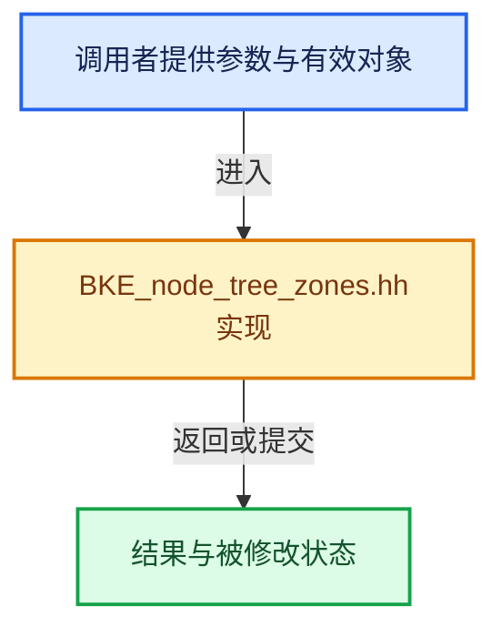

# 实现依赖专题：source/blender/blenkernel/BKE_node_tree_zones.hh

[实现依赖导航](../README.md) · [符号索引](../../00-课程指南/02-源码与提交索引/符号依赖与实现索引.md)

本专题从正文实际调用进入，集中保存共享实现。函数有稳定锚点，可从调用处直接跳到对应完整函数；递归与互相调用通过回链组织。

## 本文件的实现关系





## 完整成员与函数实现

<a id="f-892779c41416b689"></a>

### `blender::bNodeTree::zones`

实现位置：[source/blender/blenkernel/BKE_node_tree_zones.hh](../../../../../../source/blender/blenkernel/BKE_node_tree_zones.hh) · L117—L120。

**教学注释版**

<!-- annotated:fac6e3fd4a071a -->

```cpp
inline const bke::bNodeTreeZones *bNodeTree::zones() const
{
  return bke::get_tree_zones(*this);
}
```

<details>
<summary>核对原始源码：source/blender/blenkernel/BKE_node_tree_zones.hh · L117—L120</summary>

<!-- original:fac6e3fd4a071a:source/blender/blenkernel/BKE_node_tree_zones.hh:117:120 -->

```cpp
inline const bke::bNodeTreeZones *bNodeTree::zones() const
{
  return bke::get_tree_zones(*this);
}
```

</details>

**结果出口**

- `return bke::get_tree_zones(*this);`

**继续追踪实现**

- `bke::get_tree_zones` → [blender::bke::get_tree_zones · L380](intern/node_tree_zones.cc.md#f-d77c6f93b237a57d)。
