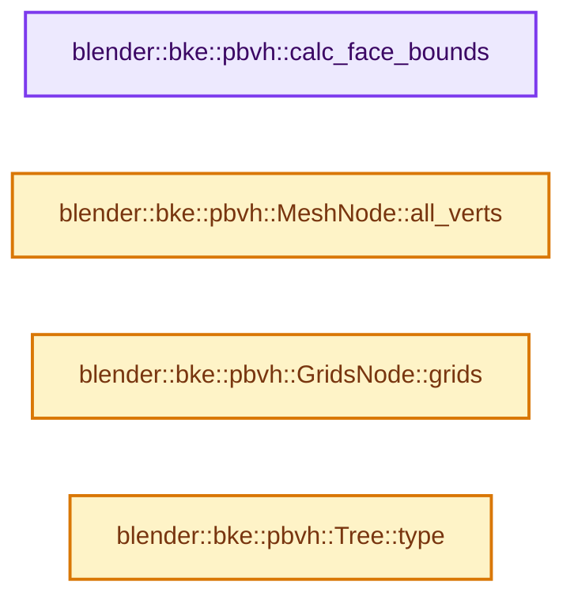

# 实现依赖专题：source/blender/blenkernel/BKE_paint_bvh.hh

[实现依赖导航](../README.md) · [符号索引](../../00-课程指南/02-源码与提交索引/符号依赖与实现索引.md)

本专题从正文实际调用进入，集中保存共享实现。函数有稳定锚点，可从调用处直接跳到对应完整函数；递归与互相调用通过回链组织。

## 本文件的实现关系




## 相关类型布局与成员入口

<a id="t-577732ca584f"></a>

### `blender::bke::pbvh::Type`

原始声明：[source/blender/blenkernel/BKE_paint_bvh.hh](../../../../../../source/blender/blenkernel/BKE_paint_bvh.hh) · L214—L218。

以下保留类的数据声明与编译条件，成员函数实现通过后面的精确链接阅读。

<!-- annotated:03f82f483ef561 -->

```cpp
enum class Type {
  Mesh,
  Grids,
  BMesh,
};
```

<details>
<summary>核对原始源码：source/blender/blenkernel/BKE_paint_bvh.hh · L214—L218</summary>

<!-- original:03f82f483ef561:source/blender/blenkernel/BKE_paint_bvh.hh:214:218 -->

```cpp
enum class Type {
  Mesh,
  Grids,
  BMesh,
};
```

</details>


## 完整成员与函数实现

<a id="f-d81ecbaa32a5dce1"></a>

### `blender::bke::pbvh::calc_face_bounds`

实现位置：[source/blender/blenkernel/BKE_paint_bvh.hh](../../../../../../source/blender/blenkernel/BKE_paint_bvh.hh) · L351—L359。

接口参数：

- `const Span<float3> vert_positions`
- `const Span<int> face_verts`

**教学注释版**

<!-- annotated:148194028edf4d -->

```cpp
inline Bounds<float3> calc_face_bounds(const Span<float3> vert_positions,
                                       const Span<int> face_verts)
{
  // [讲解] face_verts.first：按视图边界访问元素。
  Bounds<float3> bounds{vert_positions[face_verts.first()]};
  // [讲解] face_verts.slice：建立原连续范围的子视图。
  for (const int vert : face_verts.slice(1, face_verts.size() - 1)) {
    math::min_max(vert_positions[vert], bounds.min, bounds.max);
  }
  return bounds;
}
```

<details>
<summary>核对原始源码：source/blender/blenkernel/BKE_paint_bvh.hh · L351—L359</summary>

<!-- original:148194028edf4d:source/blender/blenkernel/BKE_paint_bvh.hh:351:359 -->

```cpp
inline Bounds<float3> calc_face_bounds(const Span<float3> vert_positions,
                                       const Span<int> face_verts)
{
  Bounds<float3> bounds{vert_positions[face_verts.first()]};
  for (const int vert : face_verts.slice(1, face_verts.size() - 1)) {
    math::min_max(vert_positions[vert], bounds.min, bounds.max);
  }
  return bounds;
}
```

</details>

**结果出口**

- `return bounds;`

**继续追踪实现**

- `face_verts.first` → [blender::Span::first · L319](../../01-基础容器与现代CPP/05-Span只读连续视图.md#f-d8c9bcc3e9757248)。
- `face_verts.slice` → [blender::Span::slice · L141](../../01-基础容器与现代CPP/05-Span只读连续视图.md#f-380a0e8fdcbd53cc)；[blender::Span::slice · L149](../../01-基础容器与现代CPP/05-Span只读连续视图.md#f-9b9c15e78dd54eec)。同名重载需按实参类型选择。
- `face_verts.size` → [blender::Span::size · L256](../../01-基础容器与现代CPP/05-Span只读连续视图.md#f-5f80fa006089c998)。
- `math::min_max` → [blender::math::min_max · L331](../01-BLI基础库/BLI_math_vector.hh.md#f-d0ca25e982d9489c)；[blender::math::min_max · L99](../01-BLI基础库/BLI_math_base.hh.md#f-d076aca4030981e7)。同名重载需按实参类型选择。

<a id="f-d2ea42ec93b129ff"></a>

### `blender::bke::pbvh::MeshNode::all_verts`

实现位置：[source/blender/blenkernel/BKE_paint_bvh.hh](../../../../../../source/blender/blenkernel/BKE_paint_bvh.hh) · L659—L662。

**教学注释版**

<!-- annotated:38454864b09612 -->

```cpp
inline Span<int> MeshNode::all_verts() const
{
  return vert_indices_;
}
```

<details>
<summary>核对原始源码：source/blender/blenkernel/BKE_paint_bvh.hh · L659—L662</summary>

<!-- original:38454864b09612:source/blender/blenkernel/BKE_paint_bvh.hh:659:662 -->

```cpp
inline Span<int> MeshNode::all_verts() const
{
  return vert_indices_;
}
```

</details>

**结果出口**

- `return vert_indices_;`

**继续追踪实现**

本实现没有需要继续展开的显式调用；检查返回表达式、对象转换和调用者前置条件。

<a id="f-1ec586e8a88fbcbd"></a>

### `blender::bke::pbvh::GridsNode::grids`

实现位置：[source/blender/blenkernel/BKE_paint_bvh.hh](../../../../../../source/blender/blenkernel/BKE_paint_bvh.hh) · L668—L671。

**教学注释版**

<!-- annotated:9d258759a401b5 -->

```cpp
inline Span<int> GridsNode::grids() const
{
  return prim_indices_;
}
```

<details>
<summary>核对原始源码：source/blender/blenkernel/BKE_paint_bvh.hh · L668—L671</summary>

<!-- original:9d258759a401b5:source/blender/blenkernel/BKE_paint_bvh.hh:668:671 -->

```cpp
inline Span<int> GridsNode::grids() const
{
  return prim_indices_;
}
```

</details>

**结果出口**

- `return prim_indices_;`

**继续追踪实现**

本实现没有需要继续展开的显式调用；检查返回表达式、对象转换和调用者前置条件。

<a id="f-137ce3483b4da62c"></a>

### `blender::bke::pbvh::Tree::type`

实现位置：[source/blender/blenkernel/BKE_paint_bvh.hh](../../../../../../source/blender/blenkernel/BKE_paint_bvh.hh) · L673—L676。

**教学注释版**

<!-- annotated:9a5569d0956d74 -->

```cpp
inline Type Tree::type() const
{
  return type_;
}
```

<details>
<summary>核对原始源码：source/blender/blenkernel/BKE_paint_bvh.hh · L673—L676</summary>

<!-- original:9a5569d0956d74:source/blender/blenkernel/BKE_paint_bvh.hh:673:676 -->

```cpp
inline Type Tree::type() const
{
  return type_;
}
```

</details>

**结果出口**

- `return type_;`

**继续追踪实现**

本实现没有需要继续展开的显式调用；检查返回表达式、对象转换和调用者前置条件。
