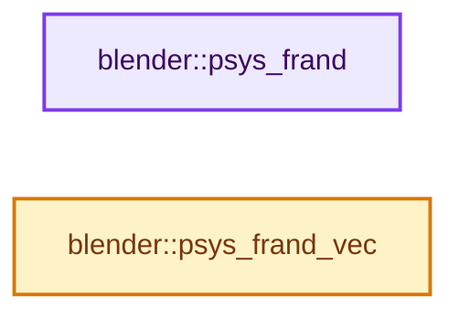
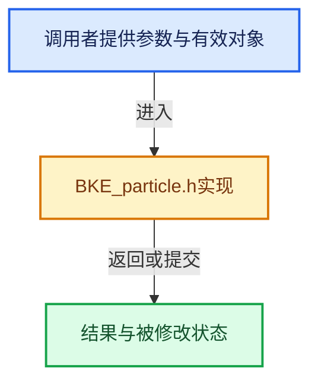

# 实现依赖专题：source/blender/blenkernel/BKE_particle.h

[实现依赖导航](../README.md) · [符号索引](../../00-课程指南/02-源码与提交索引/符号依赖与实现索引.md)

本专题从正文实际调用进入，集中保存共享实现。函数有稳定锚点，可从调用处直接跳到对应完整函数；递归与互相调用通过回链组织。

## 本文件的实现关系






## 完整成员与函数实现

<a id="f-0374069a50cd2f66"></a>

### `blender::psys_frand`

实现位置：[source/blender/blenkernel/BKE_particle.h](../../../../../../source/blender/blenkernel/BKE_particle.h) · L256—L266。

接口参数：

- `ParticleSystem *psys`
- `unsigned int seed`

**教学注释版**

<!-- annotated:0ac85d85b5b5b3 -->

```cpp
BLI_INLINE float psys_frand(ParticleSystem *psys, unsigned int seed)
{
  /* XXX far from ideal, this simply scrambles particle random numbers a bit
   * to avoid obvious correlations.
   * Can't use previous psys->frand arrays because these require initialization
   * inside psys_check_enabled, which wreaks havoc in multi-threaded depsgraph updates.
   */
  unsigned int offset = PSYS_FRAND_SEED_OFFSET[psys->seed % PSYS_FRAND_COUNT];
  unsigned int multiplier = PSYS_FRAND_SEED_MULTIPLIER[psys->seed % PSYS_FRAND_COUNT];
  return PSYS_FRAND_BASE[(offset + seed * multiplier) % PSYS_FRAND_COUNT];
}
```

<details>
<summary>核对原始源码：source/blender/blenkernel/BKE_particle.h · L256—L266</summary>

<!-- original:0ac85d85b5b5b3:source/blender/blenkernel/BKE_particle.h:256:266 -->

```cpp
BLI_INLINE float psys_frand(ParticleSystem *psys, unsigned int seed)
{
  /* XXX far from ideal, this simply scrambles particle random numbers a bit
   * to avoid obvious correlations.
   * Can't use previous psys->frand arrays because these require initialization
   * inside psys_check_enabled, which wreaks havoc in multi-threaded depsgraph updates.
   */
  unsigned int offset = PSYS_FRAND_SEED_OFFSET[psys->seed % PSYS_FRAND_COUNT];
  unsigned int multiplier = PSYS_FRAND_SEED_MULTIPLIER[psys->seed % PSYS_FRAND_COUNT];
  return PSYS_FRAND_BASE[(offset + seed * multiplier) % PSYS_FRAND_COUNT];
}
```

</details>

**结果出口**

- `return PSYS_FRAND_BASE[(offset + seed * multiplier) % PSYS_FRAND_COUNT];`

**继续追踪实现**

本实现没有需要继续展开的显式调用；检查返回表达式、对象转换和调用者前置条件。

<a id="f-cb1f550aa8057a82"></a>

### `blender::psys_frand_vec`

实现位置：[source/blender/blenkernel/BKE_particle.h](../../../../../../source/blender/blenkernel/BKE_particle.h) · L268—L275。

接口参数：

- `ParticleSystem *psys`
- `unsigned int seed`
- `float vec[3]`

**教学注释版**

<!-- annotated:56b6c5729c2027 -->

```cpp
BLI_INLINE void psys_frand_vec(ParticleSystem *psys, unsigned int seed, float vec[3])
{
  unsigned int offset = PSYS_FRAND_SEED_OFFSET[psys->seed % PSYS_FRAND_COUNT];
  unsigned int multiplier = PSYS_FRAND_SEED_MULTIPLIER[psys->seed % PSYS_FRAND_COUNT];
  vec[0] = PSYS_FRAND_BASE[(offset + (seed + 0) * multiplier) % PSYS_FRAND_COUNT];
  vec[1] = PSYS_FRAND_BASE[(offset + (seed + 1) * multiplier) % PSYS_FRAND_COUNT];
  vec[2] = PSYS_FRAND_BASE[(offset + (seed + 2) * multiplier) % PSYS_FRAND_COUNT];
}
```

<details>
<summary>核对原始源码：source/blender/blenkernel/BKE_particle.h · L268—L275</summary>

<!-- original:56b6c5729c2027:source/blender/blenkernel/BKE_particle.h:268:275 -->

```cpp
BLI_INLINE void psys_frand_vec(ParticleSystem *psys, unsigned int seed, float vec[3])
{
  unsigned int offset = PSYS_FRAND_SEED_OFFSET[psys->seed % PSYS_FRAND_COUNT];
  unsigned int multiplier = PSYS_FRAND_SEED_MULTIPLIER[psys->seed % PSYS_FRAND_COUNT];
  vec[0] = PSYS_FRAND_BASE[(offset + (seed + 0) * multiplier) % PSYS_FRAND_COUNT];
  vec[1] = PSYS_FRAND_BASE[(offset + (seed + 1) * multiplier) % PSYS_FRAND_COUNT];
  vec[2] = PSYS_FRAND_BASE[(offset + (seed + 2) * multiplier) % PSYS_FRAND_COUNT];
}
```

</details>

**沿实际写入检查状态**

- `vec[0] = PSYS_FRAND_BASE[(offset + (seed + 0) * multiplier) % PSYS_FRAND_COUNT];`
- `vec[1] = PSYS_FRAND_BASE[(offset + (seed + 1) * multiplier) % PSYS_FRAND_COUNT];`
- `vec[2] = PSYS_FRAND_BASE[(offset + (seed + 2) * multiplier) % PSYS_FRAND_COUNT];`

**继续追踪实现**

本实现没有需要继续展开的显式调用；检查返回表达式、对象转换和调用者前置条件。
