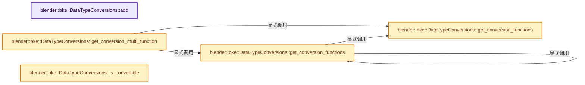
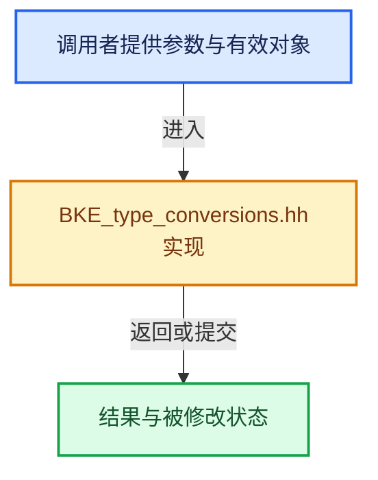

# 实现依赖专题：source/blender/blenkernel/BKE_type_conversions.hh

[实现依赖导航](../README.md) · [符号索引](../../00-课程指南/02-源码与提交索引/符号依赖与实现索引.md)

本专题从正文实际调用进入，集中保存共享实现。函数有稳定锚点，可从调用处直接跳到对应完整函数；递归与互相调用通过回链组织。

## 本文件的实现关系






## 完整成员与函数实现

<a id="f-9c167a3f5a254c6f"></a>

### `blender::bke::DataTypeConversions::add`

实现位置：[source/blender/blenkernel/BKE_type_conversions.hh](../../../../../../source/blender/blenkernel/BKE_type_conversions.hh) · L27—L35。

接口参数：

- `mf::DataType from_type`
- `mf::DataType to_type`
- `const mf::MultiFunction &fn`
- `void (*convert_single_to_initialized)(const void *src, void *dst)`
- `const void *src`
- `void *dst`
- `void (*convert_single_to_uninitialized)(const void *src, void *dst)`
- `const void *src`
- `void *dst`

**教学注释版**

<!-- annotated:f6bd5b05f2ec5a -->

```cpp
  void add(mf::DataType from_type,
           mf::DataType to_type,
           const mf::MultiFunction &fn,
           void (*convert_single_to_initialized)(const void *src, void *dst),
           void (*convert_single_to_uninitialized)(const void *src, void *dst))
  {
    // [讲解] conversions_.add_new：按哈希与相等关系加入键或键值。
    conversions_.add_new({from_type, to_type},
                         {&fn, convert_single_to_initialized, convert_single_to_uninitialized});
  }
```

<details>
<summary>核对原始源码：source/blender/blenkernel/BKE_type_conversions.hh · L27—L35</summary>

<!-- original:f6bd5b05f2ec5a:source/blender/blenkernel/BKE_type_conversions.hh:27:35 -->

```cpp
  void add(mf::DataType from_type,
           mf::DataType to_type,
           const mf::MultiFunction &fn,
           void (*convert_single_to_initialized)(const void *src, void *dst),
           void (*convert_single_to_uninitialized)(const void *src, void *dst))
  {
    conversions_.add_new({from_type, to_type},
                         {&fn, convert_single_to_initialized, convert_single_to_uninitialized});
  }
```

</details>

**继续追踪实现**

- `conversions_.add_new` → [blender::Map::add_new · L265](../../02-哈希表与关联数据结构/02-Map总体布局.md#f-521ff0865e8229d0)；[blender::Map::add_new · L269](../../02-哈希表与关联数据结构/02-Map总体布局.md#f-d89cee0e3d2848a0)；[blender::Map::add_new · L273](../../02-哈希表与关联数据结构/02-Map总体布局.md#f-c13142c32e703ebd)；[blender::Map::add_new · L277](../../02-哈希表与关联数据结构/04-Map查找与键访问.md#f-da1e537f229db040)。同名重载需按实参类型选择。

<a id="f-af0aa2b66c3d54b7"></a>

### `blender::bke::DataTypeConversions::get_conversion_functions`

实现位置：[source/blender/blenkernel/BKE_type_conversions.hh](../../../../../../source/blender/blenkernel/BKE_type_conversions.hh) · L37—L40。

接口参数：

- `mf::DataType from`
- `mf::DataType to`

**教学注释版**

<!-- annotated:39d85cc8227329 -->

```cpp
  const ConversionFunctions *get_conversion_functions(mf::DataType from, mf::DataType to) const
  {
    // [讲解] conversions_.lookup_ptr：按键查找对应项。
    return conversions_.lookup_ptr({from, to});
  }
```

<details>
<summary>核对原始源码：source/blender/blenkernel/BKE_type_conversions.hh · L37—L40</summary>

<!-- original:39d85cc8227329:source/blender/blenkernel/BKE_type_conversions.hh:37:40 -->

```cpp
  const ConversionFunctions *get_conversion_functions(mf::DataType from, mf::DataType to) const
  {
    return conversions_.lookup_ptr({from, to});
  }
```

</details>

**结果出口**

- `return conversions_.lookup_ptr({from, to});`

**继续追踪实现**

- `conversions_.lookup_ptr` → [blender::Map::lookup_ptr · L508](../../02-哈希表与关联数据结构/04-Map查找与键访问.md#f-90844510a761dcb2)；[blender::Map::lookup_ptr · L512](../../02-哈希表与关联数据结构/04-Map查找与键访问.md#f-ce017485b88f4b2c)。同名重载需按实参类型选择。

<a id="f-efd8b468baf4902a"></a>

### `blender::bke::DataTypeConversions::get_conversion_functions`

实现位置：[source/blender/blenkernel/BKE_type_conversions.hh](../../../../../../source/blender/blenkernel/BKE_type_conversions.hh) · L42—L46。

接口参数：

- `const CPPType &from`
- `const CPPType &to`

**教学注释版**

<!-- annotated:aeb91d2fbad4e7 -->

```cpp
  const ConversionFunctions *get_conversion_functions(const CPPType &from, const CPPType &to) const
  {
    return this->get_conversion_functions(mf::DataType::ForSingle(from),
                                          mf::DataType::ForSingle(to));
  }
```

<details>
<summary>核对原始源码：source/blender/blenkernel/BKE_type_conversions.hh · L42—L46</summary>

<!-- original:aeb91d2fbad4e7:source/blender/blenkernel/BKE_type_conversions.hh:42:46 -->

```cpp
  const ConversionFunctions *get_conversion_functions(const CPPType &from, const CPPType &to) const
  {
    return this->get_conversion_functions(mf::DataType::ForSingle(from),
                                          mf::DataType::ForSingle(to));
  }
```

</details>

**结果出口**

- `return this->get_conversion_functions(mf::DataType::ForSingle(from),`

**继续追踪实现**

- `this->get_conversion_functions` → [blender::bke::DataTypeConversions::get_conversion_functions · L37](BKE_type_conversions.hh.md#f-af0aa2b66c3d54b7)；[blender::bke::DataTypeConversions::get_conversion_functions · L42](BKE_type_conversions.hh.md#f-efd8b468baf4902a)。同名重载需按实参类型选择。
- `mf::DataType::ForSingle` → [blender::fn::multi_function::DataType::ForSingle · L65](../../07-MultiFunction与批量执行/03-参数类型与角色.md#f-e041e357ea765818)；[blender::fn::multi_function::DataType::ForSingle · L75](../../07-MultiFunction与批量执行/03-参数类型与角色.md#f-ffb4bc870ea750f6)。同名重载需按实参类型选择。

<a id="f-e1caf0bd2be1605a"></a>

### `blender::bke::DataTypeConversions::get_conversion_multi_function`

实现位置：[source/blender/blenkernel/BKE_type_conversions.hh](../../../../../../source/blender/blenkernel/BKE_type_conversions.hh) · L48—L52。

接口参数：

- `mf::DataType from`
- `mf::DataType to`

**教学注释版**

<!-- annotated:1d9c7307a9102c -->

```cpp
  const mf::MultiFunction *get_conversion_multi_function(mf::DataType from, mf::DataType to) const
  {
    const ConversionFunctions *functions = this->get_conversion_functions(from, to);
    return functions ? functions->multi_function : nullptr;
  }
```

<details>
<summary>核对原始源码：source/blender/blenkernel/BKE_type_conversions.hh · L48—L52</summary>

<!-- original:1d9c7307a9102c:source/blender/blenkernel/BKE_type_conversions.hh:48:52 -->

```cpp
  const mf::MultiFunction *get_conversion_multi_function(mf::DataType from, mf::DataType to) const
  {
    const ConversionFunctions *functions = this->get_conversion_functions(from, to);
    return functions ? functions->multi_function : nullptr;
  }
```

</details>

**结果出口**

- `return functions ? functions->multi_function : nullptr;`

**继续追踪实现**

- `this->get_conversion_functions` → [blender::bke::DataTypeConversions::get_conversion_functions · L37](BKE_type_conversions.hh.md#f-af0aa2b66c3d54b7)；[blender::bke::DataTypeConversions::get_conversion_functions · L42](BKE_type_conversions.hh.md#f-efd8b468baf4902a)。同名重载需按实参类型选择。

<a id="f-7c23c7ee8ac47fd2"></a>

### `blender::bke::DataTypeConversions::is_convertible`

实现位置：[source/blender/blenkernel/BKE_type_conversions.hh](../../../../../../source/blender/blenkernel/BKE_type_conversions.hh) · L54—L58。

接口参数：

- `const CPPType &from_type`
- `const CPPType &to_type`

**教学注释版**

<!-- annotated:476cb9192b3920 -->

```cpp
  bool is_convertible(const CPPType &from_type, const CPPType &to_type) const
  {
    // [讲解] conversions_.contains：查询活项数量或键是否存在。
    return conversions_.contains(
        {mf::DataType::ForSingle(from_type), mf::DataType::ForSingle(to_type)});
  }
```

<details>
<summary>核对原始源码：source/blender/blenkernel/BKE_type_conversions.hh · L54—L58</summary>

<!-- original:476cb9192b3920:source/blender/blenkernel/BKE_type_conversions.hh:54:58 -->

```cpp
  bool is_convertible(const CPPType &from_type, const CPPType &to_type) const
  {
    return conversions_.contains(
        {mf::DataType::ForSingle(from_type), mf::DataType::ForSingle(to_type)});
  }
```

</details>

**结果出口**

- `return conversions_.contains(`

**继续追踪实现**

- `conversions_.contains` → [blender::Map::contains · L353](../../02-哈希表与关联数据结构/04-Map查找与键访问.md#f-70237c86261ee04d)。
- `mf::DataType::ForSingle` → [blender::fn::multi_function::DataType::ForSingle · L65](../../07-MultiFunction与批量执行/03-参数类型与角色.md#f-e041e357ea765818)；[blender::fn::multi_function::DataType::ForSingle · L75](../../07-MultiFunction与批量执行/03-参数类型与角色.md#f-ffb4bc870ea750f6)。同名重载需按实参类型选择。
