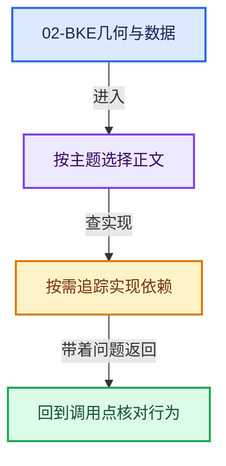
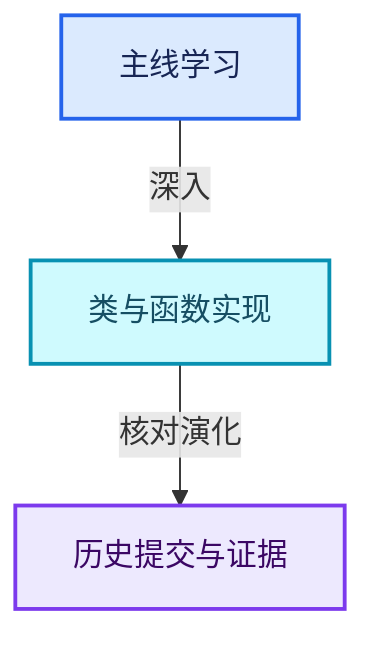

# 02-BKE几何与数据

[实现依赖总导航](../README.md)

## 模块公共接口

- [BKE_animsys.hh](BKE_animsys.hh.md)
- [BKE_annotations.h](BKE_annotations.h.md)
- [BKE_anonymous_attribute_make.hh](BKE_anonymous_attribute_make.hh.md)
- [BKE_asset.hh](BKE_asset.hh.md)
- [BKE_attribute.h](BKE_attribute.h.md)
- [BKE_attribute.hh](BKE_attribute.hh.md)
- [BKE_attribute_enums.hh](BKE_attribute_enums.hh.md)
- [BKE_attribute_math.hh](BKE_attribute_math.hh.md)
- [BKE_attribute_storage.hh](BKE_attribute_storage.hh.md)
- [BKE_blender_project.hh](BKE_blender_project.hh.md)
- [BKE_blendfile_link_append.hh](BKE_blendfile_link_append.hh.md)
- [BKE_brush.hh](BKE_brush.hh.md)
- [BKE_bvh.hh](BKE_bvh.hh.md)
- [BKE_camera.h](BKE_camera.h.md)
- [BKE_ccg.hh](BKE_ccg.hh.md)
- [BKE_cloth.hh](BKE_cloth.hh.md)
- [BKE_collection.hh](BKE_collection.hh.md)
- [BKE_colortools.hh](BKE_colortools.hh.md)
- [BKE_compute_context_cache.hh](BKE_compute_context_cache.hh.md)
- [BKE_compute_contexts.hh](BKE_compute_contexts.hh.md)
- [BKE_context.hh](BKE_context.hh.md)
- [BKE_crazyspace.hh](BKE_crazyspace.hh.md)
- [BKE_cryptomatte.h](BKE_cryptomatte.h.md)
- [BKE_curve.hh](BKE_curve.hh.md)
- [BKE_curves.hh](BKE_curves.hh.md)
- [BKE_curves_utils.hh](BKE_curves_utils.hh.md)
- [BKE_customdata.hh](BKE_customdata.hh.md)
- [BKE_effect.h](BKE_effect.h.md)
- [BKE_geometry_fields.hh](BKE_geometry_fields.hh.md)
- [BKE_geometry_set.hh](BKE_geometry_set.hh.md)
- [BKE_grease_pencil.hh](BKE_grease_pencil.hh.md)
- [BKE_idprop.hh](BKE_idprop.hh.md)
- [BKE_image.hh](BKE_image.hh.md)
- [BKE_image_format.hh](BKE_image_format.hh.md)
- [BKE_image_save.hh](BKE_image_save.hh.md)
- [BKE_instances.hh](BKE_instances.hh.md)
- [BKE_key.hh](BKE_key.hh.md)
- [BKE_layer.hh](BKE_layer.hh.md)
- [BKE_lib_id.hh](BKE_lib_id.hh.md)
- [BKE_lib_override.hh](BKE_lib_override.hh.md)
- [BKE_lib_query.hh](BKE_lib_query.hh.md)
- [BKE_lib_remap.hh](BKE_lib_remap.hh.md)
- [BKE_main.hh](BKE_main.hh.md)
- [BKE_mesh.h](BKE_mesh.h.md)
- [BKE_mesh.hh](BKE_mesh.hh.md)
- [BKE_mesh_legacy_convert.hh](BKE_mesh_legacy_convert.hh.md)
- [BKE_mesh_types.hh](BKE_mesh_types.hh.md)
- [BKE_modifier.hh](BKE_modifier.hh.md)
- [BKE_node.hh](BKE_node.hh.md)
- [BKE_node_runtime.hh](BKE_node_runtime.hh.md)
- [BKE_node_socket_value.hh](BKE_node_socket_value.hh.md)
- [BKE_node_socket_value_iter.hh](BKE_node_socket_value_iter.hh.md)
- [BKE_node_tree_interface.hh](BKE_node_tree_interface.hh.md)
- [BKE_node_tree_zones.hh](BKE_node_tree_zones.hh.md)
- [BKE_object.hh](BKE_object.hh.md)
- [BKE_paint.hh](BKE_paint.hh.md)
- [BKE_paint_bvh.hh](BKE_paint_bvh.hh.md)
- [BKE_particle.h](BKE_particle.h.md)
- [BKE_preview_image.hh](BKE_preview_image.hh.md)
- [BKE_recents.hh](BKE_recents.hh.md)
- [BKE_report.hh](BKE_report.hh.md)
- [BKE_rigidbody.h](BKE_rigidbody.h.md)
- [BKE_scene.hh](BKE_scene.hh.md)
- [BKE_screen.hh](BKE_screen.hh.md)
- [BKE_sound.hh](BKE_sound.hh.md)
- [BKE_sound_sample.hh](BKE_sound_sample.hh.md)
- [BKE_subdiv_ccg.hh](BKE_subdiv_ccg.hh.md)
- [BKE_subdiv_modifier.hh](BKE_subdiv_modifier.hh.md)
- [BKE_texture.h](BKE_texture.h.md)
- [BKE_type_conversions.hh](BKE_type_conversions.hh.md)
- [BKE_vfont.hh](BKE_vfont.hh.md)
- [BKE_volume_grid.hh](BKE_volume_grid.hh.md)
- [BKE_volume_grid_process.hh](BKE_volume_grid_process.hh.md)
- [BKE_volume_openvdb.hh](BKE_volume_openvdb.hh.md)

## intern

- [action.cc](intern/action.cc.md)
- [action_bones.cc](intern/action_bones.cc.md)
- [addon.cc](intern/addon.cc.md)
- [anim_data.cc](intern/anim_data.cc.md)
- [anim_data_bmain_utils.cc](intern/anim_data_bmain_utils.cc.md)
- [anim_path.cc](intern/anim_path.cc.md)
- [anim_sys.cc](intern/anim_sys.cc.md)
- [anim_visualization.cc](intern/anim_visualization.cc.md)
- [annotations.cc](intern/annotations.cc.md)
- [annotations_geom.cc](intern/annotations_geom.cc.md)
- [appdir.cc](intern/appdir.cc.md)
- [armature.cc](intern/armature.cc.md)
- [armature_deform.cc](intern/armature_deform.cc.md)
- [armature_update.cc](intern/armature_update.cc.md)
- [asset.cc](intern/asset.cc.md)
- [asset_edit.cc](intern/asset_edit.cc.md)
- [asset_weak_reference.cc](intern/asset_weak_reference.cc.md)
- [attribute.cc](intern/attribute.cc.md)
- [attribute_access.cc](intern/attribute_access.cc.md)
- [attribute_legacy_convert.cc](intern/attribute_legacy_convert.cc.md)
- [attribute_math.cc](intern/attribute_math.cc.md)
- [attribute_storage.cc](intern/attribute_storage.cc.md)
- [attribute_storage_access.cc](intern/attribute_storage_access.cc.md)
- [attribute_storage_access.hh](intern/attribute_storage_access.hh.md)
- [blender.cc](intern/blender.cc.md)
- [blender_project.cc](intern/blender_project.cc.md)
- [blender_user_menu.cc](intern/blender_user_menu.cc.md)
- [blendfile.cc](intern/blendfile.cc.md)
- [blendfile_link_append.cc](intern/blendfile_link_append.cc.md)
- [bpath.cc](intern/bpath.cc.md)
- [brush.cc](intern/brush.cc.md)
- [bvh.cc](intern/bvh.cc.md)
- [cachefile.cc](intern/cachefile.cc.md)
- [callbacks.cc](intern/callbacks.cc.md)
- [camera.cc](intern/camera.cc.md)
- [cloth.cc](intern/cloth.cc.md)
- [collection.cc](intern/collection.cc.md)
- [collision.cc](intern/collision.cc.md)
- [colorband.cc](intern/colorband.cc.md)
- [colortools.cc](intern/colortools.cc.md)
- [compositor.cc](intern/compositor.cc.md)
- [compute_contexts.cc](intern/compute_contexts.cc.md)
- [constraint.cc](intern/constraint.cc.md)
- [context.cc](intern/context.cc.md)
- [crazyspace.cc](intern/crazyspace.cc.md)
- [cryptomatte.cc](intern/cryptomatte.cc.md)
- [curve.cc](intern/curve.cc.md)
- [curve_bevel.cc](intern/curve_bevel.cc.md)
- [curve_bezier.cc](intern/curve_bezier.cc.md)
- [curve_catmull_rom.cc](intern/curve_catmull_rom.cc.md)
- [curve_deform.cc](intern/curve_deform.cc.md)
- [curve_legacy_convert.cc](intern/curve_legacy_convert.cc.md)
- [curve_nurbs.cc](intern/curve_nurbs.cc.md)
- [curve_poly.cc](intern/curve_poly.cc.md)
- [curve_to_mesh_convert.cc](intern/curve_to_mesh_convert.cc.md)
- [curveprofile.cc](intern/curveprofile.cc.md)
- [curves.cc](intern/curves.cc.md)
- [curves_attributes.cc](intern/curves_attributes.cc.md)
- [curves_geometry.cc](intern/curves_geometry.cc.md)
- [curves_utils.cc](intern/curves_utils.cc.md)
- [customdata.cc](intern/customdata.cc.md)
- [customdata_file.cc](intern/customdata_file.cc.md)
- [data_transfer.cc](intern/data_transfer.cc.md)
- [deform.cc](intern/deform.cc.md)
- [displist.cc](intern/displist.cc.md)
- [dynamicpaint.cc](intern/dynamicpaint.cc.md)
- [editmesh.cc](intern/editmesh.cc.md)
- [editmesh_bvh.cc](intern/editmesh_bvh.cc.md)
- [editmesh_cache.cc](intern/editmesh_cache.cc.md)
- [editmesh_tangent.cc](intern/editmesh_tangent.cc.md)
- [effect.cc](intern/effect.cc.md)
- [fcurve.cc](intern/fcurve.cc.md)
- [fcurve_driver.cc](intern/fcurve_driver.cc.md)
- [file_handler.cc](intern/file_handler.cc.md)
- [fluid.cc](intern/fluid.cc.md)
- [fmodifier.cc](intern/fmodifier.cc.md)
- [freestyle.cc](intern/freestyle.cc.md)
- [geometry_component_curves.cc](intern/geometry_component_curves.cc.md)
- [geometry_component_edit_data.cc](intern/geometry_component_edit_data.cc.md)
- [geometry_component_grease_pencil.cc](intern/geometry_component_grease_pencil.cc.md)
- [geometry_component_instances.cc](intern/geometry_component_instances.cc.md)
- [geometry_component_mesh.cc](intern/geometry_component_mesh.cc.md)
- [geometry_component_pointcloud.cc](intern/geometry_component_pointcloud.cc.md)
- [geometry_component_volume.cc](intern/geometry_component_volume.cc.md)
- [geometry_set_instances.cc](intern/geometry_set_instances.cc.md)
- [grease_pencil.cc](intern/grease_pencil.cc.md)
- [grease_pencil_attributes.cc](intern/grease_pencil_attributes.cc.md)
- [grease_pencil_convert_legacy.cc](intern/grease_pencil_convert_legacy.cc.md)
- [grease_pencil_fills.cc](intern/grease_pencil_fills.cc.md)
- [grease_pencil_modifiers.cc](intern/grease_pencil_modifiers.cc.md)
- [grease_pencil_vertex_groups.cc](intern/grease_pencil_vertex_groups.cc.md)
- [icons.cc](intern/icons.cc.md)
- [idprop.cc](intern/idprop.cc.md)
- [idprop_create.cc](intern/idprop_create.cc.md)
- [idprop_utils.cc](intern/idprop_utils.cc.md)
- [idtype.cc](intern/idtype.cc.md)
- [image.cc](intern/image.cc.md)
- [image_format.cc](intern/image_format.cc.md)
- [image_gpu.cc](intern/image_gpu.cc.md)
- [image_intern.hh](intern/image_intern.hh.md)
- [image_save.cc](intern/image_save.cc.md)
- [instances.cc](intern/instances.cc.md)
- [instances_attributes.cc](intern/instances_attributes.cc.md)
- [key.cc](intern/key.cc.md)
- [keyconfig.cc](intern/keyconfig.cc.md)
- [lattice.cc](intern/lattice.cc.md)
- [lattice_deform.cc](intern/lattice_deform.cc.md)
- [layer.cc](intern/layer.cc.md)
- [layer_utils.cc](intern/layer_utils.cc.md)
- [lib_id.cc](intern/lib_id.cc.md)
- [lib_id_delete.cc](intern/lib_id_delete.cc.md)
- [lib_id_eval.cc](intern/lib_id_eval.cc.md)
- [lib_id_remapper.cc](intern/lib_id_remapper.cc.md)
- [lib_override.cc](intern/lib_override.cc.md)
- [lib_override_proxy_conversion.cc](intern/lib_override_proxy_conversion.cc.md)
- [lib_query.cc](intern/lib_query.cc.md)
- [lib_remap.cc](intern/lib_remap.cc.md)
- [library.cc](intern/library.cc.md)
- [light.cc](intern/light.cc.md)
- [lightprobe.cc](intern/lightprobe.cc.md)
- [main.cc](intern/main.cc.md)
- [main_idmap.cc](intern/main_idmap.cc.md)
- [main_invariants.cc](intern/main_invariants.cc.md)
- [main_namemap.cc](intern/main_namemap.cc.md)
- [mask.cc](intern/mask.cc.md)
- [mask_evaluate.cc](intern/mask_evaluate.cc.md)
- [material.cc](intern/material.cc.md)
- [mball.cc](intern/mball.cc.md)
- [mball_tessellate.cc](intern/mball_tessellate.cc.md)
- [mesh_attributes.cc](intern/mesh_attributes.cc.md)
- [mesh_calc_edges.cc](intern/mesh_calc_edges.cc.md)
- [mesh_convert.cc](intern/mesh_convert.cc.md)
- [mesh_data_update.cc](intern/mesh_data_update.cc.md)
- [mesh_evaluate.cc](intern/mesh_evaluate.cc.md)
- [mesh_flip_faces.cc](intern/mesh_flip_faces.cc.md)
- [mesh_legacy_convert.cc](intern/mesh_legacy_convert.cc.md)
- [mesh_mirror.cc](intern/mesh_mirror.cc.md)
- [mesh_normals.cc](intern/mesh_normals.cc.md)
- [mesh_remap.cc](intern/mesh_remap.cc.md)
- [mesh_remesh_voxel.cc](intern/mesh_remesh_voxel.cc.md)
- [mesh_sample.cc](intern/mesh_sample.cc.md)
- [mesh_tangent.cc](intern/mesh_tangent.cc.md)
- [mesh_tessellate.cc](intern/mesh_tessellate.cc.md)
- [mesh_topology_state.cc](intern/mesh_topology_state.cc.md)
- [mesh_validate.cc](intern/mesh_validate.cc.md)
- [mesh_wrapper.cc](intern/mesh_wrapper.cc.md)
- [modifier.cc](intern/modifier.cc.md)
- [movieclip.cc](intern/movieclip.cc.md)
- [multires.cc](intern/multires.cc.md)
- [multires_inline.hh](intern/multires_inline.hh.md)
- [multires_reshape.cc](intern/multires_reshape.cc.md)
- [multires_reshape_ccg.cc](intern/multires_reshape_ccg.cc.md)
- [multires_reshape_smooth.cc](intern/multires_reshape_smooth.cc.md)
- [multires_reshape_util.cc](intern/multires_reshape_util.cc.md)
- [multires_subdiv.cc](intern/multires_subdiv.cc.md)
- [multires_versioning.cc](intern/multires_versioning.cc.md)
- [nla.cc](intern/nla.cc.md)
- [node.cc](intern/node.cc.md)
- [node_enum_definition.cc](intern/node_enum_definition.cc.md)
- [node_runtime.cc](intern/node_runtime.cc.md)
- [node_socket_value.cc](intern/node_socket_value.cc.md)
- [node_socket_value_iter.cc](intern/node_socket_value_iter.cc.md)
- [node_tree_dot_export.cc](intern/node_tree_dot_export.cc.md)
- [node_tree_interface.cc](intern/node_tree_interface.cc.md)
- [node_tree_structure_type_inferencing.cc](intern/node_tree_structure_type_inferencing.cc.md)
- [node_tree_update.cc](intern/node_tree_update.cc.md)
- [node_tree_zones.cc](intern/node_tree_zones.cc.md)
- [object.cc](intern/object.cc.md)
- [object_deform.cc](intern/object_deform.cc.md)
- [object_dupli.cc](intern/object_dupli.cc.md)
- [object_update.cc](intern/object_update.cc.md)
- [ocean.cc](intern/ocean.cc.md)
- [ocean_spectrum.cc](intern/ocean_spectrum.cc.md)
- [packedFile.cc](intern/packedFile.cc.md)
- [paint.cc](intern/paint.cc.md)
- [paint_canvas.cc](intern/paint_canvas.cc.md)
- [particle.cc](intern/particle.cc.md)
- [particle_child.cc](intern/particle_child.cc.md)
- [particle_distribute.cc](intern/particle_distribute.cc.md)
- [particle_system.cc](intern/particle_system.cc.md)
- [path_templates.cc](intern/path_templates.cc.md)
- [pbvh.cc](intern/pbvh.cc.md)
- [pbvh_bmesh.cc](intern/pbvh_bmesh.cc.md)
- [pointcache.cc](intern/pointcache.cc.md)
- [pointcloud.cc](intern/pointcloud.cc.md)
- [pointcloud_attributes.cc](intern/pointcloud_attributes.cc.md)
- [pose_backup.cc](intern/pose_backup.cc.md)
- [preferences.cc](intern/preferences.cc.md)
- [preview_image.cc](intern/preview_image.cc.md)
- [report.cc](intern/report.cc.md)
- [rigidbody.cc](intern/rigidbody.cc.md)
- [scene.cc](intern/scene.cc.md)
- [screen.cc](intern/screen.cc.md)
- [shader_fx.cc](intern/shader_fx.cc.md)
- [shrinkwrap.cc](intern/shrinkwrap.cc.md)
- [softbody.cc](intern/softbody.cc.md)
- [sound.cc](intern/sound.cc.md)
- [sound_reader_cache_test.cc](intern/sound_reader_cache_test.cc.md)
- [speaker.cc](intern/speaker.cc.md)
- [studiolight.cc](intern/studiolight.cc.md)
- [subdiv.cc](intern/subdiv.cc.md)
- [subdiv_ccg.cc](intern/subdiv_ccg.cc.md)
- [subdiv_ccg_mask.cc](intern/subdiv_ccg_mask.cc.md)
- [subdiv_converter.cc](intern/subdiv_converter.cc.md)
- [subdiv_converter_mesh.cc](intern/subdiv_converter_mesh.cc.md)
- [subdiv_deform.cc](intern/subdiv_deform.cc.md)
- [subdiv_displacement.cc](intern/subdiv_displacement.cc.md)
- [subdiv_displacement_multires.cc](intern/subdiv_displacement_multires.cc.md)
- [subdiv_eval.cc](intern/subdiv_eval.cc.md)
- [subdiv_foreach.cc](intern/subdiv_foreach.cc.md)
- [subdiv_inline.hh](intern/subdiv_inline.hh.md)
- [subdiv_mesh.cc](intern/subdiv_mesh.cc.md)
- [subdiv_modifier.cc](intern/subdiv_modifier.cc.md)
- [subdiv_stats.cc](intern/subdiv_stats.cc.md)
- [text.cc](intern/text.cc.md)
- [texture.cc](intern/texture.cc.md)
- [tracking.cc](intern/tracking.cc.md)
- [tracking_plane_tracker.cc](intern/tracking_plane_tracker.cc.md)
- [tracking_util.cc](intern/tracking_util.cc.md)
- [type_conversions.cc](intern/type_conversions.cc.md)
- [undo_system.cc](intern/undo_system.cc.md)
- [unit.cc](intern/unit.cc.md)
- [uvproject.cc](intern/uvproject.cc.md)
- [vfont.cc](intern/vfont.cc.md)
- [vfont_curve.cc](intern/vfont_curve.cc.md)
- [vfontdata_freetype.cc](intern/vfontdata_freetype.cc.md)
- [volume.cc](intern/volume.cc.md)
- [volume_grid.cc](intern/volume_grid.cc.md)
- [volume_grid_file_cache.cc](intern/volume_grid_file_cache.cc.md)
- [volume_grid_multi_function_eval.cc](intern/volume_grid_multi_function_eval.cc.md)
- [volume_to_mesh.cc](intern/volume_to_mesh.cc.md)
- [workspace.cc](intern/workspace.cc.md)
- [world.cc](intern/world.cc.md)

