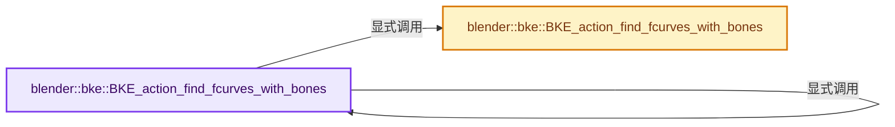
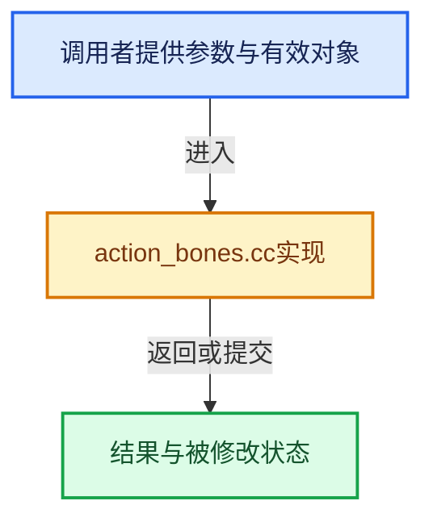

# 实现依赖专题：source/blender/blenkernel/intern/action_bones.cc

[实现依赖导航](../../README.md) · [符号索引](../../../00-课程指南/02-源码与提交索引/符号依赖与实现索引.md)

本专题从正文实际调用进入，集中保存共享实现。函数有稳定锚点，可从调用处直接跳到对应完整函数；递归与互相调用通过回链组织。

## 本文件的实现关系






## 完整成员与函数实现

<a id="f-9745e4376c100546"></a>

### `blender::bke::BKE_action_find_fcurves_with_bones`

实现位置：[source/blender/blenkernel/intern/action_bones.cc](../../../../../../../source/blender/blenkernel/intern/action_bones.cc) · L21—L30。

接口参数：

- `bAction *action`
- `const animrig::slot_handle_t slot_handle`
- `FoundFCurveCallback callback`

**教学注释版**

<!-- annotated:293a2115a16a9f -->

```cpp
void BKE_action_find_fcurves_with_bones(bAction *action,
                                        const animrig::slot_handle_t slot_handle,
                                        FoundFCurveCallback callback)
{
  auto const_callback = [&](const FCurve *fcurve, const char *bone_name) {
    callback(const_cast<FCurve *>(fcurve), bone_name);
  };
  BKE_action_find_fcurves_with_bones(
      const_cast<const bAction *>(action), slot_handle, const_callback);
}
```

<details>
<summary>核对原始源码：source/blender/blenkernel/intern/action_bones.cc · L21—L30</summary>

<!-- original:293a2115a16a9f:source/blender/blenkernel/intern/action_bones.cc:21:30 -->

```cpp
void BKE_action_find_fcurves_with_bones(bAction *action,
                                        const animrig::slot_handle_t slot_handle,
                                        FoundFCurveCallback callback)
{
  auto const_callback = [&](const FCurve *fcurve, const char *bone_name) {
    callback(const_cast<FCurve *>(fcurve), bone_name);
  };
  BKE_action_find_fcurves_with_bones(
      const_cast<const bAction *>(action), slot_handle, const_callback);
}
```

</details>

**继续追踪实现**

- `callback` → [调用协议](../../../00-课程指南/01-路线与规范/模板宏与动态分派协议.md)：局部可调用对象，须结合其初始化与捕获环境。调用位置L26。
- `BKE_action_find_fcurves_with_bones` → [blender::bke::BKE_action_find_fcurves_with_bones · L21](action_bones.cc.md#f-9745e4376c100546)；[blender::bke::BKE_action_find_fcurves_with_bones · L32](action_bones.cc.md#f-da05aab12ef96e57)。同名重载需按实参类型选择。

<a id="f-da05aab12ef96e57"></a>

### `blender::bke::BKE_action_find_fcurves_with_bones`

实现位置：[source/blender/blenkernel/intern/action_bones.cc](../../../../../../../source/blender/blenkernel/intern/action_bones.cc) · L32—L45。

接口参数：

- `const bAction *action`
- `const animrig::slot_handle_t slot_handle`
- `FoundFCurveCallbackConst callback`

**教学注释版**

<!-- annotated:000cf1e055423e -->

```cpp
void BKE_action_find_fcurves_with_bones(const bAction *action,
                                        const animrig::slot_handle_t slot_handle,
                                        FoundFCurveCallbackConst callback)
{
  for (const FCurve *fcu : animrig::fcurves_for_action_slot(action->wrap(), slot_handle)) {
    char bone_name[MAXBONENAME];
    if (!BLI_str_quoted_substr(
            fcu->rna_path().c_str(), "pose.bones[", bone_name, sizeof(bone_name)))
    {
      continue;
    }
    callback(fcu, bone_name);
  }
}
```

<details>
<summary>核对原始源码：source/blender/blenkernel/intern/action_bones.cc · L32—L45</summary>

<!-- original:000cf1e055423e:source/blender/blenkernel/intern/action_bones.cc:32:45 -->

```cpp
void BKE_action_find_fcurves_with_bones(const bAction *action,
                                        const animrig::slot_handle_t slot_handle,
                                        FoundFCurveCallbackConst callback)
{
  for (const FCurve *fcu : animrig::fcurves_for_action_slot(action->wrap(), slot_handle)) {
    char bone_name[MAXBONENAME];
    if (!BLI_str_quoted_substr(
            fcu->rna_path().c_str(), "pose.bones[", bone_name, sizeof(bone_name)))
    {
      continue;
    }
    callback(fcu, bone_name);
  }
}
```

</details>

**继续追踪实现**

- `animrig::fcurves_for_action_slot` → [blender::animrig::fcurves_for_action_slot · L2544](../../08-其他Blender模块/animrig/intern/action.cc.md#f-78c71d42065fc00f)；[blender::animrig::fcurves_for_action_slot · L2554](../../08-其他Blender模块/animrig/intern/action.cc.md#f-c1c45d131d9cf075)。同名重载需按实参类型选择。
- `action->wrap` → [blender::bAction::wrap · L1929](../../08-其他Blender模块/animrig/ANIM_action.hh.md#f-f049614274fd7a45)；[blender::bAction::wrap · L1933](../../08-其他Blender模块/animrig/ANIM_action.hh.md#f-2d697d1983fd282f)。同名重载需按实参类型选择。
- `BLI_str_quoted_substr` → [blender::BLI_str_quoted_substr · L527](../../01-BLI基础库/intern/string.cc.md#f-1f02ab716623972c)。
- `fcu->rna_path().c_str` → [调用协议](../../../00-课程指南/01-路线与规范/模板宏与动态分派协议.md)：接收对象类型依赖auto、返回值或模板实例；不按同名猜测目标。调用位置L39。
- `fcu->rna_path` → [调用协议](../../../00-课程指南/01-路线与规范/模板宏与动态分派协议.md)：接收对象类型依赖auto、返回值或模板实例；不按同名猜测目标。调用位置L39。
- `callback` → [调用协议](../../../00-课程指南/01-路线与规范/模板宏与动态分派协议.md)：局部可调用对象，须结合其初始化与捕获环境。调用位置L43。
