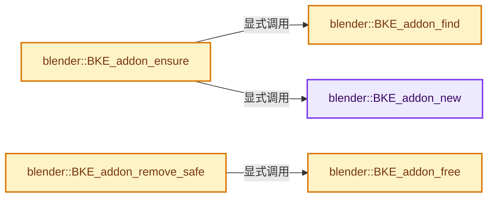
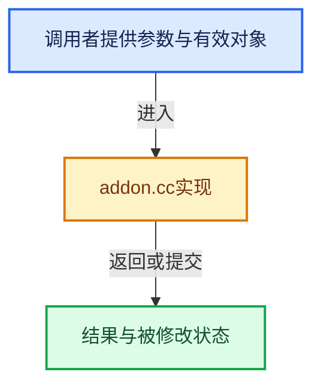

# 实现依赖专题：source/blender/blenkernel/intern/addon.cc

[实现依赖导航](../../README.md) · [符号索引](../../../00-课程指南/02-源码与提交索引/符号依赖与实现索引.md)

本专题从正文实际调用进入，集中保存共享实现。函数有稳定锚点，可从调用处直接跳到对应完整函数；递归与互相调用通过回链组织。

## 本文件的实现关系






## 完整成员与函数实现

<a id="f-e868503b83108f35"></a>

### `blender::BKE_addon_new`

实现位置：[source/blender/blenkernel/intern/addon.cc](../../../../../../../source/blender/blenkernel/intern/addon.cc) · L36—L40。

**教学注释版**

<!-- annotated:9155c973f892c0 -->

```cpp
bAddon *BKE_addon_new()
{
  bAddon *addon = MEM_new<bAddon>("bAddon");
  return addon;
}
```

<details>
<summary>核对原始源码：source/blender/blenkernel/intern/addon.cc · L36—L40</summary>

<!-- original:9155c973f892c0:source/blender/blenkernel/intern/addon.cc:36:40 -->

```cpp
bAddon *BKE_addon_new()
{
  bAddon *addon = MEM_new<bAddon>("bAddon");
  return addon;
}
```

</details>

**结果出口**

- `return addon;`

**继续追踪实现**

- `MEM_new<bAddon>` → [MEM_new · L351](../../07-Intern运行时与平台/guardedalloc/MEM_guardedalloc.h.md#f-115f9b6784f89912)。

<a id="f-ff21101e92676531"></a>

### `blender::BKE_addon_find`

实现位置：[source/blender/blenkernel/intern/addon.cc](../../../../../../../source/blender/blenkernel/intern/addon.cc) · L42—L45。

接口参数：

- `const ListBaseT<bAddon> *addon_list`
- `const char *module`

**教学注释版**

<!-- annotated:1977bbc8761a0d -->

```cpp
bAddon *BKE_addon_find(const ListBaseT<bAddon> *addon_list, const char *module)
{
  return static_cast<bAddon *>(BLI_findstring(addon_list, module, offsetof(bAddon, module)));
}
```

<details>
<summary>核对原始源码：source/blender/blenkernel/intern/addon.cc · L42—L45</summary>

<!-- original:1977bbc8761a0d:source/blender/blenkernel/intern/addon.cc:42:45 -->

```cpp
bAddon *BKE_addon_find(const ListBaseT<bAddon> *addon_list, const char *module)
{
  return static_cast<bAddon *>(BLI_findstring(addon_list, module, offsetof(bAddon, module)));
}
```

</details>

**结果出口**

- `return static_cast<bAddon *>(BLI_findstring(addon_list, module, offsetof(bAddon, module)));`

**继续追踪实现**

- `BLI_findstring` → [blender::BLI_findstring · L615](../../01-BLI基础库/intern/listbase.cc.md#f-d913b13b2651348e)。

<a id="f-86483ee0da01ac47"></a>

### `blender::BKE_addon_ensure`

实现位置：[source/blender/blenkernel/intern/addon.cc](../../../../../../../source/blender/blenkernel/intern/addon.cc) · L47—L56。

接口参数：

- `ListBaseT<bAddon> *addon_list`
- `const char *module`

**教学注释版**

<!-- annotated:a0b0b32a404fb8 -->

```cpp
bAddon *BKE_addon_ensure(ListBaseT<bAddon> *addon_list, const char *module)
{
  bAddon *addon = BKE_addon_find(addon_list, module);
  if (addon == nullptr) {
    addon = BKE_addon_new();
    STRNCPY(addon->module, module);
    BLI_addtail(addon_list, addon);
  }
  return addon;
}
```

<details>
<summary>核对原始源码：source/blender/blenkernel/intern/addon.cc · L47—L56</summary>

<!-- original:a0b0b32a404fb8:source/blender/blenkernel/intern/addon.cc:47:56 -->

```cpp
bAddon *BKE_addon_ensure(ListBaseT<bAddon> *addon_list, const char *module)
{
  bAddon *addon = BKE_addon_find(addon_list, module);
  if (addon == nullptr) {
    addon = BKE_addon_new();
    STRNCPY(addon->module, module);
    BLI_addtail(addon_list, addon);
  }
  return addon;
}
```

</details>

**沿实际写入检查状态**

- `addon = BKE_addon_new();`

**结果出口**

- `return addon;`

**继续追踪实现**

- `BKE_addon_find` → [blender::BKE_addon_find · L42](addon.cc.md#f-ff21101e92676531)。
- `BKE_addon_new` → [blender::BKE_addon_new · L36](addon.cc.md#f-e868503b83108f35)。
- `STRNCPY` → [blender::STRNCPY · L690](../../01-BLI基础库/BLI_string.hh.md#f-6b2d861724026be6)。
- `BLI_addtail` → [blender::BLI_addtail · L118](../../01-BLI基础库/intern/listbase.cc.md#f-4fb027713fa3115b)。

<a id="f-8cd806282ca680eb"></a>

### `blender::BKE_addon_remove_safe`

实现位置：[source/blender/blenkernel/intern/addon.cc](../../../../../../../source/blender/blenkernel/intern/addon.cc) · L58—L68。

接口参数：

- `ListBaseT<bAddon> *addon_list`
- `const char *module`

**教学注释版**

<!-- annotated:d2d518f7c6be20 -->

```cpp
bool BKE_addon_remove_safe(ListBaseT<bAddon> *addon_list, const char *module)
{
  bAddon *addon = static_cast<bAddon *>(
      BLI_findstring(addon_list, module, offsetof(bAddon, module)));
  if (addon) {
    BLI_remlink(addon_list, addon);
    BKE_addon_free(addon);
    return true;
  }
  return false;
}
```

<details>
<summary>核对原始源码：source/blender/blenkernel/intern/addon.cc · L58—L68</summary>

<!-- original:d2d518f7c6be20:source/blender/blenkernel/intern/addon.cc:58:68 -->

```cpp
bool BKE_addon_remove_safe(ListBaseT<bAddon> *addon_list, const char *module)
{
  bAddon *addon = static_cast<bAddon *>(
      BLI_findstring(addon_list, module, offsetof(bAddon, module)));
  if (addon) {
    BLI_remlink(addon_list, addon);
    BKE_addon_free(addon);
    return true;
  }
  return false;
}
```

</details>

**结果出口**

- `return true;`
- `return false;`

**继续追踪实现**

- `BLI_findstring` → [blender::BLI_findstring · L615](../../01-BLI基础库/intern/listbase.cc.md#f-d913b13b2651348e)。
- `BLI_remlink` → [blender::BLI_remlink · L138](../../01-BLI基础库/intern/listbase.cc.md#f-120d80f281ca4cb7)。
- `BKE_addon_free` → [blender::BKE_addon_free · L70](addon.cc.md#f-e3cb7b1af75ca146)。

<a id="f-e3cb7b1af75ca146"></a>

### `blender::BKE_addon_free`

实现位置：[source/blender/blenkernel/intern/addon.cc](../../../../../../../source/blender/blenkernel/intern/addon.cc) · L70—L76。

接口参数：

- `bAddon *addon`

**教学注释版**

<!-- annotated:ff6dcd992ebbdc -->

```cpp
void BKE_addon_free(bAddon *addon)
{
  if (addon->prop) {
    IDP_FreeProperty(addon->prop);
  }
  MEM_delete(addon);
}
```

<details>
<summary>核对原始源码：source/blender/blenkernel/intern/addon.cc · L70—L76</summary>

<!-- original:ff6dcd992ebbdc:source/blender/blenkernel/intern/addon.cc:70:76 -->

```cpp
void BKE_addon_free(bAddon *addon)
{
  if (addon->prop) {
    IDP_FreeProperty(addon->prop);
  }
  MEM_delete(addon);
}
```

</details>

**继续追踪实现**

- `IDP_FreeProperty` → [blender::IDP_FreeProperty · L1403](idprop.cc.md#f-389134a630df1bed)。
- `MEM_delete` → [MEM_delete · L400](../../07-Intern运行时与平台/guardedalloc/MEM_guardedalloc.h.md#f-9049ffdd1682887c)。
