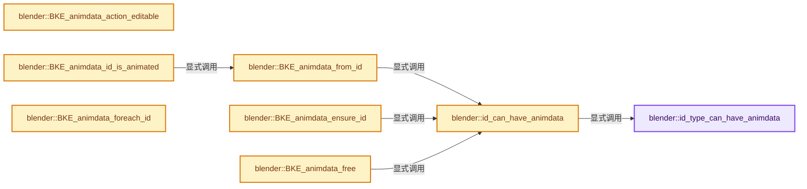
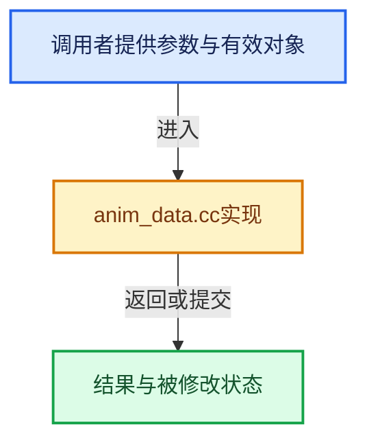

# 实现依赖专题：source/blender/blenkernel/intern/anim_data.cc

[实现依赖导航](../../README.md) · [符号索引](../../../00-课程指南/02-源码与提交索引/符号依赖与实现索引.md)

本专题从正文实际调用进入，集中保存共享实现。函数有稳定锚点，可从调用处直接跳到对应完整函数；递归与互相调用通过回链组织。

## 本文件的实现关系






## 完整成员与函数实现

<a id="f-817565962e9ceb86"></a>

### `blender::id_type_can_have_animdata`

实现位置：[source/blender/blenkernel/intern/anim_data.cc](../../../../../../../source/blender/blenkernel/intern/anim_data.cc) · L69—L76。

接口参数：

- `const short id_type`

**教学注释版**

<!-- annotated:bc211f841e9fe6 -->

```cpp
bool id_type_can_have_animdata(const short id_type)
{
  const IDTypeInfo *typeinfo = BKE_idtype_get_info_from_idcode(id_type);
  if (typeinfo != nullptr) {
    return (typeinfo->flags & IDTYPE_FLAGS_NO_ANIMDATA) == 0;
  }
  return false;
}
```

<details>
<summary>核对原始源码：source/blender/blenkernel/intern/anim_data.cc · L69—L76</summary>

<!-- original:bc211f841e9fe6:source/blender/blenkernel/intern/anim_data.cc:69:76 -->

```cpp
bool id_type_can_have_animdata(const short id_type)
{
  const IDTypeInfo *typeinfo = BKE_idtype_get_info_from_idcode(id_type);
  if (typeinfo != nullptr) {
    return (typeinfo->flags & IDTYPE_FLAGS_NO_ANIMDATA) == 0;
  }
  return false;
}
```

</details>

**结果出口**

- `return (typeinfo->flags & IDTYPE_FLAGS_NO_ANIMDATA) == 0;`
- `return false;`

**继续追踪实现**

- `BKE_idtype_get_info_from_idcode` → [blender::BKE_idtype_get_info_from_idcode · L227](idtype.cc.md#f-3cf440a8f8dbe459)。

<a id="f-006144b58a860d8d"></a>

### `blender::id_can_have_animdata`

实现位置：[source/blender/blenkernel/intern/anim_data.cc](../../../../../../../source/blender/blenkernel/intern/anim_data.cc) · L78—L91。

接口参数：

- `const ID *id`

**教学注释版**

<!-- annotated:7a254195d57cda -->

```cpp
bool id_can_have_animdata(const ID *id)
{
  /* sanity check */
  if (id == nullptr) {
    return false;
  }
  /* Placeholders IDs used during readfile process are just an ID struct, so they never have
   * animdata either. */
  if (BLO_readfile_id_runtime_tags(*id).is_link_placeholder) {
    return false;
  }

  return id_type_can_have_animdata(id->id_type());
}
```

<details>
<summary>核对原始源码：source/blender/blenkernel/intern/anim_data.cc · L78—L91</summary>

<!-- original:7a254195d57cda:source/blender/blenkernel/intern/anim_data.cc:78:91 -->

```cpp
bool id_can_have_animdata(const ID *id)
{
  /* sanity check */
  if (id == nullptr) {
    return false;
  }
  /* Placeholders IDs used during readfile process are just an ID struct, so they never have
   * animdata either. */
  if (BLO_readfile_id_runtime_tags(*id).is_link_placeholder) {
    return false;
  }

  return id_type_can_have_animdata(id->id_type());
}
```

</details>

**结果出口**

- `return false;`
- `return id_type_can_have_animdata(id->id_type());`

**继续追踪实现**

- `BLO_readfile_id_runtime_tags` → [BLO_readfile_id_runtime_tags · L2218](../../08-其他Blender模块/blenloader/intern/readfile.cc.md#f-3a41f7f7c43b577e)。
- `id_type_can_have_animdata` → [blender::id_type_can_have_animdata · L69](anim_data.cc.md#f-817565962e9ceb86)。
- `id->id_type` → [blender::ID::id_type · L544](../../08-其他Blender模块/makesdna/DNA_ID.h.md#f-ee8fe63f3948aa47)。

<a id="f-354e5421ff0a6c96"></a>

### `blender::BKE_animdata_from_id`

实现位置：[source/blender/blenkernel/intern/anim_data.cc](../../../../../../../source/blender/blenkernel/intern/anim_data.cc) · L93—L105。

接口参数：

- `const ID *id`

**教学注释版**

<!-- annotated:9be3cc5b0743c2 -->

```cpp
AnimData *BKE_animdata_from_id(const ID *id)
{
  /* In order for this to work, we assume that the #AnimData pointer is stored
   * immediately after the given ID-block in the struct, as per IdAdtTemplate. */

  /* Only some ID-blocks have this info for now, so we cast the types that do
   * to be of type IdAdtTemplate, and add the AnimData to it using the template. */
  if (id_can_have_animdata(id)) {
    const IdAdtTemplate *iat = reinterpret_cast<const IdAdtTemplate *>(id);
    return iat->adt;
  }
  return nullptr;
}
```

<details>
<summary>核对原始源码：source/blender/blenkernel/intern/anim_data.cc · L93—L105</summary>

<!-- original:9be3cc5b0743c2:source/blender/blenkernel/intern/anim_data.cc:93:105 -->

```cpp
AnimData *BKE_animdata_from_id(const ID *id)
{
  /* In order for this to work, we assume that the #AnimData pointer is stored
   * immediately after the given ID-block in the struct, as per IdAdtTemplate. */

  /* Only some ID-blocks have this info for now, so we cast the types that do
   * to be of type IdAdtTemplate, and add the AnimData to it using the template. */
  if (id_can_have_animdata(id)) {
    const IdAdtTemplate *iat = reinterpret_cast<const IdAdtTemplate *>(id);
    return iat->adt;
  }
  return nullptr;
}
```

</details>

**结果出口**

- `return iat->adt;`
- `return nullptr;`

**继续追踪实现**

- `id_can_have_animdata` → [blender::id_can_have_animdata · L78](anim_data.cc.md#f-006144b58a860d8d)。

<a id="f-03c23566cd3e0251"></a>

### `blender::BKE_animdata_ensure_id`

实现位置：[source/blender/blenkernel/intern/anim_data.cc](../../../../../../../source/blender/blenkernel/intern/anim_data.cc) · L107—L131。

接口参数：

- `ID *id`

**教学注释版**

<!-- annotated:b7e2cb8b4c2e53 -->

```cpp
AnimData *BKE_animdata_ensure_id(ID *id)
{
  /* In order for this to work, we assume that the #AnimData pointer is stored
   * immediately after the given ID-block in the struct, as per IdAdtTemplate. */

  /* Only some ID-blocks have this info for now, so we cast the types that do
   * to be of type IdAdtTemplate, and add the AnimData to it using the template. */
  if (id_can_have_animdata(id)) {
    IdAdtTemplate *iat = reinterpret_cast<IdAdtTemplate *>(id);

    /* check if there's already AnimData, in which case, don't add */
    if (iat->adt == nullptr) {
      AnimData *adt;

      /* add animdata */
      adt = iat->adt = MEM_new<AnimData>("AnimData");

      /* set default settings */
      adt->act_influence = 1.0f;
    }

    return iat->adt;
  }
  return nullptr;
}
```

<details>
<summary>核对原始源码：source/blender/blenkernel/intern/anim_data.cc · L107—L131</summary>

<!-- original:b7e2cb8b4c2e53:source/blender/blenkernel/intern/anim_data.cc:107:131 -->

```cpp
AnimData *BKE_animdata_ensure_id(ID *id)
{
  /* In order for this to work, we assume that the #AnimData pointer is stored
   * immediately after the given ID-block in the struct, as per IdAdtTemplate. */

  /* Only some ID-blocks have this info for now, so we cast the types that do
   * to be of type IdAdtTemplate, and add the AnimData to it using the template. */
  if (id_can_have_animdata(id)) {
    IdAdtTemplate *iat = reinterpret_cast<IdAdtTemplate *>(id);

    /* check if there's already AnimData, in which case, don't add */
    if (iat->adt == nullptr) {
      AnimData *adt;

      /* add animdata */
      adt = iat->adt = MEM_new<AnimData>("AnimData");

      /* set default settings */
      adt->act_influence = 1.0f;
    }

    return iat->adt;
  }
  return nullptr;
}
```

</details>

**沿实际写入检查状态**

- `adt = iat->adt = MEM_new<AnimData>("AnimData");`
- `adt->act_influence = 1.0f;`

**结果出口**

- `return iat->adt;`
- `return nullptr;`

**继续追踪实现**

- `id_can_have_animdata` → [blender::id_can_have_animdata · L78](anim_data.cc.md#f-006144b58a860d8d)。
- `MEM_new<AnimData>` → [MEM_new · L351](../../07-Intern运行时与平台/guardedalloc/MEM_guardedalloc.h.md#f-115f9b6784f89912)。

<a id="f-4fcf4926c4554418"></a>

### `blender::BKE_animdata_action_editable`

实现位置：[source/blender/blenkernel/intern/anim_data.cc](../../../../../../../source/blender/blenkernel/intern/anim_data.cc) · L164—L170。

接口参数：

- `const AnimData *adt`

**教学注释版**

<!-- annotated:bf6b8f91ae876a -->

```cpp
bool BKE_animdata_action_editable(const AnimData *adt)
{
  /* Active action is only editable when it is not a tweaking strip. */
  const bool is_tweaking_strip = (adt->flag & ADT_NLA_EDIT_ON) || adt->actstrip != nullptr ||
                                 adt->tmpact != nullptr;
  return !is_tweaking_strip;
}
```

<details>
<summary>核对原始源码：source/blender/blenkernel/intern/anim_data.cc · L164—L170</summary>

<!-- original:bf6b8f91ae876a:source/blender/blenkernel/intern/anim_data.cc:164:170 -->

```cpp
bool BKE_animdata_action_editable(const AnimData *adt)
{
  /* Active action is only editable when it is not a tweaking strip. */
  const bool is_tweaking_strip = (adt->flag & ADT_NLA_EDIT_ON) || adt->actstrip != nullptr ||
                                 adt->tmpact != nullptr;
  return !is_tweaking_strip;
}
```

</details>

**结果出口**

- `return !is_tweaking_strip;`

**继续追踪实现**

本实现没有需要继续展开的显式调用；检查返回表达式、对象转换和调用者前置条件。

<a id="f-eae6096ee0f51e92"></a>

### `blender::BKE_animdata_free`

实现位置：[source/blender/blenkernel/intern/anim_data.cc](../../../../../../../source/blender/blenkernel/intern/anim_data.cc) · L174—L222。

接口参数：

- `ID *id`
- `const bool do_id_user`

**教学注释版**

<!-- annotated:8a589b5e5096b2 -->

```cpp
void BKE_animdata_free(ID *id, const bool do_id_user)
{
  if (!id_can_have_animdata(id)) {
    return;
  }

  IdAdtTemplate *iat = reinterpret_cast<IdAdtTemplate *>(id);
  AnimData *adt = iat->adt;
  if (!adt) {
    return;
  }

  if (do_id_user) {
    /* The ADT is going to be freed, which means that if it's in tweak mode, it'll have to exit
     * that first. Otherwise we cannot un-assign its Action. */
    BKE_nla_tweakmode_exit({*id, *adt});

    if (adt->action) {
      const bool unassign_ok = animrig::unassign_action(*id);
      BLI_assert_msg(unassign_ok,
                     "Expecting action un-assignment to always work when not in NLA tweak mode");
      UNUSED_VARS_NDEBUG(unassign_ok);
    }
    /* same goes for the temporarily displaced action */
    if (adt->tmpact) {
      /* This should never happen, as we _just_ exited tweak mode. */
      BLI_assert_unreachable();
      const bool unassign_ok = animrig::assign_tmpaction(nullptr, {*id, *adt});
      BLI_assert_msg(unassign_ok, "Expecting tmpaction un-assignment to always work");
      UNUSED_VARS_NDEBUG(unassign_ok);
    }
  }

  /* free nla data */
  BKE_nla_tracks_free(&adt->nla_tracks, do_id_user);

  /* free drivers - stored as a list of F-Curves */
  BKE_fcurves_free(&adt->drivers);

  /* free driver array cache */
  MEM_SAFE_DELETE(adt->driver_array);

  /* free overrides */
  /* TODO... */

  /* free animdata now */
  MEM_delete(adt);
  iat->adt = nullptr;
}
```

<details>
<summary>核对原始源码：source/blender/blenkernel/intern/anim_data.cc · L174—L222</summary>

<!-- original:8a589b5e5096b2:source/blender/blenkernel/intern/anim_data.cc:174:222 -->

```cpp
void BKE_animdata_free(ID *id, const bool do_id_user)
{
  if (!id_can_have_animdata(id)) {
    return;
  }

  IdAdtTemplate *iat = reinterpret_cast<IdAdtTemplate *>(id);
  AnimData *adt = iat->adt;
  if (!adt) {
    return;
  }

  if (do_id_user) {
    /* The ADT is going to be freed, which means that if it's in tweak mode, it'll have to exit
     * that first. Otherwise we cannot un-assign its Action. */
    BKE_nla_tweakmode_exit({*id, *adt});

    if (adt->action) {
      const bool unassign_ok = animrig::unassign_action(*id);
      BLI_assert_msg(unassign_ok,
                     "Expecting action un-assignment to always work when not in NLA tweak mode");
      UNUSED_VARS_NDEBUG(unassign_ok);
    }
    /* same goes for the temporarily displaced action */
    if (adt->tmpact) {
      /* This should never happen, as we _just_ exited tweak mode. */
      BLI_assert_unreachable();
      const bool unassign_ok = animrig::assign_tmpaction(nullptr, {*id, *adt});
      BLI_assert_msg(unassign_ok, "Expecting tmpaction un-assignment to always work");
      UNUSED_VARS_NDEBUG(unassign_ok);
    }
  }

  /* free nla data */
  BKE_nla_tracks_free(&adt->nla_tracks, do_id_user);

  /* free drivers - stored as a list of F-Curves */
  BKE_fcurves_free(&adt->drivers);

  /* free driver array cache */
  MEM_SAFE_DELETE(adt->driver_array);

  /* free overrides */
  /* TODO... */

  /* free animdata now */
  MEM_delete(adt);
  iat->adt = nullptr;
}
```

</details>

**沿实际写入检查状态**

- `iat->adt = nullptr;`

**继续追踪实现**

- `id_can_have_animdata` → [blender::id_can_have_animdata · L78](anim_data.cc.md#f-006144b58a860d8d)。
- `BKE_nla_tweakmode_exit` → [blender::BKE_nla_tweakmode_exit · L2510](nla.cc.md#f-ac7712242983a12d)。
- `animrig::unassign_action` → [blender::animrig::unassign_action · L1199](../../08-其他Blender模块/animrig/intern/action.cc.md#f-ac10c2500015ac91)；[blender::animrig::unassign_action · L1204](../../08-其他Blender模块/animrig/intern/action.cc.md#f-1ec86bbacd32d6ad)。同名重载需按实参类型选择。
- `BLI_assert_msg` → [BLI_assert_msg · L55](../../01-BLI基础库/BLI_assert.hh.md#m-695eed20dceb)；[BLI_assert_msg · L64](../../01-BLI基础库/BLI_assert.hh.md#m-7de5563de4db)。宏定义由构建条件选择。
- `UNUSED_VARS_NDEBUG` → [UNUSED_VARS_NDEBUG · L526](../../01-BLI基础库/BLI_utildefines.hh.md#m-fea439f7d366)；[UNUSED_VARS_NDEBUG · L528](../../01-BLI基础库/BLI_utildefines.hh.md#m-a8f8cfac06c0)。宏定义由构建条件选择。
- `BLI_assert_unreachable` → [BLI_assert_unreachable · L77](../../01-BLI基础库/BLI_assert.hh.md#m-7a2d91a67d8e)。宏定义由构建条件选择。
- `animrig::assign_tmpaction` → [blender::animrig::assign_tmpaction · L1190](../../08-其他Blender模块/animrig/intern/action.cc.md#f-f9f6b9697fb263e1)。
- `BKE_nla_tracks_free` → [blender::BKE_nla_tracks_free · L128](nla.cc.md#f-078f449854048a5a)。
- `BKE_fcurves_free` → [blender::BKE_fcurves_free · L101](fcurve.cc.md#f-8d7f34aa906ce734)。
- `MEM_SAFE_DELETE` → [MEM_SAFE_DELETE · L436](../../07-Intern运行时与平台/guardedalloc/MEM_guardedalloc.h.md#m-eadb3bc5b902)。宏定义由构建条件选择。
- `MEM_delete` → [MEM_delete · L400](../../07-Intern运行时与平台/guardedalloc/MEM_guardedalloc.h.md#f-9049ffdd1682887c)。

<a id="f-45ca839356150d4f"></a>

### `blender::BKE_animdata_id_is_animated`

实现位置：[source/blender/blenkernel/intern/anim_data.cc](../../../../../../../source/blender/blenkernel/intern/anim_data.cc) · L224—L243。

接口参数：

- `const ID *id`

**教学注释版**

<!-- annotated:16ae9124155a49 -->

```cpp
bool BKE_animdata_id_is_animated(const ID *id)
{
  if (id == nullptr) {
    return false;
  }

  const AnimData *adt = BKE_animdata_from_id(const_cast<ID *>(id));
  if (adt == nullptr) {
    return false;
  }

  if (adt->action) {
    const animrig::Action &action = adt->action->wrap();
    if (action.is_slot_animated(adt->slot_handle)) {
      return true;
    }
  }

  return !adt->drivers.is_empty() || !adt->nla_tracks.is_empty() || !adt->overrides.is_empty();
}
```

<details>
<summary>核对原始源码：source/blender/blenkernel/intern/anim_data.cc · L224—L243</summary>

<!-- original:16ae9124155a49:source/blender/blenkernel/intern/anim_data.cc:224:243 -->

```cpp
bool BKE_animdata_id_is_animated(const ID *id)
{
  if (id == nullptr) {
    return false;
  }

  const AnimData *adt = BKE_animdata_from_id(const_cast<ID *>(id));
  if (adt == nullptr) {
    return false;
  }

  if (adt->action) {
    const animrig::Action &action = adt->action->wrap();
    if (action.is_slot_animated(adt->slot_handle)) {
      return true;
    }
  }

  return !adt->drivers.is_empty() || !adt->nla_tracks.is_empty() || !adt->overrides.is_empty();
}
```

</details>

**结果出口**

- `return false;`
- `return true;`
- `return !adt->drivers.is_empty() || !adt->nla_tracks.is_empty() || !adt->overrides.is_empty();`

**继续追踪实现**

- `BKE_animdata_from_id` → [blender::BKE_animdata_from_id · L93](anim_data.cc.md#f-354e5421ff0a6c96)。
- `adt->action->wrap` → [调用协议](../../../00-课程指南/01-路线与规范/模板宏与动态分派协议.md)：接收对象类型依赖auto、返回值或模板实例；不按同名猜测目标。调用位置L236。
- `action.is_slot_animated` → [blender::animrig::Action::is_slot_animated · L614](../../08-其他Blender模块/animrig/intern/action.cc.md#f-f46d69f40a7b4496)。
- `adt->drivers.is_empty` → [调用协议](../../../00-课程指南/01-路线与规范/模板宏与动态分派协议.md)：接收对象类型依赖auto、返回值或模板实例；不按同名猜测目标。调用位置L242。
- `adt->nla_tracks.is_empty` → [调用协议](../../../00-课程指南/01-路线与规范/模板宏与动态分派协议.md)：接收对象类型依赖auto、返回值或模板实例；不按同名猜测目标。调用位置L242。
- `adt->overrides.is_empty` → [调用协议](../../../00-课程指南/01-路线与规范/模板宏与动态分派协议.md)：接收对象类型依赖auto、返回值或模板实例；不按同名猜测目标。调用位置L242。

<a id="f-5f9e5bc599257332"></a>

### `blender::BKE_animdata_foreach_id`

实现位置：[source/blender/blenkernel/intern/anim_data.cc](../../../../../../../source/blender/blenkernel/intern/anim_data.cc) · L245—L259。

接口参数：

- `AnimData *adt`
- `LibraryForeachIDData *data`

**教学注释版**

<!-- annotated:5d3cc0fe7daba1 -->

```cpp
void BKE_animdata_foreach_id(AnimData *adt, LibraryForeachIDData *data)
{
  for (FCurve &fcu : adt->drivers) {
    BKE_LIB_FOREACHID_PROCESS_FUNCTION_CALL(data, BKE_fcurve_foreach_id(&fcu, data));
  }

  BKE_LIB_FOREACHID_PROCESS_IDSUPER(data, adt->action, IDWALK_CB_USER);
  BKE_LIB_FOREACHID_PROCESS_IDSUPER(data, adt->tmpact, IDWALK_CB_USER);

  for (NlaTrack &nla_track : adt->nla_tracks) {
    for (NlaStrip &nla_strip : nla_track.strips) {
      BKE_nla_strip_foreach_id(&nla_strip, data);
    }
  }
}
```

<details>
<summary>核对原始源码：source/blender/blenkernel/intern/anim_data.cc · L245—L259</summary>

<!-- original:5d3cc0fe7daba1:source/blender/blenkernel/intern/anim_data.cc:245:259 -->

```cpp
void BKE_animdata_foreach_id(AnimData *adt, LibraryForeachIDData *data)
{
  for (FCurve &fcu : adt->drivers) {
    BKE_LIB_FOREACHID_PROCESS_FUNCTION_CALL(data, BKE_fcurve_foreach_id(&fcu, data));
  }

  BKE_LIB_FOREACHID_PROCESS_IDSUPER(data, adt->action, IDWALK_CB_USER);
  BKE_LIB_FOREACHID_PROCESS_IDSUPER(data, adt->tmpact, IDWALK_CB_USER);

  for (NlaTrack &nla_track : adt->nla_tracks) {
    for (NlaStrip &nla_strip : nla_track.strips) {
      BKE_nla_strip_foreach_id(&nla_strip, data);
    }
  }
}
```

</details>

**继续追踪实现**

- `BKE_LIB_FOREACHID_PROCESS_FUNCTION_CALL` → [BKE_LIB_FOREACHID_PROCESS_FUNCTION_CALL · L299](../BKE_lib_query.hh.md#m-c45df84f7bf3)。宏定义由构建条件选择。
- `BKE_fcurve_foreach_id` → [blender::BKE_fcurve_foreach_id · L229](fcurve.cc.md#f-072b1b2e8dc76f61)。
- `BKE_LIB_FOREACHID_PROCESS_IDSUPER` → [BKE_LIB_FOREACHID_PROCESS_IDSUPER · L293](../BKE_lib_query.hh.md#m-1b059b49d6cb)。宏定义由构建条件选择。
- `BKE_nla_strip_foreach_id` → [blender::BKE_nla_strip_foreach_id · L658](nla.cc.md#f-897dfadc5ac4e61f)。

<a id="f-58f11f46cdc83f44"></a>

### `blender::BKE_animdata_copy_in_lib`

实现位置：[source/blender/blenkernel/intern/anim_data.cc](../../../../../../../source/blender/blenkernel/intern/anim_data.cc) · L263—L344。

接口参数：

- `Main *bmain`
- `std::optional<Library *> owner_library`
- `AnimData *adt`
- `const int flag`

**教学注释版**

<!-- annotated:b0342c21f4bfe2 -->

```cpp
AnimData *BKE_animdata_copy_in_lib(Main *bmain,
                                   std::optional<Library *> owner_library,
                                   AnimData *adt,
                                   const int flag)
{
  AnimData *dadt;

  const bool do_action = (flag & LIB_ID_COPY_ACTIONS) != 0 && (flag & LIB_ID_CREATE_NO_MAIN) == 0;
  const bool do_id_user = (flag & LIB_ID_CREATE_NO_USER_REFCOUNT) == 0;

  /* sanity check before duplicating struct */
  if (adt == nullptr) {
    return nullptr;
  }
  dadt = MEM_dupalloc(adt);

  /* make a copy of action - at worst, user has to delete copies... */
  if (do_action) {
    /* Recursive copy of 'real' IDs is a bit hairy. Even if do not want to deal with user-count
     * when copying ID's data itself, we still need to do so with sub-IDs, since those will not be
     * handled by later 'update user-counts of used IDs' code as used e.g. at end of
     * #BKE_id_copy_ex().
     * So in case we do copy the ID and its sub-IDs in bmain, silence the 'no user-count' flag for
     * the sub-IDs copying.
     * NOTE: This is a bit weak, as usually when it comes to recursive ID copy. Should work for
     * now, but we may have to revisit this at some point and add a proper extra flag to deal with
     * that situation. Or refactor completely the way we handle such recursion, by flattening it
     * e.g. */
    const int id_copy_flag = (flag & LIB_ID_CREATE_NO_MAIN) == 0 ?
                                 flag & ~LIB_ID_CREATE_NO_USER_REFCOUNT :
                                 flag;
    BLI_assert(bmain != nullptr);
    BLI_assert(dadt->action == nullptr || dadt->action != dadt->tmpact);
    dadt->action = reinterpret_cast<bAction *>(
        BKE_id_copy_in_lib(bmain,
                           owner_library,
                           reinterpret_cast<ID *>(dadt->action),
                           std::nullopt,
                           nullptr,
                           id_copy_flag));
    dadt->tmpact = reinterpret_cast<bAction *>(
        BKE_id_copy_in_lib(bmain,
                           owner_library,
                           reinterpret_cast<ID *>(dadt->tmpact),
                           std::nullopt,
                           nullptr,
                           id_copy_flag));
  }
  else if (do_id_user) {
    id_us_plus(id_cast<ID *>(dadt->action));
    id_us_plus(id_cast<ID *>(dadt->tmpact));
  }

  /* duplicate NLA data */
  BKE_nla_tracks_copy_from_adt(bmain, dadt, adt, flag);

  /* duplicate drivers (F-Curves) */
  BKE_fcurves_copy(&dadt->drivers, &adt->drivers);
  dadt->driver_array = nullptr;

  /* don't copy overrides */
  dadt->overrides.clear_no_delete();

  const bool is_main = (flag & LIB_ID_CREATE_NO_MAIN) == 0;
  if (is_main) {
    /* Action references were changed, so the Slot-to-user map is incomplete now. Only necessary
     * when this happens in the main database though, as the user cache only tracks original IDs,
     * not evaluated copies.
     *
     * This function does not have access to the animated ID, so it cannot just add that ID to the
     * slot's users, hence the invalidation of the users map.
     *
     * TODO: refactor to pass the owner ID to this function, and just add it to the Slot's
     * users. */
    if (bmain) {
      animrig::Slot::users_invalidate(*bmain);
    }
  }

  /* return */
  return dadt;
}
```

<details>
<summary>核对原始源码：source/blender/blenkernel/intern/anim_data.cc · L263—L344</summary>

<!-- original:b0342c21f4bfe2:source/blender/blenkernel/intern/anim_data.cc:263:344 -->

```cpp
AnimData *BKE_animdata_copy_in_lib(Main *bmain,
                                   std::optional<Library *> owner_library,
                                   AnimData *adt,
                                   const int flag)
{
  AnimData *dadt;

  const bool do_action = (flag & LIB_ID_COPY_ACTIONS) != 0 && (flag & LIB_ID_CREATE_NO_MAIN) == 0;
  const bool do_id_user = (flag & LIB_ID_CREATE_NO_USER_REFCOUNT) == 0;

  /* sanity check before duplicating struct */
  if (adt == nullptr) {
    return nullptr;
  }
  dadt = MEM_dupalloc(adt);

  /* make a copy of action - at worst, user has to delete copies... */
  if (do_action) {
    /* Recursive copy of 'real' IDs is a bit hairy. Even if do not want to deal with user-count
     * when copying ID's data itself, we still need to do so with sub-IDs, since those will not be
     * handled by later 'update user-counts of used IDs' code as used e.g. at end of
     * #BKE_id_copy_ex().
     * So in case we do copy the ID and its sub-IDs in bmain, silence the 'no user-count' flag for
     * the sub-IDs copying.
     * NOTE: This is a bit weak, as usually when it comes to recursive ID copy. Should work for
     * now, but we may have to revisit this at some point and add a proper extra flag to deal with
     * that situation. Or refactor completely the way we handle such recursion, by flattening it
     * e.g. */
    const int id_copy_flag = (flag & LIB_ID_CREATE_NO_MAIN) == 0 ?
                                 flag & ~LIB_ID_CREATE_NO_USER_REFCOUNT :
                                 flag;
    BLI_assert(bmain != nullptr);
    BLI_assert(dadt->action == nullptr || dadt->action != dadt->tmpact);
    dadt->action = reinterpret_cast<bAction *>(
        BKE_id_copy_in_lib(bmain,
                           owner_library,
                           reinterpret_cast<ID *>(dadt->action),
                           std::nullopt,
                           nullptr,
                           id_copy_flag));
    dadt->tmpact = reinterpret_cast<bAction *>(
        BKE_id_copy_in_lib(bmain,
                           owner_library,
                           reinterpret_cast<ID *>(dadt->tmpact),
                           std::nullopt,
                           nullptr,
                           id_copy_flag));
  }
  else if (do_id_user) {
    id_us_plus(id_cast<ID *>(dadt->action));
    id_us_plus(id_cast<ID *>(dadt->tmpact));
  }

  /* duplicate NLA data */
  BKE_nla_tracks_copy_from_adt(bmain, dadt, adt, flag);

  /* duplicate drivers (F-Curves) */
  BKE_fcurves_copy(&dadt->drivers, &adt->drivers);
  dadt->driver_array = nullptr;

  /* don't copy overrides */
  dadt->overrides.clear_no_delete();

  const bool is_main = (flag & LIB_ID_CREATE_NO_MAIN) == 0;
  if (is_main) {
    /* Action references were changed, so the Slot-to-user map is incomplete now. Only necessary
     * when this happens in the main database though, as the user cache only tracks original IDs,
     * not evaluated copies.
     *
     * This function does not have access to the animated ID, so it cannot just add that ID to the
     * slot's users, hence the invalidation of the users map.
     *
     * TODO: refactor to pass the owner ID to this function, and just add it to the Slot's
     * users. */
    if (bmain) {
      animrig::Slot::users_invalidate(*bmain);
    }
  }

  /* return */
  return dadt;
}
```

</details>

**沿实际写入检查状态**

- `dadt = MEM_dupalloc(adt);`
- `dadt->action = reinterpret_cast<bAction *>(`
- `dadt->tmpact = reinterpret_cast<bAction *>(`
- `dadt->driver_array = nullptr;`

**结果出口**

- `return nullptr;`
- `return dadt;`

**继续追踪实现**

- `MEM_dupalloc` → [MEM_dupalloc · L627](../../07-Intern运行时与平台/guardedalloc/MEM_guardedalloc.h.md#f-78a72b71e3c57010)。
- `BLI_assert` → [BLI_assert · L48](../../01-BLI基础库/BLI_assert.hh.md#m-57a88495704d)；[BLI_assert · L63](../../01-BLI基础库/BLI_assert.hh.md#m-d07050020cb5)。宏定义由构建条件选择。
- `BKE_id_copy_in_lib` → [blender::BKE_id_copy_in_lib · L749](lib_id.cc.md#f-1ed32b930b96ebb2)。
- `id_us_plus` → [blender::id_us_plus · L433](lib_id.cc.md#f-1b90ef7608c4f32e)。
- `id_cast<ID *>` → [blender::id_cast · L1417](../../08-其他Blender模块/makesdna/DNA_ID.h.md#f-6c8ac6412850ac5a)。
- `BKE_nla_tracks_copy_from_adt` → [blender::BKE_nla_tracks_copy_from_adt · L343](nla.cc.md#f-e7d36139a58a9b13)。
- `BKE_fcurves_copy` → [blender::BKE_fcurves_copy · L157](fcurve.cc.md#f-63469f0f9cea1060)。
- `dadt->overrides.clear_no_delete` → [调用协议](../../../00-课程指南/01-路线与规范/模板宏与动态分派协议.md)：接收对象类型依赖auto、返回值或模板实例；不按同名猜测目标。调用位置L324。
- `animrig::Slot::users_invalidate` → [blender::animrig::Slot::users_invalidate · L1101](../../08-其他Blender模块/animrig/intern/action.cc.md#f-88a44aa4b574979d)。

<a id="f-1d420fedc018160d"></a>

### `blender::check_rna_path_is_valid`

实现位置：[source/blender/blenkernel/intern/anim_data.cc](../../../../../../../source/blender/blenkernel/intern/anim_data.cc) · L690—L700。

接口参数：

- `ID &owner_id`
- `const StringRefNull path`

**教学注释版**

<!-- annotated:60b5eecc7a64a2 -->

```cpp
static bool check_rna_path_is_valid(ID &owner_id, const StringRefNull path)
{
  PointerRNA ptr;
  PropertyRNA *prop = nullptr;

  /* make initial RNA pointer to start resolving from */
  PointerRNA id_ptr = RNA_id_pointer_create(&owner_id);

  /* try to resolve */
  return RNA_path_resolve_property(&id_ptr, path.data(), &ptr, &prop);
}
```

<details>
<summary>核对原始源码：source/blender/blenkernel/intern/anim_data.cc · L690—L700</summary>

<!-- original:60b5eecc7a64a2:source/blender/blenkernel/intern/anim_data.cc:690:700 -->

```cpp
static bool check_rna_path_is_valid(ID &owner_id, const StringRefNull path)
{
  PointerRNA ptr;
  PropertyRNA *prop = nullptr;

  /* make initial RNA pointer to start resolving from */
  PointerRNA id_ptr = RNA_id_pointer_create(&owner_id);

  /* try to resolve */
  return RNA_path_resolve_property(&id_ptr, path.data(), &ptr, &prop);
}
```

</details>

**结果出口**

- `return RNA_path_resolve_property(&id_ptr, path.data(), &ptr, &prop);`

**继续追踪实现**

- `RNA_id_pointer_create` → [blender::RNA_id_pointer_create · L170](../../08-其他Blender模块/makesrna/intern/rna_access.cc.md#f-d41a2d612ae3a7b6)。
- `RNA_path_resolve_property` → [blender::RNA_path_resolve_property · L575](../../08-其他Blender模块/makesrna/intern/rna_path.cc.md#f-9ccab9d4f53550b5)；[blender::RNA_path_resolve_property · L594](../../08-其他Blender模块/makesrna/intern/rna_path.cc.md#f-ea2ad4371e6f4b35)。同名重载需按实参类型选择。
- `path.data` → [blender::StringRefBase::data · L209](../../../01-基础容器与现代CPP/15-StringRef字符串视图.md#f-cced1a1ccd124155)。

<a id="f-dd8d114145e2efe3"></a>

### `blender::rna_path_rename_fix`

实现位置：[source/blender/blenkernel/intern/anim_data.cc](../../../../../../../source/blender/blenkernel/intern/anim_data.cc) · L708—L754。

接口参数：

- `ID &owner_id`
- `const StringRef prefix`
- `const StringRef old_infix`
- `const StringRef new_infix`
- `const StringRefNull old_path`
- `const bool verify_paths`

**教学注释版**

<!-- annotated:fd534ab059d50b -->

```cpp
static std::optional<std::string> rna_path_rename_fix(ID &owner_id,
                                                      const StringRef prefix,
                                                      const StringRef old_infix,
                                                      const StringRef new_infix,
                                                      const StringRefNull old_path,
                                                      const bool verify_paths)
{
  const int64_t prefix_offset = old_path.find(prefix);
  if (prefix_offset == StringRefBase::not_found) {
    return std::nullopt;
  }

  const int64_t old_infix_offset = old_path.find(old_infix);
  if (old_infix_offset == StringRefBase::not_found) {
    return std::nullopt;
  }

  /* Only modify paths if the prefix and old_name feature in the path,
   * and prefix occurs immediately before old_name. */
  if (prefix_offset + prefix.size() != old_infix_offset) {
    return std::nullopt;
  }

  /* Only modify a path that is invalid. */
  if (verify_paths && check_rna_path_is_valid(owner_id, old_path)) {
    return std::nullopt;
  }

  std::string modified_path;
  const int64_t postfix_offset = old_infix_offset + old_infix.size();

  /* Add the part of the string that goes up to the start of the prefix. */
  if (prefix_offset > 0) {
    modified_path.append(old_path.substr(0, prefix_offset));
  }

  modified_path.append(prefix);
  modified_path.append(new_infix);
  modified_path.append(old_path.substr(postfix_offset));

  /* If the new path is not valid, the renaming failed. */
  if (verify_paths && !check_rna_path_is_valid(owner_id, modified_path)) {
    return std::nullopt;
  }

  return modified_path;
}
```

<details>
<summary>核对原始源码：source/blender/blenkernel/intern/anim_data.cc · L708—L754</summary>

<!-- original:fd534ab059d50b:source/blender/blenkernel/intern/anim_data.cc:708:754 -->

```cpp
static std::optional<std::string> rna_path_rename_fix(ID &owner_id,
                                                      const StringRef prefix,
                                                      const StringRef old_infix,
                                                      const StringRef new_infix,
                                                      const StringRefNull old_path,
                                                      const bool verify_paths)
{
  const int64_t prefix_offset = old_path.find(prefix);
  if (prefix_offset == StringRefBase::not_found) {
    return std::nullopt;
  }

  const int64_t old_infix_offset = old_path.find(old_infix);
  if (old_infix_offset == StringRefBase::not_found) {
    return std::nullopt;
  }

  /* Only modify paths if the prefix and old_name feature in the path,
   * and prefix occurs immediately before old_name. */
  if (prefix_offset + prefix.size() != old_infix_offset) {
    return std::nullopt;
  }

  /* Only modify a path that is invalid. */
  if (verify_paths && check_rna_path_is_valid(owner_id, old_path)) {
    return std::nullopt;
  }

  std::string modified_path;
  const int64_t postfix_offset = old_infix_offset + old_infix.size();

  /* Add the part of the string that goes up to the start of the prefix. */
  if (prefix_offset > 0) {
    modified_path.append(old_path.substr(0, prefix_offset));
  }

  modified_path.append(prefix);
  modified_path.append(new_infix);
  modified_path.append(old_path.substr(postfix_offset));

  /* If the new path is not valid, the renaming failed. */
  if (verify_paths && !check_rna_path_is_valid(owner_id, modified_path)) {
    return std::nullopt;
  }

  return modified_path;
}
```

</details>

**结果出口**

- `return std::nullopt;`
- `return modified_path;`

**继续追踪实现**

- `old_path.find` → [blender::StringRefBase::find · L339](../../../01-基础容器与现代CPP/15-StringRef字符串视图.md#f-00f0ca38486d01b5)；[blender::StringRefBase::find · L345](../../../01-基础容器与现代CPP/15-StringRef字符串视图.md#f-824b468ce4cb47b7)。同名重载需按实参类型选择。
- `prefix.size` → [blender::MainAllIDsIterator::size · L1291](main.cc.md#f-520d1311c646452f)。
- `check_rna_path_is_valid` → [blender::check_rna_path_is_valid · L690](anim_data.cc.md#f-1d420fedc018160d)。
- `old_infix.size` → [blender::MainAllIDsIterator::size · L1291](main.cc.md#f-520d1311c646452f)。
- `modified_path.append` → [外部契约](https://eel.is/c++draft/)：这个边界按实际表达式及所属类型核对参数、返回值、寿命与失败行为。这里提供接口入口，不声称已解释该第三方版本的内部实现。
- `old_path.substr` → [blender::StringRefBase::substr · L303](../../../01-基础容器与现代CPP/15-StringRef字符串视图.md#f-cc876508a516d26d)。

<a id="f-b5c67153816e0ac6"></a>

### `blender::infix_to_name`

实现位置：[source/blender/blenkernel/intern/anim_data.cc](../../../../../../../source/blender/blenkernel/intern/anim_data.cc) · L759—L768。

接口参数：

- `const StringRef infix`

**教学注释版**

<!-- annotated:b0c6638723e8af -->

```cpp
static std::string infix_to_name(const StringRef infix)
{
  /* An empty name infix would be `[""]` so four characters. */
  BLI_assert(infix.size() >= 4);
  std::string unescaped;
  unescaped.resize(infix.size() - 4);
  size_t string_size = BLI_str_unescape(unescaped.data(), infix.data() + 2, unescaped.size());
  unescaped.resize(string_size);
  return unescaped;
}
```

<details>
<summary>核对原始源码：source/blender/blenkernel/intern/anim_data.cc · L759—L768</summary>

<!-- original:b0c6638723e8af:source/blender/blenkernel/intern/anim_data.cc:759:768 -->

```cpp
static std::string infix_to_name(const StringRef infix)
{
  /* An empty name infix would be `[""]` so four characters. */
  BLI_assert(infix.size() >= 4);
  std::string unescaped;
  unescaped.resize(infix.size() - 4);
  size_t string_size = BLI_str_unescape(unescaped.data(), infix.data() + 2, unescaped.size());
  unescaped.resize(string_size);
  return unescaped;
}
```

</details>

**结果出口**

- `return unescaped;`

**继续追踪实现**

- `BLI_assert` → [BLI_assert · L48](../../01-BLI基础库/BLI_assert.hh.md#m-57a88495704d)；[BLI_assert · L63](../../01-BLI基础库/BLI_assert.hh.md#m-d07050020cb5)。宏定义由构建条件选择。
- `infix.size` → [blender::MainAllIDsIterator::size · L1291](main.cc.md#f-520d1311c646452f)。
- `unescaped.resize` → [外部契约](https://eel.is/c++draft/)：这个边界按实际表达式及所属类型核对参数、返回值、寿命与失败行为。这里提供接口入口，不声称已解释该第三方版本的内部实现。
- `BLI_str_unescape` → [blender::BLI_str_unescape · L428](../../01-BLI基础库/intern/string.cc.md#f-15c9c9e5a203af4e)。
- `unescaped.data` → [外部契约](https://eel.is/c++draft/)：这个边界按实际表达式及所属类型核对参数、返回值、寿命与失败行为。这里提供接口入口，不声称已解释该第三方版本的内部实现。
- `infix.data` → [blender::StringRefBase::data · L209](../../../01-基础容器与现代CPP/15-StringRef字符串视图.md#f-cced1a1ccd124155)。
- `unescaped.size` → [外部契约](https://eel.is/c++draft/)：这个边界按实际表达式及所属类型核对参数、返回值、寿命与失败行为。这里提供接口入口，不声称已解释该第三方版本的内部实现。

<a id="f-e9d9106acf214e59"></a>

### `blender::fcurves_path_rename_fix`

实现位置：[source/blender/blenkernel/intern/anim_data.cc](../../../../../../../source/blender/blenkernel/intern/anim_data.cc) · L771—L820。

接口参数：

- `ID &owner_id`
- `const StringRef prefix`
- `const StringRef old_infix`
- `const StringRef new_infix`
- `const Span<FCurve *> curves`
- `const bool verify_paths`

**教学注释版**

<!-- annotated:3ca97b67e33096 -->

```cpp
static bool fcurves_path_rename_fix(ID &owner_id,
                                    const StringRef prefix,
                                    const StringRef old_infix,
                                    const StringRef new_infix,
                                    const Span<FCurve *> curves,
                                    const bool verify_paths)
{
  bool is_changed = false;
  /* We need to check every curve. */
  for (FCurve *fcu : curves) {
    if (fcu->rna_path().is_empty()) {
      continue;
    }
    /* Firstly, handle the F-Curve's own path. */
    std::optional<std::string> new_path = rna_path_rename_fix(
        owner_id, prefix, old_infix, new_infix, fcu->rna_path(), verify_paths);
    if (!new_path.has_value()) {
      continue;
    }
    fcu->rna_path_set(*new_path);
    is_changed = true;

    /* If the path changed and the FCurve is grouped, check if its group also needs renaming
     * (i.e. F-Curve is first of a bone's F-Curves;
     * hence renaming this should also trigger rename) */
    PointerRNA ptr = RNA_id_pointer_create(&owner_id);
    PointerRNA resolved_ptr;
    PropertyRNA *resolved_prop;
    if (!RNA_path_resolve(&ptr, fcu->rna_path().c_str(), &resolved_ptr, &resolved_prop)) {
      /* This can happen in versioning code. */
      continue;
    }
    /* If the path changed, make sure to update the fcurve flags to the new property type. See
     * #157234. We assume that the property type didn't change if the path is the same. */
    animrig::update_autoflags_fcurve_direct(fcu, RNA_property_type(resolved_prop));
    /* If the path changed and the F-Curve is grouped, check if its group also needs renaming
     * For pose bones, the group is named after it, hence it also needs a name update. */
    bActionGroup *agrp = fcu->grp;
    if (agrp && resolved_ptr.type == RNA_PoseBone) {
      /* Only update the name if the action group name was contained in the old infix. Since groups
       * can be renamed by the user we shouldn't override that data. */
      bPoseChannel *pchan = static_cast<bPoseChannel *>(resolved_ptr.data);
      std::string old_name = infix_to_name(old_infix);
      if (old_name == StringRefNull(agrp->name)) {
        STRNCPY_UTF8(agrp->name, pchan->name);
      }
    }
  }
  return is_changed;
}
```

<details>
<summary>核对原始源码：source/blender/blenkernel/intern/anim_data.cc · L771—L820</summary>

<!-- original:3ca97b67e33096:source/blender/blenkernel/intern/anim_data.cc:771:820 -->

```cpp
static bool fcurves_path_rename_fix(ID &owner_id,
                                    const StringRef prefix,
                                    const StringRef old_infix,
                                    const StringRef new_infix,
                                    const Span<FCurve *> curves,
                                    const bool verify_paths)
{
  bool is_changed = false;
  /* We need to check every curve. */
  for (FCurve *fcu : curves) {
    if (fcu->rna_path().is_empty()) {
      continue;
    }
    /* Firstly, handle the F-Curve's own path. */
    std::optional<std::string> new_path = rna_path_rename_fix(
        owner_id, prefix, old_infix, new_infix, fcu->rna_path(), verify_paths);
    if (!new_path.has_value()) {
      continue;
    }
    fcu->rna_path_set(*new_path);
    is_changed = true;

    /* If the path changed and the FCurve is grouped, check if its group also needs renaming
     * (i.e. F-Curve is first of a bone's F-Curves;
     * hence renaming this should also trigger rename) */
    PointerRNA ptr = RNA_id_pointer_create(&owner_id);
    PointerRNA resolved_ptr;
    PropertyRNA *resolved_prop;
    if (!RNA_path_resolve(&ptr, fcu->rna_path().c_str(), &resolved_ptr, &resolved_prop)) {
      /* This can happen in versioning code. */
      continue;
    }
    /* If the path changed, make sure to update the fcurve flags to the new property type. See
     * #157234. We assume that the property type didn't change if the path is the same. */
    animrig::update_autoflags_fcurve_direct(fcu, RNA_property_type(resolved_prop));
    /* If the path changed and the F-Curve is grouped, check if its group also needs renaming
     * For pose bones, the group is named after it, hence it also needs a name update. */
    bActionGroup *agrp = fcu->grp;
    if (agrp && resolved_ptr.type == RNA_PoseBone) {
      /* Only update the name if the action group name was contained in the old infix. Since groups
       * can be renamed by the user we shouldn't override that data. */
      bPoseChannel *pchan = static_cast<bPoseChannel *>(resolved_ptr.data);
      std::string old_name = infix_to_name(old_infix);
      if (old_name == StringRefNull(agrp->name)) {
        STRNCPY_UTF8(agrp->name, pchan->name);
      }
    }
  }
  return is_changed;
}
```

</details>

**沿实际写入检查状态**

- `is_changed = true;`

**结果出口**

- `return is_changed;`

**继续追踪实现**

- `fcu->rna_path().is_empty` → [调用协议](../../../00-课程指南/01-路线与规范/模板宏与动态分派协议.md)：接收对象类型依赖auto、返回值或模板实例；不按同名猜测目标。调用位置L781。
- `fcu->rna_path` → [调用协议](../../../00-课程指南/01-路线与规范/模板宏与动态分派协议.md)：接收对象类型依赖auto、返回值或模板实例；不按同名猜测目标。调用位置L781。
- `rna_path_rename_fix` → [blender::rna_path_rename_fix · L708](anim_data.cc.md#f-dd8d114145e2efe3)。
- `new_path.has_value` → [外部契约](https://eel.is/c++draft/)：这个边界按实际表达式及所属类型核对参数、返回值、寿命与失败行为。这里提供接口入口，不声称已解释该第三方版本的内部实现。
- `fcu->rna_path_set` → [调用协议](../../../00-课程指南/01-路线与规范/模板宏与动态分派协议.md)：接收对象类型依赖auto、返回值或模板实例；不按同名猜测目标。调用位置L790。
- `RNA_id_pointer_create` → [blender::RNA_id_pointer_create · L170](../../08-其他Blender模块/makesrna/intern/rna_access.cc.md#f-d41a2d612ae3a7b6)。
- `RNA_path_resolve` → [blender::RNA_path_resolve · L526](../../08-其他Blender模块/makesrna/intern/rna_path.cc.md#f-308769359a317652)。
- `fcu->rna_path().c_str` → [调用协议](../../../00-课程指南/01-路线与规范/模板宏与动态分派协议.md)：接收对象类型依赖auto、返回值或模板实例；不按同名猜测目标。调用位置L799。
- `animrig::update_autoflags_fcurve_direct` → [blender::animrig::update_autoflags_fcurve_direct · L266](../../08-其他Blender模块/animrig/intern/keyframing.cc.md#f-921b4b08f236ad5f)。
- `RNA_property_type` → [blender::RNA_property_type · L1293](../../08-其他Blender模块/makesrna/intern/rna_access.cc.md#f-4465a90d55f022df)。
- `infix_to_name` → [blender::infix_to_name · L759](anim_data.cc.md#f-b5c67153816e0ac6)。
- `StringRefNull` → [blender::StringRefNull::StringRefNull · L496](../../../01-基础容器与现代CPP/15-StringRef字符串视图.md#f-936c98fc0d9ae39e)；[blender::StringRefNull::StringRefNull · L502](../../../01-基础容器与现代CPP/15-StringRef字符串视图.md#f-cf03ac0c28007ee0)；[blender::StringRefNull::StringRefNull · L512](../../../01-基础容器与现代CPP/15-StringRef字符串视图.md#f-8a14273318bc57e1)；[blender::StringRefNull::StringRefNull · L523](../../../01-基础容器与现代CPP/15-StringRef字符串视图.md#f-e1cc63a4ff92775b)。同名重载需按实参类型选择。
- `STRNCPY_UTF8` → [STRNCPY_UTF8 · L335](../../01-BLI基础库/BLI_string_utf8.hh.md#m-222967f0ab6a)。宏定义由构建条件选择。

<a id="f-435f2feaf6098421"></a>

### `blender::rename_paths_action`

实现位置：[source/blender/blenkernel/intern/anim_data.cc](../../../../../../../source/blender/blenkernel/intern/anim_data.cc) · L822—L848。

接口参数：

- `bAction *dna_action`
- `const animrig::slot_handle_t slot_handle`
- `ID &owner_id`
- `const StringRef prefix`
- `const StringRef old_infix`
- `const StringRef new_infix`
- `const bool verify_paths`

**教学注释版**

<!-- annotated:160fce15ccc27b -->

```cpp
static bool rename_paths_action(bAction *dna_action,
                                const animrig::slot_handle_t slot_handle,
                                ID &owner_id,
                                const StringRef prefix,
                                const StringRef old_infix,
                                const StringRef new_infix,
                                const bool verify_paths)
{
  animrig::Action &action = dna_action->wrap();
  bool is_changed_action;
  /* Since this code path is used for versioning of actions before they are converted to layered,
   * we have to keep support for legacy actions here. */
  if (animrig::versioning::action_is_layered(action)) {
    const Span<FCurve *> fcurves = animrig::fcurves_for_action_slot(action, slot_handle);
    is_changed_action = fcurves_path_rename_fix(
        owner_id, prefix, old_infix, new_infix, fcurves, verify_paths);
  }
  else {
    const Vector<FCurve *> fcurves = animrig::versioning::fcurves_for_legacy_action(dna_action);
    is_changed_action = fcurves_path_rename_fix(
        owner_id, prefix, old_infix, new_infix, fcurves, verify_paths);
  }
  if (is_changed_action) {
    DEG_id_tag_update(&dna_action->id, ID_RECALC_ANIMATION);
  }
  return is_changed_action;
}
```

<details>
<summary>核对原始源码：source/blender/blenkernel/intern/anim_data.cc · L822—L848</summary>

<!-- original:160fce15ccc27b:source/blender/blenkernel/intern/anim_data.cc:822:848 -->

```cpp
static bool rename_paths_action(bAction *dna_action,
                                const animrig::slot_handle_t slot_handle,
                                ID &owner_id,
                                const StringRef prefix,
                                const StringRef old_infix,
                                const StringRef new_infix,
                                const bool verify_paths)
{
  animrig::Action &action = dna_action->wrap();
  bool is_changed_action;
  /* Since this code path is used for versioning of actions before they are converted to layered,
   * we have to keep support for legacy actions here. */
  if (animrig::versioning::action_is_layered(action)) {
    const Span<FCurve *> fcurves = animrig::fcurves_for_action_slot(action, slot_handle);
    is_changed_action = fcurves_path_rename_fix(
        owner_id, prefix, old_infix, new_infix, fcurves, verify_paths);
  }
  else {
    const Vector<FCurve *> fcurves = animrig::versioning::fcurves_for_legacy_action(dna_action);
    is_changed_action = fcurves_path_rename_fix(
        owner_id, prefix, old_infix, new_infix, fcurves, verify_paths);
  }
  if (is_changed_action) {
    DEG_id_tag_update(&dna_action->id, ID_RECALC_ANIMATION);
  }
  return is_changed_action;
}
```

</details>

**沿实际写入检查状态**

- `is_changed_action = fcurves_path_rename_fix(`

**结果出口**

- `return is_changed_action;`

**继续追踪实现**

- `dna_action->wrap` → [blender::bAction::wrap · L1929](../../08-其他Blender模块/animrig/ANIM_action.hh.md#f-f049614274fd7a45)；[blender::bAction::wrap · L1933](../../08-其他Blender模块/animrig/ANIM_action.hh.md#f-2d697d1983fd282f)。同名重载需按实参类型选择。
- `animrig::versioning::action_is_layered` → [blender::animrig::versioning::action_is_layered · L38](../../08-其他Blender模块/animrig/intern/versioning.cc.md#f-d66eaac2c524592b)。
- `animrig::fcurves_for_action_slot` → [blender::animrig::fcurves_for_action_slot · L2544](../../08-其他Blender模块/animrig/intern/action.cc.md#f-78c71d42065fc00f)；[blender::animrig::fcurves_for_action_slot · L2554](../../08-其他Blender模块/animrig/intern/action.cc.md#f-c1c45d131d9cf075)。同名重载需按实参类型选择。
- `fcurves_path_rename_fix` → [blender::fcurves_path_rename_fix · L771](anim_data.cc.md#f-e9d9106acf214e59)。
- `animrig::versioning::fcurves_for_legacy_action` → [blender::animrig::versioning::fcurves_for_legacy_action · L394](../../08-其他Blender模块/animrig/intern/versioning.cc.md#f-449b8c977bb055a2)。
- `DEG_id_tag_update` → [blender::DEG_id_tag_update · L844](../../06-Depsgraph依赖图/intern/depsgraph_tag.cc.md#f-62d2949dd168bb81)。

<a id="f-edcfb9628b494b76"></a>

### `blender::nlastrips_path_rename_fix`

实现位置：[source/blender/blenkernel/intern/anim_data.cc](../../../../../../../source/blender/blenkernel/intern/anim_data.cc) · L851—L878。

接口参数：

- `ID &owner_id`
- `const StringRef prefix`
- `const StringRef old_infix`
- `const StringRef new_infix`
- `ListBaseT<NlaStrip> &strips`
- `const bool verify_paths`

**教学注释版**

<!-- annotated:709afd09935823 -->

```cpp
static bool nlastrips_path_rename_fix(ID &owner_id,
                                      const StringRef prefix,
                                      const StringRef old_infix,
                                      const StringRef new_infix,
                                      ListBaseT<NlaStrip> &strips,
                                      const bool verify_paths)
{
  bool is_changed = false;
  /* Recursively check strips, fixing only actions. */
  for (NlaStrip &strip : strips) {
    /* fix strip's action */
    if (strip.act != nullptr) {
      const bool is_changed_action = rename_paths_action(strip.act,
                                                         strip.action_slot_handle,
                                                         owner_id,
                                                         prefix,
                                                         old_infix,
                                                         new_infix,
                                                         verify_paths);
      is_changed |= is_changed_action;
    }
    /* Ignore own F-Curves, since those are local. */
    /* Check sub-strips (if meta-strips). */
    is_changed |= nlastrips_path_rename_fix(
        owner_id, prefix, old_infix, new_infix, strip.strips, verify_paths);
  }
  return is_changed;
}
```

<details>
<summary>核对原始源码：source/blender/blenkernel/intern/anim_data.cc · L851—L878</summary>

<!-- original:709afd09935823:source/blender/blenkernel/intern/anim_data.cc:851:878 -->

```cpp
static bool nlastrips_path_rename_fix(ID &owner_id,
                                      const StringRef prefix,
                                      const StringRef old_infix,
                                      const StringRef new_infix,
                                      ListBaseT<NlaStrip> &strips,
                                      const bool verify_paths)
{
  bool is_changed = false;
  /* Recursively check strips, fixing only actions. */
  for (NlaStrip &strip : strips) {
    /* fix strip's action */
    if (strip.act != nullptr) {
      const bool is_changed_action = rename_paths_action(strip.act,
                                                         strip.action_slot_handle,
                                                         owner_id,
                                                         prefix,
                                                         old_infix,
                                                         new_infix,
                                                         verify_paths);
      is_changed |= is_changed_action;
    }
    /* Ignore own F-Curves, since those are local. */
    /* Check sub-strips (if meta-strips). */
    is_changed |= nlastrips_path_rename_fix(
        owner_id, prefix, old_infix, new_infix, strip.strips, verify_paths);
  }
  return is_changed;
}
```

</details>

**沿实际写入检查状态**

- `is_changed |= is_changed_action;`
- `is_changed |= nlastrips_path_rename_fix(`

**结果出口**

- `return is_changed;`

**继续追踪实现**

- `rename_paths_action` → [blender::rename_paths_action · L822](anim_data.cc.md#f-435f2feaf6098421)。
- `nlastrips_path_rename_fix` → [blender::nlastrips_path_rename_fix · L851](anim_data.cc.md#f-edcfb9628b494b76)。

<a id="f-bb910fa835ea1c8a"></a>

### `blender::driver_target_path_fix`

实现位置：[source/blender/blenkernel/intern/anim_data.cc](../../../../../../../source/blender/blenkernel/intern/anim_data.cc) · L937—L978。

接口参数：

- `ID &owner_id`
- `const StringRef prefix`
- `const StringRef old_infix`
- `const StringRef new_infix`
- `const DriverMap &driver_map`

**教学注释版**

<!-- annotated:0a581d5b578ce2 -->

```cpp
static bool driver_target_path_fix(ID &owner_id,
                                   const StringRef prefix,
                                   const StringRef old_infix,
                                   const StringRef new_infix,
                                   const DriverMap &driver_map)
{
  const Vector<DriverTarget *> *target_uses = driver_map.lookup_ptr(&owner_id);
  if (!target_uses) {
    return false;
  }

  bool is_changed = false;
  for (DriverTarget *target : *target_uses) {
    BLI_assert_msg(target->id == &owner_id,
                   "Driver Map for this ID contains targets for another ID.");
    if (target->rna_path) {
      /* This cannot verify paths because driver paths are not always valid rna paths. They can end
       * in e.g. ".location[0]" while "location" + array index integer would be correct. */
      std::optional<std::string> fixed_path = rna_path_rename_fix(
          owner_id, prefix, old_infix, new_infix, target->rna_path, /*verify_paths=*/false);
      if (fixed_path.has_value()) {
        MEM_delete(target->rna_path);
        target->rna_path = BLI_strdup(fixed_path->c_str());
        is_changed = true;
      }
    }

    if (owner_id.id_type() == ID_OB && target->pchan_name[0] && prefix.find("bones")) {
      /* If the target is a bone we can assume that the infix will be surrounded with square
       * brackets and escaped. */
      BLI_assert(old_infix.size() >= 4);
      const std::string old_bone_name = infix_to_name(old_infix);
      if (old_bone_name == StringRef(target->pchan_name)) {
        const std::string new_bone_name = infix_to_name(new_infix);
        STRNCPY(target->pchan_name, new_bone_name.data());
        is_changed = true;
      }
    }
  }

  return is_changed;
}
```

<details>
<summary>核对原始源码：source/blender/blenkernel/intern/anim_data.cc · L937—L978</summary>

<!-- original:0a581d5b578ce2:source/blender/blenkernel/intern/anim_data.cc:937:978 -->

```cpp
static bool driver_target_path_fix(ID &owner_id,
                                   const StringRef prefix,
                                   const StringRef old_infix,
                                   const StringRef new_infix,
                                   const DriverMap &driver_map)
{
  const Vector<DriverTarget *> *target_uses = driver_map.lookup_ptr(&owner_id);
  if (!target_uses) {
    return false;
  }

  bool is_changed = false;
  for (DriverTarget *target : *target_uses) {
    BLI_assert_msg(target->id == &owner_id,
                   "Driver Map for this ID contains targets for another ID.");
    if (target->rna_path) {
      /* This cannot verify paths because driver paths are not always valid rna paths. They can end
       * in e.g. ".location[0]" while "location" + array index integer would be correct. */
      std::optional<std::string> fixed_path = rna_path_rename_fix(
          owner_id, prefix, old_infix, new_infix, target->rna_path, /*verify_paths=*/false);
      if (fixed_path.has_value()) {
        MEM_delete(target->rna_path);
        target->rna_path = BLI_strdup(fixed_path->c_str());
        is_changed = true;
      }
    }

    if (owner_id.id_type() == ID_OB && target->pchan_name[0] && prefix.find("bones")) {
      /* If the target is a bone we can assume that the infix will be surrounded with square
       * brackets and escaped. */
      BLI_assert(old_infix.size() >= 4);
      const std::string old_bone_name = infix_to_name(old_infix);
      if (old_bone_name == StringRef(target->pchan_name)) {
        const std::string new_bone_name = infix_to_name(new_infix);
        STRNCPY(target->pchan_name, new_bone_name.data());
        is_changed = true;
      }
    }
  }

  return is_changed;
}
```

</details>

**沿实际写入检查状态**

- `target->rna_path = BLI_strdup(fixed_path->c_str());`
- `is_changed = true;`

**结果出口**

- `return false;`
- `return is_changed;`

**继续追踪实现**

- `driver_map.lookup_ptr` → [调用协议](../../../00-课程指南/01-路线与规范/模板宏与动态分派协议.md)：由接收对象具体类型或运行时策略提供实现。调用位置L943。
- `BLI_assert_msg` → [BLI_assert_msg · L55](../../01-BLI基础库/BLI_assert.hh.md#m-695eed20dceb)；[BLI_assert_msg · L64](../../01-BLI基础库/BLI_assert.hh.md#m-7de5563de4db)。宏定义由构建条件选择。
- `rna_path_rename_fix` → [blender::rna_path_rename_fix · L708](anim_data.cc.md#f-dd8d114145e2efe3)。
- `fixed_path.has_value` → [外部契约](https://eel.is/c++draft/)：这个边界按实际表达式及所属类型核对参数、返回值、寿命与失败行为。这里提供接口入口，不声称已解释该第三方版本的内部实现。
- `MEM_delete` → [MEM_delete · L400](../../07-Intern运行时与平台/guardedalloc/MEM_guardedalloc.h.md#f-9049ffdd1682887c)。
- `BLI_strdup` → [blender::BLI_strdup · L43](../../01-BLI基础库/intern/string.cc.md#f-7e6d5c696c20c0e1)。
- `fixed_path->c_str` → [外部契约](https://eel.is/c++draft/)：这个边界按实际表达式及所属类型核对参数、返回值、寿命与失败行为。这里提供接口入口，不声称已解释该第三方版本的内部实现。
- `owner_id.id_type` → [blender::ID::id_type · L544](../../08-其他Blender模块/makesdna/DNA_ID.h.md#f-ee8fe63f3948aa47)。
- `prefix.find` → [blender::StringRefBase::find · L339](../../../01-基础容器与现代CPP/15-StringRef字符串视图.md#f-00f0ca38486d01b5)；[blender::StringRefBase::find · L345](../../../01-基础容器与现代CPP/15-StringRef字符串视图.md#f-824b468ce4cb47b7)。同名重载需按实参类型选择。
- `BLI_assert` → [BLI_assert · L48](../../01-BLI基础库/BLI_assert.hh.md#m-57a88495704d)；[BLI_assert · L63](../../01-BLI基础库/BLI_assert.hh.md#m-d07050020cb5)。宏定义由构建条件选择。
- `old_infix.size` → [blender::MainAllIDsIterator::size · L1291](main.cc.md#f-520d1311c646452f)。
- `infix_to_name` → [blender::infix_to_name · L759](anim_data.cc.md#f-b5c67153816e0ac6)。
- `StringRef` → [blender::StringRef::StringRef · L555](../../../01-基础容器与现代CPP/15-StringRef字符串视图.md#f-f6aca324a36faa7e)；[blender::StringRef::StringRef · L560](../../../01-基础容器与现代CPP/15-StringRef字符串视图.md#f-ab9714781ca51bac)；[blender::StringRef::StringRef · L565](../../../01-基础容器与现代CPP/15-StringRef字符串视图.md#f-95f0b483bbdd7739)；[blender::StringRef::StringRef · L570](../../../01-基础容器与现代CPP/15-StringRef字符串视图.md#f-808d05699cb33334)；[blender::StringRef::StringRef · L631](../../../01-基础容器与现代CPP/15-StringRef字符串视图.md#f-37788e5f3fa3b736)；[blender::StringRef::StringRef · L641](../../../01-基础容器与现代CPP/15-StringRef字符串视图.md#f-11abd0510fb6b926)；[blender::StringRef::StringRef · L646](../../../01-基础容器与现代CPP/15-StringRef字符串视图.md#f-8437dbd8a582eefd)；[blender::StringRef::StringRef · L651](../../../01-基础容器与现代CPP/15-StringRef字符串视图.md#f-70bcb338de0db978)。同名重载需按实参类型选择。
- `STRNCPY` → [blender::STRNCPY · L690](../../01-BLI基础库/BLI_string.hh.md#f-6b2d861724026be6)。
- `new_bone_name.data` → [外部契约](https://eel.is/c++draft/)：这个边界按实际表达式及所属类型核对参数、返回值、寿命与失败行为。这里提供接口入口，不声称已解释该第三方版本的内部实现。

<a id="f-756c69b4ccf4bd7c"></a>

### `blender::BKE_animdata_build_driver_target_map`

实现位置：[source/blender/blenkernel/intern/anim_data.cc](../../../../../../../source/blender/blenkernel/intern/anim_data.cc) · L980—L999。

接口参数：

- `Main &bmain`

**教学注释版**

<!-- annotated:0964444e946efd -->

```cpp
DriverMap BKE_animdata_build_driver_target_map(Main &bmain)
{
  DriverMap map;
  BKE_animdata_main_cb(&bmain, [&](ID * /* id */, AnimData *adt) {
    for (const FCurve &driver : adt->drivers) {
      if (!driver.driver) {
        continue;
      }
      for (DriverVar &driver_var : driver.driver->variables) {
        for (DriverTarget &target : MutableSpan(driver_var.targets, driver_var.num_targets)) {
          if (!target.id) {
            continue;
          }
          map.lookup_or_add_default(target.id).append(&target);
        }
      }
    }
  });
  return map;
}
```

<details>
<summary>核对原始源码：source/blender/blenkernel/intern/anim_data.cc · L980—L999</summary>

<!-- original:0964444e946efd:source/blender/blenkernel/intern/anim_data.cc:980:999 -->

```cpp
DriverMap BKE_animdata_build_driver_target_map(Main &bmain)
{
  DriverMap map;
  BKE_animdata_main_cb(&bmain, [&](ID * /* id */, AnimData *adt) {
    for (const FCurve &driver : adt->drivers) {
      if (!driver.driver) {
        continue;
      }
      for (DriverVar &driver_var : driver.driver->variables) {
        for (DriverTarget &target : MutableSpan(driver_var.targets, driver_var.num_targets)) {
          if (!target.id) {
            continue;
          }
          map.lookup_or_add_default(target.id).append(&target);
        }
      }
    }
  });
  return map;
}
```

</details>

**结果出口**

- `return map;`

**继续追踪实现**

- `BKE_animdata_main_cb` → [blender::BKE_animdata_main_cb · L27](anim_data_bmain_utils.cc.md#f-099bef57f1e1e41b)。
- `MutableSpan` → [blender::MutableSpan::MutableSpan · L462](../../../01-基础容器与现代CPP/06-MutableSpan可写视图.md#f-0f07034aaffc3384)；[blender::MutableSpan::MutableSpan · L464](../../../01-基础容器与现代CPP/06-MutableSpan可写视图.md#f-39977234ad0ce192)；[blender::MutableSpan::MutableSpan · L466](../../../01-基础容器与现代CPP/06-MutableSpan可写视图.md#f-ee249b5042dd38aa)；[blender::MutableSpan::MutableSpan · L468](../../../01-基础容器与现代CPP/06-MutableSpan可写视图.md#f-479c5f85921e531f)；[blender::MutableSpan::MutableSpan · L477](../../../01-基础容器与现代CPP/06-MutableSpan可写视图.md#f-afcce5325e6f19e0)。同名重载需按实参类型选择。
- `map.lookup_or_add_default(target.id).append` → [调用协议](../../../00-课程指南/01-路线与规范/模板宏与动态分派协议.md)：接收对象类型依赖auto、返回值或模板实例；不按同名猜测目标。调用位置L993。
- `map.lookup_or_add_default` → [blender::Map::lookup_or_add_default · L639](../../../02-哈希表与关联数据结构/05-Map插入与回调.md#f-e8d33f0bfe1f3153)；[blender::Map::lookup_or_add_default · L643](../../../02-哈希表与关联数据结构/05-Map插入与回调.md#f-d67ab6e12fd0a267)。同名重载需按实参类型选择。

<a id="f-ba061b4dce9eccbc"></a>

### `blender::BKE_animdata_fix_paths`

实现位置：[source/blender/blenkernel/intern/anim_data.cc](../../../../../../../source/blender/blenkernel/intern/anim_data.cc) · L1001—L1042。

接口参数：

- `ID &id`
- `const StringRef prefix`
- `const StringRef old_infix`
- `const StringRef new_infix`
- `const bool verify_paths`
- `const DriverMap &driver_map`

**教学注释版**

<!-- annotated:97bbb50fd061e1 -->

```cpp
void BKE_animdata_fix_paths(ID &id,
                            const StringRef prefix,
                            const StringRef old_infix,
                            const StringRef new_infix,
                            const bool verify_paths,
                            const DriverMap &driver_map)
{
  bool is_changed = false;
  /* We always need to fix drivers that target this ID. This is independent of this ID having
   * animation data. Also fixes this ID's drivers if they target the ID itself. */
  is_changed |= driver_target_path_fix(id, prefix, old_infix, new_infix, driver_map);

  AnimData *adt = BKE_animdata_from_id(&id);
  if (!adt) {
    return;
  }

  if (adt->action && adt->slot_handle != animrig::Slot::unassigned) {
    is_changed |= rename_paths_action(
        adt->action, adt->slot_handle, id, prefix, old_infix, new_infix, verify_paths);
  }
  if (adt->tmpact && adt->tmp_slot_handle != animrig::Slot::unassigned) {
    is_changed |= rename_paths_action(
        adt->tmpact, adt->tmp_slot_handle, id, prefix, old_infix, new_infix, verify_paths);
  }
  for (NlaTrack &nlt : adt->nla_tracks) {
    is_changed |= nlastrips_path_rename_fix(
        id, prefix, old_infix, new_infix, nlt.strips, verify_paths);
  }
  for (FCurve &fcurve : adt->drivers) {
    std::optional<std::string> fixed_path = rna_path_rename_fix(
        id, prefix, old_infix, new_infix, fcurve.rna_path(), verify_paths);
    if (!fixed_path.has_value()) {
      continue;
    }
    fcurve.rna_path_set(*fixed_path);
    is_changed = true;
  }
  if (is_changed) {
    DEG_id_tag_update(&id, ID_RECALC_SYNC_TO_EVAL);
  }
}
```

<details>
<summary>核对原始源码：source/blender/blenkernel/intern/anim_data.cc · L1001—L1042</summary>

<!-- original:97bbb50fd061e1:source/blender/blenkernel/intern/anim_data.cc:1001:1042 -->

```cpp
void BKE_animdata_fix_paths(ID &id,
                            const StringRef prefix,
                            const StringRef old_infix,
                            const StringRef new_infix,
                            const bool verify_paths,
                            const DriverMap &driver_map)
{
  bool is_changed = false;
  /* We always need to fix drivers that target this ID. This is independent of this ID having
   * animation data. Also fixes this ID's drivers if they target the ID itself. */
  is_changed |= driver_target_path_fix(id, prefix, old_infix, new_infix, driver_map);

  AnimData *adt = BKE_animdata_from_id(&id);
  if (!adt) {
    return;
  }

  if (adt->action && adt->slot_handle != animrig::Slot::unassigned) {
    is_changed |= rename_paths_action(
        adt->action, adt->slot_handle, id, prefix, old_infix, new_infix, verify_paths);
  }
  if (adt->tmpact && adt->tmp_slot_handle != animrig::Slot::unassigned) {
    is_changed |= rename_paths_action(
        adt->tmpact, adt->tmp_slot_handle, id, prefix, old_infix, new_infix, verify_paths);
  }
  for (NlaTrack &nlt : adt->nla_tracks) {
    is_changed |= nlastrips_path_rename_fix(
        id, prefix, old_infix, new_infix, nlt.strips, verify_paths);
  }
  for (FCurve &fcurve : adt->drivers) {
    std::optional<std::string> fixed_path = rna_path_rename_fix(
        id, prefix, old_infix, new_infix, fcurve.rna_path(), verify_paths);
    if (!fixed_path.has_value()) {
      continue;
    }
    fcurve.rna_path_set(*fixed_path);
    is_changed = true;
  }
  if (is_changed) {
    DEG_id_tag_update(&id, ID_RECALC_SYNC_TO_EVAL);
  }
}
```

</details>

**沿实际写入检查状态**

- `is_changed |= driver_target_path_fix(id, prefix, old_infix, new_infix, driver_map);`
- `is_changed |= rename_paths_action(`
- `is_changed |= nlastrips_path_rename_fix(`
- `is_changed = true;`

**继续追踪实现**

- `driver_target_path_fix` → [blender::driver_target_path_fix · L937](anim_data.cc.md#f-bb910fa835ea1c8a)。
- `BKE_animdata_from_id` → [blender::BKE_animdata_from_id · L93](anim_data.cc.md#f-354e5421ff0a6c96)。
- `rename_paths_action` → [blender::rename_paths_action · L822](anim_data.cc.md#f-435f2feaf6098421)。
- `nlastrips_path_rename_fix` → [blender::nlastrips_path_rename_fix · L851](anim_data.cc.md#f-edcfb9628b494b76)。
- `rna_path_rename_fix` → [blender::rna_path_rename_fix · L708](anim_data.cc.md#f-dd8d114145e2efe3)。
- `fcurve.rna_path` → [调用协议](../../../00-课程指南/01-路线与规范/模板宏与动态分派协议.md)：接收对象类型依赖auto、返回值或模板实例；不按同名猜测目标。调用位置L1032。
- `fixed_path.has_value` → [外部契约](https://eel.is/c++draft/)：这个边界按实际表达式及所属类型核对参数、返回值、寿命与失败行为。这里提供接口入口，不声称已解释该第三方版本的内部实现。
- `fcurve.rna_path_set` → [调用协议](../../../00-课程指南/01-路线与规范/模板宏与动态分派协议.md)：接收对象类型依赖auto、返回值或模板实例；不按同名猜测目标。调用位置L1036。
- `DEG_id_tag_update` → [blender::DEG_id_tag_update · L844](../../06-Depsgraph依赖图/intern/depsgraph_tag.cc.md#f-62d2949dd168bb81)。

<a id="f-d7648451f6591b0b"></a>

### `blender::BKE_animdata_fix_paths`

实现位置：[source/blender/blenkernel/intern/anim_data.cc](../../../../../../../source/blender/blenkernel/intern/anim_data.cc) · L1044—L1053。

接口参数：

- `ID &id`
- `StringRef prefix`
- `StringRef old_infix`
- `StringRef new_infix`
- `bool verify_paths`
- `Main &bmain`

**教学注释版**

<!-- annotated:3f1564107b033f -->

```cpp
void BKE_animdata_fix_paths(ID &id,
                            StringRef prefix,
                            StringRef old_infix,
                            StringRef new_infix,
                            bool verify_paths,
                            Main &bmain)
{
  const DriverMap driver_map = BKE_animdata_build_driver_target_map(bmain);
  BKE_animdata_fix_paths(id, prefix, old_infix, new_infix, verify_paths, driver_map);
}
```

<details>
<summary>核对原始源码：source/blender/blenkernel/intern/anim_data.cc · L1044—L1053</summary>

<!-- original:3f1564107b033f:source/blender/blenkernel/intern/anim_data.cc:1044:1053 -->

```cpp
void BKE_animdata_fix_paths(ID &id,
                            StringRef prefix,
                            StringRef old_infix,
                            StringRef new_infix,
                            bool verify_paths,
                            Main &bmain)
{
  const DriverMap driver_map = BKE_animdata_build_driver_target_map(bmain);
  BKE_animdata_fix_paths(id, prefix, old_infix, new_infix, verify_paths, driver_map);
}
```

</details>

**继续追踪实现**

- `BKE_animdata_build_driver_target_map` → [blender::BKE_animdata_build_driver_target_map · L980](anim_data.cc.md#f-756c69b4ccf4bd7c)。
- `BKE_animdata_fix_paths` → [blender::BKE_animdata_fix_paths · L1001](anim_data.cc.md#f-ba061b4dce9eccbc)；[blender::BKE_animdata_fix_paths · L1044](anim_data.cc.md#f-d7648451f6591b0b)。同名重载需按实参类型选择。

<a id="f-4c73f77e85b5338e"></a>

### `blender::fcurves_path_remove_from_listbase`

实现位置：[source/blender/blenkernel/intern/anim_data.cc](../../../../../../../source/blender/blenkernel/intern/anim_data.cc) · L1058—L1077。

接口参数：

- `const char *prefix`
- `ListBaseT<FCurve> *curves`

**教学注释版**

<!-- annotated:d5219ea40ffbec -->

```cpp
static bool fcurves_path_remove_from_listbase(const char *prefix, ListBaseT<FCurve> *curves)
{
  FCurve *fcu, *fcn;
  bool any_removed = false;
  if (!prefix) {
    return any_removed;
  }

  /* we need to check every curve... */
  for (fcu = curves->first(); fcu; fcu = fcn) {
    fcn = fcu->next;
    const StringRefNull rna_path = fcu->rna_path();
    if (rna_path.startswith(prefix)) {
      BLI_remlink(curves, fcu);
      BKE_fcurve_free(fcu);
      any_removed = true;
    }
  }
  return any_removed;
}
```

<details>
<summary>核对原始源码：source/blender/blenkernel/intern/anim_data.cc · L1058—L1077</summary>

<!-- original:d5219ea40ffbec:source/blender/blenkernel/intern/anim_data.cc:1058:1077 -->

```cpp
static bool fcurves_path_remove_from_listbase(const char *prefix, ListBaseT<FCurve> *curves)
{
  FCurve *fcu, *fcn;
  bool any_removed = false;
  if (!prefix) {
    return any_removed;
  }

  /* we need to check every curve... */
  for (fcu = curves->first(); fcu; fcu = fcn) {
    fcn = fcu->next;
    const StringRefNull rna_path = fcu->rna_path();
    if (rna_path.startswith(prefix)) {
      BLI_remlink(curves, fcu);
      BKE_fcurve_free(fcu);
      any_removed = true;
    }
  }
  return any_removed;
}
```

</details>

**沿实际写入检查状态**

- `fcn = fcu->next;`
- `any_removed = true;`

**结果出口**

- `return any_removed;`

**继续追踪实现**

- `curves->first` → [blender::ListBaseT::first · L102](../../08-其他Blender模块/makesdna/DNA_listBase.h.md#f-3d12ff35da057c9e)；[blender::ListBaseT::first · L106](../../08-其他Blender模块/makesdna/DNA_listBase.h.md#f-0df87c3480e059f9)。同名重载需按实参类型选择。
- `fcu->rna_path` → [blender::FCurve::rna_path · L189](fcurve.cc.md#f-b3be61588d36ab9c)。
- `rna_path.startswith` → [blender::StringRefBase::startswith · L269](../../../01-基础容器与现代CPP/15-StringRef字符串视图.md#f-78237ccfe249bfa5)。
- `BLI_remlink` → [blender::BLI_remlink · L138](../../01-BLI基础库/intern/listbase.cc.md#f-120d80f281ca4cb7)。
- `BKE_fcurve_free` → [blender::BKE_fcurve_free · L79](fcurve.cc.md#f-1eca4335cbc9e0eb)。

<a id="f-c3d26668ba26ff4a"></a>

### `blender::nlastrips_path_remove_fix`

实现位置：[source/blender/blenkernel/intern/anim_data.cc](../../../../../../../source/blender/blenkernel/intern/anim_data.cc) · L1080—L1097。

接口参数：

- `const char *prefix`
- `ListBaseT<NlaStrip> *strips`

**教学注释版**

<!-- annotated:21b27050e0f0bd -->

```cpp
static bool nlastrips_path_remove_fix(const char *prefix, ListBaseT<NlaStrip> *strips)
{
  bool any_removed = false;

  /* recursively check strips, fixing only actions... */
  for (NlaStrip &strip : *strips) {
    /* fix strip's action */
    if (strip.act) {
      any_removed |= animrig::legacy::action_fcurves_remove(
          *strip.act, strip.action_slot_handle, prefix);
    }

    /* Check sub-strips (if meta-strips). */
    any_removed |= nlastrips_path_remove_fix(prefix, &strip.strips);
  }

  return any_removed;
}
```

<details>
<summary>核对原始源码：source/blender/blenkernel/intern/anim_data.cc · L1080—L1097</summary>

<!-- original:21b27050e0f0bd:source/blender/blenkernel/intern/anim_data.cc:1080:1097 -->

```cpp
static bool nlastrips_path_remove_fix(const char *prefix, ListBaseT<NlaStrip> *strips)
{
  bool any_removed = false;

  /* recursively check strips, fixing only actions... */
  for (NlaStrip &strip : *strips) {
    /* fix strip's action */
    if (strip.act) {
      any_removed |= animrig::legacy::action_fcurves_remove(
          *strip.act, strip.action_slot_handle, prefix);
    }

    /* Check sub-strips (if meta-strips). */
    any_removed |= nlastrips_path_remove_fix(prefix, &strip.strips);
  }

  return any_removed;
}
```

</details>

**沿实际写入检查状态**

- `any_removed |= animrig::legacy::action_fcurves_remove(`
- `any_removed |= nlastrips_path_remove_fix(prefix, &strip.strips);`

**结果出口**

- `return any_removed;`

**继续追踪实现**

- `animrig::legacy::action_fcurves_remove` → [blender::animrig::legacy::action_fcurves_remove · L132](../../08-其他Blender模块/animrig/intern/action_legacy.cc.md#f-510a8ce29eb7a9c6)。
- `nlastrips_path_remove_fix` → [blender::nlastrips_path_remove_fix · L1080](anim_data.cc.md#f-c3d26668ba26ff4a)。

<a id="f-68de586516884602"></a>

### `blender::BKE_animdata_fix_paths_remove`

实现位置：[source/blender/blenkernel/intern/anim_data.cc](../../../../../../../source/blender/blenkernel/intern/anim_data.cc) · L1099—L1126。

接口参数：

- `ID *id`
- `const char *prefix`

**教学注释版**

<!-- annotated:0a43a5a8be5dde -->

```cpp
bool BKE_animdata_fix_paths_remove(ID *id, const char *prefix)
{
  AnimData *adt = BKE_animdata_from_id(id);
  if (!adt) {
    return false;
  }

  bool any_removed = false;

  /* Actions. */
  if (adt->action) {
    any_removed |= animrig::legacy::action_fcurves_remove(*adt->action, adt->slot_handle, prefix);
  }
  if (adt->tmpact) {
    any_removed |= animrig::legacy::action_fcurves_remove(
        *adt->action, adt->tmp_slot_handle, prefix);
  }

  /* Drivers. */
  any_removed |= fcurves_path_remove_from_listbase(prefix, &adt->drivers);

  /* NLA strips. */
  for (NlaTrack &nlt : adt->nla_tracks) {
    any_removed |= nlastrips_path_remove_fix(prefix, &nlt.strips);
  }

  return any_removed;
}
```

<details>
<summary>核对原始源码：source/blender/blenkernel/intern/anim_data.cc · L1099—L1126</summary>

<!-- original:0a43a5a8be5dde:source/blender/blenkernel/intern/anim_data.cc:1099:1126 -->

```cpp
bool BKE_animdata_fix_paths_remove(ID *id, const char *prefix)
{
  AnimData *adt = BKE_animdata_from_id(id);
  if (!adt) {
    return false;
  }

  bool any_removed = false;

  /* Actions. */
  if (adt->action) {
    any_removed |= animrig::legacy::action_fcurves_remove(*adt->action, adt->slot_handle, prefix);
  }
  if (adt->tmpact) {
    any_removed |= animrig::legacy::action_fcurves_remove(
        *adt->action, adt->tmp_slot_handle, prefix);
  }

  /* Drivers. */
  any_removed |= fcurves_path_remove_from_listbase(prefix, &adt->drivers);

  /* NLA strips. */
  for (NlaTrack &nlt : adt->nla_tracks) {
    any_removed |= nlastrips_path_remove_fix(prefix, &nlt.strips);
  }

  return any_removed;
}
```

</details>

**沿实际写入检查状态**

- `any_removed |= animrig::legacy::action_fcurves_remove(*adt->action, adt->slot_handle, prefix);`
- `any_removed |= animrig::legacy::action_fcurves_remove(`
- `any_removed |= fcurves_path_remove_from_listbase(prefix, &adt->drivers);`
- `any_removed |= nlastrips_path_remove_fix(prefix, &nlt.strips);`

**结果出口**

- `return false;`
- `return any_removed;`

**继续追踪实现**

- `BKE_animdata_from_id` → [blender::BKE_animdata_from_id · L93](anim_data.cc.md#f-354e5421ff0a6c96)。
- `animrig::legacy::action_fcurves_remove` → [blender::animrig::legacy::action_fcurves_remove · L132](../../08-其他Blender模块/animrig/intern/action_legacy.cc.md#f-510a8ce29eb7a9c6)。
- `fcurves_path_remove_from_listbase` → [blender::fcurves_path_remove_from_listbase · L1058](anim_data.cc.md#f-4c73f77e85b5338e)。
- `nlastrips_path_remove_fix` → [blender::nlastrips_path_remove_fix · L1080](anim_data.cc.md#f-c3d26668ba26ff4a)。

<a id="f-2d2e797fe51378f3"></a>

### `blender::BKE_animdata_driver_path_remove`

实现位置：[source/blender/blenkernel/intern/anim_data.cc](../../../../../../../source/blender/blenkernel/intern/anim_data.cc) · L1128—L1137。

接口参数：

- `ID *id`
- `const StringRefNull prefix`

**教学注释版**

<!-- annotated:714b61db60fd89 -->

```cpp
bool BKE_animdata_driver_path_remove(ID *id, const StringRefNull prefix)
{
  AnimData *adt = BKE_animdata_from_id(id);
  if (!adt) {
    return false;
  }

  const bool any_removed = fcurves_path_remove_from_listbase(prefix.data(), &adt->drivers);
  return any_removed;
}
```

<details>
<summary>核对原始源码：source/blender/blenkernel/intern/anim_data.cc · L1128—L1137</summary>

<!-- original:714b61db60fd89:source/blender/blenkernel/intern/anim_data.cc:1128:1137 -->

```cpp
bool BKE_animdata_driver_path_remove(ID *id, const StringRefNull prefix)
{
  AnimData *adt = BKE_animdata_from_id(id);
  if (!adt) {
    return false;
  }

  const bool any_removed = fcurves_path_remove_from_listbase(prefix.data(), &adt->drivers);
  return any_removed;
}
```

</details>

**结果出口**

- `return false;`
- `return any_removed;`

**继续追踪实现**

- `BKE_animdata_from_id` → [blender::BKE_animdata_from_id · L93](anim_data.cc.md#f-354e5421ff0a6c96)。
- `fcurves_path_remove_from_listbase` → [blender::fcurves_path_remove_from_listbase · L1058](anim_data.cc.md#f-4c73f77e85b5338e)。
- `prefix.data` → [blender::StringRefBase::data · L209](../../../01-基础容器与现代CPP/15-StringRef字符串视图.md#f-cced1a1ccd124155)。

<a id="f-f17c6f6a577fd2de"></a>

### `blender::BKE_animdata_drivers_remove_for_rna_struct`

实现位置：[source/blender/blenkernel/intern/anim_data.cc](../../../../../../../source/blender/blenkernel/intern/anim_data.cc) · L1139—L1149。

接口参数：

- `ID &owner_id`
- `StructRNA &type`
- `void *data`

**教学注释版**

<!-- annotated:f523eef05a13df -->

```cpp
bool BKE_animdata_drivers_remove_for_rna_struct(ID &owner_id, StructRNA &type, void *data)
{
  PointerRNA constraint_ptr = RNA_pointer_create_discrete(&owner_id, &type, data);
  const std::optional<std::string> base_path = RNA_path_from_ID_to_struct(&constraint_ptr);
  if (!base_path.has_value()) {
    /* The data should exist, so the path should always resolve. */
    BLI_assert_unreachable();
  }

  return BKE_animdata_driver_path_remove(&owner_id, base_path.value());
}
```

<details>
<summary>核对原始源码：source/blender/blenkernel/intern/anim_data.cc · L1139—L1149</summary>

<!-- original:f523eef05a13df:source/blender/blenkernel/intern/anim_data.cc:1139:1149 -->

```cpp
bool BKE_animdata_drivers_remove_for_rna_struct(ID &owner_id, StructRNA &type, void *data)
{
  PointerRNA constraint_ptr = RNA_pointer_create_discrete(&owner_id, &type, data);
  const std::optional<std::string> base_path = RNA_path_from_ID_to_struct(&constraint_ptr);
  if (!base_path.has_value()) {
    /* The data should exist, so the path should always resolve. */
    BLI_assert_unreachable();
  }

  return BKE_animdata_driver_path_remove(&owner_id, base_path.value());
}
```

</details>

**结果出口**

- `return BKE_animdata_driver_path_remove(&owner_id, base_path.value());`

**继续追踪实现**

- `RNA_pointer_create_discrete` → [blender::RNA_pointer_create_discrete · L181](../../08-其他Blender模块/makesrna/intern/rna_access.cc.md#f-592a276e869c6d94)。
- `RNA_path_from_ID_to_struct` → [blender::RNA_path_from_ID_to_struct · L1075](../../08-其他Blender模块/makesrna/intern/rna_path.cc.md#f-fa3d75dda405d96f)。
- `base_path.has_value` → [外部契约](https://eel.is/c++draft/)：这个边界按实际表达式及所属类型核对参数、返回值、寿命与失败行为。这里提供接口入口，不声称已解释该第三方版本的内部实现。
- `BLI_assert_unreachable` → [BLI_assert_unreachable · L77](../../01-BLI基础库/BLI_assert.hh.md#m-7a2d91a67d8e)。宏定义由构建条件选择。
- `BKE_animdata_driver_path_remove` → [blender::BKE_animdata_driver_path_remove · L1128](anim_data.cc.md#f-2d2e797fe51378f3)。
- `base_path.value` → [外部契约](https://eel.is/c++draft/)：这个边界按实际表达式及所属类型核对参数、返回值、寿命与失败行为。这里提供接口入口，不声称已解释该第三方版本的内部实现。

<a id="f-4f819d0c9774b88e"></a>

### `blender::fcurves_apply_cb`

实现位置：[source/blender/blenkernel/intern/anim_data.cc](../../../../../../../source/blender/blenkernel/intern/anim_data.cc) · L1161—L1169。

接口参数：

- `ID *id`
- `Span<FCurve *> fcurves`
- `const IDFCurveCallback func`

**教学注释版**

<!-- annotated:8f58557fb81cb6 -->

```cpp
static bool fcurves_apply_cb(ID *id, Span<FCurve *> fcurves, const IDFCurveCallback func)
{
  for (FCurve *fcu : fcurves) {
    if (!func(id, fcu)) {
      return false;
    }
  }
  return true;
}
```

<details>
<summary>核对原始源码：source/blender/blenkernel/intern/anim_data.cc · L1161—L1169</summary>

<!-- original:8f58557fb81cb6:source/blender/blenkernel/intern/anim_data.cc:1161:1169 -->

```cpp
static bool fcurves_apply_cb(ID *id, Span<FCurve *> fcurves, const IDFCurveCallback func)
{
  for (FCurve *fcu : fcurves) {
    if (!func(id, fcu)) {
      return false;
    }
  }
  return true;
}
```

</details>

**结果出口**

- `return false;`
- `return true;`

**继续追踪实现**

- `func` → [调用协议](../../../00-课程指南/01-路线与规范/模板宏与动态分派协议.md)：局部可调用对象，须结合其初始化与捕获环境。调用位置L1164。

<a id="f-46660910139cb086"></a>

### `blender::fcurves_listbase_apply_cb`

实现位置：[source/blender/blenkernel/intern/anim_data.cc](../../../../../../../source/blender/blenkernel/intern/anim_data.cc) · L1170—L1180。

接口参数：

- `ID *id`
- `ListBaseT<FCurve> *fcurves`
- `const IDFCurveCallback func`

**教学注释版**

<!-- annotated:3b6aeae39c3c1c -->

```cpp
static bool fcurves_listbase_apply_cb(ID *id,
                                      ListBaseT<FCurve> *fcurves,
                                      const IDFCurveCallback func)
{
  for (FCurve &fcu : *fcurves) {
    if (!func(id, &fcu)) {
      return false;
    }
  }
  return true;
}
```

<details>
<summary>核对原始源码：source/blender/blenkernel/intern/anim_data.cc · L1170—L1180</summary>

<!-- original:3b6aeae39c3c1c:source/blender/blenkernel/intern/anim_data.cc:1170:1180 -->

```cpp
static bool fcurves_listbase_apply_cb(ID *id,
                                      ListBaseT<FCurve> *fcurves,
                                      const IDFCurveCallback func)
{
  for (FCurve &fcu : *fcurves) {
    if (!func(id, &fcu)) {
      return false;
    }
  }
  return true;
}
```

</details>

**结果出口**

- `return false;`
- `return true;`

**继续追踪实现**

- `func` → [调用协议](../../../00-课程指南/01-路线与规范/模板宏与动态分派协议.md)：局部可调用对象，须结合其初始化与捕获环境。调用位置L1175。

<a id="f-12a4a5ee99a580c0"></a>

### `blender::nlastrips_apply_all_curves_cb`

实现位置：[source/blender/blenkernel/intern/anim_data.cc](../../../../../../../source/blender/blenkernel/intern/anim_data.cc) · L1183—L1203。

接口参数：

- `ID *id`
- `ListBaseT<NlaStrip> *strips`
- `const IDFCurveCallback func`

**教学注释版**

<!-- annotated:bb39e55c84caf5 -->

```cpp
static bool nlastrips_apply_all_curves_cb(ID *id,
                                          ListBaseT<NlaStrip> *strips,
                                          const IDFCurveCallback func)
{
  for (NlaStrip &strip : *strips) {
    if (strip.act) {
      BLI_assert_msg(strip.act->curves.is_empty(), "Legacy Actions are not supported here");
      const Vector<FCurve *> fcurves = animrig::fcurves_for_action_slot(strip.act->wrap(),
                                                                        strip.action_slot_handle);
      if (!fcurves_apply_cb(id, fcurves, func)) {
        return false;
      }
    }

    /* Check sub-strips (if meta-strips). */
    if (!nlastrips_apply_all_curves_cb(id, &strip.strips, func)) {
      return false;
    }
  }
  return true;
}
```

<details>
<summary>核对原始源码：source/blender/blenkernel/intern/anim_data.cc · L1183—L1203</summary>

<!-- original:bb39e55c84caf5:source/blender/blenkernel/intern/anim_data.cc:1183:1203 -->

```cpp
static bool nlastrips_apply_all_curves_cb(ID *id,
                                          ListBaseT<NlaStrip> *strips,
                                          const IDFCurveCallback func)
{
  for (NlaStrip &strip : *strips) {
    if (strip.act) {
      BLI_assert_msg(strip.act->curves.is_empty(), "Legacy Actions are not supported here");
      const Vector<FCurve *> fcurves = animrig::fcurves_for_action_slot(strip.act->wrap(),
                                                                        strip.action_slot_handle);
      if (!fcurves_apply_cb(id, fcurves, func)) {
        return false;
      }
    }

    /* Check sub-strips (if meta-strips). */
    if (!nlastrips_apply_all_curves_cb(id, &strip.strips, func)) {
      return false;
    }
  }
  return true;
}
```

</details>

**结果出口**

- `return false;`
- `return true;`

**继续追踪实现**

- `BLI_assert_msg` → [BLI_assert_msg · L55](../../01-BLI基础库/BLI_assert.hh.md#m-695eed20dceb)；[BLI_assert_msg · L64](../../01-BLI基础库/BLI_assert.hh.md#m-7de5563de4db)。宏定义由构建条件选择。
- `strip.act->curves.is_empty` → [调用协议](../../../00-课程指南/01-路线与规范/模板宏与动态分派协议.md)：接收对象类型依赖auto、返回值或模板实例；不按同名猜测目标。调用位置L1189。
- `animrig::fcurves_for_action_slot` → [blender::animrig::fcurves_for_action_slot · L2544](../../08-其他Blender模块/animrig/intern/action.cc.md#f-78c71d42065fc00f)；[blender::animrig::fcurves_for_action_slot · L2554](../../08-其他Blender模块/animrig/intern/action.cc.md#f-c1c45d131d9cf075)。同名重载需按实参类型选择。
- `strip.act->wrap` → [调用协议](../../../00-课程指南/01-路线与规范/模板宏与动态分派协议.md)：接收对象类型依赖auto、返回值或模板实例；不按同名猜测目标。调用位置L1190。
- `fcurves_apply_cb` → [blender::fcurves_apply_cb · L1161](anim_data.cc.md#f-4f819d0c9774b88e)。
- `nlastrips_apply_all_curves_cb` → [blender::nlastrips_apply_all_curves_cb · L1183](anim_data.cc.md#f-12a4a5ee99a580c0)。

<a id="f-1edc161b39958b4c"></a>

### `blender::adt_apply_all_fcurves_cb`

实现位置：[source/blender/blenkernel/intern/anim_data.cc](../../../../../../../source/blender/blenkernel/intern/anim_data.cc) · L1212—L1247。

接口参数：

- `ID *id`
- `AnimData *adt`
- `const IDFCurveCallback func`

**教学注释版**

<!-- annotated:543248f417cb02 -->

```cpp
static bool adt_apply_all_fcurves_cb(ID *id, AnimData *adt, const IDFCurveCallback func)
{
  if (adt->action) {
    BLI_assert_msg(adt->action->curves.is_empty(), "Legacy Actions are not supported here");
    if (!fcurves_apply_cb(
            id, animrig::fcurves_for_action_slot(adt->action->wrap(), adt->slot_handle), func))
    {
      return false;
    }
  }

  if (adt->tmpact) {
    BLI_assert_msg(adt->tmpact->curves.is_empty(), "Legacy Actions are not supported here");
    if (!fcurves_apply_cb(
            id, animrig::fcurves_for_action_slot(adt->tmpact->wrap(), adt->tmp_slot_handle), func))
    {
      return false;
    }
  }

  /* Drivers, stored as a list of F-Curves. */
  if (!fcurves_listbase_apply_cb(id, &adt->drivers, func)) {
    return false;
  }

  /* NLA Data - Animation Data for Strips */
  for (NlaTrack &nlt : adt->nla_tracks) {
    if (!BKE_nlatrack_is_enabled(*adt, nlt)) {
      continue;
    }
    if (!nlastrips_apply_all_curves_cb(id, &nlt.strips, func)) {
      return false;
    }
  }
  return true;
}
```

<details>
<summary>核对原始源码：source/blender/blenkernel/intern/anim_data.cc · L1212—L1247</summary>

<!-- original:543248f417cb02:source/blender/blenkernel/intern/anim_data.cc:1212:1247 -->

```cpp
static bool adt_apply_all_fcurves_cb(ID *id, AnimData *adt, const IDFCurveCallback func)
{
  if (adt->action) {
    BLI_assert_msg(adt->action->curves.is_empty(), "Legacy Actions are not supported here");
    if (!fcurves_apply_cb(
            id, animrig::fcurves_for_action_slot(adt->action->wrap(), adt->slot_handle), func))
    {
      return false;
    }
  }

  if (adt->tmpact) {
    BLI_assert_msg(adt->tmpact->curves.is_empty(), "Legacy Actions are not supported here");
    if (!fcurves_apply_cb(
            id, animrig::fcurves_for_action_slot(adt->tmpact->wrap(), adt->tmp_slot_handle), func))
    {
      return false;
    }
  }

  /* Drivers, stored as a list of F-Curves. */
  if (!fcurves_listbase_apply_cb(id, &adt->drivers, func)) {
    return false;
  }

  /* NLA Data - Animation Data for Strips */
  for (NlaTrack &nlt : adt->nla_tracks) {
    if (!BKE_nlatrack_is_enabled(*adt, nlt)) {
      continue;
    }
    if (!nlastrips_apply_all_curves_cb(id, &nlt.strips, func)) {
      return false;
    }
  }
  return true;
}
```

</details>

**结果出口**

- `return false;`
- `return true;`

**继续追踪实现**

- `BLI_assert_msg` → [BLI_assert_msg · L55](../../01-BLI基础库/BLI_assert.hh.md#m-695eed20dceb)；[BLI_assert_msg · L64](../../01-BLI基础库/BLI_assert.hh.md#m-7de5563de4db)。宏定义由构建条件选择。
- `adt->action->curves.is_empty` → [调用协议](../../../00-课程指南/01-路线与规范/模板宏与动态分派协议.md)：接收对象类型依赖auto、返回值或模板实例；不按同名猜测目标。调用位置L1215。
- `fcurves_apply_cb` → [blender::fcurves_apply_cb · L1161](anim_data.cc.md#f-4f819d0c9774b88e)。
- `animrig::fcurves_for_action_slot` → [blender::animrig::fcurves_for_action_slot · L2544](../../08-其他Blender模块/animrig/intern/action.cc.md#f-78c71d42065fc00f)；[blender::animrig::fcurves_for_action_slot · L2554](../../08-其他Blender模块/animrig/intern/action.cc.md#f-c1c45d131d9cf075)。同名重载需按实参类型选择。
- `adt->action->wrap` → [调用协议](../../../00-课程指南/01-路线与规范/模板宏与动态分派协议.md)：接收对象类型依赖auto、返回值或模板实例；不按同名猜测目标。调用位置L1217。
- `adt->tmpact->curves.is_empty` → [调用协议](../../../00-课程指南/01-路线与规范/模板宏与动态分派协议.md)：接收对象类型依赖auto、返回值或模板实例；不按同名猜测目标。调用位置L1224。
- `adt->tmpact->wrap` → [调用协议](../../../00-课程指南/01-路线与规范/模板宏与动态分派协议.md)：接收对象类型依赖auto、返回值或模板实例；不按同名猜测目标。调用位置L1226。
- `fcurves_listbase_apply_cb` → [blender::fcurves_listbase_apply_cb · L1170](anim_data.cc.md#f-46660910139cb086)。
- `BKE_nlatrack_is_enabled` → [blender::BKE_nlatrack_is_enabled · L685](nla.cc.md#f-fc2b05e308bb67ac)。
- `nlastrips_apply_all_curves_cb` → [blender::nlastrips_apply_all_curves_cb · L1183](anim_data.cc.md#f-12a4a5ee99a580c0)。

<a id="f-fd9dec54d9a0bd30"></a>

### `blender::BKE_fcurves_id_cb`

实现位置：[source/blender/blenkernel/intern/anim_data.cc](../../../../../../../source/blender/blenkernel/intern/anim_data.cc) · L1249—L1260。

接口参数：

- `ID *id`
- `const FunctionRef<void(ID *, FCurve *)> func`
- `ID *`
- `FCurve *`

**教学注释版**

<!-- annotated:801e4008229347 -->

```cpp
void BKE_fcurves_id_cb(ID *id, const FunctionRef<void(ID *, FCurve *)> func)
{
  AnimData *adt = BKE_animdata_from_id(id);
  if (adt != nullptr) {
    /* Use a little wrapper function to always return 'true' and thus keep the loop looping. */
    const auto wrapper = [&func](ID *id, FCurve *fcurve) {
      func(id, fcurve);
      return true;
    };
    adt_apply_all_fcurves_cb(id, adt, wrapper);
  }
}
```

<details>
<summary>核对原始源码：source/blender/blenkernel/intern/anim_data.cc · L1249—L1260</summary>

<!-- original:801e4008229347:source/blender/blenkernel/intern/anim_data.cc:1249:1260 -->

```cpp
void BKE_fcurves_id_cb(ID *id, const FunctionRef<void(ID *, FCurve *)> func)
{
  AnimData *adt = BKE_animdata_from_id(id);
  if (adt != nullptr) {
    /* Use a little wrapper function to always return 'true' and thus keep the loop looping. */
    const auto wrapper = [&func](ID *id, FCurve *fcurve) {
      func(id, fcurve);
      return true;
    };
    adt_apply_all_fcurves_cb(id, adt, wrapper);
  }
}
```

</details>

**结果出口**

- `return true;`

**继续追踪实现**

- `BKE_animdata_from_id` → [blender::BKE_animdata_from_id · L93](anim_data.cc.md#f-354e5421ff0a6c96)。
- `func` → [调用协议](../../../00-课程指南/01-路线与规范/模板宏与动态分派协议.md)：局部可调用对象，须结合其初始化与捕获环境。调用位置L1255。
- `adt_apply_all_fcurves_cb` → [blender::adt_apply_all_fcurves_cb · L1212](anim_data.cc.md#f-1edc161b39958b4c)。

<a id="f-247fa76d22009421"></a>

### `blender::BKE_animdata_blend_write`

实现位置：[source/blender/blenkernel/intern/anim_data.cc](../../../../../../../source/blender/blenkernel/intern/anim_data.cc) · L1277—L1302。

接口参数：

- `BlendWriter *writer`
- `ID *id`

**教学注释版**

<!-- annotated:f3027e25431bbe -->

```cpp
void BKE_animdata_blend_write(BlendWriter *writer, ID *id)
{
  AnimData *adt = BKE_animdata_from_id(id);
  if (!adt) {
    return;
  }

  /* firstly, just write the AnimData block */
  writer->write_struct(adt);

  /* write drivers */
  BKE_fcurve_blend_write_listbase(writer, &adt->drivers);

  /* write overrides */
  /* FIXME: are these needed? */
  for (AnimOverride &aor : adt->overrides) {
    /* overrides consist of base data + rna_path */
    writer->write_struct(&aor);
    writer->write_string(aor.rna_path);
  }

  /* TODO: write the remaps (if they are needed). */

  /* write NLA data */
  BKE_nla_blend_write(writer, &adt->nla_tracks);
}
```

<details>
<summary>核对原始源码：source/blender/blenkernel/intern/anim_data.cc · L1277—L1302</summary>

<!-- original:f3027e25431bbe:source/blender/blenkernel/intern/anim_data.cc:1277:1302 -->

```cpp
void BKE_animdata_blend_write(BlendWriter *writer, ID *id)
{
  AnimData *adt = BKE_animdata_from_id(id);
  if (!adt) {
    return;
  }

  /* firstly, just write the AnimData block */
  writer->write_struct(adt);

  /* write drivers */
  BKE_fcurve_blend_write_listbase(writer, &adt->drivers);

  /* write overrides */
  /* FIXME: are these needed? */
  for (AnimOverride &aor : adt->overrides) {
    /* overrides consist of base data + rna_path */
    writer->write_struct(&aor);
    writer->write_string(aor.rna_path);
  }

  /* TODO: write the remaps (if they are needed). */

  /* write NLA data */
  BKE_nla_blend_write(writer, &adt->nla_tracks);
}
```

</details>

**继续追踪实现**

- `BKE_animdata_from_id` → [blender::BKE_animdata_from_id · L93](anim_data.cc.md#f-354e5421ff0a6c96)。
- `writer->write_struct` → [blender::BlendWriter::write_struct · L236](../../08-其他Blender模块/blenloader/BLO_read_write.hh.md#f-65ffd01269f4b779)。
- `BKE_fcurve_blend_write_listbase` → [blender::BKE_fcurve_blend_write_listbase · L2649](fcurve.cc.md#f-71c799ac5051e852)。
- `writer->write_string` → [blender::BlendWriter::write_string · L2357](../../08-其他Blender模块/blenloader/intern/writefile.cc.md#f-3fd83db72afbdcbe)。
- `BKE_nla_blend_write` → [blender::BKE_nla_blend_write · L2731](nla.cc.md#f-1d82ab0b1700f61f)。

<a id="f-5b5f1560d58b5556"></a>

### `blender::BKE_animdata_blend_read_data`

实现位置：[source/blender/blenkernel/intern/anim_data.cc](../../../../../../../source/blender/blenkernel/intern/anim_data.cc) · L1304—L1341。

接口参数：

- `BlendDataReader *reader`
- `ID *id`

**教学注释版**

<!-- annotated:b8753c4122e92a -->

```cpp
void BKE_animdata_blend_read_data(BlendDataReader *reader, ID *id)
{
  IdAdtTemplate *iat = id_can_have_animdata(id) ? reinterpret_cast<IdAdtTemplate *>(id) : nullptr;
  if (!iat || !iat->adt) {
    return;
  }

  AnimData *adt = static_cast<AnimData *>(BLO_read_struct(reader, AnimData, &iat->adt));
  if (adt == nullptr) {
    return;
  }

  /* link drivers */
  BLO_read_struct_list(reader, FCurve, &adt->drivers);
  BKE_fcurve_blend_read_data_listbase(reader, &adt->drivers);
  adt->driver_array = nullptr;

  /* link overrides */
  /* TODO... */

  /* link NLA-data */
  BLO_read_struct_list(reader, NlaTrack, &adt->nla_tracks);
  BKE_nla_blend_read_data(reader, id, &adt->nla_tracks);

  /* relink active track/strip - even though strictly speaking this should only be used
   * if we're in 'tweaking mode', we need to be able to have this loaded back for
   * undo, but also since users may not exit tweak-mode before saving (#24535).
   */
  /* TODO: it's not really nice that anyone should be able to save the file in this
   *       state, but it's going to be too hard to enforce this single case. */
  BLO_read_struct(reader, NlaTrack, &adt->act_track);
  BLO_read_struct(reader, NlaStrip, &adt->actstrip);

  if (ID_IS_LINKED(id)) {
    /* Linked NLAs should never be in tweak mode, as you cannot exit that on linked data. */
    BKE_nla_tweakmode_exit_nofollowptr(adt);
  }
}
```

<details>
<summary>核对原始源码：source/blender/blenkernel/intern/anim_data.cc · L1304—L1341</summary>

<!-- original:b8753c4122e92a:source/blender/blenkernel/intern/anim_data.cc:1304:1341 -->

```cpp
void BKE_animdata_blend_read_data(BlendDataReader *reader, ID *id)
{
  IdAdtTemplate *iat = id_can_have_animdata(id) ? reinterpret_cast<IdAdtTemplate *>(id) : nullptr;
  if (!iat || !iat->adt) {
    return;
  }

  AnimData *adt = static_cast<AnimData *>(BLO_read_struct(reader, AnimData, &iat->adt));
  if (adt == nullptr) {
    return;
  }

  /* link drivers */
  BLO_read_struct_list(reader, FCurve, &adt->drivers);
  BKE_fcurve_blend_read_data_listbase(reader, &adt->drivers);
  adt->driver_array = nullptr;

  /* link overrides */
  /* TODO... */

  /* link NLA-data */
  BLO_read_struct_list(reader, NlaTrack, &adt->nla_tracks);
  BKE_nla_blend_read_data(reader, id, &adt->nla_tracks);

  /* relink active track/strip - even though strictly speaking this should only be used
   * if we're in 'tweaking mode', we need to be able to have this loaded back for
   * undo, but also since users may not exit tweak-mode before saving (#24535).
   */
  /* TODO: it's not really nice that anyone should be able to save the file in this
   *       state, but it's going to be too hard to enforce this single case. */
  BLO_read_struct(reader, NlaTrack, &adt->act_track);
  BLO_read_struct(reader, NlaStrip, &adt->actstrip);

  if (ID_IS_LINKED(id)) {
    /* Linked NLAs should never be in tweak mode, as you cannot exit that on linked data. */
    BKE_nla_tweakmode_exit_nofollowptr(adt);
  }
}
```

</details>

**沿实际写入检查状态**

- `adt->driver_array = nullptr;`

**继续追踪实现**

- `id_can_have_animdata` → [blender::id_can_have_animdata · L78](anim_data.cc.md#f-006144b58a860d8d)。
- `BLO_read_struct` → [BLO_read_struct · L477](../../08-其他Blender模块/blenloader/BLO_read_write.hh.md#m-d307fd6f7c0e)。宏定义由构建条件选择。
- `BLO_read_struct_list` → [BLO_read_struct_list · L542](../../08-其他Blender模块/blenloader/BLO_read_write.hh.md#m-7f0b2171679f)。宏定义由构建条件选择。
- `BKE_fcurve_blend_read_data_listbase` → [blender::BKE_fcurve_blend_read_data_listbase · L2721](fcurve.cc.md#f-b0cc393285189524)。
- `BKE_nla_blend_read_data` → [blender::BKE_nla_blend_read_data · L2743](nla.cc.md#f-e8c1e84420e8c3fb)。
- `ID_IS_LINKED` → [ID_IS_LINKED · L697](../../08-其他Blender模块/makesdna/DNA_ID.h.md#m-7e1e1e9b20e6)。宏定义由构建条件选择。
- `BKE_nla_tweakmode_exit_nofollowptr` → [blender::BKE_nla_tweakmode_exit_nofollowptr · L2501](nla.cc.md#f-3a5039cc36dc7fb5)。

<a id="f-4d2da087ebb5c816"></a>

### `blender::BKE_animdata_liboverride_post_process`

实现位置：[source/blender/blenkernel/intern/anim_data.cc](../../../../../../../source/blender/blenkernel/intern/anim_data.cc) · L1343—L1351。

接口参数：

- `ID *id`

**教学注释版**

<!-- annotated:adb5299aaf16cf -->

```cpp
void BKE_animdata_liboverride_post_process(ID *id)
{
  AnimData *adt = BKE_animdata_from_id(id);
  if (!adt) {
    return;
  }

  BKE_nla_liboverride_post_process(id, adt);
}
```

<details>
<summary>核对原始源码：source/blender/blenkernel/intern/anim_data.cc · L1343—L1351</summary>

<!-- original:adb5299aaf16cf:source/blender/blenkernel/intern/anim_data.cc:1343:1351 -->

```cpp
void BKE_animdata_liboverride_post_process(ID *id)
{
  AnimData *adt = BKE_animdata_from_id(id);
  if (!adt) {
    return;
  }

  BKE_nla_liboverride_post_process(id, adt);
}
```

</details>

**继续追踪实现**

- `BKE_animdata_from_id` → [blender::BKE_animdata_from_id · L93](anim_data.cc.md#f-354e5421ff0a6c96)。
- `BKE_nla_liboverride_post_process` → [blender::BKE_nla_liboverride_post_process · L2759](nla.cc.md#f-65f6f7a7cdce671a)。

<a id="f-9b952bffc35f3758"></a>

### `blender::bke::animdata::action_slots_user_cache_invalidate`

实现位置：[source/blender/blenkernel/intern/anim_data.cc](../../../../../../../source/blender/blenkernel/intern/anim_data.cc) · L1355—L1358。

接口参数：

- `Main &bmain`

**教学注释版**

<!-- annotated:3901d7629bae0a -->

```cpp
void action_slots_user_cache_invalidate(Main &bmain)
{
  animrig::Slot::users_invalidate(bmain);
}
```

<details>
<summary>核对原始源码：source/blender/blenkernel/intern/anim_data.cc · L1355—L1358</summary>

<!-- original:3901d7629bae0a:source/blender/blenkernel/intern/anim_data.cc:1355:1358 -->

```cpp
void action_slots_user_cache_invalidate(Main &bmain)
{
  animrig::Slot::users_invalidate(bmain);
}
```

</details>

**继续追踪实现**

- `animrig::Slot::users_invalidate` → [blender::animrig::Slot::users_invalidate · L1101](../../08-其他Blender模块/animrig/intern/action.cc.md#f-88a44aa4b574979d)。

<a id="f-a0a76c49cf1e4d56"></a>

### `blender::bke::animdata::prop_is_animated`

实现位置：[source/blender/blenkernel/intern/anim_data.cc](../../../../../../../source/blender/blenkernel/intern/anim_data.cc) · L1360—L1377。

接口参数：

- `const AnimData *adt`
- `const StringRefNull rna_path`
- `const int array_index`

**教学注释版**

<!-- annotated:11444333b0f30e -->

```cpp
bool prop_is_animated(const AnimData *adt, const StringRefNull rna_path, const int array_index)
{
  if (!adt) {
    /* If there is no animdata, it's clear the property is not animated. */
    return false;
  }

  /* The const_cast is used because adt_apply_all_fcurves_cb() wants to yield a
   * mutable F-Curve and thus gets a mutable AnimData. The function itself is
   * not modifying anything, so this case should be safe. */
  const bool looped_until_end = adt_apply_all_fcurves_cb(
      nullptr, const_cast<AnimData *>(adt), [&](const ID *, const FCurve *fcurve) {
        /* Looping should stop (so return false) when the F-Curve was found. */
        return !(array_index == fcurve->array_index && rna_path == fcurve->rna_path());
      });

  return !looped_until_end;
}
```

<details>
<summary>核对原始源码：source/blender/blenkernel/intern/anim_data.cc · L1360—L1377</summary>

<!-- original:11444333b0f30e:source/blender/blenkernel/intern/anim_data.cc:1360:1377 -->

```cpp
bool prop_is_animated(const AnimData *adt, const StringRefNull rna_path, const int array_index)
{
  if (!adt) {
    /* If there is no animdata, it's clear the property is not animated. */
    return false;
  }

  /* The const_cast is used because adt_apply_all_fcurves_cb() wants to yield a
   * mutable F-Curve and thus gets a mutable AnimData. The function itself is
   * not modifying anything, so this case should be safe. */
  const bool looped_until_end = adt_apply_all_fcurves_cb(
      nullptr, const_cast<AnimData *>(adt), [&](const ID *, const FCurve *fcurve) {
        /* Looping should stop (so return false) when the F-Curve was found. */
        return !(array_index == fcurve->array_index && rna_path == fcurve->rna_path());
      });

  return !looped_until_end;
}
```

</details>

**结果出口**

- `return false;`
- `return !(array_index == fcurve->array_index && rna_path == fcurve->rna_path());`
- `return !looped_until_end;`

**继续追踪实现**

- `adt_apply_all_fcurves_cb` → [blender::adt_apply_all_fcurves_cb · L1212](anim_data.cc.md#f-1edc161b39958b4c)。
- `fcurve->rna_path` → [blender::FCurve::rna_path · L189](fcurve.cc.md#f-b3be61588d36ab9c)。
