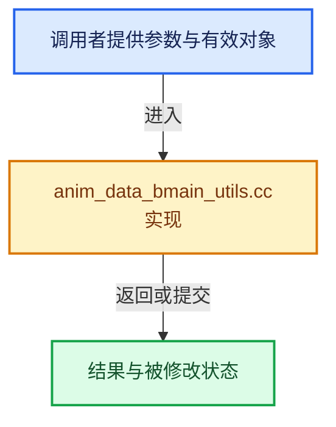

# 实现依赖专题：source/blender/blenkernel/intern/anim_data_bmain_utils.cc

[实现依赖导航](../../README.md) · [符号索引](../../../00-课程指南/02-源码与提交索引/符号依赖与实现索引.md)

本专题从正文实际调用进入，集中保存共享实现。函数有稳定锚点，可从调用处直接跳到对应完整函数；递归与互相调用通过回链组织。

## 本文件的实现关系





## 完整成员与函数实现

<a id="f-099bef57f1e1e41b"></a>

### `blender::BKE_animdata_main_cb`

实现位置：[source/blender/blenkernel/intern/anim_data_bmain_utils.cc](../../../../../../../source/blender/blenkernel/intern/anim_data_bmain_utils.cc) · L27—L135。

接口参数：

- `Main *bmain`
- `const FunctionRef<void(ID *, AnimData *)> func`
- `ID *`
- `AnimData *`

**教学注释版**

<!-- annotated:c53af9ece0d73d -->

```cpp
void BKE_animdata_main_cb(Main *bmain, const FunctionRef<void(ID *, AnimData *)> func)
{
  ID *id;

/* standard data version */
#define ANIMDATA_IDS_CB(first) \
  for (id = static_cast<ID *>(first); id; id = static_cast<ID *>(id->next)) { \
    AnimData *adt = BKE_animdata_from_id(id); \
    if (adt) { \
      func(id, adt); \
    } \
  } \
  (void)0

/* "embedded" nodetree cases (i.e. scene/material/texture->nodetree) */
#define ANIMDATA_NODETREE_IDS_CB(first, NtId_Type) \
  for (id = static_cast<ID *>(first); id; id = static_cast<ID *>(id->next)) { \
    AnimData *adt = BKE_animdata_from_id(id); \
    NtId_Type *ntp = (NtId_Type *)id; \
    if (ntp->nodetree) { \
      AnimData *adt2 = BKE_animdata_from_id((ID *)ntp->nodetree); \
      if (adt2) { \
        func((ID *)ntp->nodetree, adt2); \
      } \
    } \
    if (adt) { \
      func(id, adt); \
    } \
  } \
  (void)0

  /* nodes */
  ANIMDATA_IDS_CB(bmain->nodetrees.first_as<ID>());

  /* textures */
  ANIMDATA_NODETREE_IDS_CB(bmain->textures.first_as<ID>(), Tex);

  /* lights */
  ANIMDATA_NODETREE_IDS_CB(bmain->lights.first_as<ID>(), Light);

  /* materials */
  ANIMDATA_NODETREE_IDS_CB(bmain->materials.first_as<ID>(), Material);

  /* cameras */
  ANIMDATA_IDS_CB(bmain->cameras.first_as<ID>());

  /* shapekeys */
  ANIMDATA_IDS_CB(bmain->shapekeys.first_as<ID>());

  /* metaballs */
  ANIMDATA_IDS_CB(bmain->metaballs.first_as<ID>());

  /* curves */
  ANIMDATA_IDS_CB(bmain->curves.first_as<ID>());

  /* armatures */
  ANIMDATA_IDS_CB(bmain->armatures.first_as<ID>());

  /* lattices */
  ANIMDATA_IDS_CB(bmain->lattices.first_as<ID>());

  /* meshes */
  ANIMDATA_IDS_CB(bmain->meshes.first_as<ID>());

  /* particles */
  ANIMDATA_IDS_CB(bmain->particles.first_as<ID>());

  /* speakers */
  ANIMDATA_IDS_CB(bmain->speakers.first_as<ID>());

  /* movie clips */
  ANIMDATA_IDS_CB(bmain->movieclips.first_as<ID>());

  /* objects */
  ANIMDATA_IDS_CB(bmain->objects.first_as<ID>());

  /* masks */
  ANIMDATA_IDS_CB(bmain->masks.first_as<ID>());

  /* worlds */
  ANIMDATA_NODETREE_IDS_CB(bmain->worlds.first_as<ID>(), World);

  /* scenes */
  ANIMDATA_NODETREE_IDS_CB(bmain->scenes.first_as<ID>(), Scene);

  /* line styles */
  ANIMDATA_IDS_CB(bmain->linestyles.first_as<ID>());

  /* grease pencil */
  ANIMDATA_IDS_CB(bmain->gpencils.first_as<ID>());

  /* grease pencil */
  ANIMDATA_IDS_CB(bmain->grease_pencils.first_as<ID>());

  /* palettes */
  ANIMDATA_IDS_CB(bmain->palettes.first_as<ID>());

  /* cache files */
  ANIMDATA_IDS_CB(bmain->cachefiles.first_as<ID>());

  /* Hair Curves. */
  ANIMDATA_IDS_CB(bmain->hair_curves.first_as<ID>());

  /* pointclouds */
  ANIMDATA_IDS_CB(bmain->pointclouds.first_as<ID>());

  /* volumes */
  ANIMDATA_IDS_CB(bmain->volumes.first_as<ID>());
}
```

<details>
<summary>核对原始源码：source/blender/blenkernel/intern/anim_data_bmain_utils.cc · L27—L135</summary>

<!-- original:c53af9ece0d73d:source/blender/blenkernel/intern/anim_data_bmain_utils.cc:27:135 -->

```cpp
void BKE_animdata_main_cb(Main *bmain, const FunctionRef<void(ID *, AnimData *)> func)
{
  ID *id;

/* standard data version */
#define ANIMDATA_IDS_CB(first) \
  for (id = static_cast<ID *>(first); id; id = static_cast<ID *>(id->next)) { \
    AnimData *adt = BKE_animdata_from_id(id); \
    if (adt) { \
      func(id, adt); \
    } \
  } \
  (void)0

/* "embedded" nodetree cases (i.e. scene/material/texture->nodetree) */
#define ANIMDATA_NODETREE_IDS_CB(first, NtId_Type) \
  for (id = static_cast<ID *>(first); id; id = static_cast<ID *>(id->next)) { \
    AnimData *adt = BKE_animdata_from_id(id); \
    NtId_Type *ntp = (NtId_Type *)id; \
    if (ntp->nodetree) { \
      AnimData *adt2 = BKE_animdata_from_id((ID *)ntp->nodetree); \
      if (adt2) { \
        func((ID *)ntp->nodetree, adt2); \
      } \
    } \
    if (adt) { \
      func(id, adt); \
    } \
  } \
  (void)0

  /* nodes */
  ANIMDATA_IDS_CB(bmain->nodetrees.first_as<ID>());

  /* textures */
  ANIMDATA_NODETREE_IDS_CB(bmain->textures.first_as<ID>(), Tex);

  /* lights */
  ANIMDATA_NODETREE_IDS_CB(bmain->lights.first_as<ID>(), Light);

  /* materials */
  ANIMDATA_NODETREE_IDS_CB(bmain->materials.first_as<ID>(), Material);

  /* cameras */
  ANIMDATA_IDS_CB(bmain->cameras.first_as<ID>());

  /* shapekeys */
  ANIMDATA_IDS_CB(bmain->shapekeys.first_as<ID>());

  /* metaballs */
  ANIMDATA_IDS_CB(bmain->metaballs.first_as<ID>());

  /* curves */
  ANIMDATA_IDS_CB(bmain->curves.first_as<ID>());

  /* armatures */
  ANIMDATA_IDS_CB(bmain->armatures.first_as<ID>());

  /* lattices */
  ANIMDATA_IDS_CB(bmain->lattices.first_as<ID>());

  /* meshes */
  ANIMDATA_IDS_CB(bmain->meshes.first_as<ID>());

  /* particles */
  ANIMDATA_IDS_CB(bmain->particles.first_as<ID>());

  /* speakers */
  ANIMDATA_IDS_CB(bmain->speakers.first_as<ID>());

  /* movie clips */
  ANIMDATA_IDS_CB(bmain->movieclips.first_as<ID>());

  /* objects */
  ANIMDATA_IDS_CB(bmain->objects.first_as<ID>());

  /* masks */
  ANIMDATA_IDS_CB(bmain->masks.first_as<ID>());

  /* worlds */
  ANIMDATA_NODETREE_IDS_CB(bmain->worlds.first_as<ID>(), World);

  /* scenes */
  ANIMDATA_NODETREE_IDS_CB(bmain->scenes.first_as<ID>(), Scene);

  /* line styles */
  ANIMDATA_IDS_CB(bmain->linestyles.first_as<ID>());

  /* grease pencil */
  ANIMDATA_IDS_CB(bmain->gpencils.first_as<ID>());

  /* grease pencil */
  ANIMDATA_IDS_CB(bmain->grease_pencils.first_as<ID>());

  /* palettes */
  ANIMDATA_IDS_CB(bmain->palettes.first_as<ID>());

  /* cache files */
  ANIMDATA_IDS_CB(bmain->cachefiles.first_as<ID>());

  /* Hair Curves. */
  ANIMDATA_IDS_CB(bmain->hair_curves.first_as<ID>());

  /* pointclouds */
  ANIMDATA_IDS_CB(bmain->pointclouds.first_as<ID>());

  /* volumes */
  ANIMDATA_IDS_CB(bmain->volumes.first_as<ID>());
}
```

</details>

**继续追踪实现**

- `ANIMDATA_IDS_CB` → [调用协议](../../../00-课程指南/01-路线与规范/模板宏与动态分派协议.md)：函数指针、局部可调用对象或未展开的宏；必须结合调用者环境。调用位置L59。
- `bmain->nodetrees.first_as<ID>` → [调用协议](../../../00-课程指南/01-路线与规范/模板宏与动态分派协议.md)：接收对象类型依赖auto、返回值或模板实例；不按同名猜测目标。调用位置L59。
- `ANIMDATA_NODETREE_IDS_CB` → [调用协议](../../../00-课程指南/01-路线与规范/模板宏与动态分派协议.md)：函数指针、局部可调用对象或未展开的宏；必须结合调用者环境。调用位置L62。
- `bmain->textures.first_as<ID>` → [调用协议](../../../00-课程指南/01-路线与规范/模板宏与动态分派协议.md)：接收对象类型依赖auto、返回值或模板实例；不按同名猜测目标。调用位置L62。
- `bmain->lights.first_as<ID>` → [调用协议](../../../00-课程指南/01-路线与规范/模板宏与动态分派协议.md)：接收对象类型依赖auto、返回值或模板实例；不按同名猜测目标。调用位置L65。
- `bmain->materials.first_as<ID>` → [调用协议](../../../00-课程指南/01-路线与规范/模板宏与动态分派协议.md)：接收对象类型依赖auto、返回值或模板实例；不按同名猜测目标。调用位置L68。
- `bmain->cameras.first_as<ID>` → [调用协议](../../../00-课程指南/01-路线与规范/模板宏与动态分派协议.md)：接收对象类型依赖auto、返回值或模板实例；不按同名猜测目标。调用位置L71。
- `bmain->shapekeys.first_as<ID>` → [调用协议](../../../00-课程指南/01-路线与规范/模板宏与动态分派协议.md)：接收对象类型依赖auto、返回值或模板实例；不按同名猜测目标。调用位置L74。
- `bmain->metaballs.first_as<ID>` → [调用协议](../../../00-课程指南/01-路线与规范/模板宏与动态分派协议.md)：接收对象类型依赖auto、返回值或模板实例；不按同名猜测目标。调用位置L77。
- `bmain->curves.first_as<ID>` → [调用协议](../../../00-课程指南/01-路线与规范/模板宏与动态分派协议.md)：接收对象类型依赖auto、返回值或模板实例；不按同名猜测目标。调用位置L80。
- `bmain->armatures.first_as<ID>` → [调用协议](../../../00-课程指南/01-路线与规范/模板宏与动态分派协议.md)：接收对象类型依赖auto、返回值或模板实例；不按同名猜测目标。调用位置L83。
- `bmain->lattices.first_as<ID>` → [调用协议](../../../00-课程指南/01-路线与规范/模板宏与动态分派协议.md)：接收对象类型依赖auto、返回值或模板实例；不按同名猜测目标。调用位置L86。
- `bmain->meshes.first_as<ID>` → [调用协议](../../../00-课程指南/01-路线与规范/模板宏与动态分派协议.md)：接收对象类型依赖auto、返回值或模板实例；不按同名猜测目标。调用位置L89。
- `bmain->particles.first_as<ID>` → [调用协议](../../../00-课程指南/01-路线与规范/模板宏与动态分派协议.md)：接收对象类型依赖auto、返回值或模板实例；不按同名猜测目标。调用位置L92。
- `bmain->speakers.first_as<ID>` → [调用协议](../../../00-课程指南/01-路线与规范/模板宏与动态分派协议.md)：接收对象类型依赖auto、返回值或模板实例；不按同名猜测目标。调用位置L95。
- `bmain->movieclips.first_as<ID>` → [调用协议](../../../00-课程指南/01-路线与规范/模板宏与动态分派协议.md)：接收对象类型依赖auto、返回值或模板实例；不按同名猜测目标。调用位置L98。
- `bmain->objects.first_as<ID>` → [调用协议](../../../00-课程指南/01-路线与规范/模板宏与动态分派协议.md)：接收对象类型依赖auto、返回值或模板实例；不按同名猜测目标。调用位置L101。
- `bmain->masks.first_as<ID>` → [调用协议](../../../00-课程指南/01-路线与规范/模板宏与动态分派协议.md)：接收对象类型依赖auto、返回值或模板实例；不按同名猜测目标。调用位置L104。
- `bmain->worlds.first_as<ID>` → [调用协议](../../../00-课程指南/01-路线与规范/模板宏与动态分派协议.md)：接收对象类型依赖auto、返回值或模板实例；不按同名猜测目标。调用位置L107。
- `bmain->scenes.first_as<ID>` → [调用协议](../../../00-课程指南/01-路线与规范/模板宏与动态分派协议.md)：接收对象类型依赖auto、返回值或模板实例；不按同名猜测目标。调用位置L110。
- `bmain->linestyles.first_as<ID>` → [调用协议](../../../00-课程指南/01-路线与规范/模板宏与动态分派协议.md)：接收对象类型依赖auto、返回值或模板实例；不按同名猜测目标。调用位置L113。
- `bmain->gpencils.first_as<ID>` → [调用协议](../../../00-课程指南/01-路线与规范/模板宏与动态分派协议.md)：接收对象类型依赖auto、返回值或模板实例；不按同名猜测目标。调用位置L116。
- `bmain->grease_pencils.first_as<ID>` → [调用协议](../../../00-课程指南/01-路线与规范/模板宏与动态分派协议.md)：接收对象类型依赖auto、返回值或模板实例；不按同名猜测目标。调用位置L119。
- `bmain->palettes.first_as<ID>` → [调用协议](../../../00-课程指南/01-路线与规范/模板宏与动态分派协议.md)：接收对象类型依赖auto、返回值或模板实例；不按同名猜测目标。调用位置L122。
- `bmain->cachefiles.first_as<ID>` → [调用协议](../../../00-课程指南/01-路线与规范/模板宏与动态分派协议.md)：接收对象类型依赖auto、返回值或模板实例；不按同名猜测目标。调用位置L125。
- `bmain->hair_curves.first_as<ID>` → [调用协议](../../../00-课程指南/01-路线与规范/模板宏与动态分派协议.md)：接收对象类型依赖auto、返回值或模板实例；不按同名猜测目标。调用位置L128。
- `bmain->pointclouds.first_as<ID>` → [调用协议](../../../00-课程指南/01-路线与规范/模板宏与动态分派协议.md)：接收对象类型依赖auto、返回值或模板实例；不按同名猜测目标。调用位置L131。
- `bmain->volumes.first_as<ID>` → [调用协议](../../../00-课程指南/01-路线与规范/模板宏与动态分派协议.md)：接收对象类型依赖auto、返回值或模板实例；不按同名猜测目标。调用位置L134。
