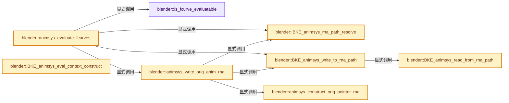
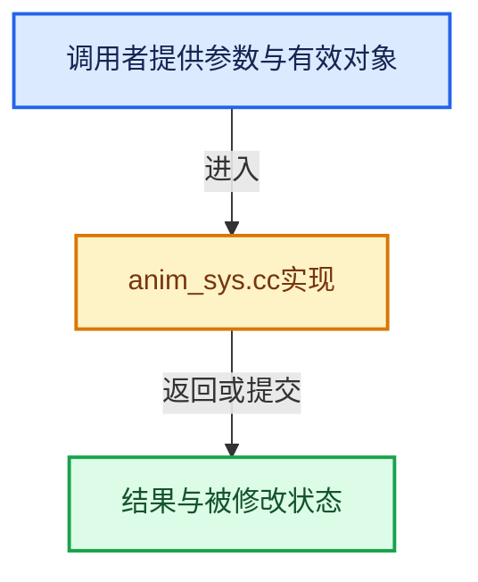

# 实现依赖专题：source/blender/blenkernel/intern/anim_sys.cc

[实现依赖导航](../../README.md) · [符号索引](../../../00-课程指南/02-源码与提交索引/符号依赖与实现索引.md)

本专题从正文实际调用进入，集中保存共享实现。函数有稳定锚点，可从调用处直接跳到对应完整函数；递归与互相调用通过回链组织。

## 本文件的实现关系






<a id="m-a6aaab5a3390"></a>

## 宏 `ANIMSYS_FLOAT_AS_BOOL`

<!-- annotated:f77de320072980 -->

```cpp
#define ANIMSYS_FLOAT_AS_BOOL(value) ((value) > (1.0f - FLT_EPSILON))

```

<details>
<summary>核对原始源码：source/blender/blenkernel/intern/anim_sys.cc · L398—L399</summary>

<!-- original:f77de320072980:source/blender/blenkernel/intern/anim_sys.cc:398:399 -->

```cpp
#define ANIMSYS_FLOAT_AS_BOOL(value) ((value) > (1.0f - FLT_EPSILON))

```

</details>

宏在预处理阶段展开，参数替换、重复求值和条件编译应直接从该定义检查。与普通函数不同，宏不会自动提供参数类型检查；构建配置选择哪个定义需结合外围条件。

## 完整成员与函数实现

<a id="f-a9bdea58f1043b74"></a>

### `blender::is_fcurve_evaluatable`

实现位置：[source/blender/blenkernel/intern/anim_sys.cc](../../../../../../../source/blender/blenkernel/intern/anim_sys.cc) · L342—L354。

接口参数：

- `const FCurve *fcu`

**教学注释版**

<!-- annotated:91bb2b4100e876 -->

```cpp
static bool is_fcurve_evaluatable(const FCurve *fcu)
{
  if (fcu->flag & (FCURVE_MUTED | FCURVE_DISABLED)) {
    return false;
  }
  if (fcu->grp != nullptr && (fcu->grp->flag & AGRP_MUTED)) {
    return false;
  }
  if (BKE_fcurve_is_empty(fcu)) {
    return false;
  }
  return true;
}
```

<details>
<summary>核对原始源码：source/blender/blenkernel/intern/anim_sys.cc · L342—L354</summary>

<!-- original:91bb2b4100e876:source/blender/blenkernel/intern/anim_sys.cc:342:354 -->

```cpp
static bool is_fcurve_evaluatable(const FCurve *fcu)
{
  if (fcu->flag & (FCURVE_MUTED | FCURVE_DISABLED)) {
    return false;
  }
  if (fcu->grp != nullptr && (fcu->grp->flag & AGRP_MUTED)) {
    return false;
  }
  if (BKE_fcurve_is_empty(fcu)) {
    return false;
  }
  return true;
}
```

</details>

**结果出口**

- `return false;`
- `return true;`

**继续追踪实现**

- `BKE_fcurve_is_empty` → [blender::BKE_fcurve_is_empty · L2492](fcurve.cc.md#f-d6df9e9e77afd03e)。

<a id="f-5c73502a8e98ce35"></a>

### `blender::BKE_animsys_rna_path_resolve`

实现位置：[source/blender/blenkernel/intern/anim_sys.cc](../../../../../../../source/blender/blenkernel/intern/anim_sys.cc) · L356—L395。

接口参数：

- `PointerRNA *ptr`
- `const ParsedRNAPathRef rna_path`
- `const int array_index`
- `PathResolvedRNA *r_result`

**教学注释版**

<!-- annotated:9571fcee2cf358 -->

```cpp
bool BKE_animsys_rna_path_resolve(
    PointerRNA *ptr, /* typically 'fcu->rna_path()', 'fcu->array_index' */
    const ParsedRNAPathRef rna_path,
    const int array_index,
    PathResolvedRNA *r_result)
{
  if (!RNA_path_resolve_property(ptr, rna_path, &r_result->ptr, &r_result->prop)) {
    /* failed to get path */
    /* XXX don't tag as failed yet though, as there are some legit situations (Action Constraint)
     * where some channels will not exist, but shouldn't lock up Action */
    if (G.debug & G_DEBUG) {
      CLOG_WARN(&LOG_ANIM_FCURVE,
                "Invalid path. ID = '%s',  '%s[%d]'",
                (ptr->owner_id) ? (ptr->owner_id->name + 2) : "<No ID>",
                rna_path::to_string(rna_path).c_str(),
                array_index);
    }
    return false;
  }

  if (ptr->owner_id != nullptr && !RNA_property_animateable(&r_result->ptr, r_result->prop)) {
    return false;
  }

  int array_len = RNA_property_array_length(&r_result->ptr, r_result->prop);
  if (array_len && array_index >= array_len) {
    if (G.debug & G_DEBUG) {
      CLOG_WARN(&LOG_ANIM_FCURVE,
                "Invalid array index. ID = '%s',  '%s[%d]', array length is %d",
                (ptr->owner_id) ? (ptr->owner_id->name + 2) : "<No ID>",
                rna_path::to_string(rna_path).c_str(),
                array_index,
                array_len - 1);
    }
    return false;
  }

  r_result->prop_index = array_len ? array_index : -1;
  return true;
}
```

<details>
<summary>核对原始源码：source/blender/blenkernel/intern/anim_sys.cc · L356—L395</summary>

<!-- original:9571fcee2cf358:source/blender/blenkernel/intern/anim_sys.cc:356:395 -->

```cpp
bool BKE_animsys_rna_path_resolve(
    PointerRNA *ptr, /* typically 'fcu->rna_path()', 'fcu->array_index' */
    const ParsedRNAPathRef rna_path,
    const int array_index,
    PathResolvedRNA *r_result)
{
  if (!RNA_path_resolve_property(ptr, rna_path, &r_result->ptr, &r_result->prop)) {
    /* failed to get path */
    /* XXX don't tag as failed yet though, as there are some legit situations (Action Constraint)
     * where some channels will not exist, but shouldn't lock up Action */
    if (G.debug & G_DEBUG) {
      CLOG_WARN(&LOG_ANIM_FCURVE,
                "Invalid path. ID = '%s',  '%s[%d]'",
                (ptr->owner_id) ? (ptr->owner_id->name + 2) : "<No ID>",
                rna_path::to_string(rna_path).c_str(),
                array_index);
    }
    return false;
  }

  if (ptr->owner_id != nullptr && !RNA_property_animateable(&r_result->ptr, r_result->prop)) {
    return false;
  }

  int array_len = RNA_property_array_length(&r_result->ptr, r_result->prop);
  if (array_len && array_index >= array_len) {
    if (G.debug & G_DEBUG) {
      CLOG_WARN(&LOG_ANIM_FCURVE,
                "Invalid array index. ID = '%s',  '%s[%d]', array length is %d",
                (ptr->owner_id) ? (ptr->owner_id->name + 2) : "<No ID>",
                rna_path::to_string(rna_path).c_str(),
                array_index,
                array_len - 1);
    }
    return false;
  }

  r_result->prop_index = array_len ? array_index : -1;
  return true;
}
```

</details>

**沿实际写入检查状态**

- `r_result->prop_index = array_len ? array_index : -1;`

**结果出口**

- `return false;`
- `return true;`

**继续追踪实现**

- `RNA_path_resolve_property` → [blender::RNA_path_resolve_property · L575](../../08-其他Blender模块/makesrna/intern/rna_path.cc.md#f-9ccab9d4f53550b5)；[blender::RNA_path_resolve_property · L594](../../08-其他Blender模块/makesrna/intern/rna_path.cc.md#f-ea2ad4371e6f4b35)。同名重载需按实参类型选择。
- `CLOG_WARN` → [CLOG_WARN · L189](../../07-Intern运行时与平台/clog/CLG_log.h.md#m-9da21a06cdbe)。宏定义由构建条件选择。
- `rna_path::to_string(rna_path).c_str` → [调用协议](../../../00-课程指南/01-路线与规范/模板宏与动态分派协议.md)：接收对象类型依赖auto、返回值或模板实例；不按同名猜测目标。调用位置L370。
- `rna_path::to_string` → [blender::rna_path::to_string · L243](../../08-其他Blender模块/makesrna/intern/rna_path.cc.md#f-6d63a196e04aca1b)。
- `RNA_property_animateable` → [blender::RNA_property_animateable · L2439](../../08-其他Blender模块/makesrna/intern/rna_access.cc.md#f-e1c78c87e38a75a8)。
- `RNA_property_array_length` → [blender::RNA_property_array_length · L1371](../../08-其他Blender模块/makesrna/intern/rna_access.cc.md#f-2258ce063a075147)。

<a id="f-12181652b947106c"></a>

### `blender::BKE_animsys_read_from_rna_path`

实现位置：[source/blender/blenkernel/intern/anim_sys.cc](../../../../../../../source/blender/blenkernel/intern/anim_sys.cc) · L400—L459。

接口参数：

- `PathResolvedRNA *anim_rna`
- `float *r_value`

**教学注释版**

<!-- annotated:36e3e6b2d78762 -->

```cpp
bool BKE_animsys_read_from_rna_path(PathResolvedRNA *anim_rna, float *r_value)
{
  PropertyRNA *prop = anim_rna->prop;
  PointerRNA *ptr = &anim_rna->ptr;
  int array_index = anim_rna->prop_index;
  float orig_value;

  /* caller must ensure this is animatable */
  BLI_assert(RNA_property_animateable(ptr, prop) || ptr->owner_id == nullptr);

  switch (RNA_property_type(prop)) {
    case PROP_BOOLEAN: {
      if (array_index != -1) {
        const int orig_value_coerce = RNA_property_boolean_get_index(ptr, prop, array_index);
        orig_value = float(orig_value_coerce);
      }
      else {
        const int orig_value_coerce = RNA_property_boolean_get(ptr, prop);
        orig_value = float(orig_value_coerce);
      }
      break;
    }
    case PROP_INT: {
      if (array_index != -1) {
        const int orig_value_coerce = RNA_property_int_get_index(ptr, prop, array_index);
        orig_value = float(orig_value_coerce);
      }
      else {
        const int orig_value_coerce = RNA_property_int_get(ptr, prop);
        orig_value = float(orig_value_coerce);
      }
      break;
    }
    case PROP_FLOAT: {
      if (array_index != -1) {
        const float orig_value_coerce = RNA_property_float_get_index(ptr, prop, array_index);
        orig_value = float(orig_value_coerce);
      }
      else {
        const float orig_value_coerce = RNA_property_float_get(ptr, prop);
        orig_value = float(orig_value_coerce);
      }
      break;
    }
    case PROP_ENUM: {
      const int orig_value_coerce = RNA_property_enum_get(ptr, prop);
      orig_value = float(orig_value_coerce);
      break;
    }
    default: /* nothing can be done here... so it is unsuccessful? */
      return false;
  }

  if (r_value != nullptr) {
    *r_value = orig_value;
  }

  /* successful */
  return true;
}
```

<details>
<summary>核对原始源码：source/blender/blenkernel/intern/anim_sys.cc · L400—L459</summary>

<!-- original:36e3e6b2d78762:source/blender/blenkernel/intern/anim_sys.cc:400:459 -->

```cpp
bool BKE_animsys_read_from_rna_path(PathResolvedRNA *anim_rna, float *r_value)
{
  PropertyRNA *prop = anim_rna->prop;
  PointerRNA *ptr = &anim_rna->ptr;
  int array_index = anim_rna->prop_index;
  float orig_value;

  /* caller must ensure this is animatable */
  BLI_assert(RNA_property_animateable(ptr, prop) || ptr->owner_id == nullptr);

  switch (RNA_property_type(prop)) {
    case PROP_BOOLEAN: {
      if (array_index != -1) {
        const int orig_value_coerce = RNA_property_boolean_get_index(ptr, prop, array_index);
        orig_value = float(orig_value_coerce);
      }
      else {
        const int orig_value_coerce = RNA_property_boolean_get(ptr, prop);
        orig_value = float(orig_value_coerce);
      }
      break;
    }
    case PROP_INT: {
      if (array_index != -1) {
        const int orig_value_coerce = RNA_property_int_get_index(ptr, prop, array_index);
        orig_value = float(orig_value_coerce);
      }
      else {
        const int orig_value_coerce = RNA_property_int_get(ptr, prop);
        orig_value = float(orig_value_coerce);
      }
      break;
    }
    case PROP_FLOAT: {
      if (array_index != -1) {
        const float orig_value_coerce = RNA_property_float_get_index(ptr, prop, array_index);
        orig_value = float(orig_value_coerce);
      }
      else {
        const float orig_value_coerce = RNA_property_float_get(ptr, prop);
        orig_value = float(orig_value_coerce);
      }
      break;
    }
    case PROP_ENUM: {
      const int orig_value_coerce = RNA_property_enum_get(ptr, prop);
      orig_value = float(orig_value_coerce);
      break;
    }
    default: /* nothing can be done here... so it is unsuccessful? */
      return false;
  }

  if (r_value != nullptr) {
    *r_value = orig_value;
  }

  /* successful */
  return true;
}
```

</details>

**沿实际写入检查状态**

- `orig_value = float(orig_value_coerce);`

**结果出口**

- `return false;`
- `return true;`

**继续追踪实现**

- `BLI_assert` → [BLI_assert · L48](../../01-BLI基础库/BLI_assert.hh.md#m-57a88495704d)；[BLI_assert · L63](../../01-BLI基础库/BLI_assert.hh.md#m-d07050020cb5)。宏定义由构建条件选择。
- `RNA_property_animateable` → [blender::RNA_property_animateable · L2439](../../08-其他Blender模块/makesrna/intern/rna_access.cc.md#f-e1c78c87e38a75a8)。
- `RNA_property_type` → [blender::RNA_property_type · L1293](../../08-其他Blender模块/makesrna/intern/rna_access.cc.md#f-4465a90d55f022df)。
- `RNA_property_boolean_get_index` → [blender::RNA_property_boolean_get_index · L2887](../../08-其他Blender模块/makesrna/intern/rna_access.cc.md#f-e8d48870c3e2ceac)。
- `RNA_property_boolean_get` → [blender::RNA_property_boolean_get · L2682](../../08-其他Blender模块/makesrna/intern/rna_access.cc.md#f-16ebc777a7f8eb66)。
- `RNA_property_int_get_index` → [blender::RNA_property_int_get_index · L3404](../../08-其他Blender模块/makesrna/intern/rna_access.cc.md#f-0f7616199232ca55)。
- `RNA_property_int_get` → [blender::RNA_property_int_get · L3198](../../08-其他Blender模块/makesrna/intern/rna_access.cc.md#f-09c89e28122fa344)。
- `RNA_property_float_get_index` → [blender::RNA_property_float_get_index · L3894](../../08-其他Blender模块/makesrna/intern/rna_access.cc.md#f-be851c32bd58e17b)。
- `RNA_property_float_get` → [blender::RNA_property_float_get · L3656](../../08-其他Blender模块/makesrna/intern/rna_access.cc.md#f-715b911efa49b6ab)。
- `RNA_property_enum_get` → [blender::RNA_property_enum_get · L4499](../../08-其他Blender模块/makesrna/intern/rna_access.cc.md#f-7921c83822683274)。

<a id="f-93df2a4caf33ded1"></a>

### `blender::BKE_animsys_write_to_rna_path`

实现位置：[source/blender/blenkernel/intern/anim_sys.cc](../../../../../../../source/blender/blenkernel/intern/anim_sys.cc) · L461—L527。

接口参数：

- `PathResolvedRNA *anim_rna`
- `const float value`
- `const bool force_write`

**教学注释版**

<!-- annotated:2609149815bb53 -->

```cpp
bool BKE_animsys_write_to_rna_path(PathResolvedRNA *anim_rna,
                                   const float value,
                                   const bool force_write)
{
  PropertyRNA *prop = anim_rna->prop;
  PointerRNA *ptr = &anim_rna->ptr;
  int array_index = anim_rna->prop_index;

  /* caller must ensure this is animatable */
  BLI_assert(RNA_property_animateable(ptr, prop) || ptr->owner_id == nullptr);

  if (!force_write) {
    /* Check whether value is new. Otherwise we skip all the updates. */
    float old_value;
    if (!BKE_animsys_read_from_rna_path(anim_rna, &old_value)) {
      return false;
    }
    if (old_value == value) {
      return true;
    }
  }

  switch (RNA_property_type(prop)) {
    case PROP_BOOLEAN: {
      const int value_coerce = ANIMSYS_FLOAT_AS_BOOL(value);
      if (array_index != -1) {
        RNA_property_boolean_set_index(ptr, prop, array_index, value_coerce);
      }
      else {
        RNA_property_boolean_set(ptr, prop, value_coerce);
      }
      break;
    }
    case PROP_INT: {
      int value_coerce = int(value);
      RNA_property_int_clamp(ptr, prop, &value_coerce);
      if (array_index != -1) {
        RNA_property_int_set_index(ptr, prop, array_index, value_coerce);
      }
      else {
        RNA_property_int_set(ptr, prop, value_coerce);
      }
      break;
    }
    case PROP_FLOAT: {
      float value_coerce = value;
      RNA_property_float_clamp(ptr, prop, &value_coerce);
      if (array_index != -1) {
        RNA_property_float_set_index(ptr, prop, array_index, value_coerce);
      }
      else {
        RNA_property_float_set(ptr, prop, value_coerce);
      }
      break;
    }
    case PROP_ENUM: {
      const int value_coerce = int(value);
      RNA_property_enum_set(ptr, prop, value_coerce);
      break;
    }
    default: /* nothing can be done here... so it is unsuccessful? */
      return false;
  }

  /* successful */
  return true;
}
```

<details>
<summary>核对原始源码：source/blender/blenkernel/intern/anim_sys.cc · L461—L527</summary>

<!-- original:2609149815bb53:source/blender/blenkernel/intern/anim_sys.cc:461:527 -->

```cpp
bool BKE_animsys_write_to_rna_path(PathResolvedRNA *anim_rna,
                                   const float value,
                                   const bool force_write)
{
  PropertyRNA *prop = anim_rna->prop;
  PointerRNA *ptr = &anim_rna->ptr;
  int array_index = anim_rna->prop_index;

  /* caller must ensure this is animatable */
  BLI_assert(RNA_property_animateable(ptr, prop) || ptr->owner_id == nullptr);

  if (!force_write) {
    /* Check whether value is new. Otherwise we skip all the updates. */
    float old_value;
    if (!BKE_animsys_read_from_rna_path(anim_rna, &old_value)) {
      return false;
    }
    if (old_value == value) {
      return true;
    }
  }

  switch (RNA_property_type(prop)) {
    case PROP_BOOLEAN: {
      const int value_coerce = ANIMSYS_FLOAT_AS_BOOL(value);
      if (array_index != -1) {
        RNA_property_boolean_set_index(ptr, prop, array_index, value_coerce);
      }
      else {
        RNA_property_boolean_set(ptr, prop, value_coerce);
      }
      break;
    }
    case PROP_INT: {
      int value_coerce = int(value);
      RNA_property_int_clamp(ptr, prop, &value_coerce);
      if (array_index != -1) {
        RNA_property_int_set_index(ptr, prop, array_index, value_coerce);
      }
      else {
        RNA_property_int_set(ptr, prop, value_coerce);
      }
      break;
    }
    case PROP_FLOAT: {
      float value_coerce = value;
      RNA_property_float_clamp(ptr, prop, &value_coerce);
      if (array_index != -1) {
        RNA_property_float_set_index(ptr, prop, array_index, value_coerce);
      }
      else {
        RNA_property_float_set(ptr, prop, value_coerce);
      }
      break;
    }
    case PROP_ENUM: {
      const int value_coerce = int(value);
      RNA_property_enum_set(ptr, prop, value_coerce);
      break;
    }
    default: /* nothing can be done here... so it is unsuccessful? */
      return false;
  }

  /* successful */
  return true;
}
```

</details>

**结果出口**

- `return false;`
- `return true;`

**继续追踪实现**

- `BLI_assert` → [BLI_assert · L48](../../01-BLI基础库/BLI_assert.hh.md#m-57a88495704d)；[BLI_assert · L63](../../01-BLI基础库/BLI_assert.hh.md#m-d07050020cb5)。宏定义由构建条件选择。
- `RNA_property_animateable` → [blender::RNA_property_animateable · L2439](../../08-其他Blender模块/makesrna/intern/rna_access.cc.md#f-e1c78c87e38a75a8)。
- `BKE_animsys_read_from_rna_path` → [blender::BKE_animsys_read_from_rna_path · L400](anim_sys.cc.md#f-12181652b947106c)。
- `RNA_property_type` → [blender::RNA_property_type · L1293](../../08-其他Blender模块/makesrna/intern/rna_access.cc.md#f-4465a90d55f022df)。
- `ANIMSYS_FLOAT_AS_BOOL` → [ANIMSYS_FLOAT_AS_BOOL · L398](anim_sys.cc.md#m-a6aaab5a3390)。宏定义由构建条件选择。
- `RNA_property_boolean_set_index` → [blender::RNA_property_boolean_set_index · L3035](../../08-其他Blender模块/makesrna/intern/rna_access.cc.md#f-989d2bdfc8b70995)。
- `RNA_property_boolean_set` → [blender::RNA_property_boolean_set · L2702](../../08-其他Blender模块/makesrna/intern/rna_access.cc.md#f-cedecdc71f9b74f3)。
- `RNA_property_int_clamp` → [blender::RNA_property_int_clamp · L1682](../../08-其他Blender模块/makesrna/intern/rna_access.cc.md#f-5e269f122d4303ea)。
- `RNA_property_int_set_index` → [blender::RNA_property_int_set_index · L3514](../../08-其他Blender模块/makesrna/intern/rna_access.cc.md#f-725a754cf7481b1f)。
- `RNA_property_int_set` → [blender::RNA_property_int_set · L3218](../../08-其他Blender模块/makesrna/intern/rna_access.cc.md#f-56cfd6d117befeec)。
- `RNA_property_float_clamp` → [blender::RNA_property_float_clamp · L1665](../../08-其他Blender模块/makesrna/intern/rna_access.cc.md#f-dc18840fcd6084c2)。
- `RNA_property_float_set_index` → [blender::RNA_property_float_set_index · L4015](../../08-其他Blender模块/makesrna/intern/rna_access.cc.md#f-10aea6161fe56513)。
- `RNA_property_float_set` → [blender::RNA_property_float_set · L3676](../../08-其他Blender模块/makesrna/intern/rna_access.cc.md#f-ce4c60d317da9180)。
- `RNA_property_enum_set` → [blender::RNA_property_enum_set · L4519](../../08-其他Blender模块/makesrna/intern/rna_access.cc.md#f-2b121636a1ef1c59)。

<a id="f-b4f60c9287be813a"></a>

### `blender::animsys_construct_orig_pointer_rna`

实现位置：[source/blender/blenkernel/intern/anim_sys.cc](../../../../../../../source/blender/blenkernel/intern/anim_sys.cc) · L529—L551。

接口参数：

- `const PointerRNA *ptr`
- `PointerRNA *ptr_orig`

**教学注释版**

<!-- annotated:322fd071f4c943 -->

```cpp
static bool animsys_construct_orig_pointer_rna(const PointerRNA *ptr, PointerRNA *ptr_orig)
{
  *ptr_orig = *ptr;
  /* NOTE: nlastrip_evaluate_controls() creates PointerRNA with ID of nullptr. Technically, this is
   * not a valid pointer, but there are exceptions in various places of this file which handles
   * such pointers.
   * We do special trickery here as well, to quickly go from evaluated to original NlaStrip. */
  if (ptr->owner_id == nullptr) {
    if (ptr->type != RNA_NlaStrip) {
      return false;
    }
    NlaStrip *strip = (static_cast<NlaStrip *>(ptr_orig->data));
    if (strip->orig_strip == nullptr) {
      return false;
    }
    ptr_orig->data = strip->orig_strip;
  }
  else {
    ptr_orig->owner_id = ptr_orig->owner_id->orig_id;
    ptr_orig->data = ptr_orig->owner_id;
  }
  return true;
}
```

<details>
<summary>核对原始源码：source/blender/blenkernel/intern/anim_sys.cc · L529—L551</summary>

<!-- original:322fd071f4c943:source/blender/blenkernel/intern/anim_sys.cc:529:551 -->

```cpp
static bool animsys_construct_orig_pointer_rna(const PointerRNA *ptr, PointerRNA *ptr_orig)
{
  *ptr_orig = *ptr;
  /* NOTE: nlastrip_evaluate_controls() creates PointerRNA with ID of nullptr. Technically, this is
   * not a valid pointer, but there are exceptions in various places of this file which handles
   * such pointers.
   * We do special trickery here as well, to quickly go from evaluated to original NlaStrip. */
  if (ptr->owner_id == nullptr) {
    if (ptr->type != RNA_NlaStrip) {
      return false;
    }
    NlaStrip *strip = (static_cast<NlaStrip *>(ptr_orig->data));
    if (strip->orig_strip == nullptr) {
      return false;
    }
    ptr_orig->data = strip->orig_strip;
  }
  else {
    ptr_orig->owner_id = ptr_orig->owner_id->orig_id;
    ptr_orig->data = ptr_orig->owner_id;
  }
  return true;
}
```

</details>

**沿实际写入检查状态**

- `ptr_orig->data = strip->orig_strip;`
- `ptr_orig->owner_id = ptr_orig->owner_id->orig_id;`
- `ptr_orig->data = ptr_orig->owner_id;`

**结果出口**

- `return false;`
- `return true;`

**继续追踪实现**

本实现没有需要继续展开的显式调用；检查返回表达式、对象转换和调用者前置条件。

<a id="f-880dbfbd3302d1aa"></a>

### `blender::animsys_write_orig_anim_rna`

实现位置：[source/blender/blenkernel/intern/anim_sys.cc](../../../../../../../source/blender/blenkernel/intern/anim_sys.cc) · L553—L567。

接口参数：

- `PointerRNA *ptr`
- `const ParsedRNAPathRef rna_path`
- `int array_index`
- `float value`

**教学注释版**

<!-- annotated:4c77557ac1ee66 -->

```cpp
static void animsys_write_orig_anim_rna(PointerRNA *ptr,
                                        const ParsedRNAPathRef rna_path,
                                        int array_index,
                                        float value)
{
  PointerRNA ptr_orig;
  if (!animsys_construct_orig_pointer_rna(ptr, &ptr_orig)) {
    return;
  }
  PathResolvedRNA orig_anim_rna;
  /* TODO(sergey): Should be possible to cache resolved path in dependency graph somehow. */
  if (BKE_animsys_rna_path_resolve(&ptr_orig, rna_path, array_index, &orig_anim_rna)) {
    BKE_animsys_write_to_rna_path(&orig_anim_rna, value);
  }
}
```

<details>
<summary>核对原始源码：source/blender/blenkernel/intern/anim_sys.cc · L553—L567</summary>

<!-- original:4c77557ac1ee66:source/blender/blenkernel/intern/anim_sys.cc:553:567 -->

```cpp
static void animsys_write_orig_anim_rna(PointerRNA *ptr,
                                        const ParsedRNAPathRef rna_path,
                                        int array_index,
                                        float value)
{
  PointerRNA ptr_orig;
  if (!animsys_construct_orig_pointer_rna(ptr, &ptr_orig)) {
    return;
  }
  PathResolvedRNA orig_anim_rna;
  /* TODO(sergey): Should be possible to cache resolved path in dependency graph somehow. */
  if (BKE_animsys_rna_path_resolve(&ptr_orig, rna_path, array_index, &orig_anim_rna)) {
    BKE_animsys_write_to_rna_path(&orig_anim_rna, value);
  }
}
```

</details>

**继续追踪实现**

- `animsys_construct_orig_pointer_rna` → [blender::animsys_construct_orig_pointer_rna · L529](anim_sys.cc.md#f-b4f60c9287be813a)。
- `BKE_animsys_rna_path_resolve` → [blender::BKE_animsys_rna_path_resolve · L356](anim_sys.cc.md#f-5c73502a8e98ce35)。
- `BKE_animsys_write_to_rna_path` → [blender::BKE_animsys_write_to_rna_path · L461](anim_sys.cc.md#f-93df2a4caf33ded1)。

<a id="f-432aaa0fb8b20c21"></a>

### `blender::animsys_evaluate_fcurves`

实现位置：[source/blender/blenkernel/intern/anim_sys.cc](../../../../../../../source/blender/blenkernel/intern/anim_sys.cc) · L574—L597。

接口参数：

- `PointerRNA *ptr`
- `const Span<FCurve *> fcurves`
- `const AnimationEvalContext *anim_eval_context`
- `bool flush_to_original`

**教学注释版**

<!-- annotated:f16c601c30168b -->

```cpp
static void animsys_evaluate_fcurves(PointerRNA *ptr,
                                     const Span<FCurve *> fcurves,
                                     const AnimationEvalContext *anim_eval_context,
                                     bool flush_to_original)
{
  /* Calculate then execute each curve. */
  for (FCurve *fcu : fcurves) {

    if (!is_fcurve_evaluatable(fcu)) {
      continue;
    }

    const ParsedRNAPathRef rna_path = fcu->rna_path_parsed();

    PathResolvedRNA anim_rna;
    if (BKE_animsys_rna_path_resolve(ptr, rna_path, fcu->array_index, &anim_rna)) {
      const float curval = calculate_fcurve(&anim_rna, fcu, anim_eval_context);
      BKE_animsys_write_to_rna_path(&anim_rna, curval);
      if (flush_to_original) {
        animsys_write_orig_anim_rna(ptr, rna_path, fcu->array_index, curval);
      }
    }
  }
}
```

<details>
<summary>核对原始源码：source/blender/blenkernel/intern/anim_sys.cc · L574—L597</summary>

<!-- original:f16c601c30168b:source/blender/blenkernel/intern/anim_sys.cc:574:597 -->

```cpp
static void animsys_evaluate_fcurves(PointerRNA *ptr,
                                     const Span<FCurve *> fcurves,
                                     const AnimationEvalContext *anim_eval_context,
                                     bool flush_to_original)
{
  /* Calculate then execute each curve. */
  for (FCurve *fcu : fcurves) {

    if (!is_fcurve_evaluatable(fcu)) {
      continue;
    }

    const ParsedRNAPathRef rna_path = fcu->rna_path_parsed();

    PathResolvedRNA anim_rna;
    if (BKE_animsys_rna_path_resolve(ptr, rna_path, fcu->array_index, &anim_rna)) {
      const float curval = calculate_fcurve(&anim_rna, fcu, anim_eval_context);
      BKE_animsys_write_to_rna_path(&anim_rna, curval);
      if (flush_to_original) {
        animsys_write_orig_anim_rna(ptr, rna_path, fcu->array_index, curval);
      }
    }
  }
}
```

</details>

**继续追踪实现**

- `is_fcurve_evaluatable` → [blender::is_fcurve_evaluatable · L342](anim_sys.cc.md#f-a9bdea58f1043b74)。
- `fcu->rna_path_parsed` → [调用协议](../../../00-课程指南/01-路线与规范/模板宏与动态分派协议.md)：接收对象类型依赖auto、返回值或模板实例；不按同名猜测目标。调用位置L586。
- `BKE_animsys_rna_path_resolve` → [blender::BKE_animsys_rna_path_resolve · L356](anim_sys.cc.md#f-5c73502a8e98ce35)。
- `calculate_fcurve` → [blender::calculate_fcurve · L2498](fcurve.cc.md#f-b79d1d1beb2a8966)。
- `BKE_animsys_write_to_rna_path` → [blender::BKE_animsys_write_to_rna_path · L461](anim_sys.cc.md#f-93df2a4caf33ded1)。
- `animsys_write_orig_anim_rna` → [blender::animsys_write_orig_anim_rna · L553](anim_sys.cc.md#f-880dbfbd3302d1aa)。

<a id="f-af44793c19c0ddcc"></a>

### `blender::BKE_animsys_eval_context_construct`

实现位置：[source/blender/blenkernel/intern/anim_sys.cc](../../../../../../../source/blender/blenkernel/intern/anim_sys.cc) · L602—L608。

接口参数：

- `Depsgraph *depsgraph`
- `float eval_time`

**教学注释版**

<!-- annotated:e3b0614e9cea61 -->

```cpp
AnimationEvalContext BKE_animsys_eval_context_construct(Depsgraph *depsgraph, float eval_time)
{
  AnimationEvalContext ctx{};
  ctx.depsgraph = depsgraph;
  ctx.eval_time = eval_time;
  return ctx;
}
```

<details>
<summary>核对原始源码：source/blender/blenkernel/intern/anim_sys.cc · L602—L608</summary>

<!-- original:e3b0614e9cea61:source/blender/blenkernel/intern/anim_sys.cc:602:608 -->

```cpp
AnimationEvalContext BKE_animsys_eval_context_construct(Depsgraph *depsgraph, float eval_time)
{
  AnimationEvalContext ctx{};
  ctx.depsgraph = depsgraph;
  ctx.eval_time = eval_time;
  return ctx;
}
```

</details>

**沿实际写入检查状态**

- `ctx.depsgraph = depsgraph;`
- `ctx.eval_time = eval_time;`

**结果出口**

- `return ctx;`

**继续追踪实现**

本实现没有需要继续展开的显式调用；检查返回表达式、对象转换和调用者前置条件。

<a id="f-14ac59b6d9afad82"></a>

### `blender::BKE_animsys_eval_context_construct_at`

实现位置：[source/blender/blenkernel/intern/anim_sys.cc](../../../../../../../source/blender/blenkernel/intern/anim_sys.cc) · L610—L614。

接口参数：

- `const AnimationEvalContext *anim_eval_context`
- `float eval_time`

**教学注释版**

<!-- annotated:0cce170d1864eb -->

```cpp
AnimationEvalContext BKE_animsys_eval_context_construct_at(
    const AnimationEvalContext *anim_eval_context, float eval_time)
{
  return BKE_animsys_eval_context_construct(anim_eval_context->depsgraph, eval_time);
}
```

<details>
<summary>核对原始源码：source/blender/blenkernel/intern/anim_sys.cc · L610—L614</summary>

<!-- original:0cce170d1864eb:source/blender/blenkernel/intern/anim_sys.cc:610:614 -->

```cpp
AnimationEvalContext BKE_animsys_eval_context_construct_at(
    const AnimationEvalContext *anim_eval_context, float eval_time)
{
  return BKE_animsys_eval_context_construct(anim_eval_context->depsgraph, eval_time);
}
```

</details>

**结果出口**

- `return BKE_animsys_eval_context_construct(anim_eval_context->depsgraph, eval_time);`

**继续追踪实现**

- `BKE_animsys_eval_context_construct` → [blender::BKE_animsys_eval_context_construct · L602](anim_sys.cc.md#f-af44793c19c0ddcc)。

<a id="f-2e81a3d7ad9b5127"></a>

### `blender::animsys_evaluate_drivers`

实现位置：[source/blender/blenkernel/intern/anim_sys.cc](../../../../../../../source/blender/blenkernel/intern/anim_sys.cc) · L617—L649。

接口参数：

- `PointerRNA *ptr`
- `AnimData *adt`
- `const AnimationEvalContext *anim_eval_context`

**教学注释版**

<!-- annotated:cc129dc2619d47 -->

```cpp
static void animsys_evaluate_drivers(PointerRNA *ptr,
                                     AnimData *adt,
                                     const AnimationEvalContext *anim_eval_context)
{
  /* drivers are stored as F-Curves, but we cannot use the standard code, as we need to check if
   * the depsgraph requested that this driver be evaluated...
   */
  for (FCurve &fcu : adt->drivers) {
    ChannelDriver *driver = fcu.driver;
    bool ok = false;

    /* check if this driver's curve should be skipped */
    if ((fcu.flag & (FCURVE_MUTED | FCURVE_DISABLED)) == 0) {
      /* check if driver itself is tagged for recalculation */
      /* XXX driver recalc flag is not set yet by depsgraph! */
      if ((driver) && !(driver->flag & DRIVER_FLAG_INVALID)) {
        /* evaluate this using values set already in other places
         * NOTE: for 'layering' option later on, we should check if we should remove old value
         * before adding new to only be done when drivers only changed. */
        PathResolvedRNA anim_rna;
        if (BKE_animsys_rna_path_resolve(ptr, fcu.rna_path_parsed(), fcu.array_index, &anim_rna)) {
          const float curval = calculate_fcurve(&anim_rna, &fcu, anim_eval_context);
          ok = BKE_animsys_write_to_rna_path(&anim_rna, curval);
        }

        /* set error-flag if evaluation failed */
        if (ok == 0) {
          driver->flag |= DRIVER_FLAG_INVALID;
        }
      }
    }
  }
}
```

<details>
<summary>核对原始源码：source/blender/blenkernel/intern/anim_sys.cc · L617—L649</summary>

<!-- original:cc129dc2619d47:source/blender/blenkernel/intern/anim_sys.cc:617:649 -->

```cpp
static void animsys_evaluate_drivers(PointerRNA *ptr,
                                     AnimData *adt,
                                     const AnimationEvalContext *anim_eval_context)
{
  /* drivers are stored as F-Curves, but we cannot use the standard code, as we need to check if
   * the depsgraph requested that this driver be evaluated...
   */
  for (FCurve &fcu : adt->drivers) {
    ChannelDriver *driver = fcu.driver;
    bool ok = false;

    /* check if this driver's curve should be skipped */
    if ((fcu.flag & (FCURVE_MUTED | FCURVE_DISABLED)) == 0) {
      /* check if driver itself is tagged for recalculation */
      /* XXX driver recalc flag is not set yet by depsgraph! */
      if ((driver) && !(driver->flag & DRIVER_FLAG_INVALID)) {
        /* evaluate this using values set already in other places
         * NOTE: for 'layering' option later on, we should check if we should remove old value
         * before adding new to only be done when drivers only changed. */
        PathResolvedRNA anim_rna;
        if (BKE_animsys_rna_path_resolve(ptr, fcu.rna_path_parsed(), fcu.array_index, &anim_rna)) {
          const float curval = calculate_fcurve(&anim_rna, &fcu, anim_eval_context);
          ok = BKE_animsys_write_to_rna_path(&anim_rna, curval);
        }

        /* set error-flag if evaluation failed */
        if (ok == 0) {
          driver->flag |= DRIVER_FLAG_INVALID;
        }
      }
    }
  }
}
```

</details>

**沿实际写入检查状态**

- `ok = BKE_animsys_write_to_rna_path(&anim_rna, curval);`
- `driver->flag |= DRIVER_FLAG_INVALID;`

**继续追踪实现**

- `BKE_animsys_rna_path_resolve` → [blender::BKE_animsys_rna_path_resolve · L356](anim_sys.cc.md#f-5c73502a8e98ce35)。
- `fcu.rna_path_parsed` → [调用协议](../../../00-课程指南/01-路线与规范/模板宏与动态分派协议.md)：接收对象类型依赖auto、返回值或模板实例；不按同名猜测目标。调用位置L637。
- `calculate_fcurve` → [blender::calculate_fcurve · L2498](fcurve.cc.md#f-b79d1d1beb2a8966)。
- `BKE_animsys_write_to_rna_path` → [blender::BKE_animsys_write_to_rna_path · L461](anim_sys.cc.md#f-93df2a4caf33ded1)。

<a id="f-71bebbefd7b9ff7f"></a>

### `blender::animsys_evaluate_action`

实现位置：[source/blender/blenkernel/intern/anim_sys.cc](../../../../../../../source/blender/blenkernel/intern/anim_sys.cc) · L686—L706。

接口参数：

- `PointerRNA *ptr`
- `bAction *act`
- `const int32_t action_slot_handle`
- `const AnimationEvalContext *anim_eval_context`
- `const bool flush_to_original`

**教学注释版**

<!-- annotated:73b31dce5e7735 -->

```cpp
void animsys_evaluate_action(PointerRNA *ptr,
                             bAction *act,
                             const int32_t action_slot_handle,
                             const AnimationEvalContext *anim_eval_context,
                             const bool flush_to_original)
{
  /* check if mapper is appropriate for use here (we set to nullptr if it's inappropriate) */
  if (act == nullptr) {
    return;
  }

  animrig::Action &action = act->wrap();

  /* TODO: check the slot to see if its IDtype is suitable for the animated ID. */

  /* Note that this is _only_ for evaluation of actions linked by NLA strips. As in, legacy code
   * paths that I (Sybren) tried to keep as much intact as possible when adding support for slotted
   * Actions. This code will go away when we implement layered Actions. */
  const Span<FCurve *> fcurves = animrig::fcurves_for_action_slot(action, action_slot_handle);
  animsys_evaluate_fcurves(ptr, fcurves, anim_eval_context, flush_to_original);
}
```

<details>
<summary>核对原始源码：source/blender/blenkernel/intern/anim_sys.cc · L686—L706</summary>

<!-- original:73b31dce5e7735:source/blender/blenkernel/intern/anim_sys.cc:686:706 -->

```cpp
void animsys_evaluate_action(PointerRNA *ptr,
                             bAction *act,
                             const int32_t action_slot_handle,
                             const AnimationEvalContext *anim_eval_context,
                             const bool flush_to_original)
{
  /* check if mapper is appropriate for use here (we set to nullptr if it's inappropriate) */
  if (act == nullptr) {
    return;
  }

  animrig::Action &action = act->wrap();

  /* TODO: check the slot to see if its IDtype is suitable for the animated ID. */

  /* Note that this is _only_ for evaluation of actions linked by NLA strips. As in, legacy code
   * paths that I (Sybren) tried to keep as much intact as possible when adding support for slotted
   * Actions. This code will go away when we implement layered Actions. */
  const Span<FCurve *> fcurves = animrig::fcurves_for_action_slot(action, action_slot_handle);
  animsys_evaluate_fcurves(ptr, fcurves, anim_eval_context, flush_to_original);
}
```

</details>

**继续追踪实现**

- `act->wrap` → [blender::bAction::wrap · L1929](../../08-其他Blender模块/animrig/ANIM_action.hh.md#f-f049614274fd7a45)；[blender::bAction::wrap · L1933](../../08-其他Blender模块/animrig/ANIM_action.hh.md#f-2d697d1983fd282f)。同名重载需按实参类型选择。
- `animrig::fcurves_for_action_slot` → [blender::animrig::fcurves_for_action_slot · L2544](../../08-其他Blender模块/animrig/intern/action.cc.md#f-78c71d42065fc00f)；[blender::animrig::fcurves_for_action_slot · L2554](../../08-其他Blender模块/animrig/intern/action.cc.md#f-c1c45d131d9cf075)。同名重载需按实参类型选择。
- `animsys_evaluate_fcurves` → [blender::animsys_evaluate_fcurves · L574](anim_sys.cc.md#f-432aaa0fb8b20c21)。

<a id="f-817b36edc4154c9f"></a>

### `blender::nlastrip_get_influence`

实现位置：[source/blender/blenkernel/intern/anim_sys.cc](../../../../../../../source/blender/blenkernel/intern/anim_sys.cc) · L712—L730。

接口参数：

- `NlaStrip *strip`
- `float cframe`

**教学注释版**

<!-- annotated:a9b07876792d5e -->

```cpp
static float nlastrip_get_influence(NlaStrip *strip, float cframe)
{
  /* sanity checks - normalize the blendin/out values? */
  strip->blendin = fabsf(strip->blendin);
  strip->blendout = fabsf(strip->blendout);

  /* result depends on where frame is in respect to blendin/out values */
  if (IS_EQF(strip->blendin, 0.0f) == false && (cframe <= (strip->start + strip->blendin))) {
    /* there is some blend-in */
    return fabsf(cframe - strip->start) / (strip->blendin);
  }
  if (IS_EQF(strip->blendout, 0.0f) == false && (cframe >= (strip->end - strip->blendout))) {
    /* there is some blend-out */
    return fabsf(strip->end - cframe) / (strip->blendout);
  }

  /* in the middle of the strip, we should be full strength */
  return 1.0f;
}
```

<details>
<summary>核对原始源码：source/blender/blenkernel/intern/anim_sys.cc · L712—L730</summary>

<!-- original:a9b07876792d5e:source/blender/blenkernel/intern/anim_sys.cc:712:730 -->

```cpp
static float nlastrip_get_influence(NlaStrip *strip, float cframe)
{
  /* sanity checks - normalize the blendin/out values? */
  strip->blendin = fabsf(strip->blendin);
  strip->blendout = fabsf(strip->blendout);

  /* result depends on where frame is in respect to blendin/out values */
  if (IS_EQF(strip->blendin, 0.0f) == false && (cframe <= (strip->start + strip->blendin))) {
    /* there is some blend-in */
    return fabsf(cframe - strip->start) / (strip->blendin);
  }
  if (IS_EQF(strip->blendout, 0.0f) == false && (cframe >= (strip->end - strip->blendout))) {
    /* there is some blend-out */
    return fabsf(strip->end - cframe) / (strip->blendout);
  }

  /* in the middle of the strip, we should be full strength */
  return 1.0f;
}
```

</details>

**沿实际写入检查状态**

- `strip->blendin = fabsf(strip->blendin);`
- `strip->blendout = fabsf(strip->blendout);`

**结果出口**

- `return fabsf(cframe - strip->start) / (strip->blendin);`
- `return fabsf(strip->end - cframe) / (strip->blendout);`
- `return 1.0f;`

**继续追踪实现**

- `fabsf` → [fabsf · L21](../../07-Intern运行时与平台/cycles/kernel/svm/radial_tiling_shared.h.md#m-02cc4c69cfb3)；[fabsf · L43](../../07-Intern运行时与平台/cycles/kernel/svm/radial_tiling_shared.h.md#m-04effe61803b)；[fabsf · L74](../../07-Intern运行时与平台/cycles/kernel/svm/radial_tiling_shared.h.md#m-927dd4eba7dc)；[fabsf · L25](../../01-BLI基础库/intern/radial_tiling_shared.hh.md#m-8348d6b3d08f)；[fabsf · L47](../../01-BLI基础库/intern/radial_tiling_shared.hh.md#m-13b7e0b6d84f)；[fabsf · L78](../../01-BLI基础库/intern/radial_tiling_shared.hh.md#m-326c83464a0d)；[fabsf · L21](../../07-Intern运行时与平台/cycles/kernel/osl/shaders/node_radial_tiling_shared.h.md#m-7c3ee12fc119)；[fabsf · L43](../../07-Intern运行时与平台/cycles/kernel/osl/shaders/node_radial_tiling_shared.h.md#m-9112db0e2dd1)；[fabsf · L74](../../07-Intern运行时与平台/cycles/kernel/osl/shaders/node_radial_tiling_shared.h.md#m-ee4e61908a6f)；[fabsf · L167](../../07-Intern运行时与平台/cycles/kernel/device/oneapi/compat.h.md#m-b039ee6c1601)；[fabsf · L265](../../07-Intern运行时与平台/cycles/kernel/device/metal/compat.h.md#m-6b21869e9f3f)。宏定义由构建条件选择。
- `IS_EQF` → [IS_EQF · L150](../../01-BLI基础库/BLI_utildefines.hh.md#m-cbb89356c077)。宏定义由构建条件选择。

<a id="f-2e2ec314a48ba973"></a>

### `blender::nlastrip_evaluate_controls`

实现位置：[source/blender/blenkernel/intern/anim_sys.cc](../../../../../../../source/blender/blenkernel/intern/anim_sys.cc) · L733—L775。

接口参数：

- `NlaStrip *strip`
- `const AnimationEvalContext *anim_eval_context`
- `const bool flush_to_original`

**教学注释版**

<!-- annotated:663d69d8f83688 -->

```cpp
static void nlastrip_evaluate_controls(NlaStrip *strip,
                                       const AnimationEvalContext *anim_eval_context,
                                       const bool flush_to_original)
{
  /* now strip's evaluate F-Curves for these settings (if applicable) */
  if (strip->fcurves.first()) {

    /* create RNA-pointer needed to set values */
    PointerRNA strip_ptr = RNA_pointer_create_discrete(nullptr, RNA_NlaStrip, strip);

    /* execute these settings as per normal */
    Vector<FCurve *> strip_fcurves = listbase_to_vector<FCurve>(strip->fcurves);
    animsys_evaluate_fcurves(&strip_ptr, strip_fcurves, anim_eval_context, flush_to_original);
  }

  /* analytically generate values for influence and time (if applicable)
   * - we do this after the F-Curves have been evaluated to override the effects of those
   *   in case the override has been turned off.
   */
  if ((strip->flag & NLASTRIP_FLAG_USR_INFLUENCE) == 0) {
    strip->influence = nlastrip_get_influence(strip, anim_eval_context->eval_time);
  }

  /* Bypass evaluation time computation if time mapping is disabled. */
  if ((strip->flag & NLASTRIP_FLAG_NO_TIME_MAP) != 0) {
    strip->strip_time = anim_eval_context->eval_time;
    return;
  }

  if ((strip->flag & NLASTRIP_FLAG_USR_TIME) == 0) {
    strip->strip_time = nlastrip_get_frame(
        strip, anim_eval_context->eval_time, NLATIME_CONVERT_EVAL);
  }

  /* if user can control the evaluation time (using F-Curves), consider the option which allows
   * this time to be clamped to lie within extents of the action-clip, so that a steady changing
   * rate of progress through several cycles of the clip can be achieved easily.
   */
  /* NOTE: if we add any more of these special cases, we better group them up nicely... */
  if ((strip->flag & NLASTRIP_FLAG_USR_TIME) && (strip->flag & NLASTRIP_FLAG_USR_TIME_CYCLIC)) {
    strip->strip_time = fmod(strip->strip_time - strip->actstart, strip->actend - strip->actstart);
  }
}
```

<details>
<summary>核对原始源码：source/blender/blenkernel/intern/anim_sys.cc · L733—L775</summary>

<!-- original:663d69d8f83688:source/blender/blenkernel/intern/anim_sys.cc:733:775 -->

```cpp
static void nlastrip_evaluate_controls(NlaStrip *strip,
                                       const AnimationEvalContext *anim_eval_context,
                                       const bool flush_to_original)
{
  /* now strip's evaluate F-Curves for these settings (if applicable) */
  if (strip->fcurves.first()) {

    /* create RNA-pointer needed to set values */
    PointerRNA strip_ptr = RNA_pointer_create_discrete(nullptr, RNA_NlaStrip, strip);

    /* execute these settings as per normal */
    Vector<FCurve *> strip_fcurves = listbase_to_vector<FCurve>(strip->fcurves);
    animsys_evaluate_fcurves(&strip_ptr, strip_fcurves, anim_eval_context, flush_to_original);
  }

  /* analytically generate values for influence and time (if applicable)
   * - we do this after the F-Curves have been evaluated to override the effects of those
   *   in case the override has been turned off.
   */
  if ((strip->flag & NLASTRIP_FLAG_USR_INFLUENCE) == 0) {
    strip->influence = nlastrip_get_influence(strip, anim_eval_context->eval_time);
  }

  /* Bypass evaluation time computation if time mapping is disabled. */
  if ((strip->flag & NLASTRIP_FLAG_NO_TIME_MAP) != 0) {
    strip->strip_time = anim_eval_context->eval_time;
    return;
  }

  if ((strip->flag & NLASTRIP_FLAG_USR_TIME) == 0) {
    strip->strip_time = nlastrip_get_frame(
        strip, anim_eval_context->eval_time, NLATIME_CONVERT_EVAL);
  }

  /* if user can control the evaluation time (using F-Curves), consider the option which allows
   * this time to be clamped to lie within extents of the action-clip, so that a steady changing
   * rate of progress through several cycles of the clip can be achieved easily.
   */
  /* NOTE: if we add any more of these special cases, we better group them up nicely... */
  if ((strip->flag & NLASTRIP_FLAG_USR_TIME) && (strip->flag & NLASTRIP_FLAG_USR_TIME_CYCLIC)) {
    strip->strip_time = fmod(strip->strip_time - strip->actstart, strip->actend - strip->actstart);
  }
}
```

</details>

**沿实际写入检查状态**

- `strip->influence = nlastrip_get_influence(strip, anim_eval_context->eval_time);`
- `strip->strip_time = anim_eval_context->eval_time;`
- `strip->strip_time = nlastrip_get_frame(`
- `strip->strip_time = fmod(strip->strip_time - strip->actstart, strip->actend - strip->actstart);`

**继续追踪实现**

- `strip->fcurves.first` → [调用协议](../../../00-课程指南/01-路线与规范/模板宏与动态分派协议.md)：接收对象类型依赖auto、返回值或模板实例；不按同名猜测目标。调用位置L738。
- `RNA_pointer_create_discrete` → [blender::RNA_pointer_create_discrete · L181](../../08-其他Blender模块/makesrna/intern/rna_access.cc.md#f-592a276e869c6d94)。
- `listbase_to_vector<FCurve>` → [blender::listbase_to_vector · L105](../../01-BLI基础库/BLI_listbase_wrapper.hh.md#f-b0cea130e4ff7d2d)；[blender::listbase_to_vector · L118](../../01-BLI基础库/BLI_listbase_wrapper.hh.md#f-bd2c65ca1fc9128c)。同名重载需按实参类型选择。
- `animsys_evaluate_fcurves` → [blender::animsys_evaluate_fcurves · L574](anim_sys.cc.md#f-432aaa0fb8b20c21)。
- `nlastrip_get_influence` → [blender::nlastrip_get_influence · L712](anim_sys.cc.md#f-817b36edc4154c9f)。
- `nlastrip_get_frame` → [blender::nlastrip_get_frame · L793](nla.cc.md#f-b9663af23114100b)。
- `fmod` → [fmod · L488](../../07-Intern运行时与平台/cycles/util/math_float4.h.md#f-0a8847d7bb4ae3b3)；[fmod · L383](../../07-Intern运行时与平台/cycles/util/math_float3.h.md#f-752e4b11eb8a06e0)；[fmod · L399](../../07-Intern运行时与平台/cycles/util/math_float3.h.md#f-cd2eb4989dc0822b)；[fmod · L231](../../07-Intern运行时与平台/cycles/util/math_float2.h.md#f-9a1d0eb1fe2260e4)。同名重载需按实参类型选择。

<a id="f-dda3e40b5e3b0c89"></a>

### `blender::nlastrips_ctime_get_strip`

实现位置：[source/blender/blenkernel/intern/anim_sys.cc](../../../../../../../source/blender/blenkernel/intern/anim_sys.cc) · L777—L929。

接口参数：

- `ListBaseT<NlaEvalStrip> *list`
- `ListBaseT<NlaStrip> *strips`
- `short index`
- `const AnimationEvalContext *anim_eval_context`
- `const bool flush_to_original`

**教学注释版**

<!-- annotated:e3e0843ad5567f -->

```cpp
NlaEvalStrip *nlastrips_ctime_get_strip(ListBaseT<NlaEvalStrip> *list,
                                        ListBaseT<NlaStrip> *strips,
                                        short index,
                                        const AnimationEvalContext *anim_eval_context,
                                        const bool flush_to_original)
{
  NlaStrip *estrip = nullptr;
  NlaEvalStrip *nes;
  short side = 0;
  float ctime = anim_eval_context->eval_time;

  /* loop over strips, checking if they fall within the range */
  for (NlaStrip &strip : *strips) {
    /* Check if current time occurs within this strip. */

    /* This block leads to the Action Track and non-time-remapped tweak strip evaluation to respect
     * the extrapolation modes. If in_range, these two tracks will always output NES_TIME_WITHIN so
     * fcurve extrapolation isn't clamped to the keyframe bounds. */
    bool in_range = IN_RANGE_INCL(ctime, strip.start, strip.end);
    if (strip.flag & NLASTRIP_FLAG_NO_TIME_MAP) {
      switch (strip.extendmode) {
        case NLASTRIP_EXTEND_HOLD:
          in_range = true;
          break;
        case NLASTRIP_EXTEND_HOLD_FORWARD:
          in_range = ctime >= strip.start;
          break;
        case NLASTRIP_EXTEND_NOTHING:
          break;
      }
    }

    if (in_range) {
      /* this strip is active, so try to use it */
      estrip = &strip;
      side = NES_TIME_WITHIN;
      break;
    }

    /* if time occurred before current strip... */
    if (ctime < strip.start) {
      if (&strip == strips->first()) {
        /* before first strip - only try to use it if it extends backwards in time too */
        if (strip.extendmode == NLASTRIP_EXTEND_HOLD) {
          estrip = &strip;
        }

        /* side is 'before' regardless of whether there's a useful strip */
        side = NES_TIME_BEFORE;
      }
      else {
        /* before next strip - previous strip has ended, but next hasn't begun,
         * so blending mode depends on whether strip is being held or not...
         * - only occurs when no transition strip added, otherwise the transition would have
         *   been picked up above...
         */
        if (strip.prev->extendmode != NLASTRIP_EXTEND_NOTHING) {
          estrip = strip.prev;
        }
        side = NES_TIME_AFTER;
      }
      break;
    }

    /* if time occurred after current strip... */
    if (ctime > strip.end) {
      /* only if this is the last strip should we do anything, and only if that is being held */
      if (&strip == strips->last()) {
        if (strip.extendmode != NLASTRIP_EXTEND_NOTHING) {
          estrip = &strip;
        }

        side = NES_TIME_AFTER;
        break;
      }

      /* otherwise, skip... as the 'before' case will catch it more elegantly! */
    }
  }

  /* check if a valid strip was found
   * - must not be muted (i.e. will have contribution)
   */
  if ((estrip == nullptr) || (estrip->flag & NLASTRIP_FLAG_MUTED)) {
    return nullptr;
  }

  /* if ctime was not within the boundaries of the strip, clamp! */
  switch (side) {
    case NES_TIME_BEFORE: /* extend first frame only */
      ctime = estrip->start;
      break;
    case NES_TIME_AFTER: /* extend last frame only */
      ctime = estrip->end;
      break;
  }

  /* evaluate strip's evaluation controls
   * - skip if no influence (i.e. same effect as muting the strip)
   * - negative influence is not supported yet... how would that be defined?
   */
  /* TODO: this sounds a bit hacky having a few isolated F-Curves
   * stuck on some data it operates on... */
  AnimationEvalContext clamped_eval_context = BKE_animsys_eval_context_construct_at(
      anim_eval_context, ctime);
  nlastrip_evaluate_controls(estrip, &clamped_eval_context, flush_to_original);
  if (estrip->influence <= 0.0f) {
    return nullptr;
  }

  /* check if strip has valid data to evaluate,
   * and/or perform any additional type-specific actions
   */
  switch (estrip->type) {
    case NLASTRIP_TYPE_CLIP: /* clip must have some action to evaluate */
      if (estrip->act == nullptr) {
        return nullptr;
      }
      break;
      /* There must be strips to transition from and to (i.e. `prev` and `next` required). */
    case NLASTRIP_TYPE_TRANSITION: {
      if (ELEM(nullptr, estrip->prev, estrip->next)) {
        return nullptr;
      }

      /* evaluate controls for the relevant extents of the bordering strips... */
      AnimationEvalContext start_eval_context = BKE_animsys_eval_context_construct_at(
          anim_eval_context, estrip->start);
      AnimationEvalContext end_eval_context = BKE_animsys_eval_context_construct_at(
          anim_eval_context, estrip->end);
      nlastrip_evaluate_controls(estrip->prev, &start_eval_context, flush_to_original);
      nlastrip_evaluate_controls(estrip->next, &end_eval_context, flush_to_original);
      break;
    }
    case NLASTRIP_TYPE_META:
    case NLASTRIP_TYPE_SOUND:
      break;
  }

  /* add to list of strips we need to evaluate */
  nes = MEM_new_zeroed<NlaEvalStrip>("NlaEvalStrip");

  nes->strip = estrip;
  nes->strip_mode = side;
  nes->track_index = index;
  nes->strip_time = estrip->strip_time;

  if (list) {
    BLI_addtail(list, nes);
  }

  return nes;
}
```

<details>
<summary>核对原始源码：source/blender/blenkernel/intern/anim_sys.cc · L777—L929</summary>

<!-- original:e3e0843ad5567f:source/blender/blenkernel/intern/anim_sys.cc:777:929 -->

```cpp
NlaEvalStrip *nlastrips_ctime_get_strip(ListBaseT<NlaEvalStrip> *list,
                                        ListBaseT<NlaStrip> *strips,
                                        short index,
                                        const AnimationEvalContext *anim_eval_context,
                                        const bool flush_to_original)
{
  NlaStrip *estrip = nullptr;
  NlaEvalStrip *nes;
  short side = 0;
  float ctime = anim_eval_context->eval_time;

  /* loop over strips, checking if they fall within the range */
  for (NlaStrip &strip : *strips) {
    /* Check if current time occurs within this strip. */

    /* This block leads to the Action Track and non-time-remapped tweak strip evaluation to respect
     * the extrapolation modes. If in_range, these two tracks will always output NES_TIME_WITHIN so
     * fcurve extrapolation isn't clamped to the keyframe bounds. */
    bool in_range = IN_RANGE_INCL(ctime, strip.start, strip.end);
    if (strip.flag & NLASTRIP_FLAG_NO_TIME_MAP) {
      switch (strip.extendmode) {
        case NLASTRIP_EXTEND_HOLD:
          in_range = true;
          break;
        case NLASTRIP_EXTEND_HOLD_FORWARD:
          in_range = ctime >= strip.start;
          break;
        case NLASTRIP_EXTEND_NOTHING:
          break;
      }
    }

    if (in_range) {
      /* this strip is active, so try to use it */
      estrip = &strip;
      side = NES_TIME_WITHIN;
      break;
    }

    /* if time occurred before current strip... */
    if (ctime < strip.start) {
      if (&strip == strips->first()) {
        /* before first strip - only try to use it if it extends backwards in time too */
        if (strip.extendmode == NLASTRIP_EXTEND_HOLD) {
          estrip = &strip;
        }

        /* side is 'before' regardless of whether there's a useful strip */
        side = NES_TIME_BEFORE;
      }
      else {
        /* before next strip - previous strip has ended, but next hasn't begun,
         * so blending mode depends on whether strip is being held or not...
         * - only occurs when no transition strip added, otherwise the transition would have
         *   been picked up above...
         */
        if (strip.prev->extendmode != NLASTRIP_EXTEND_NOTHING) {
          estrip = strip.prev;
        }
        side = NES_TIME_AFTER;
      }
      break;
    }

    /* if time occurred after current strip... */
    if (ctime > strip.end) {
      /* only if this is the last strip should we do anything, and only if that is being held */
      if (&strip == strips->last()) {
        if (strip.extendmode != NLASTRIP_EXTEND_NOTHING) {
          estrip = &strip;
        }

        side = NES_TIME_AFTER;
        break;
      }

      /* otherwise, skip... as the 'before' case will catch it more elegantly! */
    }
  }

  /* check if a valid strip was found
   * - must not be muted (i.e. will have contribution)
   */
  if ((estrip == nullptr) || (estrip->flag & NLASTRIP_FLAG_MUTED)) {
    return nullptr;
  }

  /* if ctime was not within the boundaries of the strip, clamp! */
  switch (side) {
    case NES_TIME_BEFORE: /* extend first frame only */
      ctime = estrip->start;
      break;
    case NES_TIME_AFTER: /* extend last frame only */
      ctime = estrip->end;
      break;
  }

  /* evaluate strip's evaluation controls
   * - skip if no influence (i.e. same effect as muting the strip)
   * - negative influence is not supported yet... how would that be defined?
   */
  /* TODO: this sounds a bit hacky having a few isolated F-Curves
   * stuck on some data it operates on... */
  AnimationEvalContext clamped_eval_context = BKE_animsys_eval_context_construct_at(
      anim_eval_context, ctime);
  nlastrip_evaluate_controls(estrip, &clamped_eval_context, flush_to_original);
  if (estrip->influence <= 0.0f) {
    return nullptr;
  }

  /* check if strip has valid data to evaluate,
   * and/or perform any additional type-specific actions
   */
  switch (estrip->type) {
    case NLASTRIP_TYPE_CLIP: /* clip must have some action to evaluate */
      if (estrip->act == nullptr) {
        return nullptr;
      }
      break;
      /* There must be strips to transition from and to (i.e. `prev` and `next` required). */
    case NLASTRIP_TYPE_TRANSITION: {
      if (ELEM(nullptr, estrip->prev, estrip->next)) {
        return nullptr;
      }

      /* evaluate controls for the relevant extents of the bordering strips... */
      AnimationEvalContext start_eval_context = BKE_animsys_eval_context_construct_at(
          anim_eval_context, estrip->start);
      AnimationEvalContext end_eval_context = BKE_animsys_eval_context_construct_at(
          anim_eval_context, estrip->end);
      nlastrip_evaluate_controls(estrip->prev, &start_eval_context, flush_to_original);
      nlastrip_evaluate_controls(estrip->next, &end_eval_context, flush_to_original);
      break;
    }
    case NLASTRIP_TYPE_META:
    case NLASTRIP_TYPE_SOUND:
      break;
  }

  /* add to list of strips we need to evaluate */
  nes = MEM_new_zeroed<NlaEvalStrip>("NlaEvalStrip");

  nes->strip = estrip;
  nes->strip_mode = side;
  nes->track_index = index;
  nes->strip_time = estrip->strip_time;

  if (list) {
    BLI_addtail(list, nes);
  }

  return nes;
}
```

</details>

**沿实际写入检查状态**

- `in_range = true;`
- `in_range = ctime >= strip.start;`
- `estrip = &strip;`
- `side = NES_TIME_WITHIN;`
- `side = NES_TIME_BEFORE;`
- `estrip = strip.prev;`
- `side = NES_TIME_AFTER;`
- `ctime = estrip->start;`
- `ctime = estrip->end;`
- `nes = MEM_new_zeroed<NlaEvalStrip>("NlaEvalStrip");`
- `nes->strip = estrip;`
- `nes->strip_mode = side;`
- `nes->track_index = index;`
- `nes->strip_time = estrip->strip_time;`

**结果出口**

- `return nullptr;`
- `return nes;`

**继续追踪实现**

- `IN_RANGE_INCL` → [IN_RANGE_INCL · L157](../../01-BLI基础库/BLI_utildefines.hh.md#m-867ccd307864)。宏定义由构建条件选择。
- `strips->first` → [blender::ListBaseT::first · L102](../../08-其他Blender模块/makesdna/DNA_listBase.h.md#f-3d12ff35da057c9e)；[blender::ListBaseT::first · L106](../../08-其他Blender模块/makesdna/DNA_listBase.h.md#f-0df87c3480e059f9)。同名重载需按实参类型选择。
- `strips->last` → [blender::ListBaseT::last · L110](../../08-其他Blender模块/makesdna/DNA_listBase.h.md#f-7b7d35c25b6d06a4)；[blender::ListBaseT::last · L114](../../08-其他Blender模块/makesdna/DNA_listBase.h.md#f-1376db91ee7f5ddb)。同名重载需按实参类型选择。
- `BKE_animsys_eval_context_construct_at` → [blender::BKE_animsys_eval_context_construct_at · L610](anim_sys.cc.md#f-14ac59b6d9afad82)。
- `nlastrip_evaluate_controls` → [blender::nlastrip_evaluate_controls · L733](anim_sys.cc.md#f-2e2ec314a48ba973)。
- `ELEM` → [ELEM · L88](../../07-Intern运行时与平台/ghost/intern/GHOST_utildefines.hh.md#m-d28724a15928)；[ELEM · L135](../../01-BLI基础库/BLI_utildefines.hh.md#m-d6572de7cae0)。宏定义由构建条件选择。
- `MEM_new_zeroed<NlaEvalStrip>` → [MEM_new_zeroed · L550](../../07-Intern运行时与平台/guardedalloc/MEM_guardedalloc.h.md#f-eeb1e2a7f57dd231)；[MEM_new_zeroed · L114](../../07-Intern运行时与平台/guardedalloc/intern/mallocn.cc.md#f-e04cf01c64c8b180)。同名重载需按实参类型选择。
- `BLI_addtail` → [blender::BLI_addtail · L118](../../01-BLI基础库/intern/listbase.cc.md#f-4fb027713fa3115b)。

<a id="f-9cc432d5594742d4"></a>

### `blender::nlastrips_ctime_get_strip_single`

实现位置：[source/blender/blenkernel/intern/anim_sys.cc](../../../../../../../source/blender/blenkernel/intern/anim_sys.cc) · L931—L942。

接口参数：

- `ListBaseT<NlaEvalStrip> *dst_list`
- `NlaStrip *single_strip`
- `const AnimationEvalContext *anim_eval_context`
- `const bool flush_to_original`

**教学注释版**

<!-- annotated:4b5d84758ef966 -->

```cpp
static NlaEvalStrip *nlastrips_ctime_get_strip_single(
    ListBaseT<NlaEvalStrip> *dst_list,
    NlaStrip *single_strip,
    const AnimationEvalContext *anim_eval_context,
    const bool flush_to_original)
{
  ListBaseT<NlaStrip> single_tracks_list;
  single_tracks_list.first_ = single_tracks_list.last_ = single_strip;

  return nlastrips_ctime_get_strip(
      dst_list, &single_tracks_list, -1, anim_eval_context, flush_to_original);
}
```

<details>
<summary>核对原始源码：source/blender/blenkernel/intern/anim_sys.cc · L931—L942</summary>

<!-- original:4b5d84758ef966:source/blender/blenkernel/intern/anim_sys.cc:931:942 -->

```cpp
static NlaEvalStrip *nlastrips_ctime_get_strip_single(
    ListBaseT<NlaEvalStrip> *dst_list,
    NlaStrip *single_strip,
    const AnimationEvalContext *anim_eval_context,
    const bool flush_to_original)
{
  ListBaseT<NlaStrip> single_tracks_list;
  single_tracks_list.first_ = single_tracks_list.last_ = single_strip;

  return nlastrips_ctime_get_strip(
      dst_list, &single_tracks_list, -1, anim_eval_context, flush_to_original);
}
```

</details>

**沿实际写入检查状态**

- `single_tracks_list.first_ = single_tracks_list.last_ = single_strip;`

**结果出口**

- `return nlastrips_ctime_get_strip(`

**继续追踪实现**

- `nlastrips_ctime_get_strip` → [blender::nlastrips_ctime_get_strip · L777](anim_sys.cc.md#f-dda3e40b5e3b0c89)。

<a id="f-c426472ba678e9be"></a>

### `blender::nlavalidmask_init`

实现位置：[source/blender/blenkernel/intern/anim_sys.cc](../../../../../../../source/blender/blenkernel/intern/anim_sys.cc) · L947—L955。

接口参数：

- `NlaValidMask *mask`
- `int bits`

**教学注释版**

<!-- annotated:719373ead61d73 -->

```cpp
static void nlavalidmask_init(NlaValidMask *mask, int bits)
{
  if (BLI_BITMAP_SIZE(bits) > sizeof(mask->buffer)) {
    mask->ptr = BLI_BITMAP_NEW(bits, "NlaValidMask");
  }
  else {
    mask->ptr = mask->buffer;
  }
}
```

<details>
<summary>核对原始源码：source/blender/blenkernel/intern/anim_sys.cc · L947—L955</summary>

<!-- original:719373ead61d73:source/blender/blenkernel/intern/anim_sys.cc:947:955 -->

```cpp
static void nlavalidmask_init(NlaValidMask *mask, int bits)
{
  if (BLI_BITMAP_SIZE(bits) > sizeof(mask->buffer)) {
    mask->ptr = BLI_BITMAP_NEW(bits, "NlaValidMask");
  }
  else {
    mask->ptr = mask->buffer;
  }
}
```

</details>

**沿实际写入检查状态**

- `mask->ptr = BLI_BITMAP_NEW(bits, "NlaValidMask");`
- `mask->ptr = mask->buffer;`

**继续追踪实现**

- `BLI_BITMAP_SIZE` → [BLI_BITMAP_SIZE · L34](../../01-BLI基础库/BLI_bitmap.hh.md#m-6e3426a89e18)。宏定义由构建条件选择。
- `BLI_BITMAP_NEW` → [BLI_BITMAP_NEW · L39](../../01-BLI基础库/BLI_bitmap.hh.md#m-77dce9cd8859)。宏定义由构建条件选择。

<a id="f-c2b152e216067bf9"></a>

### `blender::nlavalidmask_free`

实现位置：[source/blender/blenkernel/intern/anim_sys.cc](../../../../../../../source/blender/blenkernel/intern/anim_sys.cc) · L958—L963。

接口参数：

- `NlaValidMask *mask`

**教学注释版**

<!-- annotated:8ec0ed14c77b7b -->

```cpp
static void nlavalidmask_free(NlaValidMask *mask)
{
  if (mask->ptr != mask->buffer) {
    MEM_delete(mask->ptr);
  }
}
```

<details>
<summary>核对原始源码：source/blender/blenkernel/intern/anim_sys.cc · L958—L963</summary>

<!-- original:8ec0ed14c77b7b:source/blender/blenkernel/intern/anim_sys.cc:958:963 -->

```cpp
static void nlavalidmask_free(NlaValidMask *mask)
{
  if (mask->ptr != mask->buffer) {
    MEM_delete(mask->ptr);
  }
}
```

</details>

**继续追踪实现**

- `MEM_delete` → [MEM_delete · L400](../../07-Intern运行时与平台/guardedalloc/MEM_guardedalloc.h.md#f-9049ffdd1682887c)。

<a id="f-650c4c638bf48c59"></a>

### `blender::nlaevalchan_snapshot_new`

实现位置：[source/blender/blenkernel/intern/anim_sys.cc](../../../../../../../source/blender/blenkernel/intern/anim_sys.cc) · L968—L982。

接口参数：

- `NlaEvalChannel *nec`

**教学注释版**

<!-- annotated:877d5a3d86b577 -->

```cpp
static NlaEvalChannelSnapshot *nlaevalchan_snapshot_new(NlaEvalChannel *nec)
{
  int length = nec->base_snapshot.length;

  size_t byte_size = sizeof(NlaEvalChannelSnapshot) + sizeof(float) * length;
  NlaEvalChannelSnapshot *nec_snapshot = static_cast<NlaEvalChannelSnapshot *>(
      MEM_new_zeroed(byte_size, "NlaEvalChannelSnapshot"));

  nec_snapshot->channel = nec;
  nec_snapshot->length = length;
  nlavalidmask_init(&nec_snapshot->blend_domain, length);
  nlavalidmask_init(&nec_snapshot->remap_domain, length);

  return nec_snapshot;
}
```

<details>
<summary>核对原始源码：source/blender/blenkernel/intern/anim_sys.cc · L968—L982</summary>

<!-- original:877d5a3d86b577:source/blender/blenkernel/intern/anim_sys.cc:968:982 -->

```cpp
static NlaEvalChannelSnapshot *nlaevalchan_snapshot_new(NlaEvalChannel *nec)
{
  int length = nec->base_snapshot.length;

  size_t byte_size = sizeof(NlaEvalChannelSnapshot) + sizeof(float) * length;
  NlaEvalChannelSnapshot *nec_snapshot = static_cast<NlaEvalChannelSnapshot *>(
      MEM_new_zeroed(byte_size, "NlaEvalChannelSnapshot"));

  nec_snapshot->channel = nec;
  nec_snapshot->length = length;
  nlavalidmask_init(&nec_snapshot->blend_domain, length);
  nlavalidmask_init(&nec_snapshot->remap_domain, length);

  return nec_snapshot;
}
```

</details>

**沿实际写入检查状态**

- `nec_snapshot->channel = nec;`
- `nec_snapshot->length = length;`

**结果出口**

- `return nec_snapshot;`

**继续追踪实现**

- `MEM_new_zeroed` → [MEM_new_zeroed · L550](../../07-Intern运行时与平台/guardedalloc/MEM_guardedalloc.h.md#f-eeb1e2a7f57dd231)；[MEM_new_zeroed · L114](../../07-Intern运行时与平台/guardedalloc/intern/mallocn.cc.md#f-e04cf01c64c8b180)。同名重载需按实参类型选择。
- `nlavalidmask_init` → [blender::nlavalidmask_init · L947](anim_sys.cc.md#f-c426472ba678e9be)。

<a id="f-b77fbbdf39ea7cdd"></a>

### `blender::nlaevalchan_snapshot_free`

实现位置：[source/blender/blenkernel/intern/anim_sys.cc](../../../../../../../source/blender/blenkernel/intern/anim_sys.cc) · L985—L992。

接口参数：

- `NlaEvalChannelSnapshot *nec_snapshot`

**教学注释版**

<!-- annotated:e4e98c670af065 -->

```cpp
static void nlaevalchan_snapshot_free(NlaEvalChannelSnapshot *nec_snapshot)
{
  BLI_assert(!nec_snapshot->is_base);

  nlavalidmask_free(&nec_snapshot->blend_domain);
  nlavalidmask_free(&nec_snapshot->remap_domain);
  MEM_delete(nec_snapshot);
}
```

<details>
<summary>核对原始源码：source/blender/blenkernel/intern/anim_sys.cc · L985—L992</summary>

<!-- original:e4e98c670af065:source/blender/blenkernel/intern/anim_sys.cc:985:992 -->

```cpp
static void nlaevalchan_snapshot_free(NlaEvalChannelSnapshot *nec_snapshot)
{
  BLI_assert(!nec_snapshot->is_base);

  nlavalidmask_free(&nec_snapshot->blend_domain);
  nlavalidmask_free(&nec_snapshot->remap_domain);
  MEM_delete(nec_snapshot);
}
```

</details>

**继续追踪实现**

- `BLI_assert` → [BLI_assert · L48](../../01-BLI基础库/BLI_assert.hh.md#m-57a88495704d)；[BLI_assert · L63](../../01-BLI基础库/BLI_assert.hh.md#m-d07050020cb5)。宏定义由构建条件选择。
- `nlavalidmask_free` → [blender::nlavalidmask_free · L958](anim_sys.cc.md#f-c2b152e216067bf9)。
- `MEM_delete` → [MEM_delete · L400](../../07-Intern运行时与平台/guardedalloc/MEM_guardedalloc.h.md#f-9049ffdd1682887c)。

<a id="f-2a348477280fa21c"></a>

### `blender::nlaevalchan_snapshot_copy`

实现位置：[source/blender/blenkernel/intern/anim_sys.cc](../../../../../../../source/blender/blenkernel/intern/anim_sys.cc) · L995—L1001。

接口参数：

- `NlaEvalChannelSnapshot *dst`
- `const NlaEvalChannelSnapshot *src`

**教学注释版**

<!-- annotated:4d2dc1917287d9 -->

```cpp
static void nlaevalchan_snapshot_copy(NlaEvalChannelSnapshot *dst,
                                      const NlaEvalChannelSnapshot *src)
{
  BLI_assert(dst->channel == src->channel);

  // [讲解] memcpy：复制字节，源与目标不应重叠。类型生命周期、对齐和可复制表示须由调用者证明，不是任意对象的复制构造。
  memcpy(dst->values, src->values, sizeof(float) * dst->length);
}
```

<details>
<summary>核对原始源码：source/blender/blenkernel/intern/anim_sys.cc · L995—L1001</summary>

<!-- original:4d2dc1917287d9:source/blender/blenkernel/intern/anim_sys.cc:995:1001 -->

```cpp
static void nlaevalchan_snapshot_copy(NlaEvalChannelSnapshot *dst,
                                      const NlaEvalChannelSnapshot *src)
{
  BLI_assert(dst->channel == src->channel);

  memcpy(dst->values, src->values, sizeof(float) * dst->length);
}
```

</details>

**继续追踪实现**

- `BLI_assert` → [BLI_assert · L48](../../01-BLI基础库/BLI_assert.hh.md#m-57a88495704d)；[BLI_assert · L63](../../01-BLI基础库/BLI_assert.hh.md#m-d07050020cb5)。宏定义由构建条件选择。
- `memcpy` → [外部契约](https://eel.is/c++draft/cstring.syn)：复制字节，源与目标不应重叠。类型生命周期、对齐和可复制表示须由调用者证明，不是任意对象的复制构造。

<a id="f-3789d4e0dd841551"></a>

### `blender::nlaeval_snapshot_init`

实现位置：[source/blender/blenkernel/intern/anim_sys.cc](../../../../../../../source/blender/blenkernel/intern/anim_sys.cc) · L1006—L1014。

接口参数：

- `NlaEvalSnapshot *snapshot`
- `NlaEvalData *nlaeval`
- `NlaEvalSnapshot *base`

**教学注释版**

<!-- annotated:aea4ac302d7f68 -->

```cpp
static void nlaeval_snapshot_init(NlaEvalSnapshot *snapshot,
                                  NlaEvalData *nlaeval,
                                  NlaEvalSnapshot *base)
{
  snapshot->base = base;
  // [讲解] std::max：按比较关系选取较大值。本讲解中的增长公式同时满足最低请求和几何增长；若保存返回引用，还需注意实参寿命。
  snapshot->size = std::max(16, nlaeval->num_channels);
  snapshot->channels = MEM_new_array_zeroed<NlaEvalChannelSnapshot *>(snapshot->size,
                                                                      "NlaEvalSnapshot::channels");
}
```

<details>
<summary>核对原始源码：source/blender/blenkernel/intern/anim_sys.cc · L1006—L1014</summary>

<!-- original:aea4ac302d7f68:source/blender/blenkernel/intern/anim_sys.cc:1006:1014 -->

```cpp
static void nlaeval_snapshot_init(NlaEvalSnapshot *snapshot,
                                  NlaEvalData *nlaeval,
                                  NlaEvalSnapshot *base)
{
  snapshot->base = base;
  snapshot->size = std::max(16, nlaeval->num_channels);
  snapshot->channels = MEM_new_array_zeroed<NlaEvalChannelSnapshot *>(snapshot->size,
                                                                      "NlaEvalSnapshot::channels");
}
```

</details>

**沿实际写入检查状态**

- `snapshot->base = base;`
- `snapshot->size = std::max(16, nlaeval->num_channels);`
- `snapshot->channels = MEM_new_array_zeroed<NlaEvalChannelSnapshot *>(snapshot->size,`

**继续追踪实现**

- `std::max` → [外部契约](https://eel.is/c++draft/alg.min.max)：按比较关系选取较大值。本讲解中的增长公式同时满足最低请求和几何增长；若保存返回引用，还需注意实参寿命。
- `MEM_new_array_zeroed<NlaEvalChannelSnapshot *>` → [MEM_new_array_zeroed · L566](../../07-Intern运行时与平台/guardedalloc/MEM_guardedalloc.h.md#f-3a0cf63fb5216500)；[MEM_new_array_zeroed · L119](../../07-Intern运行时与平台/guardedalloc/intern/mallocn.cc.md#f-6825557da566fdbe)。同名重载需按实参类型选择。

<a id="f-0665fd85aa2aee6c"></a>

### `blender::nlaeval_snapshot_get`

实现位置：[source/blender/blenkernel/intern/anim_sys.cc](../../../../../../../source/blender/blenkernel/intern/anim_sys.cc) · L1017—L1020。

接口参数：

- `NlaEvalSnapshot *snapshot`
- `int index`

**教学注释版**

<!-- annotated:ddbeee27a896da -->

```cpp
static NlaEvalChannelSnapshot *nlaeval_snapshot_get(NlaEvalSnapshot *snapshot, int index)
{
  return (index < snapshot->size) ? snapshot->channels[index] : nullptr;
}
```

<details>
<summary>核对原始源码：source/blender/blenkernel/intern/anim_sys.cc · L1017—L1020</summary>

<!-- original:ddbeee27a896da:source/blender/blenkernel/intern/anim_sys.cc:1017:1020 -->

```cpp
static NlaEvalChannelSnapshot *nlaeval_snapshot_get(NlaEvalSnapshot *snapshot, int index)
{
  return (index < snapshot->size) ? snapshot->channels[index] : nullptr;
}
```

</details>

**结果出口**

- `return (index < snapshot->size) ? snapshot->channels[index] : nullptr;`

**继续追踪实现**

本实现没有需要继续展开的显式调用；检查返回表达式、对象转换和调用者前置条件。

<a id="f-b66dafdb6b7f0318"></a>

### `blender::nlaeval_snapshot_ensure_size`

实现位置：[source/blender/blenkernel/intern/anim_sys.cc](../../../../../../../source/blender/blenkernel/intern/anim_sys.cc) · L1023—L1034。

接口参数：

- `NlaEvalSnapshot *snapshot`
- `int size`

**教学注释版**

<!-- annotated:56a2ebead4d822 -->

```cpp
static void nlaeval_snapshot_ensure_size(NlaEvalSnapshot *snapshot, int size)
{
  if (size > snapshot->size) {
    snapshot->size *= 2;
    CLAMP_MIN(snapshot->size, size);
    CLAMP_MIN(snapshot->size, 16);

    size_t byte_size = sizeof(*snapshot->channels) * snapshot->size;
    snapshot->channels = static_cast<NlaEvalChannelSnapshot **>(
        MEM_realloc_zeroed_id(snapshot->channels, byte_size, "NlaEvalSnapshot::channels"));
  }
}
```

<details>
<summary>核对原始源码：source/blender/blenkernel/intern/anim_sys.cc · L1023—L1034</summary>

<!-- original:56a2ebead4d822:source/blender/blenkernel/intern/anim_sys.cc:1023:1034 -->

```cpp
static void nlaeval_snapshot_ensure_size(NlaEvalSnapshot *snapshot, int size)
{
  if (size > snapshot->size) {
    snapshot->size *= 2;
    CLAMP_MIN(snapshot->size, size);
    CLAMP_MIN(snapshot->size, 16);

    size_t byte_size = sizeof(*snapshot->channels) * snapshot->size;
    snapshot->channels = static_cast<NlaEvalChannelSnapshot **>(
        MEM_realloc_zeroed_id(snapshot->channels, byte_size, "NlaEvalSnapshot::channels"));
  }
}
```

</details>

**沿实际写入检查状态**

- `snapshot->size *= 2;`
- `snapshot->channels = static_cast<NlaEvalChannelSnapshot **>(`

**继续追踪实现**

- `CLAMP_MIN` → [CLAMP_MIN · L219](../../01-BLI基础库/BLI_utildefines.hh.md#m-fd63318fbafb)。宏定义由构建条件选择。
- `MEM_realloc_zeroed_id` → [调用协议](../../../00-课程指南/01-路线与规范/模板宏与动态分派协议.md)：函数指针、局部可调用对象或未展开的宏；必须结合调用者环境。调用位置L1032。

<a id="f-235288aef67a6d8c"></a>

### `blender::nlaeval_snapshot_ensure_slot`

实现位置：[source/blender/blenkernel/intern/anim_sys.cc](../../../../../../../source/blender/blenkernel/intern/anim_sys.cc) · L1037—L1042。

接口参数：

- `NlaEvalSnapshot *snapshot`
- `NlaEvalChannel *nec`

**教学注释版**

<!-- annotated:5b2d9209d04507 -->

```cpp
static NlaEvalChannelSnapshot **nlaeval_snapshot_ensure_slot(NlaEvalSnapshot *snapshot,
                                                             NlaEvalChannel *nec)
{
  nlaeval_snapshot_ensure_size(snapshot, nec->owner->num_channels);
  return &snapshot->channels[nec->index];
}
```

<details>
<summary>核对原始源码：source/blender/blenkernel/intern/anim_sys.cc · L1037—L1042</summary>

<!-- original:5b2d9209d04507:source/blender/blenkernel/intern/anim_sys.cc:1037:1042 -->

```cpp
static NlaEvalChannelSnapshot **nlaeval_snapshot_ensure_slot(NlaEvalSnapshot *snapshot,
                                                             NlaEvalChannel *nec)
{
  nlaeval_snapshot_ensure_size(snapshot, nec->owner->num_channels);
  return &snapshot->channels[nec->index];
}
```

</details>

**结果出口**

- `return &snapshot->channels[nec->index];`

**继续追踪实现**

- `nlaeval_snapshot_ensure_size` → [blender::nlaeval_snapshot_ensure_size · L1023](anim_sys.cc.md#f-b66dafdb6b7f0318)。

<a id="f-c2cf10d8ba153afd"></a>

### `blender::nlaeval_snapshot_find_channel`

实现位置：[source/blender/blenkernel/intern/anim_sys.cc](../../../../../../../source/blender/blenkernel/intern/anim_sys.cc) · L1045—L1057。

接口参数：

- `NlaEvalSnapshot *snapshot`
- `NlaEvalChannel *nec`

**教学注释版**

<!-- annotated:98bc094342c87e -->

```cpp
static NlaEvalChannelSnapshot *nlaeval_snapshot_find_channel(NlaEvalSnapshot *snapshot,
                                                             NlaEvalChannel *nec)
{
  while (snapshot != nullptr) {
    NlaEvalChannelSnapshot *nec_snapshot = nlaeval_snapshot_get(snapshot, nec->index);
    if (nec_snapshot != nullptr) {
      return nec_snapshot;
    }
    snapshot = snapshot->base;
  }

  return &nec->base_snapshot;
}
```

<details>
<summary>核对原始源码：source/blender/blenkernel/intern/anim_sys.cc · L1045—L1057</summary>

<!-- original:98bc094342c87e:source/blender/blenkernel/intern/anim_sys.cc:1045:1057 -->

```cpp
static NlaEvalChannelSnapshot *nlaeval_snapshot_find_channel(NlaEvalSnapshot *snapshot,
                                                             NlaEvalChannel *nec)
{
  while (snapshot != nullptr) {
    NlaEvalChannelSnapshot *nec_snapshot = nlaeval_snapshot_get(snapshot, nec->index);
    if (nec_snapshot != nullptr) {
      return nec_snapshot;
    }
    snapshot = snapshot->base;
  }

  return &nec->base_snapshot;
}
```

</details>

**沿实际写入检查状态**

- `snapshot = snapshot->base;`

**结果出口**

- `return nec_snapshot;`
- `return &nec->base_snapshot;`

**继续追踪实现**

- `nlaeval_snapshot_get` → [blender::nlaeval_snapshot_get · L1017](anim_sys.cc.md#f-0665fd85aa2aee6c)。

<a id="f-800902331ab62e95"></a>

### `blender::nlaeval_snapshot_ensure_channel`

实现位置：[source/blender/blenkernel/intern/anim_sys.cc](../../../../../../../source/blender/blenkernel/intern/anim_sys.cc) · L1061—L1078。

接口参数：

- `NlaEvalSnapshot *snapshot`
- `NlaEvalChannel *nec`

**教学注释版**

<!-- annotated:9c673d55749220 -->

```cpp
static NlaEvalChannelSnapshot *nlaeval_snapshot_ensure_channel(NlaEvalSnapshot *snapshot,
                                                               NlaEvalChannel *nec)
{
  NlaEvalChannelSnapshot **slot = nlaeval_snapshot_ensure_slot(snapshot, nec);

  if (*slot == nullptr) {
    NlaEvalChannelSnapshot *base_snapshot, *nec_snapshot;

    nec_snapshot = nlaevalchan_snapshot_new(nec);
    base_snapshot = nlaeval_snapshot_find_channel(snapshot->base, nec);

    nlaevalchan_snapshot_copy(nec_snapshot, base_snapshot);

    *slot = nec_snapshot;
  }

  return *slot;
}
```

<details>
<summary>核对原始源码：source/blender/blenkernel/intern/anim_sys.cc · L1061—L1078</summary>

<!-- original:9c673d55749220:source/blender/blenkernel/intern/anim_sys.cc:1061:1078 -->

```cpp
static NlaEvalChannelSnapshot *nlaeval_snapshot_ensure_channel(NlaEvalSnapshot *snapshot,
                                                               NlaEvalChannel *nec)
{
  NlaEvalChannelSnapshot **slot = nlaeval_snapshot_ensure_slot(snapshot, nec);

  if (*slot == nullptr) {
    NlaEvalChannelSnapshot *base_snapshot, *nec_snapshot;

    nec_snapshot = nlaevalchan_snapshot_new(nec);
    base_snapshot = nlaeval_snapshot_find_channel(snapshot->base, nec);

    nlaevalchan_snapshot_copy(nec_snapshot, base_snapshot);

    *slot = nec_snapshot;
  }

  return *slot;
}
```

</details>

**沿实际写入检查状态**

- `nec_snapshot = nlaevalchan_snapshot_new(nec);`
- `base_snapshot = nlaeval_snapshot_find_channel(snapshot->base, nec);`

**结果出口**

- `return *slot;`

**继续追踪实现**

- `nlaeval_snapshot_ensure_slot` → [blender::nlaeval_snapshot_ensure_slot · L1037](anim_sys.cc.md#f-235288aef67a6d8c)。
- `nlaevalchan_snapshot_new` → [blender::nlaevalchan_snapshot_new · L968](anim_sys.cc.md#f-650c4c638bf48c59)。
- `nlaeval_snapshot_find_channel` → [blender::nlaeval_snapshot_find_channel · L1045](anim_sys.cc.md#f-c2cf10d8ba153afd)。
- `nlaevalchan_snapshot_copy` → [blender::nlaevalchan_snapshot_copy · L995](anim_sys.cc.md#f-2a348477280fa21c)。

<a id="f-b3133e86355cead5"></a>

### `blender::nlaeval_snapshot_free_data`

实现位置：[source/blender/blenkernel/intern/anim_sys.cc](../../../../../../../source/blender/blenkernel/intern/anim_sys.cc) · L1081—L1097。

接口参数：

- `NlaEvalSnapshot *snapshot`

**教学注释版**

<!-- annotated:8244946df7fa7c -->

```cpp
static void nlaeval_snapshot_free_data(NlaEvalSnapshot *snapshot)
{
  if (snapshot->channels != nullptr) {
    for (int i = 0; i < snapshot->size; i++) {
      NlaEvalChannelSnapshot *nec_snapshot = snapshot->channels[i];
      if (nec_snapshot != nullptr) {
        nlaevalchan_snapshot_free(nec_snapshot);
      }
    }

    MEM_delete(snapshot->channels);
  }

  snapshot->base = nullptr;
  snapshot->size = 0;
  snapshot->channels = nullptr;
}
```

<details>
<summary>核对原始源码：source/blender/blenkernel/intern/anim_sys.cc · L1081—L1097</summary>

<!-- original:8244946df7fa7c:source/blender/blenkernel/intern/anim_sys.cc:1081:1097 -->

```cpp
static void nlaeval_snapshot_free_data(NlaEvalSnapshot *snapshot)
{
  if (snapshot->channels != nullptr) {
    for (int i = 0; i < snapshot->size; i++) {
      NlaEvalChannelSnapshot *nec_snapshot = snapshot->channels[i];
      if (nec_snapshot != nullptr) {
        nlaevalchan_snapshot_free(nec_snapshot);
      }
    }

    MEM_delete(snapshot->channels);
  }

  snapshot->base = nullptr;
  snapshot->size = 0;
  snapshot->channels = nullptr;
}
```

</details>

**沿实际写入检查状态**

- `snapshot->base = nullptr;`
- `snapshot->size = 0;`
- `snapshot->channels = nullptr;`

**继续追踪实现**

- `nlaevalchan_snapshot_free` → [blender::nlaevalchan_snapshot_free · L985](anim_sys.cc.md#f-b77fbbdf39ea7cdd)。
- `MEM_delete` → [MEM_delete · L400](../../07-Intern运行时与平台/guardedalloc/MEM_guardedalloc.h.md#f-9049ffdd1682887c)。

<a id="f-2e62a7e3ee2cf16a"></a>

### `blender::nlaevalchan_free`

实现位置：[source/blender/blenkernel/intern/anim_sys.cc](../../../../../../../source/blender/blenkernel/intern/anim_sys.cc) · L1102—L1109。

接口参数：

- `NlaEvalChannel *nec`

**教学注释版**

<!-- annotated:0190431e76f375 -->

```cpp
static void nlaevalchan_free(NlaEvalChannel *nec)
{
  nlavalidmask_free(&nec->domain);
  nec->key.~NlaEvalChannelKey();
  /* The channel is allocated as raw memory with extra space for the values of its base snapshot,
   * see #nlaevalchan_verify_key. */
  // [讲解] MEM_delete_void：以原始存储释放约定调用当前后端。
  MEM_delete_void(static_cast<void *>(nec));
}
```

<details>
<summary>核对原始源码：source/blender/blenkernel/intern/anim_sys.cc · L1102—L1109</summary>

<!-- original:0190431e76f375:source/blender/blenkernel/intern/anim_sys.cc:1102:1109 -->

```cpp
static void nlaevalchan_free(NlaEvalChannel *nec)
{
  nlavalidmask_free(&nec->domain);
  nec->key.~NlaEvalChannelKey();
  /* The channel is allocated as raw memory with extra space for the values of its base snapshot,
   * see #nlaevalchan_verify_key. */
  MEM_delete_void(static_cast<void *>(nec));
}
```

</details>

**继续追踪实现**

- `nlavalidmask_free` → [blender::nlavalidmask_free · L958](anim_sys.cc.md#f-c2b152e216067bf9)。
- `nec->key.~NlaEvalChannelKey` → [调用协议](../../../00-课程指南/01-路线与规范/模板宏与动态分派协议.md)：接收对象类型依赖auto、返回值或模板实例；不按同名猜测目标。调用位置L1105。
- `MEM_delete_void` → [MEM_delete_void · L647](../../07-Intern运行时与平台/guardedalloc/MEM_guardedalloc.h.md#f-642896c7c62ff8b9)；[MEM_delete_void · L109](../../07-Intern运行时与平台/guardedalloc/intern/mallocn.cc.md#f-9a07b26421f2bee6)。同名重载需按实参类型选择。

<a id="f-a3b0bf01b3dba3d0"></a>

### `blender::nlaeval_init`

实现位置：[source/blender/blenkernel/intern/anim_sys.cc](../../../../../../../source/blender/blenkernel/intern/anim_sys.cc) · L1112—L1118。

接口参数：

- `NlaEvalData *nlaeval`

**教学注释版**

<!-- annotated:8c12cd602f1177 -->

```cpp
static void nlaeval_init(NlaEvalData *nlaeval)
{
  // [讲解] memset：填充字节，不调用T构造函数，也不保证任意类型的全零表示是合法或期望值。
  memset(nlaeval, 0, sizeof(*nlaeval));

  nlaeval->path_hash = BLI_ghash_str_new("NlaEvalData::path_hash");
  nlaeval->key_hash = MEM_new<Map<NlaEvalChannelKey, NlaEvalChannel *>>("NlaEvalData::key_hash");
}
```

<details>
<summary>核对原始源码：source/blender/blenkernel/intern/anim_sys.cc · L1112—L1118</summary>

<!-- original:8c12cd602f1177:source/blender/blenkernel/intern/anim_sys.cc:1112:1118 -->

```cpp
static void nlaeval_init(NlaEvalData *nlaeval)
{
  memset(nlaeval, 0, sizeof(*nlaeval));

  nlaeval->path_hash = BLI_ghash_str_new("NlaEvalData::path_hash");
  nlaeval->key_hash = MEM_new<Map<NlaEvalChannelKey, NlaEvalChannel *>>("NlaEvalData::key_hash");
}
```

</details>

**沿实际写入检查状态**

- `nlaeval->path_hash = BLI_ghash_str_new("NlaEvalData::path_hash");`
- `nlaeval->key_hash = MEM_new<Map<NlaEvalChannelKey, NlaEvalChannel *>>("NlaEvalData::key_hash");`

**继续追踪实现**

- `memset` → [外部契约](https://eel.is/c++draft/cstring.syn)：填充字节，不调用T构造函数，也不保证任意类型的全零表示是合法或期望值。
- `BLI_ghash_str_new` → [blender::BLI_ghash_str_new · L204](../../01-BLI基础库/intern/BLI_ghash_utils.cc.md#f-309ea1b9a9bbafdf)。
- `MEM_new<Map<NlaEvalChannelKey, NlaEvalChannel *>>` → [MEM_new · L351](../../07-Intern运行时与平台/guardedalloc/MEM_guardedalloc.h.md#f-115f9b6784f89912)。

<a id="f-893487dcc596fbf1"></a>

### `blender::nlaeval_free`

实现位置：[source/blender/blenkernel/intern/anim_sys.cc](../../../../../../../source/blender/blenkernel/intern/anim_sys.cc) · L1120—L1135。

接口参数：

- `NlaEvalData *nlaeval`

**教学注释版**

<!-- annotated:cc63a1c52d0cd2 -->

```cpp
static void nlaeval_free(NlaEvalData *nlaeval)
{
  /* Delete base snapshot - its channels are part of NlaEvalChannel and shouldn't be freed. */
  MEM_SAFE_DELETE(nlaeval->base_snapshot.channels);

  /* Delete result snapshot. */
  nlaeval_snapshot_free_data(&nlaeval->eval_snapshot);

  /* Delete channels. */
  for (NlaEvalChannel &nec : nlaeval->channels.items_mutable()) {
    nlaevalchan_free(&nec);
  }
  nlaeval->channels.clear_no_delete();
  BLI_ghash_free(nlaeval->path_hash, nullptr, nullptr);
  MEM_delete(nlaeval->key_hash);
}
```

<details>
<summary>核对原始源码：source/blender/blenkernel/intern/anim_sys.cc · L1120—L1135</summary>

<!-- original:cc63a1c52d0cd2:source/blender/blenkernel/intern/anim_sys.cc:1120:1135 -->

```cpp
static void nlaeval_free(NlaEvalData *nlaeval)
{
  /* Delete base snapshot - its channels are part of NlaEvalChannel and shouldn't be freed. */
  MEM_SAFE_DELETE(nlaeval->base_snapshot.channels);

  /* Delete result snapshot. */
  nlaeval_snapshot_free_data(&nlaeval->eval_snapshot);

  /* Delete channels. */
  for (NlaEvalChannel &nec : nlaeval->channels.items_mutable()) {
    nlaevalchan_free(&nec);
  }
  nlaeval->channels.clear_no_delete();
  BLI_ghash_free(nlaeval->path_hash, nullptr, nullptr);
  MEM_delete(nlaeval->key_hash);
}
```

</details>

**继续追踪实现**

- `MEM_SAFE_DELETE` → [MEM_SAFE_DELETE · L436](../../07-Intern运行时与平台/guardedalloc/MEM_guardedalloc.h.md#m-eadb3bc5b902)。宏定义由构建条件选择。
- `nlaeval_snapshot_free_data` → [blender::nlaeval_snapshot_free_data · L1081](anim_sys.cc.md#f-b3133e86355cead5)。
- `nlaeval->channels.items_mutable` → [调用协议](../../../00-课程指南/01-路线与规范/模板宏与动态分派协议.md)：接收对象类型依赖auto、返回值或模板实例；不按同名猜测目标。调用位置L1129。
- `nlaevalchan_free` → [blender::nlaevalchan_free · L1102](anim_sys.cc.md#f-2e62a7e3ee2cf16a)。
- `nlaeval->channels.clear_no_delete` → [调用协议](../../../00-课程指南/01-路线与规范/模板宏与动态分派协议.md)：接收对象类型依赖auto、返回值或模板实例；不按同名猜测目标。调用位置L1132。
- `BLI_ghash_free` → [blender::BLI_ghash_free · L866](../../01-BLI基础库/intern/BLI_ghash.cc.md#f-ab6fda2cc049587d)。
- `MEM_delete` → [MEM_delete · L400](../../07-Intern运行时与平台/guardedalloc/MEM_guardedalloc.h.md#f-9049ffdd1682887c)。

<a id="f-fbb40b2c8c282bee"></a>

### `blender::nlaevalchan_validate_index`

实现位置：[source/blender/blenkernel/intern/anim_sys.cc](../../../../../../../source/blender/blenkernel/intern/anim_sys.cc) · L1139—L1149。

接口参数：

- `const NlaEvalChannel *nec`
- `int index`

**教学注释版**

<!-- annotated:78e1e64e64bf95 -->

```cpp
static int nlaevalchan_validate_index(const NlaEvalChannel *nec, int index)
{
  if (nec->is_array) {
    if (index >= 0 && index < nec->base_snapshot.length) {
      return index;
    }

    return -1;
  }
  return 0;
}
```

<details>
<summary>核对原始源码：source/blender/blenkernel/intern/anim_sys.cc · L1139—L1149</summary>

<!-- original:78e1e64e64bf95:source/blender/blenkernel/intern/anim_sys.cc:1139:1149 -->

```cpp
static int nlaevalchan_validate_index(const NlaEvalChannel *nec, int index)
{
  if (nec->is_array) {
    if (index >= 0 && index < nec->base_snapshot.length) {
      return index;
    }

    return -1;
  }
  return 0;
}
```

</details>

**结果出口**

- `return index;`
- `return -1;`
- `return 0;`

**继续追踪实现**

本实现没有需要继续展开的显式调用；检查返回表达式、对象转换和调用者前置条件。

<a id="f-c092fc9ef9bbd443"></a>

### `blender::nlaevalchan_validate_index_ex`

实现位置：[source/blender/blenkernel/intern/anim_sys.cc](../../../../../../../source/blender/blenkernel/intern/anim_sys.cc) · L1151—L1171。

接口参数：

- `const NlaEvalChannel *nec`
- `const int array_index`

**教学注释版**

<!-- annotated:a20815e55ed82b -->

```cpp
static bool nlaevalchan_validate_index_ex(const NlaEvalChannel *nec, const int array_index)
{
  /* Although array_index comes from fcurve, that doesn't necessarily mean the property has that
   * many elements. */
  const int index = nlaevalchan_validate_index(nec, array_index);

  if (index < 0) {
    if (G.debug & G_DEBUG) {
      ID *id = nec->key.ptr.owner_id;
      CLOG_WARN(&LOG_ANIM_NLA,
                "Animation: Invalid array index. ID = '%s',  '%s[%d]', array length is %d",
                id ? (id->name + 2) : "<No ID>",
                nec->rna_path,
                array_index,
                nec->base_snapshot.length);
    }

    return false;
  }
  return true;
}
```

<details>
<summary>核对原始源码：source/blender/blenkernel/intern/anim_sys.cc · L1151—L1171</summary>

<!-- original:a20815e55ed82b:source/blender/blenkernel/intern/anim_sys.cc:1151:1171 -->

```cpp
static bool nlaevalchan_validate_index_ex(const NlaEvalChannel *nec, const int array_index)
{
  /* Although array_index comes from fcurve, that doesn't necessarily mean the property has that
   * many elements. */
  const int index = nlaevalchan_validate_index(nec, array_index);

  if (index < 0) {
    if (G.debug & G_DEBUG) {
      ID *id = nec->key.ptr.owner_id;
      CLOG_WARN(&LOG_ANIM_NLA,
                "Animation: Invalid array index. ID = '%s',  '%s[%d]', array length is %d",
                id ? (id->name + 2) : "<No ID>",
                nec->rna_path,
                array_index,
                nec->base_snapshot.length);
    }

    return false;
  }
  return true;
}
```

</details>

**结果出口**

- `return false;`
- `return true;`

**继续追踪实现**

- `nlaevalchan_validate_index` → [blender::nlaevalchan_validate_index · L1139](anim_sys.cc.md#f-fbb40b2c8c282bee)。
- `CLOG_WARN` → [CLOG_WARN · L189](../../07-Intern运行时与平台/clog/CLG_log.h.md#m-9da21a06cdbe)。宏定义由构建条件选择。

<a id="f-f927eb2df8cfe2c6"></a>

### `blender::nlaevalchan_get_default_values`

实现位置：[source/blender/blenkernel/intern/anim_sys.cc](../../../../../../../source/blender/blenkernel/intern/anim_sys.cc) · L1174—L1253。

接口参数：

- `NlaEvalChannel *nec`
- `float *r_values`

**教学注释版**

<!-- annotated:ba4250cc48dc27 -->

```cpp
static void nlaevalchan_get_default_values(NlaEvalChannel *nec, float *r_values)
{
  PointerRNA *ptr = &nec->key.ptr;
  PropertyRNA *prop = nec->key.prop;
  int length = nec->base_snapshot.length;

  /* Use unit quaternion for quaternion properties. */
  if (nec->mix_mode == NEC_MIX_QUATERNION) {
    unit_qt(r_values);
    return;
  }
  /* Use all zero for Axis-Angle properties. */
  if (nec->mix_mode == NEC_MIX_AXIS_ANGLE) {
    zero_v4(r_values);
    return;
  }

  /* NOTE: while this doesn't work for all RNA properties as default values aren't in fact
   * set properly for most of them, at least the common ones (which also happen to get used
   * in NLA strips a lot, e.g. scale) are set correctly.
   */
  if (RNA_property_array_check(prop)) {
    BLI_assert(length == RNA_property_array_length(ptr, prop));
    bool *tmp_bool;
    int *tmp_int;

    switch (RNA_property_type(prop)) {
      case PROP_BOOLEAN:
        tmp_bool = MEM_new_array_uninitialized<bool>(size_t(length), __func__);
        RNA_property_boolean_get_default_array(ptr, prop, tmp_bool);
        for (int i = 0; i < length; i++) {
          r_values[i] = float(tmp_bool[i]);
        }
        MEM_delete(tmp_bool);
        break;
      case PROP_INT:
        tmp_int = MEM_new_array_uninitialized<int>(size_t(length), __func__);
        RNA_property_int_get_default_array(ptr, prop, tmp_int);
        for (int i = 0; i < length; i++) {
          r_values[i] = float(tmp_int[i]);
        }
        MEM_delete(tmp_int);
        break;
      case PROP_FLOAT:
        RNA_property_float_get_default_array(ptr, prop, r_values);
        break;
      default:
        // [讲解] memset：填充字节，不调用T构造函数，也不保证任意类型的全零表示是合法或期望值。
        memset(r_values, 0, sizeof(float) * length);
    }
  }
  else {
    BLI_assert(length == 1);

    switch (RNA_property_type(prop)) {
      case PROP_BOOLEAN:
        *r_values = float(RNA_property_boolean_get_default(ptr, prop));
        break;
      case PROP_INT:
        *r_values = float(RNA_property_int_get_default(ptr, prop));
        break;
      case PROP_FLOAT:
        *r_values = RNA_property_float_get_default(ptr, prop);
        break;
      case PROP_ENUM:
        *r_values = float(RNA_property_enum_get_default(ptr, prop));
        break;
      default:
        *r_values = 0.0f;
    }
  }

  /* Ensure multiplicative properties aren't reset to 0. */
  if (nec->mix_mode == NEC_MIX_MULTIPLY) {
    for (int i = 0; i < length; i++) {
      if (r_values[i] == 0.0f) {
        r_values[i] = 1.0f;
      }
    }
  }
}
```

<details>
<summary>核对原始源码：source/blender/blenkernel/intern/anim_sys.cc · L1174—L1253</summary>

<!-- original:ba4250cc48dc27:source/blender/blenkernel/intern/anim_sys.cc:1174:1253 -->

```cpp
static void nlaevalchan_get_default_values(NlaEvalChannel *nec, float *r_values)
{
  PointerRNA *ptr = &nec->key.ptr;
  PropertyRNA *prop = nec->key.prop;
  int length = nec->base_snapshot.length;

  /* Use unit quaternion for quaternion properties. */
  if (nec->mix_mode == NEC_MIX_QUATERNION) {
    unit_qt(r_values);
    return;
  }
  /* Use all zero for Axis-Angle properties. */
  if (nec->mix_mode == NEC_MIX_AXIS_ANGLE) {
    zero_v4(r_values);
    return;
  }

  /* NOTE: while this doesn't work for all RNA properties as default values aren't in fact
   * set properly for most of them, at least the common ones (which also happen to get used
   * in NLA strips a lot, e.g. scale) are set correctly.
   */
  if (RNA_property_array_check(prop)) {
    BLI_assert(length == RNA_property_array_length(ptr, prop));
    bool *tmp_bool;
    int *tmp_int;

    switch (RNA_property_type(prop)) {
      case PROP_BOOLEAN:
        tmp_bool = MEM_new_array_uninitialized<bool>(size_t(length), __func__);
        RNA_property_boolean_get_default_array(ptr, prop, tmp_bool);
        for (int i = 0; i < length; i++) {
          r_values[i] = float(tmp_bool[i]);
        }
        MEM_delete(tmp_bool);
        break;
      case PROP_INT:
        tmp_int = MEM_new_array_uninitialized<int>(size_t(length), __func__);
        RNA_property_int_get_default_array(ptr, prop, tmp_int);
        for (int i = 0; i < length; i++) {
          r_values[i] = float(tmp_int[i]);
        }
        MEM_delete(tmp_int);
        break;
      case PROP_FLOAT:
        RNA_property_float_get_default_array(ptr, prop, r_values);
        break;
      default:
        memset(r_values, 0, sizeof(float) * length);
    }
  }
  else {
    BLI_assert(length == 1);

    switch (RNA_property_type(prop)) {
      case PROP_BOOLEAN:
        *r_values = float(RNA_property_boolean_get_default(ptr, prop));
        break;
      case PROP_INT:
        *r_values = float(RNA_property_int_get_default(ptr, prop));
        break;
      case PROP_FLOAT:
        *r_values = RNA_property_float_get_default(ptr, prop);
        break;
      case PROP_ENUM:
        *r_values = float(RNA_property_enum_get_default(ptr, prop));
        break;
      default:
        *r_values = 0.0f;
    }
  }

  /* Ensure multiplicative properties aren't reset to 0. */
  if (nec->mix_mode == NEC_MIX_MULTIPLY) {
    for (int i = 0; i < length; i++) {
      if (r_values[i] == 0.0f) {
        r_values[i] = 1.0f;
      }
    }
  }
}
```

</details>

**沿实际写入检查状态**

- `tmp_bool = MEM_new_array_uninitialized<bool>(size_t(length), __func__);`
- `r_values[i] = float(tmp_bool[i]);`
- `tmp_int = MEM_new_array_uninitialized<int>(size_t(length), __func__);`
- `r_values[i] = float(tmp_int[i]);`
- `r_values[i] = 1.0f;`

**继续追踪实现**

- `unit_qt` → [blender::unit_qt · L45](../../01-BLI基础库/intern/math_rotation_c.cc.md#f-6323eadd66d3989a)。
- `zero_v4` → [blender::zero_v4 · L33](../../01-BLI基础库/intern/math_vector_inline.cc.md#f-ebb683697baa0431)。
- `RNA_property_array_check` → [blender::RNA_property_array_check · L1376](../../08-其他Blender模块/makesrna/intern/rna_access.cc.md#f-efbdada33e42c28c)。
- `BLI_assert` → [BLI_assert · L48](../../01-BLI基础库/BLI_assert.hh.md#m-57a88495704d)；[BLI_assert · L63](../../01-BLI基础库/BLI_assert.hh.md#m-d07050020cb5)。宏定义由构建条件选择。
- `RNA_property_array_length` → [blender::RNA_property_array_length · L1371](../../08-其他Blender模块/makesrna/intern/rna_access.cc.md#f-2258ce063a075147)。
- `RNA_property_type` → [blender::RNA_property_type · L1293](../../08-其他Blender模块/makesrna/intern/rna_access.cc.md#f-4465a90d55f022df)。
- `MEM_new_array_uninitialized<bool>` → [MEM_new_array_uninitialized · L608](../../07-Intern运行时与平台/guardedalloc/MEM_guardedalloc.h.md#f-b7103eae8eb57b05)；[MEM_new_array_uninitialized · L129](../../07-Intern运行时与平台/guardedalloc/intern/mallocn.cc.md#f-bf6ef4ddcfb6e5df)。同名重载需按实参类型选择。
- `RNA_property_boolean_get_default_array` → [blender::RNA_property_boolean_get_default_array · L3099](../../08-其他Blender模块/makesrna/intern/rna_access.cc.md#f-d2ccdb66b6b70229)。
- `MEM_delete` → [MEM_delete · L400](../../07-Intern运行时与平台/guardedalloc/MEM_guardedalloc.h.md#f-9049ffdd1682887c)。
- `MEM_new_array_uninitialized<int>` → [MEM_new_array_uninitialized · L608](../../07-Intern运行时与平台/guardedalloc/MEM_guardedalloc.h.md#f-b7103eae8eb57b05)；[MEM_new_array_uninitialized · L129](../../07-Intern运行时与平台/guardedalloc/intern/mallocn.cc.md#f-bf6ef4ddcfb6e5df)。同名重载需按实参类型选择。
- `RNA_property_int_get_default_array` → [blender::RNA_property_int_get_default_array · L3575](../../08-其他Blender模块/makesrna/intern/rna_access.cc.md#f-737de9a640b8f013)。
- `RNA_property_float_get_default_array` → [blender::RNA_property_float_get_default_array · L4080](../../08-其他Blender模块/makesrna/intern/rna_access.cc.md#f-671a75e9caa5f915)。
- `memset` → [外部契约](https://eel.is/c++draft/cstring.syn)：填充字节，不调用T构造函数，也不保证任意类型的全零表示是合法或期望值。
- `RNA_property_boolean_get_default` → [blender::RNA_property_boolean_get_default · L3062](../../08-其他Blender模块/makesrna/intern/rna_access.cc.md#f-4cce3c4d674445d6)。
- `RNA_property_int_get_default` → [blender::RNA_property_int_get_default · L3540](../../08-其他Blender模块/makesrna/intern/rna_access.cc.md#f-5e708c1580c07cb2)。
- `RNA_property_float_get_default` → [blender::RNA_property_float_get_default · L4041](../../08-其他Blender模块/makesrna/intern/rna_access.cc.md#f-5dabf7008a562bec)。
- `RNA_property_enum_get_default` → [blender::RNA_property_enum_get_default · L4558](../../08-其他Blender模块/makesrna/intern/rna_access.cc.md#f-609229524a06a10a)。

<a id="f-e589d6db0e67b969"></a>

### `blender::nlaevalchan_detect_mix_mode`

实现位置：[source/blender/blenkernel/intern/anim_sys.cc](../../../../../../../source/blender/blenkernel/intern/anim_sys.cc) · L1255—L1269。

接口参数：

- `NlaEvalChannelKey *key`
- `int length`

**教学注释版**

<!-- annotated:fbc7135fe9bfe6 -->

```cpp
static char nlaevalchan_detect_mix_mode(NlaEvalChannelKey *key, int length)
{
  PropertySubType subtype = RNA_property_subtype(key->prop);

  if (subtype == PROP_QUATERNION && length == 4) {
    return NEC_MIX_QUATERNION;
  }
  if (subtype == PROP_AXISANGLE && length == 4) {
    return NEC_MIX_AXIS_ANGLE;
  }
  if (RNA_property_flag(key->prop) & PROP_PROPORTIONAL) {
    return NEC_MIX_MULTIPLY;
  }
  return NEC_MIX_ADD;
}
```

<details>
<summary>核对原始源码：source/blender/blenkernel/intern/anim_sys.cc · L1255—L1269</summary>

<!-- original:fbc7135fe9bfe6:source/blender/blenkernel/intern/anim_sys.cc:1255:1269 -->

```cpp
static char nlaevalchan_detect_mix_mode(NlaEvalChannelKey *key, int length)
{
  PropertySubType subtype = RNA_property_subtype(key->prop);

  if (subtype == PROP_QUATERNION && length == 4) {
    return NEC_MIX_QUATERNION;
  }
  if (subtype == PROP_AXISANGLE && length == 4) {
    return NEC_MIX_AXIS_ANGLE;
  }
  if (RNA_property_flag(key->prop) & PROP_PROPORTIONAL) {
    return NEC_MIX_MULTIPLY;
  }
  return NEC_MIX_ADD;
}
```

</details>

**结果出口**

- `return NEC_MIX_QUATERNION;`
- `return NEC_MIX_AXIS_ANGLE;`
- `return NEC_MIX_MULTIPLY;`
- `return NEC_MIX_ADD;`

**继续追踪实现**

- `RNA_property_subtype` → [blender::RNA_property_subtype · L1298](../../08-其他Blender模块/makesrna/intern/rna_access.cc.md#f-993b1583bfe2d18a)。
- `RNA_property_flag` → [blender::RNA_property_flag · L1342](../../08-其他Blender模块/makesrna/intern/rna_access.cc.md#f-c36ad8058f3a533e)。

<a id="f-1837196e0624fff0"></a>

### `blender::nlaevalchan_verify_key`

实现位置：[source/blender/blenkernel/intern/anim_sys.cc](../../../../../../../source/blender/blenkernel/intern/anim_sys.cc) · L1272—L1309。

接口参数：

- `NlaEvalData *nlaeval`
- `const char *path`
- `NlaEvalChannelKey *key`

**教学注释版**

<!-- annotated:262f992de60d67 -->

```cpp
static NlaEvalChannel *nlaevalchan_verify_key(NlaEvalData *nlaeval,
                                              const char *path,
                                              NlaEvalChannelKey *key)
{
  return nlaeval->key_hash->lookup_or_add_cb(*key, [&]() {
    /* Create the channel. */
    bool is_array = RNA_property_array_check(key->prop);
    int length = is_array ? RNA_property_array_length(&key->ptr, key->prop) : 1;

    NlaEvalChannel *nec = static_cast<NlaEvalChannel *>(
        MEM_new_zeroed(sizeof(NlaEvalChannel) + sizeof(float) * length, "NlaEvalChannel"));

    /* Initialize the channel. */
    nec->rna_path = path;
    new (&nec->key) NlaEvalChannelKey(*key);

    nec->owner = nlaeval;
    nec->index = nlaeval->num_channels++;
    nec->is_array = is_array;

    nec->mix_mode = nlaevalchan_detect_mix_mode(key, length);

    nlavalidmask_init(&nec->domain, length);

    nec->base_snapshot.channel = nec;
    nec->base_snapshot.length = length;
    nec->base_snapshot.is_base = true;

    nlaevalchan_get_default_values(nec, nec->base_snapshot.values);

    /* Store channel in data structures. */
    BLI_addtail(&nlaeval->channels, nec);

    *nlaeval_snapshot_ensure_slot(&nlaeval->base_snapshot, nec) = &nec->base_snapshot;

    return nec;
  });
}
```

<details>
<summary>核对原始源码：source/blender/blenkernel/intern/anim_sys.cc · L1272—L1309</summary>

<!-- original:262f992de60d67:source/blender/blenkernel/intern/anim_sys.cc:1272:1309 -->

```cpp
static NlaEvalChannel *nlaevalchan_verify_key(NlaEvalData *nlaeval,
                                              const char *path,
                                              NlaEvalChannelKey *key)
{
  return nlaeval->key_hash->lookup_or_add_cb(*key, [&]() {
    /* Create the channel. */
    bool is_array = RNA_property_array_check(key->prop);
    int length = is_array ? RNA_property_array_length(&key->ptr, key->prop) : 1;

    NlaEvalChannel *nec = static_cast<NlaEvalChannel *>(
        MEM_new_zeroed(sizeof(NlaEvalChannel) + sizeof(float) * length, "NlaEvalChannel"));

    /* Initialize the channel. */
    nec->rna_path = path;
    new (&nec->key) NlaEvalChannelKey(*key);

    nec->owner = nlaeval;
    nec->index = nlaeval->num_channels++;
    nec->is_array = is_array;

    nec->mix_mode = nlaevalchan_detect_mix_mode(key, length);

    nlavalidmask_init(&nec->domain, length);

    nec->base_snapshot.channel = nec;
    nec->base_snapshot.length = length;
    nec->base_snapshot.is_base = true;

    nlaevalchan_get_default_values(nec, nec->base_snapshot.values);

    /* Store channel in data structures. */
    BLI_addtail(&nlaeval->channels, nec);

    *nlaeval_snapshot_ensure_slot(&nlaeval->base_snapshot, nec) = &nec->base_snapshot;

    return nec;
  });
}
```

</details>

**沿实际写入检查状态**

- `nec->rna_path = path;`
- `nec->owner = nlaeval;`
- `nec->index = nlaeval->num_channels++;`
- `nec->is_array = is_array;`
- `nec->mix_mode = nlaevalchan_detect_mix_mode(key, length);`
- `nec->base_snapshot.channel = nec;`
- `nec->base_snapshot.length = length;`
- `nec->base_snapshot.is_base = true;`

**结果出口**

- `return nlaeval->key_hash->lookup_or_add_cb(*key, [&]() {`
- `return nec;`

**继续追踪实现**

- `nlaeval->key_hash->lookup_or_add_cb` → [调用协议](../../../00-课程指南/01-路线与规范/模板宏与动态分派协议.md)：接收对象类型依赖auto、返回值或模板实例；不按同名猜测目标。调用位置L1276。
- `RNA_property_array_check` → [blender::RNA_property_array_check · L1376](../../08-其他Blender模块/makesrna/intern/rna_access.cc.md#f-efbdada33e42c28c)。
- `RNA_property_array_length` → [blender::RNA_property_array_length · L1371](../../08-其他Blender模块/makesrna/intern/rna_access.cc.md#f-2258ce063a075147)。
- `MEM_new_zeroed` → [MEM_new_zeroed · L550](../../07-Intern运行时与平台/guardedalloc/MEM_guardedalloc.h.md#f-eeb1e2a7f57dd231)；[MEM_new_zeroed · L114](../../07-Intern运行时与平台/guardedalloc/intern/mallocn.cc.md#f-e04cf01c64c8b180)。同名重载需按实参类型选择。
- `nlaevalchan_detect_mix_mode` → [blender::nlaevalchan_detect_mix_mode · L1255](anim_sys.cc.md#f-e589d6db0e67b969)。
- `nlavalidmask_init` → [blender::nlavalidmask_init · L947](anim_sys.cc.md#f-c426472ba678e9be)。
- `nlaevalchan_get_default_values` → [blender::nlaevalchan_get_default_values · L1174](anim_sys.cc.md#f-f927eb2df8cfe2c6)。
- `BLI_addtail` → [blender::BLI_addtail · L118](../../01-BLI基础库/intern/listbase.cc.md#f-4fb027713fa3115b)。
- `nlaeval_snapshot_ensure_slot` → [blender::nlaeval_snapshot_ensure_slot · L1037](anim_sys.cc.md#f-235288aef67a6d8c)。

<a id="f-c6fde90efba4588a"></a>

### `blender::nlaevalchan_verify`

实现位置：[source/blender/blenkernel/intern/anim_sys.cc](../../../../../../../source/blender/blenkernel/intern/anim_sys.cc) · L1312—L1356。

接口参数：

- `PointerRNA *ptr`
- `NlaEvalData *nlaeval`
- `const char *path`

**教学注释版**

<!-- annotated:76372d6d5c5387 -->

```cpp
static NlaEvalChannel *nlaevalchan_verify(PointerRNA *ptr, NlaEvalData *nlaeval, const char *path)
{
  if (path == nullptr) {
    return nullptr;
  }

  /* Lookup the path in the path based hash. */
  NlaEvalChannel **p_path_nec;
  bool found_path = BLI_ghash_ensure_p(nlaeval->path_hash, (void *)path, (void ***)&p_path_nec);

  if (found_path) {
    return *p_path_nec;
  }

  /* Cache nullptr result for now. */
  *p_path_nec = nullptr;

  /* Resolve the property and look it up in the key hash. */
  NlaEvalChannelKey key{};

  if (!RNA_path_resolve_property(ptr, path, &key.ptr, &key.prop)) {
    /* Report failure to resolve the path. */
    if (G.debug & G_DEBUG) {
      CLOG_WARN(&LOG_ANIM_NLA,
                "Invalid path. ID = '%s',  '%s'",
                (ptr->owner_id) ? (ptr->owner_id->name + 2) : "<No ID>",
                path);
    }

    return nullptr;
  }

  /* Check that the property can be animated. */
  if (ptr->owner_id != nullptr && !RNA_property_animateable(&key.ptr, key.prop)) {
    return nullptr;
  }

  NlaEvalChannel *nec = nlaevalchan_verify_key(nlaeval, path, &key);

  if (nec->rna_path == nullptr) {
    nec->rna_path = path;
  }

  return *p_path_nec = nec;
}
```

<details>
<summary>核对原始源码：source/blender/blenkernel/intern/anim_sys.cc · L1312—L1356</summary>

<!-- original:76372d6d5c5387:source/blender/blenkernel/intern/anim_sys.cc:1312:1356 -->

```cpp
static NlaEvalChannel *nlaevalchan_verify(PointerRNA *ptr, NlaEvalData *nlaeval, const char *path)
{
  if (path == nullptr) {
    return nullptr;
  }

  /* Lookup the path in the path based hash. */
  NlaEvalChannel **p_path_nec;
  bool found_path = BLI_ghash_ensure_p(nlaeval->path_hash, (void *)path, (void ***)&p_path_nec);

  if (found_path) {
    return *p_path_nec;
  }

  /* Cache nullptr result for now. */
  *p_path_nec = nullptr;

  /* Resolve the property and look it up in the key hash. */
  NlaEvalChannelKey key{};

  if (!RNA_path_resolve_property(ptr, path, &key.ptr, &key.prop)) {
    /* Report failure to resolve the path. */
    if (G.debug & G_DEBUG) {
      CLOG_WARN(&LOG_ANIM_NLA,
                "Invalid path. ID = '%s',  '%s'",
                (ptr->owner_id) ? (ptr->owner_id->name + 2) : "<No ID>",
                path);
    }

    return nullptr;
  }

  /* Check that the property can be animated. */
  if (ptr->owner_id != nullptr && !RNA_property_animateable(&key.ptr, key.prop)) {
    return nullptr;
  }

  NlaEvalChannel *nec = nlaevalchan_verify_key(nlaeval, path, &key);

  if (nec->rna_path == nullptr) {
    nec->rna_path = path;
  }

  return *p_path_nec = nec;
}
```

</details>

**沿实际写入检查状态**

- `nec->rna_path = path;`

**结果出口**

- `return nullptr;`
- `return *p_path_nec;`
- `return *p_path_nec = nec;`

**继续追踪实现**

- `BLI_ghash_ensure_p` → [blender::BLI_ghash_ensure_p · L756](../../01-BLI基础库/intern/BLI_ghash.cc.md#f-5a495dbb4db7a86c)。
- `RNA_path_resolve_property` → [blender::RNA_path_resolve_property · L575](../../08-其他Blender模块/makesrna/intern/rna_path.cc.md#f-9ccab9d4f53550b5)；[blender::RNA_path_resolve_property · L594](../../08-其他Blender模块/makesrna/intern/rna_path.cc.md#f-ea2ad4371e6f4b35)。同名重载需按实参类型选择。
- `CLOG_WARN` → [CLOG_WARN · L189](../../07-Intern运行时与平台/clog/CLG_log.h.md#m-9da21a06cdbe)。宏定义由构建条件选择。
- `RNA_property_animateable` → [blender::RNA_property_animateable · L2439](../../08-其他Blender模块/makesrna/intern/rna_access.cc.md#f-e1c78c87e38a75a8)。
- `nlaevalchan_verify_key` → [blender::nlaevalchan_verify_key · L1272](anim_sys.cc.md#f-1837196e0624fff0)。

<a id="f-46c1d0f6ebe31d9a"></a>

### `blender::nla_blend_get_inverted_lower_value`

实现位置：[source/blender/blenkernel/intern/anim_sys.cc](../../../../../../../source/blender/blenkernel/intern/anim_sys.cc) · L1361—L1454。

接口参数：

- `const int blendmode`
- `const float strip_value`
- `const float blended_value`
- `const float influence`
- `float *r_lower_value`

**教学注释版**

<!-- annotated:138cbac82c3790 -->

```cpp
static bool nla_blend_get_inverted_lower_value(const int blendmode,
                                               const float strip_value,
                                               const float blended_value,
                                               const float influence,
                                               float *r_lower_value)
{
  if (IS_EQF(influence, 0.0f)) {
    *r_lower_value = blended_value;
    return true;
  }

  switch (blendmode) {
    case NLASTRIP_MODE_ADD: /* Simply subtract the scaled value on to the stack. */
      *r_lower_value = blended_value - (strip_value * influence);
      return true;

    case NLASTRIP_MODE_SUBTRACT: /* Simply add the scaled value from the stack. */
      *r_lower_value = blended_value + (strip_value * influence);
      return true;

    case NLASTRIP_MODE_MULTIPLY: {
      /* Check for division by zero. */
      const float denominator = (influence * strip_value + (1.0f - influence));
      if (IS_EQF(denominator, 0.0f)) {
        /* For 0/0, any r_lower_value is a solution. We'll just choose 1.
         *
         * Any r_lower_value is a solution. In this case, ideally we would insert redundant
         * keyframes, those that don't change the fcurve's shape. Otherwise, we're likely messing
         * up interpolation for the animator, requiring further cleanup on their part.
         */
        if (IS_EQF(blended_value, 0.0f)) {
          /* When denominator==0:
           *
           *          denominator = (inf * strip_value + (1.0f - inf))
           *                    0 =  inf * strip_value + (1-inf)
           *   -inf * strip_value =  1 - inf
           *         -strip_value = (1 - inf) / inf
           *          strip_value = (inf - 1) / inf
           *          strip_value = 1 - (1/inf)
           *
           * For blending, nla_blend_value(), this results in:
           *
           *        blended_value =  inf * (lower_value * strip_value)   + (1 - inf) * lower_value;
           *                      =  inf * (lower_value * (1 - (1/inf))) + ...
           *                      =  inf * (1 - (1/inf)) * lower_value   + ...
           *                      =  (inf - (inf/inf))   * lower_value   + ...
           *                      = -(inf - 1) * lower_value             + (1 - inf) * lower_value;
           *        blended_value = 0
           *
           * Effectively, blended_value will equal 0 no matter what lower_value is. Put another
           * way, when (blended_value==0 and denominator==0), then lower_value can be any value and
           * blending will give us back blended_value=0. We have infinite solutions for this case.
           */
          *r_lower_value = 1;
          return true;
        }
        /* No solution for division by zero. */
        return false;
      }
      /* Math:
       *     blended_value = inf * (lower_value * strip_value) + (1 - inf) * lower_value
       *                   = lower_value * (inf * strip_value + (1-inf))
       *       lower_value = blended_value / (inf * strip_value + (1-inf))
       *       lower_value = blended_value / denominator
       */
      *r_lower_value = blended_value / denominator;
      return true;
    }
    case NLASTRIP_MODE_COMBINE:
      BLI_assert_msg(0, "Use nla_combine_get_inverted_lower_value()");
      return false;

    case NLASTRIP_MODE_REPLACE:

      /* No solution if lower strip has 0 influence. */
      if (IS_EQF(influence, 1.0f)) {
        return false;
      }

      /* Math:
       *
       *  blended_value = lower_value * (1.0f - inf) + (strip_value * inf)
       *  blended_value - (strip_value * inf) = lower_value * (1.0f - inf)
       *  blended_value - (strip_value * inf) / (1.0f - inf) = lower_value
       *
       *  lower_value = blended_value - (strip_value * inf) / (1.0f - inf)
       */
      *r_lower_value = (blended_value - (strip_value * influence)) / (1.0f - influence);
      return true;
  }

  BLI_assert_msg(0, "invalid blend mode");
  return false;
}
```

<details>
<summary>核对原始源码：source/blender/blenkernel/intern/anim_sys.cc · L1361—L1454</summary>

<!-- original:138cbac82c3790:source/blender/blenkernel/intern/anim_sys.cc:1361:1454 -->

```cpp
static bool nla_blend_get_inverted_lower_value(const int blendmode,
                                               const float strip_value,
                                               const float blended_value,
                                               const float influence,
                                               float *r_lower_value)
{
  if (IS_EQF(influence, 0.0f)) {
    *r_lower_value = blended_value;
    return true;
  }

  switch (blendmode) {
    case NLASTRIP_MODE_ADD: /* Simply subtract the scaled value on to the stack. */
      *r_lower_value = blended_value - (strip_value * influence);
      return true;

    case NLASTRIP_MODE_SUBTRACT: /* Simply add the scaled value from the stack. */
      *r_lower_value = blended_value + (strip_value * influence);
      return true;

    case NLASTRIP_MODE_MULTIPLY: {
      /* Check for division by zero. */
      const float denominator = (influence * strip_value + (1.0f - influence));
      if (IS_EQF(denominator, 0.0f)) {
        /* For 0/0, any r_lower_value is a solution. We'll just choose 1.
         *
         * Any r_lower_value is a solution. In this case, ideally we would insert redundant
         * keyframes, those that don't change the fcurve's shape. Otherwise, we're likely messing
         * up interpolation for the animator, requiring further cleanup on their part.
         */
        if (IS_EQF(blended_value, 0.0f)) {
          /* When denominator==0:
           *
           *          denominator = (inf * strip_value + (1.0f - inf))
           *                    0 =  inf * strip_value + (1-inf)
           *   -inf * strip_value =  1 - inf
           *         -strip_value = (1 - inf) / inf
           *          strip_value = (inf - 1) / inf
           *          strip_value = 1 - (1/inf)
           *
           * For blending, nla_blend_value(), this results in:
           *
           *        blended_value =  inf * (lower_value * strip_value)   + (1 - inf) * lower_value;
           *                      =  inf * (lower_value * (1 - (1/inf))) + ...
           *                      =  inf * (1 - (1/inf)) * lower_value   + ...
           *                      =  (inf - (inf/inf))   * lower_value   + ...
           *                      = -(inf - 1) * lower_value             + (1 - inf) * lower_value;
           *        blended_value = 0
           *
           * Effectively, blended_value will equal 0 no matter what lower_value is. Put another
           * way, when (blended_value==0 and denominator==0), then lower_value can be any value and
           * blending will give us back blended_value=0. We have infinite solutions for this case.
           */
          *r_lower_value = 1;
          return true;
        }
        /* No solution for division by zero. */
        return false;
      }
      /* Math:
       *     blended_value = inf * (lower_value * strip_value) + (1 - inf) * lower_value
       *                   = lower_value * (inf * strip_value + (1-inf))
       *       lower_value = blended_value / (inf * strip_value + (1-inf))
       *       lower_value = blended_value / denominator
       */
      *r_lower_value = blended_value / denominator;
      return true;
    }
    case NLASTRIP_MODE_COMBINE:
      BLI_assert_msg(0, "Use nla_combine_get_inverted_lower_value()");
      return false;

    case NLASTRIP_MODE_REPLACE:

      /* No solution if lower strip has 0 influence. */
      if (IS_EQF(influence, 1.0f)) {
        return false;
      }

      /* Math:
       *
       *  blended_value = lower_value * (1.0f - inf) + (strip_value * inf)
       *  blended_value - (strip_value * inf) = lower_value * (1.0f - inf)
       *  blended_value - (strip_value * inf) / (1.0f - inf) = lower_value
       *
       *  lower_value = blended_value - (strip_value * inf) / (1.0f - inf)
       */
      *r_lower_value = (blended_value - (strip_value * influence)) / (1.0f - influence);
      return true;
  }

  BLI_assert_msg(0, "invalid blend mode");
  return false;
}
```

</details>

**结果出口**

- `return true;`
- `return false;`

**继续追踪实现**

- `IS_EQF` → [IS_EQF · L150](../../01-BLI基础库/BLI_utildefines.hh.md#m-cbb89356c077)。宏定义由构建条件选择。
- `BLI_assert_msg` → [BLI_assert_msg · L55](../../01-BLI基础库/BLI_assert.hh.md#m-695eed20dceb)；[BLI_assert_msg · L64](../../01-BLI基础库/BLI_assert.hh.md#m-7de5563de4db)。宏定义由构建条件选择。

<a id="f-3db8f24d96868140"></a>

### `blender::nla_combine_get_inverted_lower_value`

实现位置：[source/blender/blenkernel/intern/anim_sys.cc](../../../../../../../source/blender/blenkernel/intern/anim_sys.cc) · L1457—L1517。

接口参数：

- `const int mix_mode`
- `float base_value`
- `const float strip_value`
- `const float blended_value`
- `const float influence`
- `float *r_lower_value`

**教学注释版**

<!-- annotated:93e9a111634c31 -->

```cpp
static bool nla_combine_get_inverted_lower_value(const int mix_mode,
                                                 float base_value,
                                                 const float strip_value,
                                                 const float blended_value,
                                                 const float influence,
                                                 float *r_lower_value)
{
  if (IS_EQF(influence, 0.0f)) {
    *r_lower_value = blended_value;
    return true;
  }

  /* Perform blending. */
  switch (mix_mode) {
    case NEC_MIX_ADD:
    case NEC_MIX_AXIS_ANGLE:
      *r_lower_value = blended_value - (strip_value - base_value) * influence;
      return true;
    case NEC_MIX_MULTIPLY: /* Division by zero. */
      if (IS_EQF(strip_value, 0.0f)) {
        /* Resolve 0/0 to 1.
         *
         * Any r_lower_value is a solution. In this case, ideally we would insert redundant
         * keyframes, those that don't change the fcurve's shape. Otherwise, we're likely messing
         * up interpolation for the animator, requiring further cleanup on their part.
         */
        if (IS_EQF(blended_value, 0.0f)) {
          /* For blending, nla_combine_value(), when `strip_value == 0`:
           * \code{.cc}
           * blended_value = lower_value * powf(strip_value / base_value, infl);
           * blended_value = lower_value * powf(0, infl);
           * blended_value = lower_value * 0;
           * blended_value = 0;
           * \endcode
           *
           * Effectively, blended_value will equal 0 no matter what lower_value is. Put another
           * way, when (blended_value==0 and strip_value==0), then lower_value can be any value and
           * blending will give us back blended_value=0. We have infinite solutions for this case.
           */
          *r_lower_value = 1.0f;
          return true;
        }
        /* No solution. */
        return false;
      }

      if (IS_EQF(base_value, 0.0f)) {
        base_value = 1.0f;
      }

      *r_lower_value = blended_value / powf(strip_value / base_value, influence);
      return true;

    case NEC_MIX_QUATERNION:
      BLI_assert_msg(0, "Use nla_combine_quaternion_get_inverted_lower_values()");
      return false;
  }

  BLI_assert_msg(0, "Mixmode not implemented");
  return false;
}
```

<details>
<summary>核对原始源码：source/blender/blenkernel/intern/anim_sys.cc · L1457—L1517</summary>

<!-- original:93e9a111634c31:source/blender/blenkernel/intern/anim_sys.cc:1457:1517 -->

```cpp
static bool nla_combine_get_inverted_lower_value(const int mix_mode,
                                                 float base_value,
                                                 const float strip_value,
                                                 const float blended_value,
                                                 const float influence,
                                                 float *r_lower_value)
{
  if (IS_EQF(influence, 0.0f)) {
    *r_lower_value = blended_value;
    return true;
  }

  /* Perform blending. */
  switch (mix_mode) {
    case NEC_MIX_ADD:
    case NEC_MIX_AXIS_ANGLE:
      *r_lower_value = blended_value - (strip_value - base_value) * influence;
      return true;
    case NEC_MIX_MULTIPLY: /* Division by zero. */
      if (IS_EQF(strip_value, 0.0f)) {
        /* Resolve 0/0 to 1.
         *
         * Any r_lower_value is a solution. In this case, ideally we would insert redundant
         * keyframes, those that don't change the fcurve's shape. Otherwise, we're likely messing
         * up interpolation for the animator, requiring further cleanup on their part.
         */
        if (IS_EQF(blended_value, 0.0f)) {
          /* For blending, nla_combine_value(), when `strip_value == 0`:
           * \code{.cc}
           * blended_value = lower_value * powf(strip_value / base_value, infl);
           * blended_value = lower_value * powf(0, infl);
           * blended_value = lower_value * 0;
           * blended_value = 0;
           * \endcode
           *
           * Effectively, blended_value will equal 0 no matter what lower_value is. Put another
           * way, when (blended_value==0 and strip_value==0), then lower_value can be any value and
           * blending will give us back blended_value=0. We have infinite solutions for this case.
           */
          *r_lower_value = 1.0f;
          return true;
        }
        /* No solution. */
        return false;
      }

      if (IS_EQF(base_value, 0.0f)) {
        base_value = 1.0f;
      }

      *r_lower_value = blended_value / powf(strip_value / base_value, influence);
      return true;

    case NEC_MIX_QUATERNION:
      BLI_assert_msg(0, "Use nla_combine_quaternion_get_inverted_lower_values()");
      return false;
  }

  BLI_assert_msg(0, "Mixmode not implemented");
  return false;
}
```

</details>

**沿实际写入检查状态**

- `base_value = 1.0f;`

**结果出口**

- `return true;`
- `return false;`

**继续追踪实现**

- `IS_EQF` → [IS_EQF · L150](../../01-BLI基础库/BLI_utildefines.hh.md#m-cbb89356c077)。宏定义由构建条件选择。
- `powf` → [powf · L188](../../07-Intern运行时与平台/cycles/kernel/device/oneapi/compat.h.md#m-d8a2a165b5d3)；[powf · L264](../../07-Intern运行时与平台/cycles/kernel/device/metal/compat.h.md#m-3de6a9230b53)；[powf · L95](../../07-Intern运行时与平台/cycles/kernel/device/hip/compat.h.md#m-22a964b66221)；[powf · L93](../../07-Intern运行时与平台/cycles/kernel/device/cuda/compat.h.md#m-64340c9f6eb3)。宏定义由构建条件选择。
- `BLI_assert_msg` → [BLI_assert_msg · L55](../../01-BLI基础库/BLI_assert.hh.md#m-695eed20dceb)；[BLI_assert_msg · L64](../../01-BLI基础库/BLI_assert.hh.md#m-7de5563de4db)。宏定义由构建条件选择。

<a id="f-77f8ba274f3305b0"></a>

### `blender::nla_combine_quaternion_get_inverted_lower_values`

实现位置：[source/blender/blenkernel/intern/anim_sys.cc](../../../../../../../source/blender/blenkernel/intern/anim_sys.cc) · L1519—L1542。

接口参数：

- `const float strip_values[4]`
- `const float blended_values[4]`
- `const float influence`
- `float r_lower_value[4]`

**教学注释版**

<!-- annotated:4b9a053bb79456 -->

```cpp
static void nla_combine_quaternion_get_inverted_lower_values(const float strip_values[4],
                                                             const float blended_values[4],
                                                             const float influence,
                                                             float r_lower_value[4])
{
  if (IS_EQF(influence, 0.0f)) {
    normalize_qt_qt(r_lower_value, blended_values);
    return;
  }

  /* blended_value = lower_values @ strip_values^infl
   * blended_value @ inv(strip_values^inf) = lower_values
   *
   * Returns: lower_values = blended_value @ inv(strip_values^inf) */
  float tmp_strip_values[4], tmp_blended[4];

  normalize_qt_qt(tmp_strip_values, strip_values);
  normalize_qt_qt(tmp_blended, blended_values);

  pow_qt_fl_normalized(tmp_strip_values, influence);
  invert_qt_normalized(tmp_strip_values);

  mul_qt_qtqt(r_lower_value, tmp_blended, tmp_strip_values);
}
```

<details>
<summary>核对原始源码：source/blender/blenkernel/intern/anim_sys.cc · L1519—L1542</summary>

<!-- original:4b9a053bb79456:source/blender/blenkernel/intern/anim_sys.cc:1519:1542 -->

```cpp
static void nla_combine_quaternion_get_inverted_lower_values(const float strip_values[4],
                                                             const float blended_values[4],
                                                             const float influence,
                                                             float r_lower_value[4])
{
  if (IS_EQF(influence, 0.0f)) {
    normalize_qt_qt(r_lower_value, blended_values);
    return;
  }

  /* blended_value = lower_values @ strip_values^infl
   * blended_value @ inv(strip_values^inf) = lower_values
   *
   * Returns: lower_values = blended_value @ inv(strip_values^inf) */
  float tmp_strip_values[4], tmp_blended[4];

  normalize_qt_qt(tmp_strip_values, strip_values);
  normalize_qt_qt(tmp_blended, blended_values);

  pow_qt_fl_normalized(tmp_strip_values, influence);
  invert_qt_normalized(tmp_strip_values);

  mul_qt_qtqt(r_lower_value, tmp_blended, tmp_strip_values);
}
```

</details>

**继续追踪实现**

- `IS_EQF` → [IS_EQF · L150](../../01-BLI基础库/BLI_utildefines.hh.md#m-cbb89356c077)。宏定义由构建条件选择。
- `normalize_qt_qt` → [blender::normalize_qt_qt · L487](../../01-BLI基础库/intern/math_rotation_c.cc.md#f-31c9b1438bd6234a)。
- `pow_qt_fl_normalized` → [blender::pow_qt_fl_normalized · L165](../../01-BLI基础库/intern/math_rotation_c.cc.md#f-454ae6606d3afac1)。
- `invert_qt_normalized` → [blender::invert_qt_normalized · L133](../../01-BLI基础库/intern/math_rotation_c.cc.md#f-aa50889fb1fa54a1)。
- `mul_qt_qtqt` → [blender::mul_qt_qtqt · L64](../../01-BLI基础库/intern/math_rotation_c.cc.md#f-a42c1e370be54b71)。

<a id="f-f0eb8349383c9adc"></a>

### `blender::nla_blend_value`

实现位置：[source/blender/blenkernel/intern/anim_sys.cc](../../../../../../../source/blender/blenkernel/intern/anim_sys.cc) · L1546—L1578。

接口参数：

- `const int blendmode`
- `const float lower_value`
- `const float strip_value`
- `const float influence`

**教学注释版**

<!-- annotated:11f1fb99e7cd47 -->

```cpp
static float nla_blend_value(const int blendmode,
                             const float lower_value,
                             const float strip_value,
                             const float influence)
{
  /* Optimization: no need to try applying if there is no influence. */
  if (IS_EQF(influence, 0.0f)) {
    return lower_value;
  }

  /* Perform blending. */
  switch (blendmode) {
    case NLASTRIP_MODE_ADD: /* Simply add the scaled value on to the stack. */
      return lower_value + (strip_value * influence);

    case NLASTRIP_MODE_SUBTRACT: /* Simply subtract the scaled value from the stack. */
      return lower_value - (strip_value * influence);

    case NLASTRIP_MODE_MULTIPLY: /* Multiply the scaled value with the stack. */
      return influence * (lower_value * strip_value) + (1 - influence) * lower_value;

    case NLASTRIP_MODE_COMBINE:
      BLI_assert_msg(0, "combine mode");
      ATTR_FALLTHROUGH;

    default: /* TODO: Do we really want to blend by default? it seems more uses might prefer add...
              */
      /* Do linear interpolation. The influence of the accumulated data
       * (elsewhere, that is called `dstwegiht`) is 1 - influence,
       * since the strip's influence is `srcweight`. */
      return lower_value * (1.0f - influence) + (strip_value * influence);
  }
}
```

<details>
<summary>核对原始源码：source/blender/blenkernel/intern/anim_sys.cc · L1546—L1578</summary>

<!-- original:11f1fb99e7cd47:source/blender/blenkernel/intern/anim_sys.cc:1546:1578 -->

```cpp
static float nla_blend_value(const int blendmode,
                             const float lower_value,
                             const float strip_value,
                             const float influence)
{
  /* Optimization: no need to try applying if there is no influence. */
  if (IS_EQF(influence, 0.0f)) {
    return lower_value;
  }

  /* Perform blending. */
  switch (blendmode) {
    case NLASTRIP_MODE_ADD: /* Simply add the scaled value on to the stack. */
      return lower_value + (strip_value * influence);

    case NLASTRIP_MODE_SUBTRACT: /* Simply subtract the scaled value from the stack. */
      return lower_value - (strip_value * influence);

    case NLASTRIP_MODE_MULTIPLY: /* Multiply the scaled value with the stack. */
      return influence * (lower_value * strip_value) + (1 - influence) * lower_value;

    case NLASTRIP_MODE_COMBINE:
      BLI_assert_msg(0, "combine mode");
      ATTR_FALLTHROUGH;

    default: /* TODO: Do we really want to blend by default? it seems more uses might prefer add...
              */
      /* Do linear interpolation. The influence of the accumulated data
       * (elsewhere, that is called `dstwegiht`) is 1 - influence,
       * since the strip's influence is `srcweight`. */
      return lower_value * (1.0f - influence) + (strip_value * influence);
  }
}
```

</details>

**结果出口**

- `return lower_value;`
- `return lower_value + (strip_value * influence);`
- `return lower_value - (strip_value * influence);`
- `return influence * (lower_value * strip_value) + (1 - influence) * lower_value;`
- `return lower_value * (1.0f - influence) + (strip_value * influence);`

**继续追踪实现**

- `IS_EQF` → [IS_EQF · L150](../../01-BLI基础库/BLI_utildefines.hh.md#m-cbb89356c077)。宏定义由构建条件选择。
- `BLI_assert_msg` → [BLI_assert_msg · L55](../../01-BLI基础库/BLI_assert.hh.md#m-695eed20dceb)；[BLI_assert_msg · L64](../../01-BLI基础库/BLI_assert.hh.md#m-7de5563de4db)。宏定义由构建条件选择。

<a id="f-b790232e94a5859d"></a>

### `blender::nla_combine_value`

实现位置：[source/blender/blenkernel/intern/anim_sys.cc](../../../../../../../source/blender/blenkernel/intern/anim_sys.cc) · L1582—L1609。

接口参数：

- `const int mix_mode`
- `float base_value`
- `const float lower_value`
- `const float strip_value`
- `const float influence`

**教学注释版**

<!-- annotated:0a516da030d06b -->

```cpp
static float nla_combine_value(const int mix_mode,
                               float base_value,
                               const float lower_value,
                               const float strip_value,
                               const float influence)
{
  /* Optimization: No need to try applying if there is no influence. */
  if (IS_EQF(influence, 0.0f)) {
    return lower_value;
  }

  /* Perform blending */
  switch (mix_mode) {
    case NEC_MIX_ADD:
    case NEC_MIX_AXIS_ANGLE:
      return lower_value + (strip_value - base_value) * influence;

    case NEC_MIX_MULTIPLY:
      if (IS_EQF(base_value, 0.0f)) {
        base_value = 1.0f;
      }
      return lower_value * powf(strip_value / base_value, influence);

    default:
      BLI_assert_msg(0, "invalid mix mode");
      return lower_value;
  }
}
```

<details>
<summary>核对原始源码：source/blender/blenkernel/intern/anim_sys.cc · L1582—L1609</summary>

<!-- original:0a516da030d06b:source/blender/blenkernel/intern/anim_sys.cc:1582:1609 -->

```cpp
static float nla_combine_value(const int mix_mode,
                               float base_value,
                               const float lower_value,
                               const float strip_value,
                               const float influence)
{
  /* Optimization: No need to try applying if there is no influence. */
  if (IS_EQF(influence, 0.0f)) {
    return lower_value;
  }

  /* Perform blending */
  switch (mix_mode) {
    case NEC_MIX_ADD:
    case NEC_MIX_AXIS_ANGLE:
      return lower_value + (strip_value - base_value) * influence;

    case NEC_MIX_MULTIPLY:
      if (IS_EQF(base_value, 0.0f)) {
        base_value = 1.0f;
      }
      return lower_value * powf(strip_value / base_value, influence);

    default:
      BLI_assert_msg(0, "invalid mix mode");
      return lower_value;
  }
}
```

</details>

**沿实际写入检查状态**

- `base_value = 1.0f;`

**结果出口**

- `return lower_value;`
- `return lower_value + (strip_value - base_value) * influence;`
- `return lower_value * powf(strip_value / base_value, influence);`

**继续追踪实现**

- `IS_EQF` → [IS_EQF · L150](../../01-BLI基础库/BLI_utildefines.hh.md#m-cbb89356c077)。宏定义由构建条件选择。
- `powf` → [powf · L188](../../07-Intern运行时与平台/cycles/kernel/device/oneapi/compat.h.md#m-d8a2a165b5d3)；[powf · L264](../../07-Intern运行时与平台/cycles/kernel/device/metal/compat.h.md#m-3de6a9230b53)；[powf · L95](../../07-Intern运行时与平台/cycles/kernel/device/hip/compat.h.md#m-22a964b66221)；[powf · L93](../../07-Intern运行时与平台/cycles/kernel/device/cuda/compat.h.md#m-64340c9f6eb3)。宏定义由构建条件选择。
- `BLI_assert_msg` → [BLI_assert_msg · L55](../../01-BLI基础库/BLI_assert.hh.md#m-695eed20dceb)；[BLI_assert_msg · L64](../../01-BLI基础库/BLI_assert.hh.md#m-7de5563de4db)。宏定义由构建条件选择。

<a id="f-5415cf3a3ef70f98"></a>

### `blender::nla_blend_get_inverted_strip_value`

实现位置：[source/blender/blenkernel/intern/anim_sys.cc](../../../../../../../source/blender/blenkernel/intern/anim_sys.cc) · L1612—L1673。

接口参数：

- `const int blendmode`
- `const float lower_value`
- `const float blended_value`
- `const float influence`
- `float *r_strip_value`

**教学注释版**

<!-- annotated:34138c42ef548f -->

```cpp
static bool nla_blend_get_inverted_strip_value(const int blendmode,
                                               const float lower_value,
                                               const float blended_value,
                                               const float influence,
                                               float *r_strip_value)
{
  /** No solution if strip had 0 influence. */
  if (IS_EQF(influence, 0.0f)) {
    return false;
  }

  switch (blendmode) {
    case NLASTRIP_MODE_ADD:
      *r_strip_value = (blended_value - lower_value) / influence;
      return true;

    case NLASTRIP_MODE_SUBTRACT:
      *r_strip_value = (lower_value - blended_value) / influence;
      return true;

    case NLASTRIP_MODE_MULTIPLY:
      if (IS_EQF(lower_value, 0.0f)) {
        /* Resolve 0/0 to 1. */
        if (IS_EQF(blended_value, 0.0f)) {
          *r_strip_value = 1.0f;
          return true;
        }
        /* Division by zero. */
        return false;
      }

      /* Math:
       *
       * blended_value = inf * (lower_value * strip_value) + (1 - inf) * lower_value
       * blended_value - (1 - inf) * lower_value = inf * (lower_value * strip_value)
       * (blended_value - (1 - inf) * lower_value) / (inf * lower_value) =  strip_value
       * (blended_value - lower_value + inf * lower_value) / (inf * lower_value) =  strip_value
       * ((blended_value - lower_value) / (inf * lower_value)) + 1 =  strip_value
       *
       * strip_value = ((blended_value - lower_value) / (inf * lower_value)) + 1
       */
      *r_strip_value = ((blended_value - lower_value) / (influence * lower_value)) + 1.0f;
      return true;

    case NLASTRIP_MODE_COMBINE:
      BLI_assert_msg(0, "combine mode");
      ATTR_FALLTHROUGH;

    default:

      /* Math:
       *
       * blended_value = lower_value * (1.0f - inf) + (strip_value * inf)
       * blended_value - lower_value * (1.0f - inf) = (strip_value * inf)
       * (blended_value - lower_value * (1.0f - inf)) / inf = strip_value
       *
       * strip_value = (blended_value - lower_value * (1.0f - inf)) / inf
       */
      *r_strip_value = (blended_value - lower_value * (1.0f - influence)) / influence;
      return true;
  }
}
```

<details>
<summary>核对原始源码：source/blender/blenkernel/intern/anim_sys.cc · L1612—L1673</summary>

<!-- original:34138c42ef548f:source/blender/blenkernel/intern/anim_sys.cc:1612:1673 -->

```cpp
static bool nla_blend_get_inverted_strip_value(const int blendmode,
                                               const float lower_value,
                                               const float blended_value,
                                               const float influence,
                                               float *r_strip_value)
{
  /** No solution if strip had 0 influence. */
  if (IS_EQF(influence, 0.0f)) {
    return false;
  }

  switch (blendmode) {
    case NLASTRIP_MODE_ADD:
      *r_strip_value = (blended_value - lower_value) / influence;
      return true;

    case NLASTRIP_MODE_SUBTRACT:
      *r_strip_value = (lower_value - blended_value) / influence;
      return true;

    case NLASTRIP_MODE_MULTIPLY:
      if (IS_EQF(lower_value, 0.0f)) {
        /* Resolve 0/0 to 1. */
        if (IS_EQF(blended_value, 0.0f)) {
          *r_strip_value = 1.0f;
          return true;
        }
        /* Division by zero. */
        return false;
      }

      /* Math:
       *
       * blended_value = inf * (lower_value * strip_value) + (1 - inf) * lower_value
       * blended_value - (1 - inf) * lower_value = inf * (lower_value * strip_value)
       * (blended_value - (1 - inf) * lower_value) / (inf * lower_value) =  strip_value
       * (blended_value - lower_value + inf * lower_value) / (inf * lower_value) =  strip_value
       * ((blended_value - lower_value) / (inf * lower_value)) + 1 =  strip_value
       *
       * strip_value = ((blended_value - lower_value) / (inf * lower_value)) + 1
       */
      *r_strip_value = ((blended_value - lower_value) / (influence * lower_value)) + 1.0f;
      return true;

    case NLASTRIP_MODE_COMBINE:
      BLI_assert_msg(0, "combine mode");
      ATTR_FALLTHROUGH;

    default:

      /* Math:
       *
       * blended_value = lower_value * (1.0f - inf) + (strip_value * inf)
       * blended_value - lower_value * (1.0f - inf) = (strip_value * inf)
       * (blended_value - lower_value * (1.0f - inf)) / inf = strip_value
       *
       * strip_value = (blended_value - lower_value * (1.0f - inf)) / inf
       */
      *r_strip_value = (blended_value - lower_value * (1.0f - influence)) / influence;
      return true;
  }
}
```

</details>

**结果出口**

- `return false;`
- `return true;`

**继续追踪实现**

- `IS_EQF` → [IS_EQF · L150](../../01-BLI基础库/BLI_utildefines.hh.md#m-cbb89356c077)。宏定义由构建条件选择。
- `BLI_assert_msg` → [BLI_assert_msg · L55](../../01-BLI基础库/BLI_assert.hh.md#m-695eed20dceb)；[BLI_assert_msg · L64](../../01-BLI基础库/BLI_assert.hh.md#m-7de5563de4db)。宏定义由构建条件选择。

<a id="f-568feb4f22c4368c"></a>

### `blender::nla_combine_get_inverted_strip_value`

实现位置：[source/blender/blenkernel/intern/anim_sys.cc](../../../../../../../source/blender/blenkernel/intern/anim_sys.cc) · L1676—L1716。

接口参数：

- `const int mix_mode`
- `float base_value`
- `const float lower_value`
- `const float blended_value`
- `const float influence`
- `float *r_strip_value`

**教学注释版**

<!-- annotated:dd446a8d55ef5c -->

```cpp
static bool nla_combine_get_inverted_strip_value(const int mix_mode,
                                                 float base_value,
                                                 const float lower_value,
                                                 const float blended_value,
                                                 const float influence,
                                                 float *r_strip_value)
{
  /* No solution if strip had no influence. */
  if (IS_EQF(influence, 0.0f)) {
    return false;
  }

  switch (mix_mode) {
    case NEC_MIX_ADD:
    case NEC_MIX_AXIS_ANGLE:
      *r_strip_value = base_value + (blended_value - lower_value) / influence;
      return true;

    case NEC_MIX_MULTIPLY:
      if (IS_EQF(base_value, 0.0f)) {
        base_value = 1.0f;
      }
      /* Division by zero. */
      if (IS_EQF(lower_value, 0.0f)) {
        /* Resolve 0/0 to 1. */
        if (IS_EQF(blended_value, 0.0f)) {
          *r_strip_value = base_value;
          return true;
        }
        /* Division by zero. */
        return false;
      }

      *r_strip_value = base_value * powf(blended_value / lower_value, 1.0f / influence);
      return true;

    default:
      BLI_assert_msg(0, "invalid mix mode");
      return false;
  }
}
```

<details>
<summary>核对原始源码：source/blender/blenkernel/intern/anim_sys.cc · L1676—L1716</summary>

<!-- original:dd446a8d55ef5c:source/blender/blenkernel/intern/anim_sys.cc:1676:1716 -->

```cpp
static bool nla_combine_get_inverted_strip_value(const int mix_mode,
                                                 float base_value,
                                                 const float lower_value,
                                                 const float blended_value,
                                                 const float influence,
                                                 float *r_strip_value)
{
  /* No solution if strip had no influence. */
  if (IS_EQF(influence, 0.0f)) {
    return false;
  }

  switch (mix_mode) {
    case NEC_MIX_ADD:
    case NEC_MIX_AXIS_ANGLE:
      *r_strip_value = base_value + (blended_value - lower_value) / influence;
      return true;

    case NEC_MIX_MULTIPLY:
      if (IS_EQF(base_value, 0.0f)) {
        base_value = 1.0f;
      }
      /* Division by zero. */
      if (IS_EQF(lower_value, 0.0f)) {
        /* Resolve 0/0 to 1. */
        if (IS_EQF(blended_value, 0.0f)) {
          *r_strip_value = base_value;
          return true;
        }
        /* Division by zero. */
        return false;
      }

      *r_strip_value = base_value * powf(blended_value / lower_value, 1.0f / influence);
      return true;

    default:
      BLI_assert_msg(0, "invalid mix mode");
      return false;
  }
}
```

</details>

**沿实际写入检查状态**

- `base_value = 1.0f;`

**结果出口**

- `return false;`
- `return true;`

**继续追踪实现**

- `IS_EQF` → [IS_EQF · L150](../../01-BLI基础库/BLI_utildefines.hh.md#m-cbb89356c077)。宏定义由构建条件选择。
- `powf` → [powf · L188](../../07-Intern运行时与平台/cycles/kernel/device/oneapi/compat.h.md#m-d8a2a165b5d3)；[powf · L264](../../07-Intern运行时与平台/cycles/kernel/device/metal/compat.h.md#m-3de6a9230b53)；[powf · L95](../../07-Intern运行时与平台/cycles/kernel/device/hip/compat.h.md#m-22a964b66221)；[powf · L93](../../07-Intern运行时与平台/cycles/kernel/device/cuda/compat.h.md#m-64340c9f6eb3)。宏定义由构建条件选择。
- `BLI_assert_msg` → [BLI_assert_msg · L55](../../01-BLI基础库/BLI_assert.hh.md#m-695eed20dceb)；[BLI_assert_msg · L64](../../01-BLI基础库/BLI_assert.hh.md#m-7de5563de4db)。宏定义由构建条件选择。

<a id="f-f840fcef4b67171d"></a>

### `blender::nla_combine_quaternion`

实现位置：[source/blender/blenkernel/intern/anim_sys.cc](../../../../../../../source/blender/blenkernel/intern/anim_sys.cc) · L1722—L1734。

接口参数：

- `const float lower_values[4]`
- `const float strip_values[4]`
- `const float influence`
- `float r_blended_value[4]`

**教学注释版**

<!-- annotated:c4ff553c117bf3 -->

```cpp
static void nla_combine_quaternion(const float lower_values[4],
                                   const float strip_values[4],
                                   const float influence,
                                   float r_blended_value[4])
{
  float tmp_lower[4], tmp_strip_values[4];

  normalize_qt_qt(tmp_lower, lower_values);
  normalize_qt_qt(tmp_strip_values, strip_values);

  pow_qt_fl_normalized(tmp_strip_values, influence);
  mul_qt_qtqt(r_blended_value, tmp_lower, tmp_strip_values);
}
```

<details>
<summary>核对原始源码：source/blender/blenkernel/intern/anim_sys.cc · L1722—L1734</summary>

<!-- original:c4ff553c117bf3:source/blender/blenkernel/intern/anim_sys.cc:1722:1734 -->

```cpp
static void nla_combine_quaternion(const float lower_values[4],
                                   const float strip_values[4],
                                   const float influence,
                                   float r_blended_value[4])
{
  float tmp_lower[4], tmp_strip_values[4];

  normalize_qt_qt(tmp_lower, lower_values);
  normalize_qt_qt(tmp_strip_values, strip_values);

  pow_qt_fl_normalized(tmp_strip_values, influence);
  mul_qt_qtqt(r_blended_value, tmp_lower, tmp_strip_values);
}
```

</details>

**继续追踪实现**

- `normalize_qt_qt` → [blender::normalize_qt_qt · L487](../../01-BLI基础库/intern/math_rotation_c.cc.md#f-31c9b1438bd6234a)。
- `pow_qt_fl_normalized` → [blender::pow_qt_fl_normalized · L165](../../01-BLI基础库/intern/math_rotation_c.cc.md#f-454ae6606d3afac1)。
- `mul_qt_qtqt` → [blender::mul_qt_qtqt · L64](../../01-BLI基础库/intern/math_rotation_c.cc.md#f-a42c1e370be54b71)。

<a id="f-03604c3921bd8280"></a>

### `blender::nla_combine_quaternion_get_inverted_strip_values`

实现位置：[source/blender/blenkernel/intern/anim_sys.cc](../../../../../../../source/blender/blenkernel/intern/anim_sys.cc) · L1737—L1760。

接口参数：

- `const float lower_values[4]`
- `const float blended_values[4]`
- `const float influence`
- `float r_strip_values[4]`

**教学注释版**

<!-- annotated:c297ac7d8ab514 -->

```cpp
static bool nla_combine_quaternion_get_inverted_strip_values(const float lower_values[4],
                                                             const float blended_values[4],
                                                             const float influence,
                                                             float r_strip_values[4])
{
  /* blended_value = lower_values @ r_strip_values^infl
   * inv(lower_values) @ blended_value = r_strip_values^infl
   * (inv(lower_values) @ blended_value) ^ (1/inf) = r_strip_values
   *
   * Returns: r_strip_values = (inv(lower_values) @ blended_value) ^ (1/inf) */
  if (IS_EQF(influence, 0.0f)) {
    return false;
  }
  float tmp_lower[4], tmp_blended[4];

  normalize_qt_qt(tmp_lower, lower_values);
  normalize_qt_qt(tmp_blended, blended_values);
  invert_qt_normalized(tmp_lower);

  mul_qt_qtqt(r_strip_values, tmp_lower, tmp_blended);
  pow_qt_fl_normalized(r_strip_values, 1.0f / influence);

  return true;
}
```

<details>
<summary>核对原始源码：source/blender/blenkernel/intern/anim_sys.cc · L1737—L1760</summary>

<!-- original:c297ac7d8ab514:source/blender/blenkernel/intern/anim_sys.cc:1737:1760 -->

```cpp
static bool nla_combine_quaternion_get_inverted_strip_values(const float lower_values[4],
                                                             const float blended_values[4],
                                                             const float influence,
                                                             float r_strip_values[4])
{
  /* blended_value = lower_values @ r_strip_values^infl
   * inv(lower_values) @ blended_value = r_strip_values^infl
   * (inv(lower_values) @ blended_value) ^ (1/inf) = r_strip_values
   *
   * Returns: r_strip_values = (inv(lower_values) @ blended_value) ^ (1/inf) */
  if (IS_EQF(influence, 0.0f)) {
    return false;
  }
  float tmp_lower[4], tmp_blended[4];

  normalize_qt_qt(tmp_lower, lower_values);
  normalize_qt_qt(tmp_blended, blended_values);
  invert_qt_normalized(tmp_lower);

  mul_qt_qtqt(r_strip_values, tmp_lower, tmp_blended);
  pow_qt_fl_normalized(r_strip_values, 1.0f / influence);

  return true;
}
```

</details>

**结果出口**

- `return false;`
- `return true;`

**继续追踪实现**

- `IS_EQF` → [IS_EQF · L150](../../01-BLI基础库/BLI_utildefines.hh.md#m-cbb89356c077)。宏定义由构建条件选择。
- `normalize_qt_qt` → [blender::normalize_qt_qt · L487](../../01-BLI基础库/intern/math_rotation_c.cc.md#f-31c9b1438bd6234a)。
- `invert_qt_normalized` → [blender::invert_qt_normalized · L133](../../01-BLI基础库/intern/math_rotation_c.cc.md#f-aa50889fb1fa54a1)。
- `mul_qt_qtqt` → [blender::mul_qt_qtqt · L64](../../01-BLI基础库/intern/math_rotation_c.cc.md#f-a42c1e370be54b71)。
- `pow_qt_fl_normalized` → [blender::pow_qt_fl_normalized · L165](../../01-BLI基础库/intern/math_rotation_c.cc.md#f-454ae6606d3afac1)。

<a id="f-2c2c13aa78cab6e7"></a>

### `blender::nlaevalchan_assert_nonNull`

实现位置：[source/blender/blenkernel/intern/anim_sys.cc](../../../../../../../source/blender/blenkernel/intern/anim_sys.cc) · L1765—L1769。

接口参数：

- `const NlaEvalChannelSnapshot *necs`

**教学注释版**

<!-- annotated:098ef6a834bcc9 -->

```cpp
static void nlaevalchan_assert_nonNull(const NlaEvalChannelSnapshot *necs)
{
  UNUSED_VARS_NDEBUG(necs);
  BLI_assert(necs != nullptr && necs->channel != nullptr);
}
```

<details>
<summary>核对原始源码：source/blender/blenkernel/intern/anim_sys.cc · L1765—L1769</summary>

<!-- original:098ef6a834bcc9:source/blender/blenkernel/intern/anim_sys.cc:1765:1769 -->

```cpp
static void nlaevalchan_assert_nonNull(const NlaEvalChannelSnapshot *necs)
{
  UNUSED_VARS_NDEBUG(necs);
  BLI_assert(necs != nullptr && necs->channel != nullptr);
}
```

</details>

**继续追踪实现**

- `UNUSED_VARS_NDEBUG` → [UNUSED_VARS_NDEBUG · L526](../../01-BLI基础库/BLI_utildefines.hh.md#m-fea439f7d366)；[UNUSED_VARS_NDEBUG · L528](../../01-BLI基础库/BLI_utildefines.hh.md#m-a8f8cfac06c0)。宏定义由构建条件选择。
- `BLI_assert` → [BLI_assert · L48](../../01-BLI基础库/BLI_assert.hh.md#m-57a88495704d)；[BLI_assert · L63](../../01-BLI基础库/BLI_assert.hh.md#m-d07050020cb5)。宏定义由构建条件选择。

<a id="f-f8612454998d5292"></a>

### `blender::nlaevalchan_assert_blendOrcombine_compatible`

实现位置：[source/blender/blenkernel/intern/anim_sys.cc](../../../../../../../source/blender/blenkernel/intern/anim_sys.cc) · L1772—L1781。

接口参数：

- `const NlaEvalChannelSnapshot *lower_necs`
- `const NlaEvalChannelSnapshot *upper_necs`
- `const NlaEvalChannelSnapshot *blended_necs`

**教学注释版**

<!-- annotated:4d1c433a9836b5 -->

```cpp
static void nlaevalchan_assert_blendOrcombine_compatible(
    const NlaEvalChannelSnapshot *lower_necs,
    const NlaEvalChannelSnapshot *upper_necs,
    const NlaEvalChannelSnapshot *blended_necs)
{
  UNUSED_VARS_NDEBUG(lower_necs, upper_necs, blended_necs);
  BLI_assert(!ELEM(nullptr, lower_necs, blended_necs));
  BLI_assert(upper_necs == nullptr || lower_necs->length == upper_necs->length);
  BLI_assert(lower_necs->length == blended_necs->length);
}
```

<details>
<summary>核对原始源码：source/blender/blenkernel/intern/anim_sys.cc · L1772—L1781</summary>

<!-- original:4d1c433a9836b5:source/blender/blenkernel/intern/anim_sys.cc:1772:1781 -->

```cpp
static void nlaevalchan_assert_blendOrcombine_compatible(
    const NlaEvalChannelSnapshot *lower_necs,
    const NlaEvalChannelSnapshot *upper_necs,
    const NlaEvalChannelSnapshot *blended_necs)
{
  UNUSED_VARS_NDEBUG(lower_necs, upper_necs, blended_necs);
  BLI_assert(!ELEM(nullptr, lower_necs, blended_necs));
  BLI_assert(upper_necs == nullptr || lower_necs->length == upper_necs->length);
  BLI_assert(lower_necs->length == blended_necs->length);
}
```

</details>

**继续追踪实现**

- `UNUSED_VARS_NDEBUG` → [UNUSED_VARS_NDEBUG · L526](../../01-BLI基础库/BLI_utildefines.hh.md#m-fea439f7d366)；[UNUSED_VARS_NDEBUG · L528](../../01-BLI基础库/BLI_utildefines.hh.md#m-a8f8cfac06c0)。宏定义由构建条件选择。
- `BLI_assert` → [BLI_assert · L48](../../01-BLI基础库/BLI_assert.hh.md#m-57a88495704d)；[BLI_assert · L63](../../01-BLI基础库/BLI_assert.hh.md#m-d07050020cb5)。宏定义由构建条件选择。
- `ELEM` → [ELEM · L88](../../07-Intern运行时与平台/ghost/intern/GHOST_utildefines.hh.md#m-d28724a15928)；[ELEM · L135](../../01-BLI基础库/BLI_utildefines.hh.md#m-d6572de7cae0)。宏定义由构建条件选择。

<a id="f-c448ad8e53d3741e"></a>

### `blender::nlaevalchan_combine_quaternion_handle_undefined_blend_values`

实现位置：[source/blender/blenkernel/intern/anim_sys.cc](../../../../../../../source/blender/blenkernel/intern/anim_sys.cc) · L1790—L1801。

接口参数：

- `NlaEvalChannelSnapshot *blended_necs`
- `NlaEvalChannelSnapshot *upper_or_lower_necs`

**教学注释版**

<!-- annotated:48e1c4f5ad7c99 -->

```cpp
static bool nlaevalchan_combine_quaternion_handle_undefined_blend_values(
    NlaEvalChannelSnapshot *blended_necs, NlaEvalChannelSnapshot *upper_or_lower_necs)
{
  for (int j = 0; j < 4; j++) {
    if (!BLI_BITMAP_TEST_BOOL(blended_necs->remap_domain.ptr, j)) {
      BLI_bitmap_set_all(upper_or_lower_necs->remap_domain.ptr, false, 4);
      return true;
    }
  }

  return false;
}
```

<details>
<summary>核对原始源码：source/blender/blenkernel/intern/anim_sys.cc · L1790—L1801</summary>

<!-- original:48e1c4f5ad7c99:source/blender/blenkernel/intern/anim_sys.cc:1790:1801 -->

```cpp
static bool nlaevalchan_combine_quaternion_handle_undefined_blend_values(
    NlaEvalChannelSnapshot *blended_necs, NlaEvalChannelSnapshot *upper_or_lower_necs)
{
  for (int j = 0; j < 4; j++) {
    if (!BLI_BITMAP_TEST_BOOL(blended_necs->remap_domain.ptr, j)) {
      BLI_bitmap_set_all(upper_or_lower_necs->remap_domain.ptr, false, 4);
      return true;
    }
  }

  return false;
}
```

</details>

**结果出口**

- `return true;`
- `return false;`

**继续追踪实现**

- `BLI_BITMAP_TEST_BOOL` → [BLI_BITMAP_TEST_BOOL · L73](../../01-BLI基础库/BLI_bitmap.hh.md#m-7695fe80c8ba)。宏定义由构建条件选择。
- `BLI_bitmap_set_all` → [blender::BLI_bitmap_set_all · L19](../../01-BLI基础库/intern/bitmap.cc.md#f-a60aac2bf556a851)。

<a id="f-87707b7d85c2c9a7"></a>

### `blender::nlaevalchan_assert_blendOrcombine_compatible_quaternion`

实现位置：[source/blender/blenkernel/intern/anim_sys.cc](../../../../../../../source/blender/blenkernel/intern/anim_sys.cc) · L1804—L1811。

接口参数：

- `NlaEvalChannelSnapshot *lower_necs`
- `NlaEvalChannelSnapshot *upper_necs`
- `NlaEvalChannelSnapshot *blended_necs`

**教学注释版**

<!-- annotated:b5a68639a75533 -->

```cpp
static void nlaevalchan_assert_blendOrcombine_compatible_quaternion(
    NlaEvalChannelSnapshot *lower_necs,
    NlaEvalChannelSnapshot *upper_necs,
    NlaEvalChannelSnapshot *blended_necs)
{
  nlaevalchan_assert_blendOrcombine_compatible(lower_necs, upper_necs, blended_necs);
  BLI_assert(lower_necs->length == 4);
}
```

<details>
<summary>核对原始源码：source/blender/blenkernel/intern/anim_sys.cc · L1804—L1811</summary>

<!-- original:b5a68639a75533:source/blender/blenkernel/intern/anim_sys.cc:1804:1811 -->

```cpp
static void nlaevalchan_assert_blendOrcombine_compatible_quaternion(
    NlaEvalChannelSnapshot *lower_necs,
    NlaEvalChannelSnapshot *upper_necs,
    NlaEvalChannelSnapshot *blended_necs)
{
  nlaevalchan_assert_blendOrcombine_compatible(lower_necs, upper_necs, blended_necs);
  BLI_assert(lower_necs->length == 4);
}
```

</details>

**继续追踪实现**

- `nlaevalchan_assert_blendOrcombine_compatible` → [blender::nlaevalchan_assert_blendOrcombine_compatible · L1772](anim_sys.cc.md#f-f8612454998d5292)。
- `BLI_assert` → [BLI_assert · L48](../../01-BLI基础库/BLI_assert.hh.md#m-57a88495704d)；[BLI_assert · L63](../../01-BLI基础库/BLI_assert.hh.md#m-d07050020cb5)。宏定义由构建条件选择。

<a id="f-7874d7628a3e9f0d"></a>

### `blender::nlaevalchan_copy_values`

实现位置：[source/blender/blenkernel/intern/anim_sys.cc](../../../../../../../source/blender/blenkernel/intern/anim_sys.cc) · L1813—L1816。

接口参数：

- `NlaEvalChannelSnapshot *dst`
- `const NlaEvalChannelSnapshot *src`

**教学注释版**

<!-- annotated:44b2e9740dfaac -->

```cpp
static void nlaevalchan_copy_values(NlaEvalChannelSnapshot *dst, const NlaEvalChannelSnapshot *src)
{
  // [讲解] memcpy：复制字节，源与目标不应重叠。类型生命周期、对齐和可复制表示须由调用者证明，不是任意对象的复制构造。
  memcpy(dst->values, src->values, src->length * sizeof(float));
}
```

<details>
<summary>核对原始源码：source/blender/blenkernel/intern/anim_sys.cc · L1813—L1816</summary>

<!-- original:44b2e9740dfaac:source/blender/blenkernel/intern/anim_sys.cc:1813:1816 -->

```cpp
static void nlaevalchan_copy_values(NlaEvalChannelSnapshot *dst, const NlaEvalChannelSnapshot *src)
{
  memcpy(dst->values, src->values, src->length * sizeof(float));
}
```

</details>

**继续追踪实现**

- `memcpy` → [外部契约](https://eel.is/c++draft/cstring.syn)：复制字节，源与目标不应重叠。类型生命周期、对齐和可复制表示须由调用者证明，不是任意对象的复制构造。

<a id="f-a1ba2b788fdc54b4"></a>

### `blender::nlaevalchan_blendOrcombine_try_copy_from_lower`

实现位置：[source/blender/blenkernel/intern/anim_sys.cc](../../../../../../../source/blender/blenkernel/intern/anim_sys.cc) · L1822—L1835。

接口参数：

- `const NlaEvalChannelSnapshot *lower_necs`
- `const NlaEvalChannelSnapshot *upper_necs`
- `const float upper_influence`
- `NlaEvalChannelSnapshot *r_blended_necs`

**教学注释版**

<!-- annotated:40aebf49f05987 -->

```cpp
static bool nlaevalchan_blendOrcombine_try_copy_from_lower(
    const NlaEvalChannelSnapshot *lower_necs,
    const NlaEvalChannelSnapshot *upper_necs,
    const float upper_influence,
    NlaEvalChannelSnapshot *r_blended_necs)
{
  const bool has_influence = !IS_EQF(upper_influence, 0.0f);
  if (upper_necs != nullptr && has_influence) {
    return false;
  }

  nlaevalchan_copy_values(r_blended_necs, lower_necs);
  return true;
}
```

<details>
<summary>核对原始源码：source/blender/blenkernel/intern/anim_sys.cc · L1822—L1835</summary>

<!-- original:40aebf49f05987:source/blender/blenkernel/intern/anim_sys.cc:1822:1835 -->

```cpp
static bool nlaevalchan_blendOrcombine_try_copy_from_lower(
    const NlaEvalChannelSnapshot *lower_necs,
    const NlaEvalChannelSnapshot *upper_necs,
    const float upper_influence,
    NlaEvalChannelSnapshot *r_blended_necs)
{
  const bool has_influence = !IS_EQF(upper_influence, 0.0f);
  if (upper_necs != nullptr && has_influence) {
    return false;
  }

  nlaevalchan_copy_values(r_blended_necs, lower_necs);
  return true;
}
```

</details>

**结果出口**

- `return false;`
- `return true;`

**继续追踪实现**

- `IS_EQF` → [IS_EQF · L150](../../01-BLI基础库/BLI_utildefines.hh.md#m-cbb89356c077)。宏定义由构建条件选择。
- `nlaevalchan_copy_values` → [blender::nlaevalchan_copy_values · L1813](anim_sys.cc.md#f-7874d7628a3e9f0d)。

<a id="f-ba494991dbd2d9dd"></a>

### `blender::nlaevalchan_blendOrcombine_try_copy_to_lower`

实现位置：[source/blender/blenkernel/intern/anim_sys.cc](../../../../../../../source/blender/blenkernel/intern/anim_sys.cc) · L1845—L1862。

接口参数：

- `NlaEvalChannelSnapshot *blended_necs`
- `NlaEvalChannelSnapshot *upper_necs`
- `const float upper_influence`
- `NlaEvalChannelSnapshot *r_lower_necs`

**教学注释版**

<!-- annotated:85a276acb403e7 -->

```cpp
static bool nlaevalchan_blendOrcombine_try_copy_to_lower(NlaEvalChannelSnapshot *blended_necs,
                                                         NlaEvalChannelSnapshot *upper_necs,
                                                         const float upper_influence,
                                                         NlaEvalChannelSnapshot *r_lower_necs)
{
  const bool has_influence = !IS_EQF(upper_influence, 0.0f);
  if (upper_necs != nullptr && has_influence) {
    return false;
  }

  nlaevalchan_copy_values(r_lower_necs, blended_necs);

  /* Must copy remap domain to handle case where some blended values are out of domain. */
  BLI_bitmap_copy_all(
      r_lower_necs->remap_domain.ptr, blended_necs->remap_domain.ptr, r_lower_necs->length);

  return true;
}
```

<details>
<summary>核对原始源码：source/blender/blenkernel/intern/anim_sys.cc · L1845—L1862</summary>

<!-- original:85a276acb403e7:source/blender/blenkernel/intern/anim_sys.cc:1845:1862 -->

```cpp
static bool nlaevalchan_blendOrcombine_try_copy_to_lower(NlaEvalChannelSnapshot *blended_necs,
                                                         NlaEvalChannelSnapshot *upper_necs,
                                                         const float upper_influence,
                                                         NlaEvalChannelSnapshot *r_lower_necs)
{
  const bool has_influence = !IS_EQF(upper_influence, 0.0f);
  if (upper_necs != nullptr && has_influence) {
    return false;
  }

  nlaevalchan_copy_values(r_lower_necs, blended_necs);

  /* Must copy remap domain to handle case where some blended values are out of domain. */
  BLI_bitmap_copy_all(
      r_lower_necs->remap_domain.ptr, blended_necs->remap_domain.ptr, r_lower_necs->length);

  return true;
}
```

</details>

**结果出口**

- `return false;`
- `return true;`

**继续追踪实现**

- `IS_EQF` → [IS_EQF · L150](../../01-BLI基础库/BLI_utildefines.hh.md#m-cbb89356c077)。宏定义由构建条件选择。
- `nlaevalchan_copy_values` → [blender::nlaevalchan_copy_values · L1813](anim_sys.cc.md#f-7874d7628a3e9f0d)。
- `BLI_bitmap_copy_all` → [blender::BLI_bitmap_copy_all · L32](../../01-BLI基础库/intern/bitmap.cc.md#f-ab0de2d1dcafd000)。

<a id="f-91f4941c8fc71c7a"></a>

### `blender::nlaevalchan_blend_value`

实现位置：[source/blender/blenkernel/intern/anim_sys.cc](../../../../../../../source/blender/blenkernel/intern/anim_sys.cc) · L1870—L1893。

接口参数：

- `NlaEvalChannelSnapshot *lower_necs`
- `NlaEvalChannelSnapshot *upper_necs`
- `const int upper_blendmode`
- `const float upper_influence`
- `NlaEvalChannelSnapshot *r_blended_necs`

**教学注释版**

<!-- annotated:97fa09a579c7b2 -->

```cpp
static void nlaevalchan_blend_value(NlaEvalChannelSnapshot *lower_necs,
                                    NlaEvalChannelSnapshot *upper_necs,
                                    const int upper_blendmode,
                                    const float upper_influence,
                                    NlaEvalChannelSnapshot *r_blended_necs)
{
  nlaevalchan_assert_blendOrcombine_compatible(lower_necs, upper_necs, r_blended_necs);
  if (nlaevalchan_blendOrcombine_try_copy_from_lower(
          lower_necs, upper_necs, upper_influence, r_blended_necs))
  {
    return;
  }

  const int length = lower_necs->length;
  for (int j = 0; j < length; j++) {
    if (!BLI_BITMAP_TEST_BOOL(upper_necs->blend_domain.ptr, j)) {
      r_blended_necs->values[j] = lower_necs->values[j];
      continue;
    }

    r_blended_necs->values[j] = nla_blend_value(
        upper_blendmode, lower_necs->values[j], upper_necs->values[j], upper_influence);
  }
}
```

<details>
<summary>核对原始源码：source/blender/blenkernel/intern/anim_sys.cc · L1870—L1893</summary>

<!-- original:97fa09a579c7b2:source/blender/blenkernel/intern/anim_sys.cc:1870:1893 -->

```cpp
static void nlaevalchan_blend_value(NlaEvalChannelSnapshot *lower_necs,
                                    NlaEvalChannelSnapshot *upper_necs,
                                    const int upper_blendmode,
                                    const float upper_influence,
                                    NlaEvalChannelSnapshot *r_blended_necs)
{
  nlaevalchan_assert_blendOrcombine_compatible(lower_necs, upper_necs, r_blended_necs);
  if (nlaevalchan_blendOrcombine_try_copy_from_lower(
          lower_necs, upper_necs, upper_influence, r_blended_necs))
  {
    return;
  }

  const int length = lower_necs->length;
  for (int j = 0; j < length; j++) {
    if (!BLI_BITMAP_TEST_BOOL(upper_necs->blend_domain.ptr, j)) {
      r_blended_necs->values[j] = lower_necs->values[j];
      continue;
    }

    r_blended_necs->values[j] = nla_blend_value(
        upper_blendmode, lower_necs->values[j], upper_necs->values[j], upper_influence);
  }
}
```

</details>

**沿实际写入检查状态**

- `r_blended_necs->values[j] = lower_necs->values[j];`
- `r_blended_necs->values[j] = nla_blend_value(`

**继续追踪实现**

- `nlaevalchan_assert_blendOrcombine_compatible` → [blender::nlaevalchan_assert_blendOrcombine_compatible · L1772](anim_sys.cc.md#f-f8612454998d5292)。
- `nlaevalchan_blendOrcombine_try_copy_from_lower` → [blender::nlaevalchan_blendOrcombine_try_copy_from_lower · L1822](anim_sys.cc.md#f-a1ba2b788fdc54b4)。
- `BLI_BITMAP_TEST_BOOL` → [BLI_BITMAP_TEST_BOOL · L73](../../01-BLI基础库/BLI_bitmap.hh.md#m-7695fe80c8ba)。宏定义由构建条件选择。
- `nla_blend_value` → [blender::nla_blend_value · L1546](anim_sys.cc.md#f-f0eb8349383c9adc)。

<a id="f-f249759a39cd1414"></a>

### `blender::nlaevalchan_combine_value`

实现位置：[source/blender/blenkernel/intern/anim_sys.cc](../../../../../../../source/blender/blenkernel/intern/anim_sys.cc) · L1901—L1927。

接口参数：

- `NlaEvalChannelSnapshot *lower_necs`
- `NlaEvalChannelSnapshot *upper_necs`
- `const float upper_influence`
- `NlaEvalChannelSnapshot *r_blended_necs`

**教学注释版**

<!-- annotated:3e96020bd617d5 -->

```cpp
static void nlaevalchan_combine_value(NlaEvalChannelSnapshot *lower_necs,
                                      NlaEvalChannelSnapshot *upper_necs,
                                      const float upper_influence,
                                      NlaEvalChannelSnapshot *r_blended_necs)
{
  nlaevalchan_assert_blendOrcombine_compatible(lower_necs, upper_necs, r_blended_necs);
  if (nlaevalchan_blendOrcombine_try_copy_from_lower(
          lower_necs, upper_necs, upper_influence, r_blended_necs))
  {
    return;
  }

  /* Assumes every base is the same. */
  float *base_values = lower_necs->channel->base_snapshot.values;
  const int length = lower_necs->length;
  const char mix_mode = lower_necs->channel->mix_mode;

  for (int j = 0; j < length; j++) {
    if (!BLI_BITMAP_TEST_BOOL(upper_necs->blend_domain.ptr, j)) {
      r_blended_necs->values[j] = lower_necs->values[j];
      continue;
    }

    r_blended_necs->values[j] = nla_combine_value(
        mix_mode, base_values[j], lower_necs->values[j], upper_necs->values[j], upper_influence);
  }
}
```

<details>
<summary>核对原始源码：source/blender/blenkernel/intern/anim_sys.cc · L1901—L1927</summary>

<!-- original:3e96020bd617d5:source/blender/blenkernel/intern/anim_sys.cc:1901:1927 -->

```cpp
static void nlaevalchan_combine_value(NlaEvalChannelSnapshot *lower_necs,
                                      NlaEvalChannelSnapshot *upper_necs,
                                      const float upper_influence,
                                      NlaEvalChannelSnapshot *r_blended_necs)
{
  nlaevalchan_assert_blendOrcombine_compatible(lower_necs, upper_necs, r_blended_necs);
  if (nlaevalchan_blendOrcombine_try_copy_from_lower(
          lower_necs, upper_necs, upper_influence, r_blended_necs))
  {
    return;
  }

  /* Assumes every base is the same. */
  float *base_values = lower_necs->channel->base_snapshot.values;
  const int length = lower_necs->length;
  const char mix_mode = lower_necs->channel->mix_mode;

  for (int j = 0; j < length; j++) {
    if (!BLI_BITMAP_TEST_BOOL(upper_necs->blend_domain.ptr, j)) {
      r_blended_necs->values[j] = lower_necs->values[j];
      continue;
    }

    r_blended_necs->values[j] = nla_combine_value(
        mix_mode, base_values[j], lower_necs->values[j], upper_necs->values[j], upper_influence);
  }
}
```

</details>

**沿实际写入检查状态**

- `r_blended_necs->values[j] = lower_necs->values[j];`
- `r_blended_necs->values[j] = nla_combine_value(`

**继续追踪实现**

- `nlaevalchan_assert_blendOrcombine_compatible` → [blender::nlaevalchan_assert_blendOrcombine_compatible · L1772](anim_sys.cc.md#f-f8612454998d5292)。
- `nlaevalchan_blendOrcombine_try_copy_from_lower` → [blender::nlaevalchan_blendOrcombine_try_copy_from_lower · L1822](anim_sys.cc.md#f-a1ba2b788fdc54b4)。
- `BLI_BITMAP_TEST_BOOL` → [BLI_BITMAP_TEST_BOOL · L73](../../01-BLI基础库/BLI_bitmap.hh.md#m-7695fe80c8ba)。宏定义由构建条件选择。
- `nla_combine_value` → [blender::nla_combine_value · L1582](anim_sys.cc.md#f-b790232e94a5859d)。

<a id="f-5b40c1e6fe2ca5eb"></a>

### `blender::nlaevalchan_combine_quaternion`

实现位置：[source/blender/blenkernel/intern/anim_sys.cc](../../../../../../../source/blender/blenkernel/intern/anim_sys.cc) · L1935—L1955。

接口参数：

- `NlaEvalChannelSnapshot *lower_necs`
- `NlaEvalChannelSnapshot *upper_necs`
- `const float upper_influence`
- `NlaEvalChannelSnapshot *r_blended_necs`

**教学注释版**

<!-- annotated:1c39ec3612d8fc -->

```cpp
static void nlaevalchan_combine_quaternion(NlaEvalChannelSnapshot *lower_necs,
                                           NlaEvalChannelSnapshot *upper_necs,
                                           const float upper_influence,
                                           NlaEvalChannelSnapshot *r_blended_necs)
{
  nlaevalchan_assert_blendOrcombine_compatible_quaternion(lower_necs, upper_necs, r_blended_necs);
  if (nlaevalchan_blendOrcombine_try_copy_from_lower(
          lower_necs, upper_necs, upper_influence, r_blended_necs))
  {
    return;
  }

  /** No need to check per index. We limit to all or nothing combining for quaternions. */
  if (!BLI_BITMAP_TEST_BOOL(upper_necs->blend_domain.ptr, 0)) {
    nlaevalchan_copy_values(r_blended_necs, lower_necs);
    return;
  }

  nla_combine_quaternion(
      lower_necs->values, upper_necs->values, upper_influence, r_blended_necs->values);
}
```

<details>
<summary>核对原始源码：source/blender/blenkernel/intern/anim_sys.cc · L1935—L1955</summary>

<!-- original:1c39ec3612d8fc:source/blender/blenkernel/intern/anim_sys.cc:1935:1955 -->

```cpp
static void nlaevalchan_combine_quaternion(NlaEvalChannelSnapshot *lower_necs,
                                           NlaEvalChannelSnapshot *upper_necs,
                                           const float upper_influence,
                                           NlaEvalChannelSnapshot *r_blended_necs)
{
  nlaevalchan_assert_blendOrcombine_compatible_quaternion(lower_necs, upper_necs, r_blended_necs);
  if (nlaevalchan_blendOrcombine_try_copy_from_lower(
          lower_necs, upper_necs, upper_influence, r_blended_necs))
  {
    return;
  }

  /** No need to check per index. We limit to all or nothing combining for quaternions. */
  if (!BLI_BITMAP_TEST_BOOL(upper_necs->blend_domain.ptr, 0)) {
    nlaevalchan_copy_values(r_blended_necs, lower_necs);
    return;
  }

  nla_combine_quaternion(
      lower_necs->values, upper_necs->values, upper_influence, r_blended_necs->values);
}
```

</details>

**继续追踪实现**

- `nlaevalchan_assert_blendOrcombine_compatible_quaternion` → [blender::nlaevalchan_assert_blendOrcombine_compatible_quaternion · L1804](anim_sys.cc.md#f-87707b7d85c2c9a7)。
- `nlaevalchan_blendOrcombine_try_copy_from_lower` → [blender::nlaevalchan_blendOrcombine_try_copy_from_lower · L1822](anim_sys.cc.md#f-a1ba2b788fdc54b4)。
- `BLI_BITMAP_TEST_BOOL` → [BLI_BITMAP_TEST_BOOL · L73](../../01-BLI基础库/BLI_bitmap.hh.md#m-7695fe80c8ba)。宏定义由构建条件选择。
- `nlaevalchan_copy_values` → [blender::nlaevalchan_copy_values · L1813](anim_sys.cc.md#f-7874d7628a3e9f0d)。
- `nla_combine_quaternion` → [blender::nla_combine_quaternion · L1722](anim_sys.cc.md#f-f840fcef4b67171d)。

<a id="f-5f4227ebe479501d"></a>

### `blender::nlaevalchan_blendOrcombine`

实现位置：[source/blender/blenkernel/intern/anim_sys.cc](../../../../../../../source/blender/blenkernel/intern/anim_sys.cc) · L1969—L2006。

接口参数：

- `NlaEvalChannelSnapshot *lower_necs`
- `NlaEvalChannelSnapshot *upper_necs`
- `const int upper_blendmode`
- `const float upper_influence`
- `NlaEvalChannelSnapshot *r_blended_necs`

**教学注释版**

<!-- annotated:a5c118edc10fd7 -->

```cpp
static void nlaevalchan_blendOrcombine(NlaEvalChannelSnapshot *lower_necs,
                                       NlaEvalChannelSnapshot *upper_necs,
                                       const int upper_blendmode,
                                       const float upper_influence,
                                       NlaEvalChannelSnapshot *r_blended_necs)
{
  nlaevalchan_assert_nonNull(r_blended_necs);

  switch (upper_blendmode) {
    case NLASTRIP_MODE_COMBINE: {
      switch (r_blended_necs->channel->mix_mode) {
        case NEC_MIX_QUATERNION: {
          nlaevalchan_combine_quaternion(lower_necs, upper_necs, upper_influence, r_blended_necs);
          return;
        }
        case NEC_MIX_ADD:
        case NEC_MIX_AXIS_ANGLE:
        case NEC_MIX_MULTIPLY: {
          nlaevalchan_combine_value(lower_necs, upper_necs, upper_influence, r_blended_necs);
          return;
        }
        default:
          BLI_assert_msg(0, "Mix mode should've been handled");
      }
      return;
    }
    case NLASTRIP_MODE_ADD:
    case NLASTRIP_MODE_SUBTRACT:
    case NLASTRIP_MODE_MULTIPLY:
    case NLASTRIP_MODE_REPLACE: {
      nlaevalchan_blend_value(
          lower_necs, upper_necs, upper_blendmode, upper_influence, r_blended_necs);
      return;
    }
    default:
      BLI_assert_msg(0, "Blend mode should've been handled");
  }
}
```

<details>
<summary>核对原始源码：source/blender/blenkernel/intern/anim_sys.cc · L1969—L2006</summary>

<!-- original:a5c118edc10fd7:source/blender/blenkernel/intern/anim_sys.cc:1969:2006 -->

```cpp
static void nlaevalchan_blendOrcombine(NlaEvalChannelSnapshot *lower_necs,
                                       NlaEvalChannelSnapshot *upper_necs,
                                       const int upper_blendmode,
                                       const float upper_influence,
                                       NlaEvalChannelSnapshot *r_blended_necs)
{
  nlaevalchan_assert_nonNull(r_blended_necs);

  switch (upper_blendmode) {
    case NLASTRIP_MODE_COMBINE: {
      switch (r_blended_necs->channel->mix_mode) {
        case NEC_MIX_QUATERNION: {
          nlaevalchan_combine_quaternion(lower_necs, upper_necs, upper_influence, r_blended_necs);
          return;
        }
        case NEC_MIX_ADD:
        case NEC_MIX_AXIS_ANGLE:
        case NEC_MIX_MULTIPLY: {
          nlaevalchan_combine_value(lower_necs, upper_necs, upper_influence, r_blended_necs);
          return;
        }
        default:
          BLI_assert_msg(0, "Mix mode should've been handled");
      }
      return;
    }
    case NLASTRIP_MODE_ADD:
    case NLASTRIP_MODE_SUBTRACT:
    case NLASTRIP_MODE_MULTIPLY:
    case NLASTRIP_MODE_REPLACE: {
      nlaevalchan_blend_value(
          lower_necs, upper_necs, upper_blendmode, upper_influence, r_blended_necs);
      return;
    }
    default:
      BLI_assert_msg(0, "Blend mode should've been handled");
  }
}
```

</details>

**继续追踪实现**

- `nlaevalchan_assert_nonNull` → [blender::nlaevalchan_assert_nonNull · L1765](anim_sys.cc.md#f-2c2c13aa78cab6e7)。
- `nlaevalchan_combine_quaternion` → [blender::nlaevalchan_combine_quaternion · L1935](anim_sys.cc.md#f-5b40c1e6fe2ca5eb)。
- `nlaevalchan_combine_value` → [blender::nlaevalchan_combine_value · L1901](anim_sys.cc.md#f-f249759a39cd1414)。
- `BLI_assert_msg` → [BLI_assert_msg · L55](../../01-BLI基础库/BLI_assert.hh.md#m-695eed20dceb)；[BLI_assert_msg · L64](../../01-BLI基础库/BLI_assert.hh.md#m-7de5563de4db)。宏定义由构建条件选择。
- `nlaevalchan_blend_value` → [blender::nlaevalchan_blend_value · L1870](anim_sys.cc.md#f-91f4941c8fc71c7a)。

<a id="f-6a4f2388560dcde0"></a>

### `blender::nlaevalchan_blend_value_get_inverted_upper_evalchan`

实现位置：[source/blender/blenkernel/intern/anim_sys.cc](../../../../../../../source/blender/blenkernel/intern/anim_sys.cc) · L2015—L2039。

接口参数：

- `NlaEvalChannelSnapshot *lower_necs`
- `NlaEvalChannelSnapshot *blended_necs`
- `const int upper_blendmode`
- `const float upper_influence`
- `NlaEvalChannelSnapshot *r_upper_necs`

**教学注释版**

<!-- annotated:9d5249d2cc8205 -->

```cpp
static void nlaevalchan_blend_value_get_inverted_upper_evalchan(
    NlaEvalChannelSnapshot *lower_necs,
    NlaEvalChannelSnapshot *blended_necs,
    const int upper_blendmode,
    const float upper_influence,
    NlaEvalChannelSnapshot *r_upper_necs)
{
  nlaevalchan_assert_nonNull(r_upper_necs);
  nlaevalchan_assert_blendOrcombine_compatible(lower_necs, r_upper_necs, blended_necs);

  const int length = lower_necs->length;
  for (int j = 0; j < length; j++) {
    if (!BLI_BITMAP_TEST_BOOL(blended_necs->remap_domain.ptr, j)) {
      BLI_BITMAP_DISABLE(r_upper_necs->remap_domain.ptr, j);
      continue;
    }

    const bool success = nla_blend_get_inverted_strip_value(upper_blendmode,
                                                            lower_necs->values[j],
                                                            blended_necs->values[j],
                                                            upper_influence,
                                                            &r_upper_necs->values[j]);
    BLI_BITMAP_SET(r_upper_necs->remap_domain.ptr, j, success);
  }
}
```

<details>
<summary>核对原始源码：source/blender/blenkernel/intern/anim_sys.cc · L2015—L2039</summary>

<!-- original:9d5249d2cc8205:source/blender/blenkernel/intern/anim_sys.cc:2015:2039 -->

```cpp
static void nlaevalchan_blend_value_get_inverted_upper_evalchan(
    NlaEvalChannelSnapshot *lower_necs,
    NlaEvalChannelSnapshot *blended_necs,
    const int upper_blendmode,
    const float upper_influence,
    NlaEvalChannelSnapshot *r_upper_necs)
{
  nlaevalchan_assert_nonNull(r_upper_necs);
  nlaevalchan_assert_blendOrcombine_compatible(lower_necs, r_upper_necs, blended_necs);

  const int length = lower_necs->length;
  for (int j = 0; j < length; j++) {
    if (!BLI_BITMAP_TEST_BOOL(blended_necs->remap_domain.ptr, j)) {
      BLI_BITMAP_DISABLE(r_upper_necs->remap_domain.ptr, j);
      continue;
    }

    const bool success = nla_blend_get_inverted_strip_value(upper_blendmode,
                                                            lower_necs->values[j],
                                                            blended_necs->values[j],
                                                            upper_influence,
                                                            &r_upper_necs->values[j]);
    BLI_BITMAP_SET(r_upper_necs->remap_domain.ptr, j, success);
  }
}
```

</details>

**继续追踪实现**

- `nlaevalchan_assert_nonNull` → [blender::nlaevalchan_assert_nonNull · L1765](anim_sys.cc.md#f-2c2c13aa78cab6e7)。
- `nlaevalchan_assert_blendOrcombine_compatible` → [blender::nlaevalchan_assert_blendOrcombine_compatible · L1772](anim_sys.cc.md#f-f8612454998d5292)。
- `BLI_BITMAP_TEST_BOOL` → [BLI_BITMAP_TEST_BOOL · L73](../../01-BLI基础库/BLI_bitmap.hh.md#m-7695fe80c8ba)。宏定义由构建条件选择。
- `BLI_BITMAP_DISABLE` → [BLI_BITMAP_DISABLE · L87](../../01-BLI基础库/BLI_bitmap.hh.md#m-c82ee8e72e2b)。宏定义由构建条件选择。
- `nla_blend_get_inverted_strip_value` → [blender::nla_blend_get_inverted_strip_value · L1612](anim_sys.cc.md#f-5415cf3a3ef70f98)。
- `BLI_BITMAP_SET` → [BLI_BITMAP_SET · L101](../../01-BLI基础库/BLI_bitmap.hh.md#m-656e1533cf5d)。宏定义由构建条件选择。

<a id="f-a2b3c5be537e97b9"></a>

### `blender::nlaevalchan_combine_value_get_inverted_upper_evalchan`

实现位置：[source/blender/blenkernel/intern/anim_sys.cc](../../../../../../../source/blender/blenkernel/intern/anim_sys.cc) · L2048—L2077。

接口参数：

- `NlaEvalChannelSnapshot *lower_necs`
- `NlaEvalChannelSnapshot *blended_necs`
- `const float upper_influence`
- `NlaEvalChannelSnapshot *r_upper_necs`

**教学注释版**

<!-- annotated:29311a76617dfe -->

```cpp
static void nlaevalchan_combine_value_get_inverted_upper_evalchan(
    NlaEvalChannelSnapshot *lower_necs,
    NlaEvalChannelSnapshot *blended_necs,
    const float upper_influence,
    NlaEvalChannelSnapshot *r_upper_necs)
{
  nlaevalchan_assert_nonNull(r_upper_necs);
  nlaevalchan_assert_blendOrcombine_compatible(lower_necs, r_upper_necs, blended_necs);

  /* Assumes every channel's base is the same. */
  float *base_values = lower_necs->channel->base_snapshot.values;
  const int length = lower_necs->length;
  const char mix_mode = lower_necs->channel->mix_mode;

  for (int j = 0; j < length; j++) {
    if (!BLI_BITMAP_TEST_BOOL(blended_necs->remap_domain.ptr, j)) {
      BLI_BITMAP_DISABLE(r_upper_necs->remap_domain.ptr, j);
      continue;
    }

    const bool success = nla_combine_get_inverted_strip_value(mix_mode,
                                                              base_values[j],
                                                              lower_necs->values[j],
                                                              blended_necs->values[j],
                                                              upper_influence,
                                                              &r_upper_necs->values[j]);

    BLI_BITMAP_SET(r_upper_necs->remap_domain.ptr, j, success);
  }
}
```

<details>
<summary>核对原始源码：source/blender/blenkernel/intern/anim_sys.cc · L2048—L2077</summary>

<!-- original:29311a76617dfe:source/blender/blenkernel/intern/anim_sys.cc:2048:2077 -->

```cpp
static void nlaevalchan_combine_value_get_inverted_upper_evalchan(
    NlaEvalChannelSnapshot *lower_necs,
    NlaEvalChannelSnapshot *blended_necs,
    const float upper_influence,
    NlaEvalChannelSnapshot *r_upper_necs)
{
  nlaevalchan_assert_nonNull(r_upper_necs);
  nlaevalchan_assert_blendOrcombine_compatible(lower_necs, r_upper_necs, blended_necs);

  /* Assumes every channel's base is the same. */
  float *base_values = lower_necs->channel->base_snapshot.values;
  const int length = lower_necs->length;
  const char mix_mode = lower_necs->channel->mix_mode;

  for (int j = 0; j < length; j++) {
    if (!BLI_BITMAP_TEST_BOOL(blended_necs->remap_domain.ptr, j)) {
      BLI_BITMAP_DISABLE(r_upper_necs->remap_domain.ptr, j);
      continue;
    }

    const bool success = nla_combine_get_inverted_strip_value(mix_mode,
                                                              base_values[j],
                                                              lower_necs->values[j],
                                                              blended_necs->values[j],
                                                              upper_influence,
                                                              &r_upper_necs->values[j]);

    BLI_BITMAP_SET(r_upper_necs->remap_domain.ptr, j, success);
  }
}
```

</details>

**继续追踪实现**

- `nlaevalchan_assert_nonNull` → [blender::nlaevalchan_assert_nonNull · L1765](anim_sys.cc.md#f-2c2c13aa78cab6e7)。
- `nlaevalchan_assert_blendOrcombine_compatible` → [blender::nlaevalchan_assert_blendOrcombine_compatible · L1772](anim_sys.cc.md#f-f8612454998d5292)。
- `BLI_BITMAP_TEST_BOOL` → [BLI_BITMAP_TEST_BOOL · L73](../../01-BLI基础库/BLI_bitmap.hh.md#m-7695fe80c8ba)。宏定义由构建条件选择。
- `BLI_BITMAP_DISABLE` → [BLI_BITMAP_DISABLE · L87](../../01-BLI基础库/BLI_bitmap.hh.md#m-c82ee8e72e2b)。宏定义由构建条件选择。
- `nla_combine_get_inverted_strip_value` → [blender::nla_combine_get_inverted_strip_value · L1676](anim_sys.cc.md#f-568feb4f22c4368c)。
- `BLI_BITMAP_SET` → [BLI_BITMAP_SET · L101](../../01-BLI基础库/BLI_bitmap.hh.md#m-656e1533cf5d)。宏定义由构建条件选择。

<a id="f-85d3c92506ba5586"></a>

### `blender::nlaevalchan_combine_quaternion_get_inverted_upper_evalchan`

实现位置：[source/blender/blenkernel/intern/anim_sys.cc](../../../../../../../source/blender/blenkernel/intern/anim_sys.cc) · L2086—L2103。

接口参数：

- `NlaEvalChannelSnapshot *lower_necs`
- `NlaEvalChannelSnapshot *blended_necs`
- `const float upper_influence`
- `NlaEvalChannelSnapshot *r_upper_necs`

**教学注释版**

<!-- annotated:f4d1dafd90d601 -->

```cpp
static void nlaevalchan_combine_quaternion_get_inverted_upper_evalchan(
    NlaEvalChannelSnapshot *lower_necs,
    NlaEvalChannelSnapshot *blended_necs,
    const float upper_influence,
    NlaEvalChannelSnapshot *r_upper_necs)
{
  nlaevalchan_assert_nonNull(r_upper_necs);
  nlaevalchan_assert_blendOrcombine_compatible_quaternion(lower_necs, r_upper_necs, blended_necs);

  if (nlaevalchan_combine_quaternion_handle_undefined_blend_values(blended_necs, r_upper_necs)) {
    return;
  }

  const bool success = nla_combine_quaternion_get_inverted_strip_values(
      lower_necs->values, blended_necs->values, upper_influence, r_upper_necs->values);

  BLI_bitmap_set_all(r_upper_necs->remap_domain.ptr, success, 4);
}
```

<details>
<summary>核对原始源码：source/blender/blenkernel/intern/anim_sys.cc · L2086—L2103</summary>

<!-- original:f4d1dafd90d601:source/blender/blenkernel/intern/anim_sys.cc:2086:2103 -->

```cpp
static void nlaevalchan_combine_quaternion_get_inverted_upper_evalchan(
    NlaEvalChannelSnapshot *lower_necs,
    NlaEvalChannelSnapshot *blended_necs,
    const float upper_influence,
    NlaEvalChannelSnapshot *r_upper_necs)
{
  nlaevalchan_assert_nonNull(r_upper_necs);
  nlaevalchan_assert_blendOrcombine_compatible_quaternion(lower_necs, r_upper_necs, blended_necs);

  if (nlaevalchan_combine_quaternion_handle_undefined_blend_values(blended_necs, r_upper_necs)) {
    return;
  }

  const bool success = nla_combine_quaternion_get_inverted_strip_values(
      lower_necs->values, blended_necs->values, upper_influence, r_upper_necs->values);

  BLI_bitmap_set_all(r_upper_necs->remap_domain.ptr, success, 4);
}
```

</details>

**继续追踪实现**

- `nlaevalchan_assert_nonNull` → [blender::nlaevalchan_assert_nonNull · L1765](anim_sys.cc.md#f-2c2c13aa78cab6e7)。
- `nlaevalchan_assert_blendOrcombine_compatible_quaternion` → [blender::nlaevalchan_assert_blendOrcombine_compatible_quaternion · L1804](anim_sys.cc.md#f-87707b7d85c2c9a7)。
- `nlaevalchan_combine_quaternion_handle_undefined_blend_values` → [blender::nlaevalchan_combine_quaternion_handle_undefined_blend_values · L1790](anim_sys.cc.md#f-c448ad8e53d3741e)。
- `nla_combine_quaternion_get_inverted_strip_values` → [blender::nla_combine_quaternion_get_inverted_strip_values · L1737](anim_sys.cc.md#f-03604c3921bd8280)。
- `BLI_bitmap_set_all` → [blender::BLI_bitmap_set_all · L19](../../01-BLI基础库/intern/bitmap.cc.md#f-a60aac2bf556a851)。

<a id="f-d47af44e9d113ac2"></a>

### `blender::nlaevalchan_blendOrcombine_get_inverted_upper_evalchan`

实现位置：[source/blender/blenkernel/intern/anim_sys.cc](../../../../../../../source/blender/blenkernel/intern/anim_sys.cc) · L2118—L2163。

接口参数：

- `NlaEvalChannelSnapshot *lower_necs`
- `NlaEvalChannelSnapshot *blended_necs`
- `const int upper_blendmode`
- `const float upper_influence`
- `NlaEvalChannelSnapshot *r_upper_necs`

**教学注释版**

<!-- annotated:df9b272fb7a686 -->

```cpp
static void nlaevalchan_blendOrcombine_get_inverted_upper_evalchan(
    NlaEvalChannelSnapshot *lower_necs,
    NlaEvalChannelSnapshot *blended_necs,
    const int upper_blendmode,
    const float upper_influence,
    NlaEvalChannelSnapshot *r_upper_necs)
{
  nlaevalchan_assert_nonNull(r_upper_necs);

  if (IS_EQF(upper_influence, 0.0f)) {
    BLI_bitmap_set_all(r_upper_necs->remap_domain.ptr, false, r_upper_necs->length);
    return;
  }

  switch (upper_blendmode) {
    case NLASTRIP_MODE_COMBINE: {
      switch (r_upper_necs->channel->mix_mode) {
        case NEC_MIX_QUATERNION: {
          nlaevalchan_combine_quaternion_get_inverted_upper_evalchan(
              lower_necs, blended_necs, upper_influence, r_upper_necs);
          return;
        }
        case NEC_MIX_ADD:
        case NEC_MIX_AXIS_ANGLE:
        case NEC_MIX_MULTIPLY: {
          nlaevalchan_combine_value_get_inverted_upper_evalchan(
              lower_necs, blended_necs, upper_influence, r_upper_necs);
          return;
        }
        default:
          BLI_assert_msg(0, "Mix mode should've been handled");
      }
      return;
    }
    case NLASTRIP_MODE_ADD:
    case NLASTRIP_MODE_SUBTRACT:
    case NLASTRIP_MODE_MULTIPLY:
    case NLASTRIP_MODE_REPLACE: {
      nlaevalchan_blend_value_get_inverted_upper_evalchan(
          lower_necs, blended_necs, upper_blendmode, upper_influence, r_upper_necs);
      return;
    }
    default:
      BLI_assert_msg(0, "Blend mode should've been handled");
  }
}
```

<details>
<summary>核对原始源码：source/blender/blenkernel/intern/anim_sys.cc · L2118—L2163</summary>

<!-- original:df9b272fb7a686:source/blender/blenkernel/intern/anim_sys.cc:2118:2163 -->

```cpp
static void nlaevalchan_blendOrcombine_get_inverted_upper_evalchan(
    NlaEvalChannelSnapshot *lower_necs,
    NlaEvalChannelSnapshot *blended_necs,
    const int upper_blendmode,
    const float upper_influence,
    NlaEvalChannelSnapshot *r_upper_necs)
{
  nlaevalchan_assert_nonNull(r_upper_necs);

  if (IS_EQF(upper_influence, 0.0f)) {
    BLI_bitmap_set_all(r_upper_necs->remap_domain.ptr, false, r_upper_necs->length);
    return;
  }

  switch (upper_blendmode) {
    case NLASTRIP_MODE_COMBINE: {
      switch (r_upper_necs->channel->mix_mode) {
        case NEC_MIX_QUATERNION: {
          nlaevalchan_combine_quaternion_get_inverted_upper_evalchan(
              lower_necs, blended_necs, upper_influence, r_upper_necs);
          return;
        }
        case NEC_MIX_ADD:
        case NEC_MIX_AXIS_ANGLE:
        case NEC_MIX_MULTIPLY: {
          nlaevalchan_combine_value_get_inverted_upper_evalchan(
              lower_necs, blended_necs, upper_influence, r_upper_necs);
          return;
        }
        default:
          BLI_assert_msg(0, "Mix mode should've been handled");
      }
      return;
    }
    case NLASTRIP_MODE_ADD:
    case NLASTRIP_MODE_SUBTRACT:
    case NLASTRIP_MODE_MULTIPLY:
    case NLASTRIP_MODE_REPLACE: {
      nlaevalchan_blend_value_get_inverted_upper_evalchan(
          lower_necs, blended_necs, upper_blendmode, upper_influence, r_upper_necs);
      return;
    }
    default:
      BLI_assert_msg(0, "Blend mode should've been handled");
  }
}
```

</details>

**继续追踪实现**

- `nlaevalchan_assert_nonNull` → [blender::nlaevalchan_assert_nonNull · L1765](anim_sys.cc.md#f-2c2c13aa78cab6e7)。
- `IS_EQF` → [IS_EQF · L150](../../01-BLI基础库/BLI_utildefines.hh.md#m-cbb89356c077)。宏定义由构建条件选择。
- `BLI_bitmap_set_all` → [blender::BLI_bitmap_set_all · L19](../../01-BLI基础库/intern/bitmap.cc.md#f-a60aac2bf556a851)。
- `nlaevalchan_combine_quaternion_get_inverted_upper_evalchan` → [blender::nlaevalchan_combine_quaternion_get_inverted_upper_evalchan · L2086](anim_sys.cc.md#f-85d3c92506ba5586)。
- `nlaevalchan_combine_value_get_inverted_upper_evalchan` → [blender::nlaevalchan_combine_value_get_inverted_upper_evalchan · L2048](anim_sys.cc.md#f-a2b3c5be537e97b9)。
- `BLI_assert_msg` → [BLI_assert_msg · L55](../../01-BLI基础库/BLI_assert.hh.md#m-695eed20dceb)；[BLI_assert_msg · L64](../../01-BLI基础库/BLI_assert.hh.md#m-7de5563de4db)。宏定义由构建条件选择。
- `nlaevalchan_blend_value_get_inverted_upper_evalchan` → [blender::nlaevalchan_blend_value_get_inverted_upper_evalchan · L2015](anim_sys.cc.md#f-6a4f2388560dcde0)。

<a id="f-94a488cde9d49108"></a>

### `blender::nlaevalchan_blend_value_get_inverted_lower_evalchan`

实现位置：[source/blender/blenkernel/intern/anim_sys.cc](../../../../../../../source/blender/blenkernel/intern/anim_sys.cc) · L2165—L2204。

接口参数：

- `NlaEvalChannelSnapshot *blended_necs`
- `NlaEvalChannelSnapshot *upper_necs`
- `const int upper_blendmode`
- `const float upper_influence`
- `NlaEvalChannelSnapshot *r_lower_necs`

**教学注释版**

<!-- annotated:db703f9bb62a24 -->

```cpp
static void nlaevalchan_blend_value_get_inverted_lower_evalchan(
    NlaEvalChannelSnapshot *blended_necs,
    NlaEvalChannelSnapshot *upper_necs,
    const int upper_blendmode,
    const float upper_influence,
    NlaEvalChannelSnapshot *r_lower_necs)
{
  nlaevalchan_assert_blendOrcombine_compatible(r_lower_necs, upper_necs, blended_necs);

  if (nlaevalchan_blendOrcombine_try_copy_to_lower(
          blended_necs, upper_necs, upper_influence, r_lower_necs))
  {
    return;
  }

  const int length = r_lower_necs->length;

  for (int j = 0; j < length; j++) {
    if (!BLI_BITMAP_TEST_BOOL(blended_necs->remap_domain.ptr, j)) {
      BLI_BITMAP_DISABLE(r_lower_necs->remap_domain.ptr, j);
      continue;
    }

    /* If upper value was not blended, then the blended value was directly copied from the lower
     * value. */
    if (!BLI_BITMAP_TEST_BOOL(upper_necs->blend_domain.ptr, j)) {
      r_lower_necs->values[j] = blended_necs->values[j];
      BLI_BITMAP_ENABLE(r_lower_necs->remap_domain.ptr, j);
      continue;
    }

    const bool success = nla_blend_get_inverted_lower_value(upper_blendmode,
                                                            upper_necs->values[j],
                                                            blended_necs->values[j],
                                                            upper_influence,
                                                            &r_lower_necs->values[j]);

    BLI_BITMAP_SET(r_lower_necs->remap_domain.ptr, j, success);
  }
}
```

<details>
<summary>核对原始源码：source/blender/blenkernel/intern/anim_sys.cc · L2165—L2204</summary>

<!-- original:db703f9bb62a24:source/blender/blenkernel/intern/anim_sys.cc:2165:2204 -->

```cpp
static void nlaevalchan_blend_value_get_inverted_lower_evalchan(
    NlaEvalChannelSnapshot *blended_necs,
    NlaEvalChannelSnapshot *upper_necs,
    const int upper_blendmode,
    const float upper_influence,
    NlaEvalChannelSnapshot *r_lower_necs)
{
  nlaevalchan_assert_blendOrcombine_compatible(r_lower_necs, upper_necs, blended_necs);

  if (nlaevalchan_blendOrcombine_try_copy_to_lower(
          blended_necs, upper_necs, upper_influence, r_lower_necs))
  {
    return;
  }

  const int length = r_lower_necs->length;

  for (int j = 0; j < length; j++) {
    if (!BLI_BITMAP_TEST_BOOL(blended_necs->remap_domain.ptr, j)) {
      BLI_BITMAP_DISABLE(r_lower_necs->remap_domain.ptr, j);
      continue;
    }

    /* If upper value was not blended, then the blended value was directly copied from the lower
     * value. */
    if (!BLI_BITMAP_TEST_BOOL(upper_necs->blend_domain.ptr, j)) {
      r_lower_necs->values[j] = blended_necs->values[j];
      BLI_BITMAP_ENABLE(r_lower_necs->remap_domain.ptr, j);
      continue;
    }

    const bool success = nla_blend_get_inverted_lower_value(upper_blendmode,
                                                            upper_necs->values[j],
                                                            blended_necs->values[j],
                                                            upper_influence,
                                                            &r_lower_necs->values[j]);

    BLI_BITMAP_SET(r_lower_necs->remap_domain.ptr, j, success);
  }
}
```

</details>

**沿实际写入检查状态**

- `r_lower_necs->values[j] = blended_necs->values[j];`

**继续追踪实现**

- `nlaevalchan_assert_blendOrcombine_compatible` → [blender::nlaevalchan_assert_blendOrcombine_compatible · L1772](anim_sys.cc.md#f-f8612454998d5292)。
- `nlaevalchan_blendOrcombine_try_copy_to_lower` → [blender::nlaevalchan_blendOrcombine_try_copy_to_lower · L1845](anim_sys.cc.md#f-ba494991dbd2d9dd)。
- `BLI_BITMAP_TEST_BOOL` → [BLI_BITMAP_TEST_BOOL · L73](../../01-BLI基础库/BLI_bitmap.hh.md#m-7695fe80c8ba)。宏定义由构建条件选择。
- `BLI_BITMAP_DISABLE` → [BLI_BITMAP_DISABLE · L87](../../01-BLI基础库/BLI_bitmap.hh.md#m-c82ee8e72e2b)。宏定义由构建条件选择。
- `BLI_BITMAP_ENABLE` → [BLI_BITMAP_ENABLE · L80](../../01-BLI基础库/BLI_bitmap.hh.md#m-6b0abc936749)。宏定义由构建条件选择。
- `nla_blend_get_inverted_lower_value` → [blender::nla_blend_get_inverted_lower_value · L1361](anim_sys.cc.md#f-46c1d0f6ebe31d9a)。
- `BLI_BITMAP_SET` → [BLI_BITMAP_SET · L101](../../01-BLI基础库/BLI_bitmap.hh.md#m-656e1533cf5d)。宏定义由构建条件选择。

<a id="f-5c527981fb5eb2a7"></a>

### `blender::nlaevalchan_combine_value_get_inverted_lower_evalchan`

实现位置：[source/blender/blenkernel/intern/anim_sys.cc](../../../../../../../source/blender/blenkernel/intern/anim_sys.cc) · L2206—L2247。

接口参数：

- `NlaEvalChannelSnapshot *blended_necs`
- `NlaEvalChannelSnapshot *upper_necs`
- `const float upper_influence`
- `NlaEvalChannelSnapshot *r_lower_necs`

**教学注释版**

<!-- annotated:c946e4d933292e -->

```cpp
static void nlaevalchan_combine_value_get_inverted_lower_evalchan(
    NlaEvalChannelSnapshot *blended_necs,
    NlaEvalChannelSnapshot *upper_necs,
    const float upper_influence,
    NlaEvalChannelSnapshot *r_lower_necs)
{
  nlaevalchan_assert_blendOrcombine_compatible(r_lower_necs, upper_necs, blended_necs);

  if (nlaevalchan_blendOrcombine_try_copy_to_lower(
          blended_necs, upper_necs, upper_influence, r_lower_necs))
  {
    return;
  }

  float *base_values = r_lower_necs->channel->base_snapshot.values;
  const int mix_mode = r_lower_necs->channel->mix_mode;
  const int length = r_lower_necs->length;

  for (int j = 0; j < length; j++) {
    if (!BLI_BITMAP_TEST_BOOL(blended_necs->remap_domain.ptr, j)) {
      BLI_BITMAP_DISABLE(r_lower_necs->remap_domain.ptr, j);
      continue;
    }

    /* If upper value was not blended, then the blended value was directly copied from the lower
     * value. */
    if (!BLI_BITMAP_TEST_BOOL(upper_necs->blend_domain.ptr, j)) {
      r_lower_necs->values[j] = blended_necs->values[j];
      BLI_BITMAP_ENABLE(r_lower_necs->remap_domain.ptr, j);
      continue;
    }

    const bool success = nla_combine_get_inverted_lower_value(mix_mode,
                                                              base_values[j],
                                                              upper_necs->values[j],
                                                              blended_necs->values[j],
                                                              upper_influence,
                                                              &r_lower_necs->values[j]);

    BLI_BITMAP_SET(r_lower_necs->remap_domain.ptr, j, success);
  }
}
```

<details>
<summary>核对原始源码：source/blender/blenkernel/intern/anim_sys.cc · L2206—L2247</summary>

<!-- original:c946e4d933292e:source/blender/blenkernel/intern/anim_sys.cc:2206:2247 -->

```cpp
static void nlaevalchan_combine_value_get_inverted_lower_evalchan(
    NlaEvalChannelSnapshot *blended_necs,
    NlaEvalChannelSnapshot *upper_necs,
    const float upper_influence,
    NlaEvalChannelSnapshot *r_lower_necs)
{
  nlaevalchan_assert_blendOrcombine_compatible(r_lower_necs, upper_necs, blended_necs);

  if (nlaevalchan_blendOrcombine_try_copy_to_lower(
          blended_necs, upper_necs, upper_influence, r_lower_necs))
  {
    return;
  }

  float *base_values = r_lower_necs->channel->base_snapshot.values;
  const int mix_mode = r_lower_necs->channel->mix_mode;
  const int length = r_lower_necs->length;

  for (int j = 0; j < length; j++) {
    if (!BLI_BITMAP_TEST_BOOL(blended_necs->remap_domain.ptr, j)) {
      BLI_BITMAP_DISABLE(r_lower_necs->remap_domain.ptr, j);
      continue;
    }

    /* If upper value was not blended, then the blended value was directly copied from the lower
     * value. */
    if (!BLI_BITMAP_TEST_BOOL(upper_necs->blend_domain.ptr, j)) {
      r_lower_necs->values[j] = blended_necs->values[j];
      BLI_BITMAP_ENABLE(r_lower_necs->remap_domain.ptr, j);
      continue;
    }

    const bool success = nla_combine_get_inverted_lower_value(mix_mode,
                                                              base_values[j],
                                                              upper_necs->values[j],
                                                              blended_necs->values[j],
                                                              upper_influence,
                                                              &r_lower_necs->values[j]);

    BLI_BITMAP_SET(r_lower_necs->remap_domain.ptr, j, success);
  }
}
```

</details>

**沿实际写入检查状态**

- `r_lower_necs->values[j] = blended_necs->values[j];`

**继续追踪实现**

- `nlaevalchan_assert_blendOrcombine_compatible` → [blender::nlaevalchan_assert_blendOrcombine_compatible · L1772](anim_sys.cc.md#f-f8612454998d5292)。
- `nlaevalchan_blendOrcombine_try_copy_to_lower` → [blender::nlaevalchan_blendOrcombine_try_copy_to_lower · L1845](anim_sys.cc.md#f-ba494991dbd2d9dd)。
- `BLI_BITMAP_TEST_BOOL` → [BLI_BITMAP_TEST_BOOL · L73](../../01-BLI基础库/BLI_bitmap.hh.md#m-7695fe80c8ba)。宏定义由构建条件选择。
- `BLI_BITMAP_DISABLE` → [BLI_BITMAP_DISABLE · L87](../../01-BLI基础库/BLI_bitmap.hh.md#m-c82ee8e72e2b)。宏定义由构建条件选择。
- `BLI_BITMAP_ENABLE` → [BLI_BITMAP_ENABLE · L80](../../01-BLI基础库/BLI_bitmap.hh.md#m-6b0abc936749)。宏定义由构建条件选择。
- `nla_combine_get_inverted_lower_value` → [blender::nla_combine_get_inverted_lower_value · L1457](anim_sys.cc.md#f-3db8f24d96868140)。
- `BLI_BITMAP_SET` → [BLI_BITMAP_SET · L101](../../01-BLI基础库/BLI_bitmap.hh.md#m-656e1533cf5d)。宏定义由构建条件选择。

<a id="f-cd073ebda730a99f"></a>

### `blender::nlaevalchan_combine_quaternion_get_inverted_lower_evalchan`

实现位置：[source/blender/blenkernel/intern/anim_sys.cc](../../../../../../../source/blender/blenkernel/intern/anim_sys.cc) · L2249—L2279。

接口参数：

- `NlaEvalChannelSnapshot *blended_necs`
- `NlaEvalChannelSnapshot *upper_necs`
- `const float upper_influence`
- `NlaEvalChannelSnapshot *r_lower_necs`

**教学注释版**

<!-- annotated:3d3cc7e74339a6 -->

```cpp
static void nlaevalchan_combine_quaternion_get_inverted_lower_evalchan(
    NlaEvalChannelSnapshot *blended_necs,
    NlaEvalChannelSnapshot *upper_necs,
    const float upper_influence,
    NlaEvalChannelSnapshot *r_lower_necs)
{
  nlaevalchan_assert_blendOrcombine_compatible_quaternion(r_lower_necs, upper_necs, blended_necs);

  if (nlaevalchan_combine_quaternion_handle_undefined_blend_values(blended_necs, r_lower_necs)) {
    return;
  }

  if (nlaevalchan_blendOrcombine_try_copy_to_lower(
          blended_necs, upper_necs, upper_influence, r_lower_necs))
  {
    return;
  }

  /* If upper value was not blended, then the blended value was directly copied from the lower
   * value. */
  if (!BLI_BITMAP_TEST_BOOL(upper_necs->blend_domain.ptr, 0)) {
    // [讲解] memcpy：复制字节，源与目标不应重叠。类型生命周期、对齐和可复制表示须由调用者证明，不是任意对象的复制构造。
    memcpy(r_lower_necs->values, blended_necs->values, 4 * sizeof(float));
    BLI_bitmap_set_all(r_lower_necs->remap_domain.ptr, true, 4);
    return;
  }

  nla_combine_quaternion_get_inverted_lower_values(
      upper_necs->values, blended_necs->values, upper_influence, r_lower_necs->values);

  BLI_bitmap_set_all(r_lower_necs->remap_domain.ptr, true, 4);
}
```

<details>
<summary>核对原始源码：source/blender/blenkernel/intern/anim_sys.cc · L2249—L2279</summary>

<!-- original:3d3cc7e74339a6:source/blender/blenkernel/intern/anim_sys.cc:2249:2279 -->

```cpp
static void nlaevalchan_combine_quaternion_get_inverted_lower_evalchan(
    NlaEvalChannelSnapshot *blended_necs,
    NlaEvalChannelSnapshot *upper_necs,
    const float upper_influence,
    NlaEvalChannelSnapshot *r_lower_necs)
{
  nlaevalchan_assert_blendOrcombine_compatible_quaternion(r_lower_necs, upper_necs, blended_necs);

  if (nlaevalchan_combine_quaternion_handle_undefined_blend_values(blended_necs, r_lower_necs)) {
    return;
  }

  if (nlaevalchan_blendOrcombine_try_copy_to_lower(
          blended_necs, upper_necs, upper_influence, r_lower_necs))
  {
    return;
  }

  /* If upper value was not blended, then the blended value was directly copied from the lower
   * value. */
  if (!BLI_BITMAP_TEST_BOOL(upper_necs->blend_domain.ptr, 0)) {
    memcpy(r_lower_necs->values, blended_necs->values, 4 * sizeof(float));
    BLI_bitmap_set_all(r_lower_necs->remap_domain.ptr, true, 4);
    return;
  }

  nla_combine_quaternion_get_inverted_lower_values(
      upper_necs->values, blended_necs->values, upper_influence, r_lower_necs->values);

  BLI_bitmap_set_all(r_lower_necs->remap_domain.ptr, true, 4);
}
```

</details>

**继续追踪实现**

- `nlaevalchan_assert_blendOrcombine_compatible_quaternion` → [blender::nlaevalchan_assert_blendOrcombine_compatible_quaternion · L1804](anim_sys.cc.md#f-87707b7d85c2c9a7)。
- `nlaevalchan_combine_quaternion_handle_undefined_blend_values` → [blender::nlaevalchan_combine_quaternion_handle_undefined_blend_values · L1790](anim_sys.cc.md#f-c448ad8e53d3741e)。
- `nlaevalchan_blendOrcombine_try_copy_to_lower` → [blender::nlaevalchan_blendOrcombine_try_copy_to_lower · L1845](anim_sys.cc.md#f-ba494991dbd2d9dd)。
- `BLI_BITMAP_TEST_BOOL` → [BLI_BITMAP_TEST_BOOL · L73](../../01-BLI基础库/BLI_bitmap.hh.md#m-7695fe80c8ba)。宏定义由构建条件选择。
- `memcpy` → [外部契约](https://eel.is/c++draft/cstring.syn)：复制字节，源与目标不应重叠。类型生命周期、对齐和可复制表示须由调用者证明，不是任意对象的复制构造。
- `BLI_bitmap_set_all` → [blender::BLI_bitmap_set_all · L19](../../01-BLI基础库/intern/bitmap.cc.md#f-a60aac2bf556a851)。
- `nla_combine_quaternion_get_inverted_lower_values` → [blender::nla_combine_quaternion_get_inverted_lower_values · L1519](anim_sys.cc.md#f-77f8ba274f3305b0)。

<a id="f-478ded2800e725fc"></a>

### `blender::nlaevalchan_blendOrCombine_get_inverted_lower_evalchan`

实现位置：[source/blender/blenkernel/intern/anim_sys.cc](../../../../../../../source/blender/blenkernel/intern/anim_sys.cc) · L2294—L2334。

接口参数：

- `NlaEvalChannelSnapshot *blended_necs`
- `NlaEvalChannelSnapshot *upper_necs`
- `const int upper_blendmode`
- `const float upper_influence`
- `NlaEvalChannelSnapshot *r_lower_necs`

**教学注释版**

<!-- annotated:efaae45cc1eef0 -->

```cpp
static void nlaevalchan_blendOrCombine_get_inverted_lower_evalchan(
    NlaEvalChannelSnapshot *blended_necs,
    NlaEvalChannelSnapshot *upper_necs,
    const int upper_blendmode,
    const float upper_influence,
    NlaEvalChannelSnapshot *r_lower_necs)

{
  nlaevalchan_assert_nonNull(r_lower_necs);

  switch (upper_blendmode) {
    case NLASTRIP_MODE_COMBINE: {
      switch (r_lower_necs->channel->mix_mode) {
        case NEC_MIX_QUATERNION: {
          nlaevalchan_combine_quaternion_get_inverted_lower_evalchan(
              blended_necs, upper_necs, upper_influence, r_lower_necs);
          return;
        }
        case NEC_MIX_ADD:
        case NEC_MIX_AXIS_ANGLE:
        case NEC_MIX_MULTIPLY: {
          nlaevalchan_combine_value_get_inverted_lower_evalchan(
              blended_necs, upper_necs, upper_influence, r_lower_necs);
          return;
        }
      }
      BLI_assert_msg(0, "Mix mode should've been handled");
      return;
    }
    case NLASTRIP_MODE_ADD:
    case NLASTRIP_MODE_SUBTRACT:
    case NLASTRIP_MODE_MULTIPLY:
    case NLASTRIP_MODE_REPLACE: {
      nlaevalchan_blend_value_get_inverted_lower_evalchan(
          blended_necs, upper_necs, upper_blendmode, upper_influence, r_lower_necs);
      return;
    }
  }

  BLI_assert_msg(0, "Blend mode should've been handled");
}
```

<details>
<summary>核对原始源码：source/blender/blenkernel/intern/anim_sys.cc · L2294—L2334</summary>

<!-- original:efaae45cc1eef0:source/blender/blenkernel/intern/anim_sys.cc:2294:2334 -->

```cpp
static void nlaevalchan_blendOrCombine_get_inverted_lower_evalchan(
    NlaEvalChannelSnapshot *blended_necs,
    NlaEvalChannelSnapshot *upper_necs,
    const int upper_blendmode,
    const float upper_influence,
    NlaEvalChannelSnapshot *r_lower_necs)

{
  nlaevalchan_assert_nonNull(r_lower_necs);

  switch (upper_blendmode) {
    case NLASTRIP_MODE_COMBINE: {
      switch (r_lower_necs->channel->mix_mode) {
        case NEC_MIX_QUATERNION: {
          nlaevalchan_combine_quaternion_get_inverted_lower_evalchan(
              blended_necs, upper_necs, upper_influence, r_lower_necs);
          return;
        }
        case NEC_MIX_ADD:
        case NEC_MIX_AXIS_ANGLE:
        case NEC_MIX_MULTIPLY: {
          nlaevalchan_combine_value_get_inverted_lower_evalchan(
              blended_necs, upper_necs, upper_influence, r_lower_necs);
          return;
        }
      }
      BLI_assert_msg(0, "Mix mode should've been handled");
      return;
    }
    case NLASTRIP_MODE_ADD:
    case NLASTRIP_MODE_SUBTRACT:
    case NLASTRIP_MODE_MULTIPLY:
    case NLASTRIP_MODE_REPLACE: {
      nlaevalchan_blend_value_get_inverted_lower_evalchan(
          blended_necs, upper_necs, upper_blendmode, upper_influence, r_lower_necs);
      return;
    }
  }

  BLI_assert_msg(0, "Blend mode should've been handled");
}
```

</details>

**继续追踪实现**

- `nlaevalchan_assert_nonNull` → [blender::nlaevalchan_assert_nonNull · L1765](anim_sys.cc.md#f-2c2c13aa78cab6e7)。
- `nlaevalchan_combine_quaternion_get_inverted_lower_evalchan` → [blender::nlaevalchan_combine_quaternion_get_inverted_lower_evalchan · L2249](anim_sys.cc.md#f-cd073ebda730a99f)。
- `nlaevalchan_combine_value_get_inverted_lower_evalchan` → [blender::nlaevalchan_combine_value_get_inverted_lower_evalchan · L2206](anim_sys.cc.md#f-5c527981fb5eb2a7)。
- `BLI_assert_msg` → [BLI_assert_msg · L55](../../01-BLI基础库/BLI_assert.hh.md#m-695eed20dceb)；[BLI_assert_msg · L64](../../01-BLI基础库/BLI_assert.hh.md#m-7de5563de4db)。宏定义由构建条件选择。
- `nlaevalchan_blend_value_get_inverted_lower_evalchan` → [blender::nlaevalchan_blend_value_get_inverted_lower_evalchan · L2165](anim_sys.cc.md#f-94a488cde9d49108)。

<a id="f-e56119ffc9e627b6"></a>

### `blender::nlaeval_fmodifiers_join_stacks`

实现位置：[source/blender/blenkernel/intern/anim_sys.cc](../../../../../../../source/blender/blenkernel/intern/anim_sys.cc) · L2341—L2373。

接口参数：

- `ListBaseT<FModifier> *result`
- `ListBaseT<FModifier> *list1`
- `ListBaseT<FModifier> *list2`

**教学注释版**

<!-- annotated:e4f07103e3084a -->

```cpp
static void nlaeval_fmodifiers_join_stacks(ListBaseT<FModifier> *result,
                                           ListBaseT<FModifier> *list1,
                                           ListBaseT<FModifier> *list2)
{
  FModifier *fcm1, *fcm2;

  /* if list1 is invalid... */
  if (ELEM(nullptr, list1, list1->first())) {
    if (list2 && list2->first()) {
      result->first_ = list2->first();
      result->last_ = list2->last();
    }
  }
  /* if list 2 is invalid... */
  else if (ELEM(nullptr, list2, list2->first())) {
    result->first_ = list1->first();
    result->last_ = list1->last();
  }
  else {
    /* list1 should be added first, and list2 second,
     * with the endpoints of these being the endpoints for result
     * - the original lists must be left unchanged though, as we need that fact for restoring.
     */
    result->first_ = list1->first();
    result->last_ = list2->last();

    fcm1 = list1->last();
    fcm2 = list2->first();

    fcm1->next = fcm2;
    fcm2->prev = fcm1;
  }
}
```

<details>
<summary>核对原始源码：source/blender/blenkernel/intern/anim_sys.cc · L2341—L2373</summary>

<!-- original:e4f07103e3084a:source/blender/blenkernel/intern/anim_sys.cc:2341:2373 -->

```cpp
static void nlaeval_fmodifiers_join_stacks(ListBaseT<FModifier> *result,
                                           ListBaseT<FModifier> *list1,
                                           ListBaseT<FModifier> *list2)
{
  FModifier *fcm1, *fcm2;

  /* if list1 is invalid... */
  if (ELEM(nullptr, list1, list1->first())) {
    if (list2 && list2->first()) {
      result->first_ = list2->first();
      result->last_ = list2->last();
    }
  }
  /* if list 2 is invalid... */
  else if (ELEM(nullptr, list2, list2->first())) {
    result->first_ = list1->first();
    result->last_ = list1->last();
  }
  else {
    /* list1 should be added first, and list2 second,
     * with the endpoints of these being the endpoints for result
     * - the original lists must be left unchanged though, as we need that fact for restoring.
     */
    result->first_ = list1->first();
    result->last_ = list2->last();

    fcm1 = list1->last();
    fcm2 = list2->first();

    fcm1->next = fcm2;
    fcm2->prev = fcm1;
  }
}
```

</details>

**沿实际写入检查状态**

- `result->first_ = list2->first();`
- `result->last_ = list2->last();`
- `result->first_ = list1->first();`
- `result->last_ = list1->last();`
- `fcm1 = list1->last();`
- `fcm2 = list2->first();`
- `fcm1->next = fcm2;`
- `fcm2->prev = fcm1;`

**继续追踪实现**

- `ELEM` → [ELEM · L88](../../07-Intern运行时与平台/ghost/intern/GHOST_utildefines.hh.md#m-d28724a15928)；[ELEM · L135](../../01-BLI基础库/BLI_utildefines.hh.md#m-d6572de7cae0)。宏定义由构建条件选择。
- `list1->first` → [blender::ListBaseT::first · L102](../../08-其他Blender模块/makesdna/DNA_listBase.h.md#f-3d12ff35da057c9e)；[blender::ListBaseT::first · L106](../../08-其他Blender模块/makesdna/DNA_listBase.h.md#f-0df87c3480e059f9)。同名重载需按实参类型选择。
- `list2->first` → [blender::ListBaseT::first · L102](../../08-其他Blender模块/makesdna/DNA_listBase.h.md#f-3d12ff35da057c9e)；[blender::ListBaseT::first · L106](../../08-其他Blender模块/makesdna/DNA_listBase.h.md#f-0df87c3480e059f9)。同名重载需按实参类型选择。
- `list2->last` → [blender::ListBaseT::last · L110](../../08-其他Blender模块/makesdna/DNA_listBase.h.md#f-7b7d35c25b6d06a4)；[blender::ListBaseT::last · L114](../../08-其他Blender模块/makesdna/DNA_listBase.h.md#f-1376db91ee7f5ddb)。同名重载需按实参类型选择。
- `list1->last` → [blender::ListBaseT::last · L110](../../08-其他Blender模块/makesdna/DNA_listBase.h.md#f-7b7d35c25b6d06a4)；[blender::ListBaseT::last · L114](../../08-其他Blender模块/makesdna/DNA_listBase.h.md#f-1376db91ee7f5ddb)。同名重载需按实参类型选择。

<a id="f-78e8bd19419e6dbf"></a>

### `blender::nlaeval_fmodifiers_split_stacks`

实现位置：[source/blender/blenkernel/intern/anim_sys.cc](../../../../../../../source/blender/blenkernel/intern/anim_sys.cc) · L2376—L2396。

接口参数：

- `ListBaseT<FModifier> *list1`
- `ListBaseT<FModifier> *list2`

**教学注释版**

<!-- annotated:ade1f15517838a -->

```cpp
static void nlaeval_fmodifiers_split_stacks(ListBaseT<FModifier> *list1,
                                            ListBaseT<FModifier> *list2)
{
  FModifier *fcm1, *fcm2;

  /* if list1/2 is invalid... just skip */
  if (ELEM(nullptr, list1, list2)) {
    return;
  }
  if (ELEM(nullptr, list1->first(), list2->first())) {
    return;
  }

  /* get endpoints */
  fcm1 = list1->last();
  fcm2 = list2->first();

  /* clear their links */
  fcm1->next = nullptr;
  fcm2->prev = nullptr;
}
```

<details>
<summary>核对原始源码：source/blender/blenkernel/intern/anim_sys.cc · L2376—L2396</summary>

<!-- original:ade1f15517838a:source/blender/blenkernel/intern/anim_sys.cc:2376:2396 -->

```cpp
static void nlaeval_fmodifiers_split_stacks(ListBaseT<FModifier> *list1,
                                            ListBaseT<FModifier> *list2)
{
  FModifier *fcm1, *fcm2;

  /* if list1/2 is invalid... just skip */
  if (ELEM(nullptr, list1, list2)) {
    return;
  }
  if (ELEM(nullptr, list1->first(), list2->first())) {
    return;
  }

  /* get endpoints */
  fcm1 = list1->last();
  fcm2 = list2->first();

  /* clear their links */
  fcm1->next = nullptr;
  fcm2->prev = nullptr;
}
```

</details>

**沿实际写入检查状态**

- `fcm1 = list1->last();`
- `fcm2 = list2->first();`
- `fcm1->next = nullptr;`
- `fcm2->prev = nullptr;`

**继续追踪实现**

- `ELEM` → [ELEM · L88](../../07-Intern运行时与平台/ghost/intern/GHOST_utildefines.hh.md#m-d28724a15928)；[ELEM · L135](../../01-BLI基础库/BLI_utildefines.hh.md#m-d6572de7cae0)。宏定义由构建条件选择。
- `list1->first` → [blender::ListBaseT::first · L102](../../08-其他Blender模块/makesdna/DNA_listBase.h.md#f-3d12ff35da057c9e)；[blender::ListBaseT::first · L106](../../08-其他Blender模块/makesdna/DNA_listBase.h.md#f-0df87c3480e059f9)。同名重载需按实参类型选择。
- `list2->first` → [blender::ListBaseT::first · L102](../../08-其他Blender模块/makesdna/DNA_listBase.h.md#f-3d12ff35da057c9e)；[blender::ListBaseT::first · L106](../../08-其他Blender模块/makesdna/DNA_listBase.h.md#f-0df87c3480e059f9)。同名重载需按实参类型选择。
- `list1->last` → [blender::ListBaseT::last · L110](../../08-其他Blender模块/makesdna/DNA_listBase.h.md#f-7b7d35c25b6d06a4)；[blender::ListBaseT::last · L114](../../08-其他Blender模块/makesdna/DNA_listBase.h.md#f-1376db91ee7f5ddb)。同名重载需按实参类型选择。

<a id="f-f6317851c37ea362"></a>

### `blender::nlasnapshot_from_action`

实现位置：[source/blender/blenkernel/intern/anim_sys.cc](../../../../../../../source/blender/blenkernel/intern/anim_sys.cc) · L2401—L2447。

接口参数：

- `PointerRNA *ptr`
- `NlaEvalData *channels`
- `ListBaseT<FModifier> *modifiers`
- `bAction *action`
- `const animrig::slot_handle_t slot_handle`
- `const float evaltime`
- `NlaEvalSnapshot *r_snapshot`

**教学注释版**

<!-- annotated:2d5e8b6d4c261e -->

```cpp
static void nlasnapshot_from_action(PointerRNA *ptr,
                                    NlaEvalData *channels,
                                    ListBaseT<FModifier> *modifiers,
                                    bAction *action,
                                    const animrig::slot_handle_t slot_handle,
                                    const float evaltime,
                                    NlaEvalSnapshot *r_snapshot)
{
  /* Evaluate modifiers which modify time to evaluate the base curves at. */
  FModifiersStackStorage storage;
  storage.modifier_count = modifiers->count();
  storage.size_per_modifier = evaluate_fmodifiers_storage_size_per_modifier(modifiers);
  storage.buffer = alloca(storage.modifier_count * storage.size_per_modifier);

  const float modified_evaltime = evaluate_time_fmodifiers(
      &storage, modifiers, nullptr, 0.0f, evaltime);

  for (const FCurve *fcu : animrig::fcurves_for_action_slot(action->wrap(), slot_handle)) {
    if (!is_fcurve_evaluatable(fcu)) {
      continue;
    }

    NlaEvalChannel *nec = nlaevalchan_verify(ptr, channels, fcu->rna_path().c_str());

    /* Invalid path or property cannot be animated. */
    if (nec == nullptr) {
      continue;
    }

    if (!nlaevalchan_validate_index_ex(nec, fcu->array_index)) {
      continue;
    }

    NlaEvalChannelSnapshot *necs = nlaeval_snapshot_ensure_channel(r_snapshot, nec);

    float value = evaluate_fcurve(fcu, modified_evaltime);
    evaluate_value_fmodifiers(&storage, modifiers, fcu, &value, evaltime);
    necs->values[fcu->array_index] = value;

    if (nec->mix_mode == NEC_MIX_QUATERNION) {
      BLI_bitmap_set_all(necs->blend_domain.ptr, true, 4);
    }
    else {
      BLI_BITMAP_ENABLE(necs->blend_domain.ptr, fcu->array_index);
    }
  }
}
```

<details>
<summary>核对原始源码：source/blender/blenkernel/intern/anim_sys.cc · L2401—L2447</summary>

<!-- original:2d5e8b6d4c261e:source/blender/blenkernel/intern/anim_sys.cc:2401:2447 -->

```cpp
static void nlasnapshot_from_action(PointerRNA *ptr,
                                    NlaEvalData *channels,
                                    ListBaseT<FModifier> *modifiers,
                                    bAction *action,
                                    const animrig::slot_handle_t slot_handle,
                                    const float evaltime,
                                    NlaEvalSnapshot *r_snapshot)
{
  /* Evaluate modifiers which modify time to evaluate the base curves at. */
  FModifiersStackStorage storage;
  storage.modifier_count = modifiers->count();
  storage.size_per_modifier = evaluate_fmodifiers_storage_size_per_modifier(modifiers);
  storage.buffer = alloca(storage.modifier_count * storage.size_per_modifier);

  const float modified_evaltime = evaluate_time_fmodifiers(
      &storage, modifiers, nullptr, 0.0f, evaltime);

  for (const FCurve *fcu : animrig::fcurves_for_action_slot(action->wrap(), slot_handle)) {
    if (!is_fcurve_evaluatable(fcu)) {
      continue;
    }

    NlaEvalChannel *nec = nlaevalchan_verify(ptr, channels, fcu->rna_path().c_str());

    /* Invalid path or property cannot be animated. */
    if (nec == nullptr) {
      continue;
    }

    if (!nlaevalchan_validate_index_ex(nec, fcu->array_index)) {
      continue;
    }

    NlaEvalChannelSnapshot *necs = nlaeval_snapshot_ensure_channel(r_snapshot, nec);

    float value = evaluate_fcurve(fcu, modified_evaltime);
    evaluate_value_fmodifiers(&storage, modifiers, fcu, &value, evaltime);
    necs->values[fcu->array_index] = value;

    if (nec->mix_mode == NEC_MIX_QUATERNION) {
      BLI_bitmap_set_all(necs->blend_domain.ptr, true, 4);
    }
    else {
      BLI_BITMAP_ENABLE(necs->blend_domain.ptr, fcu->array_index);
    }
  }
}
```

</details>

**沿实际写入检查状态**

- `storage.modifier_count = modifiers->count();`
- `storage.size_per_modifier = evaluate_fmodifiers_storage_size_per_modifier(modifiers);`
- `storage.buffer = alloca(storage.modifier_count * storage.size_per_modifier);`
- `necs->values[fcu->array_index] = value;`

**继续追踪实现**

- `modifiers->count` → [blender::ListBaseT::count · L92](../../08-其他Blender模块/makesdna/DNA_listBase.h.md#f-7d243d006ac4c693)。
- `evaluate_fmodifiers_storage_size_per_modifier` → [blender::evaluate_fmodifiers_storage_size_per_modifier · L1410](fmodifier.cc.md#f-6426d51a11efc623)。
- `alloca` → [alloca · L19](../../01-BLI基础库/BLI_compiler_compat.hh.md#m-3f4c0afdcf42)。宏定义由构建条件选择。
- `evaluate_time_fmodifiers` → [blender::evaluate_time_fmodifiers · L1482](fmodifier.cc.md#f-25943653f88123ee)。
- `animrig::fcurves_for_action_slot` → [blender::animrig::fcurves_for_action_slot · L2544](../../08-其他Blender模块/animrig/intern/action.cc.md#f-78c71d42065fc00f)；[blender::animrig::fcurves_for_action_slot · L2554](../../08-其他Blender模块/animrig/intern/action.cc.md#f-c1c45d131d9cf075)。同名重载需按实参类型选择。
- `action->wrap` → [blender::bAction::wrap · L1929](../../08-其他Blender模块/animrig/ANIM_action.hh.md#f-f049614274fd7a45)；[blender::bAction::wrap · L1933](../../08-其他Blender模块/animrig/ANIM_action.hh.md#f-2d697d1983fd282f)。同名重载需按实参类型选择。
- `is_fcurve_evaluatable` → [blender::is_fcurve_evaluatable · L342](anim_sys.cc.md#f-a9bdea58f1043b74)。
- `nlaevalchan_verify` → [blender::nlaevalchan_verify · L1312](anim_sys.cc.md#f-c6fde90efba4588a)。
- `fcu->rna_path().c_str` → [调用协议](../../../00-课程指南/01-路线与规范/模板宏与动态分派协议.md)：接收对象类型依赖auto、返回值或模板实例；不按同名猜测目标。调用位置L2423。
- `fcu->rna_path` → [调用协议](../../../00-课程指南/01-路线与规范/模板宏与动态分派协议.md)：接收对象类型依赖auto、返回值或模板实例；不按同名猜测目标。调用位置L2423。
- `nlaevalchan_validate_index_ex` → [blender::nlaevalchan_validate_index_ex · L1151](anim_sys.cc.md#f-c092fc9ef9bbd443)。
- `nlaeval_snapshot_ensure_channel` → [blender::nlaeval_snapshot_ensure_channel · L1061](anim_sys.cc.md#f-800902331ab62e95)。
- `evaluate_fcurve` → [blender::evaluate_fcurve · L2416](fcurve.cc.md#f-83388654bf008ed3)。
- `evaluate_value_fmodifiers` → [blender::evaluate_value_fmodifiers · L1540](fmodifier.cc.md#f-23da5b8798f5d052)。
- `BLI_bitmap_set_all` → [blender::BLI_bitmap_set_all · L19](../../01-BLI基础库/intern/bitmap.cc.md#f-a60aac2bf556a851)。
- `BLI_BITMAP_ENABLE` → [BLI_BITMAP_ENABLE · L80](../../01-BLI基础库/BLI_bitmap.hh.md#m-6b0abc936749)。宏定义由构建条件选择。

<a id="f-6b192c9ec14d10c1"></a>

### `blender::nlastrip_evaluate_actionclip`

实现位置：[source/blender/blenkernel/intern/anim_sys.cc](../../../../../../../source/blender/blenkernel/intern/anim_sys.cc) · L2450—L2528。

接口参数：

- `const int evaluation_mode`
- `PointerRNA *ptr`
- `NlaEvalData *channels`
- `ListBaseT<FModifier> *modifiers`
- `NlaEvalStrip *nes`
- `NlaEvalSnapshot *snapshot`

**教学注释版**

<!-- annotated:43b914f3ac6a6b -->

```cpp
static void nlastrip_evaluate_actionclip(const int evaluation_mode,
                                         PointerRNA *ptr,
                                         NlaEvalData *channels,
                                         ListBaseT<FModifier> *modifiers,
                                         NlaEvalStrip *nes,
                                         NlaEvalSnapshot *snapshot)
{

  NlaStrip *strip = nes->strip;

  /* sanity checks for action */
  if (strip == nullptr) {
    return;
  }

  if (strip->act == nullptr) {
    CLOG_ERROR(&LOG_ANIM_NLA, "NLA-Strip Eval Error: Strip '%s' has no Action", strip->name);
    return;
  }

  ListBaseT<FModifier> tmp_modifiers = {nullptr, nullptr};

  /* join this strip's modifiers to the parent's modifiers (own modifiers first) */
  nlaeval_fmodifiers_join_stacks(&tmp_modifiers, &strip->modifiers, modifiers);

  switch (evaluation_mode) {
    case STRIP_EVAL_BLEND: {

      NlaEvalSnapshot strip_snapshot;
      nlaeval_snapshot_init(&strip_snapshot, channels, nullptr);

      nlasnapshot_from_action(ptr,
                              channels,
                              &tmp_modifiers,
                              strip->act,
                              strip->action_slot_handle,
                              strip->strip_time,
                              &strip_snapshot);
      nlasnapshot_blend(
          channels, snapshot, &strip_snapshot, strip->blendmode, strip->influence, snapshot);

      nlaeval_snapshot_free_data(&strip_snapshot);

      break;
    }
    case STRIP_EVAL_BLEND_GET_INVERTED_LOWER_SNAPSHOT: {

      NlaEvalSnapshot strip_snapshot;
      nlaeval_snapshot_init(&strip_snapshot, channels, nullptr);

      nlasnapshot_from_action(ptr,
                              channels,
                              &tmp_modifiers,
                              strip->act,
                              strip->action_slot_handle,
                              strip->strip_time,
                              &strip_snapshot);
      nlasnapshot_blend_get_inverted_lower_snapshot(
          channels, snapshot, &strip_snapshot, strip->blendmode, strip->influence, snapshot);

      nlaeval_snapshot_free_data(&strip_snapshot);

      break;
    }
    case STRIP_EVAL_NOBLEND: {
      nlasnapshot_from_action(ptr,
                              channels,
                              &tmp_modifiers,
                              strip->act,
                              strip->action_slot_handle,
                              strip->strip_time,
                              snapshot);
      break;
    }
  }

  /* unlink this strip's modifiers from the parent's modifiers again */
  nlaeval_fmodifiers_split_stacks(&strip->modifiers, modifiers);
}
```

<details>
<summary>核对原始源码：source/blender/blenkernel/intern/anim_sys.cc · L2450—L2528</summary>

<!-- original:43b914f3ac6a6b:source/blender/blenkernel/intern/anim_sys.cc:2450:2528 -->

```cpp
static void nlastrip_evaluate_actionclip(const int evaluation_mode,
                                         PointerRNA *ptr,
                                         NlaEvalData *channels,
                                         ListBaseT<FModifier> *modifiers,
                                         NlaEvalStrip *nes,
                                         NlaEvalSnapshot *snapshot)
{

  NlaStrip *strip = nes->strip;

  /* sanity checks for action */
  if (strip == nullptr) {
    return;
  }

  if (strip->act == nullptr) {
    CLOG_ERROR(&LOG_ANIM_NLA, "NLA-Strip Eval Error: Strip '%s' has no Action", strip->name);
    return;
  }

  ListBaseT<FModifier> tmp_modifiers = {nullptr, nullptr};

  /* join this strip's modifiers to the parent's modifiers (own modifiers first) */
  nlaeval_fmodifiers_join_stacks(&tmp_modifiers, &strip->modifiers, modifiers);

  switch (evaluation_mode) {
    case STRIP_EVAL_BLEND: {

      NlaEvalSnapshot strip_snapshot;
      nlaeval_snapshot_init(&strip_snapshot, channels, nullptr);

      nlasnapshot_from_action(ptr,
                              channels,
                              &tmp_modifiers,
                              strip->act,
                              strip->action_slot_handle,
                              strip->strip_time,
                              &strip_snapshot);
      nlasnapshot_blend(
          channels, snapshot, &strip_snapshot, strip->blendmode, strip->influence, snapshot);

      nlaeval_snapshot_free_data(&strip_snapshot);

      break;
    }
    case STRIP_EVAL_BLEND_GET_INVERTED_LOWER_SNAPSHOT: {

      NlaEvalSnapshot strip_snapshot;
      nlaeval_snapshot_init(&strip_snapshot, channels, nullptr);

      nlasnapshot_from_action(ptr,
                              channels,
                              &tmp_modifiers,
                              strip->act,
                              strip->action_slot_handle,
                              strip->strip_time,
                              &strip_snapshot);
      nlasnapshot_blend_get_inverted_lower_snapshot(
          channels, snapshot, &strip_snapshot, strip->blendmode, strip->influence, snapshot);

      nlaeval_snapshot_free_data(&strip_snapshot);

      break;
    }
    case STRIP_EVAL_NOBLEND: {
      nlasnapshot_from_action(ptr,
                              channels,
                              &tmp_modifiers,
                              strip->act,
                              strip->action_slot_handle,
                              strip->strip_time,
                              snapshot);
      break;
    }
  }

  /* unlink this strip's modifiers from the parent's modifiers again */
  nlaeval_fmodifiers_split_stacks(&strip->modifiers, modifiers);
}
```

</details>

**继续追踪实现**

- `CLOG_ERROR` → [CLOG_ERROR · L188](../../07-Intern运行时与平台/clog/CLG_log.h.md#m-081575cdc8d0)。宏定义由构建条件选择。
- `nlaeval_fmodifiers_join_stacks` → [blender::nlaeval_fmodifiers_join_stacks · L2341](anim_sys.cc.md#f-e56119ffc9e627b6)。
- `nlaeval_snapshot_init` → [blender::nlaeval_snapshot_init · L1006](anim_sys.cc.md#f-3789d4e0dd841551)。
- `nlasnapshot_from_action` → [blender::nlasnapshot_from_action · L2401](anim_sys.cc.md#f-f6317851c37ea362)。
- `nlasnapshot_blend` → [blender::nlasnapshot_blend · L3395](anim_sys.cc.md#f-2c18d0b48056bdec)。
- `nlaeval_snapshot_free_data` → [blender::nlaeval_snapshot_free_data · L1081](anim_sys.cc.md#f-b3133e86355cead5)。
- `nlasnapshot_blend_get_inverted_lower_snapshot` → [blender::nlasnapshot_blend_get_inverted_lower_snapshot · L3451](anim_sys.cc.md#f-4d0884e8370f3cea)。
- `nlaeval_fmodifiers_split_stacks` → [blender::nlaeval_fmodifiers_split_stacks · L2376](anim_sys.cc.md#f-78e8bd19419e6dbf)。

<a id="f-b2bcb825a4a0c073"></a>

### `blender::nlastrip_evaluate_transition`

实现位置：[source/blender/blenkernel/intern/anim_sys.cc](../../../../../../../source/blender/blenkernel/intern/anim_sys.cc) · L2531—L2681。

接口参数：

- `const int evaluation_mode`
- `PointerRNA *ptr`
- `NlaEvalData *channels`
- `ListBaseT<FModifier> *modifiers`
- `NlaEvalStrip *nes`
- `NlaEvalSnapshot *snapshot`
- `const AnimationEvalContext *anim_eval_context`
- `const bool flush_to_original`

**教学注释版**

<!-- annotated:b281dd05863d3b -->

```cpp
static void nlastrip_evaluate_transition(const int evaluation_mode,
                                         PointerRNA *ptr,
                                         NlaEvalData *channels,
                                         ListBaseT<FModifier> *modifiers,
                                         NlaEvalStrip *nes,
                                         NlaEvalSnapshot *snapshot,
                                         const AnimationEvalContext *anim_eval_context,
                                         const bool flush_to_original)
{
  ListBaseT<FModifier> tmp_modifiers = {nullptr, nullptr};
  NlaEvalSnapshot snapshot1, snapshot2;
  NlaEvalStrip tmp_nes;
  NlaStrip *s1, *s2;

  /* join this strip's modifiers to the parent's modifiers (own modifiers first) */
  nlaeval_fmodifiers_join_stacks(&tmp_modifiers, &nes->strip->modifiers, modifiers);

  /* get the two strips to operate on
   * - we use the endpoints of the strips directly flanking our strip
   *   using these as the endpoints of the transition (destination and source)
   * - these should have already been determined to be valid...
   * - if this strip is being played in reverse, we need to swap these endpoints
   *   otherwise they will be interpolated wrong
   */
  if (nes->strip->flag & NLASTRIP_FLAG_REVERSE) {
    s1 = nes->strip->next;
    s2 = nes->strip->prev;
  }
  else {
    s1 = nes->strip->prev;
    s2 = nes->strip->next;
  }

  switch (evaluation_mode) {
    case STRIP_EVAL_BLEND: {

      /* prepare template for 'evaluation strip'
       * - based on the transition strip's evaluation strip data
       * - strip_mode is NES_TIME_TRANSITION_* based on which endpoint
       * - strip_time is the 'normalized' (i.e. in-strip) time for evaluation,
       *   which doubles up as an additional weighting factor for the strip influences
       *   which allows us to appear to be 'interpolating' between the two extremes
       */
      tmp_nes = *nes;

      /* evaluate these strips into a temp-buffer (tmp_channels) */
      /* FIXME: modifier evaluation here needs some work... */
      /* first strip */
      tmp_nes.strip_mode = NES_TIME_TRANSITION_START;
      tmp_nes.strip = s1;
      tmp_nes.strip_time = s1->strip_time;
      nlaeval_snapshot_init(&snapshot1, channels, snapshot);
      nlasnapshot_blend_strip(ptr,
                              channels,
                              &tmp_modifiers,
                              &tmp_nes,
                              &snapshot1,
                              anim_eval_context,
                              flush_to_original);

      /* second strip */
      tmp_nes.strip_mode = NES_TIME_TRANSITION_END;
      tmp_nes.strip = s2;
      tmp_nes.strip_time = s2->strip_time;
      nlaeval_snapshot_init(&snapshot2, channels, snapshot);
      nlasnapshot_blend_strip(ptr,
                              channels,
                              &tmp_modifiers,
                              &tmp_nes,
                              &snapshot2,
                              anim_eval_context,
                              flush_to_original);

      /**
       * Replace \a snapshot2 nullptr channels with base or default values so all channels blend.
       */
      nlasnapshot_ensure_channels(channels, &snapshot2);
      /** Mark all \a snapshot2 channel's values to blend. */
      nlasnapshot_enable_all_blend_domain(&snapshot2);
      nlasnapshot_blend(
          channels, &snapshot1, &snapshot2, NLASTRIP_MODE_REPLACE, nes->strip_time, snapshot);

      nlaeval_snapshot_free_data(&snapshot1);
      nlaeval_snapshot_free_data(&snapshot2);

      break;
    }
    case STRIP_EVAL_BLEND_GET_INVERTED_LOWER_SNAPSHOT: {
      /* No support for remapping values through a transition. Mark all channel values affected by
       * transition as non-remappable. */
      tmp_nes = *nes;

      /* Process first strip. */
      tmp_nes.strip = s1;
      tmp_nes.strip_time = s1->strip_time;
      nlaeval_snapshot_init(&snapshot1, channels, snapshot);
      nlasnapshot_blend_strip_no_blend(
          ptr, channels, &tmp_modifiers, &tmp_nes, &snapshot1, anim_eval_context);

      /* Remove channel values affected by transition from the remap domain. */
      for (NlaEvalChannel &nec : channels->channels) {
        NlaEvalChannelSnapshot *necs = nlaeval_snapshot_get(&snapshot1, nec.index);
        if (necs == nullptr) {
          continue;
        }
        NlaEvalChannelSnapshot *output_necs = nlaeval_snapshot_ensure_channel(snapshot, &nec);
        for (int i = 0; i < necs->length; i++) {
          if (BLI_BITMAP_TEST_BOOL(necs->blend_domain.ptr, i)) {
            BLI_BITMAP_DISABLE(output_necs->remap_domain.ptr, i);
          }
        }
      }

      nlaeval_snapshot_free_data(&snapshot1);

      /* Process second strip. */
      tmp_nes.strip = s2;
      tmp_nes.strip_time = s2->strip_time;
      nlaeval_snapshot_init(&snapshot2, channels, snapshot);
      nlasnapshot_blend_strip_no_blend(
          ptr, channels, &tmp_modifiers, &tmp_nes, &snapshot2, anim_eval_context);

      /* Remove channel values affected by transition from the remap domain. */
      for (NlaEvalChannel &nec : channels->channels) {
        NlaEvalChannelSnapshot *necs = nlaeval_snapshot_get(&snapshot2, nec.index);
        if (necs == nullptr) {
          continue;
        }
        NlaEvalChannelSnapshot *output_necs = nlaeval_snapshot_ensure_channel(snapshot, &nec);
        for (int i = 0; i < necs->length; i++) {
          if (BLI_BITMAP_TEST_BOOL(necs->blend_domain.ptr, i)) {
            BLI_BITMAP_DISABLE(output_necs->remap_domain.ptr, i);
          }
        }
      }

      nlaeval_snapshot_free_data(&snapshot2);

      break;
    }
    case STRIP_EVAL_NOBLEND: {
      BLI_assert_msg(false,
                     "This case shouldn't occur. "
                     "Transitions assumed to not reference other transitions.");
      break;
    }
  }

  /* unlink this strip's modifiers from the parent's modifiers again */
  nlaeval_fmodifiers_split_stacks(&nes->strip->modifiers, modifiers);
}
```

<details>
<summary>核对原始源码：source/blender/blenkernel/intern/anim_sys.cc · L2531—L2681</summary>

<!-- original:b281dd05863d3b:source/blender/blenkernel/intern/anim_sys.cc:2531:2681 -->

```cpp
static void nlastrip_evaluate_transition(const int evaluation_mode,
                                         PointerRNA *ptr,
                                         NlaEvalData *channels,
                                         ListBaseT<FModifier> *modifiers,
                                         NlaEvalStrip *nes,
                                         NlaEvalSnapshot *snapshot,
                                         const AnimationEvalContext *anim_eval_context,
                                         const bool flush_to_original)
{
  ListBaseT<FModifier> tmp_modifiers = {nullptr, nullptr};
  NlaEvalSnapshot snapshot1, snapshot2;
  NlaEvalStrip tmp_nes;
  NlaStrip *s1, *s2;

  /* join this strip's modifiers to the parent's modifiers (own modifiers first) */
  nlaeval_fmodifiers_join_stacks(&tmp_modifiers, &nes->strip->modifiers, modifiers);

  /* get the two strips to operate on
   * - we use the endpoints of the strips directly flanking our strip
   *   using these as the endpoints of the transition (destination and source)
   * - these should have already been determined to be valid...
   * - if this strip is being played in reverse, we need to swap these endpoints
   *   otherwise they will be interpolated wrong
   */
  if (nes->strip->flag & NLASTRIP_FLAG_REVERSE) {
    s1 = nes->strip->next;
    s2 = nes->strip->prev;
  }
  else {
    s1 = nes->strip->prev;
    s2 = nes->strip->next;
  }

  switch (evaluation_mode) {
    case STRIP_EVAL_BLEND: {

      /* prepare template for 'evaluation strip'
       * - based on the transition strip's evaluation strip data
       * - strip_mode is NES_TIME_TRANSITION_* based on which endpoint
       * - strip_time is the 'normalized' (i.e. in-strip) time for evaluation,
       *   which doubles up as an additional weighting factor for the strip influences
       *   which allows us to appear to be 'interpolating' between the two extremes
       */
      tmp_nes = *nes;

      /* evaluate these strips into a temp-buffer (tmp_channels) */
      /* FIXME: modifier evaluation here needs some work... */
      /* first strip */
      tmp_nes.strip_mode = NES_TIME_TRANSITION_START;
      tmp_nes.strip = s1;
      tmp_nes.strip_time = s1->strip_time;
      nlaeval_snapshot_init(&snapshot1, channels, snapshot);
      nlasnapshot_blend_strip(ptr,
                              channels,
                              &tmp_modifiers,
                              &tmp_nes,
                              &snapshot1,
                              anim_eval_context,
                              flush_to_original);

      /* second strip */
      tmp_nes.strip_mode = NES_TIME_TRANSITION_END;
      tmp_nes.strip = s2;
      tmp_nes.strip_time = s2->strip_time;
      nlaeval_snapshot_init(&snapshot2, channels, snapshot);
      nlasnapshot_blend_strip(ptr,
                              channels,
                              &tmp_modifiers,
                              &tmp_nes,
                              &snapshot2,
                              anim_eval_context,
                              flush_to_original);

      /**
       * Replace \a snapshot2 nullptr channels with base or default values so all channels blend.
       */
      nlasnapshot_ensure_channels(channels, &snapshot2);
      /** Mark all \a snapshot2 channel's values to blend. */
      nlasnapshot_enable_all_blend_domain(&snapshot2);
      nlasnapshot_blend(
          channels, &snapshot1, &snapshot2, NLASTRIP_MODE_REPLACE, nes->strip_time, snapshot);

      nlaeval_snapshot_free_data(&snapshot1);
      nlaeval_snapshot_free_data(&snapshot2);

      break;
    }
    case STRIP_EVAL_BLEND_GET_INVERTED_LOWER_SNAPSHOT: {
      /* No support for remapping values through a transition. Mark all channel values affected by
       * transition as non-remappable. */
      tmp_nes = *nes;

      /* Process first strip. */
      tmp_nes.strip = s1;
      tmp_nes.strip_time = s1->strip_time;
      nlaeval_snapshot_init(&snapshot1, channels, snapshot);
      nlasnapshot_blend_strip_no_blend(
          ptr, channels, &tmp_modifiers, &tmp_nes, &snapshot1, anim_eval_context);

      /* Remove channel values affected by transition from the remap domain. */
      for (NlaEvalChannel &nec : channels->channels) {
        NlaEvalChannelSnapshot *necs = nlaeval_snapshot_get(&snapshot1, nec.index);
        if (necs == nullptr) {
          continue;
        }
        NlaEvalChannelSnapshot *output_necs = nlaeval_snapshot_ensure_channel(snapshot, &nec);
        for (int i = 0; i < necs->length; i++) {
          if (BLI_BITMAP_TEST_BOOL(necs->blend_domain.ptr, i)) {
            BLI_BITMAP_DISABLE(output_necs->remap_domain.ptr, i);
          }
        }
      }

      nlaeval_snapshot_free_data(&snapshot1);

      /* Process second strip. */
      tmp_nes.strip = s2;
      tmp_nes.strip_time = s2->strip_time;
      nlaeval_snapshot_init(&snapshot2, channels, snapshot);
      nlasnapshot_blend_strip_no_blend(
          ptr, channels, &tmp_modifiers, &tmp_nes, &snapshot2, anim_eval_context);

      /* Remove channel values affected by transition from the remap domain. */
      for (NlaEvalChannel &nec : channels->channels) {
        NlaEvalChannelSnapshot *necs = nlaeval_snapshot_get(&snapshot2, nec.index);
        if (necs == nullptr) {
          continue;
        }
        NlaEvalChannelSnapshot *output_necs = nlaeval_snapshot_ensure_channel(snapshot, &nec);
        for (int i = 0; i < necs->length; i++) {
          if (BLI_BITMAP_TEST_BOOL(necs->blend_domain.ptr, i)) {
            BLI_BITMAP_DISABLE(output_necs->remap_domain.ptr, i);
          }
        }
      }

      nlaeval_snapshot_free_data(&snapshot2);

      break;
    }
    case STRIP_EVAL_NOBLEND: {
      BLI_assert_msg(false,
                     "This case shouldn't occur. "
                     "Transitions assumed to not reference other transitions.");
      break;
    }
  }

  /* unlink this strip's modifiers from the parent's modifiers again */
  nlaeval_fmodifiers_split_stacks(&nes->strip->modifiers, modifiers);
}
```

</details>

**沿实际写入检查状态**

- `s1 = nes->strip->next;`
- `s2 = nes->strip->prev;`
- `s1 = nes->strip->prev;`
- `s2 = nes->strip->next;`
- `tmp_nes = *nes;`
- `tmp_nes.strip_mode = NES_TIME_TRANSITION_START;`
- `tmp_nes.strip = s1;`
- `tmp_nes.strip_time = s1->strip_time;`
- `tmp_nes.strip_mode = NES_TIME_TRANSITION_END;`
- `tmp_nes.strip = s2;`
- `tmp_nes.strip_time = s2->strip_time;`

**继续追踪实现**

- `nlaeval_fmodifiers_join_stacks` → [blender::nlaeval_fmodifiers_join_stacks · L2341](anim_sys.cc.md#f-e56119ffc9e627b6)。
- `nlaeval_snapshot_init` → [blender::nlaeval_snapshot_init · L1006](anim_sys.cc.md#f-3789d4e0dd841551)。
- `nlasnapshot_blend_strip` → [blender::nlasnapshot_blend_strip · L2807](anim_sys.cc.md#f-d837fb88dd508713)。
- `nlasnapshot_ensure_channels` → [blender::nlasnapshot_ensure_channels · L3388](anim_sys.cc.md#f-2c1416a37f5bba8d)。
- `nlasnapshot_enable_all_blend_domain` → [blender::nlasnapshot_enable_all_blend_domain · L3376](anim_sys.cc.md#f-9c2847c83cb47997)。
- `nlasnapshot_blend` → [blender::nlasnapshot_blend · L3395](anim_sys.cc.md#f-2c18d0b48056bdec)。
- `nlaeval_snapshot_free_data` → [blender::nlaeval_snapshot_free_data · L1081](anim_sys.cc.md#f-b3133e86355cead5)。
- `nlasnapshot_blend_strip_no_blend` → [blender::nlasnapshot_blend_strip_no_blend · L2843](anim_sys.cc.md#f-05e35862b5097b60)。
- `nlaeval_snapshot_get` → [blender::nlaeval_snapshot_get · L1017](anim_sys.cc.md#f-0665fd85aa2aee6c)。
- `nlaeval_snapshot_ensure_channel` → [blender::nlaeval_snapshot_ensure_channel · L1061](anim_sys.cc.md#f-800902331ab62e95)。
- `BLI_BITMAP_TEST_BOOL` → [BLI_BITMAP_TEST_BOOL · L73](../../01-BLI基础库/BLI_bitmap.hh.md#m-7695fe80c8ba)。宏定义由构建条件选择。
- `BLI_BITMAP_DISABLE` → [BLI_BITMAP_DISABLE · L87](../../01-BLI基础库/BLI_bitmap.hh.md#m-c82ee8e72e2b)。宏定义由构建条件选择。
- `BLI_assert_msg` → [BLI_assert_msg · L55](../../01-BLI基础库/BLI_assert.hh.md#m-695eed20dceb)；[BLI_assert_msg · L64](../../01-BLI基础库/BLI_assert.hh.md#m-7de5563de4db)。宏定义由构建条件选择。
- `nlaeval_fmodifiers_split_stacks` → [blender::nlaeval_fmodifiers_split_stacks · L2376](anim_sys.cc.md#f-78e8bd19419e6dbf)。

<a id="f-e56b7e689d18d2b5"></a>

### `blender::nlastrip_evaluate_meta`

实现位置：[source/blender/blenkernel/intern/anim_sys.cc](../../../../../../../source/blender/blenkernel/intern/anim_sys.cc) · L2684—L2748。

接口参数：

- `const int evaluation_mode`
- `PointerRNA *ptr`
- `NlaEvalData *channels`
- `ListBaseT<FModifier> *modifiers`
- `NlaEvalStrip *nes`
- `NlaEvalSnapshot *snapshot`
- `const AnimationEvalContext *anim_eval_context`
- `const bool flush_to_original`

**教学注释版**

<!-- annotated:3d830d22ff8dbd -->

```cpp
static void nlastrip_evaluate_meta(const int evaluation_mode,
                                   PointerRNA *ptr,
                                   NlaEvalData *channels,
                                   ListBaseT<FModifier> *modifiers,
                                   NlaEvalStrip *nes,
                                   NlaEvalSnapshot *snapshot,
                                   const AnimationEvalContext *anim_eval_context,
                                   const bool flush_to_original)
{
  ListBaseT<FModifier> tmp_modifiers = {nullptr, nullptr};
  NlaStrip *strip = nes->strip;
  NlaEvalStrip *tmp_nes;
  float evaltime;

  /* meta-strip was calculated normally to have some time to be evaluated at
   * and here we 'look inside' the meta strip, treating it as a decorated window to
   * its child strips, which get evaluated as if they were some tracks on a strip
   * (but with some extra modifiers to apply).
   *
   * NOTE: keep this in sync with animsys_evaluate_nla()
   */

  /* join this strip's modifiers to the parent's modifiers (own modifiers first) */
  nlaeval_fmodifiers_join_stacks(&tmp_modifiers, &strip->modifiers, modifiers);

  /* find the child-strip to evaluate */
  evaltime = (nes->strip_time * (strip->end - strip->start)) + strip->start;
  AnimationEvalContext child_context = BKE_animsys_eval_context_construct_at(anim_eval_context,
                                                                             evaltime);
  tmp_nes = nlastrips_ctime_get_strip(
      nullptr, &strip->strips, -1, &child_context, flush_to_original);

  /* Assert currently supported modes. If new mode added, then assertion marks potentially missed
   * area.
   *
   * NOTE: In the future if support is ever added to meta-strips to support nested tracks, then
   * STRIP_EVAL_BLEND and STRIP_EVAL_BLEND_GET_INVERTED_LOWER_SNAPSHOT cases are no longer
   * equivalent. The output of nlastrips_ctime_get_strip() may return a list of strips. The only
   * case difference should be the evaluation order.
   */
  BLI_assert(ELEM(evaluation_mode,
                  STRIP_EVAL_BLEND,
                  STRIP_EVAL_BLEND_GET_INVERTED_LOWER_SNAPSHOT,
                  STRIP_EVAL_NOBLEND));

  /* directly evaluate child strip into accumulation buffer...
   * - there's no need to use a temporary buffer (as it causes issues [#40082])
   */
  if (tmp_nes) {
    nlastrip_evaluate(evaluation_mode,
                      ptr,
                      channels,
                      &tmp_modifiers,
                      tmp_nes,
                      snapshot,
                      &child_context,
                      flush_to_original);

    /* free temp eval-strip */
    MEM_delete(tmp_nes);
  }

  /* unlink this strip's modifiers from the parent's modifiers again */
  nlaeval_fmodifiers_split_stacks(&strip->modifiers, modifiers);
}
```

<details>
<summary>核对原始源码：source/blender/blenkernel/intern/anim_sys.cc · L2684—L2748</summary>

<!-- original:3d830d22ff8dbd:source/blender/blenkernel/intern/anim_sys.cc:2684:2748 -->

```cpp
static void nlastrip_evaluate_meta(const int evaluation_mode,
                                   PointerRNA *ptr,
                                   NlaEvalData *channels,
                                   ListBaseT<FModifier> *modifiers,
                                   NlaEvalStrip *nes,
                                   NlaEvalSnapshot *snapshot,
                                   const AnimationEvalContext *anim_eval_context,
                                   const bool flush_to_original)
{
  ListBaseT<FModifier> tmp_modifiers = {nullptr, nullptr};
  NlaStrip *strip = nes->strip;
  NlaEvalStrip *tmp_nes;
  float evaltime;

  /* meta-strip was calculated normally to have some time to be evaluated at
   * and here we 'look inside' the meta strip, treating it as a decorated window to
   * its child strips, which get evaluated as if they were some tracks on a strip
   * (but with some extra modifiers to apply).
   *
   * NOTE: keep this in sync with animsys_evaluate_nla()
   */

  /* join this strip's modifiers to the parent's modifiers (own modifiers first) */
  nlaeval_fmodifiers_join_stacks(&tmp_modifiers, &strip->modifiers, modifiers);

  /* find the child-strip to evaluate */
  evaltime = (nes->strip_time * (strip->end - strip->start)) + strip->start;
  AnimationEvalContext child_context = BKE_animsys_eval_context_construct_at(anim_eval_context,
                                                                             evaltime);
  tmp_nes = nlastrips_ctime_get_strip(
      nullptr, &strip->strips, -1, &child_context, flush_to_original);

  /* Assert currently supported modes. If new mode added, then assertion marks potentially missed
   * area.
   *
   * NOTE: In the future if support is ever added to meta-strips to support nested tracks, then
   * STRIP_EVAL_BLEND and STRIP_EVAL_BLEND_GET_INVERTED_LOWER_SNAPSHOT cases are no longer
   * equivalent. The output of nlastrips_ctime_get_strip() may return a list of strips. The only
   * case difference should be the evaluation order.
   */
  BLI_assert(ELEM(evaluation_mode,
                  STRIP_EVAL_BLEND,
                  STRIP_EVAL_BLEND_GET_INVERTED_LOWER_SNAPSHOT,
                  STRIP_EVAL_NOBLEND));

  /* directly evaluate child strip into accumulation buffer...
   * - there's no need to use a temporary buffer (as it causes issues [#40082])
   */
  if (tmp_nes) {
    nlastrip_evaluate(evaluation_mode,
                      ptr,
                      channels,
                      &tmp_modifiers,
                      tmp_nes,
                      snapshot,
                      &child_context,
                      flush_to_original);

    /* free temp eval-strip */
    MEM_delete(tmp_nes);
  }

  /* unlink this strip's modifiers from the parent's modifiers again */
  nlaeval_fmodifiers_split_stacks(&strip->modifiers, modifiers);
}
```

</details>

**沿实际写入检查状态**

- `evaltime = (nes->strip_time * (strip->end - strip->start)) + strip->start;`
- `tmp_nes = nlastrips_ctime_get_strip(`

**继续追踪实现**

- `nlaeval_fmodifiers_join_stacks` → [blender::nlaeval_fmodifiers_join_stacks · L2341](anim_sys.cc.md#f-e56119ffc9e627b6)。
- `BKE_animsys_eval_context_construct_at` → [blender::BKE_animsys_eval_context_construct_at · L610](anim_sys.cc.md#f-14ac59b6d9afad82)。
- `nlastrips_ctime_get_strip` → [blender::nlastrips_ctime_get_strip · L777](anim_sys.cc.md#f-dda3e40b5e3b0c89)。
- `BLI_assert` → [BLI_assert · L48](../../01-BLI基础库/BLI_assert.hh.md#m-57a88495704d)；[BLI_assert · L63](../../01-BLI基础库/BLI_assert.hh.md#m-d07050020cb5)。宏定义由构建条件选择。
- `ELEM` → [ELEM · L88](../../07-Intern运行时与平台/ghost/intern/GHOST_utildefines.hh.md#m-d28724a15928)；[ELEM · L135](../../01-BLI基础库/BLI_utildefines.hh.md#m-d6572de7cae0)。宏定义由构建条件选择。
- `nlastrip_evaluate` → [blender::nlastrip_evaluate · L2750](anim_sys.cc.md#f-58f34677634feed0)。
- `MEM_delete` → [MEM_delete · L400](../../07-Intern运行时与平台/guardedalloc/MEM_guardedalloc.h.md#f-9049ffdd1682887c)。
- `nlaeval_fmodifiers_split_stacks` → [blender::nlaeval_fmodifiers_split_stacks · L2376](anim_sys.cc.md#f-78e8bd19419e6dbf)。

<a id="f-58f34677634feed0"></a>

### `blender::nlastrip_evaluate`

实现位置：[source/blender/blenkernel/intern/anim_sys.cc](../../../../../../../source/blender/blenkernel/intern/anim_sys.cc) · L2750—L2805。

接口参数：

- `const int evaluation_mode`
- `PointerRNA *ptr`
- `NlaEvalData *channels`
- `ListBaseT<FModifier> *modifiers`
- `NlaEvalStrip *nes`
- `NlaEvalSnapshot *snapshot`
- `const AnimationEvalContext *anim_eval_context`
- `const bool flush_to_original`

**教学注释版**

<!-- annotated:076e6a608063e2 -->

```cpp
void nlastrip_evaluate(const int evaluation_mode,
                       PointerRNA *ptr,
                       NlaEvalData *channels,
                       ListBaseT<FModifier> *modifiers,
                       NlaEvalStrip *nes,
                       NlaEvalSnapshot *snapshot,
                       const AnimationEvalContext *anim_eval_context,
                       const bool flush_to_original)
{
  NlaStrip *strip = nes->strip;

  /* To prevent potential infinite recursion problems
   * (i.e. transition strip, beside meta strip containing a transition
   * several levels deep inside it),
   * we tag the current strip as being evaluated, and clear this when we leave.
   */
  /* TODO: be careful with this flag, since some edit tools may be running and have
   * set this while animation playback was running. */
  if (strip->flag & NLASTRIP_FLAG_EDIT_TOUCHED) {
    return;
  }
  strip->flag |= NLASTRIP_FLAG_EDIT_TOUCHED;

  /* actions to take depend on the type of strip */
  switch (strip->type) {
    case NLASTRIP_TYPE_CLIP: /* action-clip */
      nlastrip_evaluate_actionclip(evaluation_mode, ptr, channels, modifiers, nes, snapshot);
      break;
    case NLASTRIP_TYPE_TRANSITION: /* transition */
      nlastrip_evaluate_transition(evaluation_mode,
                                   ptr,
                                   channels,
                                   modifiers,
                                   nes,
                                   snapshot,
                                   anim_eval_context,
                                   flush_to_original);
      break;
    case NLASTRIP_TYPE_META: /* meta */
      nlastrip_evaluate_meta(evaluation_mode,
                             ptr,
                             channels,
                             modifiers,
                             nes,
                             snapshot,
                             anim_eval_context,
                             flush_to_original);
      break;

    default: /* do nothing */
      break;
  }

  /* clear temp recursion safe-check */
  strip->flag &= ~NLASTRIP_FLAG_EDIT_TOUCHED;
}
```

<details>
<summary>核对原始源码：source/blender/blenkernel/intern/anim_sys.cc · L2750—L2805</summary>

<!-- original:076e6a608063e2:source/blender/blenkernel/intern/anim_sys.cc:2750:2805 -->

```cpp
void nlastrip_evaluate(const int evaluation_mode,
                       PointerRNA *ptr,
                       NlaEvalData *channels,
                       ListBaseT<FModifier> *modifiers,
                       NlaEvalStrip *nes,
                       NlaEvalSnapshot *snapshot,
                       const AnimationEvalContext *anim_eval_context,
                       const bool flush_to_original)
{
  NlaStrip *strip = nes->strip;

  /* To prevent potential infinite recursion problems
   * (i.e. transition strip, beside meta strip containing a transition
   * several levels deep inside it),
   * we tag the current strip as being evaluated, and clear this when we leave.
   */
  /* TODO: be careful with this flag, since some edit tools may be running and have
   * set this while animation playback was running. */
  if (strip->flag & NLASTRIP_FLAG_EDIT_TOUCHED) {
    return;
  }
  strip->flag |= NLASTRIP_FLAG_EDIT_TOUCHED;

  /* actions to take depend on the type of strip */
  switch (strip->type) {
    case NLASTRIP_TYPE_CLIP: /* action-clip */
      nlastrip_evaluate_actionclip(evaluation_mode, ptr, channels, modifiers, nes, snapshot);
      break;
    case NLASTRIP_TYPE_TRANSITION: /* transition */
      nlastrip_evaluate_transition(evaluation_mode,
                                   ptr,
                                   channels,
                                   modifiers,
                                   nes,
                                   snapshot,
                                   anim_eval_context,
                                   flush_to_original);
      break;
    case NLASTRIP_TYPE_META: /* meta */
      nlastrip_evaluate_meta(evaluation_mode,
                             ptr,
                             channels,
                             modifiers,
                             nes,
                             snapshot,
                             anim_eval_context,
                             flush_to_original);
      break;

    default: /* do nothing */
      break;
  }

  /* clear temp recursion safe-check */
  strip->flag &= ~NLASTRIP_FLAG_EDIT_TOUCHED;
}
```

</details>

**沿实际写入检查状态**

- `strip->flag |= NLASTRIP_FLAG_EDIT_TOUCHED;`
- `strip->flag &= ~NLASTRIP_FLAG_EDIT_TOUCHED;`

**继续追踪实现**

- `nlastrip_evaluate_actionclip` → [blender::nlastrip_evaluate_actionclip · L2450](anim_sys.cc.md#f-6b192c9ec14d10c1)。
- `nlastrip_evaluate_transition` → [blender::nlastrip_evaluate_transition · L2531](anim_sys.cc.md#f-b2bcb825a4a0c073)。
- `nlastrip_evaluate_meta` → [blender::nlastrip_evaluate_meta · L2684](anim_sys.cc.md#f-e56b7e689d18d2b5)。

<a id="f-d837fb88dd508713"></a>

### `blender::nlasnapshot_blend_strip`

实现位置：[source/blender/blenkernel/intern/anim_sys.cc](../../../../../../../source/blender/blenkernel/intern/anim_sys.cc) · L2807—L2823。

接口参数：

- `PointerRNA *ptr`
- `NlaEvalData *channels`
- `ListBaseT<FModifier> *modifiers`
- `NlaEvalStrip *nes`
- `NlaEvalSnapshot *snapshot`
- `const AnimationEvalContext *anim_eval_context`
- `const bool flush_to_original`

**教学注释版**

<!-- annotated:7964198e318b97 -->

```cpp
void nlasnapshot_blend_strip(PointerRNA *ptr,
                             NlaEvalData *channels,
                             ListBaseT<FModifier> *modifiers,
                             NlaEvalStrip *nes,
                             NlaEvalSnapshot *snapshot,
                             const AnimationEvalContext *anim_eval_context,
                             const bool flush_to_original)
{
  nlastrip_evaluate(STRIP_EVAL_BLEND,
                    ptr,
                    channels,
                    modifiers,
                    nes,
                    snapshot,
                    anim_eval_context,
                    flush_to_original);
}
```

<details>
<summary>核对原始源码：source/blender/blenkernel/intern/anim_sys.cc · L2807—L2823</summary>

<!-- original:7964198e318b97:source/blender/blenkernel/intern/anim_sys.cc:2807:2823 -->

```cpp
void nlasnapshot_blend_strip(PointerRNA *ptr,
                             NlaEvalData *channels,
                             ListBaseT<FModifier> *modifiers,
                             NlaEvalStrip *nes,
                             NlaEvalSnapshot *snapshot,
                             const AnimationEvalContext *anim_eval_context,
                             const bool flush_to_original)
{
  nlastrip_evaluate(STRIP_EVAL_BLEND,
                    ptr,
                    channels,
                    modifiers,
                    nes,
                    snapshot,
                    anim_eval_context,
                    flush_to_original);
}
```

</details>

**继续追踪实现**

- `nlastrip_evaluate` → [blender::nlastrip_evaluate · L2750](anim_sys.cc.md#f-58f34677634feed0)。

<a id="f-2988ffc73f8f82ef"></a>

### `blender::nlasnapshot_blend_strip_get_inverted_lower_snapshot`

实现位置：[source/blender/blenkernel/intern/anim_sys.cc](../../../../../../../source/blender/blenkernel/intern/anim_sys.cc) · L2825—L2841。

接口参数：

- `PointerRNA *ptr`
- `NlaEvalData *channels`
- `ListBaseT<FModifier> *modifiers`
- `NlaEvalStrip *nes`
- `NlaEvalSnapshot *snapshot`
- `const AnimationEvalContext *anim_eval_context`

**教学注释版**

<!-- annotated:7fc0be237237fb -->

```cpp
void nlasnapshot_blend_strip_get_inverted_lower_snapshot(
    PointerRNA *ptr,
    NlaEvalData *channels,
    ListBaseT<FModifier> *modifiers,
    NlaEvalStrip *nes,
    NlaEvalSnapshot *snapshot,
    const AnimationEvalContext *anim_eval_context)
{
  nlastrip_evaluate(STRIP_EVAL_BLEND_GET_INVERTED_LOWER_SNAPSHOT,
                    ptr,
                    channels,
                    modifiers,
                    nes,
                    snapshot,
                    anim_eval_context,
                    false);
}
```

<details>
<summary>核对原始源码：source/blender/blenkernel/intern/anim_sys.cc · L2825—L2841</summary>

<!-- original:7fc0be237237fb:source/blender/blenkernel/intern/anim_sys.cc:2825:2841 -->

```cpp
void nlasnapshot_blend_strip_get_inverted_lower_snapshot(
    PointerRNA *ptr,
    NlaEvalData *channels,
    ListBaseT<FModifier> *modifiers,
    NlaEvalStrip *nes,
    NlaEvalSnapshot *snapshot,
    const AnimationEvalContext *anim_eval_context)
{
  nlastrip_evaluate(STRIP_EVAL_BLEND_GET_INVERTED_LOWER_SNAPSHOT,
                    ptr,
                    channels,
                    modifiers,
                    nes,
                    snapshot,
                    anim_eval_context,
                    false);
}
```

</details>

**继续追踪实现**

- `nlastrip_evaluate` → [blender::nlastrip_evaluate · L2750](anim_sys.cc.md#f-58f34677634feed0)。

<a id="f-05e35862b5097b60"></a>

### `blender::nlasnapshot_blend_strip_no_blend`

实现位置：[source/blender/blenkernel/intern/anim_sys.cc](../../../../../../../source/blender/blenkernel/intern/anim_sys.cc) · L2843—L2852。

接口参数：

- `PointerRNA *ptr`
- `NlaEvalData *channels`
- `ListBaseT<FModifier> *modifiers`
- `NlaEvalStrip *nes`
- `NlaEvalSnapshot *snapshot`
- `const AnimationEvalContext *anim_eval_context`

**教学注释版**

<!-- annotated:c7f26a56b35c3d -->

```cpp
void nlasnapshot_blend_strip_no_blend(PointerRNA *ptr,
                                      NlaEvalData *channels,
                                      ListBaseT<FModifier> *modifiers,
                                      NlaEvalStrip *nes,
                                      NlaEvalSnapshot *snapshot,
                                      const AnimationEvalContext *anim_eval_context)
{
  nlastrip_evaluate(
      STRIP_EVAL_NOBLEND, ptr, channels, modifiers, nes, snapshot, anim_eval_context, false);
}
```

<details>
<summary>核对原始源码：source/blender/blenkernel/intern/anim_sys.cc · L2843—L2852</summary>

<!-- original:c7f26a56b35c3d:source/blender/blenkernel/intern/anim_sys.cc:2843:2852 -->

```cpp
void nlasnapshot_blend_strip_no_blend(PointerRNA *ptr,
                                      NlaEvalData *channels,
                                      ListBaseT<FModifier> *modifiers,
                                      NlaEvalStrip *nes,
                                      NlaEvalSnapshot *snapshot,
                                      const AnimationEvalContext *anim_eval_context)
{
  nlastrip_evaluate(
      STRIP_EVAL_NOBLEND, ptr, channels, modifiers, nes, snapshot, anim_eval_context, false);
}
```

</details>

**继续追踪实现**

- `nlastrip_evaluate` → [blender::nlastrip_evaluate · L2750](anim_sys.cc.md#f-58f34677634feed0)。

<a id="f-07633d4e87e8c39b"></a>

### `blender::nladata_flush_channels`

实现位置：[source/blender/blenkernel/intern/anim_sys.cc](../../../../../../../source/blender/blenkernel/intern/anim_sys.cc) · L2854—L2895。

接口参数：

- `PointerRNA *ptr`
- `NlaEvalData *channels`
- `NlaEvalSnapshot *snapshot`
- `const bool flush_to_original`

**教学注释版**

<!-- annotated:79cc71965e1ea1 -->

```cpp
void nladata_flush_channels(PointerRNA *ptr,
                            NlaEvalData *channels,
                            NlaEvalSnapshot *snapshot,
                            const bool flush_to_original)
{
  /* sanity checks */
  if (channels == nullptr) {
    return;
  }

  /* for each channel with accumulated values, write its value on the property it affects */
  for (NlaEvalChannel &nec : channels->channels) {
    /**
     * The bitmask is set for all channels touched by NLA due to the domain() function.
     * Channels touched by current set of evaluated strips will have a snapshot channel directly
     * from the evaluation snapshot.
     *
     * This function falls back to the default value if the snapshot channel doesn't exist.
     * Thus channels, touched by NLA but not by the current set of evaluated strips, will be
     * reset to default. If channel not touched by NLA then it's value is unchanged.
     */
    NlaEvalChannelSnapshot *nec_snapshot = nlaeval_snapshot_find_channel(snapshot, &nec);

    PathResolvedRNA rna = {nec.key.ptr, nec.key.prop, -1};

    for (int i = 0; i < nec_snapshot->length; i++) {
      if (BLI_BITMAP_TEST(nec.domain.ptr, i)) {
        float value = nec_snapshot->values[i];
        if (nec.is_array) {
          rna.prop_index = i;
        }
        BKE_animsys_write_to_rna_path(&rna, value);
        if (flush_to_original) {
          if (std::optional<ParsedRNAPath<>> rna_path = ParsedRNAPath<>::from_string(nec.rna_path))
          {
            animsys_write_orig_anim_rna(ptr, *rna_path, rna.prop_index, value);
          }
        }
      }
    }
  }
}
```

<details>
<summary>核对原始源码：source/blender/blenkernel/intern/anim_sys.cc · L2854—L2895</summary>

<!-- original:79cc71965e1ea1:source/blender/blenkernel/intern/anim_sys.cc:2854:2895 -->

```cpp
void nladata_flush_channels(PointerRNA *ptr,
                            NlaEvalData *channels,
                            NlaEvalSnapshot *snapshot,
                            const bool flush_to_original)
{
  /* sanity checks */
  if (channels == nullptr) {
    return;
  }

  /* for each channel with accumulated values, write its value on the property it affects */
  for (NlaEvalChannel &nec : channels->channels) {
    /**
     * The bitmask is set for all channels touched by NLA due to the domain() function.
     * Channels touched by current set of evaluated strips will have a snapshot channel directly
     * from the evaluation snapshot.
     *
     * This function falls back to the default value if the snapshot channel doesn't exist.
     * Thus channels, touched by NLA but not by the current set of evaluated strips, will be
     * reset to default. If channel not touched by NLA then it's value is unchanged.
     */
    NlaEvalChannelSnapshot *nec_snapshot = nlaeval_snapshot_find_channel(snapshot, &nec);

    PathResolvedRNA rna = {nec.key.ptr, nec.key.prop, -1};

    for (int i = 0; i < nec_snapshot->length; i++) {
      if (BLI_BITMAP_TEST(nec.domain.ptr, i)) {
        float value = nec_snapshot->values[i];
        if (nec.is_array) {
          rna.prop_index = i;
        }
        BKE_animsys_write_to_rna_path(&rna, value);
        if (flush_to_original) {
          if (std::optional<ParsedRNAPath<>> rna_path = ParsedRNAPath<>::from_string(nec.rna_path))
          {
            animsys_write_orig_anim_rna(ptr, *rna_path, rna.prop_index, value);
          }
        }
      }
    }
  }
}
```

</details>

**沿实际写入检查状态**

- `rna.prop_index = i;`

**继续追踪实现**

- `nlaeval_snapshot_find_channel` → [blender::nlaeval_snapshot_find_channel · L1045](anim_sys.cc.md#f-c2cf10d8ba153afd)。
- `BLI_BITMAP_TEST` → [BLI_BITMAP_TEST · L63](../../01-BLI基础库/BLI_bitmap.hh.md#m-631c4702a77d)。宏定义由构建条件选择。
- `BKE_animsys_write_to_rna_path` → [blender::BKE_animsys_write_to_rna_path · L461](anim_sys.cc.md#f-93df2a4caf33ded1)。
- `ParsedRNAPath<>::from_string` → [blender::std::optional<ParsedRNAPath<N>> ParsedRNAPath<N>::from_string · L193](../../08-其他Blender模块/makesrna/intern/rna_path.cc.md#f-29fb30a98412611d)。
- `animsys_write_orig_anim_rna` → [blender::animsys_write_orig_anim_rna · L553](anim_sys.cc.md#f-880dbfbd3302d1aa)。

<a id="f-c041dbd70559c033"></a>

### `blender::nla_eval_domain_action`

实现位置：[source/blender/blenkernel/intern/anim_sys.cc](../../../../../../../source/blender/blenkernel/intern/anim_sys.cc) · L2902—L2935。

接口参数：

- `PointerRNA *ptr`
- `NlaEvalData *channels`
- `bAction *act`
- `const animrig::slot_handle_t slot_handle`
- `ActionAndSlotSet &touched_actions`

**教学注释版**

<!-- annotated:6ed8754eb84ff9 -->

```cpp
static void nla_eval_domain_action(PointerRNA *ptr,
                                   NlaEvalData *channels,
                                   bAction *act,
                                   const animrig::slot_handle_t slot_handle,
                                   ActionAndSlotSet &touched_actions)
{
  const ActionAndSlot action_and_slot(act, slot_handle);
  if (!touched_actions.add(action_and_slot)) {
    return;
  }

  for (const FCurve *fcu : animrig::fcurves_for_action_slot(act->wrap(), slot_handle)) {
    /* check if this curve should be skipped */
    if (!is_fcurve_evaluatable(fcu)) {
      continue;
    }

    NlaEvalChannel *nec = nlaevalchan_verify(ptr, channels, fcu->rna_path().c_str());

    if (nec != nullptr) {
      /* For quaternion properties, enable all sub-channels. */
      if (nec->mix_mode == NEC_MIX_QUATERNION) {
        BLI_bitmap_set_all(nec->domain.ptr, true, 4);
        continue;
      }

      int idx = nlaevalchan_validate_index(nec, fcu->array_index);

      if (idx >= 0) {
        BLI_BITMAP_ENABLE(nec->domain.ptr, idx);
      }
    }
  }
}
```

<details>
<summary>核对原始源码：source/blender/blenkernel/intern/anim_sys.cc · L2902—L2935</summary>

<!-- original:6ed8754eb84ff9:source/blender/blenkernel/intern/anim_sys.cc:2902:2935 -->

```cpp
static void nla_eval_domain_action(PointerRNA *ptr,
                                   NlaEvalData *channels,
                                   bAction *act,
                                   const animrig::slot_handle_t slot_handle,
                                   ActionAndSlotSet &touched_actions)
{
  const ActionAndSlot action_and_slot(act, slot_handle);
  if (!touched_actions.add(action_and_slot)) {
    return;
  }

  for (const FCurve *fcu : animrig::fcurves_for_action_slot(act->wrap(), slot_handle)) {
    /* check if this curve should be skipped */
    if (!is_fcurve_evaluatable(fcu)) {
      continue;
    }

    NlaEvalChannel *nec = nlaevalchan_verify(ptr, channels, fcu->rna_path().c_str());

    if (nec != nullptr) {
      /* For quaternion properties, enable all sub-channels. */
      if (nec->mix_mode == NEC_MIX_QUATERNION) {
        BLI_bitmap_set_all(nec->domain.ptr, true, 4);
        continue;
      }

      int idx = nlaevalchan_validate_index(nec, fcu->array_index);

      if (idx >= 0) {
        BLI_BITMAP_ENABLE(nec->domain.ptr, idx);
      }
    }
  }
}
```

</details>

**继续追踪实现**

- `touched_actions.add` → [blender::ResourceScope::add · L158](../../../03-内存分配与运行时类型/05-ResourceScope销毁责任.md#f-ea50aaeb75a3ae88)；[blender::ResourceScope::add · L171](../../../03-内存分配与运行时类型/05-ResourceScope销毁责任.md#f-69a0755cd9372e60)；[blender::ResourceScope::add · L181](../../../03-内存分配与运行时类型/05-ResourceScope销毁责任.md#f-af785bf57d715c47)；[blender::ResourceScope::add · L199](../../../03-内存分配与运行时类型/05-ResourceScope销毁责任.md#f-bd09b45cee23317d)；[blender::add · L222](../../08-其他Blender模块/blentranslation/msgfmt/msgfmt.cc.md#f-7292fc7e06488a67)。同名重载需按实参类型选择。
- `animrig::fcurves_for_action_slot` → [blender::animrig::fcurves_for_action_slot · L2544](../../08-其他Blender模块/animrig/intern/action.cc.md#f-78c71d42065fc00f)；[blender::animrig::fcurves_for_action_slot · L2554](../../08-其他Blender模块/animrig/intern/action.cc.md#f-c1c45d131d9cf075)。同名重载需按实参类型选择。
- `act->wrap` → [blender::bAction::wrap · L1929](../../08-其他Blender模块/animrig/ANIM_action.hh.md#f-f049614274fd7a45)；[blender::bAction::wrap · L1933](../../08-其他Blender模块/animrig/ANIM_action.hh.md#f-2d697d1983fd282f)。同名重载需按实参类型选择。
- `is_fcurve_evaluatable` → [blender::is_fcurve_evaluatable · L342](anim_sys.cc.md#f-a9bdea58f1043b74)。
- `nlaevalchan_verify` → [blender::nlaevalchan_verify · L1312](anim_sys.cc.md#f-c6fde90efba4588a)。
- `fcu->rna_path().c_str` → [调用协议](../../../00-课程指南/01-路线与规范/模板宏与动态分派协议.md)：接收对象类型依赖auto、返回值或模板实例；不按同名猜测目标。调用位置L2919。
- `fcu->rna_path` → [调用协议](../../../00-课程指南/01-路线与规范/模板宏与动态分派协议.md)：接收对象类型依赖auto、返回值或模板实例；不按同名猜测目标。调用位置L2919。
- `BLI_bitmap_set_all` → [blender::BLI_bitmap_set_all · L19](../../01-BLI基础库/intern/bitmap.cc.md#f-a60aac2bf556a851)。
- `nlaevalchan_validate_index` → [blender::nlaevalchan_validate_index · L1139](anim_sys.cc.md#f-fbb40b2c8c282bee)。
- `BLI_BITMAP_ENABLE` → [BLI_BITMAP_ENABLE · L80](../../01-BLI基础库/BLI_bitmap.hh.md#m-6b0abc936749)。宏定义由构建条件选择。

<a id="f-35e3b7e74f1ed430"></a>

### `blender::nla_eval_domain_strips`

实现位置：[source/blender/blenkernel/intern/anim_sys.cc](../../../../../../../source/blender/blenkernel/intern/anim_sys.cc) · L2937—L2951。

接口参数：

- `PointerRNA *ptr`
- `NlaEvalData *channels`
- `ListBaseT<NlaStrip> *strips`
- `ActionAndSlotSet &touched_actions`

**教学注释版**

<!-- annotated:a3fa20edc69505 -->

```cpp
static void nla_eval_domain_strips(PointerRNA *ptr,
                                   NlaEvalData *channels,
                                   ListBaseT<NlaStrip> *strips,
                                   ActionAndSlotSet &touched_actions)
{
  for (NlaStrip &strip : *strips) {
    /* Check strip's action. */
    if (strip.act) {
      nla_eval_domain_action(ptr, channels, strip.act, strip.action_slot_handle, touched_actions);
    }

    /* Check sub-strips (if meta-strips). */
    nla_eval_domain_strips(ptr, channels, &strip.strips, touched_actions);
  }
}
```

<details>
<summary>核对原始源码：source/blender/blenkernel/intern/anim_sys.cc · L2937—L2951</summary>

<!-- original:a3fa20edc69505:source/blender/blenkernel/intern/anim_sys.cc:2937:2951 -->

```cpp
static void nla_eval_domain_strips(PointerRNA *ptr,
                                   NlaEvalData *channels,
                                   ListBaseT<NlaStrip> *strips,
                                   ActionAndSlotSet &touched_actions)
{
  for (NlaStrip &strip : *strips) {
    /* Check strip's action. */
    if (strip.act) {
      nla_eval_domain_action(ptr, channels, strip.act, strip.action_slot_handle, touched_actions);
    }

    /* Check sub-strips (if meta-strips). */
    nla_eval_domain_strips(ptr, channels, &strip.strips, touched_actions);
  }
}
```

</details>

**继续追踪实现**

- `nla_eval_domain_action` → [blender::nla_eval_domain_action · L2902](anim_sys.cc.md#f-c041dbd70559c033)。
- `nla_eval_domain_strips` → [blender::nla_eval_domain_strips · L2937](anim_sys.cc.md#f-35e3b7e74f1ed430)。

<a id="f-54350c15f49ac49e"></a>

### `blender::animsys_evaluate_nla_domain`

实现位置：[source/blender/blenkernel/intern/anim_sys.cc](../../../../../../../source/blender/blenkernel/intern/anim_sys.cc) · L2957—L2978。

接口参数：

- `PointerRNA *ptr`
- `NlaEvalData *channels`
- `AnimData *adt`

**教学注释版**

<!-- annotated:83ccffbf5631ac -->

```cpp
static void animsys_evaluate_nla_domain(PointerRNA *ptr, NlaEvalData *channels, AnimData *adt)
{
  ActionAndSlotSet touched_actions;

  /* Include domain of Action Track. */
  if ((adt->flag & ADT_NLA_EDIT_ON) == 0) {
    if (adt->action) {
      nla_eval_domain_action(ptr, channels, adt->action, adt->slot_handle, touched_actions);
    }
  }
  else if (adt->tmpact && (adt->flag & ADT_NLA_EVAL_UPPER_TRACKS)) {
    nla_eval_domain_action(ptr, channels, adt->tmpact, adt->tmp_slot_handle, touched_actions);
  }

  /* NLA Data - Animation Data for Strips */
  for (NlaTrack &nlt : adt->nla_tracks) {
    if (!BKE_nlatrack_is_enabled(*adt, nlt)) {
      continue;
    }
    nla_eval_domain_strips(ptr, channels, &nlt.strips, touched_actions);
  }
}
```

<details>
<summary>核对原始源码：source/blender/blenkernel/intern/anim_sys.cc · L2957—L2978</summary>

<!-- original:83ccffbf5631ac:source/blender/blenkernel/intern/anim_sys.cc:2957:2978 -->

```cpp
static void animsys_evaluate_nla_domain(PointerRNA *ptr, NlaEvalData *channels, AnimData *adt)
{
  ActionAndSlotSet touched_actions;

  /* Include domain of Action Track. */
  if ((adt->flag & ADT_NLA_EDIT_ON) == 0) {
    if (adt->action) {
      nla_eval_domain_action(ptr, channels, adt->action, adt->slot_handle, touched_actions);
    }
  }
  else if (adt->tmpact && (adt->flag & ADT_NLA_EVAL_UPPER_TRACKS)) {
    nla_eval_domain_action(ptr, channels, adt->tmpact, adt->tmp_slot_handle, touched_actions);
  }

  /* NLA Data - Animation Data for Strips */
  for (NlaTrack &nlt : adt->nla_tracks) {
    if (!BKE_nlatrack_is_enabled(*adt, nlt)) {
      continue;
    }
    nla_eval_domain_strips(ptr, channels, &nlt.strips, touched_actions);
  }
}
```

</details>

**继续追踪实现**

- `nla_eval_domain_action` → [blender::nla_eval_domain_action · L2902](anim_sys.cc.md#f-c041dbd70559c033)。
- `BKE_nlatrack_is_enabled` → [blender::BKE_nlatrack_is_enabled · L685](nla.cc.md#f-fc2b05e308bb67ac)。
- `nla_eval_domain_strips` → [blender::nla_eval_domain_strips · L2937](anim_sys.cc.md#f-35e3b7e74f1ed430)。

<a id="f-8f24e4ff03503c3b"></a>

### `blender::animsys_create_tweak_strip`

实现位置：[source/blender/blenkernel/intern/anim_sys.cc](../../../../../../../source/blender/blenkernel/intern/anim_sys.cc) · L2986—L3018。

接口参数：

- `const AnimData *adt`
- `const bool keyframing_to_strip`
- `NlaStrip *r_tweak_strip`

**教学注释版**

<!-- annotated:5096b24ce451ec -->

```cpp
static void animsys_create_tweak_strip(const AnimData *adt,
                                       const bool keyframing_to_strip,
                                       NlaStrip *r_tweak_strip)

{
  /* Copy active strip so we can modify how it evaluates without affecting user data. */
  // [讲解] memcpy：复制字节，源与目标不应重叠。类型生命周期、对齐和可复制表示须由调用者证明，不是任意对象的复制构造。
  memcpy(r_tweak_strip, adt->actstrip, sizeof(NlaStrip));
  r_tweak_strip->next = r_tweak_strip->prev = nullptr;

  /* If tweaked strip is syncing action length, then evaluate using action length. */
  if (r_tweak_strip->flag & NLASTRIP_FLAG_SYNC_LENGTH) {
    BKE_nlastrip_recalculate_bounds_sync_action(r_tweak_strip);
  }

  /* Strips with a user-defined time curve don't get properly remapped for editing
   * at the moment, so mapping them just for display may be confusing. */
  const bool is_inplace_tweak = !(adt->flag & ADT_NLA_EDIT_NOMAP) &&
                                !(adt->actstrip->flag & NLASTRIP_FLAG_USR_TIME);

  if (!is_inplace_tweak) {
    /* Use Hold due to no proper remapping yet (the note above). */
    r_tweak_strip->extendmode = NLASTRIP_EXTEND_HOLD;

    /* Disable range. */
    r_tweak_strip->flag |= NLASTRIP_FLAG_NO_TIME_MAP;
  }

  if (keyframing_to_strip) {
    /* Since keying cannot happen when there is no NLA influence, this is a workaround to get keys
     * onto the strip in tweak mode while keyframing. */
    r_tweak_strip->extendmode = NLASTRIP_EXTEND_HOLD;
  }
}
```

<details>
<summary>核对原始源码：source/blender/blenkernel/intern/anim_sys.cc · L2986—L3018</summary>

<!-- original:5096b24ce451ec:source/blender/blenkernel/intern/anim_sys.cc:2986:3018 -->

```cpp
static void animsys_create_tweak_strip(const AnimData *adt,
                                       const bool keyframing_to_strip,
                                       NlaStrip *r_tweak_strip)

{
  /* Copy active strip so we can modify how it evaluates without affecting user data. */
  memcpy(r_tweak_strip, adt->actstrip, sizeof(NlaStrip));
  r_tweak_strip->next = r_tweak_strip->prev = nullptr;

  /* If tweaked strip is syncing action length, then evaluate using action length. */
  if (r_tweak_strip->flag & NLASTRIP_FLAG_SYNC_LENGTH) {
    BKE_nlastrip_recalculate_bounds_sync_action(r_tweak_strip);
  }

  /* Strips with a user-defined time curve don't get properly remapped for editing
   * at the moment, so mapping them just for display may be confusing. */
  const bool is_inplace_tweak = !(adt->flag & ADT_NLA_EDIT_NOMAP) &&
                                !(adt->actstrip->flag & NLASTRIP_FLAG_USR_TIME);

  if (!is_inplace_tweak) {
    /* Use Hold due to no proper remapping yet (the note above). */
    r_tweak_strip->extendmode = NLASTRIP_EXTEND_HOLD;

    /* Disable range. */
    r_tweak_strip->flag |= NLASTRIP_FLAG_NO_TIME_MAP;
  }

  if (keyframing_to_strip) {
    /* Since keying cannot happen when there is no NLA influence, this is a workaround to get keys
     * onto the strip in tweak mode while keyframing. */
    r_tweak_strip->extendmode = NLASTRIP_EXTEND_HOLD;
  }
}
```

</details>

**沿实际写入检查状态**

- `r_tweak_strip->next = r_tweak_strip->prev = nullptr;`
- `r_tweak_strip->extendmode = NLASTRIP_EXTEND_HOLD;`
- `r_tweak_strip->flag |= NLASTRIP_FLAG_NO_TIME_MAP;`

**继续追踪实现**

- `memcpy` → [外部契约](https://eel.is/c++draft/cstring.syn)：复制字节，源与目标不应重叠。类型生命周期、对齐和可复制表示须由调用者证明，不是任意对象的复制构造。
- `BKE_nlastrip_recalculate_bounds_sync_action` → [blender::BKE_nlastrip_recalculate_bounds_sync_action · L1709](nla.cc.md#f-e46eaadd5fc11970)。

<a id="f-2d7339ae592ab665"></a>

### `blender::animsys_create_action_track_strip`

实现位置：[source/blender/blenkernel/intern/anim_sys.cc](../../../../../../../source/blender/blenkernel/intern/anim_sys.cc) · L3021—L3073。

接口参数：

- `const AnimData *adt`
- `const bool keyframing_to_strip`
- `NlaStrip *r_action_strip`

**教学注释版**

<!-- annotated:5e203ff7e7a32d -->

```cpp
static void animsys_create_action_track_strip(const AnimData *adt,
                                              const bool keyframing_to_strip,
                                              NlaStrip *r_action_strip)
{
  using namespace blender::animrig;

  *r_action_strip = NlaStrip{};

  /* Set settings of dummy NLA strip from AnimData settings. */
  bAction *action = adt->action;
  slot_handle_t slot_handle = adt->slot_handle;

  if (adt->flag & ADT_NLA_EDIT_ON) {
    action = adt->tmpact;
    slot_handle = adt->tmp_slot_handle;
  }

  r_action_strip->act = action;
  r_action_strip->action_slot_handle = slot_handle;

  /* Action range is calculated taking F-Modifiers into account
   * (which making new strips doesn't do due to the troublesome nature of that). */
  const float2 frame_range = action ? action->wrap().get_frame_range_of_keys(true) :
                                      float2{0.0f, 0.0f};
  r_action_strip->actstart = frame_range[0];
  r_action_strip->actend = frame_range[1];

  BKE_nla_clip_length_ensure_nonzero(&r_action_strip->actstart, &r_action_strip->actend);
  r_action_strip->start = r_action_strip->actstart;
  r_action_strip->end = r_action_strip->actend;

  r_action_strip->blendmode = adt->act_blendmode;
  r_action_strip->extendmode = adt->act_extendmode;
  r_action_strip->influence = adt->act_influence;

  /* Must set NLASTRIP_FLAG_USR_INFLUENCE, or else the default setting overrides, and influence
   * doesn't work.
   */
  r_action_strip->flag |= NLASTRIP_FLAG_USR_INFLUENCE | NLASTRIP_FLAG_NO_TIME_MAP;

  const bool tweaking = (adt->flag & ADT_NLA_EDIT_ON) != 0;
  const bool soloing = (adt->flag & ADT_NLA_SOLO_TRACK) != 0;
  const bool eval_upper = !tweaking || (adt->flag & ADT_NLA_EVAL_UPPER_TRACKS) != 0;
  const bool actionstrip_evaluated = r_action_strip->act && !soloing && eval_upper;
  if (!actionstrip_evaluated) {
    r_action_strip->flag |= NLASTRIP_FLAG_MUTED;
  }

  /** If we're keyframing, then we must allow keyframing outside fcurve bounds. */
  if (keyframing_to_strip) {
    r_action_strip->extendmode = NLASTRIP_EXTEND_HOLD;
  }
}
```

<details>
<summary>核对原始源码：source/blender/blenkernel/intern/anim_sys.cc · L3021—L3073</summary>

<!-- original:5e203ff7e7a32d:source/blender/blenkernel/intern/anim_sys.cc:3021:3073 -->

```cpp
static void animsys_create_action_track_strip(const AnimData *adt,
                                              const bool keyframing_to_strip,
                                              NlaStrip *r_action_strip)
{
  using namespace blender::animrig;

  *r_action_strip = NlaStrip{};

  /* Set settings of dummy NLA strip from AnimData settings. */
  bAction *action = adt->action;
  slot_handle_t slot_handle = adt->slot_handle;

  if (adt->flag & ADT_NLA_EDIT_ON) {
    action = adt->tmpact;
    slot_handle = adt->tmp_slot_handle;
  }

  r_action_strip->act = action;
  r_action_strip->action_slot_handle = slot_handle;

  /* Action range is calculated taking F-Modifiers into account
   * (which making new strips doesn't do due to the troublesome nature of that). */
  const float2 frame_range = action ? action->wrap().get_frame_range_of_keys(true) :
                                      float2{0.0f, 0.0f};
  r_action_strip->actstart = frame_range[0];
  r_action_strip->actend = frame_range[1];

  BKE_nla_clip_length_ensure_nonzero(&r_action_strip->actstart, &r_action_strip->actend);
  r_action_strip->start = r_action_strip->actstart;
  r_action_strip->end = r_action_strip->actend;

  r_action_strip->blendmode = adt->act_blendmode;
  r_action_strip->extendmode = adt->act_extendmode;
  r_action_strip->influence = adt->act_influence;

  /* Must set NLASTRIP_FLAG_USR_INFLUENCE, or else the default setting overrides, and influence
   * doesn't work.
   */
  r_action_strip->flag |= NLASTRIP_FLAG_USR_INFLUENCE | NLASTRIP_FLAG_NO_TIME_MAP;

  const bool tweaking = (adt->flag & ADT_NLA_EDIT_ON) != 0;
  const bool soloing = (adt->flag & ADT_NLA_SOLO_TRACK) != 0;
  const bool eval_upper = !tweaking || (adt->flag & ADT_NLA_EVAL_UPPER_TRACKS) != 0;
  const bool actionstrip_evaluated = r_action_strip->act && !soloing && eval_upper;
  if (!actionstrip_evaluated) {
    r_action_strip->flag |= NLASTRIP_FLAG_MUTED;
  }

  /** If we're keyframing, then we must allow keyframing outside fcurve bounds. */
  if (keyframing_to_strip) {
    r_action_strip->extendmode = NLASTRIP_EXTEND_HOLD;
  }
}
```

</details>

**沿实际写入检查状态**

- `action = adt->tmpact;`
- `slot_handle = adt->tmp_slot_handle;`
- `r_action_strip->act = action;`
- `r_action_strip->action_slot_handle = slot_handle;`
- `r_action_strip->actstart = frame_range[0];`
- `r_action_strip->actend = frame_range[1];`
- `r_action_strip->start = r_action_strip->actstart;`
- `r_action_strip->end = r_action_strip->actend;`
- `r_action_strip->blendmode = adt->act_blendmode;`
- `r_action_strip->extendmode = adt->act_extendmode;`
- `r_action_strip->influence = adt->act_influence;`
- `r_action_strip->flag |= NLASTRIP_FLAG_USR_INFLUENCE | NLASTRIP_FLAG_NO_TIME_MAP;`
- `r_action_strip->flag |= NLASTRIP_FLAG_MUTED;`
- `r_action_strip->extendmode = NLASTRIP_EXTEND_HOLD;`

**继续追踪实现**

- `action->wrap().get_frame_range_of_keys` → [调用协议](../../../00-课程指南/01-路线与规范/模板宏与动态分派协议.md)：接收对象类型依赖auto、返回值或模板实例；不按同名猜测目标。调用位置L3043。
- `action->wrap` → [blender::bAction::wrap · L1929](../../08-其他Blender模块/animrig/ANIM_action.hh.md#f-f049614274fd7a45)；[blender::bAction::wrap · L1933](../../08-其他Blender模块/animrig/ANIM_action.hh.md#f-2d697d1983fd282f)。同名重载需按实参类型选择。
- `BKE_nla_clip_length_ensure_nonzero` → [blender::BKE_nla_clip_length_ensure_nonzero · L478](nla.cc.md#f-c844ef134691eeaf)。

<a id="f-9d8e6c25a1c97e4a"></a>

### `blender::is_nlatrack_evaluatable`

实现位置：[source/blender/blenkernel/intern/anim_sys.cc](../../../../../../../source/blender/blenkernel/intern/anim_sys.cc) · L3075—L3085。

接口参数：

- `const AnimData *adt`
- `const NlaTrack *nlt`

**教学注释版**

<!-- annotated:a0d45d538ed8f5 -->

```cpp
static bool is_nlatrack_evaluatable(const AnimData *adt, const NlaTrack *nlt)
{
  /* Skip disabled tracks unless it contains the tweaked strip. */
  const bool contains_tweak_strip = (adt->flag & ADT_NLA_EDIT_ON) && adt->act_track &&
                                    (nlt->index == adt->act_track->index);
  if ((nlt->flag & NLATRACK_DISABLED) && !contains_tweak_strip) {
    return false;
  }

  return BKE_nlatrack_is_enabled(*adt, *nlt);
}
```

<details>
<summary>核对原始源码：source/blender/blenkernel/intern/anim_sys.cc · L3075—L3085</summary>

<!-- original:a0d45d538ed8f5:source/blender/blenkernel/intern/anim_sys.cc:3075:3085 -->

```cpp
static bool is_nlatrack_evaluatable(const AnimData *adt, const NlaTrack *nlt)
{
  /* Skip disabled tracks unless it contains the tweaked strip. */
  const bool contains_tweak_strip = (adt->flag & ADT_NLA_EDIT_ON) && adt->act_track &&
                                    (nlt->index == adt->act_track->index);
  if ((nlt->flag & NLATRACK_DISABLED) && !contains_tweak_strip) {
    return false;
  }

  return BKE_nlatrack_is_enabled(*adt, *nlt);
}
```

</details>

**结果出口**

- `return false;`
- `return BKE_nlatrack_is_enabled(*adt, *nlt);`

**继续追踪实现**

- `BKE_nlatrack_is_enabled` → [blender::BKE_nlatrack_is_enabled · L685](nla.cc.md#f-fc2b05e308bb67ac)。

<a id="f-fc06d1a17ae19681"></a>

### `blender::is_action_track_evaluated_without_nla`

实现位置：[source/blender/blenkernel/intern/anim_sys.cc](../../../../../../../source/blender/blenkernel/intern/anim_sys.cc) · L3091—L3109。

接口参数：

- `const AnimData *adt`
- `const bool any_strip_evaluated`

**教学注释版**

<!-- annotated:76a8aebf8a4a74 -->

```cpp
static bool is_action_track_evaluated_without_nla(const AnimData *adt,
                                                  const bool any_strip_evaluated)
{
  if (adt->action == nullptr) {
    return false;
  }

  if (any_strip_evaluated) {
    return false;
  }

  /** NLA settings interference. */
  if ((adt->flag & (ADT_NLA_SOLO_TRACK | ADT_NLA_EDIT_ON)) != 0) {
    return false;
  }

  /** Allow action track to evaluate as if there isn't any NLA data. */
  return true;
}
```

<details>
<summary>核对原始源码：source/blender/blenkernel/intern/anim_sys.cc · L3091—L3109</summary>

<!-- original:76a8aebf8a4a74:source/blender/blenkernel/intern/anim_sys.cc:3091:3109 -->

```cpp
static bool is_action_track_evaluated_without_nla(const AnimData *adt,
                                                  const bool any_strip_evaluated)
{
  if (adt->action == nullptr) {
    return false;
  }

  if (any_strip_evaluated) {
    return false;
  }

  /** NLA settings interference. */
  if ((adt->flag & (ADT_NLA_SOLO_TRACK | ADT_NLA_EDIT_ON)) != 0) {
    return false;
  }

  /** Allow action track to evaluate as if there isn't any NLA data. */
  return true;
}
```

</details>

**结果出口**

- `return false;`
- `return true;`

**继续追踪实现**

本实现没有需要继续展开的显式调用；检查返回表达式、对象转换和调用者前置条件。

<a id="f-f4a6661c148fc372"></a>

### `blender::nlatrack_find_tweaked`

实现位置：[source/blender/blenkernel/intern/anim_sys.cc](../../../../../../../source/blender/blenkernel/intern/anim_sys.cc) · L3119—L3133。

接口参数：

- `const AnimData *adt`

**教学注释版**

<!-- annotated:56c0a0f7a8cfa3 -->

```cpp
static NlaTrack *nlatrack_find_tweaked(const AnimData *adt)
{
  if (adt == nullptr) {
    return nullptr;
  }

  /* Since the track itself gets disabled, we want the first disabled. */
  for (NlaTrack &nlt : adt->nla_tracks) {
    if (nlt.flag & NLATRACK_DISABLED) {
      return &nlt;
    }
  }

  return nullptr;
}
```

<details>
<summary>核对原始源码：source/blender/blenkernel/intern/anim_sys.cc · L3119—L3133</summary>

<!-- original:56c0a0f7a8cfa3:source/blender/blenkernel/intern/anim_sys.cc:3119:3133 -->

```cpp
static NlaTrack *nlatrack_find_tweaked(const AnimData *adt)
{
  if (adt == nullptr) {
    return nullptr;
  }

  /* Since the track itself gets disabled, we want the first disabled. */
  for (NlaTrack &nlt : adt->nla_tracks) {
    if (nlt.flag & NLATRACK_DISABLED) {
      return &nlt;
    }
  }

  return nullptr;
}
```

</details>

**结果出口**

- `return nullptr;`
- `return &nlt;`

**继续追踪实现**

本实现没有需要继续展开的显式调用；检查返回表达式、对象转换和调用者前置条件。

<a id="f-57ee8aff91090820"></a>

### `blender::animsys_evaluate_nla_for_flush`

实现位置：[source/blender/blenkernel/intern/anim_sys.cc](../../../../../../../source/blender/blenkernel/intern/anim_sys.cc) · L3139—L3205。

接口参数：

- `NlaEvalData *echannels`
- `PointerRNA *ptr`
- `const AnimData *adt`
- `const AnimationEvalContext *anim_eval_context`
- `const bool flush_to_original`

**教学注释版**

<!-- annotated:3741237cfc7ed1 -->

```cpp
static bool animsys_evaluate_nla_for_flush(NlaEvalData *echannels,
                                           PointerRNA *ptr,
                                           const AnimData *adt,
                                           const AnimationEvalContext *anim_eval_context,
                                           const bool flush_to_original)
{
  NlaTrack *nlt;
  short track_index = 0;
  bool has_strips = false;
  ListBaseT<NlaEvalStrip> estrips = {nullptr, nullptr};
  NlaEvalStrip *nes;

  NlaStrip tweak_strip;

  NlaTrack *tweaked_track = nlatrack_find_tweaked(adt);

  /* Get the stack of strips to evaluate at current time (influence calculated here). */
  for (nlt = adt->nla_tracks.first(); nlt; nlt = nlt->next, track_index++) {

    if (!is_nlatrack_evaluatable(adt, nlt)) {
      continue;
    }

    if (nlt->strips.first()) {
      has_strips = true;
    }

    /** Append strip to evaluate for this track. */
    if (nlt == tweaked_track) {
      /** Tweaked strip is evaluated differently. */
      animsys_create_tweak_strip(adt, false, &tweak_strip);
      nes = nlastrips_ctime_get_strip_single(
          &estrips, &tweak_strip, anim_eval_context, flush_to_original);
    }
    else {
      nes = nlastrips_ctime_get_strip(
          &estrips, &nlt->strips, track_index, anim_eval_context, flush_to_original);
    }
    if (nes) {
      nes->track = nlt;
    }
  }

  if (is_action_track_evaluated_without_nla(adt, has_strips)) {
    estrips.free_no_destruct();
    return false;
  }

  NlaStrip action_strip = {nullptr};
  animsys_create_action_track_strip(adt, false, &action_strip);
  nlastrips_ctime_get_strip_single(&estrips, &action_strip, anim_eval_context, flush_to_original);

  /* Per strip, evaluate and accumulate on top of existing channels. */
  for (NlaEvalStrip &nes : estrips) {
    nlasnapshot_blend_strip(ptr,
                            echannels,
                            nullptr,
                            &nes,
                            &echannels->eval_snapshot,
                            anim_eval_context,
                            flush_to_original);
  }

  /* Free temporary evaluation data that's not used elsewhere. */
  estrips.free_no_destruct();
  return true;
}
```

<details>
<summary>核对原始源码：source/blender/blenkernel/intern/anim_sys.cc · L3139—L3205</summary>

<!-- original:3741237cfc7ed1:source/blender/blenkernel/intern/anim_sys.cc:3139:3205 -->

```cpp
static bool animsys_evaluate_nla_for_flush(NlaEvalData *echannels,
                                           PointerRNA *ptr,
                                           const AnimData *adt,
                                           const AnimationEvalContext *anim_eval_context,
                                           const bool flush_to_original)
{
  NlaTrack *nlt;
  short track_index = 0;
  bool has_strips = false;
  ListBaseT<NlaEvalStrip> estrips = {nullptr, nullptr};
  NlaEvalStrip *nes;

  NlaStrip tweak_strip;

  NlaTrack *tweaked_track = nlatrack_find_tweaked(adt);

  /* Get the stack of strips to evaluate at current time (influence calculated here). */
  for (nlt = adt->nla_tracks.first(); nlt; nlt = nlt->next, track_index++) {

    if (!is_nlatrack_evaluatable(adt, nlt)) {
      continue;
    }

    if (nlt->strips.first()) {
      has_strips = true;
    }

    /** Append strip to evaluate for this track. */
    if (nlt == tweaked_track) {
      /** Tweaked strip is evaluated differently. */
      animsys_create_tweak_strip(adt, false, &tweak_strip);
      nes = nlastrips_ctime_get_strip_single(
          &estrips, &tweak_strip, anim_eval_context, flush_to_original);
    }
    else {
      nes = nlastrips_ctime_get_strip(
          &estrips, &nlt->strips, track_index, anim_eval_context, flush_to_original);
    }
    if (nes) {
      nes->track = nlt;
    }
  }

  if (is_action_track_evaluated_without_nla(adt, has_strips)) {
    estrips.free_no_destruct();
    return false;
  }

  NlaStrip action_strip = {nullptr};
  animsys_create_action_track_strip(adt, false, &action_strip);
  nlastrips_ctime_get_strip_single(&estrips, &action_strip, anim_eval_context, flush_to_original);

  /* Per strip, evaluate and accumulate on top of existing channels. */
  for (NlaEvalStrip &nes : estrips) {
    nlasnapshot_blend_strip(ptr,
                            echannels,
                            nullptr,
                            &nes,
                            &echannels->eval_snapshot,
                            anim_eval_context,
                            flush_to_original);
  }

  /* Free temporary evaluation data that's not used elsewhere. */
  estrips.free_no_destruct();
  return true;
}
```

</details>

**沿实际写入检查状态**

- `has_strips = true;`
- `nes = nlastrips_ctime_get_strip_single(`
- `nes = nlastrips_ctime_get_strip(`
- `nes->track = nlt;`

**结果出口**

- `return false;`
- `return true;`

**继续追踪实现**

- `nlatrack_find_tweaked` → [blender::nlatrack_find_tweaked · L3119](anim_sys.cc.md#f-f4a6661c148fc372)。
- `adt->nla_tracks.first` → [调用协议](../../../00-课程指南/01-路线与规范/模板宏与动态分派协议.md)：接收对象类型依赖auto、返回值或模板实例；不按同名猜测目标。调用位置L3156。
- `is_nlatrack_evaluatable` → [blender::is_nlatrack_evaluatable · L3075](anim_sys.cc.md#f-9d8e6c25a1c97e4a)。
- `nlt->strips.first` → [调用协议](../../../00-课程指南/01-路线与规范/模板宏与动态分派协议.md)：接收对象类型依赖auto、返回值或模板实例；不按同名猜测目标。调用位置L3162。
- `animsys_create_tweak_strip` → [blender::animsys_create_tweak_strip · L2986](anim_sys.cc.md#f-8f24e4ff03503c3b)。
- `nlastrips_ctime_get_strip_single` → [blender::nlastrips_ctime_get_strip_single · L931](anim_sys.cc.md#f-9cc432d5594742d4)。
- `nlastrips_ctime_get_strip` → [blender::nlastrips_ctime_get_strip · L777](anim_sys.cc.md#f-dda3e40b5e3b0c89)。
- `is_action_track_evaluated_without_nla` → [blender::is_action_track_evaluated_without_nla · L3091](anim_sys.cc.md#f-fc06d1a17ae19681)。
- `estrips.free_no_destruct` → [blender::ListBaseT::free_no_destruct · L78](../../08-其他Blender模块/makesdna/DNA_listBase.h.md#f-8656670edd0f6b7e)。
- `animsys_create_action_track_strip` → [blender::animsys_create_action_track_strip · L3021](anim_sys.cc.md#f-2d7339ae592ab665)。
- `nlasnapshot_blend_strip` → [blender::nlasnapshot_blend_strip · L2807](anim_sys.cc.md#f-d837fb88dd508713)。

<a id="f-765ec27d8fbae6bf"></a>

### `blender::animsys_evaluate_nla_for_keyframing`

实现位置：[source/blender/blenkernel/intern/anim_sys.cc](../../../../../../../source/blender/blenkernel/intern/anim_sys.cc) · L3208—L3339。

接口参数：

- `PointerRNA *ptr`
- `const AnimData *adt`
- `const AnimationEvalContext *anim_eval_context`
- `NlaKeyframingContext *r_context`

**教学注释版**

<!-- annotated:36c03775d00a66 -->

```cpp
static void animsys_evaluate_nla_for_keyframing(PointerRNA *ptr,
                                                const AnimData *adt,
                                                const AnimationEvalContext *anim_eval_context,
                                                NlaKeyframingContext *r_context)
{
  if (!r_context) {
    return;
  }

  /* Early out. If NLA track is soloing and tweaked action isn't it, then don't allow keyframe
   * insertion. */
  if (adt->flag & ADT_NLA_SOLO_TRACK) {
    if (!(adt->act_track && (adt->act_track->flag & NLATRACK_SOLO))) {
      r_context->eval_strip = nullptr;
      return;
    }
  }

  NlaTrack *nlt;
  short track_index = 0;
  bool has_strips = false;

  ListBaseT<NlaEvalStrip> *upper_estrips = &r_context->upper_estrips;
  ListBaseT<NlaEvalStrip> lower_estrips = {nullptr, nullptr};
  NlaEvalStrip *nes;

  NlaTrack *tweaked_track = nlatrack_find_tweaked(adt);

  /* Get the lower stack of strips to evaluate at current time (influence calculated here). */
  for (nlt = adt->nla_tracks.first(); nlt; nlt = nlt->next, track_index++) {

    if (!is_nlatrack_evaluatable(adt, nlt)) {
      continue;
    }

    /* Tweaked strip effect should not be stored in any snapshot. */
    if (nlt == tweaked_track) {
      break;
    }

    if (nlt->strips.first()) {
      has_strips = true;
    }

    /* Get strip to evaluate for this channel. */
    nes = nlastrips_ctime_get_strip(
        &lower_estrips, &nlt->strips, track_index, anim_eval_context, false);
    if (nes) {
      nes->track = nlt;
    }
  }

  /* Get the upper stack of strips to evaluate at current time (influence calculated here).
   * Var nlt exists only if tweak strip exists. */
  if (nlt) {

    /* Skip tweaked strip. */
    nlt = nlt->next;
    track_index++;

    for (; nlt; nlt = nlt->next, track_index++) {

      if (!is_nlatrack_evaluatable(adt, nlt)) {
        continue;
      }

      if (nlt->strips.first()) {
        has_strips = true;
      }

      /* Get strip to evaluate for this channel. */
      nes = nlastrips_ctime_get_strip(
          upper_estrips, &nlt->strips, track_index, anim_eval_context, false);
    }
  }

  /* NOTE: Although we early out, we can still keyframe to the non-pushed action since the
   * keyframe remap function detects (r_context->strip.act == nullptr) and will keyframe without
   * remapping. */
  if (is_action_track_evaluated_without_nla(adt, has_strips)) {
    lower_estrips.free_no_destruct();
    return;
  }

  /* Write r_context->eval_strip. */
  if (adt->flag & ADT_NLA_EDIT_ON) {
    /* Append action_track_strip to upper estrips. */
    NlaStrip *action_strip = &r_context->action_track_strip;
    animsys_create_action_track_strip(adt, false, action_strip);
    nlastrips_ctime_get_strip_single(upper_estrips, action_strip, anim_eval_context, false);

    NlaStrip *tweak_strip = &r_context->strip;
    animsys_create_tweak_strip(adt, true, tweak_strip);
    r_context->eval_strip = nlastrips_ctime_get_strip_single(
        nullptr, tweak_strip, anim_eval_context, false);
  }
  else {

    NlaStrip *action_strip = &r_context->strip;
    animsys_create_action_track_strip(adt, true, action_strip);
    r_context->eval_strip = nlastrips_ctime_get_strip_single(
        nullptr, action_strip, anim_eval_context, false);
  }

  /* If nullptr, then keyframing will fail. No need to do any more processing. */
  if (!r_context->eval_strip) {
    lower_estrips.free_no_destruct();
    return;
  }

  /* If tweak strip is full REPLACE, then lower strips not needed. */
  if (r_context->strip.blendmode == NLASTRIP_MODE_REPLACE &&
      IS_EQF(r_context->strip.influence, 1.0f))
  {
    lower_estrips.free_no_destruct();
    return;
  }

  /* For each strip, evaluate then accumulate on top of existing channels. */
  for (NlaEvalStrip &nes : lower_estrips) {
    nlasnapshot_blend_strip(ptr,
                            &r_context->lower_eval_data,
                            nullptr,
                            &nes,
                            &r_context->lower_eval_data.eval_snapshot,
                            anim_eval_context,
                            false);
  }

  /* Free temporary evaluation data that's not used elsewhere. */
  lower_estrips.free_no_destruct();
}
```

<details>
<summary>核对原始源码：source/blender/blenkernel/intern/anim_sys.cc · L3208—L3339</summary>

<!-- original:36c03775d00a66:source/blender/blenkernel/intern/anim_sys.cc:3208:3339 -->

```cpp
static void animsys_evaluate_nla_for_keyframing(PointerRNA *ptr,
                                                const AnimData *adt,
                                                const AnimationEvalContext *anim_eval_context,
                                                NlaKeyframingContext *r_context)
{
  if (!r_context) {
    return;
  }

  /* Early out. If NLA track is soloing and tweaked action isn't it, then don't allow keyframe
   * insertion. */
  if (adt->flag & ADT_NLA_SOLO_TRACK) {
    if (!(adt->act_track && (adt->act_track->flag & NLATRACK_SOLO))) {
      r_context->eval_strip = nullptr;
      return;
    }
  }

  NlaTrack *nlt;
  short track_index = 0;
  bool has_strips = false;

  ListBaseT<NlaEvalStrip> *upper_estrips = &r_context->upper_estrips;
  ListBaseT<NlaEvalStrip> lower_estrips = {nullptr, nullptr};
  NlaEvalStrip *nes;

  NlaTrack *tweaked_track = nlatrack_find_tweaked(adt);

  /* Get the lower stack of strips to evaluate at current time (influence calculated here). */
  for (nlt = adt->nla_tracks.first(); nlt; nlt = nlt->next, track_index++) {

    if (!is_nlatrack_evaluatable(adt, nlt)) {
      continue;
    }

    /* Tweaked strip effect should not be stored in any snapshot. */
    if (nlt == tweaked_track) {
      break;
    }

    if (nlt->strips.first()) {
      has_strips = true;
    }

    /* Get strip to evaluate for this channel. */
    nes = nlastrips_ctime_get_strip(
        &lower_estrips, &nlt->strips, track_index, anim_eval_context, false);
    if (nes) {
      nes->track = nlt;
    }
  }

  /* Get the upper stack of strips to evaluate at current time (influence calculated here).
   * Var nlt exists only if tweak strip exists. */
  if (nlt) {

    /* Skip tweaked strip. */
    nlt = nlt->next;
    track_index++;

    for (; nlt; nlt = nlt->next, track_index++) {

      if (!is_nlatrack_evaluatable(adt, nlt)) {
        continue;
      }

      if (nlt->strips.first()) {
        has_strips = true;
      }

      /* Get strip to evaluate for this channel. */
      nes = nlastrips_ctime_get_strip(
          upper_estrips, &nlt->strips, track_index, anim_eval_context, false);
    }
  }

  /* NOTE: Although we early out, we can still keyframe to the non-pushed action since the
   * keyframe remap function detects (r_context->strip.act == nullptr) and will keyframe without
   * remapping. */
  if (is_action_track_evaluated_without_nla(adt, has_strips)) {
    lower_estrips.free_no_destruct();
    return;
  }

  /* Write r_context->eval_strip. */
  if (adt->flag & ADT_NLA_EDIT_ON) {
    /* Append action_track_strip to upper estrips. */
    NlaStrip *action_strip = &r_context->action_track_strip;
    animsys_create_action_track_strip(adt, false, action_strip);
    nlastrips_ctime_get_strip_single(upper_estrips, action_strip, anim_eval_context, false);

    NlaStrip *tweak_strip = &r_context->strip;
    animsys_create_tweak_strip(adt, true, tweak_strip);
    r_context->eval_strip = nlastrips_ctime_get_strip_single(
        nullptr, tweak_strip, anim_eval_context, false);
  }
  else {

    NlaStrip *action_strip = &r_context->strip;
    animsys_create_action_track_strip(adt, true, action_strip);
    r_context->eval_strip = nlastrips_ctime_get_strip_single(
        nullptr, action_strip, anim_eval_context, false);
  }

  /* If nullptr, then keyframing will fail. No need to do any more processing. */
  if (!r_context->eval_strip) {
    lower_estrips.free_no_destruct();
    return;
  }

  /* If tweak strip is full REPLACE, then lower strips not needed. */
  if (r_context->strip.blendmode == NLASTRIP_MODE_REPLACE &&
      IS_EQF(r_context->strip.influence, 1.0f))
  {
    lower_estrips.free_no_destruct();
    return;
  }

  /* For each strip, evaluate then accumulate on top of existing channels. */
  for (NlaEvalStrip &nes : lower_estrips) {
    nlasnapshot_blend_strip(ptr,
                            &r_context->lower_eval_data,
                            nullptr,
                            &nes,
                            &r_context->lower_eval_data.eval_snapshot,
                            anim_eval_context,
                            false);
  }

  /* Free temporary evaluation data that's not used elsewhere. */
  lower_estrips.free_no_destruct();
}
```

</details>

**沿实际写入检查状态**

- `r_context->eval_strip = nullptr;`
- `has_strips = true;`
- `nes = nlastrips_ctime_get_strip(`
- `nes->track = nlt;`
- `nlt = nlt->next;`
- `r_context->eval_strip = nlastrips_ctime_get_strip_single(`

**继续追踪实现**

- `nlatrack_find_tweaked` → [blender::nlatrack_find_tweaked · L3119](anim_sys.cc.md#f-f4a6661c148fc372)。
- `adt->nla_tracks.first` → [调用协议](../../../00-课程指南/01-路线与规范/模板宏与动态分派协议.md)：接收对象类型依赖auto、返回值或模板实例；不按同名猜测目标。调用位置L3237。
- `is_nlatrack_evaluatable` → [blender::is_nlatrack_evaluatable · L3075](anim_sys.cc.md#f-9d8e6c25a1c97e4a)。
- `nlt->strips.first` → [调用协议](../../../00-课程指南/01-路线与规范/模板宏与动态分派协议.md)：接收对象类型依赖auto、返回值或模板实例；不按同名猜测目标。调用位置L3248。
- `nlastrips_ctime_get_strip` → [blender::nlastrips_ctime_get_strip · L777](anim_sys.cc.md#f-dda3e40b5e3b0c89)。
- `is_action_track_evaluated_without_nla` → [blender::is_action_track_evaluated_without_nla · L3091](anim_sys.cc.md#f-fc06d1a17ae19681)。
- `lower_estrips.free_no_destruct` → [blender::ListBaseT::free_no_destruct · L78](../../08-其他Blender模块/makesdna/DNA_listBase.h.md#f-8656670edd0f6b7e)。
- `animsys_create_action_track_strip` → [blender::animsys_create_action_track_strip · L3021](anim_sys.cc.md#f-2d7339ae592ab665)。
- `nlastrips_ctime_get_strip_single` → [blender::nlastrips_ctime_get_strip_single · L931](anim_sys.cc.md#f-9cc432d5594742d4)。
- `animsys_create_tweak_strip` → [blender::animsys_create_tweak_strip · L2986](anim_sys.cc.md#f-8f24e4ff03503c3b)。
- `IS_EQF` → [IS_EQF · L150](../../01-BLI基础库/BLI_utildefines.hh.md#m-cbb89356c077)。宏定义由构建条件选择。
- `nlasnapshot_blend_strip` → [blender::nlasnapshot_blend_strip · L2807](anim_sys.cc.md#f-d837fb88dd508713)。

<a id="f-8e5ad1cd7e345a94"></a>

### `blender::animsys_calculate_nla`

实现位置：[source/blender/blenkernel/intern/anim_sys.cc](../../../../../../../source/blender/blenkernel/intern/anim_sys.cc) · L3348—L3372。

接口参数：

- `PointerRNA *ptr`
- `AnimData *adt`
- `const AnimationEvalContext *anim_eval_context`
- `const bool flush_to_original`

**教学注释版**

<!-- annotated:5a983249d5ffe2 -->

```cpp
static bool animsys_calculate_nla(PointerRNA *ptr,
                                  AnimData *adt,
                                  const AnimationEvalContext *anim_eval_context,
                                  const bool flush_to_original)
{
  NlaEvalData echannels;

  nlaeval_init(&echannels);

  /* evaluate the NLA stack, obtaining a set of values to flush */
  const bool did_evaluate_something = animsys_evaluate_nla_for_flush(
      &echannels, ptr, adt, anim_eval_context, flush_to_original);
  if (did_evaluate_something) {
    /* reset any channels touched by currently inactive actions to default value */
    animsys_evaluate_nla_domain(ptr, &echannels, adt);

    /* flush effects of accumulating channels in NLA to the actual data they affect */
    nladata_flush_channels(ptr, &echannels, &echannels.eval_snapshot, flush_to_original);
  }

  /* free temp data */
  nlaeval_free(&echannels);

  return did_evaluate_something;
}
```

<details>
<summary>核对原始源码：source/blender/blenkernel/intern/anim_sys.cc · L3348—L3372</summary>

<!-- original:5a983249d5ffe2:source/blender/blenkernel/intern/anim_sys.cc:3348:3372 -->

```cpp
static bool animsys_calculate_nla(PointerRNA *ptr,
                                  AnimData *adt,
                                  const AnimationEvalContext *anim_eval_context,
                                  const bool flush_to_original)
{
  NlaEvalData echannels;

  nlaeval_init(&echannels);

  /* evaluate the NLA stack, obtaining a set of values to flush */
  const bool did_evaluate_something = animsys_evaluate_nla_for_flush(
      &echannels, ptr, adt, anim_eval_context, flush_to_original);
  if (did_evaluate_something) {
    /* reset any channels touched by currently inactive actions to default value */
    animsys_evaluate_nla_domain(ptr, &echannels, adt);

    /* flush effects of accumulating channels in NLA to the actual data they affect */
    nladata_flush_channels(ptr, &echannels, &echannels.eval_snapshot, flush_to_original);
  }

  /* free temp data */
  nlaeval_free(&echannels);

  return did_evaluate_something;
}
```

</details>

**结果出口**

- `return did_evaluate_something;`

**继续追踪实现**

- `nlaeval_init` → [blender::nlaeval_init · L1112](anim_sys.cc.md#f-a3b0bf01b3dba3d0)。
- `animsys_evaluate_nla_for_flush` → [blender::animsys_evaluate_nla_for_flush · L3139](anim_sys.cc.md#f-57ee8aff91090820)。
- `animsys_evaluate_nla_domain` → [blender::animsys_evaluate_nla_domain · L2957](anim_sys.cc.md#f-54350c15f49ac49e)。
- `nladata_flush_channels` → [blender::nladata_flush_channels · L2854](anim_sys.cc.md#f-07633d4e87e8c39b)。
- `nlaeval_free` → [blender::nlaeval_free · L1120](anim_sys.cc.md#f-893487dcc596fbf1)。

<a id="f-9c2847c83cb47997"></a>

### `blender::nlasnapshot_enable_all_blend_domain`

实现位置：[source/blender/blenkernel/intern/anim_sys.cc](../../../../../../../source/blender/blenkernel/intern/anim_sys.cc) · L3376—L3386。

接口参数：

- `NlaEvalSnapshot *snapshot`

**教学注释版**

<!-- annotated:4fc2490e863a1c -->

```cpp
void nlasnapshot_enable_all_blend_domain(NlaEvalSnapshot *snapshot)
{
  for (int i = 0; i < snapshot->size; i++) {
    NlaEvalChannelSnapshot *necs = nlaeval_snapshot_get(snapshot, i);
    if (necs == nullptr) {
      continue;
    }

    BLI_bitmap_set_all(necs->blend_domain.ptr, true, necs->length);
  }
}
```

<details>
<summary>核对原始源码：source/blender/blenkernel/intern/anim_sys.cc · L3376—L3386</summary>

<!-- original:4fc2490e863a1c:source/blender/blenkernel/intern/anim_sys.cc:3376:3386 -->

```cpp
void nlasnapshot_enable_all_blend_domain(NlaEvalSnapshot *snapshot)
{
  for (int i = 0; i < snapshot->size; i++) {
    NlaEvalChannelSnapshot *necs = nlaeval_snapshot_get(snapshot, i);
    if (necs == nullptr) {
      continue;
    }

    BLI_bitmap_set_all(necs->blend_domain.ptr, true, necs->length);
  }
}
```

</details>

**继续追踪实现**

- `nlaeval_snapshot_get` → [blender::nlaeval_snapshot_get · L1017](anim_sys.cc.md#f-0665fd85aa2aee6c)。
- `BLI_bitmap_set_all` → [blender::BLI_bitmap_set_all · L19](../../01-BLI基础库/intern/bitmap.cc.md#f-a60aac2bf556a851)。

<a id="f-2c1416a37f5bba8d"></a>

### `blender::nlasnapshot_ensure_channels`

实现位置：[source/blender/blenkernel/intern/anim_sys.cc](../../../../../../../source/blender/blenkernel/intern/anim_sys.cc) · L3388—L3393。

接口参数：

- `NlaEvalData *eval_data`
- `NlaEvalSnapshot *snapshot`

**教学注释版**

<!-- annotated:8bea6746e3a386 -->

```cpp
void nlasnapshot_ensure_channels(NlaEvalData *eval_data, NlaEvalSnapshot *snapshot)
{
  for (NlaEvalChannel &nec : eval_data->channels) {
    nlaeval_snapshot_ensure_channel(snapshot, &nec);
  }
}
```

<details>
<summary>核对原始源码：source/blender/blenkernel/intern/anim_sys.cc · L3388—L3393</summary>

<!-- original:8bea6746e3a386:source/blender/blenkernel/intern/anim_sys.cc:3388:3393 -->

```cpp
void nlasnapshot_ensure_channels(NlaEvalData *eval_data, NlaEvalSnapshot *snapshot)
{
  for (NlaEvalChannel &nec : eval_data->channels) {
    nlaeval_snapshot_ensure_channel(snapshot, &nec);
  }
}
```

</details>

**继续追踪实现**

- `nlaeval_snapshot_ensure_channel` → [blender::nlaeval_snapshot_ensure_channel · L1061](anim_sys.cc.md#f-800902331ab62e95)。

<a id="f-2c18d0b48056bdec"></a>

### `blender::nlasnapshot_blend`

实现位置：[source/blender/blenkernel/intern/anim_sys.cc](../../../../../../../source/blender/blenkernel/intern/anim_sys.cc) · L3395—L3421。

接口参数：

- `NlaEvalData *eval_data`
- `NlaEvalSnapshot *lower_snapshot`
- `NlaEvalSnapshot *upper_snapshot`
- `const short upper_blendmode`
- `const float upper_influence`
- `NlaEvalSnapshot *r_blended_snapshot`

**教学注释版**

<!-- annotated:e88a6e18f4f6fb -->

```cpp
void nlasnapshot_blend(NlaEvalData *eval_data,
                       NlaEvalSnapshot *lower_snapshot,
                       NlaEvalSnapshot *upper_snapshot,
                       const short upper_blendmode,
                       const float upper_influence,
                       NlaEvalSnapshot *r_blended_snapshot)
{
  nlaeval_snapshot_ensure_size(r_blended_snapshot, eval_data->num_channels);

  for (NlaEvalChannel &nec : eval_data->channels) {
    NlaEvalChannelSnapshot *upper_necs = nlaeval_snapshot_get(upper_snapshot, nec.index);
    NlaEvalChannelSnapshot *lower_necs = nlaeval_snapshot_get(lower_snapshot, nec.index);
    if (upper_necs == nullptr && lower_necs == nullptr) {
      continue;
    }

    /** Blend with lower_snapshot's base or default. */
    if (lower_necs == nullptr) {
      lower_necs = nlaeval_snapshot_find_channel(lower_snapshot->base, &nec);
    }

    NlaEvalChannelSnapshot *result_necs = nlaeval_snapshot_ensure_channel(r_blended_snapshot,
                                                                          &nec);
    nlaevalchan_blendOrcombine(
        lower_necs, upper_necs, upper_blendmode, upper_influence, result_necs);
  }
}
```

<details>
<summary>核对原始源码：source/blender/blenkernel/intern/anim_sys.cc · L3395—L3421</summary>

<!-- original:e88a6e18f4f6fb:source/blender/blenkernel/intern/anim_sys.cc:3395:3421 -->

```cpp
void nlasnapshot_blend(NlaEvalData *eval_data,
                       NlaEvalSnapshot *lower_snapshot,
                       NlaEvalSnapshot *upper_snapshot,
                       const short upper_blendmode,
                       const float upper_influence,
                       NlaEvalSnapshot *r_blended_snapshot)
{
  nlaeval_snapshot_ensure_size(r_blended_snapshot, eval_data->num_channels);

  for (NlaEvalChannel &nec : eval_data->channels) {
    NlaEvalChannelSnapshot *upper_necs = nlaeval_snapshot_get(upper_snapshot, nec.index);
    NlaEvalChannelSnapshot *lower_necs = nlaeval_snapshot_get(lower_snapshot, nec.index);
    if (upper_necs == nullptr && lower_necs == nullptr) {
      continue;
    }

    /** Blend with lower_snapshot's base or default. */
    if (lower_necs == nullptr) {
      lower_necs = nlaeval_snapshot_find_channel(lower_snapshot->base, &nec);
    }

    NlaEvalChannelSnapshot *result_necs = nlaeval_snapshot_ensure_channel(r_blended_snapshot,
                                                                          &nec);
    nlaevalchan_blendOrcombine(
        lower_necs, upper_necs, upper_blendmode, upper_influence, result_necs);
  }
}
```

</details>

**沿实际写入检查状态**

- `lower_necs = nlaeval_snapshot_find_channel(lower_snapshot->base, &nec);`

**继续追踪实现**

- `nlaeval_snapshot_ensure_size` → [blender::nlaeval_snapshot_ensure_size · L1023](anim_sys.cc.md#f-b66dafdb6b7f0318)。
- `nlaeval_snapshot_get` → [blender::nlaeval_snapshot_get · L1017](anim_sys.cc.md#f-0665fd85aa2aee6c)。
- `nlaeval_snapshot_find_channel` → [blender::nlaeval_snapshot_find_channel · L1045](anim_sys.cc.md#f-c2cf10d8ba153afd)。
- `nlaeval_snapshot_ensure_channel` → [blender::nlaeval_snapshot_ensure_channel · L1061](anim_sys.cc.md#f-800902331ab62e95)。
- `nlaevalchan_blendOrcombine` → [blender::nlaevalchan_blendOrcombine · L1969](anim_sys.cc.md#f-5f4227ebe479501d)。

<a id="f-3be612a2908c040c"></a>

### `blender::nlasnapshot_blend_get_inverted_upper_snapshot`

实现位置：[source/blender/blenkernel/intern/anim_sys.cc](../../../../../../../source/blender/blenkernel/intern/anim_sys.cc) · L3423—L3449。

接口参数：

- `NlaEvalData *eval_data`
- `NlaEvalSnapshot *lower_snapshot`
- `NlaEvalSnapshot *blended_snapshot`
- `const short upper_blendmode`
- `const float upper_influence`
- `NlaEvalSnapshot *r_upper_snapshot`

**教学注释版**

<!-- annotated:a2e4cdd222b84c -->

```cpp
void nlasnapshot_blend_get_inverted_upper_snapshot(NlaEvalData *eval_data,
                                                   NlaEvalSnapshot *lower_snapshot,
                                                   NlaEvalSnapshot *blended_snapshot,
                                                   const short upper_blendmode,
                                                   const float upper_influence,
                                                   NlaEvalSnapshot *r_upper_snapshot)
{
  nlaeval_snapshot_ensure_size(r_upper_snapshot, eval_data->num_channels);

  for (NlaEvalChannel &nec : eval_data->channels) {
    NlaEvalChannelSnapshot *blended_necs = nlaeval_snapshot_get(blended_snapshot, nec.index);
    if (blended_necs == nullptr) {
      /* We assume the caller only wants a subset of channels to be inverted,
       * those that exist within `blended_snapshot`. */
      continue;
    }

    NlaEvalChannelSnapshot *lower_necs = nlaeval_snapshot_get(lower_snapshot, nec.index);
    if (lower_necs == nullptr) {
      lower_necs = nlaeval_snapshot_find_channel(lower_snapshot->base, &nec);
    }

    NlaEvalChannelSnapshot *result_necs = nlaeval_snapshot_ensure_channel(r_upper_snapshot, &nec);
    nlaevalchan_blendOrcombine_get_inverted_upper_evalchan(
        lower_necs, blended_necs, upper_blendmode, upper_influence, result_necs);
  }
}
```

<details>
<summary>核对原始源码：source/blender/blenkernel/intern/anim_sys.cc · L3423—L3449</summary>

<!-- original:a2e4cdd222b84c:source/blender/blenkernel/intern/anim_sys.cc:3423:3449 -->

```cpp
void nlasnapshot_blend_get_inverted_upper_snapshot(NlaEvalData *eval_data,
                                                   NlaEvalSnapshot *lower_snapshot,
                                                   NlaEvalSnapshot *blended_snapshot,
                                                   const short upper_blendmode,
                                                   const float upper_influence,
                                                   NlaEvalSnapshot *r_upper_snapshot)
{
  nlaeval_snapshot_ensure_size(r_upper_snapshot, eval_data->num_channels);

  for (NlaEvalChannel &nec : eval_data->channels) {
    NlaEvalChannelSnapshot *blended_necs = nlaeval_snapshot_get(blended_snapshot, nec.index);
    if (blended_necs == nullptr) {
      /* We assume the caller only wants a subset of channels to be inverted,
       * those that exist within `blended_snapshot`. */
      continue;
    }

    NlaEvalChannelSnapshot *lower_necs = nlaeval_snapshot_get(lower_snapshot, nec.index);
    if (lower_necs == nullptr) {
      lower_necs = nlaeval_snapshot_find_channel(lower_snapshot->base, &nec);
    }

    NlaEvalChannelSnapshot *result_necs = nlaeval_snapshot_ensure_channel(r_upper_snapshot, &nec);
    nlaevalchan_blendOrcombine_get_inverted_upper_evalchan(
        lower_necs, blended_necs, upper_blendmode, upper_influence, result_necs);
  }
}
```

</details>

**沿实际写入检查状态**

- `lower_necs = nlaeval_snapshot_find_channel(lower_snapshot->base, &nec);`

**继续追踪实现**

- `nlaeval_snapshot_ensure_size` → [blender::nlaeval_snapshot_ensure_size · L1023](anim_sys.cc.md#f-b66dafdb6b7f0318)。
- `nlaeval_snapshot_get` → [blender::nlaeval_snapshot_get · L1017](anim_sys.cc.md#f-0665fd85aa2aee6c)。
- `nlaeval_snapshot_find_channel` → [blender::nlaeval_snapshot_find_channel · L1045](anim_sys.cc.md#f-c2cf10d8ba153afd)。
- `nlaeval_snapshot_ensure_channel` → [blender::nlaeval_snapshot_ensure_channel · L1061](anim_sys.cc.md#f-800902331ab62e95)。
- `nlaevalchan_blendOrcombine_get_inverted_upper_evalchan` → [blender::nlaevalchan_blendOrcombine_get_inverted_upper_evalchan · L2118](anim_sys.cc.md#f-d47af44e9d113ac2)。

<a id="f-4d0884e8370f3cea"></a>

### `blender::nlasnapshot_blend_get_inverted_lower_snapshot`

实现位置：[source/blender/blenkernel/intern/anim_sys.cc](../../../../../../../source/blender/blenkernel/intern/anim_sys.cc) · L3451—L3474。

接口参数：

- `NlaEvalData *eval_data`
- `NlaEvalSnapshot *blended_snapshot`
- `NlaEvalSnapshot *upper_snapshot`
- `const short upper_blendmode`
- `const float upper_influence`
- `NlaEvalSnapshot *r_lower_snapshot`

**教学注释版**

<!-- annotated:79d19b70f35aef -->

```cpp
void nlasnapshot_blend_get_inverted_lower_snapshot(NlaEvalData *eval_data,
                                                   NlaEvalSnapshot *blended_snapshot,
                                                   NlaEvalSnapshot *upper_snapshot,
                                                   const short upper_blendmode,
                                                   const float upper_influence,
                                                   NlaEvalSnapshot *r_lower_snapshot)
{
  nlaeval_snapshot_ensure_size(r_lower_snapshot, eval_data->num_channels);

  for (NlaEvalChannel &nec : eval_data->channels) {
    NlaEvalChannelSnapshot *blended_necs = nlaeval_snapshot_get(blended_snapshot, nec.index);
    if (blended_necs == nullptr) {
      /* We assume the caller only wants a subset of channels to be inverted, those that exist
       * within \a blended_snapshot. */
      continue;
    }

    NlaEvalChannelSnapshot *upper_necs = nlaeval_snapshot_get(upper_snapshot, nec.index);
    NlaEvalChannelSnapshot *result_necs = nlaeval_snapshot_ensure_channel(r_lower_snapshot, &nec);

    nlaevalchan_blendOrCombine_get_inverted_lower_evalchan(
        blended_necs, upper_necs, upper_blendmode, upper_influence, result_necs);
  }
}
```

<details>
<summary>核对原始源码：source/blender/blenkernel/intern/anim_sys.cc · L3451—L3474</summary>

<!-- original:79d19b70f35aef:source/blender/blenkernel/intern/anim_sys.cc:3451:3474 -->

```cpp
void nlasnapshot_blend_get_inverted_lower_snapshot(NlaEvalData *eval_data,
                                                   NlaEvalSnapshot *blended_snapshot,
                                                   NlaEvalSnapshot *upper_snapshot,
                                                   const short upper_blendmode,
                                                   const float upper_influence,
                                                   NlaEvalSnapshot *r_lower_snapshot)
{
  nlaeval_snapshot_ensure_size(r_lower_snapshot, eval_data->num_channels);

  for (NlaEvalChannel &nec : eval_data->channels) {
    NlaEvalChannelSnapshot *blended_necs = nlaeval_snapshot_get(blended_snapshot, nec.index);
    if (blended_necs == nullptr) {
      /* We assume the caller only wants a subset of channels to be inverted, those that exist
       * within \a blended_snapshot. */
      continue;
    }

    NlaEvalChannelSnapshot *upper_necs = nlaeval_snapshot_get(upper_snapshot, nec.index);
    NlaEvalChannelSnapshot *result_necs = nlaeval_snapshot_ensure_channel(r_lower_snapshot, &nec);

    nlaevalchan_blendOrCombine_get_inverted_lower_evalchan(
        blended_necs, upper_necs, upper_blendmode, upper_influence, result_necs);
  }
}
```

</details>

**继续追踪实现**

- `nlaeval_snapshot_ensure_size` → [blender::nlaeval_snapshot_ensure_size · L1023](anim_sys.cc.md#f-b66dafdb6b7f0318)。
- `nlaeval_snapshot_get` → [blender::nlaeval_snapshot_get · L1017](anim_sys.cc.md#f-0665fd85aa2aee6c)。
- `nlaeval_snapshot_ensure_channel` → [blender::nlaeval_snapshot_ensure_channel · L1061](anim_sys.cc.md#f-800902331ab62e95)。
- `nlaevalchan_blendOrCombine_get_inverted_lower_evalchan` → [blender::nlaevalchan_blendOrCombine_get_inverted_lower_evalchan · L2294](anim_sys.cc.md#f-478ded2800e725fc)。

<a id="f-f3997fe0bdb8f40f"></a>

### `blender::BKE_animsys_get_nla_keyframing_context`

实现位置：[source/blender/blenkernel/intern/anim_sys.cc](../../../../../../../source/blender/blenkernel/intern/anim_sys.cc) · L3478—L3522。

接口参数：

- `ListBaseT<NlaKeyframingContext> *cache`
- `PointerRNA *ptr`
- `AnimData *adt`
- `const AnimationEvalContext *anim_eval_context`

**教学注释版**

<!-- annotated:4c8f9f81593ee8 -->

```cpp
NlaKeyframingContext *BKE_animsys_get_nla_keyframing_context(
    ListBaseT<NlaKeyframingContext> *cache,
    PointerRNA *ptr,
    AnimData *adt,
    const AnimationEvalContext *anim_eval_context)
{
  /* The PointerRNA needs to point to an ID because animsys_evaluate_nla_for_keyframing uses
   * F-Curve paths to resolve properties. Since F-Curve paths are always relative to the ID this
   * would fail if the PointerRNA was e.g. a bone. */
  BLI_assert(RNA_struct_is_ID(ptr->type));

  /* No remapping needed if NLA is off or no action. */
  if ((adt == nullptr) || (adt->action == nullptr) || (adt->nla_tracks.first() == nullptr) ||
      (adt->flag & ADT_NLA_EVAL_OFF))
  {
    return nullptr;
  }

  /* No remapping if editing an ordinary Replace action with full influence and upper tracks not
   * evaluated. */
  if (!(adt->flag & ADT_NLA_EDIT_ON) &&
      (adt->act_blendmode == NLASTRIP_MODE_REPLACE && adt->act_influence == 1.0f) &&
      (adt->flag & ADT_NLA_EVAL_UPPER_TRACKS) == 0)
  {
    return nullptr;
  }

  /* Try to find a cached context. */
  NlaKeyframingContext *ctx = static_cast<NlaKeyframingContext *>(
      BLI_findptr(cache, adt, offsetof(NlaKeyframingContext, adt)));

  if (ctx == nullptr) {
    /* Allocate and evaluate a new context. */
    ctx = MEM_new<NlaKeyframingContext>("NlaKeyframingContext");
    ctx->adt = adt;

    nlaeval_init(&ctx->lower_eval_data);
    animsys_evaluate_nla_for_keyframing(ptr, adt, anim_eval_context, ctx);

    BLI_assert(ELEM(ctx->strip.act, nullptr, adt->action));
    BLI_addtail(cache, ctx);
  }

  return ctx;
}
```

<details>
<summary>核对原始源码：source/blender/blenkernel/intern/anim_sys.cc · L3478—L3522</summary>

<!-- original:4c8f9f81593ee8:source/blender/blenkernel/intern/anim_sys.cc:3478:3522 -->

```cpp
NlaKeyframingContext *BKE_animsys_get_nla_keyframing_context(
    ListBaseT<NlaKeyframingContext> *cache,
    PointerRNA *ptr,
    AnimData *adt,
    const AnimationEvalContext *anim_eval_context)
{
  /* The PointerRNA needs to point to an ID because animsys_evaluate_nla_for_keyframing uses
   * F-Curve paths to resolve properties. Since F-Curve paths are always relative to the ID this
   * would fail if the PointerRNA was e.g. a bone. */
  BLI_assert(RNA_struct_is_ID(ptr->type));

  /* No remapping needed if NLA is off or no action. */
  if ((adt == nullptr) || (adt->action == nullptr) || (adt->nla_tracks.first() == nullptr) ||
      (adt->flag & ADT_NLA_EVAL_OFF))
  {
    return nullptr;
  }

  /* No remapping if editing an ordinary Replace action with full influence and upper tracks not
   * evaluated. */
  if (!(adt->flag & ADT_NLA_EDIT_ON) &&
      (adt->act_blendmode == NLASTRIP_MODE_REPLACE && adt->act_influence == 1.0f) &&
      (adt->flag & ADT_NLA_EVAL_UPPER_TRACKS) == 0)
  {
    return nullptr;
  }

  /* Try to find a cached context. */
  NlaKeyframingContext *ctx = static_cast<NlaKeyframingContext *>(
      BLI_findptr(cache, adt, offsetof(NlaKeyframingContext, adt)));

  if (ctx == nullptr) {
    /* Allocate and evaluate a new context. */
    ctx = MEM_new<NlaKeyframingContext>("NlaKeyframingContext");
    ctx->adt = adt;

    nlaeval_init(&ctx->lower_eval_data);
    animsys_evaluate_nla_for_keyframing(ptr, adt, anim_eval_context, ctx);

    BLI_assert(ELEM(ctx->strip.act, nullptr, adt->action));
    BLI_addtail(cache, ctx);
  }

  return ctx;
}
```

</details>

**沿实际写入检查状态**

- `ctx = MEM_new<NlaKeyframingContext>("NlaKeyframingContext");`
- `ctx->adt = adt;`

**结果出口**

- `return nullptr;`
- `return ctx;`

**继续追踪实现**

- `BLI_assert` → [BLI_assert · L48](../../01-BLI基础库/BLI_assert.hh.md#m-57a88495704d)；[BLI_assert · L63](../../01-BLI基础库/BLI_assert.hh.md#m-d07050020cb5)。宏定义由构建条件选择。
- `RNA_struct_is_ID` → [blender::RNA_struct_is_ID · L793](../../08-其他Blender模块/makesrna/intern/rna_access.cc.md#f-d146fa9a7698b857)。
- `adt->nla_tracks.first` → [调用协议](../../../00-课程指南/01-路线与规范/模板宏与动态分派协议.md)：接收对象类型依赖auto、返回值或模板实例；不按同名猜测目标。调用位置L3490。
- `BLI_findptr` → [blender::BLI_findptr · L710](../../01-BLI基础库/intern/listbase.cc.md#f-3093e95bd403c099)。
- `MEM_new<NlaKeyframingContext>` → [MEM_new · L351](../../07-Intern运行时与平台/guardedalloc/MEM_guardedalloc.h.md#f-115f9b6784f89912)。
- `nlaeval_init` → [blender::nlaeval_init · L1112](anim_sys.cc.md#f-a3b0bf01b3dba3d0)。
- `animsys_evaluate_nla_for_keyframing` → [blender::animsys_evaluate_nla_for_keyframing · L3208](anim_sys.cc.md#f-765ec27d8fbae6bf)。
- `ELEM` → [ELEM · L88](../../07-Intern运行时与平台/ghost/intern/GHOST_utildefines.hh.md#m-d28724a15928)；[ELEM · L135](../../01-BLI基础库/BLI_utildefines.hh.md#m-d6572de7cae0)。宏定义由构建条件选择。
- `BLI_addtail` → [blender::BLI_addtail · L118](../../01-BLI基础库/intern/listbase.cc.md#f-4fb027713fa3115b)。

<a id="f-345b28399ad0b4be"></a>

### `blender::BKE_animsys_nla_remap_keyframe_values`

实现位置：[source/blender/blenkernel/intern/anim_sys.cc](../../../../../../../source/blender/blenkernel/intern/anim_sys.cc) · L3524—L3646。

接口参数：

- `NlaKeyframingContext *context`
- `PointerRNA *prop_ptr`
- `PropertyRNA *prop`
- `const MutableSpan<float> values`
- `int index`
- `const AnimationEvalContext *anim_eval_context`
- `bool *r_force_all`
- `BitVector<> &r_values_mask`

**教学注释版**

<!-- annotated:9d68fd71149caa -->

```cpp
void BKE_animsys_nla_remap_keyframe_values(NlaKeyframingContext *context,
                                           PointerRNA *prop_ptr,
                                           PropertyRNA *prop,
                                           const MutableSpan<float> values,
                                           int index,
                                           const AnimationEvalContext *anim_eval_context,
                                           bool *r_force_all,
                                           BitVector<> &r_values_mask)
{
  // [讲解] values.size：查询视图长度或生成对应有效索引区间。
  const int count = values.size();
  r_values_mask.fill(false);

  if (r_force_all != nullptr) {
    *r_force_all = false;
  }

  BitVector remap_domain(count, false);
  for (int i = 0; i < count; i++) {
    if (!ELEM(index, i, -1)) {
      continue;
    }

    remap_domain[i].set();
  }

  /* No context means no correction. */
  if (context == nullptr || context->strip.act == nullptr) {
    r_values_mask = remap_domain;
    return;
  }

  /* If the strip is not evaluated, it is the same as zero influence. */
  if (context->eval_strip == nullptr) {
    return;
  }

  /* Full influence Replace strips also require no correction if there are no upper tracks
   * evaluating. */
  int blend_mode = context->strip.blendmode;
  float influence = context->strip.influence;

  if (blend_mode == NLASTRIP_MODE_REPLACE && influence == 1.0f &&
      context->upper_estrips.is_empty())
  {
    r_values_mask = remap_domain;
    return;
  }

  /* Zero influence is division by zero. */
  if (influence <= 0.0f) {
    return;
  }

  /** Create \a blended_snapshot and fill with input \a values. */
  NlaEvalData *eval_data = &context->lower_eval_data;
  NlaEvalSnapshot blended_snapshot;
  nlaeval_snapshot_init(&blended_snapshot, eval_data, nullptr);

  NlaEvalChannelKey key{};
  key.ptr = *prop_ptr;
  key.prop = prop;

  NlaEvalChannel *nec = nlaevalchan_verify_key(eval_data, nullptr, &key);
  BLI_assert(nec);
  if (nec->base_snapshot.length != count) {
    BLI_assert_msg(0, "invalid value count");
    nlaeval_snapshot_free_data(&blended_snapshot);
    return;
  }

  NlaEvalChannelSnapshot *blended_necs = nlaeval_snapshot_ensure_channel(&blended_snapshot, nec);
  // [讲解] values.begin：返回借用范围的地址。
  std::copy(values.begin(), values.end(), blended_necs->values);

  /* Force all channels to be remapped for quaternions in a Combine or Replace strip, otherwise it
   * will always fail. See nlaevalchan_combine_quaternion_handle_undefined_blend_values().
   */
  const bool can_force_all = r_force_all != nullptr;
  if (blended_necs->channel->mix_mode == NEC_MIX_QUATERNION &&
      ELEM(blend_mode, NLASTRIP_MODE_COMBINE, NLASTRIP_MODE_REPLACE) && can_force_all)
  {

    *r_force_all = true;
    index = -1;
    remap_domain.fill(true);
  }

  for (const int i : remap_domain.index_range()) {
    BLI_BITMAP_SET(blended_necs->remap_domain.ptr, i, remap_domain[i]);
  }

  /* Need to send id_ptr instead of prop_ptr so fcurve RNA paths resolve properly. */
  PointerRNA id_ptr = RNA_id_pointer_create(prop_ptr->owner_id);

  /* Per iteration, remove effect of upper strip which gives output of nla stack below it. */
  for (NlaEvalStrip &nes : context->upper_estrips.items_reversed()) {
    /* This will disable blended_necs->remap_domain bits if an upper strip is not invertible
     * (full replace, multiply zero, or transition). Then there is no remap solution. */
    nlasnapshot_blend_strip_get_inverted_lower_snapshot(
        &id_ptr, eval_data, nullptr, &nes, &blended_snapshot, anim_eval_context);
  }

  /** Remove lower NLA stack effects. */
  nlasnapshot_blend_get_inverted_upper_snapshot(eval_data,
                                                &context->lower_eval_data.eval_snapshot,
                                                &blended_snapshot,
                                                blend_mode,
                                                influence,
                                                &blended_snapshot);

  /* Write results into \a values for successfully remapped values. */
  for (int i = 0; i < count; i++) {
    if (!BLI_BITMAP_TEST_BOOL(blended_necs->remap_domain.ptr, i)) {
      continue;
    }
    values[i] = blended_necs->values[i];
  }

  for (int i = 0; i < blended_necs->length; i++) {
    r_values_mask[i].set(BLI_BITMAP_TEST_BOOL(blended_necs->remap_domain.ptr, i));
  }

  nlaeval_snapshot_free_data(&blended_snapshot);
}
```

<details>
<summary>核对原始源码：source/blender/blenkernel/intern/anim_sys.cc · L3524—L3646</summary>

<!-- original:9d68fd71149caa:source/blender/blenkernel/intern/anim_sys.cc:3524:3646 -->

```cpp
void BKE_animsys_nla_remap_keyframe_values(NlaKeyframingContext *context,
                                           PointerRNA *prop_ptr,
                                           PropertyRNA *prop,
                                           const MutableSpan<float> values,
                                           int index,
                                           const AnimationEvalContext *anim_eval_context,
                                           bool *r_force_all,
                                           BitVector<> &r_values_mask)
{
  const int count = values.size();
  r_values_mask.fill(false);

  if (r_force_all != nullptr) {
    *r_force_all = false;
  }

  BitVector remap_domain(count, false);
  for (int i = 0; i < count; i++) {
    if (!ELEM(index, i, -1)) {
      continue;
    }

    remap_domain[i].set();
  }

  /* No context means no correction. */
  if (context == nullptr || context->strip.act == nullptr) {
    r_values_mask = remap_domain;
    return;
  }

  /* If the strip is not evaluated, it is the same as zero influence. */
  if (context->eval_strip == nullptr) {
    return;
  }

  /* Full influence Replace strips also require no correction if there are no upper tracks
   * evaluating. */
  int blend_mode = context->strip.blendmode;
  float influence = context->strip.influence;

  if (blend_mode == NLASTRIP_MODE_REPLACE && influence == 1.0f &&
      context->upper_estrips.is_empty())
  {
    r_values_mask = remap_domain;
    return;
  }

  /* Zero influence is division by zero. */
  if (influence <= 0.0f) {
    return;
  }

  /** Create \a blended_snapshot and fill with input \a values. */
  NlaEvalData *eval_data = &context->lower_eval_data;
  NlaEvalSnapshot blended_snapshot;
  nlaeval_snapshot_init(&blended_snapshot, eval_data, nullptr);

  NlaEvalChannelKey key{};
  key.ptr = *prop_ptr;
  key.prop = prop;

  NlaEvalChannel *nec = nlaevalchan_verify_key(eval_data, nullptr, &key);
  BLI_assert(nec);
  if (nec->base_snapshot.length != count) {
    BLI_assert_msg(0, "invalid value count");
    nlaeval_snapshot_free_data(&blended_snapshot);
    return;
  }

  NlaEvalChannelSnapshot *blended_necs = nlaeval_snapshot_ensure_channel(&blended_snapshot, nec);
  std::copy(values.begin(), values.end(), blended_necs->values);

  /* Force all channels to be remapped for quaternions in a Combine or Replace strip, otherwise it
   * will always fail. See nlaevalchan_combine_quaternion_handle_undefined_blend_values().
   */
  const bool can_force_all = r_force_all != nullptr;
  if (blended_necs->channel->mix_mode == NEC_MIX_QUATERNION &&
      ELEM(blend_mode, NLASTRIP_MODE_COMBINE, NLASTRIP_MODE_REPLACE) && can_force_all)
  {

    *r_force_all = true;
    index = -1;
    remap_domain.fill(true);
  }

  for (const int i : remap_domain.index_range()) {
    BLI_BITMAP_SET(blended_necs->remap_domain.ptr, i, remap_domain[i]);
  }

  /* Need to send id_ptr instead of prop_ptr so fcurve RNA paths resolve properly. */
  PointerRNA id_ptr = RNA_id_pointer_create(prop_ptr->owner_id);

  /* Per iteration, remove effect of upper strip which gives output of nla stack below it. */
  for (NlaEvalStrip &nes : context->upper_estrips.items_reversed()) {
    /* This will disable blended_necs->remap_domain bits if an upper strip is not invertible
     * (full replace, multiply zero, or transition). Then there is no remap solution. */
    nlasnapshot_blend_strip_get_inverted_lower_snapshot(
        &id_ptr, eval_data, nullptr, &nes, &blended_snapshot, anim_eval_context);
  }

  /** Remove lower NLA stack effects. */
  nlasnapshot_blend_get_inverted_upper_snapshot(eval_data,
                                                &context->lower_eval_data.eval_snapshot,
                                                &blended_snapshot,
                                                blend_mode,
                                                influence,
                                                &blended_snapshot);

  /* Write results into \a values for successfully remapped values. */
  for (int i = 0; i < count; i++) {
    if (!BLI_BITMAP_TEST_BOOL(blended_necs->remap_domain.ptr, i)) {
      continue;
    }
    values[i] = blended_necs->values[i];
  }

  for (int i = 0; i < blended_necs->length; i++) {
    r_values_mask[i].set(BLI_BITMAP_TEST_BOOL(blended_necs->remap_domain.ptr, i));
  }

  nlaeval_snapshot_free_data(&blended_snapshot);
}
```

</details>

**沿实际写入检查状态**

- `r_values_mask = remap_domain;`
- `key.ptr = *prop_ptr;`
- `key.prop = prop;`
- `index = -1;`
- `values[i] = blended_necs->values[i];`

**继续追踪实现**

- `values.size` → [blender::MutableSpan::size · L499](../../../01-基础容器与现代CPP/06-MutableSpan可写视图.md#f-1de6a66839c304a8)；[blender::gpu::shader::parser::MutableSpan::size · L87](../../08-其他Blender模块/gpu/shader_tool/utils.hh.md#f-5e684af6ee7990e9)。同名重载需按实参类型选择。
- `r_values_mask.fill` → [blender::bits::BitVector::fill · L303](../../../01-基础容器与现代CPP/19-BitSpan与BitVector.md#f-ebe084fd083316a3)。
- `ELEM` → [ELEM · L88](../../07-Intern运行时与平台/ghost/intern/GHOST_utildefines.hh.md#m-d28724a15928)；[ELEM · L135](../../01-BLI基础库/BLI_utildefines.hh.md#m-d6572de7cae0)。宏定义由构建条件选择。
- `remap_domain[i].set` → [调用协议](../../../00-课程指南/01-路线与规范/模板宏与动态分派协议.md)：接收对象类型依赖auto、返回值或模板实例；不按同名猜测目标。调用位置L3546。
- `context->upper_estrips.is_empty` → [调用协议](../../../00-课程指南/01-路线与规范/模板宏与动态分派协议.md)：接收对象类型依赖auto、返回值或模板实例；不按同名猜测目标。调用位置L3566。
- `nlaeval_snapshot_init` → [blender::nlaeval_snapshot_init · L1006](anim_sys.cc.md#f-3789d4e0dd841551)。
- `nlaevalchan_verify_key` → [blender::nlaevalchan_verify_key · L1272](anim_sys.cc.md#f-1837196e0624fff0)。
- `BLI_assert` → [BLI_assert · L48](../../01-BLI基础库/BLI_assert.hh.md#m-57a88495704d)；[BLI_assert · L63](../../01-BLI基础库/BLI_assert.hh.md#m-d07050020cb5)。宏定义由构建条件选择。
- `BLI_assert_msg` → [BLI_assert_msg · L55](../../01-BLI基础库/BLI_assert.hh.md#m-695eed20dceb)；[BLI_assert_msg · L64](../../01-BLI基础库/BLI_assert.hh.md#m-7de5563de4db)。宏定义由构建条件选择。
- `nlaeval_snapshot_free_data` → [blender::nlaeval_snapshot_free_data · L1081](anim_sys.cc.md#f-b3133e86355cead5)。
- `nlaeval_snapshot_ensure_channel` → [blender::nlaeval_snapshot_ensure_channel · L1061](anim_sys.cc.md#f-800902331ab62e95)。
- `std::copy` → [外部契约](https://eel.is/c++draft/)：这个边界按实际表达式及所属类型核对参数、返回值、寿命与失败行为。这里提供接口入口，不声称已解释该第三方版本的内部实现。
- `values.begin` → [blender::MutableSpan::begin · L550](../../../01-基础容器与现代CPP/06-MutableSpan可写视图.md#f-02a6b28889d59da1)；[blender::gpu::shader::parser::MutableSpan::begin · L97](../../08-其他Blender模块/gpu/shader_tool/utils.hh.md#f-707ab8fcbd90899b)；[blender::gpu::shader::parser::MutableSpan::begin · L106](../../08-其他Blender模块/gpu/shader_tool/utils.hh.md#f-24291c7b5f37860b)。同名重载需按实参类型选择。
- `values.end` → [blender::MutableSpan::end · L554](../../../01-基础容器与现代CPP/06-MutableSpan可写视图.md#f-4bf60034b9ddbc44)；[blender::gpu::shader::parser::MutableSpan::end · L101](../../08-其他Blender模块/gpu/shader_tool/utils.hh.md#f-21cd00bb95944779)；[blender::gpu::shader::parser::MutableSpan::end · L110](../../08-其他Blender模块/gpu/shader_tool/utils.hh.md#f-b75205cae5a07f2c)。同名重载需按实参类型选择。
- `remap_domain.fill` → [blender::bits::BitVector::fill · L303](../../../01-基础容器与现代CPP/19-BitSpan与BitVector.md#f-ebe084fd083316a3)。
- `remap_domain.index_range` → [blender::bits::BitVector::index_range · L246](../../../01-基础容器与现代CPP/19-BitSpan与BitVector.md#f-0aea2de9e95e0e03)。
- `BLI_BITMAP_SET` → [BLI_BITMAP_SET · L101](../../01-BLI基础库/BLI_bitmap.hh.md#m-656e1533cf5d)。宏定义由构建条件选择。
- `RNA_id_pointer_create` → [blender::RNA_id_pointer_create · L170](../../08-其他Blender模块/makesrna/intern/rna_access.cc.md#f-d41a2d612ae3a7b6)。
- `context->upper_estrips.items_reversed` → [调用协议](../../../00-课程指南/01-路线与规范/模板宏与动态分派协议.md)：接收对象类型依赖auto、返回值或模板实例；不按同名猜测目标。调用位置L3618。
- `nlasnapshot_blend_strip_get_inverted_lower_snapshot` → [blender::nlasnapshot_blend_strip_get_inverted_lower_snapshot · L2825](anim_sys.cc.md#f-2988ffc73f8f82ef)。
- `nlasnapshot_blend_get_inverted_upper_snapshot` → [blender::nlasnapshot_blend_get_inverted_upper_snapshot · L3423](anim_sys.cc.md#f-3be612a2908c040c)。
- `BLI_BITMAP_TEST_BOOL` → [BLI_BITMAP_TEST_BOOL · L73](../../01-BLI基础库/BLI_bitmap.hh.md#m-7695fe80c8ba)。宏定义由构建条件选择。
- `r_values_mask[i].set` → [调用协议](../../../00-课程指南/01-路线与规范/模板宏与动态分派协议.md)：接收对象类型依赖auto、返回值或模板实例；不按同名猜测目标。调用位置L3642。

<a id="f-61fc9bccc1d81176"></a>

### `blender::BKE_animsys_free_nla_keyframing_context_cache`

实现位置：[source/blender/blenkernel/intern/anim_sys.cc](../../../../../../../source/blender/blenkernel/intern/anim_sys.cc) · L3648—L3657。

接口参数：

- `ListBaseT<NlaKeyframingContext> *cache`

**教学注释版**

<!-- annotated:2b940dfe6a44aa -->

```cpp
void BKE_animsys_free_nla_keyframing_context_cache(ListBaseT<NlaKeyframingContext> *cache)
{
  for (NlaKeyframingContext &ctx : *cache) {
    MEM_SAFE_DELETE(ctx.eval_strip);
    ctx.upper_estrips.free_no_destruct();
    nlaeval_free(&ctx.lower_eval_data);
  }

  cache->free_no_destruct();
}
```

<details>
<summary>核对原始源码：source/blender/blenkernel/intern/anim_sys.cc · L3648—L3657</summary>

<!-- original:2b940dfe6a44aa:source/blender/blenkernel/intern/anim_sys.cc:3648:3657 -->

```cpp
void BKE_animsys_free_nla_keyframing_context_cache(ListBaseT<NlaKeyframingContext> *cache)
{
  for (NlaKeyframingContext &ctx : *cache) {
    MEM_SAFE_DELETE(ctx.eval_strip);
    ctx.upper_estrips.free_no_destruct();
    nlaeval_free(&ctx.lower_eval_data);
  }

  cache->free_no_destruct();
}
```

</details>

**继续追踪实现**

- `MEM_SAFE_DELETE` → [MEM_SAFE_DELETE · L436](../../07-Intern运行时与平台/guardedalloc/MEM_guardedalloc.h.md#m-eadb3bc5b902)。宏定义由构建条件选择。
- `ctx.upper_estrips.free_no_destruct` → [调用协议](../../../00-课程指南/01-路线与规范/模板宏与动态分派协议.md)：接收对象类型依赖auto、返回值或模板实例；不按同名猜测目标。调用位置L3652。
- `nlaeval_free` → [blender::nlaeval_free · L1120](anim_sys.cc.md#f-893487dcc596fbf1)。
- `cache->free_no_destruct` → [blender::ListBaseT::free_no_destruct · L78](../../08-其他Blender模块/makesdna/DNA_listBase.h.md#f-8656670edd0f6b7e)。

<a id="f-79f4624af83b99d6"></a>

### `blender::animsys_evaluate_overrides`

实现位置：[source/blender/blenkernel/intern/anim_sys.cc](../../../../../../../source/blender/blenkernel/intern/anim_sys.cc) · L3663—L3676。

接口参数：

- `PointerRNA *ptr`
- `AnimData *adt`

**教学注释版**

<!-- annotated:ac104a3e45014c -->

```cpp
static void animsys_evaluate_overrides(PointerRNA *ptr, AnimData *adt)
{
  /* for each override, simply execute... */
  for (AnimOverride &aor : adt->overrides) {
    PathResolvedRNA anim_rna;
    const std::optional<ParsedRNAPath<>> rna_path = ParsedRNAPath<>::from_string(aor.rna_path);
    if (!rna_path) {
      continue;
    }
    if (BKE_animsys_rna_path_resolve(ptr, *rna_path, aor.array_index, &anim_rna)) {
      BKE_animsys_write_to_rna_path(&anim_rna, aor.value);
    }
  }
}
```

<details>
<summary>核对原始源码：source/blender/blenkernel/intern/anim_sys.cc · L3663—L3676</summary>

<!-- original:ac104a3e45014c:source/blender/blenkernel/intern/anim_sys.cc:3663:3676 -->

```cpp
static void animsys_evaluate_overrides(PointerRNA *ptr, AnimData *adt)
{
  /* for each override, simply execute... */
  for (AnimOverride &aor : adt->overrides) {
    PathResolvedRNA anim_rna;
    const std::optional<ParsedRNAPath<>> rna_path = ParsedRNAPath<>::from_string(aor.rna_path);
    if (!rna_path) {
      continue;
    }
    if (BKE_animsys_rna_path_resolve(ptr, *rna_path, aor.array_index, &anim_rna)) {
      BKE_animsys_write_to_rna_path(&anim_rna, aor.value);
    }
  }
}
```

</details>

**继续追踪实现**

- `ParsedRNAPath<>::from_string` → [blender::std::optional<ParsedRNAPath<N>> ParsedRNAPath<N>::from_string · L193](../../08-其他Blender模块/makesrna/intern/rna_path.cc.md#f-29fb30a98412611d)。
- `BKE_animsys_rna_path_resolve` → [blender::BKE_animsys_rna_path_resolve · L356](anim_sys.cc.md#f-5c73502a8e98ce35)。
- `BKE_animsys_write_to_rna_path` → [blender::BKE_animsys_write_to_rna_path · L461](anim_sys.cc.md#f-93df2a4caf33ded1)。

<a id="f-9c68bd2f293cc66b"></a>

### `blender::BKE_animsys_evaluate_animdata`

实现位置：[source/blender/blenkernel/intern/anim_sys.cc](../../../../../../../source/blender/blenkernel/intern/anim_sys.cc) · L3716—L3770。

接口参数：

- `ID *id`
- `AnimData *adt`
- `const AnimationEvalContext *anim_eval_context`
- `eAnimData_Recalc recalc`
- `const bool flush_to_original`

**教学注释版**

<!-- annotated:b5123dfd0c6bb3 -->

```cpp
void BKE_animsys_evaluate_animdata(ID *id,
                                   AnimData *adt,
                                   const AnimationEvalContext *anim_eval_context,
                                   eAnimData_Recalc recalc,
                                   const bool flush_to_original)
{

  /* sanity checks */
  if (ELEM(nullptr, id, adt)) {
    return;
  }

  /* get pointer to ID-block for RNA to use */
  PointerRNA id_ptr = RNA_id_pointer_create(id);

  /* recalculate keyframe data:
   * - NLA before Active Action, as Active Action behaves as 'tweaking track'
   *   that overrides 'rough' work in NLA
   */
  /* TODO: need to double check that this all works correctly */
  if (recalc & ADT_RECALC_ANIM) {
    /* evaluate NLA data */
    bool did_nla_evaluate_anything = false;
    if ((adt->nla_tracks.first()) && !(adt->flag & ADT_NLA_EVAL_OFF)) {
      /* evaluate NLA-stack
       * - active action is evaluated as part of the NLA stack as the last item
       */
      did_nla_evaluate_anything = animsys_calculate_nla(
          &id_ptr, adt, anim_eval_context, flush_to_original);
    }

    if (!did_nla_evaluate_anything && adt->action) {
      animrig::Action &action = adt->action->wrap();
      animrig::evaluate_and_apply_action(
          id_ptr, action, adt->slot_handle, *anim_eval_context, flush_to_original);
    }
  }

  /* recalculate drivers
   * - Drivers need to be evaluated afterwards, as they can either override
   *   or be layered on top of existing animation data.
   * - Drivers should be in the appropriate order to be evaluated without problems...
   */
  if (recalc & ADT_RECALC_DRIVERS) {
    animsys_evaluate_drivers(&id_ptr, adt, anim_eval_context);
  }

  /* always execute 'overrides'
   * - Overrides allow editing, by overwriting the value(s) set from animation-data, with the
   *   value last set by the user (and not keyframed yet).
   * - Overrides are cleared upon frame change and/or keyframing
   * - It is best that we execute this every time, so that no errors are likely to occur.
   */
  animsys_evaluate_overrides(&id_ptr, adt);
}
```

<details>
<summary>核对原始源码：source/blender/blenkernel/intern/anim_sys.cc · L3716—L3770</summary>

<!-- original:b5123dfd0c6bb3:source/blender/blenkernel/intern/anim_sys.cc:3716:3770 -->

```cpp
void BKE_animsys_evaluate_animdata(ID *id,
                                   AnimData *adt,
                                   const AnimationEvalContext *anim_eval_context,
                                   eAnimData_Recalc recalc,
                                   const bool flush_to_original)
{

  /* sanity checks */
  if (ELEM(nullptr, id, adt)) {
    return;
  }

  /* get pointer to ID-block for RNA to use */
  PointerRNA id_ptr = RNA_id_pointer_create(id);

  /* recalculate keyframe data:
   * - NLA before Active Action, as Active Action behaves as 'tweaking track'
   *   that overrides 'rough' work in NLA
   */
  /* TODO: need to double check that this all works correctly */
  if (recalc & ADT_RECALC_ANIM) {
    /* evaluate NLA data */
    bool did_nla_evaluate_anything = false;
    if ((adt->nla_tracks.first()) && !(adt->flag & ADT_NLA_EVAL_OFF)) {
      /* evaluate NLA-stack
       * - active action is evaluated as part of the NLA stack as the last item
       */
      did_nla_evaluate_anything = animsys_calculate_nla(
          &id_ptr, adt, anim_eval_context, flush_to_original);
    }

    if (!did_nla_evaluate_anything && adt->action) {
      animrig::Action &action = adt->action->wrap();
      animrig::evaluate_and_apply_action(
          id_ptr, action, adt->slot_handle, *anim_eval_context, flush_to_original);
    }
  }

  /* recalculate drivers
   * - Drivers need to be evaluated afterwards, as they can either override
   *   or be layered on top of existing animation data.
   * - Drivers should be in the appropriate order to be evaluated without problems...
   */
  if (recalc & ADT_RECALC_DRIVERS) {
    animsys_evaluate_drivers(&id_ptr, adt, anim_eval_context);
  }

  /* always execute 'overrides'
   * - Overrides allow editing, by overwriting the value(s) set from animation-data, with the
   *   value last set by the user (and not keyframed yet).
   * - Overrides are cleared upon frame change and/or keyframing
   * - It is best that we execute this every time, so that no errors are likely to occur.
   */
  animsys_evaluate_overrides(&id_ptr, adt);
}
```

</details>

**沿实际写入检查状态**

- `did_nla_evaluate_anything = animsys_calculate_nla(`

**继续追踪实现**

- `ELEM` → [ELEM · L88](../../07-Intern运行时与平台/ghost/intern/GHOST_utildefines.hh.md#m-d28724a15928)；[ELEM · L135](../../01-BLI基础库/BLI_utildefines.hh.md#m-d6572de7cae0)。宏定义由构建条件选择。
- `RNA_id_pointer_create` → [blender::RNA_id_pointer_create · L170](../../08-其他Blender模块/makesrna/intern/rna_access.cc.md#f-d41a2d612ae3a7b6)。
- `adt->nla_tracks.first` → [调用协议](../../../00-课程指南/01-路线与规范/模板宏与动态分派协议.md)：接收对象类型依赖auto、返回值或模板实例；不按同名猜测目标。调用位置L3739。
- `animsys_calculate_nla` → [blender::animsys_calculate_nla · L3348](anim_sys.cc.md#f-8e5ad1cd7e345a94)。
- `adt->action->wrap` → [调用协议](../../../00-课程指南/01-路线与规范/模板宏与动态分派协议.md)：接收对象类型依赖auto、返回值或模板实例；不按同名猜测目标。调用位置L3748。
- `animrig::evaluate_and_apply_action` → [blender::animrig::evaluate_and_apply_action · L83](../../08-其他Blender模块/animrig/intern/evaluation.cc.md#f-b3c06da8a2aac109)。
- `animsys_evaluate_drivers` → [blender::animsys_evaluate_drivers · L617](anim_sys.cc.md#f-2e81a3d7ad9b5127)。
- `animsys_evaluate_overrides` → [blender::animsys_evaluate_overrides · L3663](anim_sys.cc.md#f-79f4624af83b99d6)。

<a id="f-247fa30ae42c45ba"></a>

### `blender::BKE_animsys_eval_animdata`

实现位置：[source/blender/blenkernel/intern/anim_sys.cc](../../../../../../../source/blender/blenkernel/intern/anim_sys.cc) · L3777—L3789。

接口参数：

- `Depsgraph *depsgraph`
- `ID *id`

**教学注释版**

<!-- annotated:b3b910e430fee1 -->

```cpp
void BKE_animsys_eval_animdata(Depsgraph *depsgraph, ID *id)
{
  float ctime = DEG_get_ctime(depsgraph);
  AnimData *adt = BKE_animdata_from_id(id);
  /* XXX: this is only needed for flushing RNA updates,
   * which should get handled as part of the dependency graph instead. */
  DEG_debug_print_eval_time(depsgraph, __func__, id->name, id, ctime);
  const bool flush_to_original = DEG_is_active(depsgraph);

  const AnimationEvalContext anim_eval_context = BKE_animsys_eval_context_construct(depsgraph,
                                                                                    ctime);
  BKE_animsys_evaluate_animdata(id, adt, &anim_eval_context, ADT_RECALC_ANIM, flush_to_original);
}
```

<details>
<summary>核对原始源码：source/blender/blenkernel/intern/anim_sys.cc · L3777—L3789</summary>

<!-- original:b3b910e430fee1:source/blender/blenkernel/intern/anim_sys.cc:3777:3789 -->

```cpp
void BKE_animsys_eval_animdata(Depsgraph *depsgraph, ID *id)
{
  float ctime = DEG_get_ctime(depsgraph);
  AnimData *adt = BKE_animdata_from_id(id);
  /* XXX: this is only needed for flushing RNA updates,
   * which should get handled as part of the dependency graph instead. */
  DEG_debug_print_eval_time(depsgraph, __func__, id->name, id, ctime);
  const bool flush_to_original = DEG_is_active(depsgraph);

  const AnimationEvalContext anim_eval_context = BKE_animsys_eval_context_construct(depsgraph,
                                                                                    ctime);
  BKE_animsys_evaluate_animdata(id, adt, &anim_eval_context, ADT_RECALC_ANIM, flush_to_original);
}
```

</details>

**继续追踪实现**

- `DEG_get_ctime` → [blender::DEG_get_ctime · L105](../../06-Depsgraph依赖图/intern/depsgraph_query.cc.md#f-156dee0918a22f2f)。
- `BKE_animdata_from_id` → [blender::BKE_animdata_from_id · L93](anim_data.cc.md#f-354e5421ff0a6c96)。
- `DEG_debug_print_eval_time` → [blender::DEG_debug_print_eval_time · L342](../../06-Depsgraph依赖图/intern/depsgraph_debug.cc.md#f-924ae49e9b573bb1)。
- `DEG_is_active` → [blender::DEG_is_active · L324](../../06-Depsgraph依赖图/intern/depsgraph.cc.md#f-d561ff15ce03c64a)。
- `BKE_animsys_eval_context_construct` → [blender::BKE_animsys_eval_context_construct · L602](anim_sys.cc.md#f-af44793c19c0ddcc)。
- `BKE_animsys_evaluate_animdata` → [blender::BKE_animsys_evaluate_animdata · L3716](anim_sys.cc.md#f-9c68bd2f293cc66b)。

<a id="f-41d9c481005f99a6"></a>

### `blender::BKE_animsys_update_driver_array`

实现位置：[source/blender/blenkernel/intern/anim_sys.cc](../../../../../../../source/blender/blenkernel/intern/anim_sys.cc) · L3791—L3810。

接口参数：

- `ID *id`

**教学注释版**

<!-- annotated:51ba39817e270c -->

```cpp
void BKE_animsys_update_driver_array(ID *id)
{
  AnimData *adt = BKE_animdata_from_id(id);

  /* Runtime driver map to avoid O(n^2) lookups in BKE_animsys_eval_driver.
   * Ideally the depsgraph could pass a pointer to the evaluated driver directly,
   * but this is difficult in the current design. */
  if (adt && adt->drivers.first()) {
    BLI_assert(!adt->driver_array);

    int num_drivers = adt->drivers.count();
    adt->driver_array = MEM_new_array_uninitialized<FCurve *>(size_t(num_drivers),
                                                              "adt->driver_array");

    int driver_index = 0;
    for (FCurve &fcu : adt->drivers) {
      adt->driver_array[driver_index++] = &fcu;
    }
  }
}
```

<details>
<summary>核对原始源码：source/blender/blenkernel/intern/anim_sys.cc · L3791—L3810</summary>

<!-- original:51ba39817e270c:source/blender/blenkernel/intern/anim_sys.cc:3791:3810 -->

```cpp
void BKE_animsys_update_driver_array(ID *id)
{
  AnimData *adt = BKE_animdata_from_id(id);

  /* Runtime driver map to avoid O(n^2) lookups in BKE_animsys_eval_driver.
   * Ideally the depsgraph could pass a pointer to the evaluated driver directly,
   * but this is difficult in the current design. */
  if (adt && adt->drivers.first()) {
    BLI_assert(!adt->driver_array);

    int num_drivers = adt->drivers.count();
    adt->driver_array = MEM_new_array_uninitialized<FCurve *>(size_t(num_drivers),
                                                              "adt->driver_array");

    int driver_index = 0;
    for (FCurve &fcu : adt->drivers) {
      adt->driver_array[driver_index++] = &fcu;
    }
  }
}
```

</details>

**沿实际写入检查状态**

- `adt->driver_array = MEM_new_array_uninitialized<FCurve *>(size_t(num_drivers),`

**继续追踪实现**

- `BKE_animdata_from_id` → [blender::BKE_animdata_from_id · L93](anim_data.cc.md#f-354e5421ff0a6c96)。
- `adt->drivers.first` → [调用协议](../../../00-课程指南/01-路线与规范/模板宏与动态分派协议.md)：接收对象类型依赖auto、返回值或模板实例；不按同名猜测目标。调用位置L3798。
- `BLI_assert` → [BLI_assert · L48](../../01-BLI基础库/BLI_assert.hh.md#m-57a88495704d)；[BLI_assert · L63](../../01-BLI基础库/BLI_assert.hh.md#m-d07050020cb5)。宏定义由构建条件选择。
- `adt->drivers.count` → [调用协议](../../../00-课程指南/01-路线与规范/模板宏与动态分派协议.md)：接收对象类型依赖auto、返回值或模板实例；不按同名猜测目标。调用位置L3801。
- `MEM_new_array_uninitialized<FCurve *>` → [MEM_new_array_uninitialized · L608](../../07-Intern运行时与平台/guardedalloc/MEM_guardedalloc.h.md#f-b7103eae8eb57b05)；[MEM_new_array_uninitialized · L129](../../07-Intern运行时与平台/guardedalloc/intern/mallocn.cc.md#f-bf6ef4ddcfb6e5df)。同名重载需按实参类型选择。

<a id="f-b722e5a334723b6b"></a>

### `blender::BKE_animsys_eval_driver_unshare`

实现位置：[source/blender/blenkernel/intern/anim_sys.cc](../../../../../../../source/blender/blenkernel/intern/anim_sys.cc) · L3812—L3842。

接口参数：

- `Depsgraph *depsgraph`
- `ID *id_eval`

**教学注释版**

<!-- annotated:f8c46a0c7463ca -->

```cpp
void BKE_animsys_eval_driver_unshare(Depsgraph *depsgraph, ID *id_eval)
{
  BLI_assert(DEG_is_evaluated(id_eval));

  AnimData *adt = BKE_animdata_from_id(id_eval);
  PointerRNA id_ptr = RNA_id_pointer_create(id_eval);
  const bool is_active_depsgraph = DEG_is_active(depsgraph);

  for (FCurve &fcu : adt->drivers) {
    /* Resolve the driver RNA path. */
    PathResolvedRNA anim_rna;
    const ParsedRNAPathRef rna_path = fcu.rna_path_parsed();
    if (!BKE_animsys_rna_path_resolve(&id_ptr, rna_path, fcu.array_index, &anim_rna)) {
      continue;
    }

    /* Write the current value back to RNA. */
    float curval;
    if (!BKE_animsys_read_from_rna_path(&anim_rna, &curval)) {
      continue;
    }
    if (!BKE_animsys_write_to_rna_path(&anim_rna, curval, /*force_write=*/true)) {
      continue;
    }

    if (is_active_depsgraph) {
      /* Also un-share the original data, as the driver evaluation will write here too. */
      animsys_write_orig_anim_rna(&id_ptr, rna_path, fcu.array_index, curval);
    }
  }
}
```

<details>
<summary>核对原始源码：source/blender/blenkernel/intern/anim_sys.cc · L3812—L3842</summary>

<!-- original:f8c46a0c7463ca:source/blender/blenkernel/intern/anim_sys.cc:3812:3842 -->

```cpp
void BKE_animsys_eval_driver_unshare(Depsgraph *depsgraph, ID *id_eval)
{
  BLI_assert(DEG_is_evaluated(id_eval));

  AnimData *adt = BKE_animdata_from_id(id_eval);
  PointerRNA id_ptr = RNA_id_pointer_create(id_eval);
  const bool is_active_depsgraph = DEG_is_active(depsgraph);

  for (FCurve &fcu : adt->drivers) {
    /* Resolve the driver RNA path. */
    PathResolvedRNA anim_rna;
    const ParsedRNAPathRef rna_path = fcu.rna_path_parsed();
    if (!BKE_animsys_rna_path_resolve(&id_ptr, rna_path, fcu.array_index, &anim_rna)) {
      continue;
    }

    /* Write the current value back to RNA. */
    float curval;
    if (!BKE_animsys_read_from_rna_path(&anim_rna, &curval)) {
      continue;
    }
    if (!BKE_animsys_write_to_rna_path(&anim_rna, curval, /*force_write=*/true)) {
      continue;
    }

    if (is_active_depsgraph) {
      /* Also un-share the original data, as the driver evaluation will write here too. */
      animsys_write_orig_anim_rna(&id_ptr, rna_path, fcu.array_index, curval);
    }
  }
}
```

</details>

**继续追踪实现**

- `BLI_assert` → [BLI_assert · L48](../../01-BLI基础库/BLI_assert.hh.md#m-57a88495704d)；[BLI_assert · L63](../../01-BLI基础库/BLI_assert.hh.md#m-d07050020cb5)。宏定义由构建条件选择。
- `DEG_is_evaluated` → [blender::DEG_is_evaluated · L170](../../06-Depsgraph依赖图/DEG_depsgraph_query.hh.md#f-23a1423b8d446719)。
- `BKE_animdata_from_id` → [blender::BKE_animdata_from_id · L93](anim_data.cc.md#f-354e5421ff0a6c96)。
- `RNA_id_pointer_create` → [blender::RNA_id_pointer_create · L170](../../08-其他Blender模块/makesrna/intern/rna_access.cc.md#f-d41a2d612ae3a7b6)。
- `DEG_is_active` → [blender::DEG_is_active · L324](../../06-Depsgraph依赖图/intern/depsgraph.cc.md#f-d561ff15ce03c64a)。
- `fcu.rna_path_parsed` → [调用协议](../../../00-课程指南/01-路线与规范/模板宏与动态分派协议.md)：接收对象类型依赖auto、返回值或模板实例；不按同名猜测目标。调用位置L3823。
- `BKE_animsys_rna_path_resolve` → [blender::BKE_animsys_rna_path_resolve · L356](anim_sys.cc.md#f-5c73502a8e98ce35)。
- `BKE_animsys_read_from_rna_path` → [blender::BKE_animsys_read_from_rna_path · L400](anim_sys.cc.md#f-12181652b947106c)。
- `BKE_animsys_write_to_rna_path` → [blender::BKE_animsys_write_to_rna_path · L461](anim_sys.cc.md#f-93df2a4caf33ded1)。
- `animsys_write_orig_anim_rna` → [blender::animsys_write_orig_anim_rna · L553](anim_sys.cc.md#f-880dbfbd3302d1aa)。

<a id="f-2c4211a0e3b8c514"></a>

### `blender::BKE_animsys_eval_driver`

实现位置：[source/blender/blenkernel/intern/anim_sys.cc](../../../../../../../source/blender/blenkernel/intern/anim_sys.cc) · L3844—L3931。

接口参数：

- `Depsgraph *depsgraph`
- `ID *id`
- `int driver_index`
- `FCurve *fcu_orig`

**教学注释版**

<!-- annotated:6ac0b933d83ac1 -->

```cpp
void BKE_animsys_eval_driver(Depsgraph *depsgraph, ID *id, int driver_index, FCurve *fcu_orig)
{
  BLI_assert(fcu_orig != nullptr);

  /* TODO(sergey): De-duplicate with BKE animsys. */
  bool ok = false;

  /* Lookup driver, accelerated with driver array map. */
  const AnimData *adt = BKE_animdata_from_id(id);
  FCurve *fcu;

  if (adt->driver_array) {
    fcu = adt->driver_array[driver_index];
  }
  else {
    fcu = static_cast<FCurve *>(BLI_findlink(&adt->drivers, driver_index));
  }

  if (!fcu) {
    /* Trying to evaluate a driver that does no longer exist. Potentially missing a call to
     * DEG_relations_tag_update. */
    BLI_assert_unreachable();
    return;
  }

  DEG_debug_print_eval_subdata_index(
      depsgraph, __func__, id->name, id, "fcu", fcu->rna_path().c_str(), fcu, fcu->array_index);

  PointerRNA id_ptr = RNA_id_pointer_create(id);

  /* check if this driver's curve should be skipped */
  if ((fcu->flag & (FCURVE_MUTED | FCURVE_DISABLED)) == 0) {
    /* check if driver itself is tagged for recalculation */
    /* XXX driver recalc flag is not set yet by depsgraph! */
    ChannelDriver *driver_orig = fcu_orig->driver;
    if ((driver_orig) && !(driver_orig->flag & DRIVER_FLAG_INVALID)) {
      /* evaluate this using values set already in other places
       * NOTE: for 'layering' option later on, we should check if we should remove old value before
       * adding new to only be done when drivers only changed */
      // printf("\told val = %f\n", fcu->curval);

      PathResolvedRNA anim_rna;
      const ParsedRNAPathRef rna_path = fcu->rna_path_parsed();
      if (BKE_animsys_rna_path_resolve(&id_ptr, rna_path, fcu->array_index, &anim_rna)) {
        /* Evaluate driver, and write results to copy-on-eval-domain destination */
        const float ctime = DEG_get_ctime(depsgraph);
        const AnimationEvalContext anim_eval_context = BKE_animsys_eval_context_construct(
            depsgraph, ctime);
        const float curval = calculate_fcurve(&anim_rna, fcu, &anim_eval_context);
        ok = BKE_animsys_write_to_rna_path(&anim_rna, curval);

        /* Flush results & status codes to original data for UI (#59984) */
        if (ok && DEG_is_active(depsgraph)) {
          animsys_write_orig_anim_rna(&id_ptr, rna_path, fcu->array_index, curval);

          /* curval is displayed in the UI, and flag contains error-status codes */
          fcu_orig->runtime->curval = fcu->runtime->curval;
          driver_orig->curval = fcu->driver->curval;
          driver_orig->flag = fcu->driver->flag;

          DriverVar *dvar_orig = driver_orig->variables.first();
          DriverVar *dvar = fcu->driver->variables.first();
          for (; dvar_orig && dvar; dvar_orig = dvar_orig->next, dvar = dvar->next) {
            DriverTarget *dtar_orig = &dvar_orig->targets[0];
            DriverTarget *dtar = &dvar->targets[0];
            for (int i = 0; i < MAX_DRIVER_TARGETS; i++, dtar_orig++, dtar++) {
              dtar_orig->flag = dtar->flag;
            }

            dvar_orig->curval = dvar->curval;
            dvar_orig->flag = dvar->flag;
          }
        }
      }

      /* set error-flag if evaluation failed */
      if (ok == 0) {
        CLOG_WARN(&LOG_ANIM_DRIVER,
                  "Invalid driver on %s '%s' - %s[%d]",
                  BKE_idtype_idcode_to_name(id->id_type()),
                  id->name + 2,
                  fcu->rna_path().c_str(),
                  fcu->array_index);
        driver_orig->flag |= DRIVER_FLAG_INVALID;
      }
    }
  }
}
```

<details>
<summary>核对原始源码：source/blender/blenkernel/intern/anim_sys.cc · L3844—L3931</summary>

<!-- original:6ac0b933d83ac1:source/blender/blenkernel/intern/anim_sys.cc:3844:3931 -->

```cpp
void BKE_animsys_eval_driver(Depsgraph *depsgraph, ID *id, int driver_index, FCurve *fcu_orig)
{
  BLI_assert(fcu_orig != nullptr);

  /* TODO(sergey): De-duplicate with BKE animsys. */
  bool ok = false;

  /* Lookup driver, accelerated with driver array map. */
  const AnimData *adt = BKE_animdata_from_id(id);
  FCurve *fcu;

  if (adt->driver_array) {
    fcu = adt->driver_array[driver_index];
  }
  else {
    fcu = static_cast<FCurve *>(BLI_findlink(&adt->drivers, driver_index));
  }

  if (!fcu) {
    /* Trying to evaluate a driver that does no longer exist. Potentially missing a call to
     * DEG_relations_tag_update. */
    BLI_assert_unreachable();
    return;
  }

  DEG_debug_print_eval_subdata_index(
      depsgraph, __func__, id->name, id, "fcu", fcu->rna_path().c_str(), fcu, fcu->array_index);

  PointerRNA id_ptr = RNA_id_pointer_create(id);

  /* check if this driver's curve should be skipped */
  if ((fcu->flag & (FCURVE_MUTED | FCURVE_DISABLED)) == 0) {
    /* check if driver itself is tagged for recalculation */
    /* XXX driver recalc flag is not set yet by depsgraph! */
    ChannelDriver *driver_orig = fcu_orig->driver;
    if ((driver_orig) && !(driver_orig->flag & DRIVER_FLAG_INVALID)) {
      /* evaluate this using values set already in other places
       * NOTE: for 'layering' option later on, we should check if we should remove old value before
       * adding new to only be done when drivers only changed */
      // printf("\told val = %f\n", fcu->curval);

      PathResolvedRNA anim_rna;
      const ParsedRNAPathRef rna_path = fcu->rna_path_parsed();
      if (BKE_animsys_rna_path_resolve(&id_ptr, rna_path, fcu->array_index, &anim_rna)) {
        /* Evaluate driver, and write results to copy-on-eval-domain destination */
        const float ctime = DEG_get_ctime(depsgraph);
        const AnimationEvalContext anim_eval_context = BKE_animsys_eval_context_construct(
            depsgraph, ctime);
        const float curval = calculate_fcurve(&anim_rna, fcu, &anim_eval_context);
        ok = BKE_animsys_write_to_rna_path(&anim_rna, curval);

        /* Flush results & status codes to original data for UI (#59984) */
        if (ok && DEG_is_active(depsgraph)) {
          animsys_write_orig_anim_rna(&id_ptr, rna_path, fcu->array_index, curval);

          /* curval is displayed in the UI, and flag contains error-status codes */
          fcu_orig->runtime->curval = fcu->runtime->curval;
          driver_orig->curval = fcu->driver->curval;
          driver_orig->flag = fcu->driver->flag;

          DriverVar *dvar_orig = driver_orig->variables.first();
          DriverVar *dvar = fcu->driver->variables.first();
          for (; dvar_orig && dvar; dvar_orig = dvar_orig->next, dvar = dvar->next) {
            DriverTarget *dtar_orig = &dvar_orig->targets[0];
            DriverTarget *dtar = &dvar->targets[0];
            for (int i = 0; i < MAX_DRIVER_TARGETS; i++, dtar_orig++, dtar++) {
              dtar_orig->flag = dtar->flag;
            }

            dvar_orig->curval = dvar->curval;
            dvar_orig->flag = dvar->flag;
          }
        }
      }

      /* set error-flag if evaluation failed */
      if (ok == 0) {
        CLOG_WARN(&LOG_ANIM_DRIVER,
                  "Invalid driver on %s '%s' - %s[%d]",
                  BKE_idtype_idcode_to_name(id->id_type()),
                  id->name + 2,
                  fcu->rna_path().c_str(),
                  fcu->array_index);
        driver_orig->flag |= DRIVER_FLAG_INVALID;
      }
    }
  }
}
```

</details>

**沿实际写入检查状态**

- `fcu = adt->driver_array[driver_index];`
- `fcu = static_cast<FCurve *>(BLI_findlink(&adt->drivers, driver_index));`
- `ok = BKE_animsys_write_to_rna_path(&anim_rna, curval);`
- `fcu_orig->runtime->curval = fcu->runtime->curval;`
- `driver_orig->curval = fcu->driver->curval;`
- `driver_orig->flag = fcu->driver->flag;`
- `dtar_orig->flag = dtar->flag;`
- `dvar_orig->curval = dvar->curval;`
- `dvar_orig->flag = dvar->flag;`
- `driver_orig->flag |= DRIVER_FLAG_INVALID;`

**继续追踪实现**

- `BLI_assert` → [BLI_assert · L48](../../01-BLI基础库/BLI_assert.hh.md#m-57a88495704d)；[BLI_assert · L63](../../01-BLI基础库/BLI_assert.hh.md#m-d07050020cb5)。宏定义由构建条件选择。
- `BKE_animdata_from_id` → [blender::BKE_animdata_from_id · L93](anim_data.cc.md#f-354e5421ff0a6c96)。
- `BLI_findlink` → [blender::BLI_findlink · L541](../../01-BLI基础库/intern/listbase.cc.md#f-6d3fd65974b4e808)。
- `BLI_assert_unreachable` → [BLI_assert_unreachable · L77](../../01-BLI基础库/BLI_assert.hh.md#m-7a2d91a67d8e)。宏定义由构建条件选择。
- `DEG_debug_print_eval_subdata_index` → [blender::DEG_debug_print_eval_subdata_index · L286](../../06-Depsgraph依赖图/intern/depsgraph_debug.cc.md#f-425082c1583389ae)。
- `fcu->rna_path().c_str` → [调用协议](../../../00-课程指南/01-路线与规范/模板宏与动态分派协议.md)：接收对象类型依赖auto、返回值或模板实例；不按同名猜测目标。调用位置L3870。
- `fcu->rna_path` → [blender::FCurve::rna_path · L189](fcurve.cc.md#f-b3be61588d36ab9c)。
- `RNA_id_pointer_create` → [blender::RNA_id_pointer_create · L170](../../08-其他Blender模块/makesrna/intern/rna_access.cc.md#f-d41a2d612ae3a7b6)。
- `fcu->rna_path_parsed` → [blender::FCurve::rna_path_parsed · L194](fcurve.cc.md#f-3a8e2ed50f572880)。
- `BKE_animsys_rna_path_resolve` → [blender::BKE_animsys_rna_path_resolve · L356](anim_sys.cc.md#f-5c73502a8e98ce35)。
- `DEG_get_ctime` → [blender::DEG_get_ctime · L105](../../06-Depsgraph依赖图/intern/depsgraph_query.cc.md#f-156dee0918a22f2f)。
- `BKE_animsys_eval_context_construct` → [blender::BKE_animsys_eval_context_construct · L602](anim_sys.cc.md#f-af44793c19c0ddcc)。
- `calculate_fcurve` → [blender::calculate_fcurve · L2498](fcurve.cc.md#f-b79d1d1beb2a8966)。
- `BKE_animsys_write_to_rna_path` → [blender::BKE_animsys_write_to_rna_path · L461](anim_sys.cc.md#f-93df2a4caf33ded1)。
- `DEG_is_active` → [blender::DEG_is_active · L324](../../06-Depsgraph依赖图/intern/depsgraph.cc.md#f-d561ff15ce03c64a)。
- `animsys_write_orig_anim_rna` → [blender::animsys_write_orig_anim_rna · L553](anim_sys.cc.md#f-880dbfbd3302d1aa)。
- `driver_orig->variables.first` → [调用协议](../../../00-课程指南/01-路线与规范/模板宏与动态分派协议.md)：接收对象类型依赖auto、返回值或模板实例；不按同名猜测目标。调用位置L3904。
- `fcu->driver->variables.first` → [调用协议](../../../00-课程指南/01-路线与规范/模板宏与动态分派协议.md)：接收对象类型依赖auto、返回值或模板实例；不按同名猜测目标。调用位置L3905。
- `CLOG_WARN` → [CLOG_WARN · L189](../../07-Intern运行时与平台/clog/CLG_log.h.md#m-9da21a06cdbe)。宏定义由构建条件选择。
- `BKE_idtype_idcode_to_name` → [blender::BKE_idtype_idcode_to_name · L261](idtype.cc.md#f-282fc9db6d5f0eb2)。
- `id->id_type` → [blender::ID::id_type · L544](../../08-其他Blender模块/makesdna/DNA_ID.h.md#f-ee8fe63f3948aa47)。
