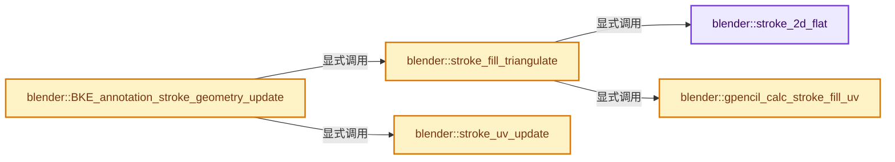

# 实现依赖专题：source/blender/blenkernel/intern/annotations_geom.cc

[实现依赖导航](../../README.md) · [符号索引](../../../00-课程指南/02-源码与提交索引/符号依赖与实现索引.md)

本专题从正文实际调用进入，集中保存共享实现。函数有稳定锚点，可从调用处直接跳到对应完整函数；递归与互相调用通过回链组织。

## 本文件的实现关系




## 完整成员与函数实现

<a id="f-bd07304e17d4e8cb"></a>

### `blender::stroke_2d_flat`

实现位置：[source/blender/blenkernel/intern/annotations_geom.cc](../../../../../../../source/blender/blenkernel/intern/annotations_geom.cc) · L34—L106。

接口参数：

- `const bGPDspoint *points`
- `int totpoints`
- `float (*points2d)[2]`
- `int *r_direction`

**教学注释版**

<!-- annotated:d3f79894346faa -->

```cpp
static void stroke_2d_flat(const bGPDspoint *points,
                           int totpoints,
                           float (*points2d)[2],
                           int *r_direction)
{
  BLI_assert(totpoints >= 2);

  const bGPDspoint *pt0 = &points[0];
  const bGPDspoint *pt1 = &points[1];
  const bGPDspoint *pt3 = &points[int(totpoints * 0.75)];

  float locx[3];
  float locy[3];
  float loc3[3];
  float normal[3];

  /* local X axis (p0 -> p1) */
  sub_v3_v3v3(locx, &pt1->x, &pt0->x);

  /* point vector at 3/4 */
  float v3[3];
  if (totpoints == 2) {
    mul_v3_v3fl(v3, &pt3->x, 0.001f);
  }
  else {
    copy_v3_v3(v3, &pt3->x);
  }

  sub_v3_v3v3(loc3, v3, &pt0->x);

  /* vector orthogonal to polygon plane */
  cross_v3_v3v3(normal, locx, loc3);

  /* local Y axis (cross to normal/x axis) */
  cross_v3_v3v3(locy, normal, locx);

  /* Normalize vectors */
  normalize_v3(locx);
  normalize_v3(locy);

  /* Calculate last point first. */
  const bGPDspoint *pt_last = &points[totpoints - 1];
  float tmp[3];
  sub_v3_v3v3(tmp, &pt_last->x, &pt0->x);

  points2d[totpoints - 1][0] = dot_v3v3(tmp, locx);
  points2d[totpoints - 1][1] = dot_v3v3(tmp, locy);

  /* Calculate the scalar cross product of the 2d points. */
  float cross = 0.0f;
  float *co_curr;
  float *co_prev = reinterpret_cast<float *>(&points2d[totpoints - 1]);

  /* Get all points in local space */
  for (int i = 0; i < totpoints - 1; i++) {
    const bGPDspoint *pt = &points[i];
    float loc[3];

    /* Get local space using first point as origin */
    sub_v3_v3v3(loc, &pt->x, &pt0->x);

    points2d[i][0] = dot_v3v3(loc, locx);
    points2d[i][1] = dot_v3v3(loc, locy);

    /* Calculate cross product. */
    co_curr = (&points2d[i][0]);
    cross += (co_curr[0] - co_prev[0]) * (co_curr[1] + co_prev[1]);
    co_prev = (&points2d[i][0]);
  }

  /* Concave (-1), Convex (1) */
  *r_direction = (cross >= 0.0f) ? 1 : -1;
}
```

<details>
<summary>核对原始源码：source/blender/blenkernel/intern/annotations_geom.cc · L34—L106</summary>

<!-- original:d3f79894346faa:source/blender/blenkernel/intern/annotations_geom.cc:34:106 -->

```cpp
static void stroke_2d_flat(const bGPDspoint *points,
                           int totpoints,
                           float (*points2d)[2],
                           int *r_direction)
{
  BLI_assert(totpoints >= 2);

  const bGPDspoint *pt0 = &points[0];
  const bGPDspoint *pt1 = &points[1];
  const bGPDspoint *pt3 = &points[int(totpoints * 0.75)];

  float locx[3];
  float locy[3];
  float loc3[3];
  float normal[3];

  /* local X axis (p0 -> p1) */
  sub_v3_v3v3(locx, &pt1->x, &pt0->x);

  /* point vector at 3/4 */
  float v3[3];
  if (totpoints == 2) {
    mul_v3_v3fl(v3, &pt3->x, 0.001f);
  }
  else {
    copy_v3_v3(v3, &pt3->x);
  }

  sub_v3_v3v3(loc3, v3, &pt0->x);

  /* vector orthogonal to polygon plane */
  cross_v3_v3v3(normal, locx, loc3);

  /* local Y axis (cross to normal/x axis) */
  cross_v3_v3v3(locy, normal, locx);

  /* Normalize vectors */
  normalize_v3(locx);
  normalize_v3(locy);

  /* Calculate last point first. */
  const bGPDspoint *pt_last = &points[totpoints - 1];
  float tmp[3];
  sub_v3_v3v3(tmp, &pt_last->x, &pt0->x);

  points2d[totpoints - 1][0] = dot_v3v3(tmp, locx);
  points2d[totpoints - 1][1] = dot_v3v3(tmp, locy);

  /* Calculate the scalar cross product of the 2d points. */
  float cross = 0.0f;
  float *co_curr;
  float *co_prev = reinterpret_cast<float *>(&points2d[totpoints - 1]);

  /* Get all points in local space */
  for (int i = 0; i < totpoints - 1; i++) {
    const bGPDspoint *pt = &points[i];
    float loc[3];

    /* Get local space using first point as origin */
    sub_v3_v3v3(loc, &pt->x, &pt0->x);

    points2d[i][0] = dot_v3v3(loc, locx);
    points2d[i][1] = dot_v3v3(loc, locy);

    /* Calculate cross product. */
    co_curr = (&points2d[i][0]);
    cross += (co_curr[0] - co_prev[0]) * (co_curr[1] + co_prev[1]);
    co_prev = (&points2d[i][0]);
  }

  /* Concave (-1), Convex (1) */
  *r_direction = (cross >= 0.0f) ? 1 : -1;
}
```

</details>

**沿实际写入检查状态**

- `points2d[i][0] = dot_v3v3(loc, locx);`
- `points2d[i][1] = dot_v3v3(loc, locy);`
- `co_curr = (&points2d[i][0]);`
- `cross += (co_curr[0] - co_prev[0]) * (co_curr[1] + co_prev[1]);`
- `co_prev = (&points2d[i][0]);`

**继续追踪实现**

- `BLI_assert` → [BLI_assert · L48](../../01-BLI基础库/BLI_assert.hh.md#m-57a88495704d)；[BLI_assert · L63](../../01-BLI基础库/BLI_assert.hh.md#m-d07050020cb5)。宏定义由构建条件选择。
- `sub_v3_v3v3` → [blender::sub_v3_v3v3 · L360](../../01-BLI基础库/intern/math_vector_inline.cc.md#f-23781c252db8b30c)。
- `mul_v3_v3fl` → [blender::mul_v3_v3fl · L428](../../01-BLI基础库/intern/math_vector_inline.cc.md#f-c3cb822497b967a8)。
- `copy_v3_v3` → [blender::copy_v3_v3 · L47](../../01-BLI基础库/intern/math_vector_inline.cc.md#f-037a0d5fa5060bd6)。
- `cross_v3_v3v3` → [blender::cross_v3_v3v3 · L690](../../01-BLI基础库/intern/math_vector_inline.cc.md#f-ac8d04405fb5dad4)。
- `normalize_v3` → [blender::normalize_v3 · L933](../../01-BLI基础库/intern/math_vector_inline.cc.md#f-5f3257e657ef732c)。
- `dot_v3v3` → [blender::dot_v3v3 · L646](../../01-BLI基础库/intern/math_vector_inline.cc.md#f-c88befa67d07591a)。

<a id="f-f0bfa4340fe789c3"></a>

### `blender::gpencil_calc_stroke_fill_uv`

实现位置：[source/blender/blenkernel/intern/annotations_geom.cc](../../../../../../../source/blender/blenkernel/intern/annotations_geom.cc) · L109—L145。

接口参数：

- `const float (*points2d)[2]`
- `bGPDstroke *gps`
- `const float minv[2]`
- `const float maxv[2]`
- `float (*r_uv)[2]`

**教学注释版**

<!-- annotated:0da3c3d7b452d2 -->

```cpp
static void gpencil_calc_stroke_fill_uv(const float (*points2d)[2],
                                        bGPDstroke *gps,
                                        const float minv[2],
                                        const float maxv[2],
                                        float (*r_uv)[2])
{
  const float s = sin(gps->uv_rotation);
  const float c = cos(gps->uv_rotation);

  /* Calc center for rotation. */
  const float center[2] = {0.5f, 0.5f};
  float d[2];
  d[0] = maxv[0] - minv[0];
  d[1] = maxv[1] - minv[1];
  for (int i = 0; i < gps->totpoints; i++) {
    r_uv[i][0] = (points2d[i][0] - minv[0]) / d[0];
    r_uv[i][1] = (points2d[i][1] - minv[1]) / d[1];

    /* Apply translation. */
    add_v2_v2(r_uv[i], gps->uv_translation);

    /* Apply Rotation. */
    r_uv[i][0] -= center[0];
    r_uv[i][1] -= center[1];

    float x = r_uv[i][0] * c - r_uv[i][1] * s;
    float y = r_uv[i][0] * s + r_uv[i][1] * c;

    r_uv[i][0] = x + center[0];
    r_uv[i][1] = y + center[1];

    /* Apply scale. */
    if (gps->uv_scale != 0.0f) {
      mul_v2_fl(r_uv[i], 1.0f / gps->uv_scale);
    }
  }
}
```

<details>
<summary>核对原始源码：source/blender/blenkernel/intern/annotations_geom.cc · L109—L145</summary>

<!-- original:0da3c3d7b452d2:source/blender/blenkernel/intern/annotations_geom.cc:109:145 -->

```cpp
static void gpencil_calc_stroke_fill_uv(const float (*points2d)[2],
                                        bGPDstroke *gps,
                                        const float minv[2],
                                        const float maxv[2],
                                        float (*r_uv)[2])
{
  const float s = sin(gps->uv_rotation);
  const float c = cos(gps->uv_rotation);

  /* Calc center for rotation. */
  const float center[2] = {0.5f, 0.5f};
  float d[2];
  d[0] = maxv[0] - minv[0];
  d[1] = maxv[1] - minv[1];
  for (int i = 0; i < gps->totpoints; i++) {
    r_uv[i][0] = (points2d[i][0] - minv[0]) / d[0];
    r_uv[i][1] = (points2d[i][1] - minv[1]) / d[1];

    /* Apply translation. */
    add_v2_v2(r_uv[i], gps->uv_translation);

    /* Apply Rotation. */
    r_uv[i][0] -= center[0];
    r_uv[i][1] -= center[1];

    float x = r_uv[i][0] * c - r_uv[i][1] * s;
    float y = r_uv[i][0] * s + r_uv[i][1] * c;

    r_uv[i][0] = x + center[0];
    r_uv[i][1] = y + center[1];

    /* Apply scale. */
    if (gps->uv_scale != 0.0f) {
      mul_v2_fl(r_uv[i], 1.0f / gps->uv_scale);
    }
  }
}
```

</details>

**沿实际写入检查状态**

- `d[0] = maxv[0] - minv[0];`
- `d[1] = maxv[1] - minv[1];`
- `r_uv[i][0] = (points2d[i][0] - minv[0]) / d[0];`
- `r_uv[i][1] = (points2d[i][1] - minv[1]) / d[1];`
- `r_uv[i][0] -= center[0];`
- `r_uv[i][1] -= center[1];`
- `r_uv[i][0] = x + center[0];`
- `r_uv[i][1] = y + center[1];`

**继续追踪实现**

- `sin` → [外部契约](https://eel.is/c++draft/)：这个边界按实际表达式及所属类型核对参数、返回值、寿命与失败行为。这里提供接口入口，不声称已解释该第三方版本的内部实现。
- `cos` → [外部契约](https://eel.is/c++draft/)：这个边界按实际表达式及所属类型核对参数、返回值、寿命与失败行为。这里提供接口入口，不声称已解释该第三方版本的内部实现。
- `add_v2_v2` → [blender::add_v2_v2 · L274](../../01-BLI基础库/intern/math_vector_inline.cc.md#f-1d5add4ac1b3a385)。
- `mul_v2_fl` → [blender::mul_v2_fl · L402](../../01-BLI基础库/intern/math_vector_inline.cc.md#f-01449ccd8e2e1640)。

<a id="f-3d436140ee2054bc"></a>

### `blender::stroke_fill_triangulate`

实现位置：[source/blender/blenkernel/intern/annotations_geom.cc](../../../../../../../source/blender/blenkernel/intern/annotations_geom.cc) · L153—L209。

接口参数：

- `bGPDstroke *gps`

**教学注释版**

<!-- annotated:d6d24cb9d6ee19 -->

```cpp
static void stroke_fill_triangulate(bGPDstroke *gps)
{
  BLI_assert(gps->totpoints >= 3);

  /* allocate memory for temporary areas */
  gps->tot_triangles = gps->totpoints - 2;
  uint(*tmp_triangles)[3] = MEM_new_array_uninitialized<uint[3]>(size_t(gps->tot_triangles),
                                                                 "GP Stroke temp triangulation");
  float (*points2d)[2] = MEM_new_array_uninitialized<float[2]>(size_t(gps->totpoints),
                                                               "GP Stroke temp 2d points");
  float (*uv)[2] = MEM_new_array_uninitialized<float[2]>(size_t(gps->totpoints),
                                                         "GP Stroke temp 2d uv data");

  int direction = 0;

  /* convert to 2d and triangulate */
  stroke_2d_flat(gps->points, gps->totpoints, points2d, &direction);
  BLI_polyfill_calc(points2d, uint(gps->totpoints), direction, tmp_triangles);

  /* calc texture coordinates automatically */
  float minv[2];
  float maxv[2];
  /* first needs bounding box data */
  ARRAY_SET_ITEMS(minv, -1.0f, -1.0f);
  ARRAY_SET_ITEMS(maxv, 1.0f, 1.0f);

  /* calc uv data */
  gpencil_calc_stroke_fill_uv(points2d, gps, minv, maxv, uv);

  /* Save triangulation data. */
  if (gps->tot_triangles > 0) {
    MEM_SAFE_DELETE(gps->triangles);
    gps->triangles = MEM_new_array<bGPDtriangle>(gps->tot_triangles, "GP Stroke triangulation");

    for (int i = 0; i < gps->tot_triangles; i++) {
      // [讲解] memcpy：复制字节，源与目标不应重叠。类型生命周期、对齐和可复制表示须由调用者证明，不是任意对象的复制构造。
      memcpy(gps->triangles[i].verts, tmp_triangles[i], sizeof(uint[3]));
    }

    /* Copy UVs to bGPDspoint. */
    for (int i = 0; i < gps->totpoints; i++) {
      copy_v2_v2(gps->points[i].uv_fill, uv[i]);
    }
  }
  else {
    /* No triangles needed - Free anything allocated previously */
    if (gps->triangles) {
      MEM_delete(gps->triangles);
    }

    gps->triangles = nullptr;
  }

  /* clear memory */
  MEM_SAFE_DELETE(tmp_triangles);
  MEM_SAFE_DELETE(points2d);
  MEM_SAFE_DELETE(uv);
}
```

<details>
<summary>核对原始源码：source/blender/blenkernel/intern/annotations_geom.cc · L153—L209</summary>

<!-- original:d6d24cb9d6ee19:source/blender/blenkernel/intern/annotations_geom.cc:153:209 -->

```cpp
static void stroke_fill_triangulate(bGPDstroke *gps)
{
  BLI_assert(gps->totpoints >= 3);

  /* allocate memory for temporary areas */
  gps->tot_triangles = gps->totpoints - 2;
  uint(*tmp_triangles)[3] = MEM_new_array_uninitialized<uint[3]>(size_t(gps->tot_triangles),
                                                                 "GP Stroke temp triangulation");
  float (*points2d)[2] = MEM_new_array_uninitialized<float[2]>(size_t(gps->totpoints),
                                                               "GP Stroke temp 2d points");
  float (*uv)[2] = MEM_new_array_uninitialized<float[2]>(size_t(gps->totpoints),
                                                         "GP Stroke temp 2d uv data");

  int direction = 0;

  /* convert to 2d and triangulate */
  stroke_2d_flat(gps->points, gps->totpoints, points2d, &direction);
  BLI_polyfill_calc(points2d, uint(gps->totpoints), direction, tmp_triangles);

  /* calc texture coordinates automatically */
  float minv[2];
  float maxv[2];
  /* first needs bounding box data */
  ARRAY_SET_ITEMS(minv, -1.0f, -1.0f);
  ARRAY_SET_ITEMS(maxv, 1.0f, 1.0f);

  /* calc uv data */
  gpencil_calc_stroke_fill_uv(points2d, gps, minv, maxv, uv);

  /* Save triangulation data. */
  if (gps->tot_triangles > 0) {
    MEM_SAFE_DELETE(gps->triangles);
    gps->triangles = MEM_new_array<bGPDtriangle>(gps->tot_triangles, "GP Stroke triangulation");

    for (int i = 0; i < gps->tot_triangles; i++) {
      memcpy(gps->triangles[i].verts, tmp_triangles[i], sizeof(uint[3]));
    }

    /* Copy UVs to bGPDspoint. */
    for (int i = 0; i < gps->totpoints; i++) {
      copy_v2_v2(gps->points[i].uv_fill, uv[i]);
    }
  }
  else {
    /* No triangles needed - Free anything allocated previously */
    if (gps->triangles) {
      MEM_delete(gps->triangles);
    }

    gps->triangles = nullptr;
  }

  /* clear memory */
  MEM_SAFE_DELETE(tmp_triangles);
  MEM_SAFE_DELETE(points2d);
  MEM_SAFE_DELETE(uv);
}
```

</details>

**沿实际写入检查状态**

- `gps->tot_triangles = gps->totpoints - 2;`
- `gps->triangles = MEM_new_array<bGPDtriangle>(gps->tot_triangles, "GP Stroke triangulation");`
- `gps->triangles = nullptr;`

**继续追踪实现**

- `BLI_assert` → [BLI_assert · L48](../../01-BLI基础库/BLI_assert.hh.md#m-57a88495704d)；[BLI_assert · L63](../../01-BLI基础库/BLI_assert.hh.md#m-d07050020cb5)。宏定义由构建条件选择。
- `MEM_new_array_uninitialized<uint[3]>` → [MEM_new_array_uninitialized · L608](../../07-Intern运行时与平台/guardedalloc/MEM_guardedalloc.h.md#f-b7103eae8eb57b05)；[MEM_new_array_uninitialized · L129](../../07-Intern运行时与平台/guardedalloc/intern/mallocn.cc.md#f-bf6ef4ddcfb6e5df)。同名重载需按实参类型选择。
- `MEM_new_array_uninitialized<float[2]>` → [MEM_new_array_uninitialized · L608](../../07-Intern运行时与平台/guardedalloc/MEM_guardedalloc.h.md#f-b7103eae8eb57b05)；[MEM_new_array_uninitialized · L129](../../07-Intern运行时与平台/guardedalloc/intern/mallocn.cc.md#f-bf6ef4ddcfb6e5df)。同名重载需按实参类型选择。
- `stroke_2d_flat` → [blender::stroke_2d_flat · L34](annotations_geom.cc.md#f-bd07304e17d4e8cb)。
- `BLI_polyfill_calc` → [blender::BLI_polyfill_calc · L1112](../../01-BLI基础库/intern/polyfill_2d.cc.md#f-88f1e5fb26ac2298)。
- `ARRAY_SET_ITEMS` → [ARRAY_SET_ITEMS · L304](../../01-BLI基础库/BLI_utildefines.hh.md#m-80336b50a95e)。宏定义由构建条件选择。
- `gpencil_calc_stroke_fill_uv` → [blender::gpencil_calc_stroke_fill_uv · L109](annotations_geom.cc.md#f-f0bfa4340fe789c3)。
- `MEM_SAFE_DELETE` → [MEM_SAFE_DELETE · L436](../../07-Intern运行时与平台/guardedalloc/MEM_guardedalloc.h.md#m-eadb3bc5b902)。宏定义由构建条件选择。
- `MEM_new_array<bGPDtriangle>` → [MEM_new_array · L372](../../07-Intern运行时与平台/guardedalloc/MEM_guardedalloc.h.md#f-56b8fe3d391af460)。
- `memcpy` → [外部契约](https://eel.is/c++draft/cstring.syn)：复制字节，源与目标不应重叠。类型生命周期、对齐和可复制表示须由调用者证明，不是任意对象的复制构造。
- `copy_v2_v2` → [blender::copy_v2_v2 · L41](../../01-BLI基础库/intern/math_vector_inline.cc.md#f-e736ee2dd71cd821)。
- `MEM_delete` → [MEM_delete · L400](../../07-Intern运行时与平台/guardedalloc/MEM_guardedalloc.h.md#f-9049ffdd1682887c)。

<a id="f-9ebfcf3069c026c4"></a>

### `blender::stroke_uv_update`

实现位置：[source/blender/blenkernel/intern/annotations_geom.cc](../../../../../../../source/blender/blenkernel/intern/annotations_geom.cc) · L211—L224。

接口参数：

- `bGPDstroke *gps`

**教学注释版**

<!-- annotated:21eb1cd787ab88 -->

```cpp
static void stroke_uv_update(bGPDstroke *gps)
{
  if (gps == nullptr || gps->totpoints == 0) {
    return;
  }

  bGPDspoint *pt = gps->points;
  float totlen = 0.0f;
  pt[0].uv_fac = totlen;
  for (int i = 1; i < gps->totpoints; i++) {
    totlen += len_v3v3(&pt[i - 1].x, &pt[i].x);
    pt[i].uv_fac = totlen;
  }
}
```

<details>
<summary>核对原始源码：source/blender/blenkernel/intern/annotations_geom.cc · L211—L224</summary>

<!-- original:21eb1cd787ab88:source/blender/blenkernel/intern/annotations_geom.cc:211:224 -->

```cpp
static void stroke_uv_update(bGPDstroke *gps)
{
  if (gps == nullptr || gps->totpoints == 0) {
    return;
  }

  bGPDspoint *pt = gps->points;
  float totlen = 0.0f;
  pt[0].uv_fac = totlen;
  for (int i = 1; i < gps->totpoints; i++) {
    totlen += len_v3v3(&pt[i - 1].x, &pt[i].x);
    pt[i].uv_fac = totlen;
  }
}
```

</details>

**沿实际写入检查状态**

- `pt[0].uv_fac = totlen;`
- `totlen += len_v3v3(&pt[i - 1].x, &pt[i].x);`
- `pt[i].uv_fac = totlen;`

**继续追踪实现**

- `len_v3v3` → [blender::len_v3v3 · L826](../../01-BLI基础库/intern/math_vector_inline.cc.md#f-c873370566848169)。

<a id="f-e86c303a529e87ea"></a>

### `blender::BKE_annotation_stroke_geometry_update`

实现位置：[source/blender/blenkernel/intern/annotations_geom.cc](../../../../../../../source/blender/blenkernel/intern/annotations_geom.cc) · L226—L242。

接口参数：

- `bGPdata *`
- `bGPDstroke *gps`

**教学注释版**

<!-- annotated:29fc2fbf1a5203 -->

```cpp
void BKE_annotation_stroke_geometry_update(bGPdata * /*gpd*/, bGPDstroke *gps)
{
  if (gps == nullptr) {
    return;
  }

  if (gps->totpoints > 2) {
    stroke_fill_triangulate(gps);
  }
  else {
    gps->tot_triangles = 0;
    MEM_SAFE_DELETE(gps->triangles);
  }

  /* calc uv data along the stroke */
  stroke_uv_update(gps);
}
```

<details>
<summary>核对原始源码：source/blender/blenkernel/intern/annotations_geom.cc · L226—L242</summary>

<!-- original:29fc2fbf1a5203:source/blender/blenkernel/intern/annotations_geom.cc:226:242 -->

```cpp
void BKE_annotation_stroke_geometry_update(bGPdata * /*gpd*/, bGPDstroke *gps)
{
  if (gps == nullptr) {
    return;
  }

  if (gps->totpoints > 2) {
    stroke_fill_triangulate(gps);
  }
  else {
    gps->tot_triangles = 0;
    MEM_SAFE_DELETE(gps->triangles);
  }

  /* calc uv data along the stroke */
  stroke_uv_update(gps);
}
```

</details>

**沿实际写入检查状态**

- `gps->tot_triangles = 0;`

**继续追踪实现**

- `stroke_fill_triangulate` → [blender::stroke_fill_triangulate · L153](annotations_geom.cc.md#f-3d436140ee2054bc)。
- `MEM_SAFE_DELETE` → [MEM_SAFE_DELETE · L436](../../07-Intern运行时与平台/guardedalloc/MEM_guardedalloc.h.md#m-eadb3bc5b902)。宏定义由构建条件选择。
- `stroke_uv_update` → [blender::stroke_uv_update · L211](annotations_geom.cc.md#f-9ebfcf3069c026c4)。
