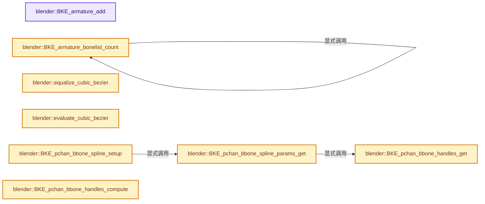
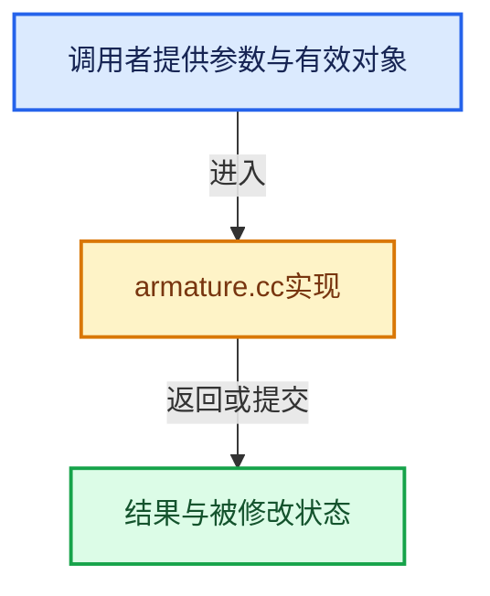

# 实现依赖专题：source/blender/blenkernel/intern/armature.cc

[实现依赖导航](../../README.md) · [符号索引](../../../00-课程指南/02-源码与提交索引/符号依赖与实现索引.md)

本专题从正文实际调用进入，集中保存共享实现。函数有稳定锚点，可从调用处直接跳到对应完整函数；递归与互相调用通过回链组织。

## 本文件的实现关系






## 完整成员与函数实现

<a id="f-60a5db078b124cdb"></a>

### `blender::BKE_armature_add`

实现位置：[source/blender/blenkernel/intern/armature.cc](../../../../../../../source/blender/blenkernel/intern/armature.cc) · L620—L626。

接口参数：

- `Main *bmain`
- `const char *name`

**教学注释版**

<!-- annotated:4eeef75b79c83d -->

```cpp
bArmature *BKE_armature_add(Main *bmain, const char *name)
{
  bArmature *arm;

  arm = BKE_id_new<bArmature>(bmain, name);
  return arm;
}
```

<details>
<summary>核对原始源码：source/blender/blenkernel/intern/armature.cc · L620—L626</summary>

<!-- original:4eeef75b79c83d:source/blender/blenkernel/intern/armature.cc:620:626 -->

```cpp
bArmature *BKE_armature_add(Main *bmain, const char *name)
{
  bArmature *arm;

  arm = BKE_id_new<bArmature>(bmain, name);
  return arm;
}
```

</details>

**沿实际写入检查状态**

- `arm = BKE_id_new<bArmature>(bmain, name);`

**结果出口**

- `return arm;`

**继续追踪实现**

- `BKE_id_new<bArmature>` → [blender::BKE_id_new · L1612](lib_id.cc.md#f-5335c97ce0a8fbc8)。

<a id="f-93b82ad00c32f43b"></a>

### `blender::BKE_armature_bonelist_count`

实现位置：[source/blender/blenkernel/intern/armature.cc](../../../../../../../source/blender/blenkernel/intern/armature.cc) · L636—L644。

接口参数：

- `const ListBaseT<Bone> *lb`

**教学注释版**

<!-- annotated:703e368eb8e607 -->

```cpp
int BKE_armature_bonelist_count(const ListBaseT<Bone> *lb)
{
  int i = 0;
  for (Bone &bone : *lb) {
    i += 1 + BKE_armature_bonelist_count(&bone.childbase);
  }

  return i;
}
```

<details>
<summary>核对原始源码：source/blender/blenkernel/intern/armature.cc · L636—L644</summary>

<!-- original:703e368eb8e607:source/blender/blenkernel/intern/armature.cc:636:644 -->

```cpp
int BKE_armature_bonelist_count(const ListBaseT<Bone> *lb)
{
  int i = 0;
  for (Bone &bone : *lb) {
    i += 1 + BKE_armature_bonelist_count(&bone.childbase);
  }

  return i;
}
```

</details>

**沿实际写入检查状态**

- `i += 1 + BKE_armature_bonelist_count(&bone.childbase);`

**结果出口**

- `return i;`

**继续追踪实现**

- `BKE_armature_bonelist_count` → [blender::BKE_armature_bonelist_count · L636](armature.cc.md#f-93b82ad00c32f43b)。

<a id="f-11a0d705e392594a"></a>

### `blender::equalize_cubic_bezier`

实现位置：[source/blender/blenkernel/intern/armature.cc](../../../../../../../source/blender/blenkernel/intern/armature.cc) · L1098—L1151。

接口参数：

- `const float control[4][3]`
- `int temp_segments`
- `int final_segments`
- `const float *segment_scales`
- `float *r_t_points`

**教学注释版**

<!-- annotated:3edba1d23fe183 -->

```cpp
static void equalize_cubic_bezier(const float control[4][3],
                                  int temp_segments,
                                  int final_segments,
                                  const float *segment_scales,
                                  float *r_t_points)
{
  float (*coords)[3] = static_cast<float (*)[3]>(BLI_array_alloca(coords, temp_segments + 1));
  float *pdist = static_cast<float *>(BLI_array_alloca(pdist, temp_segments + 1));

  /* Compute the first pass of bezier point coordinates. */
  for (int i = 0; i < 3; i++) {
    BKE_curve_forward_diff_bezier(control[0][i],
                                  control[1][i],
                                  control[2][i],
                                  control[3][i],
                                  &coords[0][i],
                                  temp_segments,
                                  sizeof(*coords));
  }

  /* Calculate the length of the polyline at each point. */
  pdist[0] = 0.0f;

  for (int i = 0; i < temp_segments; i++) {
    pdist[i + 1] = pdist[i] + len_v3v3(coords[i], coords[i + 1]);
  }

  /* Go over distances and calculate new parameter values. */
  float dist_step = pdist[temp_segments];
  float dist = 0, sum = 0;

  for (int i = 0; i < final_segments; i++) {
    sum += segment_scales[i];
  }

  dist_step /= sum;

  r_t_points[0] = 0.0f;

  for (int i = 1, nr = 1; i <= final_segments; i++) {
    dist += segment_scales[i - 1] * dist_step;

    /* We're looking for location (distance) 'dist' in the array. */
    while ((nr < temp_segments) && (dist >= pdist[nr])) {
      nr++;
    }

    float fac = (pdist[nr] - dist) / (pdist[nr] - pdist[nr - 1]);

    r_t_points[i] = (nr - fac) / temp_segments;
  }

  r_t_points[final_segments] = 1.0f;
}
```

<details>
<summary>核对原始源码：source/blender/blenkernel/intern/armature.cc · L1098—L1151</summary>

<!-- original:3edba1d23fe183:source/blender/blenkernel/intern/armature.cc:1098:1151 -->

```cpp
static void equalize_cubic_bezier(const float control[4][3],
                                  int temp_segments,
                                  int final_segments,
                                  const float *segment_scales,
                                  float *r_t_points)
{
  float (*coords)[3] = static_cast<float (*)[3]>(BLI_array_alloca(coords, temp_segments + 1));
  float *pdist = static_cast<float *>(BLI_array_alloca(pdist, temp_segments + 1));

  /* Compute the first pass of bezier point coordinates. */
  for (int i = 0; i < 3; i++) {
    BKE_curve_forward_diff_bezier(control[0][i],
                                  control[1][i],
                                  control[2][i],
                                  control[3][i],
                                  &coords[0][i],
                                  temp_segments,
                                  sizeof(*coords));
  }

  /* Calculate the length of the polyline at each point. */
  pdist[0] = 0.0f;

  for (int i = 0; i < temp_segments; i++) {
    pdist[i + 1] = pdist[i] + len_v3v3(coords[i], coords[i + 1]);
  }

  /* Go over distances and calculate new parameter values. */
  float dist_step = pdist[temp_segments];
  float dist = 0, sum = 0;

  for (int i = 0; i < final_segments; i++) {
    sum += segment_scales[i];
  }

  dist_step /= sum;

  r_t_points[0] = 0.0f;

  for (int i = 1, nr = 1; i <= final_segments; i++) {
    dist += segment_scales[i - 1] * dist_step;

    /* We're looking for location (distance) 'dist' in the array. */
    while ((nr < temp_segments) && (dist >= pdist[nr])) {
      nr++;
    }

    float fac = (pdist[nr] - dist) / (pdist[nr] - pdist[nr - 1]);

    r_t_points[i] = (nr - fac) / temp_segments;
  }

  r_t_points[final_segments] = 1.0f;
}
```

</details>

**沿实际写入检查状态**

- `pdist[0] = 0.0f;`
- `sum += segment_scales[i];`
- `r_t_points[0] = 0.0f;`
- `dist += segment_scales[i - 1] * dist_step;`
- `r_t_points[i] = (nr - fac) / temp_segments;`
- `r_t_points[final_segments] = 1.0f;`

**继续追踪实现**

- `BLI_array_alloca` → [BLI_array_alloca · L18](../../01-BLI基础库/BLI_alloca.hh.md#m-6f2643116b59)。宏定义由构建条件选择。
- `BKE_curve_forward_diff_bezier` → [blender::BKE_curve_forward_diff_bezier · L1696](curve.cc.md#f-2796edbd071c95c8)。
- `len_v3v3` → [blender::len_v3v3 · L826](../../01-BLI基础库/intern/math_vector_inline.cc.md#f-c873370566848169)。

<a id="f-c20df2dd1c04c31e"></a>

### `blender::evaluate_cubic_bezier`

实现位置：[source/blender/blenkernel/intern/armature.cc](../../../../../../../source/blender/blenkernel/intern/armature.cc) · L1155—L1171。

接口参数：

- `const float control[4][3]`
- `float t`
- `float r_pos[3]`
- `float r_tangent[3]`

**教学注释版**

<!-- annotated:6dcd021779eaea -->

```cpp
static void evaluate_cubic_bezier(const float control[4][3],
                                  float t,
                                  float r_pos[3],
                                  float r_tangent[3])
{
  float layer1[3][3];
  interp_v3_v3v3(layer1[0], control[0], control[1], t);
  interp_v3_v3v3(layer1[1], control[1], control[2], t);
  interp_v3_v3v3(layer1[2], control[2], control[3], t);

  float layer2[2][3];
  interp_v3_v3v3(layer2[0], layer1[0], layer1[1], t);
  interp_v3_v3v3(layer2[1], layer1[1], layer1[2], t);

  sub_v3_v3v3(r_tangent, layer2[1], layer2[0]);
  madd_v3_v3v3fl(r_pos, layer2[0], r_tangent, t);
}
```

<details>
<summary>核对原始源码：source/blender/blenkernel/intern/armature.cc · L1155—L1171</summary>

<!-- original:6dcd021779eaea:source/blender/blenkernel/intern/armature.cc:1155:1171 -->

```cpp
static void evaluate_cubic_bezier(const float control[4][3],
                                  float t,
                                  float r_pos[3],
                                  float r_tangent[3])
{
  float layer1[3][3];
  interp_v3_v3v3(layer1[0], control[0], control[1], t);
  interp_v3_v3v3(layer1[1], control[1], control[2], t);
  interp_v3_v3v3(layer1[2], control[2], control[3], t);

  float layer2[2][3];
  interp_v3_v3v3(layer2[0], layer1[0], layer1[1], t);
  interp_v3_v3v3(layer2[1], layer1[1], layer1[2], t);

  sub_v3_v3v3(r_tangent, layer2[1], layer2[0]);
  madd_v3_v3v3fl(r_pos, layer2[0], r_tangent, t);
}
```

</details>

**继续追踪实现**

- `interp_v3_v3v3` → [blender::interp_v3_v3v3 · L41](../../01-BLI基础库/intern/math_vector.cc.md#f-18251c70c00824d7)。
- `sub_v3_v3v3` → [blender::sub_v3_v3v3 · L360](../../01-BLI基础库/intern/math_vector_inline.cc.md#f-23781c252db8b30c)。
- `madd_v3_v3v3fl` → [blender::madd_v3_v3v3fl · L514](../../01-BLI基础库/intern/math_vector_inline.cc.md#f-862faf7c108f3bb8)。

<a id="f-134258dd866e2a82"></a>

### `blender::BKE_pchan_bbone_handles_get`

实现位置：[source/blender/blenkernel/intern/armature.cc](../../../../../../../source/blender/blenkernel/intern/armature.cc) · L1173—L1199。

接口参数：

- `bke::PChanBoneConst pchanbone`
- `bPoseChannel **r_prev`
- `bPoseChannel **r_next`

**教学注释版**

<!-- annotated:7bce13ff65603d -->

```cpp
void BKE_pchan_bbone_handles_get(bke::PChanBoneConst pchanbone,
                                 bPoseChannel **r_prev,
                                 bPoseChannel **r_next)
{
  if (pchanbone.bone->bbone_prev_type == BBONE_HANDLE_AUTO) {
    /* Use connected parent. */
    if (pchanbone.bone->flag & BONE_CONNECTED) {
      *r_prev = pchanbone.pchan->parent;
    }
    else {
      *r_prev = nullptr;
    }
  }
  else {
    /* Use the provided bone as prev - leave blank to eliminate this effect altogether. */
    *r_prev = pchanbone.pchan->bbone_prev;
  }

  if (pchanbone.bone->bbone_next_type == BBONE_HANDLE_AUTO) {
    /* Use connected child. */
    *r_next = pchanbone.pchan->child;
  }
  else {
    /* Use the provided bone as next - leave blank to eliminate this effect altogether. */
    *r_next = pchanbone.pchan->bbone_next;
  }
}
```

<details>
<summary>核对原始源码：source/blender/blenkernel/intern/armature.cc · L1173—L1199</summary>

<!-- original:7bce13ff65603d:source/blender/blenkernel/intern/armature.cc:1173:1199 -->

```cpp
void BKE_pchan_bbone_handles_get(bke::PChanBoneConst pchanbone,
                                 bPoseChannel **r_prev,
                                 bPoseChannel **r_next)
{
  if (pchanbone.bone->bbone_prev_type == BBONE_HANDLE_AUTO) {
    /* Use connected parent. */
    if (pchanbone.bone->flag & BONE_CONNECTED) {
      *r_prev = pchanbone.pchan->parent;
    }
    else {
      *r_prev = nullptr;
    }
  }
  else {
    /* Use the provided bone as prev - leave blank to eliminate this effect altogether. */
    *r_prev = pchanbone.pchan->bbone_prev;
  }

  if (pchanbone.bone->bbone_next_type == BBONE_HANDLE_AUTO) {
    /* Use connected child. */
    *r_next = pchanbone.pchan->child;
  }
  else {
    /* Use the provided bone as next - leave blank to eliminate this effect altogether. */
    *r_next = pchanbone.pchan->bbone_next;
  }
}
```

</details>

**继续追踪实现**

本实现没有需要继续展开的显式调用；检查返回表达式、对象转换和调用者前置条件。

<a id="f-77b1bfd6d6b146fa"></a>

### `blender::BKE_pchan_bbone_spline_params_get`

实现位置：[source/blender/blenkernel/intern/armature.cc](../../../../../../../source/blender/blenkernel/intern/armature.cc) · L1201—L1452。

接口参数：

- `bke::PChanBoneConst pchanbone`
- `const bArmature &armature`
- `const bool rest`
- `BBoneSplineParameters *param`

**教学注释版**

<!-- annotated:9012ca43e9d794 -->

```cpp
void BKE_pchan_bbone_spline_params_get(bke::PChanBoneConst pchanbone,
                                       const bArmature &armature,
                                       const bool rest,
                                       BBoneSplineParameters *param)
{
  const bPoseChannel *pchan = pchanbone.pchan;
  const Bone *bone = pchanbone.bone;

  float imat[4][4], posemat[4][4], tmpmat[4][4];
  float delta[3];

  // [讲解] memset：填充字节，不调用T构造函数，也不保证任意类型的全零表示是合法或期望值。
  memset(param, 0, sizeof(*param));

  param->segments = pchanbone.bone->segments;
  param->length = pchanbone.bone->length;

  if (!rest) {
    float scale[3];

    /* Check if we need to take non-uniform bone scaling into account. */
    mat4_to_size(scale, pchan->pose_mat);

    if (fabsf(scale[0] - scale[1]) > 1e-6f || fabsf(scale[1] - scale[2]) > 1e-6f) {
      param->do_scale = true;
      copy_v3_v3(param->scale, scale);
    }
  }

  bPoseChannel *next, *prev;
  BKE_pchan_bbone_handles_get(pchanbone, &prev, &next);
  const Bone *next_bone = next ? next->bone_get(armature) : nullptr;
  const Bone *prev_bone = prev ? prev->bone_get(armature) : nullptr;

  /* Find the handle points, since this is inside bone space, the
   * first point = (0, 0, 0)
   * last point =  (0, length, 0) */
  if (rest) {
    invert_m4_m4(imat, pchanbone.bone->arm_mat);
  }
  else if (param->do_scale) {
    copy_m4_m4(posemat, pchan->pose_mat);
    normalize_m4(posemat);
    invert_m4_m4(imat, posemat);
  }
  else {
    invert_m4_m4(imat, pchan->pose_mat);
  }

  float prev_scale[3], next_scale[3];

  copy_v3_fl(prev_scale, 1.0f);
  copy_v3_fl(next_scale, 1.0f);

  if (prev) {
    float h1[3];
    bool done = false;
    const Bone *bone = pchanbone.bone;

    param->use_prev = true;

    /* Transform previous point inside this bone space. */
    if (bone->bbone_prev_type == BBONE_HANDLE_RELATIVE) {
      /* Use delta movement (from rest-pose),
       * and apply this relative to the current bone's head. */
      if (rest) {
        /* In rest-pose, arm_head == pose_head */
        zero_v3(param->prev_h);
        done = true;
      }
      else {
        sub_v3_v3v3(delta, prev->pose_head, prev_bone->arm_head);
        sub_v3_v3v3(h1, pchan->pose_head, delta);
      }
    }
    else if (bone->bbone_prev_type == BBONE_HANDLE_TANGENT) {
      /* Use bone direction by offsetting so that its tail meets current bone's head */
      if (rest) {
        sub_v3_v3v3(delta, prev_bone->arm_tail, prev_bone->arm_head);
        sub_v3_v3v3(h1, bone->arm_head, delta);
      }
      else {
        sub_v3_v3v3(delta, prev->pose_tail, prev->pose_head);
        sub_v3_v3v3(h1, pchan->pose_head, delta);
      }
    }
    else {
      /* Apply special handling for smoothly joining B-Bone chains */
      param->prev_bbone = (prev_bone->segments > 1);

      /* Use bone head as absolute position. */
      copy_v3_v3(h1, rest ? prev_bone->arm_head : prev->pose_head);
    }

    if (!done) {
      mul_v3_m4v3(param->prev_h, imat, h1);
    }

    if (!param->prev_bbone) {
      /* Find the previous roll to interpolate. */
      mul_m4_m4m4(param->prev_mat, imat, rest ? prev_bone->arm_mat : prev->pose_mat);

      /* Retrieve the local scale of the bone if necessary. */
      if ((bone->bbone_prev_flag & BBONE_HANDLE_SCALE_ANY) && !rest) {
        BKE_armature_mat_pose_to_bone({prev, prev_bone}, prev->pose_mat, tmpmat);
        mat4_to_size(prev_scale, tmpmat);
      }
    }
  }

  if (next) {
    float h2[3];
    bool done = false;

    param->use_next = true;

    /* Transform next point inside this bone space. */
    if (bone->bbone_next_type == BBONE_HANDLE_RELATIVE) {
      /* Use delta movement (from rest-pose),
       * and apply this relative to the current bone's tail. */
      if (rest) {
        /* In rest-pose, arm_head == pose_head */
        copy_v3_fl3(param->next_h, 0.0f, param->length, 0.0);
        done = true;
      }
      else {
        sub_v3_v3v3(delta, next->pose_head, next_bone->arm_head);
        add_v3_v3v3(h2, pchan->pose_tail, delta);
      }
    }
    else if (bone->bbone_next_type == BBONE_HANDLE_TANGENT) {
      /* Use bone direction by offsetting so that its head meets current bone's tail */
      if (rest) {
        sub_v3_v3v3(delta, next_bone->arm_tail, next_bone->arm_head);
        add_v3_v3v3(h2, bone->arm_tail, delta);
      }
      else {
        sub_v3_v3v3(delta, next->pose_tail, next->pose_head);
        add_v3_v3v3(h2, pchan->pose_tail, delta);
      }
    }
    else {
      /* Apply special handling for smoothly joining B-Bone chains */
      param->next_bbone = (next_bone->segments > 1);

      /* Use bone tail as absolute position. */
      copy_v3_v3(h2, rest ? next_bone->arm_tail : next->pose_tail);
    }

    if (!done) {
      mul_v3_m4v3(param->next_h, imat, h2);
    }

    /* Find the next roll to interpolate as well. */
    mul_m4_m4m4(param->next_mat, imat, rest ? next_bone->arm_mat : next->pose_mat);

    /* Retrieve the local scale of the bone if necessary. */
    if ((bone->bbone_next_flag & BBONE_HANDLE_SCALE_ANY) && !rest) {
      BKE_armature_mat_pose_to_bone({next, next_bone}, next->pose_mat, tmpmat);
      mat4_to_size(next_scale, tmpmat);
    }
  }

  /* Add effects from bbone properties over the top
   * - These properties allow users to hand-animate the
   *   bone curve/shape, without having to resort to using
   *   extra bones
   * - The "bone" level offsets are for defining the rest-pose
   *   shape of the bone (e.g. for curved eyebrows for example).
   *   -> In the viewport, it's needed to define what the rest pose
   *      looks like
   *   -> For "rest == 0", we also still need to have it present
   *      so that we can "cancel out" this rest-pose when it comes
   *      time to deform some geometry, it won't cause double transforms.
   * - The "pchan" level offsets are the ones that animators actually
   *   end up animating
   */
  {
    param->ease1 = bone->ease1 + (!rest ? pchan->ease1 : 0.0f);
    param->ease2 = bone->ease2 + (!rest ? pchan->ease2 : 0.0f);

    param->roll1 = bone->roll1 + (!rest ? pchan->roll1 : 0.0f);
    param->roll2 = bone->roll2 + (!rest ? pchan->roll2 : 0.0f);

    if (bone->bbone_flag & BBONE_ADD_PARENT_END_ROLL) {
      if (prev) {
        if (prev_bone) {
          param->roll1 += prev_bone->roll2;
        }

        if (!rest) {
          param->roll1 += prev->roll2;
        }
      }
    }

    copy_v3_v3(param->scale_in, bone->scale_in);
    copy_v3_v3(param->scale_out, bone->scale_out);

    if (!rest) {
      mul_v3_v3(param->scale_in, pchan->scale_in);
      mul_v3_v3(param->scale_out, pchan->scale_out);
    }

    /* Extra curve x / z */
    param->curve_in_x = bone->curve_in_x + (!rest ? pchan->curve_in_x : 0.0f);
    param->curve_in_z = bone->curve_in_z + (!rest ? pchan->curve_in_z : 0.0f);

    param->curve_out_x = bone->curve_out_x + (!rest ? pchan->curve_out_x : 0.0f);
    param->curve_out_z = bone->curve_out_z + (!rest ? pchan->curve_out_z : 0.0f);

    if (bone->bbone_flag & BBONE_SCALE_EASING) {
      param->ease1 *= param->scale_in[1];
      param->curve_in_x *= param->scale_in[1];
      param->curve_in_z *= param->scale_in[1];

      param->ease2 *= param->scale_out[1];
      param->curve_out_x *= param->scale_out[1];
      param->curve_out_z *= param->scale_out[1];
    }

    /* Custom handle scale. */
    if (bone->bbone_prev_flag & BBONE_HANDLE_SCALE_X) {
      param->scale_in[0] *= prev_scale[0];
    }
    if (bone->bbone_prev_flag & BBONE_HANDLE_SCALE_Y) {
      param->scale_in[1] *= prev_scale[1];
    }
    if (bone->bbone_prev_flag & BBONE_HANDLE_SCALE_Z) {
      param->scale_in[2] *= prev_scale[2];
    }
    if (bone->bbone_prev_flag & BBONE_HANDLE_SCALE_EASE) {
      param->ease1 *= prev_scale[1];
      param->curve_in_x *= prev_scale[1];
      param->curve_in_z *= prev_scale[1];
    }

    if (bone->bbone_next_flag & BBONE_HANDLE_SCALE_X) {
      param->scale_out[0] *= next_scale[0];
    }
    if (bone->bbone_next_flag & BBONE_HANDLE_SCALE_Y) {
      param->scale_out[1] *= next_scale[1];
    }
    if (bone->bbone_next_flag & BBONE_HANDLE_SCALE_Z) {
      param->scale_out[2] *= next_scale[2];
    }
    if (bone->bbone_next_flag & BBONE_HANDLE_SCALE_EASE) {
      param->ease2 *= next_scale[1];
      param->curve_out_x *= next_scale[1];
      param->curve_out_z *= next_scale[1];
    }
  }
}
```

<details>
<summary>核对原始源码：source/blender/blenkernel/intern/armature.cc · L1201—L1452</summary>

<!-- original:9012ca43e9d794:source/blender/blenkernel/intern/armature.cc:1201:1452 -->

```cpp
void BKE_pchan_bbone_spline_params_get(bke::PChanBoneConst pchanbone,
                                       const bArmature &armature,
                                       const bool rest,
                                       BBoneSplineParameters *param)
{
  const bPoseChannel *pchan = pchanbone.pchan;
  const Bone *bone = pchanbone.bone;

  float imat[4][4], posemat[4][4], tmpmat[4][4];
  float delta[3];

  memset(param, 0, sizeof(*param));

  param->segments = pchanbone.bone->segments;
  param->length = pchanbone.bone->length;

  if (!rest) {
    float scale[3];

    /* Check if we need to take non-uniform bone scaling into account. */
    mat4_to_size(scale, pchan->pose_mat);

    if (fabsf(scale[0] - scale[1]) > 1e-6f || fabsf(scale[1] - scale[2]) > 1e-6f) {
      param->do_scale = true;
      copy_v3_v3(param->scale, scale);
    }
  }

  bPoseChannel *next, *prev;
  BKE_pchan_bbone_handles_get(pchanbone, &prev, &next);
  const Bone *next_bone = next ? next->bone_get(armature) : nullptr;
  const Bone *prev_bone = prev ? prev->bone_get(armature) : nullptr;

  /* Find the handle points, since this is inside bone space, the
   * first point = (0, 0, 0)
   * last point =  (0, length, 0) */
  if (rest) {
    invert_m4_m4(imat, pchanbone.bone->arm_mat);
  }
  else if (param->do_scale) {
    copy_m4_m4(posemat, pchan->pose_mat);
    normalize_m4(posemat);
    invert_m4_m4(imat, posemat);
  }
  else {
    invert_m4_m4(imat, pchan->pose_mat);
  }

  float prev_scale[3], next_scale[3];

  copy_v3_fl(prev_scale, 1.0f);
  copy_v3_fl(next_scale, 1.0f);

  if (prev) {
    float h1[3];
    bool done = false;
    const Bone *bone = pchanbone.bone;

    param->use_prev = true;

    /* Transform previous point inside this bone space. */
    if (bone->bbone_prev_type == BBONE_HANDLE_RELATIVE) {
      /* Use delta movement (from rest-pose),
       * and apply this relative to the current bone's head. */
      if (rest) {
        /* In rest-pose, arm_head == pose_head */
        zero_v3(param->prev_h);
        done = true;
      }
      else {
        sub_v3_v3v3(delta, prev->pose_head, prev_bone->arm_head);
        sub_v3_v3v3(h1, pchan->pose_head, delta);
      }
    }
    else if (bone->bbone_prev_type == BBONE_HANDLE_TANGENT) {
      /* Use bone direction by offsetting so that its tail meets current bone's head */
      if (rest) {
        sub_v3_v3v3(delta, prev_bone->arm_tail, prev_bone->arm_head);
        sub_v3_v3v3(h1, bone->arm_head, delta);
      }
      else {
        sub_v3_v3v3(delta, prev->pose_tail, prev->pose_head);
        sub_v3_v3v3(h1, pchan->pose_head, delta);
      }
    }
    else {
      /* Apply special handling for smoothly joining B-Bone chains */
      param->prev_bbone = (prev_bone->segments > 1);

      /* Use bone head as absolute position. */
      copy_v3_v3(h1, rest ? prev_bone->arm_head : prev->pose_head);
    }

    if (!done) {
      mul_v3_m4v3(param->prev_h, imat, h1);
    }

    if (!param->prev_bbone) {
      /* Find the previous roll to interpolate. */
      mul_m4_m4m4(param->prev_mat, imat, rest ? prev_bone->arm_mat : prev->pose_mat);

      /* Retrieve the local scale of the bone if necessary. */
      if ((bone->bbone_prev_flag & BBONE_HANDLE_SCALE_ANY) && !rest) {
        BKE_armature_mat_pose_to_bone({prev, prev_bone}, prev->pose_mat, tmpmat);
        mat4_to_size(prev_scale, tmpmat);
      }
    }
  }

  if (next) {
    float h2[3];
    bool done = false;

    param->use_next = true;

    /* Transform next point inside this bone space. */
    if (bone->bbone_next_type == BBONE_HANDLE_RELATIVE) {
      /* Use delta movement (from rest-pose),
       * and apply this relative to the current bone's tail. */
      if (rest) {
        /* In rest-pose, arm_head == pose_head */
        copy_v3_fl3(param->next_h, 0.0f, param->length, 0.0);
        done = true;
      }
      else {
        sub_v3_v3v3(delta, next->pose_head, next_bone->arm_head);
        add_v3_v3v3(h2, pchan->pose_tail, delta);
      }
    }
    else if (bone->bbone_next_type == BBONE_HANDLE_TANGENT) {
      /* Use bone direction by offsetting so that its head meets current bone's tail */
      if (rest) {
        sub_v3_v3v3(delta, next_bone->arm_tail, next_bone->arm_head);
        add_v3_v3v3(h2, bone->arm_tail, delta);
      }
      else {
        sub_v3_v3v3(delta, next->pose_tail, next->pose_head);
        add_v3_v3v3(h2, pchan->pose_tail, delta);
      }
    }
    else {
      /* Apply special handling for smoothly joining B-Bone chains */
      param->next_bbone = (next_bone->segments > 1);

      /* Use bone tail as absolute position. */
      copy_v3_v3(h2, rest ? next_bone->arm_tail : next->pose_tail);
    }

    if (!done) {
      mul_v3_m4v3(param->next_h, imat, h2);
    }

    /* Find the next roll to interpolate as well. */
    mul_m4_m4m4(param->next_mat, imat, rest ? next_bone->arm_mat : next->pose_mat);

    /* Retrieve the local scale of the bone if necessary. */
    if ((bone->bbone_next_flag & BBONE_HANDLE_SCALE_ANY) && !rest) {
      BKE_armature_mat_pose_to_bone({next, next_bone}, next->pose_mat, tmpmat);
      mat4_to_size(next_scale, tmpmat);
    }
  }

  /* Add effects from bbone properties over the top
   * - These properties allow users to hand-animate the
   *   bone curve/shape, without having to resort to using
   *   extra bones
   * - The "bone" level offsets are for defining the rest-pose
   *   shape of the bone (e.g. for curved eyebrows for example).
   *   -> In the viewport, it's needed to define what the rest pose
   *      looks like
   *   -> For "rest == 0", we also still need to have it present
   *      so that we can "cancel out" this rest-pose when it comes
   *      time to deform some geometry, it won't cause double transforms.
   * - The "pchan" level offsets are the ones that animators actually
   *   end up animating
   */
  {
    param->ease1 = bone->ease1 + (!rest ? pchan->ease1 : 0.0f);
    param->ease2 = bone->ease2 + (!rest ? pchan->ease2 : 0.0f);

    param->roll1 = bone->roll1 + (!rest ? pchan->roll1 : 0.0f);
    param->roll2 = bone->roll2 + (!rest ? pchan->roll2 : 0.0f);

    if (bone->bbone_flag & BBONE_ADD_PARENT_END_ROLL) {
      if (prev) {
        if (prev_bone) {
          param->roll1 += prev_bone->roll2;
        }

        if (!rest) {
          param->roll1 += prev->roll2;
        }
      }
    }

    copy_v3_v3(param->scale_in, bone->scale_in);
    copy_v3_v3(param->scale_out, bone->scale_out);

    if (!rest) {
      mul_v3_v3(param->scale_in, pchan->scale_in);
      mul_v3_v3(param->scale_out, pchan->scale_out);
    }

    /* Extra curve x / z */
    param->curve_in_x = bone->curve_in_x + (!rest ? pchan->curve_in_x : 0.0f);
    param->curve_in_z = bone->curve_in_z + (!rest ? pchan->curve_in_z : 0.0f);

    param->curve_out_x = bone->curve_out_x + (!rest ? pchan->curve_out_x : 0.0f);
    param->curve_out_z = bone->curve_out_z + (!rest ? pchan->curve_out_z : 0.0f);

    if (bone->bbone_flag & BBONE_SCALE_EASING) {
      param->ease1 *= param->scale_in[1];
      param->curve_in_x *= param->scale_in[1];
      param->curve_in_z *= param->scale_in[1];

      param->ease2 *= param->scale_out[1];
      param->curve_out_x *= param->scale_out[1];
      param->curve_out_z *= param->scale_out[1];
    }

    /* Custom handle scale. */
    if (bone->bbone_prev_flag & BBONE_HANDLE_SCALE_X) {
      param->scale_in[0] *= prev_scale[0];
    }
    if (bone->bbone_prev_flag & BBONE_HANDLE_SCALE_Y) {
      param->scale_in[1] *= prev_scale[1];
    }
    if (bone->bbone_prev_flag & BBONE_HANDLE_SCALE_Z) {
      param->scale_in[2] *= prev_scale[2];
    }
    if (bone->bbone_prev_flag & BBONE_HANDLE_SCALE_EASE) {
      param->ease1 *= prev_scale[1];
      param->curve_in_x *= prev_scale[1];
      param->curve_in_z *= prev_scale[1];
    }

    if (bone->bbone_next_flag & BBONE_HANDLE_SCALE_X) {
      param->scale_out[0] *= next_scale[0];
    }
    if (bone->bbone_next_flag & BBONE_HANDLE_SCALE_Y) {
      param->scale_out[1] *= next_scale[1];
    }
    if (bone->bbone_next_flag & BBONE_HANDLE_SCALE_Z) {
      param->scale_out[2] *= next_scale[2];
    }
    if (bone->bbone_next_flag & BBONE_HANDLE_SCALE_EASE) {
      param->ease2 *= next_scale[1];
      param->curve_out_x *= next_scale[1];
      param->curve_out_z *= next_scale[1];
    }
  }
}
```

</details>

**沿实际写入检查状态**

- `param->segments = pchanbone.bone->segments;`
- `param->length = pchanbone.bone->length;`
- `param->do_scale = true;`
- `param->use_prev = true;`
- `done = true;`
- `param->prev_bbone = (prev_bone->segments > 1);`
- `param->use_next = true;`
- `param->next_bbone = (next_bone->segments > 1);`
- `param->ease1 = bone->ease1 + (!rest ? pchan->ease1 : 0.0f);`
- `param->ease2 = bone->ease2 + (!rest ? pchan->ease2 : 0.0f);`
- `param->roll1 = bone->roll1 + (!rest ? pchan->roll1 : 0.0f);`
- `param->roll2 = bone->roll2 + (!rest ? pchan->roll2 : 0.0f);`
- `param->roll1 += prev_bone->roll2;`
- `param->roll1 += prev->roll2;`
- `param->curve_in_x = bone->curve_in_x + (!rest ? pchan->curve_in_x : 0.0f);`
- `param->curve_in_z = bone->curve_in_z + (!rest ? pchan->curve_in_z : 0.0f);`
- `param->curve_out_x = bone->curve_out_x + (!rest ? pchan->curve_out_x : 0.0f);`
- `param->curve_out_z = bone->curve_out_z + (!rest ? pchan->curve_out_z : 0.0f);`
- `param->ease1 *= param->scale_in[1];`
- `param->curve_in_x *= param->scale_in[1];`
- `param->curve_in_z *= param->scale_in[1];`
- `param->ease2 *= param->scale_out[1];`
- `param->curve_out_x *= param->scale_out[1];`
- `param->curve_out_z *= param->scale_out[1];`
- `param->scale_in[0] *= prev_scale[0];`
- `param->scale_in[1] *= prev_scale[1];`
- `param->scale_in[2] *= prev_scale[2];`
- `param->ease1 *= prev_scale[1];`
- `param->curve_in_x *= prev_scale[1];`
- `param->curve_in_z *= prev_scale[1];`
- `param->scale_out[0] *= next_scale[0];`
- `param->scale_out[1] *= next_scale[1];`
- `param->scale_out[2] *= next_scale[2];`
- `param->ease2 *= next_scale[1];`
- `param->curve_out_x *= next_scale[1];`
- `param->curve_out_z *= next_scale[1];`

**继续追踪实现**

- `memset` → [外部契约](https://eel.is/c++draft/cstring.syn)：填充字节，不调用T构造函数，也不保证任意类型的全零表示是合法或期望值。
- `mat4_to_size` → [blender::mat4_to_size · L1973](../../01-BLI基础库/intern/math_matrix_c.cc.md#f-1a66af933c403533)。
- `fabsf` → [fabsf · L21](../../07-Intern运行时与平台/cycles/kernel/svm/radial_tiling_shared.h.md#m-02cc4c69cfb3)；[fabsf · L43](../../07-Intern运行时与平台/cycles/kernel/svm/radial_tiling_shared.h.md#m-04effe61803b)；[fabsf · L74](../../07-Intern运行时与平台/cycles/kernel/svm/radial_tiling_shared.h.md#m-927dd4eba7dc)；[fabsf · L25](../../01-BLI基础库/intern/radial_tiling_shared.hh.md#m-8348d6b3d08f)；[fabsf · L47](../../01-BLI基础库/intern/radial_tiling_shared.hh.md#m-13b7e0b6d84f)；[fabsf · L78](../../01-BLI基础库/intern/radial_tiling_shared.hh.md#m-326c83464a0d)；[fabsf · L21](../../07-Intern运行时与平台/cycles/kernel/osl/shaders/node_radial_tiling_shared.h.md#m-7c3ee12fc119)；[fabsf · L43](../../07-Intern运行时与平台/cycles/kernel/osl/shaders/node_radial_tiling_shared.h.md#m-9112db0e2dd1)；[fabsf · L74](../../07-Intern运行时与平台/cycles/kernel/osl/shaders/node_radial_tiling_shared.h.md#m-ee4e61908a6f)；[fabsf · L167](../../07-Intern运行时与平台/cycles/kernel/device/oneapi/compat.h.md#m-b039ee6c1601)；[fabsf · L265](../../07-Intern运行时与平台/cycles/kernel/device/metal/compat.h.md#m-6b21869e9f3f)。宏定义由构建条件选择。
- `copy_v3_v3` → [blender::copy_v3_v3 · L47](../../01-BLI基础库/intern/math_vector_inline.cc.md#f-037a0d5fa5060bd6)。
- `BKE_pchan_bbone_handles_get` → [blender::BKE_pchan_bbone_handles_get · L1173](armature.cc.md#f-134258dd866e2a82)。
- `next->bone_get` → [blender::bPoseChannel::bone_get · L847](action.cc.md#f-0eb8bfcf060715cf)；[blender::bPoseChannel::bone_get · L862](action.cc.md#f-ccec81f60dc65040)；[blender::bPoseChannel::bone_get · L875](action.cc.md#f-b7d34ff46210a1f3)；[blender::bPoseChannel::bone_get · L881](action.cc.md#f-0bf83e1e4d68c624)。同名重载需按实参类型选择。
- `prev->bone_get` → [调用协议](../../../00-课程指南/01-路线与规范/模板宏与动态分派协议.md)：接收对象类型依赖auto、返回值或模板实例；不按同名猜测目标。调用位置L1232。
- `invert_m4_m4` → [blender::invert_m4_m4 · L1150](../../01-BLI基础库/intern/math_matrix_c.cc.md#f-c75789f10cdd5b92)。
- `copy_m4_m4` → [blender::copy_m4_m4 · L84](../../01-BLI基础库/intern/math_matrix_c.cc.md#f-b4390cf8c94710f5)。
- `normalize_m4` → [blender::normalize_m4 · L1779](../../01-BLI基础库/intern/math_matrix_c.cc.md#f-55c35f5c5d7d4719)。
- `copy_v3_fl` → [blender::copy_v3_fl · L68](../../01-BLI基础库/intern/math_vector_inline.cc.md#f-18676f3d43803485)。
- `zero_v3` → [blender::zero_v3 · L26](../../01-BLI基础库/intern/math_vector_inline.cc.md#f-13235b08fdecb098)。
- `sub_v3_v3v3` → [blender::sub_v3_v3v3 · L360](../../01-BLI基础库/intern/math_vector_inline.cc.md#f-23781c252db8b30c)。
- `mul_v3_m4v3` → [blender::mul_v3_m4v3 · L687](../../01-BLI基础库/intern/math_matrix_c.cc.md#f-31076c71c40783a8)。
- `mul_m4_m4m4` → [blender::mul_m4_m4m4 · L217](../../01-BLI基础库/intern/math_matrix_c.cc.md#f-b5272136b543b73b)。
- `BKE_armature_mat_pose_to_bone` → [blender::BKE_armature_mat_pose_to_bone · L2371](armature.cc.md#f-b1509260a38c49cd)。
- `copy_v3_fl3` → [blender::copy_v3_fl3 · L240](../../01-BLI基础库/intern/math_vector_inline.cc.md#f-16dac73e7ccf137f)。
- `add_v3_v3v3` → [blender::add_v3_v3v3 · L300](../../01-BLI基础库/intern/math_vector_inline.cc.md#f-7343b459d0d3db69)。
- `mul_v3_v3` → [blender::mul_v3_v3 · L441](../../01-BLI基础库/intern/math_vector_inline.cc.md#f-7c71ba13f60a806a)。

<a id="f-f44098a13e4afc18"></a>

### `blender::BKE_pchan_bbone_spline_setup`

实现位置：[source/blender/blenkernel/intern/armature.cc](../../../../../../../source/blender/blenkernel/intern/armature.cc) · L1454—L1465。

接口参数：

- `bke::PChanBone pchanbone`
- `const bArmature &armature`
- `const bool rest`
- `const bool for_deform`
- `Mat4 *result_array`

**教学注释版**

<!-- annotated:7610c47bdc17ea -->

```cpp
void BKE_pchan_bbone_spline_setup(bke::PChanBone pchanbone,
                                  const bArmature &armature,
                                  const bool rest,
                                  const bool for_deform,
                                  Mat4 *result_array)
{
  BBoneSplineParameters param;

  BKE_pchan_bbone_spline_params_get(pchanbone, armature, rest, &param);

  pchanbone.bone->segments = BKE_pchan_bbone_spline_compute(&param, for_deform, result_array);
}
```

<details>
<summary>核对原始源码：source/blender/blenkernel/intern/armature.cc · L1454—L1465</summary>

<!-- original:7610c47bdc17ea:source/blender/blenkernel/intern/armature.cc:1454:1465 -->

```cpp
void BKE_pchan_bbone_spline_setup(bke::PChanBone pchanbone,
                                  const bArmature &armature,
                                  const bool rest,
                                  const bool for_deform,
                                  Mat4 *result_array)
{
  BBoneSplineParameters param;

  BKE_pchan_bbone_spline_params_get(pchanbone, armature, rest, &param);

  pchanbone.bone->segments = BKE_pchan_bbone_spline_compute(&param, for_deform, result_array);
}
```

</details>

**沿实际写入检查状态**

- `pchanbone.bone->segments = BKE_pchan_bbone_spline_compute(&param, for_deform, result_array);`

**继续追踪实现**

- `BKE_pchan_bbone_spline_params_get` → [blender::BKE_pchan_bbone_spline_params_get · L1201](armature.cc.md#f-77b1bfd6d6b146fa)。
- `BKE_pchan_bbone_spline_compute` → [blender::BKE_pchan_bbone_spline_compute · L1627](armature.cc.md#f-cf6d22b6f5ac544c)。

<a id="f-25e0c3bb24993bbc"></a>

### `blender::BKE_pchan_bbone_handles_compute`

实现位置：[source/blender/blenkernel/intern/armature.cc](../../../../../../../source/blender/blenkernel/intern/armature.cc) · L1467—L1581。

接口参数：

- `const BBoneSplineParameters *param`
- `float h1[3]`
- `float *r_roll1`
- `float h2[3]`
- `float *r_roll2`
- `bool ease`
- `bool offsets`

**教学注释版**

<!-- annotated:a6f56113ce6dc6 -->

```cpp
void BKE_pchan_bbone_handles_compute(const BBoneSplineParameters *param,
                                     float h1[3],
                                     float *r_roll1,
                                     float h2[3],
                                     float *r_roll2,
                                     bool ease,
                                     bool offsets)
{
  float mat3[3][3];
  float length = param->length;
  float epsilon = 1e-5 * length;

  if (param->do_scale) {
    length *= param->scale[1];
  }

  *r_roll1 = *r_roll2 = 0.0f;

  if (param->use_prev) {
    copy_v3_v3(h1, param->prev_h);

    if (param->prev_bbone) {
      /* If previous bone is B-bone too, use average handle direction. */
      h1[1] -= length;
    }

    if (normalize_v3(h1) < epsilon) {
      copy_v3_fl3(h1, 0.0f, -1.0f, 0.0f);
    }

    negate_v3(h1);

    if (!param->prev_bbone) {
      /* Find the previous roll to interpolate. */
      copy_m3_m4(mat3, param->prev_mat);
      mat3_vec_to_roll(mat3, h1, r_roll1);
    }
  }
  else {
    h1[0] = 0.0f;
    h1[1] = 1.0;
    h1[2] = 0.0f;
  }

  if (param->use_next) {
    copy_v3_v3(h2, param->next_h);

    /* If next bone is B-bone too, use average handle direction. */
    if (param->next_bbone) {
      /* pass */
    }
    else {
      h2[1] -= length;
    }

    if (normalize_v3(h2) < epsilon) {
      copy_v3_fl3(h2, 0.0f, 1.0f, 0.0f);
    }

    /* Find the next roll to interpolate as well. */
    copy_m3_m4(mat3, param->next_mat);
    mat3_vec_to_roll(mat3, h2, r_roll2);
  }
  else {
    h2[0] = 0.0f;
    h2[1] = 1.0f;
    h2[2] = 0.0f;
  }

  if (ease) {
    const float circle_factor = length * (cubic_tangent_factor_circle_v3(h1, h2) / 0.75f);

    const float hlength1 = param->ease1 * circle_factor;
    const float hlength2 = param->ease2 * circle_factor;

    /* and only now negate h2 */
    mul_v3_fl(h1, hlength1);
    mul_v3_fl(h2, -hlength2);
  }

  /* Add effects from bbone properties over the top
   * - These properties allow users to hand-animate the
   *   bone curve/shape, without having to resort to using
   *   extra bones
   * - The "bone" level offsets are for defining the rest-pose
   *   shape of the bone (e.g. for curved eyebrows for example).
   *   -> In the viewport, it's needed to define what the rest pose
   *      looks like
   *   -> For "rest == 0", we also still need to have it present
   *      so that we can "cancel out" this rest-pose when it comes
   *      time to deform some geometry, it won't cause double transforms.
   * - The "pchan" level offsets are the ones that animators actually
   *   end up animating
   */
  if (offsets) {
    /* Add extra rolls. */
    *r_roll1 += param->roll1;
    *r_roll2 += param->roll2;

    /* Extra curve x / y */
    /* NOTE:
     * Scale correction factors here are to compensate for some random floating-point glitches
     * when scaling up the bone or its parent by a factor of approximately 8.15/6, which results
     * in the bone length getting scaled up too (from 1 to 8), causing the curve to flatten out.
     */
    const float xscale_correction = (param->do_scale) ? param->scale[0] : 1.0f;
    const float zscale_correction = (param->do_scale) ? param->scale[2] : 1.0f;

    h1[0] += param->curve_in_x * xscale_correction;
    h1[2] += param->curve_in_z * zscale_correction;

    h2[0] += param->curve_out_x * xscale_correction;
    h2[2] += param->curve_out_z * zscale_correction;
  }
}
```

<details>
<summary>核对原始源码：source/blender/blenkernel/intern/armature.cc · L1467—L1581</summary>

<!-- original:a6f56113ce6dc6:source/blender/blenkernel/intern/armature.cc:1467:1581 -->

```cpp
void BKE_pchan_bbone_handles_compute(const BBoneSplineParameters *param,
                                     float h1[3],
                                     float *r_roll1,
                                     float h2[3],
                                     float *r_roll2,
                                     bool ease,
                                     bool offsets)
{
  float mat3[3][3];
  float length = param->length;
  float epsilon = 1e-5 * length;

  if (param->do_scale) {
    length *= param->scale[1];
  }

  *r_roll1 = *r_roll2 = 0.0f;

  if (param->use_prev) {
    copy_v3_v3(h1, param->prev_h);

    if (param->prev_bbone) {
      /* If previous bone is B-bone too, use average handle direction. */
      h1[1] -= length;
    }

    if (normalize_v3(h1) < epsilon) {
      copy_v3_fl3(h1, 0.0f, -1.0f, 0.0f);
    }

    negate_v3(h1);

    if (!param->prev_bbone) {
      /* Find the previous roll to interpolate. */
      copy_m3_m4(mat3, param->prev_mat);
      mat3_vec_to_roll(mat3, h1, r_roll1);
    }
  }
  else {
    h1[0] = 0.0f;
    h1[1] = 1.0;
    h1[2] = 0.0f;
  }

  if (param->use_next) {
    copy_v3_v3(h2, param->next_h);

    /* If next bone is B-bone too, use average handle direction. */
    if (param->next_bbone) {
      /* pass */
    }
    else {
      h2[1] -= length;
    }

    if (normalize_v3(h2) < epsilon) {
      copy_v3_fl3(h2, 0.0f, 1.0f, 0.0f);
    }

    /* Find the next roll to interpolate as well. */
    copy_m3_m4(mat3, param->next_mat);
    mat3_vec_to_roll(mat3, h2, r_roll2);
  }
  else {
    h2[0] = 0.0f;
    h2[1] = 1.0f;
    h2[2] = 0.0f;
  }

  if (ease) {
    const float circle_factor = length * (cubic_tangent_factor_circle_v3(h1, h2) / 0.75f);

    const float hlength1 = param->ease1 * circle_factor;
    const float hlength2 = param->ease2 * circle_factor;

    /* and only now negate h2 */
    mul_v3_fl(h1, hlength1);
    mul_v3_fl(h2, -hlength2);
  }

  /* Add effects from bbone properties over the top
   * - These properties allow users to hand-animate the
   *   bone curve/shape, without having to resort to using
   *   extra bones
   * - The "bone" level offsets are for defining the rest-pose
   *   shape of the bone (e.g. for curved eyebrows for example).
   *   -> In the viewport, it's needed to define what the rest pose
   *      looks like
   *   -> For "rest == 0", we also still need to have it present
   *      so that we can "cancel out" this rest-pose when it comes
   *      time to deform some geometry, it won't cause double transforms.
   * - The "pchan" level offsets are the ones that animators actually
   *   end up animating
   */
  if (offsets) {
    /* Add extra rolls. */
    *r_roll1 += param->roll1;
    *r_roll2 += param->roll2;

    /* Extra curve x / y */
    /* NOTE:
     * Scale correction factors here are to compensate for some random floating-point glitches
     * when scaling up the bone or its parent by a factor of approximately 8.15/6, which results
     * in the bone length getting scaled up too (from 1 to 8), causing the curve to flatten out.
     */
    const float xscale_correction = (param->do_scale) ? param->scale[0] : 1.0f;
    const float zscale_correction = (param->do_scale) ? param->scale[2] : 1.0f;

    h1[0] += param->curve_in_x * xscale_correction;
    h1[2] += param->curve_in_z * zscale_correction;

    h2[0] += param->curve_out_x * xscale_correction;
    h2[2] += param->curve_out_z * zscale_correction;
  }
}
```

</details>

**沿实际写入检查状态**

- `length *= param->scale[1];`
- `h1[1] -= length;`
- `h1[0] = 0.0f;`
- `h1[1] = 1.0;`
- `h1[2] = 0.0f;`
- `h2[1] -= length;`
- `h2[0] = 0.0f;`
- `h2[1] = 1.0f;`
- `h2[2] = 0.0f;`
- `h1[0] += param->curve_in_x * xscale_correction;`
- `h1[2] += param->curve_in_z * zscale_correction;`
- `h2[0] += param->curve_out_x * xscale_correction;`
- `h2[2] += param->curve_out_z * zscale_correction;`

**继续追踪实现**

- `copy_v3_v3` → [blender::copy_v3_v3 · L47](../../01-BLI基础库/intern/math_vector_inline.cc.md#f-037a0d5fa5060bd6)。
- `normalize_v3` → [blender::normalize_v3 · L933](../../01-BLI基础库/intern/math_vector_inline.cc.md#f-5f3257e657ef732c)。
- `copy_v3_fl3` → [blender::copy_v3_fl3 · L240](../../01-BLI基础库/intern/math_vector_inline.cc.md#f-16dac73e7ccf137f)。
- `negate_v3` → [blender::negate_v3 · L571](../../01-BLI基础库/intern/math_vector_inline.cc.md#f-10baf09f690bcba8)。
- `copy_m3_m4` → [blender::copy_m3_m4 · L94](../../01-BLI基础库/intern/math_matrix_c.cc.md#f-1141cb3624c754b0)。
- `mat3_vec_to_roll` → [blender::mat3_vec_to_roll · L2728](armature.cc.md#f-e3ad800797467ded)。
- `cubic_tangent_factor_circle_v3` → [blender::cubic_tangent_factor_circle_v3 · L5683](../../01-BLI基础库/intern/math_geom.cc.md#f-f2c56c1ae2bad68d)。
- `mul_v3_fl` → [blender::mul_v3_fl · L414](../../01-BLI基础库/intern/math_vector_inline.cc.md#f-00165156a06d1224)。

<a id="f-d0ee8d4129aceab3"></a>

### `blender::make_bbone_spline_matrix`

实现位置：[source/blender/blenkernel/intern/armature.cc](../../../../../../../source/blender/blenkernel/intern/armature.cc) · L1583—L1607。

接口参数：

- `BBoneSplineParameters *param`
- `const float scalemats[2][4][4]`
- `const float pos[3]`
- `const float axis[3]`
- `float roll`
- `float scalex`
- `float scalez`
- `float result[4][4]`

**教学注释版**

<!-- annotated:a66ceb5be9dee1 -->

```cpp
static void make_bbone_spline_matrix(BBoneSplineParameters *param,
                                     const float scalemats[2][4][4],
                                     const float pos[3],
                                     const float axis[3],
                                     float roll,
                                     float scalex,
                                     float scalez,
                                     float result[4][4])
{
  float mat3[3][3];

  vec_roll_to_mat3(axis, roll, mat3);

  copy_m4_m3(result, mat3);
  copy_v3_v3(result[3], pos);

  if (param->do_scale) {
    /* Correct for scaling when this matrix is used in scaled space. */
    mul_m4_series(result, scalemats[0], result, scalemats[1]);
  }

  /* BBone scale... */
  mul_v3_fl(result[0], scalex);
  mul_v3_fl(result[2], scalez);
}
```

<details>
<summary>核对原始源码：source/blender/blenkernel/intern/armature.cc · L1583—L1607</summary>

<!-- original:a66ceb5be9dee1:source/blender/blenkernel/intern/armature.cc:1583:1607 -->

```cpp
static void make_bbone_spline_matrix(BBoneSplineParameters *param,
                                     const float scalemats[2][4][4],
                                     const float pos[3],
                                     const float axis[3],
                                     float roll,
                                     float scalex,
                                     float scalez,
                                     float result[4][4])
{
  float mat3[3][3];

  vec_roll_to_mat3(axis, roll, mat3);

  copy_m4_m3(result, mat3);
  copy_v3_v3(result[3], pos);

  if (param->do_scale) {
    /* Correct for scaling when this matrix is used in scaled space. */
    mul_m4_series(result, scalemats[0], result, scalemats[1]);
  }

  /* BBone scale... */
  mul_v3_fl(result[0], scalex);
  mul_v3_fl(result[2], scalez);
}
```

</details>

**继续追踪实现**

- `vec_roll_to_mat3` → [blender::vec_roll_to_mat3 · L2872](armature.cc.md#f-f0edab14c3061ef1)。
- `copy_m4_m3` → [blender::copy_m4_m3 · L109](../../01-BLI基础库/intern/math_matrix_c.cc.md#f-6915e4040afabeb8)。
- `copy_v3_v3` → [blender::copy_v3_v3 · L47](../../01-BLI基础库/intern/math_vector_inline.cc.md#f-037a0d5fa5060bd6)。
- `mul_m4_series` → [mul_m4_series · L175](../../01-BLI基础库/BLI_math_matrix_c.hh.md#m-5c76fa91d8c7)。宏定义由构建条件选择。
- `mul_v3_fl` → [blender::mul_v3_fl · L414](../../01-BLI基础库/intern/math_vector_inline.cc.md#f-00165156a06d1224)。

<a id="f-769dd92a6f72a580"></a>

### `blender::ease_handle_axis`

实现位置：[source/blender/blenkernel/intern/armature.cc](../../../../../../../source/blender/blenkernel/intern/armature.cc) · L1610—L1625。

接口参数：

- `const float deriv1[3]`
- `const float deriv2[3]`
- `float r_axis[3]`

**教学注释版**

<!-- annotated:d7303cd645f8f6 -->

```cpp
static void ease_handle_axis(const float deriv1[3], const float deriv2[3], float r_axis[3])
{
  const float gap = 0.1f;

  copy_v3_v3(r_axis, deriv1);

  const float len2 = len_squared_v3(deriv2);
  if (len2 == 0.0f) [[unlikely]] {
    return;
  }
  const float len1 = len_squared_v3(deriv1);
  const float ratio = len1 / len2;
  if (ratio < gap * gap) {
    madd_v3_v3fl(r_axis, deriv2, gap - sqrtf(ratio));
  }
}
```

<details>
<summary>核对原始源码：source/blender/blenkernel/intern/armature.cc · L1610—L1625</summary>

<!-- original:d7303cd645f8f6:source/blender/blenkernel/intern/armature.cc:1610:1625 -->

```cpp
static void ease_handle_axis(const float deriv1[3], const float deriv2[3], float r_axis[3])
{
  const float gap = 0.1f;

  copy_v3_v3(r_axis, deriv1);

  const float len2 = len_squared_v3(deriv2);
  if (len2 == 0.0f) [[unlikely]] {
    return;
  }
  const float len1 = len_squared_v3(deriv1);
  const float ratio = len1 / len2;
  if (ratio < gap * gap) {
    madd_v3_v3fl(r_axis, deriv2, gap - sqrtf(ratio));
  }
}
```

</details>

**继续追踪实现**

- `copy_v3_v3` → [blender::copy_v3_v3 · L47](../../01-BLI基础库/intern/math_vector_inline.cc.md#f-037a0d5fa5060bd6)。
- `len_squared_v3` → [blender::len_squared_v3 · L724](../../01-BLI基础库/intern/math_vector_inline.cc.md#f-089409f6f09f82ef)。
- `madd_v3_v3fl` → [blender::madd_v3_v3fl · L501](../../01-BLI基础库/intern/math_vector_inline.cc.md#f-4f81667c5d595c80)。
- `sqrtf` → [外部契约](https://eel.is/c++draft/)：这个边界按实际表达式及所属类型核对参数、返回值、寿命与失败行为。这里提供接口入口，不声称已解释该第三方版本的内部实现。

<a id="f-cf6d22b6f5ac544c"></a>

### `blender::BKE_pchan_bbone_spline_compute`

实现位置：[source/blender/blenkernel/intern/armature.cc](../../../../../../../source/blender/blenkernel/intern/armature.cc) · L1627—L1740。

接口参数：

- `BBoneSplineParameters *param`
- `const bool for_deform`
- `Mat4 *result_array`

**教学注释版**

<!-- annotated:bde8d6cd98a202 -->

```cpp
int BKE_pchan_bbone_spline_compute(BBoneSplineParameters *param,
                                   const bool for_deform,
                                   Mat4 *result_array)
{
  float scalemats[2][4][4];
  float bezt_controls[4][3];
  float h1[3], roll1, h2[3], roll2, prev[3], cur[3], axis[3];
  float length = param->length;

  if (param->do_scale) {
    size_to_mat4(scalemats[1], param->scale);
    invert_m4_m4(scalemats[0], scalemats[1]);

    length *= param->scale[1];
  }

  BKE_pchan_bbone_handles_compute(param, h1, &roll1, h2, &roll2, true, true);

  /* Make curve. */
  CLAMP_MAX(param->segments, MAX_BBONE_SUBDIV);

  copy_v3_fl3(bezt_controls[3], 0.0f, length, 0.0f);
  add_v3_v3v3(bezt_controls[2], bezt_controls[3], h2);
  copy_v3_v3(bezt_controls[1], h1);
  zero_v3(bezt_controls[0]);

  /* Compute lengthwise segment scale. */
  float segment_scales[MAX_BBONE_SUBDIV];

  CLAMP_MIN(param->scale_in[1], 0.0001f);
  CLAMP_MIN(param->scale_out[1], 0.0001f);

  const float log_scale_in_len = logf(param->scale_in[1]);
  const float log_scale_out_len = logf(param->scale_out[1]);

  for (int i = 0; i < param->segments; i++) {
    const float fac = float(i) / (param->segments - 1);
    segment_scales[i] = expf(interpf(log_scale_out_len, log_scale_in_len, fac));
  }

  /* Compute segment vertex offsets along the curve length. */
  float bezt_points[MAX_BBONE_SUBDIV + 1];

  equalize_cubic_bezier(
      bezt_controls, MAX_BBONE_SUBDIV, param->segments, segment_scales, bezt_points);

  /* Deformation uses N+1 matrices computed at points between the segments. */
  if (for_deform) {
    /* Bezier derivatives. */
    float bezt_deriv1[3][3], bezt_deriv2[2][3];

    for (int i = 0; i < 3; i++) {
      sub_v3_v3v3(bezt_deriv1[i], bezt_controls[i + 1], bezt_controls[i]);
    }
    for (int i = 0; i < 2; i++) {
      sub_v3_v3v3(bezt_deriv2[i], bezt_deriv1[i + 1], bezt_deriv1[i]);
    }

    /* End points require special handling to fix zero length handles. */
    ease_handle_axis(bezt_deriv1[0], bezt_deriv2[0], axis);
    make_bbone_spline_matrix(param,
                             scalemats,
                             bezt_controls[0],
                             axis,
                             roll1,
                             param->scale_in[0],
                             param->scale_in[2],
                             result_array[0].mat);

    for (int a = 1; a < param->segments; a++) {
      evaluate_cubic_bezier(bezt_controls, bezt_points[a], cur, axis);

      float fac = float(a) / param->segments;
      float roll = interpf(roll2, roll1, fac);
      float scalex = interpf(param->scale_out[0], param->scale_in[0], fac);
      float scalez = interpf(param->scale_out[2], param->scale_in[2], fac);

      make_bbone_spline_matrix(
          param, scalemats, cur, axis, roll, scalex, scalez, result_array[a].mat);
    }

    negate_v3(bezt_deriv2[1]);
    ease_handle_axis(bezt_deriv1[2], bezt_deriv2[1], axis);
    make_bbone_spline_matrix(param,
                             scalemats,
                             bezt_controls[3],
                             axis,
                             roll2,
                             param->scale_out[0],
                             param->scale_out[2],
                             result_array[param->segments].mat);
  }
  /* Other code (e.g. display) uses matrices for the segments themselves. */
  else {
    zero_v3(prev);

    for (int a = 0; a < param->segments; a++) {
      evaluate_cubic_bezier(bezt_controls, bezt_points[a + 1], cur, axis);

      sub_v3_v3v3(axis, cur, prev);

      float fac = (a + 0.5f) / param->segments;
      float roll = interpf(roll2, roll1, fac);
      float scalex = interpf(param->scale_out[0], param->scale_in[0], fac);
      float scalez = interpf(param->scale_out[2], param->scale_in[2], fac);

      make_bbone_spline_matrix(
          param, scalemats, prev, axis, roll, scalex, scalez, result_array[a].mat);
      copy_v3_v3(prev, cur);
    }
  }

  return param->segments;
}
```

<details>
<summary>核对原始源码：source/blender/blenkernel/intern/armature.cc · L1627—L1740</summary>

<!-- original:bde8d6cd98a202:source/blender/blenkernel/intern/armature.cc:1627:1740 -->

```cpp
int BKE_pchan_bbone_spline_compute(BBoneSplineParameters *param,
                                   const bool for_deform,
                                   Mat4 *result_array)
{
  float scalemats[2][4][4];
  float bezt_controls[4][3];
  float h1[3], roll1, h2[3], roll2, prev[3], cur[3], axis[3];
  float length = param->length;

  if (param->do_scale) {
    size_to_mat4(scalemats[1], param->scale);
    invert_m4_m4(scalemats[0], scalemats[1]);

    length *= param->scale[1];
  }

  BKE_pchan_bbone_handles_compute(param, h1, &roll1, h2, &roll2, true, true);

  /* Make curve. */
  CLAMP_MAX(param->segments, MAX_BBONE_SUBDIV);

  copy_v3_fl3(bezt_controls[3], 0.0f, length, 0.0f);
  add_v3_v3v3(bezt_controls[2], bezt_controls[3], h2);
  copy_v3_v3(bezt_controls[1], h1);
  zero_v3(bezt_controls[0]);

  /* Compute lengthwise segment scale. */
  float segment_scales[MAX_BBONE_SUBDIV];

  CLAMP_MIN(param->scale_in[1], 0.0001f);
  CLAMP_MIN(param->scale_out[1], 0.0001f);

  const float log_scale_in_len = logf(param->scale_in[1]);
  const float log_scale_out_len = logf(param->scale_out[1]);

  for (int i = 0; i < param->segments; i++) {
    const float fac = float(i) / (param->segments - 1);
    segment_scales[i] = expf(interpf(log_scale_out_len, log_scale_in_len, fac));
  }

  /* Compute segment vertex offsets along the curve length. */
  float bezt_points[MAX_BBONE_SUBDIV + 1];

  equalize_cubic_bezier(
      bezt_controls, MAX_BBONE_SUBDIV, param->segments, segment_scales, bezt_points);

  /* Deformation uses N+1 matrices computed at points between the segments. */
  if (for_deform) {
    /* Bezier derivatives. */
    float bezt_deriv1[3][3], bezt_deriv2[2][3];

    for (int i = 0; i < 3; i++) {
      sub_v3_v3v3(bezt_deriv1[i], bezt_controls[i + 1], bezt_controls[i]);
    }
    for (int i = 0; i < 2; i++) {
      sub_v3_v3v3(bezt_deriv2[i], bezt_deriv1[i + 1], bezt_deriv1[i]);
    }

    /* End points require special handling to fix zero length handles. */
    ease_handle_axis(bezt_deriv1[0], bezt_deriv2[0], axis);
    make_bbone_spline_matrix(param,
                             scalemats,
                             bezt_controls[0],
                             axis,
                             roll1,
                             param->scale_in[0],
                             param->scale_in[2],
                             result_array[0].mat);

    for (int a = 1; a < param->segments; a++) {
      evaluate_cubic_bezier(bezt_controls, bezt_points[a], cur, axis);

      float fac = float(a) / param->segments;
      float roll = interpf(roll2, roll1, fac);
      float scalex = interpf(param->scale_out[0], param->scale_in[0], fac);
      float scalez = interpf(param->scale_out[2], param->scale_in[2], fac);

      make_bbone_spline_matrix(
          param, scalemats, cur, axis, roll, scalex, scalez, result_array[a].mat);
    }

    negate_v3(bezt_deriv2[1]);
    ease_handle_axis(bezt_deriv1[2], bezt_deriv2[1], axis);
    make_bbone_spline_matrix(param,
                             scalemats,
                             bezt_controls[3],
                             axis,
                             roll2,
                             param->scale_out[0],
                             param->scale_out[2],
                             result_array[param->segments].mat);
  }
  /* Other code (e.g. display) uses matrices for the segments themselves. */
  else {
    zero_v3(prev);

    for (int a = 0; a < param->segments; a++) {
      evaluate_cubic_bezier(bezt_controls, bezt_points[a + 1], cur, axis);

      sub_v3_v3v3(axis, cur, prev);

      float fac = (a + 0.5f) / param->segments;
      float roll = interpf(roll2, roll1, fac);
      float scalex = interpf(param->scale_out[0], param->scale_in[0], fac);
      float scalez = interpf(param->scale_out[2], param->scale_in[2], fac);

      make_bbone_spline_matrix(
          param, scalemats, prev, axis, roll, scalex, scalez, result_array[a].mat);
      copy_v3_v3(prev, cur);
    }
  }

  return param->segments;
}
```

</details>

**沿实际写入检查状态**

- `length *= param->scale[1];`
- `segment_scales[i] = expf(interpf(log_scale_out_len, log_scale_in_len, fac));`

**结果出口**

- `return param->segments;`

**继续追踪实现**

- `size_to_mat4` → [blender::size_to_mat4 · L1946](../../01-BLI基础库/intern/math_matrix_c.cc.md#f-1a37b62a40d1fae2)。
- `invert_m4_m4` → [blender::invert_m4_m4 · L1150](../../01-BLI基础库/intern/math_matrix_c.cc.md#f-c75789f10cdd5b92)。
- `BKE_pchan_bbone_handles_compute` → [blender::BKE_pchan_bbone_handles_compute · L1467](armature.cc.md#f-25e0c3bb24993bbc)。
- `CLAMP_MAX` → [CLAMP_MAX · L211](../../01-BLI基础库/BLI_utildefines.hh.md#m-ff513c0bdcc5)。宏定义由构建条件选择。
- `copy_v3_fl3` → [blender::copy_v3_fl3 · L240](../../01-BLI基础库/intern/math_vector_inline.cc.md#f-16dac73e7ccf137f)。
- `add_v3_v3v3` → [blender::add_v3_v3v3 · L300](../../01-BLI基础库/intern/math_vector_inline.cc.md#f-7343b459d0d3db69)。
- `copy_v3_v3` → [blender::copy_v3_v3 · L47](../../01-BLI基础库/intern/math_vector_inline.cc.md#f-037a0d5fa5060bd6)。
- `zero_v3` → [blender::zero_v3 · L26](../../01-BLI基础库/intern/math_vector_inline.cc.md#f-13235b08fdecb098)。
- `CLAMP_MIN` → [CLAMP_MIN · L219](../../01-BLI基础库/BLI_utildefines.hh.md#m-fd63318fbafb)。宏定义由构建条件选择。
- `logf` → [logf · L190](../../07-Intern运行时与平台/cycles/kernel/device/oneapi/compat.h.md#m-f53da009c50d)；[logf · L292](../../07-Intern运行时与平台/cycles/kernel/device/metal/compat.h.md#m-be890a2167de)；[logf · L97](../../07-Intern运行时与平台/cycles/kernel/device/hip/compat.h.md#m-f421a8b23778)；[logf · L95](../../07-Intern运行时与平台/cycles/kernel/device/cuda/compat.h.md#m-3a440f80084c)。宏定义由构建条件选择。
- `expf` → [expf · L191](../../07-Intern运行时与平台/cycles/kernel/device/oneapi/compat.h.md#m-666ba7d423f9)；[expf · L290](../../07-Intern运行时与平台/cycles/kernel/device/metal/compat.h.md#m-fd388a772c4f)；[expf · L98](../../07-Intern运行时与平台/cycles/kernel/device/hip/compat.h.md#m-b7645a57fd6d)；[expf · L96](../../07-Intern运行时与平台/cycles/kernel/device/cuda/compat.h.md#m-2f79e4fe4305)；[expf · L52](../../08-其他Blender模块/gpu/GPU_shader_shared_utils.hh.md#m-84f40d996637)；[expf · L73](../../08-其他Blender模块/gpu/GPU_shader_shared_utils.hh.md#m-396d23c747d0)。宏定义由构建条件选择。
- `interpf` → [blender::interpf · L78](../../01-BLI基础库/intern/math_base_inline.cc.md#f-b3f626d354a18194)。
- `equalize_cubic_bezier` → [blender::equalize_cubic_bezier · L1098](armature.cc.md#f-11a0d705e392594a)。
- `sub_v3_v3v3` → [blender::sub_v3_v3v3 · L360](../../01-BLI基础库/intern/math_vector_inline.cc.md#f-23781c252db8b30c)。
- `ease_handle_axis` → [blender::ease_handle_axis · L1610](armature.cc.md#f-769dd92a6f72a580)。
- `make_bbone_spline_matrix` → [blender::make_bbone_spline_matrix · L1583](armature.cc.md#f-d0ee8d4129aceab3)。
- `evaluate_cubic_bezier` → [blender::evaluate_cubic_bezier · L1155](armature.cc.md#f-c20df2dd1c04c31e)。
- `negate_v3` → [blender::negate_v3 · L571](../../01-BLI基础库/intern/math_vector_inline.cc.md#f-10baf09f690bcba8)。

<a id="f-0115ecc54e6573ef"></a>

### `blender::allocate_bbone_cache`

实现位置：[source/blender/blenkernel/intern/armature.cc](../../../../../../../source/blender/blenkernel/intern/armature.cc) · L1742—L1770。

接口参数：

- `bPoseChannel *pchan`
- `const int segments`
- `const bool use_boundaries`

**教学注释版**

<!-- annotated:d92ce34e69c5ec -->

```cpp
static void allocate_bbone_cache(bPoseChannel *pchan,
                                 const int segments,
                                 const bool use_boundaries)
{
  bPoseChannel_Runtime *runtime = &pchan->runtime;

  if (runtime->bbone_segments != segments) {
    BKE_pose_channel_free_bbone_cache(runtime);

    runtime->bbone_segments = segments;
    runtime->bbone_rest_mats = MEM_new_array_uninitialized<Mat4>(
        1 + uint(segments), "bPoseChannel_Runtime::bbone_rest_mats");
    runtime->bbone_pose_mats = MEM_new_array_uninitialized<Mat4>(
        1 + uint(segments), "bPoseChannel_Runtime::bbone_pose_mats");
    runtime->bbone_deform_mats = MEM_new_array_uninitialized<Mat4>(
        2 + uint(segments), "bPoseChannel_Runtime::bbone_deform_mats");
    runtime->bbone_dual_quats = MEM_new_array<DualQuat>(1 + uint(segments),
                                                        "bPoseChannel_Runtime::bbone_dual_quats");
  }

  /* If the segment count changed, the array was deallocated and nulled above. */
  if (use_boundaries && !runtime->bbone_segment_boundaries) {
    runtime->bbone_segment_boundaries = MEM_new_array<bPoseChannel_BBoneSegmentBoundary>(
        1 + uint(segments), "bPoseChannel_Runtime::bbone_segment_boundaries");
  }
  else if (!use_boundaries) {
    MEM_SAFE_DELETE(runtime->bbone_segment_boundaries);
  }
}
```

<details>
<summary>核对原始源码：source/blender/blenkernel/intern/armature.cc · L1742—L1770</summary>

<!-- original:d92ce34e69c5ec:source/blender/blenkernel/intern/armature.cc:1742:1770 -->

```cpp
static void allocate_bbone_cache(bPoseChannel *pchan,
                                 const int segments,
                                 const bool use_boundaries)
{
  bPoseChannel_Runtime *runtime = &pchan->runtime;

  if (runtime->bbone_segments != segments) {
    BKE_pose_channel_free_bbone_cache(runtime);

    runtime->bbone_segments = segments;
    runtime->bbone_rest_mats = MEM_new_array_uninitialized<Mat4>(
        1 + uint(segments), "bPoseChannel_Runtime::bbone_rest_mats");
    runtime->bbone_pose_mats = MEM_new_array_uninitialized<Mat4>(
        1 + uint(segments), "bPoseChannel_Runtime::bbone_pose_mats");
    runtime->bbone_deform_mats = MEM_new_array_uninitialized<Mat4>(
        2 + uint(segments), "bPoseChannel_Runtime::bbone_deform_mats");
    runtime->bbone_dual_quats = MEM_new_array<DualQuat>(1 + uint(segments),
                                                        "bPoseChannel_Runtime::bbone_dual_quats");
  }

  /* If the segment count changed, the array was deallocated and nulled above. */
  if (use_boundaries && !runtime->bbone_segment_boundaries) {
    runtime->bbone_segment_boundaries = MEM_new_array<bPoseChannel_BBoneSegmentBoundary>(
        1 + uint(segments), "bPoseChannel_Runtime::bbone_segment_boundaries");
  }
  else if (!use_boundaries) {
    MEM_SAFE_DELETE(runtime->bbone_segment_boundaries);
  }
}
```

</details>

**沿实际写入检查状态**

- `runtime->bbone_segments = segments;`
- `runtime->bbone_rest_mats = MEM_new_array_uninitialized<Mat4>(`
- `runtime->bbone_pose_mats = MEM_new_array_uninitialized<Mat4>(`
- `runtime->bbone_deform_mats = MEM_new_array_uninitialized<Mat4>(`
- `runtime->bbone_dual_quats = MEM_new_array<DualQuat>(1 + uint(segments),`
- `runtime->bbone_segment_boundaries = MEM_new_array<bPoseChannel_BBoneSegmentBoundary>(`

**继续追踪实现**

- `BKE_pose_channel_free_bbone_cache` → [blender::BKE_pose_channel_free_bbone_cache · L1387](action.cc.md#f-3524fb399a0b5f48)。
- `MEM_new_array_uninitialized<Mat4>` → [MEM_new_array_uninitialized · L608](../../07-Intern运行时与平台/guardedalloc/MEM_guardedalloc.h.md#f-b7103eae8eb57b05)；[MEM_new_array_uninitialized · L129](../../07-Intern运行时与平台/guardedalloc/intern/mallocn.cc.md#f-bf6ef4ddcfb6e5df)。同名重载需按实参类型选择。
- `MEM_new_array<DualQuat>` → [MEM_new_array · L372](../../07-Intern运行时与平台/guardedalloc/MEM_guardedalloc.h.md#f-56b8fe3d391af460)。
- `MEM_new_array<bPoseChannel_BBoneSegmentBoundary>` → [MEM_new_array · L372](../../07-Intern运行时与平台/guardedalloc/MEM_guardedalloc.h.md#f-56b8fe3d391af460)。
- `MEM_SAFE_DELETE` → [MEM_SAFE_DELETE · L436](../../07-Intern运行时与平台/guardedalloc/MEM_guardedalloc.h.md#m-eadb3bc5b902)。宏定义由构建条件选择。

<a id="f-0f6f7c40b56b8e37"></a>

### `blender::compute_bbone_segment_boundaries`

实现位置：[source/blender/blenkernel/intern/armature.cc](../../../../../../../source/blender/blenkernel/intern/armature.cc) · L1773—L1823。

接口参数：

- `bke::PChanBone pchanbone`

**教学注释版**

<!-- annotated:1de421f2f4292e -->

```cpp
static void compute_bbone_segment_boundaries(bke::PChanBone pchanbone)
{
  bPoseChannel *pchan = pchanbone.pchan;
  const Bone *bone = pchanbone.bone;
  bPoseChannel_Runtime *runtime = &pchan->runtime;
  const Mat4 *b_bone_rest = runtime->bbone_rest_mats;
  bPoseChannel_BBoneSegmentBoundary *boundaries = runtime->bbone_segment_boundaries;

  /* Convert joints to pose space. */
  for (int i = 0; i <= bone->segments; i++) {
    mul_v3_m4v3(boundaries[i].point, bone->arm_mat, b_bone_rest[i].mat[3]);
    mul_v3_mat3_m4v3(boundaries[i].plane_normal, bone->arm_mat, b_bone_rest[i].mat[1]);
    normalize_v3(boundaries[i].plane_normal);
  }

  /* Precompute coefficients for the mapping calculations. */
  for (int i = 0; i <= bone->segments; i++) {
    boundaries[i].plane_offset = dot_v3v3(boundaries[i].point, boundaries[i].plane_normal);
  }

  /* Precompute the inverted length of the curve. */
  float arc_length = 0.0f;

  for (int i = 0; i < bone->segments; i++) {
    arc_length += len_v3v3(boundaries[i + 1].point, boundaries[i].point);
  }

  runtime->bbone_arc_length_reciprocal = 1.0f / arc_length;

  /* Precompute the BSP depth based widening coefficients.
   * The actual space partitioning includes two extra virtual segments for the ends. */
  const int bsp_depth = int(ceilf(log2f(bone->segments + 2)));

  BLI_assert(bsp_depth <= bone->segments);

  /* Maximum half-width of the smoothing band at the bsp tree root plane, in segments.
   * The tuning coefficient was chosen by trial and error (see PR #110758). */
  const float tuning_factor = 0.222f;
  const float straight_length = len_v3v3(boundaries[0].point, boundaries[bone->segments].point);
  const float max_depth_scale = bone->segments * (straight_length / arc_length) * tuning_factor;

  /* Per tree layer scaling factor, aiming to reduce the radius to 1 segment at the leaf level.
   * Since depth_scale is actually a reciprocal of the width, this factor is >= 1. */
  const float scale_factor = powf(max_ff(max_depth_scale, 1.0f), 1.0f / (bsp_depth - 1));

  boundaries[0].depth_scale = bone->segments / max_depth_scale;

  for (int i = 1; i < bsp_depth; i++) {
    boundaries[i].depth_scale = boundaries[i - 1].depth_scale * scale_factor;
  }
}
```

<details>
<summary>核对原始源码：source/blender/blenkernel/intern/armature.cc · L1773—L1823</summary>

<!-- original:1de421f2f4292e:source/blender/blenkernel/intern/armature.cc:1773:1823 -->

```cpp
static void compute_bbone_segment_boundaries(bke::PChanBone pchanbone)
{
  bPoseChannel *pchan = pchanbone.pchan;
  const Bone *bone = pchanbone.bone;
  bPoseChannel_Runtime *runtime = &pchan->runtime;
  const Mat4 *b_bone_rest = runtime->bbone_rest_mats;
  bPoseChannel_BBoneSegmentBoundary *boundaries = runtime->bbone_segment_boundaries;

  /* Convert joints to pose space. */
  for (int i = 0; i <= bone->segments; i++) {
    mul_v3_m4v3(boundaries[i].point, bone->arm_mat, b_bone_rest[i].mat[3]);
    mul_v3_mat3_m4v3(boundaries[i].plane_normal, bone->arm_mat, b_bone_rest[i].mat[1]);
    normalize_v3(boundaries[i].plane_normal);
  }

  /* Precompute coefficients for the mapping calculations. */
  for (int i = 0; i <= bone->segments; i++) {
    boundaries[i].plane_offset = dot_v3v3(boundaries[i].point, boundaries[i].plane_normal);
  }

  /* Precompute the inverted length of the curve. */
  float arc_length = 0.0f;

  for (int i = 0; i < bone->segments; i++) {
    arc_length += len_v3v3(boundaries[i + 1].point, boundaries[i].point);
  }

  runtime->bbone_arc_length_reciprocal = 1.0f / arc_length;

  /* Precompute the BSP depth based widening coefficients.
   * The actual space partitioning includes two extra virtual segments for the ends. */
  const int bsp_depth = int(ceilf(log2f(bone->segments + 2)));

  BLI_assert(bsp_depth <= bone->segments);

  /* Maximum half-width of the smoothing band at the bsp tree root plane, in segments.
   * The tuning coefficient was chosen by trial and error (see PR #110758). */
  const float tuning_factor = 0.222f;
  const float straight_length = len_v3v3(boundaries[0].point, boundaries[bone->segments].point);
  const float max_depth_scale = bone->segments * (straight_length / arc_length) * tuning_factor;

  /* Per tree layer scaling factor, aiming to reduce the radius to 1 segment at the leaf level.
   * Since depth_scale is actually a reciprocal of the width, this factor is >= 1. */
  const float scale_factor = powf(max_ff(max_depth_scale, 1.0f), 1.0f / (bsp_depth - 1));

  boundaries[0].depth_scale = bone->segments / max_depth_scale;

  for (int i = 1; i < bsp_depth; i++) {
    boundaries[i].depth_scale = boundaries[i - 1].depth_scale * scale_factor;
  }
}
```

</details>

**沿实际写入检查状态**

- `boundaries[i].plane_offset = dot_v3v3(boundaries[i].point, boundaries[i].plane_normal);`
- `arc_length += len_v3v3(boundaries[i + 1].point, boundaries[i].point);`
- `runtime->bbone_arc_length_reciprocal = 1.0f / arc_length;`
- `boundaries[0].depth_scale = bone->segments / max_depth_scale;`
- `boundaries[i].depth_scale = boundaries[i - 1].depth_scale * scale_factor;`

**继续追踪实现**

- `mul_v3_m4v3` → [blender::mul_v3_m4v3 · L687](../../01-BLI基础库/intern/math_matrix_c.cc.md#f-31076c71c40783a8)。
- `mul_v3_mat3_m4v3` → [blender::mul_v3_mat3_m4v3 · L748](../../01-BLI基础库/intern/math_matrix_c.cc.md#f-cffd3b331d2122f7)。
- `normalize_v3` → [blender::normalize_v3 · L933](../../01-BLI基础库/intern/math_vector_inline.cc.md#f-5f3257e657ef732c)。
- `dot_v3v3` → [blender::dot_v3v3 · L646](../../01-BLI基础库/intern/math_vector_inline.cc.md#f-c88befa67d07591a)。
- `len_v3v3` → [blender::len_v3v3 · L826](../../01-BLI基础库/intern/math_vector_inline.cc.md#f-c873370566848169)。
- `ceilf` → [ceilf · L19](../../07-Intern运行时与平台/cycles/kernel/svm/radial_tiling_shared.h.md#m-30f54371dd32)；[ceilf · L41](../../07-Intern运行时与平台/cycles/kernel/svm/radial_tiling_shared.h.md#m-227f233ea8b8)；[ceilf · L72](../../07-Intern运行时与平台/cycles/kernel/svm/radial_tiling_shared.h.md#m-093dc1c96d76)；[ceilf · L23](../../01-BLI基础库/intern/radial_tiling_shared.hh.md#m-d2cb70ab3380)；[ceilf · L45](../../01-BLI基础库/intern/radial_tiling_shared.hh.md#m-e7bc3f4e92a8)；[ceilf · L76](../../01-BLI基础库/intern/radial_tiling_shared.hh.md#m-3815d2ca4ed1)；[ceilf · L19](../../07-Intern运行时与平台/cycles/kernel/osl/shaders/node_radial_tiling_shared.h.md#m-392d4a61825d)；[ceilf · L41](../../07-Intern运行时与平台/cycles/kernel/osl/shaders/node_radial_tiling_shared.h.md#m-6bc83db21146)；[ceilf · L72](../../07-Intern运行时与平台/cycles/kernel/osl/shaders/node_radial_tiling_shared.h.md#m-3cb77b1f59b4)；[ceilf · L173](../../07-Intern运行时与平台/cycles/kernel/device/oneapi/compat.h.md#m-8b19a4af8ed1)；[ceilf · L271](../../07-Intern运行时与平台/cycles/kernel/device/metal/compat.h.md#m-95cb074a923c)；[ceilf · L50](../../08-其他Blender模块/gpu/GPU_shader_shared_utils.hh.md#m-9a3148f04496)；[ceilf · L71](../../08-其他Blender模块/gpu/GPU_shader_shared_utils.hh.md#m-a5269177f54f)。宏定义由构建条件选择。
- `log2f` → [调用协议](../../../00-课程指南/01-路线与规范/模板宏与动态分派协议.md)：函数指针、局部可调用对象或未展开的宏；必须结合调用者环境。调用位置L1804。
- `BLI_assert` → [BLI_assert · L48](../../01-BLI基础库/BLI_assert.hh.md#m-57a88495704d)；[BLI_assert · L63](../../01-BLI基础库/BLI_assert.hh.md#m-d07050020cb5)。宏定义由构建条件选择。
- `powf` → [powf · L188](../../07-Intern运行时与平台/cycles/kernel/device/oneapi/compat.h.md#m-d8a2a165b5d3)；[powf · L264](../../07-Intern运行时与平台/cycles/kernel/device/metal/compat.h.md#m-3de6a9230b53)；[powf · L95](../../07-Intern运行时与平台/cycles/kernel/device/hip/compat.h.md#m-22a964b66221)；[powf · L93](../../07-Intern运行时与平台/cycles/kernel/device/cuda/compat.h.md#m-64340c9f6eb3)。宏定义由构建条件选择。
- `max_ff` → [blender::max_ff · L325](../../01-BLI基础库/intern/math_base_inline.cc.md#f-05a351a3afd7dc2a)。

<a id="f-56b10ea05fe1b01c"></a>

### `blender::BKE_pchan_bbone_segments_cache_compute`

实现位置：[source/blender/blenkernel/intern/armature.cc](../../../../../../../source/blender/blenkernel/intern/armature.cc) · L1825—L1884。

接口参数：

- `const bke::PChanBone pchanbone`
- `const bArmature &armature`

**教学注释版**

<!-- annotated:fb2ee953f11793 -->

```cpp
void BKE_pchan_bbone_segments_cache_compute(const bke::PChanBone pchanbone,
                                            const bArmature &armature)
{
  bPoseChannel *pchan = pchanbone.pchan;
  Bone *bone = pchanbone.bone;
  bPoseChannel_Runtime *runtime = &pchan->runtime;
  int segments = bone->segments;

  BLI_assert(segments > 1);

  /* Allocate the cache if needed. */
  const bool use_curved_mapping = bone->bbone_mapping_mode == BBONE_MAPPING_CURVED;

  allocate_bbone_cache(pchan, segments, use_curved_mapping);

  /* Compute the shape. */
  Mat4 *b_bone = runtime->bbone_pose_mats;
  Mat4 *b_bone_rest = runtime->bbone_rest_mats;
  Mat4 *b_bone_mats = runtime->bbone_deform_mats;
  DualQuat *b_bone_dual_quats = runtime->bbone_dual_quats;
  int a;

  BKE_pchan_bbone_spline_setup(pchanbone, armature, false, true, b_bone);
  BKE_pchan_bbone_spline_setup(pchanbone, armature, true, true, b_bone_rest);

  /* Compute segment boundaries. */
  if (runtime->bbone_segment_boundaries) {
    BLI_assert(use_curved_mapping);
    compute_bbone_segment_boundaries(pchanbone);
  }

  /* Compute deform matrices. */
  /* first matrix is the inverse arm_mat, to bring points in local bone space
   * for finding out which segment it belongs to */
  invert_m4_m4(b_bone_mats[0].mat, bone->arm_mat);

  /* then we make the b_bone_mats:
   * - first transform to local bone space
   * - translate over the curve to the bbone mat space
   * - transform with b_bone matrix
   * - transform back into global space */

  for (a = 0; a <= bone->segments; a++) {
    float tmat[4][4];

    invert_m4_m4(tmat, b_bone_rest[a].mat);
    mul_m4_series(b_bone_mats[a + 1].mat,
                  pchan->chan_mat,
                  bone->arm_mat,
                  b_bone[a].mat,
                  tmat,
                  b_bone_mats[0].mat);

    /* Compute the orthonormal object space rest matrix of the segment. */
    mul_m4_m4m4(tmat, bone->arm_mat, b_bone_rest[a].mat);
    normalize_m4(tmat);

    mat4_to_dquat(&b_bone_dual_quats[a], tmat, b_bone_mats[a + 1].mat);
  }
}
```

<details>
<summary>核对原始源码：source/blender/blenkernel/intern/armature.cc · L1825—L1884</summary>

<!-- original:fb2ee953f11793:source/blender/blenkernel/intern/armature.cc:1825:1884 -->

```cpp
void BKE_pchan_bbone_segments_cache_compute(const bke::PChanBone pchanbone,
                                            const bArmature &armature)
{
  bPoseChannel *pchan = pchanbone.pchan;
  Bone *bone = pchanbone.bone;
  bPoseChannel_Runtime *runtime = &pchan->runtime;
  int segments = bone->segments;

  BLI_assert(segments > 1);

  /* Allocate the cache if needed. */
  const bool use_curved_mapping = bone->bbone_mapping_mode == BBONE_MAPPING_CURVED;

  allocate_bbone_cache(pchan, segments, use_curved_mapping);

  /* Compute the shape. */
  Mat4 *b_bone = runtime->bbone_pose_mats;
  Mat4 *b_bone_rest = runtime->bbone_rest_mats;
  Mat4 *b_bone_mats = runtime->bbone_deform_mats;
  DualQuat *b_bone_dual_quats = runtime->bbone_dual_quats;
  int a;

  BKE_pchan_bbone_spline_setup(pchanbone, armature, false, true, b_bone);
  BKE_pchan_bbone_spline_setup(pchanbone, armature, true, true, b_bone_rest);

  /* Compute segment boundaries. */
  if (runtime->bbone_segment_boundaries) {
    BLI_assert(use_curved_mapping);
    compute_bbone_segment_boundaries(pchanbone);
  }

  /* Compute deform matrices. */
  /* first matrix is the inverse arm_mat, to bring points in local bone space
   * for finding out which segment it belongs to */
  invert_m4_m4(b_bone_mats[0].mat, bone->arm_mat);

  /* then we make the b_bone_mats:
   * - first transform to local bone space
   * - translate over the curve to the bbone mat space
   * - transform with b_bone matrix
   * - transform back into global space */

  for (a = 0; a <= bone->segments; a++) {
    float tmat[4][4];

    invert_m4_m4(tmat, b_bone_rest[a].mat);
    mul_m4_series(b_bone_mats[a + 1].mat,
                  pchan->chan_mat,
                  bone->arm_mat,
                  b_bone[a].mat,
                  tmat,
                  b_bone_mats[0].mat);

    /* Compute the orthonormal object space rest matrix of the segment. */
    mul_m4_m4m4(tmat, bone->arm_mat, b_bone_rest[a].mat);
    normalize_m4(tmat);

    mat4_to_dquat(&b_bone_dual_quats[a], tmat, b_bone_mats[a + 1].mat);
  }
}
```

</details>

**继续追踪实现**

- `BLI_assert` → [BLI_assert · L48](../../01-BLI基础库/BLI_assert.hh.md#m-57a88495704d)；[BLI_assert · L63](../../01-BLI基础库/BLI_assert.hh.md#m-d07050020cb5)。宏定义由构建条件选择。
- `allocate_bbone_cache` → [blender::allocate_bbone_cache · L1742](armature.cc.md#f-0115ecc54e6573ef)。
- `BKE_pchan_bbone_spline_setup` → [blender::BKE_pchan_bbone_spline_setup · L1454](armature.cc.md#f-f44098a13e4afc18)。
- `compute_bbone_segment_boundaries` → [blender::compute_bbone_segment_boundaries · L1773](armature.cc.md#f-0f6f7c40b56b8e37)。
- `invert_m4_m4` → [blender::invert_m4_m4 · L1150](../../01-BLI基础库/intern/math_matrix_c.cc.md#f-c75789f10cdd5b92)。
- `mul_m4_series` → [mul_m4_series · L175](../../01-BLI基础库/BLI_math_matrix_c.hh.md#m-5c76fa91d8c7)。宏定义由构建条件选择。
- `mul_m4_m4m4` → [blender::mul_m4_m4m4 · L217](../../01-BLI基础库/intern/math_matrix_c.cc.md#f-b5272136b543b73b)。
- `normalize_m4` → [blender::normalize_m4 · L1779](../../01-BLI基础库/intern/math_matrix_c.cc.md#f-55c35f5c5d7d4719)。
- `mat4_to_dquat` → [blender::mat4_to_dquat · L2002](../../01-BLI基础库/intern/math_rotation_c.cc.md#f-2dc7f8ff98134f2b)。

<a id="f-3059cf1a84aefd8b"></a>

### `blender::BKE_pchan_bbone_segments_cache_copy`

实现位置：[source/blender/blenkernel/intern/armature.cc](../../../../../../../source/blender/blenkernel/intern/armature.cc) · L1886—L1920。

接口参数：

- `bPoseChannel *pchan`
- `bPoseChannel *pchan_from`

**教学注释版**

<!-- annotated:6cf6aca32a50a3 -->

```cpp
void BKE_pchan_bbone_segments_cache_copy(bPoseChannel *pchan, bPoseChannel *pchan_from)
{
  bPoseChannel_Runtime *runtime = &pchan->runtime;
  bPoseChannel_Runtime *runtime_from = &pchan_from->runtime;
  int segments = runtime_from->bbone_segments;

  if (segments <= 1) {
    BKE_pose_channel_free_bbone_cache(&pchan->runtime);
  }
  else {
    const bool use_curved_mapping = runtime_from->bbone_segment_boundaries != nullptr;

    allocate_bbone_cache(pchan, segments, use_curved_mapping);

    // [讲解] memcpy：复制字节，源与目标不应重叠。类型生命周期、对齐和可复制表示须由调用者证明，不是任意对象的复制构造。
    memcpy(runtime->bbone_rest_mats, runtime_from->bbone_rest_mats, sizeof(Mat4) * (1 + segments));
    memcpy(runtime->bbone_pose_mats, runtime_from->bbone_pose_mats, sizeof(Mat4) * (1 + segments));
    memcpy(runtime->bbone_deform_mats,
           runtime_from->bbone_deform_mats,
           sizeof(Mat4) * (2 + segments));
    memcpy(runtime->bbone_dual_quats,
           runtime_from->bbone_dual_quats,
           sizeof(DualQuat) * (1 + segments));

    if (use_curved_mapping) {
      runtime->bbone_arc_length_reciprocal = runtime_from->bbone_arc_length_reciprocal;

      memcpy(runtime->bbone_segment_boundaries,
             runtime_from->bbone_segment_boundaries,
             sizeof(bPoseChannel_BBoneSegmentBoundary) * (1 + segments));
    }
    else {
      BLI_assert(runtime->bbone_segment_boundaries == nullptr);
    }
  }
}
```

<details>
<summary>核对原始源码：source/blender/blenkernel/intern/armature.cc · L1886—L1920</summary>

<!-- original:6cf6aca32a50a3:source/blender/blenkernel/intern/armature.cc:1886:1920 -->

```cpp
void BKE_pchan_bbone_segments_cache_copy(bPoseChannel *pchan, bPoseChannel *pchan_from)
{
  bPoseChannel_Runtime *runtime = &pchan->runtime;
  bPoseChannel_Runtime *runtime_from = &pchan_from->runtime;
  int segments = runtime_from->bbone_segments;

  if (segments <= 1) {
    BKE_pose_channel_free_bbone_cache(&pchan->runtime);
  }
  else {
    const bool use_curved_mapping = runtime_from->bbone_segment_boundaries != nullptr;

    allocate_bbone_cache(pchan, segments, use_curved_mapping);

    memcpy(runtime->bbone_rest_mats, runtime_from->bbone_rest_mats, sizeof(Mat4) * (1 + segments));
    memcpy(runtime->bbone_pose_mats, runtime_from->bbone_pose_mats, sizeof(Mat4) * (1 + segments));
    memcpy(runtime->bbone_deform_mats,
           runtime_from->bbone_deform_mats,
           sizeof(Mat4) * (2 + segments));
    memcpy(runtime->bbone_dual_quats,
           runtime_from->bbone_dual_quats,
           sizeof(DualQuat) * (1 + segments));

    if (use_curved_mapping) {
      runtime->bbone_arc_length_reciprocal = runtime_from->bbone_arc_length_reciprocal;

      memcpy(runtime->bbone_segment_boundaries,
             runtime_from->bbone_segment_boundaries,
             sizeof(bPoseChannel_BBoneSegmentBoundary) * (1 + segments));
    }
    else {
      BLI_assert(runtime->bbone_segment_boundaries == nullptr);
    }
  }
}
```

</details>

**沿实际写入检查状态**

- `runtime->bbone_arc_length_reciprocal = runtime_from->bbone_arc_length_reciprocal;`

**继续追踪实现**

- `BKE_pose_channel_free_bbone_cache` → [blender::BKE_pose_channel_free_bbone_cache · L1387](action.cc.md#f-3524fb399a0b5f48)。
- `allocate_bbone_cache` → [blender::allocate_bbone_cache · L1742](armature.cc.md#f-0115ecc54e6573ef)。
- `memcpy` → [外部契约](https://eel.is/c++draft/cstring.syn)：复制字节，源与目标不应重叠。类型生命周期、对齐和可复制表示须由调用者证明，不是任意对象的复制构造。
- `BLI_assert` → [BLI_assert · L48](../../01-BLI基础库/BLI_assert.hh.md#m-57a88495704d)；[BLI_assert · L63](../../01-BLI基础库/BLI_assert.hh.md#m-d07050020cb5)。宏定义由构建条件选择。

<a id="f-8549d91022ba4ebf"></a>

### `blender::BKE_pchan_bbone_deform_clamp_segment_index`

实现位置：[source/blender/blenkernel/intern/armature.cc](../../../../../../../source/blender/blenkernel/intern/armature.cc) · L1922—L1945。

接口参数：

- `const Bone &bone`
- `float head_tail`
- `int *r_index`
- `float *r_blend_next`

**教学注释版**

<!-- annotated:d2520e45556db1 -->

```cpp
void BKE_pchan_bbone_deform_clamp_segment_index(const Bone &bone,
                                                float head_tail,
                                                int *r_index,
                                                float *r_blend_next)
{
  int segments = bone.segments;

  CLAMP(head_tail, 0.0f, 1.0f);

  /* Calculate the indices of the 2 affecting b_bone segments.
   * Integer part is the first segment's index.
   * Integer part plus 1 is the second segment's index.
   * Fractional part is the blend factor. */
  float pre_blend = head_tail * float(segments);

  int index = int(floorf(pre_blend));
  CLAMP(index, 0, segments - 1);

  float blend = pre_blend - index;
  CLAMP(blend, 0.0f, 1.0f);

  *r_index = index;
  *r_blend_next = blend;
}
```

<details>
<summary>核对原始源码：source/blender/blenkernel/intern/armature.cc · L1922—L1945</summary>

<!-- original:d2520e45556db1:source/blender/blenkernel/intern/armature.cc:1922:1945 -->

```cpp
void BKE_pchan_bbone_deform_clamp_segment_index(const Bone &bone,
                                                float head_tail,
                                                int *r_index,
                                                float *r_blend_next)
{
  int segments = bone.segments;

  CLAMP(head_tail, 0.0f, 1.0f);

  /* Calculate the indices of the 2 affecting b_bone segments.
   * Integer part is the first segment's index.
   * Integer part plus 1 is the second segment's index.
   * Fractional part is the blend factor. */
  float pre_blend = head_tail * float(segments);

  int index = int(floorf(pre_blend));
  CLAMP(index, 0, segments - 1);

  float blend = pre_blend - index;
  CLAMP(blend, 0.0f, 1.0f);

  *r_index = index;
  *r_blend_next = blend;
}
```

</details>

**继续追踪实现**

- `CLAMP` → [CLAMP · L200](../../01-BLI基础库/BLI_utildefines.hh.md#m-69703e497120)。宏定义由构建条件选择。
- `floorf` → [floorf · L22](../../07-Intern运行时与平台/cycles/kernel/svm/radial_tiling_shared.h.md#m-fb64dda1b0f0)；[floorf · L44](../../07-Intern运行时与平台/cycles/kernel/svm/radial_tiling_shared.h.md#m-25e4a157b53d)；[floorf · L75](../../07-Intern运行时与平台/cycles/kernel/svm/radial_tiling_shared.h.md#m-e128f662cbe8)；[floorf · L26](../../01-BLI基础库/intern/radial_tiling_shared.hh.md#m-ebadf845d492)；[floorf · L48](../../01-BLI基础库/intern/radial_tiling_shared.hh.md#m-efe0b148573a)；[floorf · L79](../../01-BLI基础库/intern/radial_tiling_shared.hh.md#m-9df2f26758e8)；[floorf · L22](../../07-Intern运行时与平台/cycles/kernel/osl/shaders/node_radial_tiling_shared.h.md#m-6b2e29ad4b19)；[floorf · L44](../../07-Intern运行时与平台/cycles/kernel/osl/shaders/node_radial_tiling_shared.h.md#m-f90222d9b445)；[floorf · L75](../../07-Intern运行时与平台/cycles/kernel/osl/shaders/node_radial_tiling_shared.h.md#m-938380992bb5)；[floorf · L172](../../07-Intern运行时与平台/cycles/kernel/device/oneapi/compat.h.md#m-176475a253a6)；[floorf · L270](../../07-Intern运行时与平台/cycles/kernel/device/metal/compat.h.md#m-fb37dbc77698)；[floorf · L49](../../08-其他Blender模块/gpu/GPU_shader_shared_utils.hh.md#m-e7115fdd7560)；[floorf · L70](../../08-其他Blender模块/gpu/GPU_shader_shared_utils.hh.md#m-aee5f6a438e4)。宏定义由构建条件选择。

<a id="f-05af9c850dcee058"></a>

### `blender::find_bbone_segment_index_straight`

实现位置：[source/blender/blenkernel/intern/armature.cc](../../../../../../../source/blender/blenkernel/intern/armature.cc) · L1948—L1962。

接口参数：

- `const bke::PChanBoneConst pchanbone`
- `const float *co`
- `int *r_index`
- `float *r_blend_next`

**教学注释版**

<!-- annotated:c4bfac6110c2a6 -->

```cpp
static void find_bbone_segment_index_straight(const bke::PChanBoneConst pchanbone,
                                              const float *co,
                                              int *r_index,
                                              float *r_blend_next)
{
  const Mat4 *mats = pchanbone.pchan->runtime.bbone_deform_mats;
  const float (*mat)[4] = mats[0].mat;

  /* Transform co to bone space and get its y component. */
  const float y = mat[0][1] * co[0] + mat[1][1] * co[1] + mat[2][1] * co[2] + mat[3][1];

  /* Calculate the indices of the 2 affecting b_bone segments. */
  BKE_pchan_bbone_deform_clamp_segment_index(
      *pchanbone.bone, y / pchanbone.bone->length, r_index, r_blend_next);
}
```

<details>
<summary>核对原始源码：source/blender/blenkernel/intern/armature.cc · L1948—L1962</summary>

<!-- original:c4bfac6110c2a6:source/blender/blenkernel/intern/armature.cc:1948:1962 -->

```cpp
static void find_bbone_segment_index_straight(const bke::PChanBoneConst pchanbone,
                                              const float *co,
                                              int *r_index,
                                              float *r_blend_next)
{
  const Mat4 *mats = pchanbone.pchan->runtime.bbone_deform_mats;
  const float (*mat)[4] = mats[0].mat;

  /* Transform co to bone space and get its y component. */
  const float y = mat[0][1] * co[0] + mat[1][1] * co[1] + mat[2][1] * co[2] + mat[3][1];

  /* Calculate the indices of the 2 affecting b_bone segments. */
  BKE_pchan_bbone_deform_clamp_segment_index(
      *pchanbone.bone, y / pchanbone.bone->length, r_index, r_blend_next);
}
```

</details>

**继续追踪实现**

- `BKE_pchan_bbone_deform_clamp_segment_index` → [blender::BKE_pchan_bbone_deform_clamp_segment_index · L1922](armature.cc.md#f-8549d91022ba4ebf)。

<a id="f-205c9f2223c10730"></a>

### `blender::bbone_segment_bsp_signed_distance`

实现位置：[source/blender/blenkernel/intern/armature.cc](../../../../../../../source/blender/blenkernel/intern/armature.cc) · L1965—L1969。

接口参数：

- `const bPoseChannel_BBoneSegmentBoundary &boundary`
- `const float *co`

**教学注释版**

<!-- annotated:e250946b2323f1 -->

```cpp
inline float bbone_segment_bsp_signed_distance(const bPoseChannel_BBoneSegmentBoundary &boundary,
                                               const float *co)
{
  return dot_v3v3(co, boundary.plane_normal) - boundary.plane_offset;
}
```

<details>
<summary>核对原始源码：source/blender/blenkernel/intern/armature.cc · L1965—L1969</summary>

<!-- original:e250946b2323f1:source/blender/blenkernel/intern/armature.cc:1965:1969 -->

```cpp
inline float bbone_segment_bsp_signed_distance(const bPoseChannel_BBoneSegmentBoundary &boundary,
                                               const float *co)
{
  return dot_v3v3(co, boundary.plane_normal) - boundary.plane_offset;
}
```

</details>

**结果出口**

- `return dot_v3v3(co, boundary.plane_normal) - boundary.plane_offset;`

**继续追踪实现**

- `dot_v3v3` → [blender::dot_v3v3 · L646](../../01-BLI基础库/intern/math_vector_inline.cc.md#f-c88befa67d07591a)。

<a id="f-aaf2da3f22c5a999"></a>

### `blender::find_bbone_segment_index_curved`

实现位置：[source/blender/blenkernel/intern/armature.cc](../../../../../../../source/blender/blenkernel/intern/armature.cc) · L1972—L2091。

接口参数：

- `const bke::PChanBoneConst pchanbone`
- `const float *co`
- `int *r_index`
- `float *r_blend_next`

**教学注释版**

<!-- annotated:6b78116ff8d5c3 -->

```cpp
static void find_bbone_segment_index_curved(const bke::PChanBoneConst pchanbone,
                                            const float *co,
                                            int *r_index,
                                            float *r_blend_next)
{
  const bPoseChannel *pchan = pchanbone.pchan;
  const bPoseChannel_BBoneSegmentBoundary *boundaries = pchan->runtime.bbone_segment_boundaries;
  const int segments = pchan->runtime.bbone_segments;

  /* Saved signed distances from co to each checked boundary plane. */
  float boundary_dist[MAX_BBONE_SUBDIV + 1];

  /* Stack of BSP plane indices that were checked in the binary search. */
  int boundary_idx_stack[MAX_BBONE_SUBDIV];
  int stack_top = -1;

  /* Perform a BSP binary search to narrow things down to one segment.
   * Checked BSP planes are stored for the smoothing pass later. */
  int start = -1, end = segments + 1, bias = 0;

  while (end - start > 1) {
    const int mid = (start + end + bias) / 2;

    BLI_assert(start < mid && mid < end);

    const float dist = bbone_segment_bsp_signed_distance(boundaries[mid], co);

    boundary_idx_stack[++stack_top] = mid;
    boundary_dist[mid] = dist;

    if (dist < 0) {
      end = mid;
      /* Bias division of odd numbers toward the previous split. This should produce
       * a slightly smoother and more symmetrical evolute boundary near the ends. */
      bias = 1;
    }
    else {
      start = mid;
      bias = 0;
    }
  }

  /* Compute the mapping from the individual segment, or the curve ends. */
  const float segment_size = 1.0f / segments;
  float head_tail;

  if (end <= 0) {
    head_tail = 0;
  }
  else if (start >= segments) {
    head_tail = 1;
  }
  else {
    /* Linear interpolation between the innermost two planes. */
    const float d1 = fabsf(boundary_dist[start]);
    const float d2 = fabsf(boundary_dist[end]);
    const float t = d1 / (d1 + d2);

    head_tail = segment_size * (start + t);
  }

  /* Smooth the mapping to suppress discontinuities by using BSP boundaries up the stack.
   *
   * This works basically by pulling the mapped position towards the boundary in order to
   * reduce the gradient slope to the ideal value (the one you get for points directly on
   * the curve), using heuristic blend strength falloff coefficients based on the distances
   * to the boundary plane before and after mapping. See PR #110758 for more details, or
   * https://developer.blender.org/docs/features/animation/b-bone_vertex_mapping/#curved-mapping */
  const float segment_scale = pchan->runtime.bbone_arc_length_reciprocal;

  for (int i = stack_top; i >= 0; --i) {
    const int boundary_idx = boundary_idx_stack[i];

    /* Boundary in the head-tail space. */
    const float boundary_pos = boundary_idx * segment_size;

    /* Distance of the original 3d point (co) from the boundary plane,
     * mapped to the head-tail space using the ideal slope ratio. */
    const float point_dist = boundary_dist[boundary_idx] * segment_scale;
    const float point_dist_abs = fabsf(point_dist);

    /* Distance of the current mapped position from the boundary in the head-tail space. */
    const float mapped_dist = fabsf(head_tail - boundary_pos);

    /* Only reduce the local gradient slope, don't increase it. This basically limits
     * smoothing to the inside of the curve, leaving outside as is. */
    const float slope_gap = mapped_dist - point_dist_abs;

    if (slope_gap <= 0) {
      continue;
    }

    /* Only affect points close to the split line; the radius depends on the depth
     * in the stack using precomputed coefficients. */
    const float dist_coeff = 1.0f - point_dist_abs * boundaries[i].depth_scale;

    if (dist_coeff <= 0) {
      continue;
    }

    /* Asymptotically clamp the slope coefficient to 1. The tune coefficients here and
     * below control the sharpness of the transition and were chosen by trial and error. */
    const float slope_tune_coeff = 3.0f;
    const float scaled_gap = slope_gap * slope_tune_coeff;
    const float slope_coeff = scaled_gap / (scaled_gap + point_dist_abs);

    /* Smooth the distance based coefficient around zero. */
    const float dist_tune_coeff = 7.0f;
    const float dist_coeff_smooth = dist_coeff * dist_coeff * (dist_tune_coeff + 1.0f) /
                                    (dist_tune_coeff * dist_coeff + 1.0f);

    /* Blend towards the point on the ideal slope. */
    const float target_pos = boundary_pos + point_dist;

    head_tail = interpf(target_pos, head_tail, slope_coeff * dist_coeff_smooth);
  }

  /* Calculate the indices of the 2 affecting b_bone segments. */
  BKE_pchan_bbone_deform_clamp_segment_index(*pchanbone.bone, head_tail, r_index, r_blend_next);
}
```

<details>
<summary>核对原始源码：source/blender/blenkernel/intern/armature.cc · L1972—L2091</summary>

<!-- original:6b78116ff8d5c3:source/blender/blenkernel/intern/armature.cc:1972:2091 -->

```cpp
static void find_bbone_segment_index_curved(const bke::PChanBoneConst pchanbone,
                                            const float *co,
                                            int *r_index,
                                            float *r_blend_next)
{
  const bPoseChannel *pchan = pchanbone.pchan;
  const bPoseChannel_BBoneSegmentBoundary *boundaries = pchan->runtime.bbone_segment_boundaries;
  const int segments = pchan->runtime.bbone_segments;

  /* Saved signed distances from co to each checked boundary plane. */
  float boundary_dist[MAX_BBONE_SUBDIV + 1];

  /* Stack of BSP plane indices that were checked in the binary search. */
  int boundary_idx_stack[MAX_BBONE_SUBDIV];
  int stack_top = -1;

  /* Perform a BSP binary search to narrow things down to one segment.
   * Checked BSP planes are stored for the smoothing pass later. */
  int start = -1, end = segments + 1, bias = 0;

  while (end - start > 1) {
    const int mid = (start + end + bias) / 2;

    BLI_assert(start < mid && mid < end);

    const float dist = bbone_segment_bsp_signed_distance(boundaries[mid], co);

    boundary_idx_stack[++stack_top] = mid;
    boundary_dist[mid] = dist;

    if (dist < 0) {
      end = mid;
      /* Bias division of odd numbers toward the previous split. This should produce
       * a slightly smoother and more symmetrical evolute boundary near the ends. */
      bias = 1;
    }
    else {
      start = mid;
      bias = 0;
    }
  }

  /* Compute the mapping from the individual segment, or the curve ends. */
  const float segment_size = 1.0f / segments;
  float head_tail;

  if (end <= 0) {
    head_tail = 0;
  }
  else if (start >= segments) {
    head_tail = 1;
  }
  else {
    /* Linear interpolation between the innermost two planes. */
    const float d1 = fabsf(boundary_dist[start]);
    const float d2 = fabsf(boundary_dist[end]);
    const float t = d1 / (d1 + d2);

    head_tail = segment_size * (start + t);
  }

  /* Smooth the mapping to suppress discontinuities by using BSP boundaries up the stack.
   *
   * This works basically by pulling the mapped position towards the boundary in order to
   * reduce the gradient slope to the ideal value (the one you get for points directly on
   * the curve), using heuristic blend strength falloff coefficients based on the distances
   * to the boundary plane before and after mapping. See PR #110758 for more details, or
   * https://developer.blender.org/docs/features/animation/b-bone_vertex_mapping/#curved-mapping */
  const float segment_scale = pchan->runtime.bbone_arc_length_reciprocal;

  for (int i = stack_top; i >= 0; --i) {
    const int boundary_idx = boundary_idx_stack[i];

    /* Boundary in the head-tail space. */
    const float boundary_pos = boundary_idx * segment_size;

    /* Distance of the original 3d point (co) from the boundary plane,
     * mapped to the head-tail space using the ideal slope ratio. */
    const float point_dist = boundary_dist[boundary_idx] * segment_scale;
    const float point_dist_abs = fabsf(point_dist);

    /* Distance of the current mapped position from the boundary in the head-tail space. */
    const float mapped_dist = fabsf(head_tail - boundary_pos);

    /* Only reduce the local gradient slope, don't increase it. This basically limits
     * smoothing to the inside of the curve, leaving outside as is. */
    const float slope_gap = mapped_dist - point_dist_abs;

    if (slope_gap <= 0) {
      continue;
    }

    /* Only affect points close to the split line; the radius depends on the depth
     * in the stack using precomputed coefficients. */
    const float dist_coeff = 1.0f - point_dist_abs * boundaries[i].depth_scale;

    if (dist_coeff <= 0) {
      continue;
    }

    /* Asymptotically clamp the slope coefficient to 1. The tune coefficients here and
     * below control the sharpness of the transition and were chosen by trial and error. */
    const float slope_tune_coeff = 3.0f;
    const float scaled_gap = slope_gap * slope_tune_coeff;
    const float slope_coeff = scaled_gap / (scaled_gap + point_dist_abs);

    /* Smooth the distance based coefficient around zero. */
    const float dist_tune_coeff = 7.0f;
    const float dist_coeff_smooth = dist_coeff * dist_coeff * (dist_tune_coeff + 1.0f) /
                                    (dist_tune_coeff * dist_coeff + 1.0f);

    /* Blend towards the point on the ideal slope. */
    const float target_pos = boundary_pos + point_dist;

    head_tail = interpf(target_pos, head_tail, slope_coeff * dist_coeff_smooth);
  }

  /* Calculate the indices of the 2 affecting b_bone segments. */
  BKE_pchan_bbone_deform_clamp_segment_index(*pchanbone.bone, head_tail, r_index, r_blend_next);
}
```

</details>

**沿实际写入检查状态**

- `boundary_dist[mid] = dist;`
- `end = mid;`
- `bias = 1;`
- `start = mid;`
- `bias = 0;`
- `head_tail = 0;`
- `head_tail = 1;`
- `head_tail = segment_size * (start + t);`
- `head_tail = interpf(target_pos, head_tail, slope_coeff * dist_coeff_smooth);`

**继续追踪实现**

- `BLI_assert` → [BLI_assert · L48](../../01-BLI基础库/BLI_assert.hh.md#m-57a88495704d)；[BLI_assert · L63](../../01-BLI基础库/BLI_assert.hh.md#m-d07050020cb5)。宏定义由构建条件选择。
- `bbone_segment_bsp_signed_distance` → [blender::bbone_segment_bsp_signed_distance · L1965](armature.cc.md#f-205c9f2223c10730)。
- `fabsf` → [fabsf · L21](../../07-Intern运行时与平台/cycles/kernel/svm/radial_tiling_shared.h.md#m-02cc4c69cfb3)；[fabsf · L43](../../07-Intern运行时与平台/cycles/kernel/svm/radial_tiling_shared.h.md#m-04effe61803b)；[fabsf · L74](../../07-Intern运行时与平台/cycles/kernel/svm/radial_tiling_shared.h.md#m-927dd4eba7dc)；[fabsf · L25](../../01-BLI基础库/intern/radial_tiling_shared.hh.md#m-8348d6b3d08f)；[fabsf · L47](../../01-BLI基础库/intern/radial_tiling_shared.hh.md#m-13b7e0b6d84f)；[fabsf · L78](../../01-BLI基础库/intern/radial_tiling_shared.hh.md#m-326c83464a0d)；[fabsf · L21](../../07-Intern运行时与平台/cycles/kernel/osl/shaders/node_radial_tiling_shared.h.md#m-7c3ee12fc119)；[fabsf · L43](../../07-Intern运行时与平台/cycles/kernel/osl/shaders/node_radial_tiling_shared.h.md#m-9112db0e2dd1)；[fabsf · L74](../../07-Intern运行时与平台/cycles/kernel/osl/shaders/node_radial_tiling_shared.h.md#m-ee4e61908a6f)；[fabsf · L167](../../07-Intern运行时与平台/cycles/kernel/device/oneapi/compat.h.md#m-b039ee6c1601)；[fabsf · L265](../../07-Intern运行时与平台/cycles/kernel/device/metal/compat.h.md#m-6b21869e9f3f)。宏定义由构建条件选择。
- `interpf` → [blender::interpf · L78](../../01-BLI基础库/intern/math_base_inline.cc.md#f-b3f626d354a18194)。
- `BKE_pchan_bbone_deform_clamp_segment_index` → [blender::BKE_pchan_bbone_deform_clamp_segment_index · L1922](armature.cc.md#f-8549d91022ba4ebf)。

<a id="f-4d3696b66a9d3db1"></a>

### `blender::BKE_pchan_bbone_deform_segment_index`

实现位置：[source/blender/blenkernel/intern/armature.cc](../../../../../../../source/blender/blenkernel/intern/armature.cc) · L2093—L2104。

接口参数：

- `const bke::PChanBoneConst pchanbone`
- `const float *co`
- `int *r_index`
- `float *r_blend_next`

**教学注释版**

<!-- annotated:9b9bd6916b4687 -->

```cpp
void BKE_pchan_bbone_deform_segment_index(const bke::PChanBoneConst pchanbone,
                                          const float *co,
                                          int *r_index,
                                          float *r_blend_next)
{
  if (pchanbone.pchan->runtime.bbone_segment_boundaries) {
    find_bbone_segment_index_curved(pchanbone, co, r_index, r_blend_next);
  }
  else {
    find_bbone_segment_index_straight(pchanbone, co, r_index, r_blend_next);
  }
}
```

<details>
<summary>核对原始源码：source/blender/blenkernel/intern/armature.cc · L2093—L2104</summary>

<!-- original:9b9bd6916b4687:source/blender/blenkernel/intern/armature.cc:2093:2104 -->

```cpp
void BKE_pchan_bbone_deform_segment_index(const bke::PChanBoneConst pchanbone,
                                          const float *co,
                                          int *r_index,
                                          float *r_blend_next)
{
  if (pchanbone.pchan->runtime.bbone_segment_boundaries) {
    find_bbone_segment_index_curved(pchanbone, co, r_index, r_blend_next);
  }
  else {
    find_bbone_segment_index_straight(pchanbone, co, r_index, r_blend_next);
  }
}
```

</details>

**继续追踪实现**

- `find_bbone_segment_index_curved` → [blender::find_bbone_segment_index_curved · L1972](armature.cc.md#f-aaf2da3f22c5a999)。
- `find_bbone_segment_index_straight` → [blender::find_bbone_segment_index_straight · L1948](armature.cc.md#f-05af9c850dcee058)。

<a id="f-195447c62eca8381"></a>

### `blender::BKE_bone_offset_matrix_get`

实现位置：[source/blender/blenkernel/intern/armature.cc](../../../../../../../source/blender/blenkernel/intern/armature.cc) · L2148—L2160。

接口参数：

- `const Bone *bone`
- `float offs_bone[4][4]`

**教学注释版**

<!-- annotated:74ea9334739299 -->

```cpp
void BKE_bone_offset_matrix_get(const Bone *bone, float offs_bone[4][4])
{
  BLI_assert(bone->parent != nullptr);

  /* Bone transform itself. */
  copy_m4_m3(offs_bone, bone->bone_mat);

  /* The bone's root offset (is in the parent's coordinate system). */
  copy_v3_v3(offs_bone[3], bone->head);

  /* Get the length translation of parent (length along y axis). */
  offs_bone[3][1] += bone->parent->length;
}
```

<details>
<summary>核对原始源码：source/blender/blenkernel/intern/armature.cc · L2148—L2160</summary>

<!-- original:74ea9334739299:source/blender/blenkernel/intern/armature.cc:2148:2160 -->

```cpp
void BKE_bone_offset_matrix_get(const Bone *bone, float offs_bone[4][4])
{
  BLI_assert(bone->parent != nullptr);

  /* Bone transform itself. */
  copy_m4_m3(offs_bone, bone->bone_mat);

  /* The bone's root offset (is in the parent's coordinate system). */
  copy_v3_v3(offs_bone[3], bone->head);

  /* Get the length translation of parent (length along y axis). */
  offs_bone[3][1] += bone->parent->length;
}
```

</details>

**沿实际写入检查状态**

- `offs_bone[3][1] += bone->parent->length;`

**继续追踪实现**

- `BLI_assert` → [BLI_assert · L48](../../01-BLI基础库/BLI_assert.hh.md#m-57a88495704d)；[BLI_assert · L63](../../01-BLI基础库/BLI_assert.hh.md#m-d07050020cb5)。宏定义由构建条件选择。
- `copy_m4_m3` → [blender::copy_m4_m3 · L109](../../01-BLI基础库/intern/math_matrix_c.cc.md#f-6915e4040afabeb8)。
- `copy_v3_v3` → [blender::copy_v3_v3 · L47](../../01-BLI基础库/intern/math_vector_inline.cc.md#f-037a0d5fa5060bd6)。

<a id="f-1d024ab557746974"></a>

### `blender::BKE_bone_parent_transform_calc_from_pchan`

实现位置：[source/blender/blenkernel/intern/armature.cc](../../../../../../../source/blender/blenkernel/intern/armature.cc) · L2162—L2188。

接口参数：

- `bke::PChanBoneConst pchanbone`
- `BoneParentTransform *r_bpt`

**教学注释版**

<!-- annotated:075d9d18c2f36b -->

```cpp
void BKE_bone_parent_transform_calc_from_pchan(bke::PChanBoneConst pchanbone,
                                               BoneParentTransform *r_bpt)
{

  /* set up variables for quicker access below */
  const Bone *bone = pchanbone.bone;
  const Bone *parbone = bone->parent;
  const bPoseChannel *pchan = pchanbone.pchan;
  const bPoseChannel *parchan = pchan->parent;

  if (parchan) {
    float offs_bone[4][4];
    /* yoffs(b-1) + root(b) + bonemat(b). */
    BKE_bone_offset_matrix_get(bone, offs_bone);

    BKE_bone_parent_transform_calc_from_matrices(bone->flag,
                                                 bone->inherit_scale_mode,
                                                 offs_bone,
                                                 parbone->arm_mat,
                                                 parchan->pose_mat,
                                                 r_bpt);
  }
  else {
    BKE_bone_parent_transform_calc_from_matrices(
        bone->flag, bone->inherit_scale_mode, bone->arm_mat, nullptr, nullptr, r_bpt);
  }
}
```

<details>
<summary>核对原始源码：source/blender/blenkernel/intern/armature.cc · L2162—L2188</summary>

<!-- original:075d9d18c2f36b:source/blender/blenkernel/intern/armature.cc:2162:2188 -->

```cpp
void BKE_bone_parent_transform_calc_from_pchan(bke::PChanBoneConst pchanbone,
                                               BoneParentTransform *r_bpt)
{

  /* set up variables for quicker access below */
  const Bone *bone = pchanbone.bone;
  const Bone *parbone = bone->parent;
  const bPoseChannel *pchan = pchanbone.pchan;
  const bPoseChannel *parchan = pchan->parent;

  if (parchan) {
    float offs_bone[4][4];
    /* yoffs(b-1) + root(b) + bonemat(b). */
    BKE_bone_offset_matrix_get(bone, offs_bone);

    BKE_bone_parent_transform_calc_from_matrices(bone->flag,
                                                 bone->inherit_scale_mode,
                                                 offs_bone,
                                                 parbone->arm_mat,
                                                 parchan->pose_mat,
                                                 r_bpt);
  }
  else {
    BKE_bone_parent_transform_calc_from_matrices(
        bone->flag, bone->inherit_scale_mode, bone->arm_mat, nullptr, nullptr, r_bpt);
  }
}
```

</details>

**继续追踪实现**

- `BKE_bone_offset_matrix_get` → [blender::BKE_bone_offset_matrix_get · L2148](armature.cc.md#f-195447c62eca8381)。
- `BKE_bone_parent_transform_calc_from_matrices` → [blender::BKE_bone_parent_transform_calc_from_matrices · L2190](armature.cc.md#f-540ae2d20f109023)。

<a id="f-540ae2d20f109023"></a>

### `blender::BKE_bone_parent_transform_calc_from_matrices`

实现位置：[source/blender/blenkernel/intern/armature.cc](../../../../../../../source/blender/blenkernel/intern/armature.cc) · L2190—L2333。

接口参数：

- `int bone_flag`
- `int inherit_scale_mode`
- `const float offs_bone[4][4]`
- `const float parent_arm_mat[4][4]`
- `const float parent_pose_mat[4][4]`
- `BoneParentTransform *r_bpt`

**教学注释版**

<!-- annotated:2bc561940b33f9 -->

```cpp
void BKE_bone_parent_transform_calc_from_matrices(int bone_flag,
                                                  int inherit_scale_mode,
                                                  const float offs_bone[4][4],
                                                  const float parent_arm_mat[4][4],
                                                  const float parent_pose_mat[4][4],
                                                  BoneParentTransform *r_bpt)
{
  copy_v3_fl(r_bpt->post_scale, 1.0f);

  if (parent_pose_mat) {
    const bool use_rotation = (bone_flag & BONE_HINGE) == 0;
    const bool full_transform = use_rotation && inherit_scale_mode == BONE_INHERIT_SCALE_FULL;

    /* Compose the rotscale matrix for this bone. */
    if (full_transform) {
      /* Parent pose rotation and scale. */
      mul_m4_m4m4(r_bpt->rotscale_mat, parent_pose_mat, offs_bone);
    }
    else {
      float tmat[4][4], tscale[3];

      /* If using parent pose rotation: */
      if (use_rotation) {
        copy_m4_m4(tmat, parent_pose_mat);

        /* Normalize the matrix when needed. */
        switch (inherit_scale_mode) {
          case BONE_INHERIT_SCALE_FULL:
          case BONE_INHERIT_SCALE_FIX_SHEAR:
            /* Keep scale and shear. */
            break;

          case BONE_INHERIT_SCALE_NONE:
          case BONE_INHERIT_SCALE_AVERAGE:
            /* Remove scale and shear from parent. */
            orthogonalize_m4_stable(tmat, 1, true);
            break;

          case BONE_INHERIT_SCALE_ALIGNED:
            /* Remove shear and extract scale. */
            orthogonalize_m4_stable(tmat, 1, false);
            normalize_m4_ex(tmat, r_bpt->post_scale);
            break;

          case BONE_INHERIT_SCALE_NONE_LEGACY:
            /* Remove only scale - bad legacy way. */
            normalize_m4(tmat);
            break;

          default:
            BLI_assert_unreachable();
        }
      }
      /* If removing parent pose rotation: */
      else {
        copy_m4_m4(tmat, parent_arm_mat);

        /* Copy the parent scale when needed. */
        switch (inherit_scale_mode) {
          case BONE_INHERIT_SCALE_FULL:
            /* Ignore effects of shear. */
            mat4_to_size(tscale, parent_pose_mat);
            rescale_m4(tmat, tscale);
            break;

          case BONE_INHERIT_SCALE_FIX_SHEAR:
            /* Take the effects of parent shear into account to get exact volume. */
            mat4_to_size_fix_shear(tscale, parent_pose_mat);
            rescale_m4(tmat, tscale);
            break;

          case BONE_INHERIT_SCALE_ALIGNED:
            mat4_to_size_fix_shear(r_bpt->post_scale, parent_pose_mat);
            break;

          case BONE_INHERIT_SCALE_NONE:
          case BONE_INHERIT_SCALE_AVERAGE:
          case BONE_INHERIT_SCALE_NONE_LEGACY:
            /* Keep unscaled. */
            break;

          default:
            BLI_assert_unreachable();
        }
      }

      /* Apply the average parent scale when needed. */
      if (inherit_scale_mode == BONE_INHERIT_SCALE_AVERAGE) {
        mul_mat3_m4_fl(tmat, cbrtf(fabsf(mat4_to_volume_scale(parent_pose_mat))));
      }

      mul_m4_m4m4(r_bpt->rotscale_mat, tmat, offs_bone);

      /* Remove remaining shear when needed, preserving volume. */
      if (inherit_scale_mode == BONE_INHERIT_SCALE_FIX_SHEAR) {
        orthogonalize_m4_stable(r_bpt->rotscale_mat, 1, false);
      }
    }

    /* Compose the loc matrix for this bone. */
    /* NOTE: That version does not modify bone's loc when HINGE/NO_SCALE options are set. */

    /* In this case, use the object's space *orientation*. */
    if (bone_flag & BONE_NO_LOCAL_LOCATION) {
      /* XXX I'm sure that code can be simplified! */
      float bone_loc[4][4], bone_rotscale[3][3], tmat4[4][4], tmat3[3][3];
      unit_m4(bone_loc);
      unit_m4(r_bpt->loc_mat);
      unit_m4(tmat4);

      mul_v3_m4v3(bone_loc[3], parent_pose_mat, offs_bone[3]);

      unit_m3(bone_rotscale);
      copy_m3_m4(tmat3, parent_pose_mat);
      mul_m3_m3m3(bone_rotscale, tmat3, bone_rotscale);

      copy_m4_m3(tmat4, bone_rotscale);
      mul_m4_m4m4(r_bpt->loc_mat, bone_loc, tmat4);
    }
    /* Those flags do not affect position, use plain parent transform space! */
    else if (!full_transform) {
      mul_m4_m4m4(r_bpt->loc_mat, parent_pose_mat, offs_bone);
    }
    /* Else (i.e. default, usual case),
     * just use the same matrix for rotation/scaling, and location. */
    else {
      copy_m4_m4(r_bpt->loc_mat, r_bpt->rotscale_mat);
    }
  }
  /* Root bones. */
  else {
    /* Rotation/scaling. */
    copy_m4_m4(r_bpt->rotscale_mat, offs_bone);
    /* Translation. */
    if (bone_flag & BONE_NO_LOCAL_LOCATION) {
      /* Translation of arm_mat, without the rotation. */
      unit_m4(r_bpt->loc_mat);
      copy_v3_v3(r_bpt->loc_mat[3], offs_bone[3]);
    }
    else {
      copy_m4_m4(r_bpt->loc_mat, r_bpt->rotscale_mat);
    }
  }
}
```

<details>
<summary>核对原始源码：source/blender/blenkernel/intern/armature.cc · L2190—L2333</summary>

<!-- original:2bc561940b33f9:source/blender/blenkernel/intern/armature.cc:2190:2333 -->

```cpp
void BKE_bone_parent_transform_calc_from_matrices(int bone_flag,
                                                  int inherit_scale_mode,
                                                  const float offs_bone[4][4],
                                                  const float parent_arm_mat[4][4],
                                                  const float parent_pose_mat[4][4],
                                                  BoneParentTransform *r_bpt)
{
  copy_v3_fl(r_bpt->post_scale, 1.0f);

  if (parent_pose_mat) {
    const bool use_rotation = (bone_flag & BONE_HINGE) == 0;
    const bool full_transform = use_rotation && inherit_scale_mode == BONE_INHERIT_SCALE_FULL;

    /* Compose the rotscale matrix for this bone. */
    if (full_transform) {
      /* Parent pose rotation and scale. */
      mul_m4_m4m4(r_bpt->rotscale_mat, parent_pose_mat, offs_bone);
    }
    else {
      float tmat[4][4], tscale[3];

      /* If using parent pose rotation: */
      if (use_rotation) {
        copy_m4_m4(tmat, parent_pose_mat);

        /* Normalize the matrix when needed. */
        switch (inherit_scale_mode) {
          case BONE_INHERIT_SCALE_FULL:
          case BONE_INHERIT_SCALE_FIX_SHEAR:
            /* Keep scale and shear. */
            break;

          case BONE_INHERIT_SCALE_NONE:
          case BONE_INHERIT_SCALE_AVERAGE:
            /* Remove scale and shear from parent. */
            orthogonalize_m4_stable(tmat, 1, true);
            break;

          case BONE_INHERIT_SCALE_ALIGNED:
            /* Remove shear and extract scale. */
            orthogonalize_m4_stable(tmat, 1, false);
            normalize_m4_ex(tmat, r_bpt->post_scale);
            break;

          case BONE_INHERIT_SCALE_NONE_LEGACY:
            /* Remove only scale - bad legacy way. */
            normalize_m4(tmat);
            break;

          default:
            BLI_assert_unreachable();
        }
      }
      /* If removing parent pose rotation: */
      else {
        copy_m4_m4(tmat, parent_arm_mat);

        /* Copy the parent scale when needed. */
        switch (inherit_scale_mode) {
          case BONE_INHERIT_SCALE_FULL:
            /* Ignore effects of shear. */
            mat4_to_size(tscale, parent_pose_mat);
            rescale_m4(tmat, tscale);
            break;

          case BONE_INHERIT_SCALE_FIX_SHEAR:
            /* Take the effects of parent shear into account to get exact volume. */
            mat4_to_size_fix_shear(tscale, parent_pose_mat);
            rescale_m4(tmat, tscale);
            break;

          case BONE_INHERIT_SCALE_ALIGNED:
            mat4_to_size_fix_shear(r_bpt->post_scale, parent_pose_mat);
            break;

          case BONE_INHERIT_SCALE_NONE:
          case BONE_INHERIT_SCALE_AVERAGE:
          case BONE_INHERIT_SCALE_NONE_LEGACY:
            /* Keep unscaled. */
            break;

          default:
            BLI_assert_unreachable();
        }
      }

      /* Apply the average parent scale when needed. */
      if (inherit_scale_mode == BONE_INHERIT_SCALE_AVERAGE) {
        mul_mat3_m4_fl(tmat, cbrtf(fabsf(mat4_to_volume_scale(parent_pose_mat))));
      }

      mul_m4_m4m4(r_bpt->rotscale_mat, tmat, offs_bone);

      /* Remove remaining shear when needed, preserving volume. */
      if (inherit_scale_mode == BONE_INHERIT_SCALE_FIX_SHEAR) {
        orthogonalize_m4_stable(r_bpt->rotscale_mat, 1, false);
      }
    }

    /* Compose the loc matrix for this bone. */
    /* NOTE: That version does not modify bone's loc when HINGE/NO_SCALE options are set. */

    /* In this case, use the object's space *orientation*. */
    if (bone_flag & BONE_NO_LOCAL_LOCATION) {
      /* XXX I'm sure that code can be simplified! */
      float bone_loc[4][4], bone_rotscale[3][3], tmat4[4][4], tmat3[3][3];
      unit_m4(bone_loc);
      unit_m4(r_bpt->loc_mat);
      unit_m4(tmat4);

      mul_v3_m4v3(bone_loc[3], parent_pose_mat, offs_bone[3]);

      unit_m3(bone_rotscale);
      copy_m3_m4(tmat3, parent_pose_mat);
      mul_m3_m3m3(bone_rotscale, tmat3, bone_rotscale);

      copy_m4_m3(tmat4, bone_rotscale);
      mul_m4_m4m4(r_bpt->loc_mat, bone_loc, tmat4);
    }
    /* Those flags do not affect position, use plain parent transform space! */
    else if (!full_transform) {
      mul_m4_m4m4(r_bpt->loc_mat, parent_pose_mat, offs_bone);
    }
    /* Else (i.e. default, usual case),
     * just use the same matrix for rotation/scaling, and location. */
    else {
      copy_m4_m4(r_bpt->loc_mat, r_bpt->rotscale_mat);
    }
  }
  /* Root bones. */
  else {
    /* Rotation/scaling. */
    copy_m4_m4(r_bpt->rotscale_mat, offs_bone);
    /* Translation. */
    if (bone_flag & BONE_NO_LOCAL_LOCATION) {
      /* Translation of arm_mat, without the rotation. */
      unit_m4(r_bpt->loc_mat);
      copy_v3_v3(r_bpt->loc_mat[3], offs_bone[3]);
    }
    else {
      copy_m4_m4(r_bpt->loc_mat, r_bpt->rotscale_mat);
    }
  }
}
```

</details>

**继续追踪实现**

- `copy_v3_fl` → [blender::copy_v3_fl · L68](../../01-BLI基础库/intern/math_vector_inline.cc.md#f-18676f3d43803485)。
- `mul_m4_m4m4` → [blender::mul_m4_m4m4 · L217](../../01-BLI基础库/intern/math_matrix_c.cc.md#f-b5272136b543b73b)。
- `copy_m4_m4` → [blender::copy_m4_m4 · L84](../../01-BLI基础库/intern/math_matrix_c.cc.md#f-b4390cf8c94710f5)。
- `orthogonalize_m4_stable` → [blender::orthogonalize_m4_stable · L1527](../../01-BLI基础库/intern/math_matrix_c.cc.md#f-f6a495d89682dd6e)。
- `normalize_m4_ex` → [blender::normalize_m4_ex · L1769](../../01-BLI基础库/intern/math_matrix_c.cc.md#f-0d816b6f464ab754)。
- `normalize_m4` → [blender::normalize_m4 · L1779](../../01-BLI基础库/intern/math_matrix_c.cc.md#f-55c35f5c5d7d4719)。
- `BLI_assert_unreachable` → [BLI_assert_unreachable · L77](../../01-BLI基础库/BLI_assert.hh.md#m-7a2d91a67d8e)。宏定义由构建条件选择。
- `mat4_to_size` → [blender::mat4_to_size · L1973](../../01-BLI基础库/intern/math_matrix_c.cc.md#f-1a66af933c403533)。
- `rescale_m4` → [blender::rescale_m4 · L2152](../../01-BLI基础库/intern/math_matrix_c.cc.md#f-9e3942c439579fa1)。
- `mat4_to_size_fix_shear` → [blender::mat4_to_size_fix_shear · L1985](../../01-BLI基础库/intern/math_matrix_c.cc.md#f-56ca1cc44cbb2a0e)。
- `mul_mat3_m4_fl` → [blender::mul_mat3_m4_fl · L905](../../01-BLI基础库/intern/math_matrix_c.cc.md#f-48f7c61bbb98e791)。
- `cbrtf` → [调用协议](../../../00-课程指南/01-路线与规范/模板宏与动态分派协议.md)：函数指针、局部可调用对象或未展开的宏；必须结合调用者环境。调用位置L2278。
- `fabsf` → [fabsf · L21](../../07-Intern运行时与平台/cycles/kernel/svm/radial_tiling_shared.h.md#m-02cc4c69cfb3)；[fabsf · L43](../../07-Intern运行时与平台/cycles/kernel/svm/radial_tiling_shared.h.md#m-04effe61803b)；[fabsf · L74](../../07-Intern运行时与平台/cycles/kernel/svm/radial_tiling_shared.h.md#m-927dd4eba7dc)；[fabsf · L25](../../01-BLI基础库/intern/radial_tiling_shared.hh.md#m-8348d6b3d08f)；[fabsf · L47](../../01-BLI基础库/intern/radial_tiling_shared.hh.md#m-13b7e0b6d84f)；[fabsf · L78](../../01-BLI基础库/intern/radial_tiling_shared.hh.md#m-326c83464a0d)；[fabsf · L21](../../07-Intern运行时与平台/cycles/kernel/osl/shaders/node_radial_tiling_shared.h.md#m-7c3ee12fc119)；[fabsf · L43](../../07-Intern运行时与平台/cycles/kernel/osl/shaders/node_radial_tiling_shared.h.md#m-9112db0e2dd1)；[fabsf · L74](../../07-Intern运行时与平台/cycles/kernel/osl/shaders/node_radial_tiling_shared.h.md#m-ee4e61908a6f)；[fabsf · L167](../../07-Intern运行时与平台/cycles/kernel/device/oneapi/compat.h.md#m-b039ee6c1601)；[fabsf · L265](../../07-Intern运行时与平台/cycles/kernel/device/metal/compat.h.md#m-6b21869e9f3f)。宏定义由构建条件选择。
- `mat4_to_volume_scale` → [blender::mat4_to_volume_scale · L1996](../../01-BLI基础库/intern/math_matrix_c.cc.md#f-f52c6d715461799d)。
- `unit_m4` → [blender::unit_m4 · L55](../../01-BLI基础库/intern/math_matrix_c.cc.md#f-e6cd812aae119176)。
- `mul_v3_m4v3` → [blender::mul_v3_m4v3 · L687](../../01-BLI基础库/intern/math_matrix_c.cc.md#f-31076c71c40783a8)。
- `unit_m3` → [blender::unit_m3 · L47](../../01-BLI基础库/intern/math_matrix_c.cc.md#f-85e0073adca4ccff)。
- `copy_m3_m4` → [blender::copy_m3_m4 · L94](../../01-BLI基础库/intern/math_matrix_c.cc.md#f-1141cb3624c754b0)。
- `mul_m3_m3m3` → [blender::mul_m3_m3m3 · L319](../../01-BLI基础库/intern/math_matrix_c.cc.md#f-a94832ebc0ebc84d)。
- `copy_m4_m3` → [blender::copy_m4_m3 · L109](../../01-BLI基础库/intern/math_matrix_c.cc.md#f-6915e4040afabeb8)。
- `copy_v3_v3` → [blender::copy_v3_v3 · L47](../../01-BLI基础库/intern/math_vector_inline.cc.md#f-037a0d5fa5060bd6)。

<a id="f-631596653258db16"></a>

### `blender::BKE_bone_parent_transform_invert`

实现位置：[source/blender/blenkernel/intern/armature.cc](../../../../../../../source/blender/blenkernel/intern/armature.cc) · L2342—L2347。

接口参数：

- `BoneParentTransform *bpt`

**教学注释版**

<!-- annotated:139276f435ef3b -->

```cpp
void BKE_bone_parent_transform_invert(BoneParentTransform *bpt)
{
  invert_m4(bpt->rotscale_mat);
  invert_m4(bpt->loc_mat);
  invert_v3_safe(bpt->post_scale);
}
```

<details>
<summary>核对原始源码：source/blender/blenkernel/intern/armature.cc · L2342—L2347</summary>

<!-- original:139276f435ef3b:source/blender/blenkernel/intern/armature.cc:2342:2347 -->

```cpp
void BKE_bone_parent_transform_invert(BoneParentTransform *bpt)
{
  invert_m4(bpt->rotscale_mat);
  invert_m4(bpt->loc_mat);
  invert_v3_safe(bpt->post_scale);
}
```

</details>

**继续追踪实现**

- `invert_m4` → [blender::invert_m4 · L1069](../../01-BLI基础库/intern/math_matrix_c.cc.md#f-db172dd1e3ce5867)。
- `invert_v3_safe` → [blender::invert_v3_safe · L623](../../01-BLI基础库/intern/math_vector_inline.cc.md#f-f6fde51e351722a2)。

<a id="f-a387277266d8261e"></a>

### `blender::BKE_bone_parent_transform_apply`

实现位置：[source/blender/blenkernel/intern/armature.cc](../../../../../../../source/blender/blenkernel/intern/armature.cc) · L2358—L2369。

接口参数：

- `const BoneParentTransform *bpt`
- `const float inmat[4][4]`
- `float outmat[4][4]`

**教学注释版**

<!-- annotated:c09c9c298b76a2 -->

```cpp
void BKE_bone_parent_transform_apply(const BoneParentTransform *bpt,
                                     const float inmat[4][4],
                                     float outmat[4][4])
{
  /* in case inmat == outmat */
  float tmploc[3];
  copy_v3_v3(tmploc, inmat[3]);

  mul_m4_m4m4(outmat, bpt->rotscale_mat, inmat);
  mul_v3_m4v3(outmat[3], bpt->loc_mat, tmploc);
  rescale_m4(outmat, bpt->post_scale);
}
```

<details>
<summary>核对原始源码：source/blender/blenkernel/intern/armature.cc · L2358—L2369</summary>

<!-- original:c09c9c298b76a2:source/blender/blenkernel/intern/armature.cc:2358:2369 -->

```cpp
void BKE_bone_parent_transform_apply(const BoneParentTransform *bpt,
                                     const float inmat[4][4],
                                     float outmat[4][4])
{
  /* in case inmat == outmat */
  float tmploc[3];
  copy_v3_v3(tmploc, inmat[3]);

  mul_m4_m4m4(outmat, bpt->rotscale_mat, inmat);
  mul_v3_m4v3(outmat[3], bpt->loc_mat, tmploc);
  rescale_m4(outmat, bpt->post_scale);
}
```

</details>

**继续追踪实现**

- `copy_v3_v3` → [blender::copy_v3_v3 · L47](../../01-BLI基础库/intern/math_vector_inline.cc.md#f-037a0d5fa5060bd6)。
- `mul_m4_m4m4` → [blender::mul_m4_m4m4 · L217](../../01-BLI基础库/intern/math_matrix_c.cc.md#f-b5272136b543b73b)。
- `mul_v3_m4v3` → [blender::mul_v3_m4v3 · L687](../../01-BLI基础库/intern/math_matrix_c.cc.md#f-31076c71c40783a8)。
- `rescale_m4` → [blender::rescale_m4 · L2152](../../01-BLI基础库/intern/math_matrix_c.cc.md#f-9e3942c439579fa1)。

<a id="f-b1509260a38c49cd"></a>

### `blender::BKE_armature_mat_pose_to_bone`

实现位置：[source/blender/blenkernel/intern/armature.cc](../../../../../../../source/blender/blenkernel/intern/armature.cc) · L2371—L2380。

接口参数：

- `const bke::PChanBoneConst pchanbone`
- `const float inmat[4][4]`
- `float outmat[4][4]`

**教学注释版**

<!-- annotated:5b9100a1520111 -->

```cpp
void BKE_armature_mat_pose_to_bone(const bke::PChanBoneConst pchanbone,
                                   const float inmat[4][4],
                                   float outmat[4][4])
{
  BoneParentTransform bpt;

  BKE_bone_parent_transform_calc_from_pchan(pchanbone, &bpt);
  BKE_bone_parent_transform_invert(&bpt);
  BKE_bone_parent_transform_apply(&bpt, inmat, outmat);
}
```

<details>
<summary>核对原始源码：source/blender/blenkernel/intern/armature.cc · L2371—L2380</summary>

<!-- original:5b9100a1520111:source/blender/blenkernel/intern/armature.cc:2371:2380 -->

```cpp
void BKE_armature_mat_pose_to_bone(const bke::PChanBoneConst pchanbone,
                                   const float inmat[4][4],
                                   float outmat[4][4])
{
  BoneParentTransform bpt;

  BKE_bone_parent_transform_calc_from_pchan(pchanbone, &bpt);
  BKE_bone_parent_transform_invert(&bpt);
  BKE_bone_parent_transform_apply(&bpt, inmat, outmat);
}
```

</details>

**继续追踪实现**

- `BKE_bone_parent_transform_calc_from_pchan` → [blender::BKE_bone_parent_transform_calc_from_pchan · L2162](armature.cc.md#f-1d024ab557746974)。
- `BKE_bone_parent_transform_invert` → [blender::BKE_bone_parent_transform_invert · L2342](armature.cc.md#f-631596653258db16)。
- `BKE_bone_parent_transform_apply` → [blender::BKE_bone_parent_transform_apply · L2358](armature.cc.md#f-a387277266d8261e)。

<a id="f-e535cfb21c40fc0b"></a>

### `blender::BKE_armature_mat_bone_to_pose`

实现位置：[source/blender/blenkernel/intern/armature.cc](../../../../../../../source/blender/blenkernel/intern/armature.cc) · L2382—L2390。

接口参数：

- `const bke::PChanBoneConst pchanbone`
- `const float inmat[4][4]`
- `float outmat[4][4]`

**教学注释版**

<!-- annotated:dc34d4362f5c9c -->

```cpp
void BKE_armature_mat_bone_to_pose(const bke::PChanBoneConst pchanbone,
                                   const float inmat[4][4],
                                   float outmat[4][4])
{
  BoneParentTransform bpt;

  BKE_bone_parent_transform_calc_from_pchan(pchanbone, &bpt);
  BKE_bone_parent_transform_apply(&bpt, inmat, outmat);
}
```

<details>
<summary>核对原始源码：source/blender/blenkernel/intern/armature.cc · L2382—L2390</summary>

<!-- original:dc34d4362f5c9c:source/blender/blenkernel/intern/armature.cc:2382:2390 -->

```cpp
void BKE_armature_mat_bone_to_pose(const bke::PChanBoneConst pchanbone,
                                   const float inmat[4][4],
                                   float outmat[4][4])
{
  BoneParentTransform bpt;

  BKE_bone_parent_transform_calc_from_pchan(pchanbone, &bpt);
  BKE_bone_parent_transform_apply(&bpt, inmat, outmat);
}
```

</details>

**继续追踪实现**

- `BKE_bone_parent_transform_calc_from_pchan` → [blender::BKE_bone_parent_transform_calc_from_pchan · L2162](armature.cc.md#f-1d024ab557746974)。
- `BKE_bone_parent_transform_apply` → [blender::BKE_bone_parent_transform_apply · L2358](armature.cc.md#f-a387277266d8261e)。

<a id="f-f06545d9b52deea6"></a>

### `blender::BKE_pchan_rot_to_mat3`

实现位置：[source/blender/blenkernel/intern/armature.cc](../../../../../../../source/blender/blenkernel/intern/armature.cc) · L2458—L2480。

接口参数：

- `const bPoseChannel *pchan`
- `float r_mat[3][3]`

**教学注释版**

<!-- annotated:858f9f9fe75066 -->

```cpp
void BKE_pchan_rot_to_mat3(const bPoseChannel *pchan, float r_mat[3][3])
{
  /* rotations may either be quats, eulers (with various rotation orders), or axis-angle */
  if (pchan->rotmode > 0) {
    /* Euler rotations (will cause gimbal lock,
     * but this can be alleviated a bit with rotation orders) */
    eulO_to_mat3(r_mat, pchan->eul, pchan->rotmode);
  }
  else if (pchan->rotmode == ROT_MODE_AXISANGLE) {
    /* axis-angle - not really that great for 3D-changing orientations */
    axis_angle_to_mat3(r_mat, pchan->rotAxis, pchan->rotAngle);
  }
  else {
    /* quats are normalized before use to eliminate scaling issues */
    float quat[4];

    /* NOTE: we now don't normalize the stored values anymore,
     * since this was kind of evil in some cases but if this proves to be too problematic,
     * switch back to the old system of operating directly on the stored copy. */
    normalize_qt_qt(quat, pchan->quat);
    quat_to_mat3(r_mat, quat);
  }
}
```

<details>
<summary>核对原始源码：source/blender/blenkernel/intern/armature.cc · L2458—L2480</summary>

<!-- original:858f9f9fe75066:source/blender/blenkernel/intern/armature.cc:2458:2480 -->

```cpp
void BKE_pchan_rot_to_mat3(const bPoseChannel *pchan, float r_mat[3][3])
{
  /* rotations may either be quats, eulers (with various rotation orders), or axis-angle */
  if (pchan->rotmode > 0) {
    /* Euler rotations (will cause gimbal lock,
     * but this can be alleviated a bit with rotation orders) */
    eulO_to_mat3(r_mat, pchan->eul, pchan->rotmode);
  }
  else if (pchan->rotmode == ROT_MODE_AXISANGLE) {
    /* axis-angle - not really that great for 3D-changing orientations */
    axis_angle_to_mat3(r_mat, pchan->rotAxis, pchan->rotAngle);
  }
  else {
    /* quats are normalized before use to eliminate scaling issues */
    float quat[4];

    /* NOTE: we now don't normalize the stored values anymore,
     * since this was kind of evil in some cases but if this proves to be too problematic,
     * switch back to the old system of operating directly on the stored copy. */
    normalize_qt_qt(quat, pchan->quat);
    quat_to_mat3(r_mat, quat);
  }
}
```

</details>

**继续追踪实现**

- `eulO_to_mat3` → [blender::eulO_to_mat3 · L1710](../../01-BLI基础库/intern/math_rotation_c.cc.md#f-d7eadeedf38b621d)。
- `axis_angle_to_mat3` → [blender::axis_angle_to_mat3 · L1178](../../01-BLI基础库/intern/math_rotation_c.cc.md#f-eaceb2d9d875fb83)。
- `normalize_qt_qt` → [blender::normalize_qt_qt · L487](../../01-BLI基础库/intern/math_rotation_c.cc.md#f-31c9b1438bd6234a)。
- `quat_to_mat3` → [blender::quat_to_mat3 · L230](../../01-BLI基础库/intern/math_rotation_c.cc.md#f-0bd397cf0e2222a3)。

<a id="f-b18eb62683427b36"></a>

### `blender::mat3_to_vec_roll`

实现位置：[source/blender/blenkernel/intern/armature.cc](../../../../../../../source/blender/blenkernel/intern/armature.cc) · L2717—L2726。

接口参数：

- `const float mat[3][3]`
- `float r_vec[3]`
- `float *r_roll`

**教学注释版**

<!-- annotated:f1e58121851f3e -->

```cpp
void mat3_to_vec_roll(const float mat[3][3], float r_vec[3], float *r_roll)
{
  if (r_vec) {
    copy_v3_v3(r_vec, mat[1]);
  }

  if (r_roll) {
    mat3_vec_to_roll(mat, mat[1], r_roll);
  }
}
```

<details>
<summary>核对原始源码：source/blender/blenkernel/intern/armature.cc · L2717—L2726</summary>

<!-- original:f1e58121851f3e:source/blender/blenkernel/intern/armature.cc:2717:2726 -->

```cpp
void mat3_to_vec_roll(const float mat[3][3], float r_vec[3], float *r_roll)
{
  if (r_vec) {
    copy_v3_v3(r_vec, mat[1]);
  }

  if (r_roll) {
    mat3_vec_to_roll(mat, mat[1], r_roll);
  }
}
```

</details>

**继续追踪实现**

- `copy_v3_v3` → [blender::copy_v3_v3 · L47](../../01-BLI基础库/intern/math_vector_inline.cc.md#f-037a0d5fa5060bd6)。
- `mat3_vec_to_roll` → [blender::mat3_vec_to_roll · L2728](armature.cc.md#f-e3ad800797467ded)。

<a id="f-e3ad800797467ded"></a>

### `blender::mat3_vec_to_roll`

实现位置：[source/blender/blenkernel/intern/armature.cc](../../../../../../../source/blender/blenkernel/intern/armature.cc) · L2728—L2741。

接口参数：

- `const float mat[3][3]`
- `const float vec[3]`
- `float *r_roll`

**教学注释版**

<!-- annotated:e0c87a9db63fce -->

```cpp
void mat3_vec_to_roll(const float mat[3][3], const float vec[3], float *r_roll)
{
  float vecmat[3][3], vecmatinv[3][3], rollmat[3][3], q[4];

  /* Compute the orientation relative to the vector with zero roll. */
  vec_roll_to_mat3(vec, 0.0f, vecmat);
  invert_m3_m3(vecmatinv, vecmat);
  mul_m3_m3m3(rollmat, vecmatinv, mat);

  /* Extract the twist angle as the roll value. */
  mat3_to_quat(q, rollmat);

  *r_roll = quat_split_swing_and_twist(q, 1, nullptr, nullptr);
}
```

<details>
<summary>核对原始源码：source/blender/blenkernel/intern/armature.cc · L2728—L2741</summary>

<!-- original:e0c87a9db63fce:source/blender/blenkernel/intern/armature.cc:2728:2741 -->

```cpp
void mat3_vec_to_roll(const float mat[3][3], const float vec[3], float *r_roll)
{
  float vecmat[3][3], vecmatinv[3][3], rollmat[3][3], q[4];

  /* Compute the orientation relative to the vector with zero roll. */
  vec_roll_to_mat3(vec, 0.0f, vecmat);
  invert_m3_m3(vecmatinv, vecmat);
  mul_m3_m3m3(rollmat, vecmatinv, mat);

  /* Extract the twist angle as the roll value. */
  mat3_to_quat(q, rollmat);

  *r_roll = quat_split_swing_and_twist(q, 1, nullptr, nullptr);
}
```

</details>

**继续追踪实现**

- `vec_roll_to_mat3` → [blender::vec_roll_to_mat3 · L2872](armature.cc.md#f-f0edab14c3061ef1)。
- `invert_m3_m3` → [blender::invert_m3_m3 · L1043](../../01-BLI基础库/intern/math_matrix_c.cc.md#f-3807bacd2e4afbad)。
- `mul_m3_m3m3` → [blender::mul_m3_m3m3 · L319](../../01-BLI基础库/intern/math_matrix_c.cc.md#f-a94832ebc0ebc84d)。
- `mat3_to_quat` → [blender::mat3_to_quat · L403](../../01-BLI基础库/intern/math_rotation_c.cc.md#f-2ec601d2a48b83c5)。
- `quat_split_swing_and_twist` → [blender::quat_split_swing_and_twist · L569](../../01-BLI基础库/intern/math_rotation_c.cc.md#f-35cf20bfe03d5e02)。

<a id="f-ca2b8ad93556507f"></a>

### `blender::vec_roll_to_mat3_normalized`

实现位置：[source/blender/blenkernel/intern/armature.cc](../../../../../../../source/blender/blenkernel/intern/armature.cc) · L2743—L2870。

接口参数：

- `const float nor[3]`
- `const float roll`
- `float r_mat[3][3]`

**教学注释版**

<!-- annotated:542bafbd3e7b62 -->

```cpp
void vec_roll_to_mat3_normalized(const float nor[3], const float roll, float r_mat[3][3])
{
  /**
   * Given `v = (v.x, v.y, v.z)` our (normalized) bone vector, we want the rotation matrix M
   * from the Y axis (so that `M * (0, 1, 0) = v`).
   * - The rotation axis a lays on XZ plane, and it is orthonormal to v,
   *   hence to the projection of v onto XZ plane.
   * - `a = (v.z, 0, -v.x)`
   *
   * We know a is eigenvector of M (so M * a = a).
   * Finally, we have w, such that M * w = (0, 1, 0)
   * (i.e. the vector that will be aligned with Y axis once transformed).
   * We know w is symmetric to v by the Y axis.
   * - `w = (-v.x, v.y, -v.z)`
   *
   * Solving this, we get (x, y and z being the components of v):
   * <pre>
   *     ┌ (x^2 * y + z^2) / (x^2 + z^2),   x,   x * z * (y - 1) / (x^2 + z^2) ┐
   * M = │  x * (y^2 - 1)  / (x^2 + z^2),   y,    z * (y^2 - 1)  / (x^2 + z^2) │
   *     └ x * z * (y - 1) / (x^2 + z^2),   z,   (x^2 + z^2 * y) / (x^2 + z^2) ┘
   * </pre>
   *
   * This is stable as long as v (the bone) is not too much aligned with +/-Y
   * (i.e. x and z components are not too close to 0).
   *
   * Since v is normalized, we have `x^2 + y^2 + z^2 = 1`,
   * hence `x^2 + z^2 = 1 - y^2 = (1 - y)(1 + y)`.
   *
   * This allows to simplifies M like this:
   * <pre>
   *     ┌ 1 - x^2 / (1 + y),   x,     -x * z / (1 + y) ┐
   * M = │                -x,   y,                   -z │
   *     └  -x * z / (1 + y),   z,    1 - z^2 / (1 + y) ┘
   * </pre>
   *
   * Written this way, we see the case v = +Y is no more a singularity.
   * The only one
   * remaining is the bone being aligned with -Y.
   *
   * Let's handle
   * the asymptotic behavior when bone vector is reaching the limit of y = -1.
   * Each of the four corner elements can vary from -1 to 1,
   * depending on the axis a chosen for doing the rotation.
   * And the "rotation" here is in fact established by mirroring XZ plane by that given axis,
   * then inversing the Y-axis.
   * For sufficiently small x and z, and with y approaching -1,
   * all elements but the four corner ones of M will degenerate.
   * So let's now focus on these corner elements.
   *
   * We rewrite M so that it only contains its four corner elements,
   * and combine the `1 / (1 + y)` factor:
   * <pre>
   *                    ┌ 1 + y - x^2,        -x * z ┐
   * M* = 1 / (1 + y) * │                            │
   *                    └      -x * z,   1 + y - z^2 ┘
   * </pre>
   *
   * When y is close to -1, computing 1 / (1 + y) will cause severe numerical instability,
   * so we use a different approach based on x and z as inputs.
   * We know `y^2 = 1 - (x^2 + z^2)`, and `y < 0`, hence `y = -sqrt(1 - (x^2 + z^2))`.
   *
   * Since x and z are both close to 0, we apply the binomial expansion to the second order:
   * `y = -sqrt(1 - (x^2 + z^2)) = -1 + (x^2 + z^2) / 2 + (x^2 + z^2)^2 / 8`, which allows
   * eliminating the problematic `1` constant.
   *
   * A first order expansion allows simplifying to this, but second order is more precise:
   * <pre>
   *                        ┌  z^2 - x^2,  -2 * x * z ┐
   * M* = 1 / (x^2 + z^2) * │                         │
   *                        └ -2 * x * z,   x^2 - z^2 ┘
   * </pre>
   *
   * P.S. In the end, this basically is a heavily optimized version of Damped Track +Y.
   */

  const float SAFE_THRESHOLD = 6.1e-3f;     /* Theta above this value has good enough precision. */
  const float CRITICAL_THRESHOLD = 2.5e-4f; /* True singularity if XZ distance is below this. */
  const float THRESHOLD_SQUARED = CRITICAL_THRESHOLD * CRITICAL_THRESHOLD;

  const float x = nor[0];
  const float y = nor[1];
  const float z = nor[2];

  float theta = 1.0f + y;                /* Remapping Y from [-1,+1] to [0,2]. */
  const float theta_alt = x * x + z * z; /* Squared distance from origin in x,z plane. */
  float rMatrix[3][3], bMatrix[3][3];

  BLI_ASSERT_UNIT_V3(nor);

  /* Determine if the input is far enough from the true singularity of this type of
   * transformation at (0,-1,0), where roll becomes 0/0 undefined without a limit.
   *
   * When theta is close to zero (nor is aligned close to negative Y Axis),
   * we have to check we do have non-null X/Z components as well.
   * Also, due to float precision errors, nor can be (0.0, -0.99999994, 0.0) which results
   * in theta being close to zero. This will cause problems when theta is used as divisor.
   */
  if (theta > SAFE_THRESHOLD || theta_alt > THRESHOLD_SQUARED) {
    /* nor is *not* aligned to negative Y-axis (0,-1,0). */

    bMatrix[0][1] = -x;
    bMatrix[1][0] = x;
    bMatrix[1][1] = y;
    bMatrix[1][2] = z;
    bMatrix[2][1] = -z;

    if (theta <= SAFE_THRESHOLD) {
      /* When nor is close to negative Y axis (0,-1,0) the theta precision is very bad,
       * so recompute it from x and z instead, using the series expansion for `sqrt`. */
      theta = theta_alt * 0.5f + theta_alt * theta_alt * 0.125f;
    }

    bMatrix[0][0] = 1 - x * x / theta;
    bMatrix[2][2] = 1 - z * z / theta;
    bMatrix[2][0] = bMatrix[0][2] = -x * z / theta;
  }
  else {
    /* nor is very close to negative Y axis (0,-1,0): use simple symmetry by Z axis. */
    unit_m3(bMatrix);
    bMatrix[0][0] = bMatrix[1][1] = -1.0;
  }

  /* Make Roll matrix */
  axis_angle_normalized_to_mat3(rMatrix, nor, roll);

  /* Combine and output result */
  mul_m3_m3m3(r_mat, rMatrix, bMatrix);
}
```

<details>
<summary>核对原始源码：source/blender/blenkernel/intern/armature.cc · L2743—L2870</summary>

<!-- original:542bafbd3e7b62:source/blender/blenkernel/intern/armature.cc:2743:2870 -->

```cpp
void vec_roll_to_mat3_normalized(const float nor[3], const float roll, float r_mat[3][3])
{
  /**
   * Given `v = (v.x, v.y, v.z)` our (normalized) bone vector, we want the rotation matrix M
   * from the Y axis (so that `M * (0, 1, 0) = v`).
   * - The rotation axis a lays on XZ plane, and it is orthonormal to v,
   *   hence to the projection of v onto XZ plane.
   * - `a = (v.z, 0, -v.x)`
   *
   * We know a is eigenvector of M (so M * a = a).
   * Finally, we have w, such that M * w = (0, 1, 0)
   * (i.e. the vector that will be aligned with Y axis once transformed).
   * We know w is symmetric to v by the Y axis.
   * - `w = (-v.x, v.y, -v.z)`
   *
   * Solving this, we get (x, y and z being the components of v):
   * <pre>
   *     ┌ (x^2 * y + z^2) / (x^2 + z^2),   x,   x * z * (y - 1) / (x^2 + z^2) ┐
   * M = │  x * (y^2 - 1)  / (x^2 + z^2),   y,    z * (y^2 - 1)  / (x^2 + z^2) │
   *     └ x * z * (y - 1) / (x^2 + z^2),   z,   (x^2 + z^2 * y) / (x^2 + z^2) ┘
   * </pre>
   *
   * This is stable as long as v (the bone) is not too much aligned with +/-Y
   * (i.e. x and z components are not too close to 0).
   *
   * Since v is normalized, we have `x^2 + y^2 + z^2 = 1`,
   * hence `x^2 + z^2 = 1 - y^2 = (1 - y)(1 + y)`.
   *
   * This allows to simplifies M like this:
   * <pre>
   *     ┌ 1 - x^2 / (1 + y),   x,     -x * z / (1 + y) ┐
   * M = │                -x,   y,                   -z │
   *     └  -x * z / (1 + y),   z,    1 - z^2 / (1 + y) ┘
   * </pre>
   *
   * Written this way, we see the case v = +Y is no more a singularity.
   * The only one
   * remaining is the bone being aligned with -Y.
   *
   * Let's handle
   * the asymptotic behavior when bone vector is reaching the limit of y = -1.
   * Each of the four corner elements can vary from -1 to 1,
   * depending on the axis a chosen for doing the rotation.
   * And the "rotation" here is in fact established by mirroring XZ plane by that given axis,
   * then inversing the Y-axis.
   * For sufficiently small x and z, and with y approaching -1,
   * all elements but the four corner ones of M will degenerate.
   * So let's now focus on these corner elements.
   *
   * We rewrite M so that it only contains its four corner elements,
   * and combine the `1 / (1 + y)` factor:
   * <pre>
   *                    ┌ 1 + y - x^2,        -x * z ┐
   * M* = 1 / (1 + y) * │                            │
   *                    └      -x * z,   1 + y - z^2 ┘
   * </pre>
   *
   * When y is close to -1, computing 1 / (1 + y) will cause severe numerical instability,
   * so we use a different approach based on x and z as inputs.
   * We know `y^2 = 1 - (x^2 + z^2)`, and `y < 0`, hence `y = -sqrt(1 - (x^2 + z^2))`.
   *
   * Since x and z are both close to 0, we apply the binomial expansion to the second order:
   * `y = -sqrt(1 - (x^2 + z^2)) = -1 + (x^2 + z^2) / 2 + (x^2 + z^2)^2 / 8`, which allows
   * eliminating the problematic `1` constant.
   *
   * A first order expansion allows simplifying to this, but second order is more precise:
   * <pre>
   *                        ┌  z^2 - x^2,  -2 * x * z ┐
   * M* = 1 / (x^2 + z^2) * │                         │
   *                        └ -2 * x * z,   x^2 - z^2 ┘
   * </pre>
   *
   * P.S. In the end, this basically is a heavily optimized version of Damped Track +Y.
   */

  const float SAFE_THRESHOLD = 6.1e-3f;     /* Theta above this value has good enough precision. */
  const float CRITICAL_THRESHOLD = 2.5e-4f; /* True singularity if XZ distance is below this. */
  const float THRESHOLD_SQUARED = CRITICAL_THRESHOLD * CRITICAL_THRESHOLD;

  const float x = nor[0];
  const float y = nor[1];
  const float z = nor[2];

  float theta = 1.0f + y;                /* Remapping Y from [-1,+1] to [0,2]. */
  const float theta_alt = x * x + z * z; /* Squared distance from origin in x,z plane. */
  float rMatrix[3][3], bMatrix[3][3];

  BLI_ASSERT_UNIT_V3(nor);

  /* Determine if the input is far enough from the true singularity of this type of
   * transformation at (0,-1,0), where roll becomes 0/0 undefined without a limit.
   *
   * When theta is close to zero (nor is aligned close to negative Y Axis),
   * we have to check we do have non-null X/Z components as well.
   * Also, due to float precision errors, nor can be (0.0, -0.99999994, 0.0) which results
   * in theta being close to zero. This will cause problems when theta is used as divisor.
   */
  if (theta > SAFE_THRESHOLD || theta_alt > THRESHOLD_SQUARED) {
    /* nor is *not* aligned to negative Y-axis (0,-1,0). */

    bMatrix[0][1] = -x;
    bMatrix[1][0] = x;
    bMatrix[1][1] = y;
    bMatrix[1][2] = z;
    bMatrix[2][1] = -z;

    if (theta <= SAFE_THRESHOLD) {
      /* When nor is close to negative Y axis (0,-1,0) the theta precision is very bad,
       * so recompute it from x and z instead, using the series expansion for `sqrt`. */
      theta = theta_alt * 0.5f + theta_alt * theta_alt * 0.125f;
    }

    bMatrix[0][0] = 1 - x * x / theta;
    bMatrix[2][2] = 1 - z * z / theta;
    bMatrix[2][0] = bMatrix[0][2] = -x * z / theta;
  }
  else {
    /* nor is very close to negative Y axis (0,-1,0): use simple symmetry by Z axis. */
    unit_m3(bMatrix);
    bMatrix[0][0] = bMatrix[1][1] = -1.0;
  }

  /* Make Roll matrix */
  axis_angle_normalized_to_mat3(rMatrix, nor, roll);

  /* Combine and output result */
  mul_m3_m3m3(r_mat, rMatrix, bMatrix);
}
```

</details>

**沿实际写入检查状态**

- `bMatrix[0][1] = -x;`
- `bMatrix[1][0] = x;`
- `bMatrix[1][1] = y;`
- `bMatrix[1][2] = z;`
- `bMatrix[2][1] = -z;`
- `theta = theta_alt * 0.5f + theta_alt * theta_alt * 0.125f;`
- `bMatrix[0][0] = 1 - x * x / theta;`
- `bMatrix[2][2] = 1 - z * z / theta;`
- `bMatrix[2][0] = bMatrix[0][2] = -x * z / theta;`
- `bMatrix[0][0] = bMatrix[1][1] = -1.0;`

**继续追踪实现**

- `BLI_ASSERT_UNIT_V3` → [BLI_ASSERT_UNIT_V3 · L315](../../01-BLI基础库/BLI_math_base_c.hh.md#m-7f347402189a)；[BLI_ASSERT_UNIT_V3 · L359](../../01-BLI基础库/BLI_math_base_c.hh.md#m-fe91af053d50)。宏定义由构建条件选择。
- `unit_m3` → [blender::unit_m3 · L47](../../01-BLI基础库/intern/math_matrix_c.cc.md#f-85e0073adca4ccff)。
- `axis_angle_normalized_to_mat3` → [blender::axis_angle_normalized_to_mat3 · L1173](../../01-BLI基础库/intern/math_rotation_c.cc.md#f-36c222e5be313b4c)。
- `mul_m3_m3m3` → [blender::mul_m3_m3m3 · L319](../../01-BLI基础库/intern/math_matrix_c.cc.md#f-a94832ebc0ebc84d)。

<a id="f-f0edab14c3061ef1"></a>

### `blender::vec_roll_to_mat3`

实现位置：[source/blender/blenkernel/intern/armature.cc](../../../../../../../source/blender/blenkernel/intern/armature.cc) · L2872—L2878。

接口参数：

- `const float vec[3]`
- `const float roll`
- `float r_mat[3][3]`

**教学注释版**

<!-- annotated:94514e9544db33 -->

```cpp
void vec_roll_to_mat3(const float vec[3], const float roll, float r_mat[3][3])
{
  float nor[3];

  normalize_v3_v3(nor, vec);
  vec_roll_to_mat3_normalized(nor, roll, r_mat);
}
```

<details>
<summary>核对原始源码：source/blender/blenkernel/intern/armature.cc · L2872—L2878</summary>

<!-- original:94514e9544db33:source/blender/blenkernel/intern/armature.cc:2872:2878 -->

```cpp
void vec_roll_to_mat3(const float vec[3], const float roll, float r_mat[3][3])
{
  float nor[3];

  normalize_v3_v3(nor, vec);
  vec_roll_to_mat3_normalized(nor, roll, r_mat);
}
```

</details>

**继续追踪实现**

- `normalize_v3_v3` → [blender::normalize_v3_v3 · L895](../../01-BLI基础库/intern/math_vector_inline.cc.md#f-ebb89b456f034ce2)。
- `vec_roll_to_mat3_normalized` → [blender::vec_roll_to_mat3_normalized · L2743](armature.cc.md#f-ca2b8ad93556507f)。

<a id="f-3e4d86c9a01c1b4c"></a>

### `blender::BKE_armature_where_is_bone`

实现位置：[source/blender/blenkernel/intern/armature.cc](../../../../../../../source/blender/blenkernel/intern/armature.cc) · L2886—L2922。

接口参数：

- `Bone *bone`
- `const Bone *bone_parent`
- `const bool use_recursion`

**教学注释版**

<!-- annotated:1ba89e7ae79d9b -->

```cpp
void BKE_armature_where_is_bone(Bone *bone, const Bone *bone_parent, const bool use_recursion)
{
  float vec[3];

  /* Bone Space */
  sub_v3_v3v3(vec, bone->tail, bone->head);
  bone->length = len_v3(vec);
  vec_roll_to_mat3(vec, bone->roll, bone->bone_mat);

  /* this is called on old file reading too... */
  if (bone->xwidth == 0.0f) {
    bone->xwidth = 0.1f;
    bone->zwidth = 0.1f;
    bone->segments = 1;
  }

  if (bone_parent) {
    float offs_bone[4][4];
    /* yoffs(b-1) + root(b) + bonemat(b) */
    BKE_bone_offset_matrix_get(bone, offs_bone);

    /* Compose the matrix for this bone. */
    mul_m4_m4m4(bone->arm_mat, bone_parent->arm_mat, offs_bone);
  }
  else {
    copy_m4_m3(bone->arm_mat, bone->bone_mat);
    copy_v3_v3(bone->arm_mat[3], bone->head);
  }

  /* and the kiddies */
  if (use_recursion) {
    bone_parent = bone;
    for (bone = bone->childbase.first(); bone; bone = bone->next) {
      BKE_armature_where_is_bone(bone, bone_parent, use_recursion);
    }
  }
}
```

<details>
<summary>核对原始源码：source/blender/blenkernel/intern/armature.cc · L2886—L2922</summary>

<!-- original:1ba89e7ae79d9b:source/blender/blenkernel/intern/armature.cc:2886:2922 -->

```cpp
void BKE_armature_where_is_bone(Bone *bone, const Bone *bone_parent, const bool use_recursion)
{
  float vec[3];

  /* Bone Space */
  sub_v3_v3v3(vec, bone->tail, bone->head);
  bone->length = len_v3(vec);
  vec_roll_to_mat3(vec, bone->roll, bone->bone_mat);

  /* this is called on old file reading too... */
  if (bone->xwidth == 0.0f) {
    bone->xwidth = 0.1f;
    bone->zwidth = 0.1f;
    bone->segments = 1;
  }

  if (bone_parent) {
    float offs_bone[4][4];
    /* yoffs(b-1) + root(b) + bonemat(b) */
    BKE_bone_offset_matrix_get(bone, offs_bone);

    /* Compose the matrix for this bone. */
    mul_m4_m4m4(bone->arm_mat, bone_parent->arm_mat, offs_bone);
  }
  else {
    copy_m4_m3(bone->arm_mat, bone->bone_mat);
    copy_v3_v3(bone->arm_mat[3], bone->head);
  }

  /* and the kiddies */
  if (use_recursion) {
    bone_parent = bone;
    for (bone = bone->childbase.first(); bone; bone = bone->next) {
      BKE_armature_where_is_bone(bone, bone_parent, use_recursion);
    }
  }
}
```

</details>

**沿实际写入检查状态**

- `bone->length = len_v3(vec);`
- `bone->xwidth = 0.1f;`
- `bone->zwidth = 0.1f;`
- `bone->segments = 1;`
- `bone_parent = bone;`

**继续追踪实现**

- `sub_v3_v3v3` → [blender::sub_v3_v3v3 · L360](../../01-BLI基础库/intern/math_vector_inline.cc.md#f-23781c252db8b30c)。
- `len_v3` → [blender::len_v3 · L781](../../01-BLI基础库/intern/math_vector_inline.cc.md#f-4ad88eb0aa8d70ab)。
- `vec_roll_to_mat3` → [blender::vec_roll_to_mat3 · L2872](armature.cc.md#f-f0edab14c3061ef1)。
- `BKE_bone_offset_matrix_get` → [blender::BKE_bone_offset_matrix_get · L2148](armature.cc.md#f-195447c62eca8381)。
- `mul_m4_m4m4` → [blender::mul_m4_m4m4 · L217](../../01-BLI基础库/intern/math_matrix_c.cc.md#f-b5272136b543b73b)。
- `copy_m4_m3` → [blender::copy_m4_m3 · L109](../../01-BLI基础库/intern/math_matrix_c.cc.md#f-6915e4040afabeb8)。
- `copy_v3_v3` → [blender::copy_v3_v3 · L47](../../01-BLI基础库/intern/math_vector_inline.cc.md#f-037a0d5fa5060bd6)。
- `bone->childbase.first` → [调用协议](../../../00-课程指南/01-路线与规范/模板宏与动态分派协议.md)：接收对象类型依赖auto、返回值或模板实例；不按同名猜测目标。调用位置L2918。
- `BKE_armature_where_is_bone` → [blender::BKE_armature_where_is_bone · L2886](armature.cc.md#f-3e4d86c9a01c1b4c)。

<a id="f-f82ea372b72919b0"></a>

### `blender::BKE_armature_where_is`

实现位置：[source/blender/blenkernel/intern/armature.cc](../../../../../../../source/blender/blenkernel/intern/armature.cc) · L2924—L2930。

接口参数：

- `bArmature *arm`

**教学注释版**

<!-- annotated:bf92084ec1bb28 -->

```cpp
void BKE_armature_where_is(bArmature *arm)
{
  /* hierarchical from root to children */
  for (Bone &bone : arm->bonebase) {
    BKE_armature_where_is_bone(&bone, nullptr, true);
  }
}
```

<details>
<summary>核对原始源码：source/blender/blenkernel/intern/armature.cc · L2924—L2930</summary>

<!-- original:bf92084ec1bb28:source/blender/blenkernel/intern/armature.cc:2924:2930 -->

```cpp
void BKE_armature_where_is(bArmature *arm)
{
  /* hierarchical from root to children */
  for (Bone &bone : arm->bonebase) {
    BKE_armature_where_is_bone(&bone, nullptr, true);
  }
}
```

</details>

**继续追踪实现**

- `BKE_armature_where_is_bone` → [blender::BKE_armature_where_is_bone · L2886](armature.cc.md#f-3e4d86c9a01c1b4c)。

<a id="f-baae780ed98f28c0"></a>

### `blender::rebuild_pose_from_armature`

实现位置：[source/blender/blenkernel/intern/armature.cc](../../../../../../../source/blender/blenkernel/intern/armature.cc) · L2938—L2969。

接口参数：

- `Object &pose_ob`
- `const bArmature &armature`

**教学注释版**

<!-- annotated:5c1da541925ee6 -->

```cpp
static void rebuild_pose_from_armature(Object &pose_ob, const bArmature &armature)
{
  bPose *pose = pose_ob.pose;
  bPoseChannel *prev_pchan = nullptr;
  BKE_armature_foreach_bone(armature, [&](const int bone_index, const Bone &bone) {
    bPoseChannel *pchan = BKE_pose_channel_ensure(pose, bone.name);
    pchan->runtime.bone_index = bone_index;

    /* Bones are visited depth-first, so the parent pchan is guaranteed to exist. */
    pchan->parent = bone.parent ? BKE_pose_channel_find_name(pose, bone.parent->name) : nullptr;

    /* Prevent custom bone colors from having alpha zero.
     * Part of the fix for issue #115434. */
    pchan->color.custom.solid[3] = 255;
    pchan->color.custom.select[3] = 255;
    pchan->color.custom.active[3] = 255;

    /* BONE_CONNECTED child tracking for b-bones. */
    if (bone.flag & BONE_CONNECTED && pchan->parent) {
      pchan->parent->child = pchan;
    }

    /* Ensure that newly-created pose channels are inserted in the right order. This ensures the
     * pose channels are in the same order as the bones. See #82758. */
    if (pchan->prev != prev_pchan) {
      BLI_remlink(&pose->chanbase, pchan);
      BLI_insertlinkafter(&pose->chanbase, prev_pchan, pchan);
    }

    prev_pchan = pchan;
  });
}
```

<details>
<summary>核对原始源码：source/blender/blenkernel/intern/armature.cc · L2938—L2969</summary>

<!-- original:5c1da541925ee6:source/blender/blenkernel/intern/armature.cc:2938:2969 -->

```cpp
static void rebuild_pose_from_armature(Object &pose_ob, const bArmature &armature)
{
  bPose *pose = pose_ob.pose;
  bPoseChannel *prev_pchan = nullptr;
  BKE_armature_foreach_bone(armature, [&](const int bone_index, const Bone &bone) {
    bPoseChannel *pchan = BKE_pose_channel_ensure(pose, bone.name);
    pchan->runtime.bone_index = bone_index;

    /* Bones are visited depth-first, so the parent pchan is guaranteed to exist. */
    pchan->parent = bone.parent ? BKE_pose_channel_find_name(pose, bone.parent->name) : nullptr;

    /* Prevent custom bone colors from having alpha zero.
     * Part of the fix for issue #115434. */
    pchan->color.custom.solid[3] = 255;
    pchan->color.custom.select[3] = 255;
    pchan->color.custom.active[3] = 255;

    /* BONE_CONNECTED child tracking for b-bones. */
    if (bone.flag & BONE_CONNECTED && pchan->parent) {
      pchan->parent->child = pchan;
    }

    /* Ensure that newly-created pose channels are inserted in the right order. This ensures the
     * pose channels are in the same order as the bones. See #82758. */
    if (pchan->prev != prev_pchan) {
      BLI_remlink(&pose->chanbase, pchan);
      BLI_insertlinkafter(&pose->chanbase, prev_pchan, pchan);
    }

    prev_pchan = pchan;
  });
}
```

</details>

**沿实际写入检查状态**

- `pchan->runtime.bone_index = bone_index;`
- `pchan->parent = bone.parent ? BKE_pose_channel_find_name(pose, bone.parent->name) : nullptr;`
- `pchan->color.custom.solid[3] = 255;`
- `pchan->color.custom.select[3] = 255;`
- `pchan->color.custom.active[3] = 255;`
- `pchan->parent->child = pchan;`
- `prev_pchan = pchan;`

**继续追踪实现**

- `BKE_armature_foreach_bone` → [blender::BKE_armature_foreach_bone · L3591](armature.cc.md#f-a986581ee96d5170)。
- `BKE_pose_channel_ensure` → [blender::BKE_pose_channel_ensure · L910](action.cc.md#f-9416d5cbf0eccf74)。
- `BKE_pose_channel_find_name` → [blender::BKE_pose_channel_find_name · L895](action.cc.md#f-5997206551bfc9f9)。
- `BLI_remlink` → [blender::BLI_remlink · L138](../../01-BLI基础库/intern/listbase.cc.md#f-120d80f281ca4cb7)。
- `BLI_insertlinkafter` → [blender::BLI_insertlinkafter · L339](../../01-BLI基础库/intern/listbase.cc.md#f-fb34ee702e68c1d5)。

<a id="f-8ae6c314638ef7bf"></a>

### `blender::BKE_pose_clear_pointers`

实现位置：[source/blender/blenkernel/intern/armature.cc](../../../../../../../source/blender/blenkernel/intern/armature.cc) · L2971—L2977。

接口参数：

- `bPose *pose`

**教学注释版**

<!-- annotated:4e571e6b322207 -->

```cpp
void BKE_pose_clear_pointers(bPose *pose)
{
  for (bPoseChannel &pchan : pose->chanbase) {
    pchan.runtime.bone_index = BONE_INDEX_UNKNOWN;
    pchan.child = nullptr;
  }
}
```

<details>
<summary>核对原始源码：source/blender/blenkernel/intern/armature.cc · L2971—L2977</summary>

<!-- original:4e571e6b322207:source/blender/blenkernel/intern/armature.cc:2971:2977 -->

```cpp
void BKE_pose_clear_pointers(bPose *pose)
{
  for (bPoseChannel &pchan : pose->chanbase) {
    pchan.runtime.bone_index = BONE_INDEX_UNKNOWN;
    pchan.child = nullptr;
  }
}
```

</details>

**沿实际写入检查状态**

- `pchan.runtime.bone_index = BONE_INDEX_UNKNOWN;`
- `pchan.child = nullptr;`

**继续追踪实现**

本实现没有需要继续展开的显式调用；检查返回表达式、对象转换和调用者前置条件。

<a id="f-ba44c5dd6e620dae"></a>

### `blender::pose_channel_find_bone`

实现位置：[source/blender/blenkernel/intern/armature.cc](../../../../../../../source/blender/blenkernel/intern/armature.cc) · L2980—L2983。

接口参数：

- `bPose *pose`
- `Bone *bone`

**教学注释版**

<!-- annotated:ec1fcd87fde7f5 -->

```cpp
static bPoseChannel *pose_channel_find_bone(bPose *pose, Bone *bone)
{
  return (bone != nullptr) ? BKE_pose_channel_find_name(pose, bone->name) : nullptr;
}
```

<details>
<summary>核对原始源码：source/blender/blenkernel/intern/armature.cc · L2980—L2983</summary>

<!-- original:ec1fcd87fde7f5:source/blender/blenkernel/intern/armature.cc:2980:2983 -->

```cpp
static bPoseChannel *pose_channel_find_bone(bPose *pose, Bone *bone)
{
  return (bone != nullptr) ? BKE_pose_channel_find_name(pose, bone->name) : nullptr;
}
```

</details>

**结果出口**

- `return (bone != nullptr) ? BKE_pose_channel_find_name(pose, bone->name) : nullptr;`

**继续追踪实现**

- `BKE_pose_channel_find_name` → [blender::BKE_pose_channel_find_name · L895](action.cc.md#f-5997206551bfc9f9)。

<a id="f-bdd784d2d749cd99"></a>

### `blender::BKE_pchan_rebuild_bbone_handles`

实现位置：[source/blender/blenkernel/intern/armature.cc](../../../../../../../source/blender/blenkernel/intern/armature.cc) · L2985—L2989。

接口参数：

- `bPose *pose`
- `bke::PChanBone pchanbone`

**教学注释版**

<!-- annotated:f0e7ce8076603c -->

```cpp
void BKE_pchan_rebuild_bbone_handles(bPose *pose, bke::PChanBone pchanbone)
{
  pchanbone.pchan->bbone_prev = pose_channel_find_bone(pose, pchanbone.bone->bbone_prev);
  pchanbone.pchan->bbone_next = pose_channel_find_bone(pose, pchanbone.bone->bbone_next);
}
```

<details>
<summary>核对原始源码：source/blender/blenkernel/intern/armature.cc · L2985—L2989</summary>

<!-- original:f0e7ce8076603c:source/blender/blenkernel/intern/armature.cc:2985:2989 -->

```cpp
void BKE_pchan_rebuild_bbone_handles(bPose *pose, bke::PChanBone pchanbone)
{
  pchanbone.pchan->bbone_prev = pose_channel_find_bone(pose, pchanbone.bone->bbone_prev);
  pchanbone.pchan->bbone_next = pose_channel_find_bone(pose, pchanbone.bone->bbone_next);
}
```

</details>

**沿实际写入检查状态**

- `pchanbone.pchan->bbone_prev = pose_channel_find_bone(pose, pchanbone.bone->bbone_prev);`
- `pchanbone.pchan->bbone_next = pose_channel_find_bone(pose, pchanbone.bone->bbone_next);`

**继续追踪实现**

- `pose_channel_find_bone` → [blender::pose_channel_find_bone · L2980](armature.cc.md#f-ba44c5dd6e620dae)。

<a id="f-28de8e656a93b9d2"></a>

### `blender::BKE_pose_channels_clear_with_null_bone`

实现位置：[source/blender/blenkernel/intern/armature.cc](../../../../../../../source/blender/blenkernel/intern/armature.cc) · L2991—L3009。

接口参数：

- `Object *armature_ob`
- `const bool do_id_user`

**教学注释版**

<!-- annotated:cc827c9ea4c591 -->

```cpp
void BKE_pose_channels_clear_with_null_bone(Object *armature_ob, const bool do_id_user)
{
  BLI_assert(armature_ob->pose);
  bPose *pose = armature_ob->pose;
  BKE_pose_ensure_bone_indices(*armature_ob);
  for (bPoseChannel &pchan : pose->chanbase.items_mutable()) {
    Bone *bone = pchan.bone_get(*armature_ob);
    if (bone == nullptr) {
      /* If `do_id_user` is false, we are working with copy on write data in which case we should
       * not be deleting any drivers of missing bones. See #158665.  */
      if (do_id_user) {
        BKE_animdata_drivers_remove_for_rna_struct(armature_ob->id, *RNA_PoseBone, &pchan);
      }
      BKE_pose_channel_free_ex(&pchan, do_id_user);
      BKE_pose_channels_hash_free(pose);
      BLI_freelinkN(&pose->chanbase, &pchan);
    }
  }
}
```

<details>
<summary>核对原始源码：source/blender/blenkernel/intern/armature.cc · L2991—L3009</summary>

<!-- original:cc827c9ea4c591:source/blender/blenkernel/intern/armature.cc:2991:3009 -->

```cpp
void BKE_pose_channels_clear_with_null_bone(Object *armature_ob, const bool do_id_user)
{
  BLI_assert(armature_ob->pose);
  bPose *pose = armature_ob->pose;
  BKE_pose_ensure_bone_indices(*armature_ob);
  for (bPoseChannel &pchan : pose->chanbase.items_mutable()) {
    Bone *bone = pchan.bone_get(*armature_ob);
    if (bone == nullptr) {
      /* If `do_id_user` is false, we are working with copy on write data in which case we should
       * not be deleting any drivers of missing bones. See #158665.  */
      if (do_id_user) {
        BKE_animdata_drivers_remove_for_rna_struct(armature_ob->id, *RNA_PoseBone, &pchan);
      }
      BKE_pose_channel_free_ex(&pchan, do_id_user);
      BKE_pose_channels_hash_free(pose);
      BLI_freelinkN(&pose->chanbase, &pchan);
    }
  }
}
```

</details>

**继续追踪实现**

- `BLI_assert` → [BLI_assert · L48](../../01-BLI基础库/BLI_assert.hh.md#m-57a88495704d)；[BLI_assert · L63](../../01-BLI基础库/BLI_assert.hh.md#m-d07050020cb5)。宏定义由构建条件选择。
- `BKE_pose_ensure_bone_indices` → [blender::BKE_pose_ensure_bone_indices · L3103](armature.cc.md#f-642aaede7e1310c6)。
- `pose->chanbase.items_mutable` → [调用协议](../../../00-课程指南/01-路线与规范/模板宏与动态分派协议.md)：接收对象类型依赖auto、返回值或模板实例；不按同名猜测目标。调用位置L2996。
- `pchan.bone_get` → [调用协议](../../../00-课程指南/01-路线与规范/模板宏与动态分派协议.md)：接收对象类型依赖auto、返回值或模板实例；不按同名猜测目标。调用位置L2997。
- `BKE_animdata_drivers_remove_for_rna_struct` → [blender::BKE_animdata_drivers_remove_for_rna_struct · L1139](anim_data.cc.md#f-f17c6f6a577fd2de)。
- `BKE_pose_channel_free_ex` → [blender::BKE_pose_channel_free_ex · L1338](action.cc.md#f-6faddd64a4f5a9a3)。
- `BKE_pose_channels_hash_free` → [blender::BKE_pose_channels_hash_free · L1257](action.cc.md#f-6d672701b571d323)。
- `BLI_freelinkN` → [blender::BLI_freelinkN · L277](../../01-BLI基础库/intern/listbase.cc.md#f-c7719591852af7da)。

<a id="f-7ff4f18d4e1279e4"></a>

### `blender::BKE_pose_rebuild`

实现位置：[source/blender/blenkernel/intern/armature.cc](../../../../../../../source/blender/blenkernel/intern/armature.cc) · L3011—L3059。

接口参数：

- `Main *bmain`
- `Object *ob`
- `bArmature *arm`
- `const bool do_id_user`

**教学注释版**

<!-- annotated:4cd867a3280ee6 -->

```cpp
void BKE_pose_rebuild(Main *bmain, Object *ob, bArmature *arm, const bool do_id_user)
{
  bPose *pose;

  /* only done here */
  if (ob->pose == nullptr) {
    /* create new pose */
    ob->pose = MEM_new<bPose>("new pose");
    ob->pose->runtime = MEM_new<bke::bPoseRuntime>(__func__);

    /* set default settings for animviz */
    bke::animviz::settings_init(&ob->pose->avs);
  }
  pose = ob->pose;

  /* clear */
  BKE_pose_clear_pointers(pose);

  /* First step, ensure that all pose channels are there. */
  rebuild_pose_from_armature(*ob, *arm);

  /* and a check for garbage */
  BKE_pose_channels_clear_with_null_bone(ob, do_id_user);

  BKE_pose_channels_hash_ensure(pose);

  for (bPoseChannel &pchan : pose->chanbase) {
    /* Find the custom B-Bone handles. */
    BKE_pchan_rebuild_bbone_handles(pose, {&pchan, pchan.bone_get(*arm)});
    /* Re-validate that we are still using a valid pchan form custom transform. */
    /* Note that we could store pointers of freed pchan in a set to speed this up, however this
     * is supposed to be a rarely used feature, so for now assuming that always building that
     * set would be less optimal. */
    if (pchan.custom_tx != nullptr && BLI_findindex(&pose->chanbase, pchan.custom_tx) == -1) {
      pchan.custom_tx = nullptr;
    }
  }

  BKE_pose_update_constraint_flags(*ob); /* for IK detection for example */

  pose->flag &= ~POSE_RECALC;
  pose->flag |= POSE_WAS_REBUILT;

  /* Rebuilding poses forces us to also rebuild the dependency graph,
   * since there is one node per pose/bone. */
  if (bmain != nullptr) {
    DEG_relations_tag_update(bmain);
  }
}
```

<details>
<summary>核对原始源码：source/blender/blenkernel/intern/armature.cc · L3011—L3059</summary>

<!-- original:4cd867a3280ee6:source/blender/blenkernel/intern/armature.cc:3011:3059 -->

```cpp
void BKE_pose_rebuild(Main *bmain, Object *ob, bArmature *arm, const bool do_id_user)
{
  bPose *pose;

  /* only done here */
  if (ob->pose == nullptr) {
    /* create new pose */
    ob->pose = MEM_new<bPose>("new pose");
    ob->pose->runtime = MEM_new<bke::bPoseRuntime>(__func__);

    /* set default settings for animviz */
    bke::animviz::settings_init(&ob->pose->avs);
  }
  pose = ob->pose;

  /* clear */
  BKE_pose_clear_pointers(pose);

  /* First step, ensure that all pose channels are there. */
  rebuild_pose_from_armature(*ob, *arm);

  /* and a check for garbage */
  BKE_pose_channels_clear_with_null_bone(ob, do_id_user);

  BKE_pose_channels_hash_ensure(pose);

  for (bPoseChannel &pchan : pose->chanbase) {
    /* Find the custom B-Bone handles. */
    BKE_pchan_rebuild_bbone_handles(pose, {&pchan, pchan.bone_get(*arm)});
    /* Re-validate that we are still using a valid pchan form custom transform. */
    /* Note that we could store pointers of freed pchan in a set to speed this up, however this
     * is supposed to be a rarely used feature, so for now assuming that always building that
     * set would be less optimal. */
    if (pchan.custom_tx != nullptr && BLI_findindex(&pose->chanbase, pchan.custom_tx) == -1) {
      pchan.custom_tx = nullptr;
    }
  }

  BKE_pose_update_constraint_flags(*ob); /* for IK detection for example */

  pose->flag &= ~POSE_RECALC;
  pose->flag |= POSE_WAS_REBUILT;

  /* Rebuilding poses forces us to also rebuild the dependency graph,
   * since there is one node per pose/bone. */
  if (bmain != nullptr) {
    DEG_relations_tag_update(bmain);
  }
}
```

</details>

**沿实际写入检查状态**

- `ob->pose = MEM_new<bPose>("new pose");`
- `ob->pose->runtime = MEM_new<bke::bPoseRuntime>(__func__);`
- `pose = ob->pose;`
- `pchan.custom_tx = nullptr;`
- `pose->flag &= ~POSE_RECALC;`
- `pose->flag |= POSE_WAS_REBUILT;`

**继续追踪实现**

- `MEM_new<bPose>` → [MEM_new · L351](../../07-Intern运行时与平台/guardedalloc/MEM_guardedalloc.h.md#f-115f9b6784f89912)。
- `MEM_new<bke::bPoseRuntime>` → [MEM_new · L351](../../07-Intern运行时与平台/guardedalloc/MEM_guardedalloc.h.md#f-115f9b6784f89912)。
- `bke::animviz::settings_init` → [blender::bke::animviz::settings_init · L28](anim_visualization.cc.md#f-a39b9f2503968c85)。
- `BKE_pose_clear_pointers` → [blender::BKE_pose_clear_pointers · L2971](armature.cc.md#f-8ae6c314638ef7bf)。
- `rebuild_pose_from_armature` → [blender::rebuild_pose_from_armature · L2938](armature.cc.md#f-baae780ed98f28c0)。
- `BKE_pose_channels_clear_with_null_bone` → [blender::BKE_pose_channels_clear_with_null_bone · L2991](armature.cc.md#f-28de8e656a93b9d2)。
- `BKE_pose_channels_hash_ensure` → [blender::BKE_pose_channels_hash_ensure · L1248](action.cc.md#f-130a100a8cddedd0)。
- `BKE_pchan_rebuild_bbone_handles` → [blender::BKE_pchan_rebuild_bbone_handles · L2985](armature.cc.md#f-bdd784d2d749cd99)。
- `pchan.bone_get` → [调用协议](../../../00-课程指南/01-路线与规范/模板宏与动态分派协议.md)：接收对象类型依赖auto、返回值或模板实例；不按同名猜测目标。调用位置L3039。
- `BLI_findindex` → [blender::BLI_findindex · L593](../../01-BLI基础库/intern/listbase.cc.md#f-cb9036f12bd486b7)。
- `BKE_pose_update_constraint_flags` → [blender::BKE_pose_update_constraint_flags · L1527](action.cc.md#f-9badb2235a873e05)。
- `DEG_relations_tag_update` → [blender::DEG_relations_tag_update · L350](../../06-Depsgraph依赖图/intern/depsgraph_build.cc.md#f-2910c78540652980)。

<a id="f-22c1bff7ca18e20e"></a>

### `blender::BKE_pose_ensure`

实现位置：[source/blender/blenkernel/intern/armature.cc](../../../../../../../source/blender/blenkernel/intern/armature.cc) · L3061—L3068。

接口参数：

- `Main *bmain`
- `Object *ob`
- `bArmature *arm`
- `const bool do_id_user`

**教学注释版**

<!-- annotated:e49d37c8fd9102 -->

```cpp
void BKE_pose_ensure(Main *bmain, Object *ob, bArmature *arm, const bool do_id_user)
{
  BLI_assert(!ELEM(nullptr, arm, ob));
  if (ob->type == OB_ARMATURE && ((ob->pose == nullptr) || (ob->pose->flag & POSE_RECALC))) {
    BLI_assert(GS(arm->id.name) == ID_AR);
    BKE_pose_rebuild(bmain, ob, arm, do_id_user);
  }
}
```

<details>
<summary>核对原始源码：source/blender/blenkernel/intern/armature.cc · L3061—L3068</summary>

<!-- original:e49d37c8fd9102:source/blender/blenkernel/intern/armature.cc:3061:3068 -->

```cpp
void BKE_pose_ensure(Main *bmain, Object *ob, bArmature *arm, const bool do_id_user)
{
  BLI_assert(!ELEM(nullptr, arm, ob));
  if (ob->type == OB_ARMATURE && ((ob->pose == nullptr) || (ob->pose->flag & POSE_RECALC))) {
    BLI_assert(GS(arm->id.name) == ID_AR);
    BKE_pose_rebuild(bmain, ob, arm, do_id_user);
  }
}
```

</details>

**继续追踪实现**

- `BLI_assert` → [BLI_assert · L48](../../01-BLI基础库/BLI_assert.hh.md#m-57a88495704d)；[BLI_assert · L63](../../01-BLI基础库/BLI_assert.hh.md#m-d07050020cb5)。宏定义由构建条件选择。
- `ELEM` → [ELEM · L88](../../07-Intern运行时与平台/ghost/intern/GHOST_utildefines.hh.md#m-d28724a15928)；[ELEM · L135](../../01-BLI基础库/BLI_utildefines.hh.md#m-d6572de7cae0)。宏定义由构建条件选择。
- `GS` → [blender::GS · L410](../../08-其他Blender模块/makesdna/DNA_ID.h.md#f-c3ff509f79f21b05)。
- `BKE_pose_rebuild` → [blender::BKE_pose_rebuild · L3011](armature.cc.md#f-7ff4f18d4e1279e4)。

<a id="f-0c32b6fc1d401dca"></a>

### `blender::rebuild_pose_bone_indices`

实现位置：[source/blender/blenkernel/intern/armature.cc](../../../../../../../source/blender/blenkernel/intern/armature.cc) · L3077—L3101。

接口参数：

- `const Object &pose_ob`

**教学注释版**

<!-- annotated:71f7a7d33fd8c2 -->

```cpp
static void rebuild_pose_bone_indices(const Object &pose_ob)
{
  const bArmature &armature = *id_cast<const bArmature *>(pose_ob.data);
  const bPose *pose = pose_ob.pose;

  for (bPoseChannel &pchan : pose->chanbase) {
    pchan.runtime.bone_index = BONE_INDEX_UNKNOWN;
  }

  BKE_armature_foreach_bone(armature, [&pose](const int index, const Bone &bone) {
    bPoseChannel *pchan = BKE_pose_channel_find_name(pose, bone.name);
    if (!pchan) {
      return;
    }
    pchan->runtime.bone_index = index;
  });

  /* If the Armature's bone array needs rebuilding, this has to happen before we grab the
   * bones_generation_count value. Otherwise the current indices will be invalidated immediately on
   * the next use. */
  if (!armature.runtime->is_bones_array_valid()) {
    rebuild_bone_array(const_cast<bArmature &>(armature));
  }
  pose_ob.runtime->pose_bones_generation_count = armature.runtime->bones_generation_count;
}
```

<details>
<summary>核对原始源码：source/blender/blenkernel/intern/armature.cc · L3077—L3101</summary>

<!-- original:71f7a7d33fd8c2:source/blender/blenkernel/intern/armature.cc:3077:3101 -->

```cpp
static void rebuild_pose_bone_indices(const Object &pose_ob)
{
  const bArmature &armature = *id_cast<const bArmature *>(pose_ob.data);
  const bPose *pose = pose_ob.pose;

  for (bPoseChannel &pchan : pose->chanbase) {
    pchan.runtime.bone_index = BONE_INDEX_UNKNOWN;
  }

  BKE_armature_foreach_bone(armature, [&pose](const int index, const Bone &bone) {
    bPoseChannel *pchan = BKE_pose_channel_find_name(pose, bone.name);
    if (!pchan) {
      return;
    }
    pchan->runtime.bone_index = index;
  });

  /* If the Armature's bone array needs rebuilding, this has to happen before we grab the
   * bones_generation_count value. Otherwise the current indices will be invalidated immediately on
   * the next use. */
  if (!armature.runtime->is_bones_array_valid()) {
    rebuild_bone_array(const_cast<bArmature &>(armature));
  }
  pose_ob.runtime->pose_bones_generation_count = armature.runtime->bones_generation_count;
}
```

</details>

**沿实际写入检查状态**

- `pchan.runtime.bone_index = BONE_INDEX_UNKNOWN;`
- `pchan->runtime.bone_index = index;`
- `pose_ob.runtime->pose_bones_generation_count = armature.runtime->bones_generation_count;`

**继续追踪实现**

- `id_cast<const bArmature *>` → [blender::id_cast · L1417](../../08-其他Blender模块/makesdna/DNA_ID.h.md#f-6c8ac6412850ac5a)。
- `BKE_armature_foreach_bone` → [blender::BKE_armature_foreach_bone · L3591](armature.cc.md#f-a986581ee96d5170)。
- `BKE_pose_channel_find_name` → [blender::BKE_pose_channel_find_name · L895](action.cc.md#f-5997206551bfc9f9)。
- `armature.runtime->is_bones_array_valid` → [调用协议](../../../00-课程指南/01-路线与规范/模板宏与动态分派协议.md)：接收对象类型依赖auto、返回值或模板实例；不按同名猜测目标。调用位置L3097。
- `rebuild_bone_array` → [blender::rebuild_bone_array · L3520](armature.cc.md#f-7fc454079453ccbb)。

<a id="f-642aaede7e1310c6"></a>

### `blender::BKE_pose_ensure_bone_indices`

实现位置：[source/blender/blenkernel/intern/armature.cc](../../../../../../../source/blender/blenkernel/intern/armature.cc) · L3103—L3116。

接口参数：

- `const Object &pose_ob`

**教学注释版**

<!-- annotated:24b0a7a447e049 -->

```cpp
void BKE_pose_ensure_bone_indices(const Object &pose_ob)
{
  BLI_assert(pose_ob.type == OB_ARMATURE);
  BLI_assert(GS(pose_ob.data->name) == ID_AR);
  bArmature *armature = id_cast<bArmature *>(pose_ob.data);

  const uint64_t armature_generation_count = armature->runtime->bones_generation_count;
  const uint64_t object_generation_count = pose_ob.runtime->pose_bones_generation_count;
  if (armature_generation_count != object_generation_count ||
      !armature->runtime->is_bones_array_valid())
  {
    rebuild_pose_bone_indices(pose_ob);
  }
}
```

<details>
<summary>核对原始源码：source/blender/blenkernel/intern/armature.cc · L3103—L3116</summary>

<!-- original:24b0a7a447e049:source/blender/blenkernel/intern/armature.cc:3103:3116 -->

```cpp
void BKE_pose_ensure_bone_indices(const Object &pose_ob)
{
  BLI_assert(pose_ob.type == OB_ARMATURE);
  BLI_assert(GS(pose_ob.data->name) == ID_AR);
  bArmature *armature = id_cast<bArmature *>(pose_ob.data);

  const uint64_t armature_generation_count = armature->runtime->bones_generation_count;
  const uint64_t object_generation_count = pose_ob.runtime->pose_bones_generation_count;
  if (armature_generation_count != object_generation_count ||
      !armature->runtime->is_bones_array_valid())
  {
    rebuild_pose_bone_indices(pose_ob);
  }
}
```

</details>

**继续追踪实现**

- `BLI_assert` → [BLI_assert · L48](../../01-BLI基础库/BLI_assert.hh.md#m-57a88495704d)；[BLI_assert · L63](../../01-BLI基础库/BLI_assert.hh.md#m-d07050020cb5)。宏定义由构建条件选择。
- `GS` → [blender::GS · L410](../../08-其他Blender模块/makesdna/DNA_ID.h.md#f-c3ff509f79f21b05)。
- `id_cast<bArmature *>` → [blender::id_cast · L1417](../../08-其他Blender模块/makesdna/DNA_ID.h.md#f-6c8ac6412850ac5a)。
- `armature->runtime->is_bones_array_valid` → [调用协议](../../../00-课程指南/01-路线与规范/模板宏与动态分派协议.md)：接收对象类型依赖auto、返回值或模板实例；不按同名猜测目标。调用位置L3112。
- `rebuild_pose_bone_indices` → [blender::rebuild_pose_bone_indices · L3077](armature.cc.md#f-0c32b6fc1d401dca)。

<a id="f-dbeafd4e64e807b2"></a>

### `blender::BKE_pchan_to_mat4`

实现位置：[source/blender/blenkernel/intern/armature.cc](../../../../../../../source/blender/blenkernel/intern/armature.cc) · L3124—L3148。

接口参数：

- `const bke::PChanBoneConst pchanbone`
- `float r_chanmat[4][4]`

**教学注释版**

<!-- annotated:653139b8499e94 -->

```cpp
void BKE_pchan_to_mat4(const bke::PChanBoneConst pchanbone, float r_chanmat[4][4])
{
  float smat[3][3];
  float rmat[3][3];
  float tmat[3][3];

  const bPoseChannel *pchan = pchanbone.pchan;
  const Bone *bone = pchanbone.bone;

  /* get scaling matrix */
  size_to_mat3(smat, pchan->scale);

  /* get rotation matrix */
  BKE_pchan_rot_to_mat3(pchan, rmat);

  /* calculate matrix of bone (as 3x3 matrix, but then copy the 4x4) */
  mul_m3_m3m3(tmat, rmat, smat);
  copy_m4_m3(r_chanmat, tmat);

  /* prevent action channels breaking chains */
  /* need to check for bone here, CONSTRAINT_TYPE_ACTION uses this call */
  if ((bone == nullptr) || !(bone->flag & BONE_CONNECTED)) {
    copy_v3_v3(r_chanmat[3], pchan->loc);
  }
}
```

<details>
<summary>核对原始源码：source/blender/blenkernel/intern/armature.cc · L3124—L3148</summary>

<!-- original:653139b8499e94:source/blender/blenkernel/intern/armature.cc:3124:3148 -->

```cpp
void BKE_pchan_to_mat4(const bke::PChanBoneConst pchanbone, float r_chanmat[4][4])
{
  float smat[3][3];
  float rmat[3][3];
  float tmat[3][3];

  const bPoseChannel *pchan = pchanbone.pchan;
  const Bone *bone = pchanbone.bone;

  /* get scaling matrix */
  size_to_mat3(smat, pchan->scale);

  /* get rotation matrix */
  BKE_pchan_rot_to_mat3(pchan, rmat);

  /* calculate matrix of bone (as 3x3 matrix, but then copy the 4x4) */
  mul_m3_m3m3(tmat, rmat, smat);
  copy_m4_m3(r_chanmat, tmat);

  /* prevent action channels breaking chains */
  /* need to check for bone here, CONSTRAINT_TYPE_ACTION uses this call */
  if ((bone == nullptr) || !(bone->flag & BONE_CONNECTED)) {
    copy_v3_v3(r_chanmat[3], pchan->loc);
  }
}
```

</details>

**继续追踪实现**

- `size_to_mat3` → [blender::size_to_mat3 · L1933](../../01-BLI基础库/intern/math_matrix_c.cc.md#f-9b7724535b2651be)。
- `BKE_pchan_rot_to_mat3` → [blender::BKE_pchan_rot_to_mat3 · L2458](armature.cc.md#f-f06545d9b52deea6)。
- `mul_m3_m3m3` → [blender::mul_m3_m3m3 · L319](../../01-BLI基础库/intern/math_matrix_c.cc.md#f-a94832ebc0ebc84d)。
- `copy_m4_m3` → [blender::copy_m4_m3 · L109](../../01-BLI基础库/intern/math_matrix_c.cc.md#f-6915e4040afabeb8)。
- `copy_v3_v3` → [blender::copy_v3_v3 · L47](../../01-BLI基础库/intern/math_vector_inline.cc.md#f-037a0d5fa5060bd6)。

<a id="f-2d3450637952a0b4"></a>

### `blender::BKE_pchan_calc_mat`

实现位置：[source/blender/blenkernel/intern/armature.cc](../../../../../../../source/blender/blenkernel/intern/armature.cc) · L3150—L3156。

接口参数：

- `const bke::PChanBone pchanbone`

**教学注释版**

<!-- annotated:3c5fa5a93d6828 -->

```cpp
void BKE_pchan_calc_mat(const bke::PChanBone pchanbone)
{
  /* this is just a wrapper around the copy of this function which calculates the matrix
   * and stores the result in any given channel
   */
  BKE_pchan_to_mat4(pchanbone, pchanbone.pchan->chan_mat);
}
```

<details>
<summary>核对原始源码：source/blender/blenkernel/intern/armature.cc · L3150—L3156</summary>

<!-- original:3c5fa5a93d6828:source/blender/blenkernel/intern/armature.cc:3150:3156 -->

```cpp
void BKE_pchan_calc_mat(const bke::PChanBone pchanbone)
{
  /* this is just a wrapper around the copy of this function which calculates the matrix
   * and stores the result in any given channel
   */
  BKE_pchan_to_mat4(pchanbone, pchanbone.pchan->chan_mat);
}
```

</details>

**继续追踪实现**

- `BKE_pchan_to_mat4` → [blender::BKE_pchan_to_mat4 · L3124](armature.cc.md#f-dbeafd4e64e807b2)。

<a id="f-7c50a111a14416c8"></a>

### `blender::BKE_pose_where_is_bone_tail`

实现位置：[source/blender/blenkernel/intern/armature.cc](../../../../../../../source/blender/blenkernel/intern/armature.cc) · L3158—L3165。

接口参数：

- `const bke::PChanBone pchanbone`

**教学注释版**

<!-- annotated:f54c5366c5ce66 -->

```cpp
void BKE_pose_where_is_bone_tail(const bke::PChanBone pchanbone)
{
  float vec[3];

  copy_v3_v3(vec, pchanbone.pchan->pose_mat[1]);
  mul_v3_fl(vec, pchanbone.bone->length);
  add_v3_v3v3(pchanbone.pchan->pose_tail, pchanbone.pchan->pose_head, vec);
}
```

<details>
<summary>核对原始源码：source/blender/blenkernel/intern/armature.cc · L3158—L3165</summary>

<!-- original:f54c5366c5ce66:source/blender/blenkernel/intern/armature.cc:3158:3165 -->

```cpp
void BKE_pose_where_is_bone_tail(const bke::PChanBone pchanbone)
{
  float vec[3];

  copy_v3_v3(vec, pchanbone.pchan->pose_mat[1]);
  mul_v3_fl(vec, pchanbone.bone->length);
  add_v3_v3v3(pchanbone.pchan->pose_tail, pchanbone.pchan->pose_head, vec);
}
```

</details>

**继续追踪实现**

- `copy_v3_v3` → [blender::copy_v3_v3 · L47](../../01-BLI基础库/intern/math_vector_inline.cc.md#f-037a0d5fa5060bd6)。
- `mul_v3_fl` → [blender::mul_v3_fl · L414](../../01-BLI基础库/intern/math_vector_inline.cc.md#f-00165156a06d1224)。
- `add_v3_v3v3` → [blender::add_v3_v3v3 · L300](../../01-BLI基础库/intern/math_vector_inline.cc.md#f-7343b459d0d3db69)。

<a id="f-6bee73ba1461b81d"></a>

### `blender::BKE_pose_where_is_bone`

实现位置：[source/blender/blenkernel/intern/armature.cc](../../../../../../../source/blender/blenkernel/intern/armature.cc) · L3167—L3230。

接口参数：

- `Depsgraph *depsgraph`
- `Scene *scene`
- `Object *ob`
- `bPoseChannel *pchan`
- `float ctime`
- `bool do_extra`

**教学注释版**

<!-- annotated:2d5df822265818 -->

```cpp
void BKE_pose_where_is_bone(Depsgraph *depsgraph,
                            Scene *scene,
                            Object *ob,
                            bPoseChannel *pchan,
                            float ctime,
                            bool do_extra)
{
  /* This gives a chan_mat with actions (F-Curve) results. */
  Bone *bone = pchan->bone_get(*ob);
  if (do_extra) {
    BKE_pchan_calc_mat({pchan, bone});
  }
  else {
    unit_m4(pchan->chan_mat);
  }

  /* Construct the posemat based on PoseChannels, that we do before applying constraints. */
  /* pose_mat(b) = pose_mat(b-1) * yoffs(b-1) * d_root(b) * bone_mat(b) * chan_mat(b) */
  BKE_armature_mat_bone_to_pose({pchan, bone}, pchan->chan_mat, pchan->pose_mat);

  /* Only root-bones get the cyclic offset (unless user doesn't want that). */
  /* XXX That could be a problem for snapping and other "reverse transform" features... */
  if (!pchan->parent) {
    if ((bone->flag & BONE_NO_CYCLICOFFSET) == 0) {
      add_v3_v3(pchan->pose_mat[3], ob->pose->cyclic_offset);
    }
  }

  if (do_extra) {
    /* Do constraints */
    if (pchan->constraints.first()) {
      bConstraintOb *cob;
      float vec[3];

      /* make a copy of location of PoseChannel for later */
      copy_v3_v3(vec, pchan->pose_mat[3]);

      /* prepare PoseChannel for Constraint solving
       * - makes a copy of matrix, and creates temporary struct to use
       */
      cob = BKE_constraints_make_evalob(depsgraph, scene, ob, pchan, CONSTRAINT_OBTYPE_BONE);

      /* Solve PoseChannel's Constraints */

      /* ctime doesn't alter objects. */
      BKE_constraints_solve(depsgraph, &pchan->constraints, cob, ctime);

      /* cleanup after Constraint Solving
       * - applies matrix back to pchan, and frees temporary struct used
       */
      BKE_constraints_clear_evalob(cob);

      /* prevent constraints breaking a chain */
      if (bone->flag & BONE_CONNECTED) {
        copy_v3_v3(pchan->pose_mat[3], vec);
      }
    }
  }

  /* calculate head */
  copy_v3_v3(pchan->pose_head, pchan->pose_mat[3]);
  /* calculate tail */
  BKE_pose_where_is_bone_tail({pchan, bone});
}
```

<details>
<summary>核对原始源码：source/blender/blenkernel/intern/armature.cc · L3167—L3230</summary>

<!-- original:2d5df822265818:source/blender/blenkernel/intern/armature.cc:3167:3230 -->

```cpp
void BKE_pose_where_is_bone(Depsgraph *depsgraph,
                            Scene *scene,
                            Object *ob,
                            bPoseChannel *pchan,
                            float ctime,
                            bool do_extra)
{
  /* This gives a chan_mat with actions (F-Curve) results. */
  Bone *bone = pchan->bone_get(*ob);
  if (do_extra) {
    BKE_pchan_calc_mat({pchan, bone});
  }
  else {
    unit_m4(pchan->chan_mat);
  }

  /* Construct the posemat based on PoseChannels, that we do before applying constraints. */
  /* pose_mat(b) = pose_mat(b-1) * yoffs(b-1) * d_root(b) * bone_mat(b) * chan_mat(b) */
  BKE_armature_mat_bone_to_pose({pchan, bone}, pchan->chan_mat, pchan->pose_mat);

  /* Only root-bones get the cyclic offset (unless user doesn't want that). */
  /* XXX That could be a problem for snapping and other "reverse transform" features... */
  if (!pchan->parent) {
    if ((bone->flag & BONE_NO_CYCLICOFFSET) == 0) {
      add_v3_v3(pchan->pose_mat[3], ob->pose->cyclic_offset);
    }
  }

  if (do_extra) {
    /* Do constraints */
    if (pchan->constraints.first()) {
      bConstraintOb *cob;
      float vec[3];

      /* make a copy of location of PoseChannel for later */
      copy_v3_v3(vec, pchan->pose_mat[3]);

      /* prepare PoseChannel for Constraint solving
       * - makes a copy of matrix, and creates temporary struct to use
       */
      cob = BKE_constraints_make_evalob(depsgraph, scene, ob, pchan, CONSTRAINT_OBTYPE_BONE);

      /* Solve PoseChannel's Constraints */

      /* ctime doesn't alter objects. */
      BKE_constraints_solve(depsgraph, &pchan->constraints, cob, ctime);

      /* cleanup after Constraint Solving
       * - applies matrix back to pchan, and frees temporary struct used
       */
      BKE_constraints_clear_evalob(cob);

      /* prevent constraints breaking a chain */
      if (bone->flag & BONE_CONNECTED) {
        copy_v3_v3(pchan->pose_mat[3], vec);
      }
    }
  }

  /* calculate head */
  copy_v3_v3(pchan->pose_head, pchan->pose_mat[3]);
  /* calculate tail */
  BKE_pose_where_is_bone_tail({pchan, bone});
}
```

</details>

**沿实际写入检查状态**

- `cob = BKE_constraints_make_evalob(depsgraph, scene, ob, pchan, CONSTRAINT_OBTYPE_BONE);`

**继续追踪实现**

- `pchan->bone_get` → [blender::bPoseChannel::bone_get · L847](action.cc.md#f-0eb8bfcf060715cf)；[blender::bPoseChannel::bone_get · L862](action.cc.md#f-ccec81f60dc65040)；[blender::bPoseChannel::bone_get · L875](action.cc.md#f-b7d34ff46210a1f3)；[blender::bPoseChannel::bone_get · L881](action.cc.md#f-0bf83e1e4d68c624)。同名重载需按实参类型选择。
- `BKE_pchan_calc_mat` → [blender::BKE_pchan_calc_mat · L3150](armature.cc.md#f-2d3450637952a0b4)。
- `unit_m4` → [blender::unit_m4 · L55](../../01-BLI基础库/intern/math_matrix_c.cc.md#f-e6cd812aae119176)。
- `BKE_armature_mat_bone_to_pose` → [blender::BKE_armature_mat_bone_to_pose · L2382](armature.cc.md#f-e535cfb21c40fc0b)。
- `add_v3_v3` → [blender::add_v3_v3 · L286](../../01-BLI基础库/intern/math_vector_inline.cc.md#f-e7930c6fdefe462c)。
- `pchan->constraints.first` → [调用协议](../../../00-课程指南/01-路线与规范/模板宏与动态分派协议.md)：接收对象类型依赖auto、返回值或模板实例；不按同名猜测目标。调用位置L3197。
- `copy_v3_v3` → [blender::copy_v3_v3 · L47](../../01-BLI基础库/intern/math_vector_inline.cc.md#f-037a0d5fa5060bd6)。
- `BKE_constraints_make_evalob` → [blender::BKE_constraints_make_evalob · L137](constraint.cc.md#f-170ffd250a05fb45)。
- `BKE_constraints_solve` → [blender::BKE_constraints_solve · L6760](constraint.cc.md#f-c71ef9368e3c53c6)。
- `BKE_constraints_clear_evalob` → [blender::BKE_constraints_clear_evalob · L215](constraint.cc.md#f-281468190a709499)。
- `BKE_pose_where_is_bone_tail` → [blender::BKE_pose_where_is_bone_tail · L3158](armature.cc.md#f-7c50a111a14416c8)。

<a id="f-b49866652d5cb3e9"></a>

### `blender::BKE_pose_where_is`

实现位置：[source/blender/blenkernel/intern/armature.cc](../../../../../../../source/blender/blenkernel/intern/armature.cc) · L3232—L3307。

接口参数：

- `Depsgraph *depsgraph`
- `Scene *scene`
- `Object *ob`

**教学注释版**

<!-- annotated:2dba9149a7fca0 -->

```cpp
void BKE_pose_where_is(Depsgraph *depsgraph, Scene *scene, Object *ob)
{
  bArmature *arm;
  float imat[4][4];
  float ctime;

  if (ob->type != OB_ARMATURE) {
    return;
  }
  arm = id_cast<bArmature *>(ob->data);

  if (ELEM(nullptr, arm, scene)) {
    return;
  }
  /* WARNING! passing nullptr bmain here means we won't tag depsgraph's as dirty -
   * hopefully this is OK. */
  BKE_pose_ensure(nullptr, ob, arm, true);

  ctime = BKE_scene_ctime_get(scene); /* not accurate... */

  /* In edit-mode or rest-position we read the data from the bones. */
  if (arm->edbo || (arm->flag & ARM_RESTPOS)) {
    for (bPoseChannel &pchan : ob->pose->chanbase) {
      const Bone *bone = pchan.bone_get(*arm);
      if (bone) {
        copy_m4_m4(pchan.pose_mat, bone->arm_mat);
        copy_v3_v3(pchan.pose_head, bone->arm_head);
        copy_v3_v3(pchan.pose_tail, bone->arm_tail);
      }
    }
  }
  else {
    invert_m4_m4(ob->runtime->world_to_object.ptr(), ob->object_to_world().ptr());

    /* 1. clear flags */
    for (bPoseChannel &pchan : ob->pose->chanbase) {
      pchan.flag &= ~(POSE_DONE | POSE_CHAIN | POSE_IKTREE | POSE_IKSPLINE);
    }

    /* 2a. construct the IK tree (standard IK) */
    BIK_init_tree(depsgraph, scene, ob, ctime);

    /* 2b. construct the Spline IK trees
     * - this is not integrated as an IK plugin, since it should be able
     *   to function in conjunction with standard IK
     */
    BKE_pose_splineik_init_tree(scene, ob, ctime);

    /* 3. the main loop, channels are already hierarchical sorted from root to children */
    for (bPoseChannel &pchan : ob->pose->chanbase) {
      /* 4a. if we find an IK root, we handle it separated */
      if (pchan.flag & POSE_IKTREE) {
        BIK_execute_tree(depsgraph, scene, ob, &pchan, ctime);
      }
      /* 4b. if we find a Spline IK root, we handle it separated too */
      else if (pchan.flag & POSE_IKSPLINE) {
        BKE_splineik_execute_tree(depsgraph, scene, ob, &pchan, ctime);
      }
      /* 5. otherwise just call the normal solver */
      else if (!(pchan.flag & POSE_DONE)) {
        BKE_pose_where_is_bone(depsgraph, scene, ob, &pchan, ctime, true);
      }
    }
    /* 6. release the IK tree */
    BIK_release_tree(scene, ob, ctime);
  }

  /* calculating deform matrices */
  for (bPoseChannel &pchan : ob->pose->chanbase) {
    const Bone *bone = pchan.bone_get(*arm);
    if (bone) {
      invert_m4_m4(imat, bone->arm_mat);
      mul_m4_m4m4(pchan.chan_mat, pchan.pose_mat, imat);
    }
  }
}
```

<details>
<summary>核对原始源码：source/blender/blenkernel/intern/armature.cc · L3232—L3307</summary>

<!-- original:2dba9149a7fca0:source/blender/blenkernel/intern/armature.cc:3232:3307 -->

```cpp
void BKE_pose_where_is(Depsgraph *depsgraph, Scene *scene, Object *ob)
{
  bArmature *arm;
  float imat[4][4];
  float ctime;

  if (ob->type != OB_ARMATURE) {
    return;
  }
  arm = id_cast<bArmature *>(ob->data);

  if (ELEM(nullptr, arm, scene)) {
    return;
  }
  /* WARNING! passing nullptr bmain here means we won't tag depsgraph's as dirty -
   * hopefully this is OK. */
  BKE_pose_ensure(nullptr, ob, arm, true);

  ctime = BKE_scene_ctime_get(scene); /* not accurate... */

  /* In edit-mode or rest-position we read the data from the bones. */
  if (arm->edbo || (arm->flag & ARM_RESTPOS)) {
    for (bPoseChannel &pchan : ob->pose->chanbase) {
      const Bone *bone = pchan.bone_get(*arm);
      if (bone) {
        copy_m4_m4(pchan.pose_mat, bone->arm_mat);
        copy_v3_v3(pchan.pose_head, bone->arm_head);
        copy_v3_v3(pchan.pose_tail, bone->arm_tail);
      }
    }
  }
  else {
    invert_m4_m4(ob->runtime->world_to_object.ptr(), ob->object_to_world().ptr());

    /* 1. clear flags */
    for (bPoseChannel &pchan : ob->pose->chanbase) {
      pchan.flag &= ~(POSE_DONE | POSE_CHAIN | POSE_IKTREE | POSE_IKSPLINE);
    }

    /* 2a. construct the IK tree (standard IK) */
    BIK_init_tree(depsgraph, scene, ob, ctime);

    /* 2b. construct the Spline IK trees
     * - this is not integrated as an IK plugin, since it should be able
     *   to function in conjunction with standard IK
     */
    BKE_pose_splineik_init_tree(scene, ob, ctime);

    /* 3. the main loop, channels are already hierarchical sorted from root to children */
    for (bPoseChannel &pchan : ob->pose->chanbase) {
      /* 4a. if we find an IK root, we handle it separated */
      if (pchan.flag & POSE_IKTREE) {
        BIK_execute_tree(depsgraph, scene, ob, &pchan, ctime);
      }
      /* 4b. if we find a Spline IK root, we handle it separated too */
      else if (pchan.flag & POSE_IKSPLINE) {
        BKE_splineik_execute_tree(depsgraph, scene, ob, &pchan, ctime);
      }
      /* 5. otherwise just call the normal solver */
      else if (!(pchan.flag & POSE_DONE)) {
        BKE_pose_where_is_bone(depsgraph, scene, ob, &pchan, ctime, true);
      }
    }
    /* 6. release the IK tree */
    BIK_release_tree(scene, ob, ctime);
  }

  /* calculating deform matrices */
  for (bPoseChannel &pchan : ob->pose->chanbase) {
    const Bone *bone = pchan.bone_get(*arm);
    if (bone) {
      invert_m4_m4(imat, bone->arm_mat);
      mul_m4_m4m4(pchan.chan_mat, pchan.pose_mat, imat);
    }
  }
}
```

</details>

**沿实际写入检查状态**

- `arm = id_cast<bArmature *>(ob->data);`
- `ctime = BKE_scene_ctime_get(scene); /* not accurate... */`
- `pchan.flag &= ~(POSE_DONE | POSE_CHAIN | POSE_IKTREE | POSE_IKSPLINE);`

**继续追踪实现**

- `id_cast<bArmature *>` → [blender::id_cast · L1417](../../08-其他Blender模块/makesdna/DNA_ID.h.md#f-6c8ac6412850ac5a)。
- `ELEM` → [ELEM · L88](../../07-Intern运行时与平台/ghost/intern/GHOST_utildefines.hh.md#m-d28724a15928)；[ELEM · L135](../../01-BLI基础库/BLI_utildefines.hh.md#m-d6572de7cae0)。宏定义由构建条件选择。
- `BKE_pose_ensure` → [blender::BKE_pose_ensure · L3061](armature.cc.md#f-22c1bff7ca18e20e)。
- `BKE_scene_ctime_get` → [blender::BKE_scene_ctime_get · L2591](scene.cc.md#f-5e28483f19a62bf5)。
- `pchan.bone_get` → [调用协议](../../../00-课程指南/01-路线与规范/模板宏与动态分派协议.md)：接收对象类型依赖auto、返回值或模板实例；不按同名猜测目标。调用位置L3255。
- `copy_m4_m4` → [blender::copy_m4_m4 · L84](../../01-BLI基础库/intern/math_matrix_c.cc.md#f-b4390cf8c94710f5)。
- `copy_v3_v3` → [blender::copy_v3_v3 · L47](../../01-BLI基础库/intern/math_vector_inline.cc.md#f-037a0d5fa5060bd6)。
- `invert_m4_m4` → [blender::invert_m4_m4 · L1150](../../01-BLI基础库/intern/math_matrix_c.cc.md#f-c75789f10cdd5b92)。
- `ob->runtime->world_to_object.ptr` → [调用协议](../../../00-课程指南/01-路线与规范/模板宏与动态分派协议.md)：接收对象类型依赖auto、返回值或模板实例；不按同名猜测目标。调用位置L3264。
- `ob->object_to_world().ptr` → [调用协议](../../../00-课程指南/01-路线与规范/模板宏与动态分派协议.md)：接收对象类型依赖auto、返回值或模板实例；不按同名猜测目标。调用位置L3264。
- `ob->object_to_world` → [blender::Object::object_to_world · L5761](object.cc.md#f-12fc20026327d50c)。
- `BIK_init_tree` → [blender::BIK_init_tree · L68](../../08-其他Blender模块/ikplugin/intern/ikplugin_api.cc.md#f-7b9a6fd9b1765701)。
- `BKE_pose_splineik_init_tree` → [blender::BKE_pose_splineik_init_tree · L784](armature_update.cc.md#f-202015e9693dd65d)。
- `BIK_execute_tree` → [blender::BIK_execute_tree · L77](../../08-其他Blender模块/ikplugin/intern/ikplugin_api.cc.md#f-67bbaae87b3a2f4f)。
- `BKE_splineik_execute_tree` → [blender::BKE_splineik_execute_tree · L789](armature_update.cc.md#f-6fd5148483c2df28)。
- `BKE_pose_where_is_bone` → [blender::BKE_pose_where_is_bone · L3167](armature.cc.md#f-6bee73ba1461b81d)。
- `BIK_release_tree` → [blender::BIK_release_tree · L87](../../08-其他Blender模块/ikplugin/intern/ikplugin_api.cc.md#f-9f2da2ea83278fe3)。
- `mul_m4_m4m4` → [blender::mul_m4_m4m4 · L217](../../01-BLI基础库/intern/math_matrix_c.cc.md#f-b5272136b543b73b)。

<a id="f-c088b6615daa5740"></a>

### `blender::BKE_armature_min_max`

实现位置：[source/blender/blenkernel/intern/armature.cc](../../../../../../../source/blender/blenkernel/intern/armature.cc) · L3315—L3318。

接口参数：

- `const Object *ob`

**教学注释版**

<!-- annotated:f181ae41c34563 -->

```cpp
std::optional<Bounds<float3>> BKE_armature_min_max(const Object *ob)
{
  return BKE_pose_minmax(ob, false);
}
```

<details>
<summary>核对原始源码：source/blender/blenkernel/intern/armature.cc · L3315—L3318</summary>

<!-- original:f181ae41c34563:source/blender/blenkernel/intern/armature.cc:3315:3318 -->

```cpp
std::optional<Bounds<float3>> BKE_armature_min_max(const Object *ob)
{
  return BKE_pose_minmax(ob, false);
}
```

</details>

**结果出口**

- `return BKE_pose_minmax(ob, false);`

**继续追踪实现**

- `BKE_pose_minmax` → [blender::BKE_pose_minmax · L3377](armature.cc.md#f-06bd136fa43ef08e)。

<a id="f-8b78edc03c45275d"></a>

### `blender::BKE_pchan_minmax`

实现位置：[source/blender/blenkernel/intern/armature.cc](../../../../../../../source/blender/blenkernel/intern/armature.cc) · L3320—L3375。

接口参数：

- `const Object *ob`
- `const bke::PChanBoneConst pchanbone`
- `const bool use_empty_drawtype`
- `float3 &r_min`
- `float3 &r_max`

**教学注释版**

<!-- annotated:672c175f7231b5 -->

```cpp
void BKE_pchan_minmax(const Object *ob,
                      const bke::PChanBoneConst pchanbone,
                      const bool use_empty_drawtype,
                      float3 &r_min,
                      float3 &r_max)
{
  const bPoseChannel *pchan = pchanbone.pchan;
  const bArmature *arm = id_cast<const bArmature *>(ob->data);

  Object *ob_custom = nullptr;
  if (!(arm->flag & ARM_NO_CUSTOM) && pchan->custom) {
    /* This should not be possible, protected against in RNA code and
     * BKE_pose_blend_read_after_liblink(). Just for safety do another check
     * here, as otherwise this code can end in an infinite loop. */
    BLI_assert(pchan->custom->type != OB_ARMATURE);

    if (pchan->custom->type != OB_ARMATURE) {
      ob_custom = pchan->custom;
    }
  }

  const bPoseChannel *pchan_tx = (ob_custom && pchan->custom_tx) ? pchan->custom_tx : pchan;

  std::optional<Bounds<float3>> bb_custom;
  if (ob_custom) {
    float3 min, max;
    if (use_empty_drawtype && (ob_custom->type == OB_EMPTY) &&
        BKE_object_minmax_empty_drawtype(ob_custom, min, max))
    {
      bb_custom.emplace(Bounds<float3>{min, max});
    }
    else {
      bb_custom = BKE_object_boundbox_get(ob_custom);
    }
  }

  if (bb_custom) {
    float4x4 mat, smat, rmat, tmp;
    scale_m4_fl(smat.ptr(), PCHAN_CUSTOM_BONE_LENGTH(pchanbone));
    rescale_m4(smat.ptr(), pchan->custom_scale_xyz);
    eulO_to_mat4(rmat.ptr(), pchan->custom_rotation_euler, ROT_MODE_XYZ);
    copy_m4_m4(tmp.ptr(), pchan_tx->pose_mat);
    translate_m4(tmp.ptr(),
                 pchan->custom_translation[0],
                 pchan->custom_translation[1],
                 pchan->custom_translation[2]);
    mul_m4_series(mat.ptr(), tmp.ptr(), rmat.ptr(), smat.ptr());
    const Bounds tranformed_bounds = bounds::transform_bounds(mat, *bb_custom);
    r_min = math::min(tranformed_bounds.min, r_min);
    r_max = math::max(tranformed_bounds.max, r_max);
  }
  else {
    minmax_v3v3_v3(r_min, r_max, pchan_tx->pose_head);
    minmax_v3v3_v3(r_min, r_max, pchan_tx->pose_tail);
  }
}
```

<details>
<summary>核对原始源码：source/blender/blenkernel/intern/armature.cc · L3320—L3375</summary>

<!-- original:672c175f7231b5:source/blender/blenkernel/intern/armature.cc:3320:3375 -->

```cpp
void BKE_pchan_minmax(const Object *ob,
                      const bke::PChanBoneConst pchanbone,
                      const bool use_empty_drawtype,
                      float3 &r_min,
                      float3 &r_max)
{
  const bPoseChannel *pchan = pchanbone.pchan;
  const bArmature *arm = id_cast<const bArmature *>(ob->data);

  Object *ob_custom = nullptr;
  if (!(arm->flag & ARM_NO_CUSTOM) && pchan->custom) {
    /* This should not be possible, protected against in RNA code and
     * BKE_pose_blend_read_after_liblink(). Just for safety do another check
     * here, as otherwise this code can end in an infinite loop. */
    BLI_assert(pchan->custom->type != OB_ARMATURE);

    if (pchan->custom->type != OB_ARMATURE) {
      ob_custom = pchan->custom;
    }
  }

  const bPoseChannel *pchan_tx = (ob_custom && pchan->custom_tx) ? pchan->custom_tx : pchan;

  std::optional<Bounds<float3>> bb_custom;
  if (ob_custom) {
    float3 min, max;
    if (use_empty_drawtype && (ob_custom->type == OB_EMPTY) &&
        BKE_object_minmax_empty_drawtype(ob_custom, min, max))
    {
      bb_custom.emplace(Bounds<float3>{min, max});
    }
    else {
      bb_custom = BKE_object_boundbox_get(ob_custom);
    }
  }

  if (bb_custom) {
    float4x4 mat, smat, rmat, tmp;
    scale_m4_fl(smat.ptr(), PCHAN_CUSTOM_BONE_LENGTH(pchanbone));
    rescale_m4(smat.ptr(), pchan->custom_scale_xyz);
    eulO_to_mat4(rmat.ptr(), pchan->custom_rotation_euler, ROT_MODE_XYZ);
    copy_m4_m4(tmp.ptr(), pchan_tx->pose_mat);
    translate_m4(tmp.ptr(),
                 pchan->custom_translation[0],
                 pchan->custom_translation[1],
                 pchan->custom_translation[2]);
    mul_m4_series(mat.ptr(), tmp.ptr(), rmat.ptr(), smat.ptr());
    const Bounds tranformed_bounds = bounds::transform_bounds(mat, *bb_custom);
    r_min = math::min(tranformed_bounds.min, r_min);
    r_max = math::max(tranformed_bounds.max, r_max);
  }
  else {
    minmax_v3v3_v3(r_min, r_max, pchan_tx->pose_head);
    minmax_v3v3_v3(r_min, r_max, pchan_tx->pose_tail);
  }
}
```

</details>

**沿实际写入检查状态**

- `ob_custom = pchan->custom;`
- `bb_custom = BKE_object_boundbox_get(ob_custom);`
- `r_min = math::min(tranformed_bounds.min, r_min);`
- `r_max = math::max(tranformed_bounds.max, r_max);`

**继续追踪实现**

- `id_cast<const bArmature *>` → [blender::id_cast · L1417](../../08-其他Blender模块/makesdna/DNA_ID.h.md#f-6c8ac6412850ac5a)。
- `BLI_assert` → [BLI_assert · L48](../../01-BLI基础库/BLI_assert.hh.md#m-57a88495704d)；[BLI_assert · L63](../../01-BLI基础库/BLI_assert.hh.md#m-d07050020cb5)。宏定义由构建条件选择。
- `BKE_object_minmax_empty_drawtype` → [blender::BKE_object_minmax_empty_drawtype · L3934](object.cc.md#f-082f66d500daea73)。
- `bb_custom.emplace` → [外部契约](https://eel.is/c++draft/)：这个边界按实际表达式及所属类型核对参数、返回值、寿命与失败行为。这里提供接口入口，不声称已解释该第三方版本的内部实现。
- `BKE_object_boundbox_get` → [blender::BKE_object_boundbox_get · L3726](object.cc.md#f-481d74b53ca88ae2)。
- `scale_m4_fl` → [blender::scale_m4_fl · L2098](../../01-BLI基础库/intern/math_matrix_c.cc.md#f-6f20973660a9a83e)。
- `smat.ptr` → [调用协议](../../../00-课程指南/01-路线与规范/模板宏与动态分派协议.md)：接收对象类型依赖auto、返回值或模板实例；不按同名猜测目标。调用位置L3358。
- `PCHAN_CUSTOM_BONE_LENGTH` → [PCHAN_CUSTOM_BONE_LENGTH · L265](../../08-其他Blender模块/makesdna/DNA_action_types.h.md#m-3f27347ce2da)。宏定义由构建条件选择。
- `rescale_m4` → [blender::rescale_m4 · L2152](../../01-BLI基础库/intern/math_matrix_c.cc.md#f-9e3942c439579fa1)。
- `eulO_to_mat4` → [blender::eulO_to_mat4 · L1787](../../01-BLI基础库/intern/math_rotation_c.cc.md#f-f63305b860a1bb67)。
- `rmat.ptr` → [调用协议](../../../00-课程指南/01-路线与规范/模板宏与动态分派协议.md)：接收对象类型依赖auto、返回值或模板实例；不按同名猜测目标。调用位置L3360。
- `copy_m4_m4` → [blender::copy_m4_m4 · L84](../../01-BLI基础库/intern/math_matrix_c.cc.md#f-b4390cf8c94710f5)。
- `tmp.ptr` → [调用协议](../../../00-课程指南/01-路线与规范/模板宏与动态分派协议.md)：接收对象类型依赖auto、返回值或模板实例；不按同名猜测目标。调用位置L3361。
- `translate_m4` → [blender::translate_m4 · L2108](../../01-BLI基础库/intern/math_matrix_c.cc.md#f-e05a7854c4f638e6)。
- `mul_m4_series` → [mul_m4_series · L175](../../01-BLI基础库/BLI_math_matrix_c.hh.md#m-5c76fa91d8c7)。宏定义由构建条件选择。
- `mat.ptr` → [调用协议](../../../00-课程指南/01-路线与规范/模板宏与动态分派协议.md)：由接收对象具体类型或运行时策略提供实现。调用位置L3366。
- `bounds::transform_bounds` → [blender::bounds::transform_bounds · L363](../../../12-空间数据结构与几何算法/07-Bounds与BVH对比.md#f-a4d7efbc8ef039f6)；[blender::bounds::transform_bounds · L379](../../../12-空间数据结构与几何算法/07-Bounds与BVH对比.md#f-68216b9346cbd8a6)。同名重载需按实参类型选择。
- `math::min` → [调用协议](../../../00-课程指南/01-路线与规范/模板宏与动态分派协议.md)：局部可调用对象，须结合其初始化与捕获环境。调用位置L3368。
- `math::max` → [blender::math::max · L87](../../01-BLI基础库/BLI_math_vector.hh.md#f-9be564a293777d6b)；[blender::math::max · L96](../../01-BLI基础库/BLI_math_vector.hh.md#f-ce32dff37d0af3bc)；[blender::math::max · L112](../../01-BLI基础库/BLI_math_vector.hh.md#f-668eb1fcf1fa8292)；[blender::math::max · L49](../../01-BLI基础库/BLI_math_base.hh.md#f-a6991ca3d12937e1)。同名重载需按实参类型选择。
- `minmax_v3v3_v3` → [blender::minmax_v3v3_v3 · L716](../../01-BLI基础库/intern/math_vector.cc.md#f-9d9c3397f2360838)。

<a id="f-06bd136fa43ef08e"></a>

### `blender::BKE_pose_minmax`

实现位置：[source/blender/blenkernel/intern/armature.cc](../../../../../../../source/blender/blenkernel/intern/armature.cc) · L3377—L3415。

接口参数：

- `const Object *ob`
- `const bool use_select`

**教学注释版**

<!-- annotated:dee52b276afdfb -->

```cpp
std::optional<Bounds<float3>> BKE_pose_minmax(const Object *ob, const bool use_select)
{
  if (!ob->pose) {
    return std::nullopt;
  }

  float3 min(std::numeric_limits<float>::max());
  float3 max(std::numeric_limits<float>::lowest());

  BLI_assert(ob->type == OB_ARMATURE);
  const bArmature *arm = id_cast<const bArmature *>(ob->data);

  bool found_pchan = false;
  for (const bPoseChannel &pchan : ob->pose->chanbase) {
    /* XXX pchan->bone_get(*ob) may be nullptr for duplicated bones, see
     * duplicateEditBoneObjects() comment (editarmature.c:2592)... Skip in this case too! */
    const Bone *bone = pchan.bone_get(*ob);
    if (!bone) {
      continue;
    }
    /* Despite `bone_is_selected` also checking for visibility we need to check visibility
     * manually due to `use_select` potentially ignoring selection state. */
    if (!animrig::bone_is_visible(arm, {&pchan, bone})) {
      continue;
    }
    if (use_select && !animrig::bone_is_selected(arm, {&pchan, bone})) {
      continue;
    }

    BKE_pchan_minmax(ob, {&pchan, bone}, false, min, max);
    found_pchan = true;
  }

  if (!found_pchan) {
    return std::nullopt;
  }

  return Bounds<float3>(min, max);
}
```

<details>
<summary>核对原始源码：source/blender/blenkernel/intern/armature.cc · L3377—L3415</summary>

<!-- original:dee52b276afdfb:source/blender/blenkernel/intern/armature.cc:3377:3415 -->

```cpp
std::optional<Bounds<float3>> BKE_pose_minmax(const Object *ob, const bool use_select)
{
  if (!ob->pose) {
    return std::nullopt;
  }

  float3 min(std::numeric_limits<float>::max());
  float3 max(std::numeric_limits<float>::lowest());

  BLI_assert(ob->type == OB_ARMATURE);
  const bArmature *arm = id_cast<const bArmature *>(ob->data);

  bool found_pchan = false;
  for (const bPoseChannel &pchan : ob->pose->chanbase) {
    /* XXX pchan->bone_get(*ob) may be nullptr for duplicated bones, see
     * duplicateEditBoneObjects() comment (editarmature.c:2592)... Skip in this case too! */
    const Bone *bone = pchan.bone_get(*ob);
    if (!bone) {
      continue;
    }
    /* Despite `bone_is_selected` also checking for visibility we need to check visibility
     * manually due to `use_select` potentially ignoring selection state. */
    if (!animrig::bone_is_visible(arm, {&pchan, bone})) {
      continue;
    }
    if (use_select && !animrig::bone_is_selected(arm, {&pchan, bone})) {
      continue;
    }

    BKE_pchan_minmax(ob, {&pchan, bone}, false, min, max);
    found_pchan = true;
  }

  if (!found_pchan) {
    return std::nullopt;
  }

  return Bounds<float3>(min, max);
}
```

</details>

**沿实际写入检查状态**

- `found_pchan = true;`

**结果出口**

- `return std::nullopt;`
- `return Bounds<float3>(min, max);`

**继续追踪实现**

- `BLI_assert` → [BLI_assert · L48](../../01-BLI基础库/BLI_assert.hh.md#m-57a88495704d)；[BLI_assert · L63](../../01-BLI基础库/BLI_assert.hh.md#m-d07050020cb5)。宏定义由构建条件选择。
- `id_cast<const bArmature *>` → [blender::id_cast · L1417](../../08-其他Blender模块/makesdna/DNA_ID.h.md#f-6c8ac6412850ac5a)。
- `pchan.bone_get` → [调用协议](../../../00-课程指南/01-路线与规范/模板宏与动态分派协议.md)：接收对象类型依赖auto、返回值或模板实例；不按同名猜测目标。调用位置L3393。
- `animrig::bone_is_visible` → [blender::animrig::bone_is_visible · L25](../../08-其他Blender模块/animrig/ANIM_armature.hh.md#f-e926c36821dc8b61)；[blender::animrig::bone_is_visible · L31](../../08-其他Blender模块/animrig/ANIM_armature.hh.md#f-5e82ccf415aba741)；[blender::animrig::bone_is_visible · L37](../../08-其他Blender模块/animrig/ANIM_armature.hh.md#f-9466cbf3f6488b5f)。同名重载需按实参类型选择。
- `animrig::bone_is_selected` → [blender::animrig::bone_is_selected · L47](../../08-其他Blender模块/animrig/ANIM_armature.hh.md#f-375954378cfed5e9)；[blender::animrig::bone_is_selected · L52](../../08-其他Blender模块/animrig/ANIM_armature.hh.md#f-ef465aafcd7d10f9)；[blender::animrig::bone_is_selected · L57](../../08-其他Blender模块/animrig/ANIM_armature.hh.md#f-e0128fd4f41bff4e)。同名重载需按实参类型选择。
- `BKE_pchan_minmax` → [blender::BKE_pchan_minmax · L3320](armature.cc.md#f-8b78edc03c45275d)。
- `Bounds<float3>` → [blender::Bounds](../../01-BLI基础库/BLI_bounds_types.hh.md#t-034e001bc6d9)；[blender::Bounds](../../08-其他Blender模块/io/usd/intern/usd_writer_abstract.hh.md#t-c611d2724544)；[blender::Bounds](../../08-其他Blender模块/makesdna/DNA_mesh_types.h.md#t-3124dc634817)；[blender::draw::overlay::Bounds](../../08-其他Blender模块/draw/engines/overlay/overlay_bounds.hh.md#t-1e10f8dc8848)。

<a id="f-c3a2d7da0a6ce805"></a>

### `blender::BKE_armature_ik_solver_find_root`

实现位置：[source/blender/blenkernel/intern/armature.cc](../../../../../../../source/blender/blenkernel/intern/armature.cc) · L3423—L3442。

接口参数：

- `bPoseChannel *pchan`
- `bKinematicConstraint *data`

**教学注释版**

<!-- annotated:169f03aa9d3f44 -->

```cpp
bPoseChannel *BKE_armature_ik_solver_find_root(bPoseChannel *pchan, bKinematicConstraint *data)
{
  bPoseChannel *rootchan = pchan;
  if (!(data->flag & CONSTRAINT_IK_TIP)) {
    /* Exclude tip from chain. */
    rootchan = rootchan->parent;
  }
  if (rootchan != nullptr) {
    int segcount = 0;
    while (rootchan->parent) {
      /* Continue up chain, until we reach target number of items. */
      segcount++;
      if (segcount == data->rootbone) {
        break;
      }
      rootchan = rootchan->parent;
    }
  }
  return rootchan;
}
```

<details>
<summary>核对原始源码：source/blender/blenkernel/intern/armature.cc · L3423—L3442</summary>

<!-- original:169f03aa9d3f44:source/blender/blenkernel/intern/armature.cc:3423:3442 -->

```cpp
bPoseChannel *BKE_armature_ik_solver_find_root(bPoseChannel *pchan, bKinematicConstraint *data)
{
  bPoseChannel *rootchan = pchan;
  if (!(data->flag & CONSTRAINT_IK_TIP)) {
    /* Exclude tip from chain. */
    rootchan = rootchan->parent;
  }
  if (rootchan != nullptr) {
    int segcount = 0;
    while (rootchan->parent) {
      /* Continue up chain, until we reach target number of items. */
      segcount++;
      if (segcount == data->rootbone) {
        break;
      }
      rootchan = rootchan->parent;
    }
  }
  return rootchan;
}
```

</details>

**沿实际写入检查状态**

- `rootchan = rootchan->parent;`

**结果出口**

- `return rootchan;`

**继续追踪实现**

本实现没有需要继续展开的显式调用；检查返回表达式、对象转换和调用者前置条件。

<a id="f-bd3fa009b5204320"></a>

### `blender::BKE_armature_splineik_solver_find_root`

实现位置：[source/blender/blenkernel/intern/armature.cc](../../../../../../../source/blender/blenkernel/intern/armature.cc) · L3444—L3459。

接口参数：

- `bPoseChannel *pchan`
- `bSplineIKConstraint *data`

**教学注释版**

<!-- annotated:d17be3e64a138b -->

```cpp
bPoseChannel *BKE_armature_splineik_solver_find_root(bPoseChannel *pchan,
                                                     bSplineIKConstraint *data)
{
  bPoseChannel *rootchan = pchan;
  int segcount = 0;
  BLI_assert(rootchan != nullptr);
  while (rootchan->parent) {
    /* Continue up chain, until we reach target number of items. */
    segcount++;
    if (segcount == data->chainlen) {
      break;
    }
    rootchan = rootchan->parent;
  }
  return rootchan;
}
```

<details>
<summary>核对原始源码：source/blender/blenkernel/intern/armature.cc · L3444—L3459</summary>

<!-- original:d17be3e64a138b:source/blender/blenkernel/intern/armature.cc:3444:3459 -->

```cpp
bPoseChannel *BKE_armature_splineik_solver_find_root(bPoseChannel *pchan,
                                                     bSplineIKConstraint *data)
{
  bPoseChannel *rootchan = pchan;
  int segcount = 0;
  BLI_assert(rootchan != nullptr);
  while (rootchan->parent) {
    /* Continue up chain, until we reach target number of items. */
    segcount++;
    if (segcount == data->chainlen) {
      break;
    }
    rootchan = rootchan->parent;
  }
  return rootchan;
}
```

</details>

**沿实际写入检查状态**

- `rootchan = rootchan->parent;`

**结果出口**

- `return rootchan;`

**继续追踪实现**

- `BLI_assert` → [BLI_assert · L48](../../01-BLI基础库/BLI_assert.hh.md#m-57a88495704d)；[BLI_assert · L63](../../01-BLI基础库/BLI_assert.hh.md#m-d07050020cb5)。宏定义由构建条件选择。

<a id="f-f6eaa0848c5c882f"></a>

### `blender::bArmature::collections_span`

实现位置：[source/blender/blenkernel/intern/armature.cc](../../../../../../../source/blender/blenkernel/intern/armature.cc) · L3467—L3470。

**教学注释版**

<!-- annotated:d247eb16989cbb -->

```cpp
Span<const BoneCollection *> bArmature::collections_span() const
{
  return Span(collection_array, collection_array_num);
}
```

<details>
<summary>核对原始源码：source/blender/blenkernel/intern/armature.cc · L3467—L3470</summary>

<!-- original:d247eb16989cbb:source/blender/blenkernel/intern/armature.cc:3467:3470 -->

```cpp
Span<const BoneCollection *> bArmature::collections_span() const
{
  return Span(collection_array, collection_array_num);
}
```

</details>

**结果出口**

- `return Span(collection_array, collection_array_num);`

**继续追踪实现**

- `Span` → [blender::Span · L214](../../../01-基础容器与现代CPP/15-StringRef字符串视图.md#f-eea723436ab634ed)。

<a id="f-725f491e0502fef3"></a>

### `blender::bArmature::collections_span`

实现位置：[source/blender/blenkernel/intern/armature.cc](../../../../../../../source/blender/blenkernel/intern/armature.cc) · L3472—L3475。

**教学注释版**

<!-- annotated:7591cb16736ea7 -->

```cpp
Span<BoneCollection *> bArmature::collections_span()
{
  return Span(collection_array, collection_array_num);
}
```

<details>
<summary>核对原始源码：source/blender/blenkernel/intern/armature.cc · L3472—L3475</summary>

<!-- original:7591cb16736ea7:source/blender/blenkernel/intern/armature.cc:3472:3475 -->

```cpp
Span<BoneCollection *> bArmature::collections_span()
{
  return Span(collection_array, collection_array_num);
}
```

</details>

**结果出口**

- `return Span(collection_array, collection_array_num);`

**继续追踪实现**

- `Span` → [blender::Span · L214](../../../01-基础容器与现代CPP/15-StringRef字符串视图.md#f-eea723436ab634ed)。

<a id="f-425a87272319a0a3"></a>

### `blender::bArmature::collection_children`

实现位置：[source/blender/blenkernel/intern/armature.cc](../../../../../../../source/blender/blenkernel/intern/armature.cc) · L3486—L3489。

接口参数：

- `const BoneCollection *parent`

**教学注释版**

<!-- annotated:55f8ceb6ce4816 -->

```cpp
Span<const BoneCollection *> bArmature::collection_children(const BoneCollection *parent) const
{
  return Span(&collection_array[parent->child_index], parent->child_count);
}
```

<details>
<summary>核对原始源码：source/blender/blenkernel/intern/armature.cc · L3486—L3489</summary>

<!-- original:55f8ceb6ce4816:source/blender/blenkernel/intern/armature.cc:3486:3489 -->

```cpp
Span<const BoneCollection *> bArmature::collection_children(const BoneCollection *parent) const
{
  return Span(&collection_array[parent->child_index], parent->child_count);
}
```

</details>

**结果出口**

- `return Span(&collection_array[parent->child_index], parent->child_count);`

**继续追踪实现**

- `Span` → [blender::Span · L214](../../../01-基础容器与现代CPP/15-StringRef字符串视图.md#f-eea723436ab634ed)。

<a id="f-08e9b6e5144da5cf"></a>

### `blender::bArmature::collection_children`

实现位置：[source/blender/blenkernel/intern/armature.cc](../../../../../../../source/blender/blenkernel/intern/armature.cc) · L3491—L3494。

接口参数：

- `BoneCollection *parent`

**教学注释版**

<!-- annotated:84c5f0bebd9757 -->

```cpp
Span<BoneCollection *> bArmature::collection_children(BoneCollection *parent)
{
  return Span(&collection_array[parent->child_index], parent->child_count);
}
```

<details>
<summary>核对原始源码：source/blender/blenkernel/intern/armature.cc · L3491—L3494</summary>

<!-- original:84c5f0bebd9757:source/blender/blenkernel/intern/armature.cc:3491:3494 -->

```cpp
Span<BoneCollection *> bArmature::collection_children(BoneCollection *parent)
{
  return Span(&collection_array[parent->child_index], parent->child_count);
}
```

</details>

**结果出口**

- `return Span(&collection_array[parent->child_index], parent->child_count);`

**继续追踪实现**

- `Span` → [blender::Span · L214](../../../01-基础容器与现代CPP/15-StringRef字符串视图.md#f-eea723436ab634ed)。

<a id="f-1d33750c4281d880"></a>

### `blender::BoneCollection::is_visible`

实现位置：[source/blender/blenkernel/intern/armature.cc](../../../../../../../source/blender/blenkernel/intern/armature.cc) · L3496—L3499。

**教学注释版**

<!-- annotated:2e10395566d889 -->

```cpp
bool BoneCollection::is_visible() const
{
  return this->flags & BONE_COLLECTION_VISIBLE;
}
```

<details>
<summary>核对原始源码：source/blender/blenkernel/intern/armature.cc · L3496—L3499</summary>

<!-- original:2e10395566d889:source/blender/blenkernel/intern/armature.cc:3496:3499 -->

```cpp
bool BoneCollection::is_visible() const
{
  return this->flags & BONE_COLLECTION_VISIBLE;
}
```

</details>

**结果出口**

- `return this->flags & BONE_COLLECTION_VISIBLE;`

**继续追踪实现**

本实现没有需要继续展开的显式调用；检查返回表达式、对象转换和调用者前置条件。

<a id="f-e2de6b947029e923"></a>

### `blender::BoneCollection::is_visible_ancestors`

实现位置：[source/blender/blenkernel/intern/armature.cc](../../../../../../../source/blender/blenkernel/intern/armature.cc) · L3500—L3503。

**教学注释版**

<!-- annotated:3308b8effacb25 -->

```cpp
bool BoneCollection::is_visible_ancestors() const
{
  return this->flags & BONE_COLLECTION_ANCESTORS_VISIBLE;
}
```

<details>
<summary>核对原始源码：source/blender/blenkernel/intern/armature.cc · L3500—L3503</summary>

<!-- original:3308b8effacb25:source/blender/blenkernel/intern/armature.cc:3500:3503 -->

```cpp
bool BoneCollection::is_visible_ancestors() const
{
  return this->flags & BONE_COLLECTION_ANCESTORS_VISIBLE;
}
```

</details>

**结果出口**

- `return this->flags & BONE_COLLECTION_ANCESTORS_VISIBLE;`

**继续追踪实现**

本实现没有需要继续展开的显式调用；检查返回表达式、对象转换和调用者前置条件。

<a id="f-7deb78dcef2f6ea0"></a>

### `blender::BoneCollection::is_visible_with_ancestors`

实现位置：[source/blender/blenkernel/intern/armature.cc](../../../../../../../source/blender/blenkernel/intern/armature.cc) · L3504—L3507。

**教学注释版**

<!-- annotated:a4b4862c9f76c5 -->

```cpp
bool BoneCollection::is_visible_with_ancestors() const
{
  return this->is_visible() && this->is_visible_ancestors();
}
```

<details>
<summary>核对原始源码：source/blender/blenkernel/intern/armature.cc · L3504—L3507</summary>

<!-- original:a4b4862c9f76c5:source/blender/blenkernel/intern/armature.cc:3504:3507 -->

```cpp
bool BoneCollection::is_visible_with_ancestors() const
{
  return this->is_visible() && this->is_visible_ancestors();
}
```

</details>

**结果出口**

- `return this->is_visible() && this->is_visible_ancestors();`

**继续追踪实现**

- `this->is_visible` → [blender::BoneCollection::is_visible · L3496](armature.cc.md#f-1d33750c4281d880)。
- `this->is_visible_ancestors` → [blender::BoneCollection::is_visible_ancestors · L3500](armature.cc.md#f-e2de6b947029e923)。

<a id="f-e639d131a8f3c7ee"></a>

### `blender::BoneCollection::is_solo`

实现位置：[source/blender/blenkernel/intern/armature.cc](../../../../../../../source/blender/blenkernel/intern/armature.cc) · L3508—L3511。

**教学注释版**

<!-- annotated:45417e94d6686f -->

```cpp
bool BoneCollection::is_solo() const
{
  return this->flags & BONE_COLLECTION_SOLO;
}
```

<details>
<summary>核对原始源码：source/blender/blenkernel/intern/armature.cc · L3508—L3511</summary>

<!-- original:45417e94d6686f:source/blender/blenkernel/intern/armature.cc:3508:3511 -->

```cpp
bool BoneCollection::is_solo() const
{
  return this->flags & BONE_COLLECTION_SOLO;
}
```

</details>

**结果出口**

- `return this->flags & BONE_COLLECTION_SOLO;`

**继续追踪实现**

本实现没有需要继续展开的显式调用；检查返回表达式、对象转换和调用者前置条件。

<a id="f-7fc454079453ccbb"></a>

### `blender::rebuild_bone_array`

实现位置：[source/blender/blenkernel/intern/armature.cc](../../../../../../../source/blender/blenkernel/intern/armature.cc) · L3520—L3542。

接口参数：

- `bArmature &armature`

**教学注释版**

<!-- annotated:16d70f360968e0 -->

```cpp
static void rebuild_bone_array(bArmature &armature)
{
  bke::bArmature_Runtime &runtime = *armature.runtime;
  std::scoped_lock lock{runtime.bones_mutex};

  /* Re-check the reason this function was called, now that the lock has been obtained. */
  if (runtime.is_bones_array_valid()) {
    return;
  }

  const int num_bones = BKE_armature_bonelist_count(&armature.bonebase);

  Array<Bone *> bones(num_bones);

  BKE_armature_foreach_bone(armature, [&](const int bone_index, const Bone &bone) {
    /* const_cast: the bone ref is const because BKE_armature_foreach_bone() is only
     * implemented for const types. */
    bones[bone_index] = const_cast<Bone *>(&bone);
  });

  // [讲解] std::move：把表达式转换成可供移动重载选择的值类别；不保证真的移动，不结束源对象寿命，对const值可能选择复制。
  runtime.bones = std::move(bones);
  runtime.bones_generation_count++;
}
```

<details>
<summary>核对原始源码：source/blender/blenkernel/intern/armature.cc · L3520—L3542</summary>

<!-- original:16d70f360968e0:source/blender/blenkernel/intern/armature.cc:3520:3542 -->

```cpp
static void rebuild_bone_array(bArmature &armature)
{
  bke::bArmature_Runtime &runtime = *armature.runtime;
  std::scoped_lock lock{runtime.bones_mutex};

  /* Re-check the reason this function was called, now that the lock has been obtained. */
  if (runtime.is_bones_array_valid()) {
    return;
  }

  const int num_bones = BKE_armature_bonelist_count(&armature.bonebase);

  Array<Bone *> bones(num_bones);

  BKE_armature_foreach_bone(armature, [&](const int bone_index, const Bone &bone) {
    /* const_cast: the bone ref is const because BKE_armature_foreach_bone() is only
     * implemented for const types. */
    bones[bone_index] = const_cast<Bone *>(&bone);
  });

  runtime.bones = std::move(bones);
  runtime.bones_generation_count++;
}
```

</details>

**沿实际写入检查状态**

- `bones[bone_index] = const_cast<Bone *>(&bone);`
- `runtime.bones = std::move(bones);`

**继续追踪实现**

- `runtime.is_bones_array_valid` → [blender::bke::bArmature_Runtime::is_bones_array_valid · L3549](armature.cc.md#f-b372192f51ef594e)。
- `BKE_armature_bonelist_count` → [blender::BKE_armature_bonelist_count · L636](armature.cc.md#f-93b82ad00c32f43b)。
- `BKE_armature_foreach_bone` → [blender::BKE_armature_foreach_bone · L3591](armature.cc.md#f-a986581ee96d5170)。
- `std::move` → [外部契约](https://eel.is/c++draft/utility.forward)：把表达式转换成可供移动重载选择的值类别；不保证真的移动，不结束源对象寿命，对const值可能选择复制。

<a id="f-b372192f51ef594e"></a>

### `blender::bke::bArmature_Runtime::is_bones_array_valid`

实现位置：[source/blender/blenkernel/intern/armature.cc](../../../../../../../source/blender/blenkernel/intern/armature.cc) · L3549—L3552。

**教学注释版**

<!-- annotated:17a9c98d7143f4 -->

```cpp
bool bke::bArmature_Runtime::is_bones_array_valid() const
{
  return !this->bones.is_empty();
}
```

<details>
<summary>核对原始源码：source/blender/blenkernel/intern/armature.cc · L3549—L3552</summary>

<!-- original:17a9c98d7143f4:source/blender/blenkernel/intern/armature.cc:3549:3552 -->

```cpp
bool bke::bArmature_Runtime::is_bones_array_valid() const
{
  return !this->bones.is_empty();
}
```

</details>

**结果出口**

- `return !this->bones.is_empty();`

**继续追踪实现**

- `this->bones.is_empty` → [调用协议](../../../00-课程指南/01-路线与规范/模板宏与动态分派协议.md)：接收对象类型依赖auto、返回值或模板实例；不按同名猜测目标。调用位置L3551。

<a id="f-9e543c0fc8e5cfd3"></a>

### `blender::bArmature::bone_get_indexed`

实现位置：[source/blender/blenkernel/intern/armature.cc](../../../../../../../source/blender/blenkernel/intern/armature.cc) · L3554—L3571。

接口参数：

- `const int64_t bone_index`

**教学注释版**

<!-- annotated:9ff3f0a622328d -->

```cpp
const Bone *bArmature::bone_get_indexed(const int64_t bone_index) const
{
  /* The logic 'if runtime->bones is empty, the array needs rebuilding' is only valid when calling
   * this function implies there is at least one bone. */
  BLI_assert(!this->bonebase.is_empty());
  if (this->bonebase.is_empty()) {
    return nullptr;
  }

  if (!this->runtime->is_bones_array_valid()) {
    /* const_cast: allow the function to write to the runtime data. */
    rebuild_bone_array(const_cast<bArmature &>(*this));
  }

  BLI_assert(bone_index >= 0);
  BLI_assert(bone_index < this->runtime->bones.size());
  return this->runtime->bones[bone_index];
}
```

<details>
<summary>核对原始源码：source/blender/blenkernel/intern/armature.cc · L3554—L3571</summary>

<!-- original:9ff3f0a622328d:source/blender/blenkernel/intern/armature.cc:3554:3571 -->

```cpp
const Bone *bArmature::bone_get_indexed(const int64_t bone_index) const
{
  /* The logic 'if runtime->bones is empty, the array needs rebuilding' is only valid when calling
   * this function implies there is at least one bone. */
  BLI_assert(!this->bonebase.is_empty());
  if (this->bonebase.is_empty()) {
    return nullptr;
  }

  if (!this->runtime->is_bones_array_valid()) {
    /* const_cast: allow the function to write to the runtime data. */
    rebuild_bone_array(const_cast<bArmature &>(*this));
  }

  BLI_assert(bone_index >= 0);
  BLI_assert(bone_index < this->runtime->bones.size());
  return this->runtime->bones[bone_index];
}
```

</details>

**结果出口**

- `return nullptr;`
- `return this->runtime->bones[bone_index];`

**继续追踪实现**

- `BLI_assert` → [BLI_assert · L48](../../01-BLI基础库/BLI_assert.hh.md#m-57a88495704d)；[BLI_assert · L63](../../01-BLI基础库/BLI_assert.hh.md#m-d07050020cb5)。宏定义由构建条件选择。
- `this->bonebase.is_empty` → [调用协议](../../../00-课程指南/01-路线与规范/模板宏与动态分派协议.md)：接收对象类型依赖auto、返回值或模板实例；不按同名猜测目标。调用位置L3558。
- `this->runtime->is_bones_array_valid` → [调用协议](../../../00-课程指南/01-路线与规范/模板宏与动态分派协议.md)：接收对象类型依赖auto、返回值或模板实例；不按同名猜测目标。调用位置L3563。
- `rebuild_bone_array` → [blender::rebuild_bone_array · L3520](armature.cc.md#f-7fc454079453ccbb)。
- `this->runtime->bones.size` → [调用协议](../../../00-课程指南/01-路线与规范/模板宏与动态分派协议.md)：接收对象类型依赖auto、返回值或模板实例；不按同名猜测目标。调用位置L3569。

<a id="f-cf9568254dc401a6"></a>

### `blender::bArmature::bone_get_indexed`

实现位置：[source/blender/blenkernel/intern/armature.cc](../../../../../../../source/blender/blenkernel/intern/armature.cc) · L3573—L3576。

接口参数：

- `const int64_t bone_index`

**教学注释版**

<!-- annotated:c8515d06dc252b -->

```cpp
Bone *bArmature::bone_get_indexed(const int64_t bone_index)
{
  return const_cast<Bone *>(std::as_const(*this).bone_get_indexed(bone_index));
}
```

<details>
<summary>核对原始源码：source/blender/blenkernel/intern/armature.cc · L3573—L3576</summary>

<!-- original:c8515d06dc252b:source/blender/blenkernel/intern/armature.cc:3573:3576 -->

```cpp
Bone *bArmature::bone_get_indexed(const int64_t bone_index)
{
  return const_cast<Bone *>(std::as_const(*this).bone_get_indexed(bone_index));
}
```

</details>

**结果出口**

- `return const_cast<Bone *>(std::as_const(*this).bone_get_indexed(bone_index));`

**继续追踪实现**

- `std::as_const(*this).bone_get_indexed` → [外部契约](https://eel.is/c++draft/)：这个边界按实际表达式及所属类型核对参数、返回值、寿命与失败行为。这里提供接口入口，不声称已解释该第三方版本的内部实现。
- `std::as_const` → [外部契约](https://eel.is/c++draft/)：这个边界按实际表达式及所属类型核对参数、返回值、寿命与失败行为。这里提供接口入口，不声称已解释该第三方版本的内部实现。

<a id="f-211a414c15d51086"></a>

### `blender::visit_bone_and_descendants`

实现位置：[source/blender/blenkernel/intern/armature.cc](../../../../../../../source/blender/blenkernel/intern/armature.cc) · L3580—L3589。

接口参数：

- `const Bone &bone`
- `int bone_index`
- `const ForeachBoneFn callback`

**教学注释版**

<!-- annotated:596c118ac3fdcc -->

```cpp
static int visit_bone_and_descendants(const Bone &bone,
                                      int bone_index,
                                      const ForeachBoneFn callback)
{
  callback(bone_index++, bone);
  for (const Bone &child : bone.childbase) {
    bone_index = visit_bone_and_descendants(child, bone_index, callback);
  }
  return bone_index;
}
```

<details>
<summary>核对原始源码：source/blender/blenkernel/intern/armature.cc · L3580—L3589</summary>

<!-- original:596c118ac3fdcc:source/blender/blenkernel/intern/armature.cc:3580:3589 -->

```cpp
static int visit_bone_and_descendants(const Bone &bone,
                                      int bone_index,
                                      const ForeachBoneFn callback)
{
  callback(bone_index++, bone);
  for (const Bone &child : bone.childbase) {
    bone_index = visit_bone_and_descendants(child, bone_index, callback);
  }
  return bone_index;
}
```

</details>

**沿实际写入检查状态**

- `bone_index = visit_bone_and_descendants(child, bone_index, callback);`

**结果出口**

- `return bone_index;`

**继续追踪实现**

- `callback` → [调用协议](../../../00-课程指南/01-路线与规范/模板宏与动态分派协议.md)：局部可调用对象，须结合其初始化与捕获环境。调用位置L3584。
- `visit_bone_and_descendants` → [blender::visit_bone_and_descendants · L3580](armature.cc.md#f-211a414c15d51086)。

<a id="f-a986581ee96d5170"></a>

### `blender::BKE_armature_foreach_bone`

实现位置：[source/blender/blenkernel/intern/armature.cc](../../../../../../../source/blender/blenkernel/intern/armature.cc) · L3591—L3599。

接口参数：

- `const bArmature &armature`
- `const ForeachBoneFn callback`

**教学注释版**

<!-- annotated:3c689e5547fc94 -->

```cpp
void BKE_armature_foreach_bone(const bArmature &armature, const ForeachBoneFn callback)
{
  int bone_index = 0;
  for (const Bone &bone : armature.bonebase) {
    bone_index = visit_bone_and_descendants(bone, bone_index, callback);
  }

  BLI_assert(bone_index == BKE_armature_bonelist_count(&armature.bonebase));
}
```

<details>
<summary>核对原始源码：source/blender/blenkernel/intern/armature.cc · L3591—L3599</summary>

<!-- original:3c689e5547fc94:source/blender/blenkernel/intern/armature.cc:3591:3599 -->

```cpp
void BKE_armature_foreach_bone(const bArmature &armature, const ForeachBoneFn callback)
{
  int bone_index = 0;
  for (const Bone &bone : armature.bonebase) {
    bone_index = visit_bone_and_descendants(bone, bone_index, callback);
  }

  BLI_assert(bone_index == BKE_armature_bonelist_count(&armature.bonebase));
}
```

</details>

**沿实际写入检查状态**

- `bone_index = visit_bone_and_descendants(bone, bone_index, callback);`

**继续追踪实现**

- `visit_bone_and_descendants` → [blender::visit_bone_and_descendants · L3580](armature.cc.md#f-211a414c15d51086)。
- `BLI_assert` → [BLI_assert · L48](../../01-BLI基础库/BLI_assert.hh.md#m-57a88495704d)；[BLI_assert · L63](../../01-BLI基础库/BLI_assert.hh.md#m-d07050020cb5)。宏定义由构建条件选择。
- `BKE_armature_bonelist_count` → [blender::BKE_armature_bonelist_count · L636](armature.cc.md#f-93b82ad00c32f43b)。
