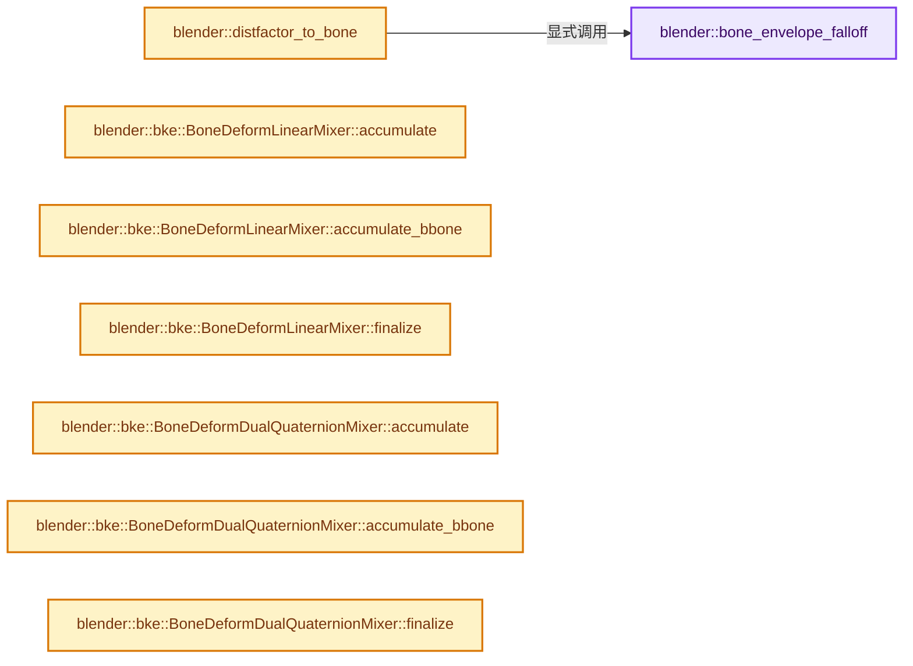

# 实现依赖专题：source/blender/blenkernel/intern/armature_deform.cc

[实现依赖导航](../../README.md) · [符号索引](../../../00-课程指南/02-源码与提交索引/符号依赖与实现索引.md)

本专题从正文实际调用进入，集中保存共享实现。函数有稳定锚点，可从调用处直接跳到对应完整函数；递归与互相调用通过回链组织。

## 本文件的实现关系




## 完整成员与函数实现

<a id="f-d40bd3f36ceb270f"></a>

### `blender::bone_envelope_falloff`

实现位置：[source/blender/blenkernel/intern/armature_deform.cc](../../../../../../../source/blender/blenkernel/intern/armature_deform.cc) · L55—L73。

接口参数：

- `const float distance_squared`
- `const float closest_radius`
- `const float falloff_distance`

**教学注释版**

<!-- annotated:0fe3a7d89197cc -->

```cpp
static float bone_envelope_falloff(const float distance_squared,
                                   const float closest_radius,
                                   const float falloff_distance)
{
  if (distance_squared < closest_radius * closest_radius) {
    return 1.0f;
  }

  /* Zero influence beyond falloff distance. */
  if (falloff_distance == 0.0f ||
      distance_squared >= math::square(closest_radius + falloff_distance))
  {
    return 0.0f;
  }

  /* Compute influence from envelope over the falloff distance. */
  const float dist_envelope = sqrtf(distance_squared) - closest_radius;
  return 1.0f - (dist_envelope * dist_envelope) / (falloff_distance * falloff_distance);
}
```

<details>
<summary>核对原始源码：source/blender/blenkernel/intern/armature_deform.cc · L55—L73</summary>

<!-- original:0fe3a7d89197cc:source/blender/blenkernel/intern/armature_deform.cc:55:73 -->

```cpp
static float bone_envelope_falloff(const float distance_squared,
                                   const float closest_radius,
                                   const float falloff_distance)
{
  if (distance_squared < closest_radius * closest_radius) {
    return 1.0f;
  }

  /* Zero influence beyond falloff distance. */
  if (falloff_distance == 0.0f ||
      distance_squared >= math::square(closest_radius + falloff_distance))
  {
    return 0.0f;
  }

  /* Compute influence from envelope over the falloff distance. */
  const float dist_envelope = sqrtf(distance_squared) - closest_radius;
  return 1.0f - (dist_envelope * dist_envelope) / (falloff_distance * falloff_distance);
}
```

</details>

**结果出口**

- `return 1.0f;`
- `return 0.0f;`
- `return 1.0f - (dist_envelope * dist_envelope) / (falloff_distance * falloff_distance);`

**继续追踪实现**

- `math::square` → [blender::math::square · L278](../../01-BLI基础库/BLI_math_vector.hh.md#f-6c1248be60a2c7c0)；[blender::math::square · L209](../../01-BLI基础库/BLI_math_base.hh.md#f-0dc33df9518a5e2d)。同名重载需按实参类型选择。
- `sqrtf` → [外部契约](https://eel.is/c++draft/)：这个边界按实际表达式及所属类型核对参数、返回值、寿命与失败行为。这里提供接口入口，不声称已解释该第三方版本的内部实现。

<a id="f-5417ef1ba5e7262f"></a>

### `blender::distfactor_to_bone`

实现位置：[source/blender/blenkernel/intern/armature_deform.cc](../../../../../../../source/blender/blenkernel/intern/armature_deform.cc) · L75—L104。

接口参数：

- `const float3 &position`
- `const float3 &head`
- `const float3 &tail`
- `const float radius_head`
- `const float radius_tail`
- `const float falloff_distance`

**教学注释版**

<!-- annotated:3a5482f7f1eb48 -->

```cpp
float distfactor_to_bone(const float3 &position,
                         const float3 &head,
                         const float3 &tail,
                         const float radius_head,
                         const float radius_tail,
                         const float falloff_distance)
{
  float bone_length;
  const float3 bone_axis = math::normalize_and_get_length(tail - head, bone_length);
  /* Distance along the bone axis from head. */
  const float height = math::dot(position - head, bone_axis);

  if (height < 0.0f) {
    /* Below the start of the bone use the head radius. */
    const float distance_squared = math::distance_squared(position, head);
    return bone_envelope_falloff(distance_squared, radius_head, falloff_distance);
  }
  if (height > bone_length) {
    /* After the end of the bone use the tail radius. */
    const float distance_squared = math::distance_squared(tail, position);
    return bone_envelope_falloff(distance_squared, radius_tail, falloff_distance);
  }
  /* Interpolate radius. */
  const float distance_squared = math::distance_squared(position, head) - height * height;
  const float closest_radius = bone_length != 0.0f ? math::interpolate(radius_head,
                                                                       radius_tail,
                                                                       height / bone_length) :
                                                     radius_head;
  return bone_envelope_falloff(distance_squared, closest_radius, falloff_distance);
}
```

<details>
<summary>核对原始源码：source/blender/blenkernel/intern/armature_deform.cc · L75—L104</summary>

<!-- original:3a5482f7f1eb48:source/blender/blenkernel/intern/armature_deform.cc:75:104 -->

```cpp
float distfactor_to_bone(const float3 &position,
                         const float3 &head,
                         const float3 &tail,
                         const float radius_head,
                         const float radius_tail,
                         const float falloff_distance)
{
  float bone_length;
  const float3 bone_axis = math::normalize_and_get_length(tail - head, bone_length);
  /* Distance along the bone axis from head. */
  const float height = math::dot(position - head, bone_axis);

  if (height < 0.0f) {
    /* Below the start of the bone use the head radius. */
    const float distance_squared = math::distance_squared(position, head);
    return bone_envelope_falloff(distance_squared, radius_head, falloff_distance);
  }
  if (height > bone_length) {
    /* After the end of the bone use the tail radius. */
    const float distance_squared = math::distance_squared(tail, position);
    return bone_envelope_falloff(distance_squared, radius_tail, falloff_distance);
  }
  /* Interpolate radius. */
  const float distance_squared = math::distance_squared(position, head) - height * height;
  const float closest_radius = bone_length != 0.0f ? math::interpolate(radius_head,
                                                                       radius_tail,
                                                                       height / bone_length) :
                                                     radius_head;
  return bone_envelope_falloff(distance_squared, closest_radius, falloff_distance);
}
```

</details>

**结果出口**

- `return bone_envelope_falloff(distance_squared, radius_head, falloff_distance);`
- `return bone_envelope_falloff(distance_squared, radius_tail, falloff_distance);`
- `return bone_envelope_falloff(distance_squared, closest_radius, falloff_distance);`

**继续追踪实现**

- `math::normalize_and_get_length` → [blender::math::normalize_and_get_length · L526](../../01-BLI基础库/BLI_math_vector.hh.md#f-77d1393eb1349806)；[blender::math::normalize_and_get_length · L250](../../01-BLI基础库/BLI_math_quaternion.hh.md#f-6fcf25529d2136aa)。同名重载需按实参类型选择。
- `math::dot` → [blender::math::dot · L430](../../01-BLI基础库/BLI_math_vector.hh.md#f-6f0c6a081b107428)；[blender::math::dot · L198](../../01-BLI基础库/BLI_math_quaternion.hh.md#f-5b1ef457981dbc76)。同名重载需按实参类型选择。
- `math::distance_squared` → [调用协议](../../../00-课程指南/01-路线与规范/模板宏与动态分派协议.md)：局部可调用对象，须结合其初始化与捕获环境。调用位置L89。
- `bone_envelope_falloff` → [blender::bone_envelope_falloff · L55](armature_deform.cc.md#f-d40bd3f36ceb270f)。
- `math::interpolate` → [blender::math::interpolate · L335](../../01-BLI基础库/intern/math_matrix.cc.md#f-91e7f517ebd72fb5)；[blender::math::interpolate · L379](../../01-BLI基础库/intern/math_matrix.cc.md#f-a1be14e86ce595c2)；[blender::math::interpolate · L636](../../01-BLI基础库/BLI_math_vector.hh.md#f-d612b6d6ab1b6e7c)；[blender::math::interpolate · L303](../../01-BLI基础库/BLI_math_quaternion.hh.md#f-48b9ace2a9c6185c)；[blender::math::interpolate · L17](../../01-BLI基础库/BLI_math_color.hh.md#f-eb5ef92b0f8c0926)；[blender::math::interpolate · L28](../../01-BLI基础库/BLI_math_color.hh.md#f-2a9e33ec55979ab6)；[blender::math::interpolate · L278](../../01-BLI基础库/BLI_math_base.hh.md#f-2629b871528f6528)。同名重载需按实参类型选择。

<a id="f-a05dc6c9ecec7527"></a>

### `blender::bke::BoneDeformLinearMixer::accumulate`

实现位置：[source/blender/blenkernel/intern/armature_deform.cc](../../../../../../../source/blender/blenkernel/intern/armature_deform.cc) · L117—L125。

接口参数：

- `const bPoseChannel &pchan`
- `const float3 &co`
- `const float weight`

**教学注释版**

<!-- annotated:10ce5334f5fe36 -->

```cpp
  void accumulate(const bPoseChannel &pchan, const float3 &co, const float weight)
  {
    const float4x4 &pose_mat = float4x4(pchan.chan_mat);

    position_delta += weight * (math::transform_point(pose_mat, co) - co);
    if constexpr (full_deform) {
      deform += weight * pose_mat.view<3, 3>();
    }
  }
```

<details>
<summary>核对原始源码：source/blender/blenkernel/intern/armature_deform.cc · L117—L125</summary>

<!-- original:10ce5334f5fe36:source/blender/blenkernel/intern/armature_deform.cc:117:125 -->

```cpp
  void accumulate(const bPoseChannel &pchan, const float3 &co, const float weight)
  {
    const float4x4 &pose_mat = float4x4(pchan.chan_mat);

    position_delta += weight * (math::transform_point(pose_mat, co) - co);
    if constexpr (full_deform) {
      deform += weight * pose_mat.view<3, 3>();
    }
  }
```

</details>

**沿实际写入检查状态**

- `position_delta += weight * (math::transform_point(pose_mat, co) - co);`
- `deform += weight * pose_mat.view<3, 3>();`

**继续追踪实现**

- `float4x4` → [调用协议](../../../00-课程指南/01-路线与规范/模板宏与动态分派协议.md)：函数指针、局部可调用对象或未展开的宏；必须结合调用者环境。调用位置L119。
- `math::transform_point` → [blender::math::transform_point · L318](../../01-BLI基础库/BLI_math_quaternion.hh.md#f-e52a2e8c12e32657)；[blender::math::transform_point · L491](../../01-BLI基础库/BLI_math_quaternion.hh.md#f-6c9f8362c60efe6c)；[blender::math::transform_point · L445](../../01-BLI基础库/BLI_math_basis_types.hh.md#f-a151fd44ae743502)。同名重载需按实参类型选择。
- `pose_mat.view<3, 3>` → [调用协议](../../../00-课程指南/01-路线与规范/模板宏与动态分派协议.md)：由接收对象具体类型或运行时策略提供实现。调用位置L123。

<a id="f-c8b8167c02ce1702"></a>

### `blender::bke::BoneDeformLinearMixer::accumulate_bbone`

实现位置：[source/blender/blenkernel/intern/armature_deform.cc](../../../../../../../source/blender/blenkernel/intern/armature_deform.cc) · L127—L141。

接口参数：

- `const bPoseChannel &pchan`
- `const float3 &co`
- `const float weight`
- `const int index`

**教学注释版**

<!-- annotated:9d32b89f22728e -->

```cpp
  void accumulate_bbone(const bPoseChannel &pchan,
                        const float3 &co,
                        const float weight,
                        const int index)
  {
    const Span<float4x4> pose_mats = Span<Mat4>(pchan.runtime.bbone_deform_mats,
                                                pchan.runtime.bbone_segments + 2)
                                         .cast<float4x4>();
    const float4x4 &pose_mat = pose_mats[index + 1];

    position_delta += weight * (math::transform_point(pose_mat, co) - co);
    if constexpr (full_deform) {
      deform += weight * pose_mat.view<3, 3>();
    }
  }
```

<details>
<summary>核对原始源码：source/blender/blenkernel/intern/armature_deform.cc · L127—L141</summary>

<!-- original:9d32b89f22728e:source/blender/blenkernel/intern/armature_deform.cc:127:141 -->

```cpp
  void accumulate_bbone(const bPoseChannel &pchan,
                        const float3 &co,
                        const float weight,
                        const int index)
  {
    const Span<float4x4> pose_mats = Span<Mat4>(pchan.runtime.bbone_deform_mats,
                                                pchan.runtime.bbone_segments + 2)
                                         .cast<float4x4>();
    const float4x4 &pose_mat = pose_mats[index + 1];

    position_delta += weight * (math::transform_point(pose_mat, co) - co);
    if constexpr (full_deform) {
      deform += weight * pose_mat.view<3, 3>();
    }
  }
```

</details>

**沿实际写入检查状态**

- `position_delta += weight * (math::transform_point(pose_mat, co) - co);`
- `deform += weight * pose_mat.view<3, 3>();`

**继续追踪实现**

- `Span<Mat4>(pchan.runtime.bbone_deform_mats, pchan.runtime.bbone_segments + 2) .cast<float4x4>` → [调用协议](../../../00-课程指南/01-路线与规范/模板宏与动态分派协议.md)：接收对象类型依赖auto、返回值或模板实例；不按同名猜测目标。调用位置L132。
- `Span<Mat4>` → [blender::Span](../../01-BLI基础库/BLI_span.hh.md#t-8765a8e0c1d5)；[blender::Span](../../01-BLI基础库/BLI_index_range.hh.md#t-86091874a1c0)；[blender::Span](../../08-其他Blender模块/makesdna/DNA_pointcloud_types.h.md#t-112aa6ed842c)；[blender::Span](../../08-其他Blender模块/makesdna/DNA_node_types.h.md#t-49ec6fbb9b69)；[blender::Span](../../08-其他Blender模块/makesdna/DNA_mesh_types.h.md#t-184fd48fb638)；[blender::Span](../../08-其他Blender模块/makesdna/DNA_anim_types.h.md#t-d841071994c2)；[blender::Span](../../08-其他Blender模块/makesrna/RNA_path_fwd.hh.md#t-4dbb08969e41)。
- `math::transform_point` → [blender::math::transform_point · L318](../../01-BLI基础库/BLI_math_quaternion.hh.md#f-e52a2e8c12e32657)；[blender::math::transform_point · L491](../../01-BLI基础库/BLI_math_quaternion.hh.md#f-6c9f8362c60efe6c)；[blender::math::transform_point · L445](../../01-BLI基础库/BLI_math_basis_types.hh.md#f-a151fd44ae743502)。同名重载需按实参类型选择。
- `pose_mat.view<3, 3>` → [调用协议](../../../00-课程指南/01-路线与规范/模板宏与动态分派协议.md)：由接收对象具体类型或运行时策略提供实现。调用位置L139。

<a id="f-9ffd8a14e5412f36"></a>

### `blender::bke::BoneDeformLinearMixer::finalize`

实现位置：[source/blender/blenkernel/intern/armature_deform.cc](../../../../../../../source/blender/blenkernel/intern/armature_deform.cc) · L143—L152。

接口参数：

- `const float3 &`
- `float total`
- `float armature_weight`
- `float3 &r_delta_co`
- `float3x3 &r_deform_mat`

**教学注释版**

<!-- annotated:ef26997a35824d -->

```cpp
  void finalize(const float3 & /*co*/,
                float total,
                float armature_weight,
                float3 &r_delta_co,
                float3x3 &r_deform_mat)
  {
    const float scale_factor = armature_weight / total;
    r_delta_co = position_delta * scale_factor;
    r_deform_mat = deform * scale_factor;
  };
```

<details>
<summary>核对原始源码：source/blender/blenkernel/intern/armature_deform.cc · L143—L152</summary>

<!-- original:ef26997a35824d:source/blender/blenkernel/intern/armature_deform.cc:143:152 -->

```cpp
  void finalize(const float3 & /*co*/,
                float total,
                float armature_weight,
                float3 &r_delta_co,
                float3x3 &r_deform_mat)
  {
    const float scale_factor = armature_weight / total;
    r_delta_co = position_delta * scale_factor;
    r_deform_mat = deform * scale_factor;
  };
```

</details>

**沿实际写入检查状态**

- `r_delta_co = position_delta * scale_factor;`
- `r_deform_mat = deform * scale_factor;`

**继续追踪实现**

本实现没有需要继续展开的显式调用；检查返回表达式、对象转换和调用者前置条件。

<a id="f-6984e981c8be2567"></a>

### `blender::bke::BoneDeformDualQuaternionMixer::accumulate`

实现位置：[source/blender/blenkernel/intern/armature_deform.cc](../../../../../../../source/blender/blenkernel/intern/armature_deform.cc) · L162—L167。

接口参数：

- `const bPoseChannel &pchan`
- `const float3 &co`
- `const float weight`

**教学注释版**

<!-- annotated:aa8932f33a561c -->

```cpp
  void accumulate(const bPoseChannel &pchan, const float3 &co, const float weight)
  {
    const DualQuat &deform_quat = pchan.runtime.deform_dual_quat;

    add_weighted_dq_dq_pivot(&dq, &deform_quat, co, weight, full_deform);
  }
```

<details>
<summary>核对原始源码：source/blender/blenkernel/intern/armature_deform.cc · L162—L167</summary>

<!-- original:aa8932f33a561c:source/blender/blenkernel/intern/armature_deform.cc:162:167 -->

```cpp
  void accumulate(const bPoseChannel &pchan, const float3 &co, const float weight)
  {
    const DualQuat &deform_quat = pchan.runtime.deform_dual_quat;

    add_weighted_dq_dq_pivot(&dq, &deform_quat, co, weight, full_deform);
  }
```

</details>

**继续追踪实现**

- `add_weighted_dq_dq_pivot` → [blender::add_weighted_dq_dq_pivot · L2130](../../01-BLI基础库/intern/math_rotation_c.cc.md#f-02795da7f9fd5d52)。

<a id="f-34cf60d3ee1d4337"></a>

### `blender::bke::BoneDeformDualQuaternionMixer::accumulate_bbone`

实现位置：[source/blender/blenkernel/intern/armature_deform.cc](../../../../../../../source/blender/blenkernel/intern/armature_deform.cc) · L169—L179。

接口参数：

- `const bPoseChannel &pchan`
- `const float3 &co`
- `const float weight`
- `const int index`

**教学注释版**

<!-- annotated:1dd5205ea6d501 -->

```cpp
  void accumulate_bbone(const bPoseChannel &pchan,
                        const float3 &co,
                        const float weight,
                        const int index)
  {
    const Span<DualQuat> quats = {pchan.runtime.bbone_dual_quats,
                                  pchan.runtime.bbone_segments + 1};
    const DualQuat &deform_quat = quats[index];

    add_weighted_dq_dq_pivot(&dq, &deform_quat, co, weight, full_deform);
  }
```

<details>
<summary>核对原始源码：source/blender/blenkernel/intern/armature_deform.cc · L169—L179</summary>

<!-- original:1dd5205ea6d501:source/blender/blenkernel/intern/armature_deform.cc:169:179 -->

```cpp
  void accumulate_bbone(const bPoseChannel &pchan,
                        const float3 &co,
                        const float weight,
                        const int index)
  {
    const Span<DualQuat> quats = {pchan.runtime.bbone_dual_quats,
                                  pchan.runtime.bbone_segments + 1};
    const DualQuat &deform_quat = quats[index];

    add_weighted_dq_dq_pivot(&dq, &deform_quat, co, weight, full_deform);
  }
```

</details>

**继续追踪实现**

- `add_weighted_dq_dq_pivot` → [blender::add_weighted_dq_dq_pivot · L2130](../../01-BLI基础库/intern/math_rotation_c.cc.md#f-02795da7f9fd5d52)。

<a id="f-05383570b7d71459"></a>

### `blender::bke::BoneDeformDualQuaternionMixer::finalize`

实现位置：[source/blender/blenkernel/intern/armature_deform.cc](../../../../../../../source/blender/blenkernel/intern/armature_deform.cc) · L181—L194。

接口参数：

- `const float3 &co`
- `float total`
- `float armature_weight`
- `float3 &r_delta_co`
- `float3x3 &r_deform_mat`

**教学注释版**

<!-- annotated:4115a1203b6da7 -->

```cpp
  void finalize(const float3 &co,
                float total,
                float armature_weight,
                float3 &r_delta_co,
                float3x3 &r_deform_mat)
  {
    normalize_dq(&dq, total);
    float3 dco = co;
    float3x3 dmat;
    mul_v3m3_dq(dco, dmat.ptr(), &dq);
    r_delta_co = (dco - co) * armature_weight;
    /* Quaternion already is scale corrected. */
    r_deform_mat = dmat;
  }
```

<details>
<summary>核对原始源码：source/blender/blenkernel/intern/armature_deform.cc · L181—L194</summary>

<!-- original:4115a1203b6da7:source/blender/blenkernel/intern/armature_deform.cc:181:194 -->

```cpp
  void finalize(const float3 &co,
                float total,
                float armature_weight,
                float3 &r_delta_co,
                float3x3 &r_deform_mat)
  {
    normalize_dq(&dq, total);
    float3 dco = co;
    float3x3 dmat;
    mul_v3m3_dq(dco, dmat.ptr(), &dq);
    r_delta_co = (dco - co) * armature_weight;
    /* Quaternion already is scale corrected. */
    r_deform_mat = dmat;
  }
```

</details>

**沿实际写入检查状态**

- `r_delta_co = (dco - co) * armature_weight;`
- `r_deform_mat = dmat;`

**继续追踪实现**

- `normalize_dq` → [blender::normalize_dq · L2173](../../01-BLI基础库/intern/math_rotation_c.cc.md#f-b8b5645999b67907)。
- `mul_v3m3_dq` → [blender::mul_v3m3_dq · L2198](../../01-BLI基础库/intern/math_rotation_c.cc.md#f-6a0473a6bc0e2f62)。
- `dmat.ptr` → [调用协议](../../../00-课程指南/01-路线与规范/模板宏与动态分派协议.md)：由接收对象具体类型或运行时策略提供实现。调用位置L190。

<a id="f-10d8c22e51837563"></a>

### `blender::bke::b_bone_deform`

实现位置：[source/blender/blenkernel/intern/armature_deform.cc](../../../../../../../source/blender/blenkernel/intern/armature_deform.cc) · L198—L211。

接口参数：

- `const bke::PChanBoneConst pchanbone`
- `const float3 &co`
- `const float weight`
- `MixerT &mixer`

**教学注释版**

<!-- annotated:b5c3300afcaa89 -->

```cpp
template<typename MixerT>
static void b_bone_deform(const bke::PChanBoneConst pchanbone,
                          const float3 &co,
                          const float weight,
                          MixerT &mixer)
{
  /* Calculate the indices of the 2 affecting b_bone segments. */
  int index;
  float blend;
  BKE_pchan_bbone_deform_segment_index(pchanbone, co, &index, &blend);

  mixer.accumulate_bbone(*pchanbone.pchan, co, weight * (1.0f - blend), index);
  mixer.accumulate_bbone(*pchanbone.pchan, co, weight * blend, index + 1);
}
```

<details>
<summary>核对原始源码：source/blender/blenkernel/intern/armature_deform.cc · L198—L211</summary>

<!-- original:b5c3300afcaa89:source/blender/blenkernel/intern/armature_deform.cc:198:211 -->

```cpp
template<typename MixerT>
static void b_bone_deform(const bke::PChanBoneConst pchanbone,
                          const float3 &co,
                          const float weight,
                          MixerT &mixer)
{
  /* Calculate the indices of the 2 affecting b_bone segments. */
  int index;
  float blend;
  BKE_pchan_bbone_deform_segment_index(pchanbone, co, &index, &blend);

  mixer.accumulate_bbone(*pchanbone.pchan, co, weight * (1.0f - blend), index);
  mixer.accumulate_bbone(*pchanbone.pchan, co, weight * blend, index + 1);
}
```

</details>

**继续追踪实现**

- `BKE_pchan_bbone_deform_segment_index` → [blender::BKE_pchan_bbone_deform_segment_index · L2093](armature.cc.md#f-4d3696b66a9d3db1)。
- `mixer.accumulate_bbone` → [blender::bke::BoneDeformLinearMixer::accumulate_bbone · L127](armature_deform.cc.md#f-c8b8167c02ce1702)；[blender::bke::BoneDeformDualQuaternionMixer::accumulate_bbone · L169](armature_deform.cc.md#f-34cf60d3ee1d4337)。同名重载需按实参类型选择。

<a id="f-8e94048896dab4bd"></a>

### `blender::bke::dist_bone_deform`

实现位置：[source/blender/blenkernel/intern/armature_deform.cc](../../../../../../../source/blender/blenkernel/intern/armature_deform.cc) · L214—L243。

接口参数：

- `const bke::PChanBoneConst pchanbone`
- `const float3 &co`
- `MixerT &mixer`

**教学注释版**

<!-- annotated:31fe9a40b39f1c -->

```cpp
template<typename MixerT>
static float dist_bone_deform(const bke::PChanBoneConst pchanbone, const float3 &co, MixerT &mixer)
{
  const Bone *bone = pchanbone.bone;
  const bPoseChannel &pchan = *pchanbone.pchan;

  if (bone == nullptr || bone->weight == 0.0f) {
    return 0.0f;
  }

  const float fac = distfactor_to_bone(co,
                                       float3(bone->arm_head),
                                       float3(bone->arm_tail),
                                       bone->rad_head,
                                       bone->rad_tail,
                                       bone->dist);
  if (fac == 0.0f) {
    return 0.0f;
  }

  const float weight = fac * bone->weight;
  if (bone->segments > 1 && pchan.runtime.bbone_segments == bone->segments) {
    b_bone_deform(pchanbone, co, weight, mixer);
  }
  else {
    mixer.accumulate(pchan, co, weight);
  }

  return weight;
}
```

<details>
<summary>核对原始源码：source/blender/blenkernel/intern/armature_deform.cc · L214—L243</summary>

<!-- original:31fe9a40b39f1c:source/blender/blenkernel/intern/armature_deform.cc:214:243 -->

```cpp
template<typename MixerT>
static float dist_bone_deform(const bke::PChanBoneConst pchanbone, const float3 &co, MixerT &mixer)
{
  const Bone *bone = pchanbone.bone;
  const bPoseChannel &pchan = *pchanbone.pchan;

  if (bone == nullptr || bone->weight == 0.0f) {
    return 0.0f;
  }

  const float fac = distfactor_to_bone(co,
                                       float3(bone->arm_head),
                                       float3(bone->arm_tail),
                                       bone->rad_head,
                                       bone->rad_tail,
                                       bone->dist);
  if (fac == 0.0f) {
    return 0.0f;
  }

  const float weight = fac * bone->weight;
  if (bone->segments > 1 && pchan.runtime.bbone_segments == bone->segments) {
    b_bone_deform(pchanbone, co, weight, mixer);
  }
  else {
    mixer.accumulate(pchan, co, weight);
  }

  return weight;
}
```

</details>

**结果出口**

- `return 0.0f;`
- `return weight;`

**继续追踪实现**

- `distfactor_to_bone` → [blender::distfactor_to_bone · L75](armature_deform.cc.md#f-5417ef1ba5e7262f)。
- `float3` → [float3 · L641](../../08-其他Blender模块/compositor/algorithms/intern/smaa.cc.md#m-0ea8254cfdb4)。宏定义由构建条件选择。
- `b_bone_deform` → [blender::bke::b_bone_deform · L198](armature_deform.cc.md#f-10d8c22e51837563)。
- `mixer.accumulate` → [blender::bke::BoneDeformLinearMixer::accumulate · L117](armature_deform.cc.md#f-a05dc6c9ecec7527)；[blender::bke::BoneDeformDualQuaternionMixer::accumulate · L162](armature_deform.cc.md#f-6984e981c8be2567)。同名重载需按实参类型选择。

<a id="f-2fc79f7173f1c747"></a>

### `blender::bke::pchan_bone_deform`

实现位置：[source/blender/blenkernel/intern/armature_deform.cc](../../../../../../../source/blender/blenkernel/intern/armature_deform.cc) · L246—L266。

接口参数：

- `const PChanBone pchanbone`
- `const float weight`
- `const float3 &co`
- `MixerT &mixer`

**教学注释版**

<!-- annotated:b1446271e127c0 -->

```cpp
template<typename MixerT>
static float pchan_bone_deform(const PChanBone pchanbone,
                               const float weight,
                               const float3 &co,
                               MixerT &mixer)
{
  const Bone *bone = pchanbone.bone;

  if (!weight) {
    return 0.0f;
  }

  if (bone->segments > 1 && pchanbone.pchan->runtime.bbone_segments == bone->segments) {
    b_bone_deform(pchanbone, co, weight, mixer);
  }
  else {
    mixer.accumulate(*pchanbone.pchan, co, weight);
  }

  return weight;
}
```

<details>
<summary>核对原始源码：source/blender/blenkernel/intern/armature_deform.cc · L246—L266</summary>

<!-- original:b1446271e127c0:source/blender/blenkernel/intern/armature_deform.cc:246:266 -->

```cpp
template<typename MixerT>
static float pchan_bone_deform(const PChanBone pchanbone,
                               const float weight,
                               const float3 &co,
                               MixerT &mixer)
{
  const Bone *bone = pchanbone.bone;

  if (!weight) {
    return 0.0f;
  }

  if (bone->segments > 1 && pchanbone.pchan->runtime.bbone_segments == bone->segments) {
    b_bone_deform(pchanbone, co, weight, mixer);
  }
  else {
    mixer.accumulate(*pchanbone.pchan, co, weight);
  }

  return weight;
}
```

</details>

**结果出口**

- `return 0.0f;`
- `return weight;`

**继续追踪实现**

- `b_bone_deform` → [blender::bke::b_bone_deform · L198](armature_deform.cc.md#f-10d8c22e51837563)。
- `mixer.accumulate` → [blender::bke::BoneDeformLinearMixer::accumulate · L117](armature_deform.cc.md#f-a05dc6c9ecec7527)；[blender::bke::BoneDeformDualQuaternionMixer::accumulate · L162](armature_deform.cc.md#f-6984e981c8be2567)。同名重载需按实参类型选择。

<a id="f-e17baefb75875420"></a>

### `blender::bke::get_armature_deform_params`

实现位置：[source/blender/blenkernel/intern/armature_deform.cc](../../../../../../../source/blender/blenkernel/intern/armature_deform.cc) · L303—L367。

接口参数：

- `const Object &ob_arm`
- `const Object &ob_target`
- `const ListBaseT<bDeformGroup> *defbase`
- `MutableSpan<float3> vert_coords`
- `std::optional<Span<float3>> vert_coords_prev`
- `std::optional<MutableSpan<float3x3>> vert_deform_mats`
- `const int deformflag`
- `StringRefNull defgrp_name`
- `const bool try_use_dverts`

**教学注释版**

<!-- annotated:a85c3a95a1766c -->

```cpp
static ArmatureDeformParams get_armature_deform_params(
    const Object &ob_arm,
    const Object &ob_target,
    const ListBaseT<bDeformGroup> *defbase,
    MutableSpan<float3> vert_coords,
    std::optional<Span<float3>> vert_coords_prev,
    std::optional<MutableSpan<float3x3>> vert_deform_mats,
    const int deformflag,
    StringRefNull defgrp_name,
    const bool try_use_dverts)
{
  const bool dverts_supported = BKE_object_supports_vertex_groups(&ob_target);

  /* TODO(Sybren): call the still-to-be-written function to assert that the pose is up to date. The
   * armature deform code doesn't use pchan->bone_get(object) but rather takes the armature (for
   * speed), and so cannot assert this itself. */

  bArmature *armature = id_cast<bArmature *>(ob_arm.data);
  ArmatureDeformParams deform_params;
  deform_params.armature = armature;
  deform_params.vert_coords = vert_coords;
  deform_params.vert_deform_mats = vert_deform_mats;
  deform_params.vert_coords_prev = vert_coords_prev;
  deform_params.use_envelope = bool(deformflag & ARM_DEF_ENVELOPE);
  deform_params.invert_vgroup = bool(deformflag & ARM_DEF_INVERT_VGROUP);

  deform_params.pose_channels = {ob_arm.pose->chanbase};
  deform_params.use_dverts = try_use_dverts && dverts_supported && (deformflag & ARM_DEF_VGROUP);
  if (deform_params.use_dverts) {
    const int defbase_len = defbase->count();
    deform_params.pose_channel_by_vertex_group.reinitialize(defbase_len);
    /* TODO(sergey): Some considerations here:
     *
     * - Check whether keeping this consistent across frames gives speedup.
     */

    BKE_pose_ensure_bone_indices(ob_arm);
    for (const auto [i, dg] : (defbase)->enumerate()) {
      bPoseChannel *pchan = BKE_pose_channel_find_name(ob_arm.pose, dg.name);
      /* Exclude non-deforming bones. */
      Bone *bone = pchan ? pchan->bone_get(*armature) : nullptr;
      if (pchan && !(bone->flag & BONE_NO_DEFORM)) {
        deform_params.pose_channel_by_vertex_group[i] = {pchan, bone};
      }
    }
  }

  /* Index of singular vertex group, if used. */
  deform_params.armature_def_nr = dverts_supported ?
                                      BKE_defgroup_name_index(defbase, defgrp_name) :
                                      -1;

/* TODO using the existing matrices directly is better, but fails tests because old code was
 * doing a double-inverse of the object matrix, leading to small differences on the order of 10^-5.
 * Test data needs to be updated if the transforms change. */
#if 0
  deform_params.target_to_armature = ob_arm.world_to_object() * ob_target.object_to_world();
  deform_params.armature_to_target = ob_target.world_to_object() * ob_arm.object_to_world();
#else
  deform_params.armature_to_target = ob_target.world_to_object() * ob_arm.object_to_world();
  deform_params.target_to_armature = math::invert(deform_params.armature_to_target);
#endif

  return deform_params;
}
```

<details>
<summary>核对原始源码：source/blender/blenkernel/intern/armature_deform.cc · L303—L367</summary>

<!-- original:a85c3a95a1766c:source/blender/blenkernel/intern/armature_deform.cc:303:367 -->

```cpp
static ArmatureDeformParams get_armature_deform_params(
    const Object &ob_arm,
    const Object &ob_target,
    const ListBaseT<bDeformGroup> *defbase,
    MutableSpan<float3> vert_coords,
    std::optional<Span<float3>> vert_coords_prev,
    std::optional<MutableSpan<float3x3>> vert_deform_mats,
    const int deformflag,
    StringRefNull defgrp_name,
    const bool try_use_dverts)
{
  const bool dverts_supported = BKE_object_supports_vertex_groups(&ob_target);

  /* TODO(Sybren): call the still-to-be-written function to assert that the pose is up to date. The
   * armature deform code doesn't use pchan->bone_get(object) but rather takes the armature (for
   * speed), and so cannot assert this itself. */

  bArmature *armature = id_cast<bArmature *>(ob_arm.data);
  ArmatureDeformParams deform_params;
  deform_params.armature = armature;
  deform_params.vert_coords = vert_coords;
  deform_params.vert_deform_mats = vert_deform_mats;
  deform_params.vert_coords_prev = vert_coords_prev;
  deform_params.use_envelope = bool(deformflag & ARM_DEF_ENVELOPE);
  deform_params.invert_vgroup = bool(deformflag & ARM_DEF_INVERT_VGROUP);

  deform_params.pose_channels = {ob_arm.pose->chanbase};
  deform_params.use_dverts = try_use_dverts && dverts_supported && (deformflag & ARM_DEF_VGROUP);
  if (deform_params.use_dverts) {
    const int defbase_len = defbase->count();
    deform_params.pose_channel_by_vertex_group.reinitialize(defbase_len);
    /* TODO(sergey): Some considerations here:
     *
     * - Check whether keeping this consistent across frames gives speedup.
     */

    BKE_pose_ensure_bone_indices(ob_arm);
    for (const auto [i, dg] : (defbase)->enumerate()) {
      bPoseChannel *pchan = BKE_pose_channel_find_name(ob_arm.pose, dg.name);
      /* Exclude non-deforming bones. */
      Bone *bone = pchan ? pchan->bone_get(*armature) : nullptr;
      if (pchan && !(bone->flag & BONE_NO_DEFORM)) {
        deform_params.pose_channel_by_vertex_group[i] = {pchan, bone};
      }
    }
  }

  /* Index of singular vertex group, if used. */
  deform_params.armature_def_nr = dverts_supported ?
                                      BKE_defgroup_name_index(defbase, defgrp_name) :
                                      -1;

/* TODO using the existing matrices directly is better, but fails tests because old code was
 * doing a double-inverse of the object matrix, leading to small differences on the order of 10^-5.
 * Test data needs to be updated if the transforms change. */
#if 0
  deform_params.target_to_armature = ob_arm.world_to_object() * ob_target.object_to_world();
  deform_params.armature_to_target = ob_target.world_to_object() * ob_arm.object_to_world();
#else
  deform_params.armature_to_target = ob_target.world_to_object() * ob_arm.object_to_world();
  deform_params.target_to_armature = math::invert(deform_params.armature_to_target);
#endif

  return deform_params;
}
```

</details>

**沿实际写入检查状态**

- `deform_params.armature = armature;`
- `deform_params.vert_coords = vert_coords;`
- `deform_params.vert_deform_mats = vert_deform_mats;`
- `deform_params.vert_coords_prev = vert_coords_prev;`
- `deform_params.use_envelope = bool(deformflag & ARM_DEF_ENVELOPE);`
- `deform_params.invert_vgroup = bool(deformflag & ARM_DEF_INVERT_VGROUP);`
- `deform_params.pose_channels = {ob_arm.pose->chanbase};`
- `deform_params.use_dverts = try_use_dverts && dverts_supported && (deformflag & ARM_DEF_VGROUP);`
- `deform_params.pose_channel_by_vertex_group[i] = {pchan, bone};`
- `deform_params.armature_def_nr = dverts_supported ?`
- `deform_params.target_to_armature = ob_arm.world_to_object() * ob_target.object_to_world();`
- `deform_params.armature_to_target = ob_target.world_to_object() * ob_arm.object_to_world();`
- `deform_params.target_to_armature = math::invert(deform_params.armature_to_target);`

**结果出口**

- `return deform_params;`

**继续追踪实现**

- `BKE_object_supports_vertex_groups` → [blender::BKE_object_supports_vertex_groups · L465](deform.cc.md#f-ad12b3e8aa234a36)。
- `id_cast<bArmature *>` → [blender::id_cast · L1417](../../08-其他Blender模块/makesdna/DNA_ID.h.md#f-6c8ac6412850ac5a)。
- `defbase->count` → [blender::ListBaseT::count · L92](../../08-其他Blender模块/makesdna/DNA_listBase.h.md#f-7d243d006ac4c693)。
- `deform_params.pose_channel_by_vertex_group.reinitialize` → [调用协议](../../../00-课程指南/01-路线与规范/模板宏与动态分派协议.md)：接收对象类型依赖auto、返回值或模板实例；不按同名猜测目标。调用位置L333。
- `BKE_pose_ensure_bone_indices` → [blender::BKE_pose_ensure_bone_indices · L3103](armature.cc.md#f-642aaede7e1310c6)。
- `(defbase)->enumerate` → [blender::ListBaseT::enumerate · L152](../../08-其他Blender模块/makesdna/DNA_listBase.h.md#f-73544c49caea6d30)；[blender::ListBaseT::enumerate · L157](../../08-其他Blender模块/makesdna/DNA_listBase.h.md#f-b4ef4f7169c0afd0)。同名重载需按实参类型选择。
- `BKE_pose_channel_find_name` → [blender::BKE_pose_channel_find_name · L895](action.cc.md#f-5997206551bfc9f9)。
- `pchan->bone_get` → [blender::bPoseChannel::bone_get · L847](action.cc.md#f-0eb8bfcf060715cf)；[blender::bPoseChannel::bone_get · L862](action.cc.md#f-ccec81f60dc65040)；[blender::bPoseChannel::bone_get · L875](action.cc.md#f-b7d34ff46210a1f3)；[blender::bPoseChannel::bone_get · L881](action.cc.md#f-0bf83e1e4d68c624)。同名重载需按实参类型选择。
- `BKE_defgroup_name_index` → [blender::BKE_defgroup_name_index · L544](deform.cc.md#f-41ba0c2309b689c8)。
- `ob_arm.world_to_object` → [blender::Object::world_to_object · L5766](object.cc.md#f-dd4d8d55d6195233)。
- `ob_target.object_to_world` → [blender::Object::object_to_world · L5761](object.cc.md#f-12fc20026327d50c)。
- `ob_target.world_to_object` → [blender::Object::world_to_object · L5766](object.cc.md#f-dd4d8d55d6195233)。
- `ob_arm.object_to_world` → [blender::Object::object_to_world · L5761](object.cc.md#f-12fc20026327d50c)。
- `math::invert` → [blender::math::invert · L202](../../01-BLI基础库/intern/math_matrix.cc.md#f-222be9a4cab433f5)；[blender::math::invert · L234](../../01-BLI基础库/BLI_math_quaternion.hh.md#f-7ba965075f461895)；[blender::math::invert · L648](../../01-BLI基础库/BLI_math_matrix.hh.md#f-2b50b5262b2a9121)；[blender::math::invert · L460](../../01-BLI基础库/BLI_math_basis_types.hh.md#f-76b56b37f151208d)。同名重载需按实参类型选择。

<a id="f-ac1f9f89f2db30cf"></a>

### `blender::bke::armature_vert_task_with_mixer`

实现位置：[source/blender/blenkernel/intern/armature_deform.cc](../../../../../../../source/blender/blenkernel/intern/armature_deform.cc) · L370—L472。

接口参数：

- `const ArmatureDeformParams &params`
- `const int i`
- `const MDeformVert *dvert`
- `MixerT &mixer`

**教学注释版**

<!-- annotated:02e88c4bce08a2 -->

```cpp
template<typename MixerT>
static void armature_vert_task_with_mixer(const ArmatureDeformParams &params,
                                          const int i,
                                          const MDeformVert *dvert,
                                          MixerT &mixer)
{
  const bool full_deform = params.vert_deform_mats.has_value();

  /* Overall influence, can change by masking with a vertex group. */
  float armature_weight = 1.0f;
  float prevco_weight = 0.0f; /* weight for optional cached vertexcos */
  if (params.armature_def_nr != -1 && dvert) {
    const float mask_weight = BKE_defvert_find_weight(dvert, params.armature_def_nr);
    /* On multi-modifier the mask is used to blend with previous coordinates. */
    if (params.vert_coords_prev) {
      prevco_weight = params.invert_vgroup ? mask_weight : 1.0f - mask_weight;
      if (prevco_weight == 1.0f) {
        return;
      }
    }
    else {
      armature_weight = params.invert_vgroup ? 1.0f - mask_weight : mask_weight;
      if (armature_weight == 0.0f) {
        return;
      }
    }
  }

  /* Input coordinates to start from. */
  float3 co = params.vert_coords_prev ? (*params.vert_coords_prev)[i] : params.vert_coords[i];
  /* Transform to armature space. */
  co = math::transform_point(params.target_to_armature, co);

  float contrib = 0.0f;
  bool deformed = false;
  /* Apply vertex group deformation if enabled. */
  if (params.use_dverts && dvert) {
    /* Range of valid def_nr in MDeformWeight. */
    const IndexRange def_nr_range = params.pose_channel_by_vertex_group.index_range();
    const Span<MDeformWeight> dweights(dvert->dw, dvert->totweight);
    for (const auto &dw : dweights) {
      const PChanBone pchanbone = def_nr_range.contains(dw.def_nr) ?
                                      params.pose_channel_by_vertex_group[dw.def_nr] :
                                      PChanBone(nullptr, nullptr);
      const bPoseChannel *pchan = pchanbone.pchan;
      if (pchan == nullptr) {
        continue;
      }

      float weight = dw.weight;

      /* Bone option to mix with envelope weight. */
      const Bone *bone = pchanbone.bone;
      if (bone && bone->flag & BONE_MULT_VG_ENV) {
        weight *= distfactor_to_bone(co,
                                     float3(bone->arm_head),
                                     float3(bone->arm_tail),
                                     bone->rad_head,
                                     bone->rad_tail,
                                     bone->dist);
      }

      contrib += pchan_bone_deform(pchanbone, weight, co, mixer);
      deformed = true;
    }
  }
  /* Use envelope if enabled and no bone deformed the vertex yet. */
  if (!deformed && params.use_envelope) {
    for (const bPoseChannel *pchan : params.pose_channels) {
      const Bone *bone = pchan->bone_get(*params.armature);
      if (!(bone->flag & BONE_NO_DEFORM)) {
        contrib += dist_bone_deform({pchan, bone}, co, mixer);
      }
    }
  }

  /* TODO Actually should be EPSILON? Weight values and contrib can be like 10e-39 small. */
  constexpr float contrib_threshold = 0.0001f;
  if (contrib > contrib_threshold) {
    float3 delta_co;
    float3x3 local_deform_mat;
    mixer.finalize(co, contrib, armature_weight, delta_co, local_deform_mat);

    co += delta_co;
    if (full_deform) {
      float3x3 &deform_mat = (*params.vert_deform_mats)[i];
      const float3x3 armature_to_target = params.armature_to_target.view<3, 3>();
      const float3x3 target_to_armature = params.target_to_armature.view<3, 3>();
      deform_mat = armature_to_target * local_deform_mat * target_to_armature * deform_mat;
    }
  }

  /* Transform back to target object space. */
  co = math::transform_point(params.armature_to_target, co);

  /* Multi-modifier: Interpolate with previous modifier position using the vertex group mask. */
  if (params.vert_coords_prev) {
    copy_v3_v3(params.vert_coords[i], math::interpolate(co, params.vert_coords[i], prevco_weight));
  }
  else {
    copy_v3_v3(params.vert_coords[i], co);
  }
}
```

<details>
<summary>核对原始源码：source/blender/blenkernel/intern/armature_deform.cc · L370—L472</summary>

<!-- original:02e88c4bce08a2:source/blender/blenkernel/intern/armature_deform.cc:370:472 -->

```cpp
template<typename MixerT>
static void armature_vert_task_with_mixer(const ArmatureDeformParams &params,
                                          const int i,
                                          const MDeformVert *dvert,
                                          MixerT &mixer)
{
  const bool full_deform = params.vert_deform_mats.has_value();

  /* Overall influence, can change by masking with a vertex group. */
  float armature_weight = 1.0f;
  float prevco_weight = 0.0f; /* weight for optional cached vertexcos */
  if (params.armature_def_nr != -1 && dvert) {
    const float mask_weight = BKE_defvert_find_weight(dvert, params.armature_def_nr);
    /* On multi-modifier the mask is used to blend with previous coordinates. */
    if (params.vert_coords_prev) {
      prevco_weight = params.invert_vgroup ? mask_weight : 1.0f - mask_weight;
      if (prevco_weight == 1.0f) {
        return;
      }
    }
    else {
      armature_weight = params.invert_vgroup ? 1.0f - mask_weight : mask_weight;
      if (armature_weight == 0.0f) {
        return;
      }
    }
  }

  /* Input coordinates to start from. */
  float3 co = params.vert_coords_prev ? (*params.vert_coords_prev)[i] : params.vert_coords[i];
  /* Transform to armature space. */
  co = math::transform_point(params.target_to_armature, co);

  float contrib = 0.0f;
  bool deformed = false;
  /* Apply vertex group deformation if enabled. */
  if (params.use_dverts && dvert) {
    /* Range of valid def_nr in MDeformWeight. */
    const IndexRange def_nr_range = params.pose_channel_by_vertex_group.index_range();
    const Span<MDeformWeight> dweights(dvert->dw, dvert->totweight);
    for (const auto &dw : dweights) {
      const PChanBone pchanbone = def_nr_range.contains(dw.def_nr) ?
                                      params.pose_channel_by_vertex_group[dw.def_nr] :
                                      PChanBone(nullptr, nullptr);
      const bPoseChannel *pchan = pchanbone.pchan;
      if (pchan == nullptr) {
        continue;
      }

      float weight = dw.weight;

      /* Bone option to mix with envelope weight. */
      const Bone *bone = pchanbone.bone;
      if (bone && bone->flag & BONE_MULT_VG_ENV) {
        weight *= distfactor_to_bone(co,
                                     float3(bone->arm_head),
                                     float3(bone->arm_tail),
                                     bone->rad_head,
                                     bone->rad_tail,
                                     bone->dist);
      }

      contrib += pchan_bone_deform(pchanbone, weight, co, mixer);
      deformed = true;
    }
  }
  /* Use envelope if enabled and no bone deformed the vertex yet. */
  if (!deformed && params.use_envelope) {
    for (const bPoseChannel *pchan : params.pose_channels) {
      const Bone *bone = pchan->bone_get(*params.armature);
      if (!(bone->flag & BONE_NO_DEFORM)) {
        contrib += dist_bone_deform({pchan, bone}, co, mixer);
      }
    }
  }

  /* TODO Actually should be EPSILON? Weight values and contrib can be like 10e-39 small. */
  constexpr float contrib_threshold = 0.0001f;
  if (contrib > contrib_threshold) {
    float3 delta_co;
    float3x3 local_deform_mat;
    mixer.finalize(co, contrib, armature_weight, delta_co, local_deform_mat);

    co += delta_co;
    if (full_deform) {
      float3x3 &deform_mat = (*params.vert_deform_mats)[i];
      const float3x3 armature_to_target = params.armature_to_target.view<3, 3>();
      const float3x3 target_to_armature = params.target_to_armature.view<3, 3>();
      deform_mat = armature_to_target * local_deform_mat * target_to_armature * deform_mat;
    }
  }

  /* Transform back to target object space. */
  co = math::transform_point(params.armature_to_target, co);

  /* Multi-modifier: Interpolate with previous modifier position using the vertex group mask. */
  if (params.vert_coords_prev) {
    copy_v3_v3(params.vert_coords[i], math::interpolate(co, params.vert_coords[i], prevco_weight));
  }
  else {
    copy_v3_v3(params.vert_coords[i], co);
  }
}
```

</details>

**沿实际写入检查状态**

- `prevco_weight = params.invert_vgroup ? mask_weight : 1.0f - mask_weight;`
- `armature_weight = params.invert_vgroup ? 1.0f - mask_weight : mask_weight;`
- `co = math::transform_point(params.target_to_armature, co);`
- `weight *= distfactor_to_bone(co,`
- `contrib += pchan_bone_deform(pchanbone, weight, co, mixer);`
- `deformed = true;`
- `contrib += dist_bone_deform({pchan, bone}, co, mixer);`
- `co += delta_co;`
- `deform_mat = armature_to_target * local_deform_mat * target_to_armature * deform_mat;`
- `co = math::transform_point(params.armature_to_target, co);`

**继续追踪实现**

- `params.vert_deform_mats.has_value` → [调用协议](../../../00-课程指南/01-路线与规范/模板宏与动态分派协议.md)：接收对象类型依赖auto、返回值或模板实例；不按同名猜测目标。调用位置L376。
- `BKE_defvert_find_weight` → [blender::BKE_defvert_find_weight · L779](deform.cc.md#f-c117fcd05c4fd453)。
- `math::transform_point` → [blender::math::transform_point · L318](../../01-BLI基础库/BLI_math_quaternion.hh.md#f-e52a2e8c12e32657)；[blender::math::transform_point · L491](../../01-BLI基础库/BLI_math_quaternion.hh.md#f-6c9f8362c60efe6c)；[blender::math::transform_point · L445](../../01-BLI基础库/BLI_math_basis_types.hh.md#f-a151fd44ae743502)。同名重载需按实参类型选择。
- `params.pose_channel_by_vertex_group.index_range` → [调用协议](../../../00-课程指南/01-路线与规范/模板宏与动态分派协议.md)：接收对象类型依赖auto、返回值或模板实例；不按同名猜测目标。调用位置L408。
- `def_nr_range.contains` → [blender::IndexRange::contains · L251](../../../01-基础容器与现代CPP/04-IndexRange连续整数区间.md#f-1a01eaa28eaecd5c)；[blender::IndexRange::contains · L259](../../../01-基础容器与现代CPP/04-IndexRange连续整数区间.md#f-8eb195a52f17a51f)。同名重载需按实参类型选择。
- `PChanBone` → [调用协议](../../../00-课程指南/01-路线与规范/模板宏与动态分派协议.md)：函数指针、局部可调用对象或未展开的宏；必须结合调用者环境。调用位置L413。
- `distfactor_to_bone` → [blender::distfactor_to_bone · L75](armature_deform.cc.md#f-5417ef1ba5e7262f)。
- `float3` → [float3 · L641](../../08-其他Blender模块/compositor/algorithms/intern/smaa.cc.md#m-0ea8254cfdb4)。宏定义由构建条件选择。
- `pchan_bone_deform` → [blender::bke::pchan_bone_deform · L246](armature_deform.cc.md#f-2fc79f7173f1c747)。
- `pchan->bone_get` → [blender::bPoseChannel::bone_get · L847](action.cc.md#f-0eb8bfcf060715cf)；[blender::bPoseChannel::bone_get · L862](action.cc.md#f-ccec81f60dc65040)；[blender::bPoseChannel::bone_get · L875](action.cc.md#f-b7d34ff46210a1f3)；[blender::bPoseChannel::bone_get · L881](action.cc.md#f-0bf83e1e4d68c624)。同名重载需按实参类型选择。
- `dist_bone_deform` → [blender::bke::dist_bone_deform · L214](armature_deform.cc.md#f-8e94048896dab4bd)。
- `mixer.finalize` → [blender::bke::BoneDeformLinearMixer::finalize · L143](armature_deform.cc.md#f-9ffd8a14e5412f36)；[blender::bke::BoneDeformDualQuaternionMixer::finalize · L181](armature_deform.cc.md#f-05383570b7d71459)。同名重载需按实参类型选择。
- `params.armature_to_target.view<3, 3>` → [调用协议](../../../00-课程指南/01-路线与规范/模板宏与动态分派协议.md)：接收对象类型依赖auto、返回值或模板实例；不按同名猜测目标。调用位置L456。
- `params.target_to_armature.view<3, 3>` → [调用协议](../../../00-课程指南/01-路线与规范/模板宏与动态分派协议.md)：接收对象类型依赖auto、返回值或模板实例；不按同名猜测目标。调用位置L457。
- `copy_v3_v3` → [调用协议](../../../00-课程指南/01-路线与规范/模板宏与动态分派协议.md)：函数指针、局部可调用对象或未展开的宏；必须结合调用者环境。调用位置L467。
- `math::interpolate` → [blender::math::interpolate · L335](../../01-BLI基础库/intern/math_matrix.cc.md#f-91e7f517ebd72fb5)；[blender::math::interpolate · L379](../../01-BLI基础库/intern/math_matrix.cc.md#f-a1be14e86ce595c2)；[blender::math::interpolate · L636](../../01-BLI基础库/BLI_math_vector.hh.md#f-d612b6d6ab1b6e7c)；[blender::math::interpolate · L303](../../01-BLI基础库/BLI_math_quaternion.hh.md#f-48b9ace2a9c6185c)；[blender::math::interpolate · L17](../../01-BLI基础库/BLI_math_color.hh.md#f-eb5ef92b0f8c0926)；[blender::math::interpolate · L28](../../01-BLI基础库/BLI_math_color.hh.md#f-2a9e33ec55979ab6)；[blender::math::interpolate · L278](../../01-BLI基础库/BLI_math_base.hh.md#f-2629b871528f6528)。同名重载需按实参类型选择。

<a id="f-3d6b3a6579d388a6"></a>

### `blender::bke::armature_vert_task_with_dvert`

实现位置：[source/blender/blenkernel/intern/armature_deform.cc](../../../../../../../source/blender/blenkernel/intern/armature_deform.cc) · L475—L501。

接口参数：

- `const ArmatureDeformParams &deform_params`
- `const int i`
- `const MDeformVert *dvert`
- `const bool use_quaternion`

**教学注释版**

<!-- annotated:0a78ae4e19827c -->

```cpp
static void armature_vert_task_with_dvert(const ArmatureDeformParams &deform_params,
                                          const int i,
                                          const MDeformVert *dvert,
                                          const bool use_quaternion)
{
  const bool full_deform = deform_params.vert_deform_mats.has_value();
  if (use_quaternion) {
    if (full_deform) {
      bke::BoneDeformDualQuaternionMixer<true> mixer;
      armature_vert_task_with_mixer(deform_params, i, dvert, mixer);
    }
    else {
      bke::BoneDeformDualQuaternionMixer<false> mixer;
      armature_vert_task_with_mixer(deform_params, i, dvert, mixer);
    }
  }
  else {
    if (full_deform) {
      bke::BoneDeformLinearMixer<true> mixer;
      armature_vert_task_with_mixer(deform_params, i, dvert, mixer);
    }
    else {
      bke::BoneDeformLinearMixer<false> mixer;
      armature_vert_task_with_mixer(deform_params, i, dvert, mixer);
    }
  }
}
```

<details>
<summary>核对原始源码：source/blender/blenkernel/intern/armature_deform.cc · L475—L501</summary>

<!-- original:0a78ae4e19827c:source/blender/blenkernel/intern/armature_deform.cc:475:501 -->

```cpp
static void armature_vert_task_with_dvert(const ArmatureDeformParams &deform_params,
                                          const int i,
                                          const MDeformVert *dvert,
                                          const bool use_quaternion)
{
  const bool full_deform = deform_params.vert_deform_mats.has_value();
  if (use_quaternion) {
    if (full_deform) {
      bke::BoneDeformDualQuaternionMixer<true> mixer;
      armature_vert_task_with_mixer(deform_params, i, dvert, mixer);
    }
    else {
      bke::BoneDeformDualQuaternionMixer<false> mixer;
      armature_vert_task_with_mixer(deform_params, i, dvert, mixer);
    }
  }
  else {
    if (full_deform) {
      bke::BoneDeformLinearMixer<true> mixer;
      armature_vert_task_with_mixer(deform_params, i, dvert, mixer);
    }
    else {
      bke::BoneDeformLinearMixer<false> mixer;
      armature_vert_task_with_mixer(deform_params, i, dvert, mixer);
    }
  }
}
```

</details>

**继续追踪实现**

- `deform_params.vert_deform_mats.has_value` → [调用协议](../../../00-课程指南/01-路线与规范/模板宏与动态分派协议.md)：接收对象类型依赖auto、返回值或模板实例；不按同名猜测目标。调用位置L480。
- `armature_vert_task_with_mixer` → [blender::bke::armature_vert_task_with_mixer · L370](armature_deform.cc.md#f-ac1f9f89f2db30cf)。

<a id="f-8a075ab971165dce"></a>

### `blender::bke::armature_deform_coords`

实现位置：[source/blender/blenkernel/intern/armature_deform.cc](../../../../../../../source/blender/blenkernel/intern/armature_deform.cc) · L503—L544。

接口参数：

- `const Object &ob_arm`
- `const Object &ob_target`
- `const ListBaseT<bDeformGroup> *defbase`
- `const MutableSpan<float3> vert_coords`
- `const std::optional<MutableSpan<float3x3>> vert_deform_mats`
- `const int deformflag`
- `const std::optional<Span<float3>> vert_coords_prev`
- `StringRefNull defgrp_name`
- `const std::optional<Span<MDeformVert>> dverts`
- `const Mesh *me_target`

**教学注释版**

<!-- annotated:54c7f4fd021e64 -->

```cpp
static void armature_deform_coords(const Object &ob_arm,
                                   const Object &ob_target,
                                   const ListBaseT<bDeformGroup> *defbase,
                                   const MutableSpan<float3> vert_coords,
                                   const std::optional<MutableSpan<float3x3>> vert_deform_mats,
                                   const int deformflag,
                                   const std::optional<Span<float3>> vert_coords_prev,
                                   StringRefNull defgrp_name,
                                   const std::optional<Span<MDeformVert>> dverts,
                                   const Mesh *me_target)
{
  ArmatureDeformParams deform_params = get_armature_deform_params(ob_arm,
                                                                  ob_target,
                                                                  defbase,
                                                                  vert_coords,
                                                                  vert_coords_prev,
                                                                  vert_deform_mats,
                                                                  deformflag,
                                                                  defgrp_name,
                                                                  dverts.has_value());

  const bool use_quaternion = bool(deformflag & ARM_DEF_QUATERNION);
  constexpr int grain_size = 32;
  // [讲解] vert_coords.index_range：查询视图长度或生成对应有效索引区间。
  threading::parallel_for(vert_coords.index_range(), grain_size, [&](const IndexRange range) {
    for (const int i : range) {
      const MDeformVert *dvert = nullptr;
      if (deform_params.use_dverts || deform_params.armature_def_nr >= 0) {
        if (me_target) {
          BLI_assert(i < me_target->verts_num);
          if (dverts) {
            dvert = &(*dverts)[i];
          }
        }
        else if (dverts && i < dverts->size()) {
          dvert = &(*dverts)[i];
        }
      }

      armature_vert_task_with_dvert(deform_params, i, dvert, use_quaternion);
    }
  });
}
```

<details>
<summary>核对原始源码：source/blender/blenkernel/intern/armature_deform.cc · L503—L544</summary>

<!-- original:54c7f4fd021e64:source/blender/blenkernel/intern/armature_deform.cc:503:544 -->

```cpp
static void armature_deform_coords(const Object &ob_arm,
                                   const Object &ob_target,
                                   const ListBaseT<bDeformGroup> *defbase,
                                   const MutableSpan<float3> vert_coords,
                                   const std::optional<MutableSpan<float3x3>> vert_deform_mats,
                                   const int deformflag,
                                   const std::optional<Span<float3>> vert_coords_prev,
                                   StringRefNull defgrp_name,
                                   const std::optional<Span<MDeformVert>> dverts,
                                   const Mesh *me_target)
{
  ArmatureDeformParams deform_params = get_armature_deform_params(ob_arm,
                                                                  ob_target,
                                                                  defbase,
                                                                  vert_coords,
                                                                  vert_coords_prev,
                                                                  vert_deform_mats,
                                                                  deformflag,
                                                                  defgrp_name,
                                                                  dverts.has_value());

  const bool use_quaternion = bool(deformflag & ARM_DEF_QUATERNION);
  constexpr int grain_size = 32;
  threading::parallel_for(vert_coords.index_range(), grain_size, [&](const IndexRange range) {
    for (const int i : range) {
      const MDeformVert *dvert = nullptr;
      if (deform_params.use_dverts || deform_params.armature_def_nr >= 0) {
        if (me_target) {
          BLI_assert(i < me_target->verts_num);
          if (dverts) {
            dvert = &(*dverts)[i];
          }
        }
        else if (dverts && i < dverts->size()) {
          dvert = &(*dverts)[i];
        }
      }

      armature_vert_task_with_dvert(deform_params, i, dvert, use_quaternion);
    }
  });
}
```

</details>

**沿实际写入检查状态**

- `dvert = &(*dverts)[i];`

**继续追踪实现**

- `get_armature_deform_params` → [blender::bke::get_armature_deform_params · L303](armature_deform.cc.md#f-e17baefb75875420)。
- `dverts.has_value` → [外部契约](https://eel.is/c++draft/)：这个边界按实际表达式及所属类型核对参数、返回值、寿命与失败行为。这里提供接口入口，不声称已解释该第三方版本的内部实现。
- `threading::parallel_for` → [blender::threading::parallel_for · L68](../../../11-Depsgraph与并行任务系统/07-任务池与TBB接入.md#f-838294754c24426c)。
- `vert_coords.index_range` → [blender::MutableSpan::index_range · L676](../../../01-基础容器与现代CPP/06-MutableSpan可写视图.md#f-f9a9d59a69ca64b5)。
- `BLI_assert` → [BLI_assert · L48](../../01-BLI基础库/BLI_assert.hh.md#m-57a88495704d)；[BLI_assert · L63](../../01-BLI基础库/BLI_assert.hh.md#m-d07050020cb5)。宏定义由构建条件选择。
- `dverts->size` → [外部契约](https://eel.is/c++draft/)：这个边界按实际表达式及所属类型核对参数、返回值、寿命与失败行为。这里提供接口入口，不声称已解释该第三方版本的内部实现。
- `armature_vert_task_with_dvert` → [blender::bke::armature_vert_task_with_dvert · L475](armature_deform.cc.md#f-3d6b3a6579d388a6)。

<a id="f-d3e240afe5bfeee6"></a>

### `blender::bke::armature_deform_editmesh`

实现位置：[source/blender/blenkernel/intern/armature_deform.cc](../../../../../../../source/blender/blenkernel/intern/armature_deform.cc) · L567—L607。

接口参数：

- `const Object &ob_arm`
- `const Object &ob_target`
- `const ListBaseT<bDeformGroup> *defbase`
- `const MutableSpan<float3> vert_coords`
- `const std::optional<MutableSpan<float3x3>> vert_deform_mats`
- `const int deformflag`
- `const std::optional<Span<float3>> vert_coords_prev`
- `StringRefNull defgrp_name`
- `const int cd_dvert_offset`

**教学注释版**

<!-- annotated:bc165896cc78ce -->

```cpp
static void armature_deform_editmesh(const Object &ob_arm,
                                     const Object &ob_target,
                                     const ListBaseT<bDeformGroup> *defbase,
                                     const MutableSpan<float3> vert_coords,
                                     const std::optional<MutableSpan<float3x3>> vert_deform_mats,
                                     const int deformflag,
                                     const std::optional<Span<float3>> vert_coords_prev,
                                     StringRefNull defgrp_name,
                                     const int cd_dvert_offset)
{
  ArmatureDeformParams deform_params = get_armature_deform_params(ob_arm,
                                                                  ob_target,
                                                                  defbase,
                                                                  vert_coords,
                                                                  vert_coords_prev,
                                                                  vert_deform_mats,
                                                                  deformflag,
                                                                  defgrp_name,
                                                                  cd_dvert_offset >= 0);

  ArmatureEditMeshUserdata data{};
  data.use_quaternion = bool(deformflag & ARM_DEF_QUATERNION);
  data.cd_dvert_offset = cd_dvert_offset;
  // [讲解] std::move：把表达式转换成可供移动重载选择的值类别；不保证真的移动，不结束源对象寿命，对const值可能选择复制。
  data.deform_params = std::move(deform_params);

  BMesh *bm = const_cast<BMesh *>(BKE_editmesh_bmesh_get(&ob_target));

  /* While this could cause an extra loop over mesh data, in most cases this will
   * have already been properly set. */
  BM_mesh_elem_index_ensure(bm, BM_VERT);

  TaskParallelSettings settings;
  BLI_parallel_mempool_settings_defaults(&settings);

  if (data.deform_params.use_dverts) {
    BLI_task_parallel_mempool(bm->vpool, &data, armature_vert_task_editmesh<true>, &settings);
  }
  else {
    BLI_task_parallel_mempool(bm->vpool, &data, armature_vert_task_editmesh<false>, &settings);
  }
}
```

<details>
<summary>核对原始源码：source/blender/blenkernel/intern/armature_deform.cc · L567—L607</summary>

<!-- original:bc165896cc78ce:source/blender/blenkernel/intern/armature_deform.cc:567:607 -->

```cpp
static void armature_deform_editmesh(const Object &ob_arm,
                                     const Object &ob_target,
                                     const ListBaseT<bDeformGroup> *defbase,
                                     const MutableSpan<float3> vert_coords,
                                     const std::optional<MutableSpan<float3x3>> vert_deform_mats,
                                     const int deformflag,
                                     const std::optional<Span<float3>> vert_coords_prev,
                                     StringRefNull defgrp_name,
                                     const int cd_dvert_offset)
{
  ArmatureDeformParams deform_params = get_armature_deform_params(ob_arm,
                                                                  ob_target,
                                                                  defbase,
                                                                  vert_coords,
                                                                  vert_coords_prev,
                                                                  vert_deform_mats,
                                                                  deformflag,
                                                                  defgrp_name,
                                                                  cd_dvert_offset >= 0);

  ArmatureEditMeshUserdata data{};
  data.use_quaternion = bool(deformflag & ARM_DEF_QUATERNION);
  data.cd_dvert_offset = cd_dvert_offset;
  data.deform_params = std::move(deform_params);

  BMesh *bm = const_cast<BMesh *>(BKE_editmesh_bmesh_get(&ob_target));

  /* While this could cause an extra loop over mesh data, in most cases this will
   * have already been properly set. */
  BM_mesh_elem_index_ensure(bm, BM_VERT);

  TaskParallelSettings settings;
  BLI_parallel_mempool_settings_defaults(&settings);

  if (data.deform_params.use_dverts) {
    BLI_task_parallel_mempool(bm->vpool, &data, armature_vert_task_editmesh<true>, &settings);
  }
  else {
    BLI_task_parallel_mempool(bm->vpool, &data, armature_vert_task_editmesh<false>, &settings);
  }
}
```

</details>

**沿实际写入检查状态**

- `data.use_quaternion = bool(deformflag & ARM_DEF_QUATERNION);`
- `data.cd_dvert_offset = cd_dvert_offset;`
- `data.deform_params = std::move(deform_params);`

**继续追踪实现**

- `get_armature_deform_params` → [blender::bke::get_armature_deform_params · L303](armature_deform.cc.md#f-e17baefb75875420)。
- `std::move` → [外部契约](https://eel.is/c++draft/utility.forward)：把表达式转换成可供移动重载选择的值类别；不保证真的移动，不结束源对象寿命，对const值可能选择复制。
- `BKE_editmesh_bmesh_get` → [blender::BKE_editmesh_bmesh_get · L65](editmesh.cc.md#f-2afdd2773d3f0d88)；[blender::BKE_editmesh_bmesh_get · L71](editmesh.cc.md#f-80631d704a7e9947)。同名重载需按实参类型选择。
- `BM_mesh_elem_index_ensure` → [blender::BM_mesh_elem_index_ensure · L453](../../08-其他Blender模块/bmesh/intern/bmesh_mesh.cc.md#f-bd47fe96d72a16e4)。
- `BLI_parallel_mempool_settings_defaults` → [blender::BLI_parallel_mempool_settings_defaults · L226](../../01-BLI基础库/BLI_task_c.hh.md#f-4663e9e152bb1f7d)。
- `BLI_task_parallel_mempool` → [blender::BLI_task_parallel_mempool · L57](../../01-BLI基础库/intern/task_iterator.cc.md#f-5cdf188dbaf24c71)。

<a id="f-050707c5fc04d5a6"></a>

### `blender::bke::verify_armature_deform_valid`

实现位置：[source/blender/blenkernel/intern/armature_deform.cc](../../../../../../../source/blender/blenkernel/intern/armature_deform.cc) · L609—L623。

接口参数：

- `const Object &ob_arm`

**教学注释版**

<!-- annotated:beab024bc23a0f -->

```cpp
static bool verify_armature_deform_valid(const Object &ob_arm)
{
  /* Not supported in armature edit mode or without pose data. */
  const bArmature *arm = id_cast<const bArmature *>(ob_arm.data);
  if (arm->edbo || (ob_arm.pose == nullptr)) {
    return false;
  }
  if ((ob_arm.pose->flag & POSE_RECALC) != 0) {
    CLOG_ERROR(&LOG,
               "Trying to evaluate influence of armature '%s' which needs Pose recalc!",
               ob_arm.id.name);
    BLI_assert_unreachable();
  }
  return true;
}
```

<details>
<summary>核对原始源码：source/blender/blenkernel/intern/armature_deform.cc · L609—L623</summary>

<!-- original:beab024bc23a0f:source/blender/blenkernel/intern/armature_deform.cc:609:623 -->

```cpp
static bool verify_armature_deform_valid(const Object &ob_arm)
{
  /* Not supported in armature edit mode or without pose data. */
  const bArmature *arm = id_cast<const bArmature *>(ob_arm.data);
  if (arm->edbo || (ob_arm.pose == nullptr)) {
    return false;
  }
  if ((ob_arm.pose->flag & POSE_RECALC) != 0) {
    CLOG_ERROR(&LOG,
               "Trying to evaluate influence of armature '%s' which needs Pose recalc!",
               ob_arm.id.name);
    BLI_assert_unreachable();
  }
  return true;
}
```

</details>

**结果出口**

- `return false;`
- `return true;`

**继续追踪实现**

- `id_cast<const bArmature *>` → [blender::id_cast · L1417](../../08-其他Blender模块/makesdna/DNA_ID.h.md#f-6c8ac6412850ac5a)。
- `CLOG_ERROR` → [CLOG_ERROR · L188](../../07-Intern运行时与平台/clog/CLG_log.h.md#m-081575cdc8d0)。宏定义由构建条件选择。
- `BLI_assert_unreachable` → [BLI_assert_unreachable · L77](../../01-BLI基础库/BLI_assert.hh.md#m-7a2d91a67d8e)。宏定义由构建条件选择。

<a id="f-5f99c966e15e60bf"></a>

### `blender::BKE_armature_deform_coords_with_curves`

实现位置：[source/blender/blenkernel/intern/armature_deform.cc](../../../../../../../source/blender/blenkernel/intern/armature_deform.cc) · L627—L655。

接口参数：

- `const Object &ob_arm`
- `const Object &ob_target`
- `const ListBaseT<bDeformGroup> *defbase`
- `MutableSpan<float3> vert_coords`
- `std::optional<Span<float3>> vert_coords_prev`
- `std::optional<MutableSpan<float3x3>> vert_deform_mats`
- `Span<MDeformVert> dverts`
- `int deformflag`
- `StringRefNull defgrp_name`

**教学注释版**

<!-- annotated:b78005dc1e89de -->

```cpp
void BKE_armature_deform_coords_with_curves(const Object &ob_arm,
                                            const Object &ob_target,
                                            const ListBaseT<bDeformGroup> *defbase,
                                            MutableSpan<float3> vert_coords,
                                            std::optional<Span<float3>> vert_coords_prev,
                                            std::optional<MutableSpan<float3x3>> vert_deform_mats,
                                            Span<MDeformVert> dverts,
                                            int deformflag,
                                            StringRefNull defgrp_name)
{
  if (!bke::verify_armature_deform_valid(ob_arm)) {
    return;
  }

  /* Vertex groups must be provided explicitly, cannot rely on object vertex groups since this is
   * used for Grease Pencil layers as well. */
  // [讲解] dverts.size：查询视图长度或生成对应有效索引区间。
  BLI_assert(dverts.size() == vert_coords.size());

  bke::armature_deform_coords(ob_arm,
                              ob_target,
                              defbase,
                              vert_coords,
                              vert_deform_mats,
                              deformflag,
                              vert_coords_prev,
                              defgrp_name,
                              dverts,
                              nullptr);
}
```

<details>
<summary>核对原始源码：source/blender/blenkernel/intern/armature_deform.cc · L627—L655</summary>

<!-- original:b78005dc1e89de:source/blender/blenkernel/intern/armature_deform.cc:627:655 -->

```cpp
void BKE_armature_deform_coords_with_curves(const Object &ob_arm,
                                            const Object &ob_target,
                                            const ListBaseT<bDeformGroup> *defbase,
                                            MutableSpan<float3> vert_coords,
                                            std::optional<Span<float3>> vert_coords_prev,
                                            std::optional<MutableSpan<float3x3>> vert_deform_mats,
                                            Span<MDeformVert> dverts,
                                            int deformflag,
                                            StringRefNull defgrp_name)
{
  if (!bke::verify_armature_deform_valid(ob_arm)) {
    return;
  }

  /* Vertex groups must be provided explicitly, cannot rely on object vertex groups since this is
   * used for Grease Pencil layers as well. */
  BLI_assert(dverts.size() == vert_coords.size());

  bke::armature_deform_coords(ob_arm,
                              ob_target,
                              defbase,
                              vert_coords,
                              vert_deform_mats,
                              deformflag,
                              vert_coords_prev,
                              defgrp_name,
                              dverts,
                              nullptr);
}
```

</details>

**继续追踪实现**

- `bke::verify_armature_deform_valid` → [blender::bke::verify_armature_deform_valid · L609](armature_deform.cc.md#f-050707c5fc04d5a6)。
- `BLI_assert` → [BLI_assert · L48](../../01-BLI基础库/BLI_assert.hh.md#m-57a88495704d)；[BLI_assert · L63](../../01-BLI基础库/BLI_assert.hh.md#m-d07050020cb5)。宏定义由构建条件选择。
- `dverts.size` → [blender::Span::size · L256](../../../01-基础容器与现代CPP/05-Span只读连续视图.md#f-5f80fa006089c998)。
- `vert_coords.size` → [blender::MutableSpan::size · L499](../../../01-基础容器与现代CPP/06-MutableSpan可写视图.md#f-1de6a66839c304a8)；[blender::gpu::shader::parser::MutableSpan::size · L87](../../08-其他Blender模块/gpu/shader_tool/utils.hh.md#f-5e684af6ee7990e9)。同名重载需按实参类型选择。
- `bke::armature_deform_coords` → [blender::bke::armature_deform_coords · L503](armature_deform.cc.md#f-8a075ab971165dce)。

<a id="f-eb8c52b76299642a"></a>

### `blender::BKE_armature_deform_coords_with_mesh`

实现位置：[source/blender/blenkernel/intern/armature_deform.cc](../../../../../../../source/blender/blenkernel/intern/armature_deform.cc) · L657—L713。

接口参数：

- `const Object &ob_arm`
- `const Object &ob_target`
- `MutableSpan<float3> vert_coords`
- `std::optional<Span<float3>> vert_coords_prev`
- `std::optional<MutableSpan<float3x3>> vert_deform_mats`
- `int deformflag`
- `StringRefNull defgrp_name`
- `const Mesh *me_target`

**教学注释版**

<!-- annotated:2f0383d4d4c3b1 -->

```cpp
void BKE_armature_deform_coords_with_mesh(const Object &ob_arm,
                                          const Object &ob_target,
                                          MutableSpan<float3> vert_coords,
                                          std::optional<Span<float3>> vert_coords_prev,
                                          std::optional<MutableSpan<float3x3>> vert_deform_mats,
                                          int deformflag,
                                          StringRefNull defgrp_name,
                                          const Mesh *me_target)
{
  if (!bke::verify_armature_deform_valid(ob_arm)) {
    return;
  }

  /* Note armature modifier on legacy curves calls this, so vertex groups are not guaranteed to
   * exist. */
  const ID *id_target = static_cast<const ID *>(ob_target.data);
  const ListBaseT<bDeformGroup> *defbase = nullptr;
  if (me_target) {
    /* Use the vertex groups from the evaluated mesh that is being deformed. */
    defbase = BKE_id_defgroup_list_get(&me_target->id);
  }
  else if (BKE_id_supports_vertex_groups(id_target)) {
    /* Take the vertex groups from the original object data. */
    defbase = BKE_id_defgroup_list_get(id_target);
  }

  Span<MDeformVert> dverts;
  if (ob_target.type == OB_MESH) {
    if (me_target == nullptr) {
      me_target = id_cast<const Mesh *>(ob_target.data);
    }
    dverts = me_target->deform_verts();
  }
  else if (ob_target.type == OB_LATTICE) {
    const Lattice *lt = id_cast<const Lattice *>(ob_target.data);
    if (lt->dvert != nullptr) {
      dverts = Span<MDeformVert>(lt->dvert, lt->pntsu * lt->pntsv * lt->pntsw);
    }
  }

  std::optional<Span<MDeformVert>> dverts_opt;
  // [讲解] dverts.size：查询视图长度或生成对应有效索引区间。
  if ((me_target && !me_target->deform_verts().is_empty()) || dverts.size() == vert_coords.size())
  {
    dverts_opt = dverts;
  }

  bke::armature_deform_coords(ob_arm,
                              ob_target,
                              defbase,
                              vert_coords,
                              vert_deform_mats,
                              deformflag,
                              vert_coords_prev,
                              defgrp_name,
                              dverts_opt,
                              me_target);
}
```

<details>
<summary>核对原始源码：source/blender/blenkernel/intern/armature_deform.cc · L657—L713</summary>

<!-- original:2f0383d4d4c3b1:source/blender/blenkernel/intern/armature_deform.cc:657:713 -->

```cpp
void BKE_armature_deform_coords_with_mesh(const Object &ob_arm,
                                          const Object &ob_target,
                                          MutableSpan<float3> vert_coords,
                                          std::optional<Span<float3>> vert_coords_prev,
                                          std::optional<MutableSpan<float3x3>> vert_deform_mats,
                                          int deformflag,
                                          StringRefNull defgrp_name,
                                          const Mesh *me_target)
{
  if (!bke::verify_armature_deform_valid(ob_arm)) {
    return;
  }

  /* Note armature modifier on legacy curves calls this, so vertex groups are not guaranteed to
   * exist. */
  const ID *id_target = static_cast<const ID *>(ob_target.data);
  const ListBaseT<bDeformGroup> *defbase = nullptr;
  if (me_target) {
    /* Use the vertex groups from the evaluated mesh that is being deformed. */
    defbase = BKE_id_defgroup_list_get(&me_target->id);
  }
  else if (BKE_id_supports_vertex_groups(id_target)) {
    /* Take the vertex groups from the original object data. */
    defbase = BKE_id_defgroup_list_get(id_target);
  }

  Span<MDeformVert> dverts;
  if (ob_target.type == OB_MESH) {
    if (me_target == nullptr) {
      me_target = id_cast<const Mesh *>(ob_target.data);
    }
    dverts = me_target->deform_verts();
  }
  else if (ob_target.type == OB_LATTICE) {
    const Lattice *lt = id_cast<const Lattice *>(ob_target.data);
    if (lt->dvert != nullptr) {
      dverts = Span<MDeformVert>(lt->dvert, lt->pntsu * lt->pntsv * lt->pntsw);
    }
  }

  std::optional<Span<MDeformVert>> dverts_opt;
  if ((me_target && !me_target->deform_verts().is_empty()) || dverts.size() == vert_coords.size())
  {
    dverts_opt = dverts;
  }

  bke::armature_deform_coords(ob_arm,
                              ob_target,
                              defbase,
                              vert_coords,
                              vert_deform_mats,
                              deformflag,
                              vert_coords_prev,
                              defgrp_name,
                              dverts_opt,
                              me_target);
}
```

</details>

**沿实际写入检查状态**

- `defbase = BKE_id_defgroup_list_get(&me_target->id);`
- `defbase = BKE_id_defgroup_list_get(id_target);`
- `me_target = id_cast<const Mesh *>(ob_target.data);`
- `dverts = me_target->deform_verts();`
- `dverts = Span<MDeformVert>(lt->dvert, lt->pntsu * lt->pntsv * lt->pntsw);`
- `dverts_opt = dverts;`

**继续追踪实现**

- `bke::verify_armature_deform_valid` → [blender::bke::verify_armature_deform_valid · L609](armature_deform.cc.md#f-050707c5fc04d5a6)。
- `BKE_id_defgroup_list_get` → [blender::BKE_id_defgroup_list_get · L472](deform.cc.md#f-a27f669a0eb5b3ab)。
- `BKE_id_supports_vertex_groups` → [blender::BKE_id_supports_vertex_groups · L457](deform.cc.md#f-c1c3401e9ffccb67)。
- `id_cast<const Mesh *>` → [blender::id_cast · L1417](../../08-其他Blender模块/makesdna/DNA_ID.h.md#f-6c8ac6412850ac5a)。
- `me_target->deform_verts` → [Mesh::deform_verts · L1266](../../../05-几何存储与拓扑映射/03-MPoly迁移与兼容.md#f-4c0433aad24aa301)。
- `id_cast<const Lattice *>` → [blender::id_cast · L1417](../../08-其他Blender模块/makesdna/DNA_ID.h.md#f-6c8ac6412850ac5a)。
- `Span<MDeformVert>` → [blender::Span · L214](../../../01-基础容器与现代CPP/15-StringRef字符串视图.md#f-eea723436ab634ed)。
- `me_target->deform_verts().is_empty` → [调用协议](../../../00-课程指南/01-路线与规范/模板宏与动态分派协议.md)：接收对象类型依赖auto、返回值或模板实例；不按同名猜测目标。调用位置L698。
- `dverts.size` → [blender::Span::size · L256](../../../01-基础容器与现代CPP/05-Span只读连续视图.md#f-5f80fa006089c998)。
- `vert_coords.size` → [blender::MutableSpan::size · L499](../../../01-基础容器与现代CPP/06-MutableSpan可写视图.md#f-1de6a66839c304a8)；[blender::gpu::shader::parser::MutableSpan::size · L87](../../08-其他Blender模块/gpu/shader_tool/utils.hh.md#f-5e684af6ee7990e9)。同名重载需按实参类型选择。
- `bke::armature_deform_coords` → [blender::bke::armature_deform_coords · L503](armature_deform.cc.md#f-8a075ab971165dce)。

<a id="f-3bd9369aa741c352"></a>

### `blender::BKE_armature_deform_coords_with_editmesh`

实现位置：[source/blender/blenkernel/intern/armature_deform.cc](../../../../../../../source/blender/blenkernel/intern/armature_deform.cc) · L715—L741。

接口参数：

- `const Object &ob_arm`
- `const Object &ob_target`
- `MutableSpan<float3> vert_coords`
- `std::optional<Span<float3>> vert_coords_prev`
- `std::optional<MutableSpan<float3x3>> vert_deform_mats`
- `int deformflag`
- `StringRefNull defgrp_name`

**教学注释版**

<!-- annotated:142d41f0f0382f -->

```cpp
void BKE_armature_deform_coords_with_editmesh(
    const Object &ob_arm,
    const Object &ob_target,
    MutableSpan<float3> vert_coords,
    std::optional<Span<float3>> vert_coords_prev,
    std::optional<MutableSpan<float3x3>> vert_deform_mats,
    int deformflag,
    StringRefNull defgrp_name)
{
  if (!bke::verify_armature_deform_valid(ob_arm)) {
    return;
  }

  const ListBaseT<bDeformGroup> *defbase = BKE_id_defgroup_list_get(
      static_cast<const ID *>(ob_target.data));
  const BMesh *bm = BKE_editmesh_bmesh_get(&ob_target);
  const int cd_dvert_offset = CustomData_get_offset(&bm->vdata, CD_MDEFORMVERT);
  bke::armature_deform_editmesh(ob_arm,
                                ob_target,
                                defbase,
                                vert_coords,
                                vert_deform_mats,
                                deformflag,
                                vert_coords_prev,
                                defgrp_name,
                                cd_dvert_offset);
}
```

<details>
<summary>核对原始源码：source/blender/blenkernel/intern/armature_deform.cc · L715—L741</summary>

<!-- original:142d41f0f0382f:source/blender/blenkernel/intern/armature_deform.cc:715:741 -->

```cpp
void BKE_armature_deform_coords_with_editmesh(
    const Object &ob_arm,
    const Object &ob_target,
    MutableSpan<float3> vert_coords,
    std::optional<Span<float3>> vert_coords_prev,
    std::optional<MutableSpan<float3x3>> vert_deform_mats,
    int deformflag,
    StringRefNull defgrp_name)
{
  if (!bke::verify_armature_deform_valid(ob_arm)) {
    return;
  }

  const ListBaseT<bDeformGroup> *defbase = BKE_id_defgroup_list_get(
      static_cast<const ID *>(ob_target.data));
  const BMesh *bm = BKE_editmesh_bmesh_get(&ob_target);
  const int cd_dvert_offset = CustomData_get_offset(&bm->vdata, CD_MDEFORMVERT);
  bke::armature_deform_editmesh(ob_arm,
                                ob_target,
                                defbase,
                                vert_coords,
                                vert_deform_mats,
                                deformflag,
                                vert_coords_prev,
                                defgrp_name,
                                cd_dvert_offset);
}
```

</details>

**继续追踪实现**

- `bke::verify_armature_deform_valid` → [blender::bke::verify_armature_deform_valid · L609](armature_deform.cc.md#f-050707c5fc04d5a6)。
- `BKE_id_defgroup_list_get` → [blender::BKE_id_defgroup_list_get · L472](deform.cc.md#f-a27f669a0eb5b3ab)。
- `BKE_editmesh_bmesh_get` → [blender::BKE_editmesh_bmesh_get · L65](editmesh.cc.md#f-2afdd2773d3f0d88)；[blender::BKE_editmesh_bmesh_get · L71](editmesh.cc.md#f-80631d704a7e9947)。同名重载需按实参类型选择。
- `CustomData_get_offset` → [blender::CustomData_get_offset · L3379](customdata.cc.md#f-e0e230c6120acc9a)。
- `bke::armature_deform_editmesh` → [blender::bke::armature_deform_editmesh · L567](armature_deform.cc.md#f-d3e240afe5bfeee6)。
