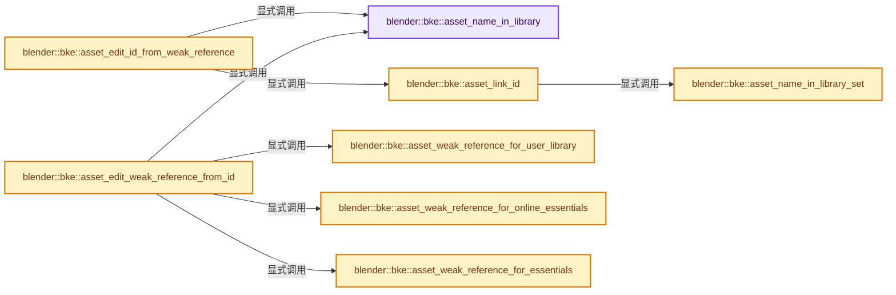
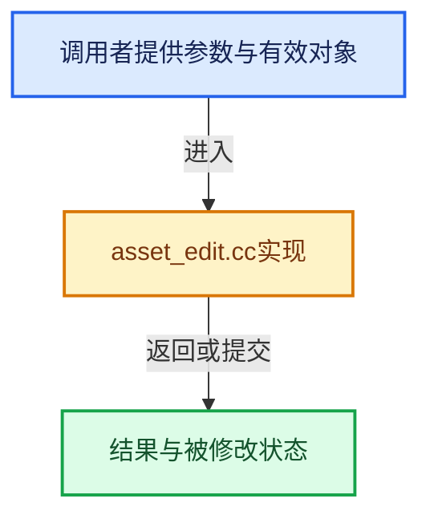

# 实现依赖专题：source/blender/blenkernel/intern/asset_edit.cc

[实现依赖导航](../../README.md) · [符号索引](../../../00-课程指南/02-源码与提交索引/符号依赖与实现索引.md)

本专题从正文实际调用进入，集中保存共享实现。函数有稳定锚点，可从调用处直接跳到对应完整函数；递归与互相调用通过回链组织。

## 本文件的实现关系






## 完整成员与函数实现

<a id="f-d935a832dc04fe06"></a>

### `blender::bke::asset_name_in_library`

实现位置：[source/blender/blenkernel/intern/asset_edit.cc](../../../../../../../source/blender/blenkernel/intern/asset_edit.cc) · L49—L57。

接口参数：

- `const ID &id`

**教学注释版**

<!-- annotated:1891cb62ce57bf -->

```cpp
static const char *asset_name_in_library(const ID &id)
{
  /* Get the original name from the weak reference, in case the datablock was renamed. */
  if (ID_IS_LINKED(&id) && id.library_weak_reference) {
    return id.library_weak_reference->library_id_name + 2;
  }

  return BKE_id_name(id);
}
```

<details>
<summary>核对原始源码：source/blender/blenkernel/intern/asset_edit.cc · L49—L57</summary>

<!-- original:1891cb62ce57bf:source/blender/blenkernel/intern/asset_edit.cc:49:57 -->

```cpp
static const char *asset_name_in_library(const ID &id)
{
  /* Get the original name from the weak reference, in case the datablock was renamed. */
  if (ID_IS_LINKED(&id) && id.library_weak_reference) {
    return id.library_weak_reference->library_id_name + 2;
  }

  return BKE_id_name(id);
}
```

</details>

**结果出口**

- `return id.library_weak_reference->library_id_name + 2;`
- `return BKE_id_name(id);`

**继续追踪实现**

- `ID_IS_LINKED` → [ID_IS_LINKED · L697](../../08-其他Blender模块/makesdna/DNA_ID.h.md#m-7e1e1e9b20e6)。宏定义由构建条件选择。
- `BKE_id_name` → [blender::BKE_id_name · L1001](../BKE_lib_id.hh.md#f-b9397f1fe1fcc017)；[blender::BKE_id_name · L1005](../BKE_lib_id.hh.md#f-c026427d13979145)。同名重载需按实参类型选择。

<a id="f-4fde23c6154728bb"></a>

### `blender::bke::asset_name_in_library_set`

实现位置：[source/blender/blenkernel/intern/asset_edit.cc](../../../../../../../source/blender/blenkernel/intern/asset_edit.cc) · L59—L68。

接口参数：

- `ID &id`
- `const char *name`

**教学注释版**

<!-- annotated:8b331b606b526d -->

```cpp
static void asset_name_in_library_set(ID &id, const char *name)
{
  BLI_assert(ID_IS_LINKED(&id));

  char id_name[MAX_ID_NAME];
  STRNCPY(id_name, id.name);
  BLI_strncpy(id_name + 2, name, sizeof(id_name) - 2);

  BKE_main_library_weak_reference_add(&id, id.lib->filepath, id_name);
}
```

<details>
<summary>核对原始源码：source/blender/blenkernel/intern/asset_edit.cc · L59—L68</summary>

<!-- original:8b331b606b526d:source/blender/blenkernel/intern/asset_edit.cc:59:68 -->

```cpp
static void asset_name_in_library_set(ID &id, const char *name)
{
  BLI_assert(ID_IS_LINKED(&id));

  char id_name[MAX_ID_NAME];
  STRNCPY(id_name, id.name);
  BLI_strncpy(id_name + 2, name, sizeof(id_name) - 2);

  BKE_main_library_weak_reference_add(&id, id.lib->filepath, id_name);
}
```

</details>

**继续追踪实现**

- `BLI_assert` → [BLI_assert · L48](../../01-BLI基础库/BLI_assert.hh.md#m-57a88495704d)；[BLI_assert · L63](../../01-BLI基础库/BLI_assert.hh.md#m-d07050020cb5)。宏定义由构建条件选择。
- `ID_IS_LINKED` → [ID_IS_LINKED · L697](../../08-其他Blender模块/makesdna/DNA_ID.h.md#m-7e1e1e9b20e6)。宏定义由构建条件选择。
- `STRNCPY` → [blender::STRNCPY · L690](../../01-BLI基础库/BLI_string.hh.md#f-6b2d861724026be6)。
- `BLI_strncpy` → [blender::BLI_strncpy · L70](../../01-BLI基础库/intern/string.cc.md#f-6324147b0d116da1)。
- `BKE_main_library_weak_reference_add` → [blender::BKE_main_library_weak_reference_add · L971](main.cc.md#f-ac51109c9da2a29b)。

<a id="f-a35e10cbcc69e543"></a>

### `blender::bke::asset_link_id`

实现位置：[source/blender/blenkernel/intern/asset_edit.cc](../../../../../../../source/blender/blenkernel/intern/asset_edit.cc) · L70—L118。

接口参数：

- `Main &global_main`
- `const ID_Type id_type`
- `const char *filepath`
- `const char *asset_name`
- `ReportList *reports = nullptr`

**教学注释版**

<!-- annotated:f3cd7060b2be2b -->

```cpp
static ID *asset_link_id(Main &global_main,
                         const ID_Type id_type,
                         const char *filepath,
                         const char *asset_name,
                         ReportList *reports = nullptr)
{
  /* Load asset from asset library. */
  LibraryLink_Params lapp_params{};
  lapp_params.bmain = &global_main;
  BlendfileLinkAppendContext *lapp_context = BKE_blendfile_link_append_context_new(&lapp_params);
  BKE_blendfile_link_append_context_flag_set(lapp_context, BLO_LIBLINK_FORCE_INDIRECT, true);

  BKE_blendfile_link_append_context_library_add(lapp_context, filepath, nullptr);

  BlendfileLinkAppendContextItem *lapp_item = BKE_blendfile_link_append_context_item_add(
      lapp_context, asset_name, id_type, nullptr);
  BKE_blendfile_link_append_context_item_library_index_enable(lapp_context, lapp_item, 0);

  BKE_blendfile_link_append_context_init_done(lapp_context);

  BKE_blendfile_link(lapp_context, reports);

  BKE_blendfile_link_append_context_finalize(lapp_context);

  ID *local_asset = BKE_blendfile_link_append_context_item_newid_get(lapp_context, lapp_item);

  BKE_blendfile_link_append_context_free(lapp_context);

  /* Verify that the name matches. It must for referencing the same asset again to work. */
  BLI_assert(local_asset == nullptr || STREQ(local_asset->name + 2, asset_name));

  /* Tag library as being editable. */
  if (local_asset && local_asset->lib) {
    local_asset->lib->runtime->tag |= LIBRARY_ASSET_EDITABLE;

    if ((local_asset->lib->runtime->tag & LIBRARY_IS_ASSET_EDIT_FILE) &&
        StringRef(filepath).endswith(BLENDER_ASSET_FILE_SUFFIX) &&
        BKE_preferences_asset_library_containing_path(&U, filepath) &&
        BLI_file_is_writable(filepath))
    {
      local_asset->lib->runtime->tag |= LIBRARY_ASSET_FILE_WRITABLE;
    }

    /* Keep original name in weak reference, in case this datablock gets renamed. */
    asset_name_in_library_set(*local_asset, asset_name);
  }

  return local_asset;
}
```

<details>
<summary>核对原始源码：source/blender/blenkernel/intern/asset_edit.cc · L70—L118</summary>

<!-- original:f3cd7060b2be2b:source/blender/blenkernel/intern/asset_edit.cc:70:118 -->

```cpp
static ID *asset_link_id(Main &global_main,
                         const ID_Type id_type,
                         const char *filepath,
                         const char *asset_name,
                         ReportList *reports = nullptr)
{
  /* Load asset from asset library. */
  LibraryLink_Params lapp_params{};
  lapp_params.bmain = &global_main;
  BlendfileLinkAppendContext *lapp_context = BKE_blendfile_link_append_context_new(&lapp_params);
  BKE_blendfile_link_append_context_flag_set(lapp_context, BLO_LIBLINK_FORCE_INDIRECT, true);

  BKE_blendfile_link_append_context_library_add(lapp_context, filepath, nullptr);

  BlendfileLinkAppendContextItem *lapp_item = BKE_blendfile_link_append_context_item_add(
      lapp_context, asset_name, id_type, nullptr);
  BKE_blendfile_link_append_context_item_library_index_enable(lapp_context, lapp_item, 0);

  BKE_blendfile_link_append_context_init_done(lapp_context);

  BKE_blendfile_link(lapp_context, reports);

  BKE_blendfile_link_append_context_finalize(lapp_context);

  ID *local_asset = BKE_blendfile_link_append_context_item_newid_get(lapp_context, lapp_item);

  BKE_blendfile_link_append_context_free(lapp_context);

  /* Verify that the name matches. It must for referencing the same asset again to work. */
  BLI_assert(local_asset == nullptr || STREQ(local_asset->name + 2, asset_name));

  /* Tag library as being editable. */
  if (local_asset && local_asset->lib) {
    local_asset->lib->runtime->tag |= LIBRARY_ASSET_EDITABLE;

    if ((local_asset->lib->runtime->tag & LIBRARY_IS_ASSET_EDIT_FILE) &&
        StringRef(filepath).endswith(BLENDER_ASSET_FILE_SUFFIX) &&
        BKE_preferences_asset_library_containing_path(&U, filepath) &&
        BLI_file_is_writable(filepath))
    {
      local_asset->lib->runtime->tag |= LIBRARY_ASSET_FILE_WRITABLE;
    }

    /* Keep original name in weak reference, in case this datablock gets renamed. */
    asset_name_in_library_set(*local_asset, asset_name);
  }

  return local_asset;
}
```

</details>

**沿实际写入检查状态**

- `lapp_params.bmain = &global_main;`
- `local_asset->lib->runtime->tag |= LIBRARY_ASSET_EDITABLE;`
- `local_asset->lib->runtime->tag |= LIBRARY_ASSET_FILE_WRITABLE;`

**结果出口**

- `return local_asset;`

**继续追踪实现**

- `BKE_blendfile_link_append_context_new` → [blender::BKE_blendfile_link_append_context_new · L138](blendfile_link_append.cc.md#f-f1888d6439608a20)。
- `BKE_blendfile_link_append_context_flag_set` → [blender::BKE_blendfile_link_append_context_flag_set · L157](blendfile_link_append.cc.md#f-4d547fb13153748c)。
- `BKE_blendfile_link_append_context_library_add` → [blender::BKE_blendfile_link_append_context_library_add · L186](blendfile_link_append.cc.md#f-452e4163f0747170)。
- `BKE_blendfile_link_append_context_item_add` → [blender::BKE_blendfile_link_append_context_item_add · L204](blendfile_link_append.cc.md#f-17397f10d24e27a1)。
- `BKE_blendfile_link_append_context_item_library_index_enable` → [blender::BKE_blendfile_link_append_context_item_library_index_enable · L279](blendfile_link_append.cc.md#f-80f9951cc3753ce2)。
- `BKE_blendfile_link_append_context_init_done` → [blender::BKE_blendfile_link_append_context_init_done · L366](blendfile_link_append.cc.md#f-c97bb95371872cec)。
- `BKE_blendfile_link` → [blender::BKE_blendfile_link · L1798](blendfile_link_append.cc.md#f-0da9af778addef2b)。
- `BKE_blendfile_link_append_context_finalize` → [blender::BKE_blendfile_link_append_context_finalize · L375](blendfile_link_append.cc.md#f-be7d55990ef1398e)。
- `BKE_blendfile_link_append_context_item_newid_get` → [blender::BKE_blendfile_link_append_context_item_newid_get · L300](blendfile_link_append.cc.md#f-5edb3f4195ff9e68)。
- `BKE_blendfile_link_append_context_free` → [blender::BKE_blendfile_link_append_context_free · L146](blendfile_link_append.cc.md#f-f79572a63c23e09f)。
- `BLI_assert` → [BLI_assert · L48](../../01-BLI基础库/BLI_assert.hh.md#m-57a88495704d)；[BLI_assert · L63](../../01-BLI基础库/BLI_assert.hh.md#m-d07050020cb5)。宏定义由构建条件选择。
- `STREQ` → [STREQ · L112](../../07-Intern运行时与平台/ghost/intern/GHOST_utildefines.hh.md#m-9549fb6aafd2)；[STREQ · L451](../../01-BLI基础库/BLI_utildefines.hh.md#m-c7b745bcfad2)；[STREQ · L55](../../07-Intern运行时与平台/clog/clog.cc.md#m-96e78f386894)。宏定义由构建条件选择。
- `StringRef(filepath).endswith` → [调用协议](../../../00-课程指南/01-路线与规范/模板宏与动态分派协议.md)：接收对象类型依赖auto、返回值或模板实例；不按同名猜测目标。调用位置L106。
- `StringRef` → [blender::StringRef::StringRef · L555](../../../01-基础容器与现代CPP/15-StringRef字符串视图.md#f-f6aca324a36faa7e)；[blender::StringRef::StringRef · L560](../../../01-基础容器与现代CPP/15-StringRef字符串视图.md#f-ab9714781ca51bac)；[blender::StringRef::StringRef · L565](../../../01-基础容器与现代CPP/15-StringRef字符串视图.md#f-95f0b483bbdd7739)；[blender::StringRef::StringRef · L570](../../../01-基础容器与现代CPP/15-StringRef字符串视图.md#f-808d05699cb33334)；[blender::StringRef::StringRef · L631](../../../01-基础容器与现代CPP/15-StringRef字符串视图.md#f-37788e5f3fa3b736)；[blender::StringRef::StringRef · L641](../../../01-基础容器与现代CPP/15-StringRef字符串视图.md#f-11abd0510fb6b926)；[blender::StringRef::StringRef · L646](../../../01-基础容器与现代CPP/15-StringRef字符串视图.md#f-8437dbd8a582eefd)；[blender::StringRef::StringRef · L651](../../../01-基础容器与现代CPP/15-StringRef字符串视图.md#f-70bcb338de0db978)。同名重载需按实参类型选择。
- `BKE_preferences_asset_library_containing_path` → [blender::BKE_preferences_asset_library_containing_path · L144](preferences.cc.md#f-7e69a2d67c04e98e)。
- `BLI_file_is_writable` → [blender::BLI_file_is_writable · L293](../../01-BLI基础库/intern/fileops_c.cc.md#f-04afb731359c2724)。
- `asset_name_in_library_set` → [blender::bke::asset_name_in_library_set · L59](asset_edit.cc.md#f-4fde23c6154728bb)。

<a id="f-e2f99cace96ce2d9"></a>

### `blender::bke::asset_weak_reference_for_user_library`

实现位置：[source/blender/blenkernel/intern/asset_edit.cc](../../../../../../../source/blender/blenkernel/intern/asset_edit.cc) · L247—L271。

接口参数：

- `const bUserAssetLibrary &user_library`
- `const short idcode`
- `const char *idname`
- `const char *filepath`

**教学注释版**

<!-- annotated:389af83c0285f5 -->

```cpp
static AssetWeakReference asset_weak_reference_for_user_library(
    const bUserAssetLibrary &user_library,
    const short idcode,
    const char *idname,
    const char *filepath)
{
  AssetWeakReference weak_ref;
  weak_ref.asset_library_type = ASSET_LIBRARY_CUSTOM;
  weak_ref.asset_library_identifier = BLI_strdup(user_library.name);

  /* BLI_path_rel requires a trailing slash. */
  char user_library_dirpath[FILE_MAX];
  STRNCPY(user_library_dirpath, user_library.dirpath);
  BLI_path_slash_ensure(user_library_dirpath, sizeof(user_library_dirpath));

  char relative_filepath[FILE_MAX];
  STRNCPY(relative_filepath, filepath);
  BLI_path_rel(relative_filepath, user_library_dirpath);
  const char *asset_blend_path = relative_filepath + 2; /* Strip out // prefix. */

  weak_ref.relative_asset_identifier = BLI_sprintfN(
      "%s/%s/%s", asset_blend_path, BKE_idtype_idcode_to_name(idcode), idname);

  return weak_ref;
}
```

<details>
<summary>核对原始源码：source/blender/blenkernel/intern/asset_edit.cc · L247—L271</summary>

<!-- original:389af83c0285f5:source/blender/blenkernel/intern/asset_edit.cc:247:271 -->

```cpp
static AssetWeakReference asset_weak_reference_for_user_library(
    const bUserAssetLibrary &user_library,
    const short idcode,
    const char *idname,
    const char *filepath)
{
  AssetWeakReference weak_ref;
  weak_ref.asset_library_type = ASSET_LIBRARY_CUSTOM;
  weak_ref.asset_library_identifier = BLI_strdup(user_library.name);

  /* BLI_path_rel requires a trailing slash. */
  char user_library_dirpath[FILE_MAX];
  STRNCPY(user_library_dirpath, user_library.dirpath);
  BLI_path_slash_ensure(user_library_dirpath, sizeof(user_library_dirpath));

  char relative_filepath[FILE_MAX];
  STRNCPY(relative_filepath, filepath);
  BLI_path_rel(relative_filepath, user_library_dirpath);
  const char *asset_blend_path = relative_filepath + 2; /* Strip out // prefix. */

  weak_ref.relative_asset_identifier = BLI_sprintfN(
      "%s/%s/%s", asset_blend_path, BKE_idtype_idcode_to_name(idcode), idname);

  return weak_ref;
}
```

</details>

**沿实际写入检查状态**

- `weak_ref.asset_library_type = ASSET_LIBRARY_CUSTOM;`
- `weak_ref.asset_library_identifier = BLI_strdup(user_library.name);`
- `weak_ref.relative_asset_identifier = BLI_sprintfN(`

**结果出口**

- `return weak_ref;`

**继续追踪实现**

- `BLI_strdup` → [blender::BLI_strdup · L43](../../01-BLI基础库/intern/string.cc.md#f-7e6d5c696c20c0e1)。
- `STRNCPY` → [blender::STRNCPY · L690](../../01-BLI基础库/BLI_string.hh.md#f-6b2d861724026be6)。
- `BLI_path_slash_ensure` → [BLI_path_slash_ensure · L2021](../../01-BLI基础库/intern/path_utils.cc.md#f-5a6c9abc494fe6dd)。
- `BLI_path_rel` → [BLI_path_rel · L820](../../01-BLI基础库/intern/path_utils.cc.md#f-c7322285f3614f66)。
- `BLI_sprintfN` → [blender::BLI_sprintfN · L296](../../01-BLI基础库/intern/string.cc.md#f-bfbc2f7076298fc0)。
- `BKE_idtype_idcode_to_name` → [blender::BKE_idtype_idcode_to_name · L261](idtype.cc.md#f-282fc9db6d5f0eb2)。

<a id="f-c1d89576ae7ec19c"></a>

### `blender::bke::asset_weak_reference_for_online_essentials`

实现位置：[source/blender/blenkernel/intern/asset_edit.cc](../../../../../../../source/blender/blenkernel/intern/asset_edit.cc) · L273—L296。

接口参数：

- `const short idcode`
- `const char *idname`
- `const char *filepath`

**教学注释版**

<!-- annotated:43bf30ee19b69c -->

```cpp
static AssetWeakReference asset_weak_reference_for_online_essentials(const short idcode,
                                                                     const char *idname,
                                                                     const char *filepath)
{
  BLI_assert(!BLI_path_is_rel(filepath));
  BLI_assert(BLI_path_is_abs_from_cwd(filepath));
  BLI_assert(
      BLI_path_contains(asset_system::online_essentials_cache_directory_path().c_str(), filepath));

  char relative_filepath[FILE_MAX];
  STRNCPY(relative_filepath, filepath);
  char online_essentials_path[FILE_MAXDIR];
  STRNCPY(online_essentials_path, asset_system::online_essentials_cache_directory_path().c_str());
  BLI_path_slash_ensure(online_essentials_path, sizeof(online_essentials_path));
  BLI_path_rel(relative_filepath, online_essentials_path);
  const char *asset_blend_path = relative_filepath + 2; /* Strip out // prefix. */

  AssetWeakReference weak_ref;
  weak_ref.asset_library_type = ASSET_LIBRARY_ONLINE_ESSENTIALS;
  weak_ref.relative_asset_identifier = BLI_sprintfN(
      "%s/%s/%s", asset_blend_path, BKE_idtype_idcode_to_name(idcode), idname);

  return weak_ref;
}
```

<details>
<summary>核对原始源码：source/blender/blenkernel/intern/asset_edit.cc · L273—L296</summary>

<!-- original:43bf30ee19b69c:source/blender/blenkernel/intern/asset_edit.cc:273:296 -->

```cpp
static AssetWeakReference asset_weak_reference_for_online_essentials(const short idcode,
                                                                     const char *idname,
                                                                     const char *filepath)
{
  BLI_assert(!BLI_path_is_rel(filepath));
  BLI_assert(BLI_path_is_abs_from_cwd(filepath));
  BLI_assert(
      BLI_path_contains(asset_system::online_essentials_cache_directory_path().c_str(), filepath));

  char relative_filepath[FILE_MAX];
  STRNCPY(relative_filepath, filepath);
  char online_essentials_path[FILE_MAXDIR];
  STRNCPY(online_essentials_path, asset_system::online_essentials_cache_directory_path().c_str());
  BLI_path_slash_ensure(online_essentials_path, sizeof(online_essentials_path));
  BLI_path_rel(relative_filepath, online_essentials_path);
  const char *asset_blend_path = relative_filepath + 2; /* Strip out // prefix. */

  AssetWeakReference weak_ref;
  weak_ref.asset_library_type = ASSET_LIBRARY_ONLINE_ESSENTIALS;
  weak_ref.relative_asset_identifier = BLI_sprintfN(
      "%s/%s/%s", asset_blend_path, BKE_idtype_idcode_to_name(idcode), idname);

  return weak_ref;
}
```

</details>

**沿实际写入检查状态**

- `weak_ref.asset_library_type = ASSET_LIBRARY_ONLINE_ESSENTIALS;`
- `weak_ref.relative_asset_identifier = BLI_sprintfN(`

**结果出口**

- `return weak_ref;`

**继续追踪实现**

- `BLI_assert` → [BLI_assert · L48](../../01-BLI基础库/BLI_assert.hh.md#m-57a88495704d)；[BLI_assert · L63](../../01-BLI基础库/BLI_assert.hh.md#m-d07050020cb5)。宏定义由构建条件选择。
- `BLI_path_is_rel` → [BLI_path_is_rel · L536](../../01-BLI基础库/intern/path_utils.cc.md#f-d938443d331ba72c)。
- `BLI_path_is_abs_from_cwd` → [BLI_path_is_abs_from_cwd · L1268](../../01-BLI基础库/intern/path_utils.cc.md#f-80f1f1b21a355aa9)。
- `BLI_path_contains` → [BLI_path_contains · L1931](../../01-BLI基础库/intern/path_utils.cc.md#f-7aee9b5c30526e8c)。
- `asset_system::online_essentials_cache_directory_path().c_str` → [调用协议](../../../00-课程指南/01-路线与规范/模板宏与动态分派协议.md)：接收对象类型依赖auto、返回值或模板实例；不按同名猜测目标。调用位置L280。
- `asset_system::online_essentials_cache_directory_path` → [blender::asset_system::online_essentials_cache_directory_path · L146](../../08-其他Blender模块/asset_system/intern/library_types/essentials_library.cc.md#f-29e80e48fd5de415)。
- `STRNCPY` → [blender::STRNCPY · L690](../../01-BLI基础库/BLI_string.hh.md#f-6b2d861724026be6)。
- `BLI_path_slash_ensure` → [BLI_path_slash_ensure · L2021](../../01-BLI基础库/intern/path_utils.cc.md#f-5a6c9abc494fe6dd)。
- `BLI_path_rel` → [BLI_path_rel · L820](../../01-BLI基础库/intern/path_utils.cc.md#f-c7322285f3614f66)。
- `BLI_sprintfN` → [blender::BLI_sprintfN · L296](../../01-BLI基础库/intern/string.cc.md#f-bfbc2f7076298fc0)。
- `BKE_idtype_idcode_to_name` → [blender::BKE_idtype_idcode_to_name · L261](idtype.cc.md#f-282fc9db6d5f0eb2)。

<a id="f-f201d40c8db126d9"></a>

### `blender::bke::asset_weak_reference_for_essentials`

实现位置：[source/blender/blenkernel/intern/asset_edit.cc](../../../../../../../source/blender/blenkernel/intern/asset_edit.cc) · L298—L316。

接口参数：

- `const short idcode`
- `const char *idname`
- `const char *filepath`

**教学注释版**

<!-- annotated:82f6e7a5e97569 -->

```cpp
static AssetWeakReference asset_weak_reference_for_essentials(const short idcode,
                                                              const char *idname,
                                                              const char *filepath)
{
  BLI_assert(!BLI_path_is_rel(filepath));
  BLI_assert(BLI_path_is_abs_from_cwd(filepath));
  BLI_assert(!BLI_path_contains(asset_system::online_essentials_cache_directory_path().c_str(),
                                filepath));

  AssetWeakReference weak_ref;
  weak_ref.asset_library_type = ASSET_LIBRARY_ESSENTIALS;
  weak_ref.relative_asset_identifier = BLI_sprintfN("%s/%s/%s/%s",
                                                    BKE_idtype_idcode_to_name_plural(idcode),
                                                    BLI_path_basename(filepath),
                                                    BKE_idtype_idcode_to_name(idcode),
                                                    idname);

  return weak_ref;
}
```

<details>
<summary>核对原始源码：source/blender/blenkernel/intern/asset_edit.cc · L298—L316</summary>

<!-- original:82f6e7a5e97569:source/blender/blenkernel/intern/asset_edit.cc:298:316 -->

```cpp
static AssetWeakReference asset_weak_reference_for_essentials(const short idcode,
                                                              const char *idname,
                                                              const char *filepath)
{
  BLI_assert(!BLI_path_is_rel(filepath));
  BLI_assert(BLI_path_is_abs_from_cwd(filepath));
  BLI_assert(!BLI_path_contains(asset_system::online_essentials_cache_directory_path().c_str(),
                                filepath));

  AssetWeakReference weak_ref;
  weak_ref.asset_library_type = ASSET_LIBRARY_ESSENTIALS;
  weak_ref.relative_asset_identifier = BLI_sprintfN("%s/%s/%s/%s",
                                                    BKE_idtype_idcode_to_name_plural(idcode),
                                                    BLI_path_basename(filepath),
                                                    BKE_idtype_idcode_to_name(idcode),
                                                    idname);

  return weak_ref;
}
```

</details>

**沿实际写入检查状态**

- `weak_ref.asset_library_type = ASSET_LIBRARY_ESSENTIALS;`
- `weak_ref.relative_asset_identifier = BLI_sprintfN("%s/%s/%s/%s",`

**结果出口**

- `return weak_ref;`

**继续追踪实现**

- `BLI_assert` → [BLI_assert · L48](../../01-BLI基础库/BLI_assert.hh.md#m-57a88495704d)；[BLI_assert · L63](../../01-BLI基础库/BLI_assert.hh.md#m-d07050020cb5)。宏定义由构建条件选择。
- `BLI_path_is_rel` → [BLI_path_is_rel · L536](../../01-BLI基础库/intern/path_utils.cc.md#f-d938443d331ba72c)。
- `BLI_path_is_abs_from_cwd` → [BLI_path_is_abs_from_cwd · L1268](../../01-BLI基础库/intern/path_utils.cc.md#f-80f1f1b21a355aa9)。
- `BLI_path_contains` → [BLI_path_contains · L1931](../../01-BLI基础库/intern/path_utils.cc.md#f-7aee9b5c30526e8c)。
- `asset_system::online_essentials_cache_directory_path().c_str` → [调用协议](../../../00-课程指南/01-路线与规范/模板宏与动态分派协议.md)：接收对象类型依赖auto、返回值或模板实例；不按同名猜测目标。调用位置L304。
- `asset_system::online_essentials_cache_directory_path` → [blender::asset_system::online_essentials_cache_directory_path · L146](../../08-其他Blender模块/asset_system/intern/library_types/essentials_library.cc.md#f-29e80e48fd5de415)。
- `BLI_sprintfN` → [blender::BLI_sprintfN · L296](../../01-BLI基础库/intern/string.cc.md#f-bfbc2f7076298fc0)。
- `BKE_idtype_idcode_to_name_plural` → [blender::BKE_idtype_idcode_to_name_plural · L268](idtype.cc.md#f-52880b295f558cdc)。
- `BLI_path_basename` → [BLI_path_basename · L1847](../../01-BLI基础库/intern/path_utils.cc.md#f-1b9bc48bebf9dfcd)。
- `BKE_idtype_idcode_to_name` → [blender::BKE_idtype_idcode_to_name · L261](idtype.cc.md#f-282fc9db6d5f0eb2)。

<a id="f-318c7f6e6f817f6d"></a>

### `blender::bke::asset_edit_id_from_weak_reference`

实现位置：[source/blender/blenkernel/intern/asset_edit.cc](../../../../../../../source/blender/blenkernel/intern/asset_edit.cc) · L482—L521。

接口参数：

- `Main &global_main`
- `const ID_Type id_type`
- `const AssetWeakReference &weak_ref`

**教学注释版**

<!-- annotated:c1daddcbac8cc9 -->

```cpp
ID *asset_edit_id_from_weak_reference(Main &global_main,
                                      const ID_Type id_type,
                                      const AssetWeakReference &weak_ref)
{
  /* Don't do this in file load. */
  BLI_assert(!global_main.is_locked_for_linking);

  char asset_full_path_buffer[FILE_MAX_LIBEXTRA];
  char *asset_lib_path, *asset_group, *asset_name;

  AS_asset_full_path_explode_from_weak_ref(
      &weak_ref, asset_full_path_buffer, &asset_lib_path, &asset_group, &asset_name);
  if (asset_lib_path == nullptr && asset_group == nullptr && asset_name == nullptr) {
    return nullptr;
  }

  /* If this is the same file as we have open, use local datablock. */
  if (asset_lib_path && STREQ(asset_lib_path, global_main.filepath)) {
    asset_lib_path = nullptr;
  }

  BLI_assert(asset_name != nullptr);

  /* Is the asset already in the file we have loaded? */
  if (asset_lib_path == nullptr) {
    return BKE_libblock_find_name(&global_main, id_type, asset_name, nullptr);
  }

  /* Find already loaded asset in a library. */
  if (Library *lib = library::search_filepath_abs(&global_main.libraries, asset_lib_path)) {
    for (ID &local_asset : *which_libbase(&global_main, id_type)) {
      if (local_asset.lib == lib && STREQ(asset_name_in_library(local_asset), asset_name)) {
        return &local_asset;
      }
    }
  }

  /* Try linking in the required file. */
  return asset_link_id(global_main, id_type, asset_lib_path, asset_name);
}
```

<details>
<summary>核对原始源码：source/blender/blenkernel/intern/asset_edit.cc · L482—L521</summary>

<!-- original:c1daddcbac8cc9:source/blender/blenkernel/intern/asset_edit.cc:482:521 -->

```cpp
ID *asset_edit_id_from_weak_reference(Main &global_main,
                                      const ID_Type id_type,
                                      const AssetWeakReference &weak_ref)
{
  /* Don't do this in file load. */
  BLI_assert(!global_main.is_locked_for_linking);

  char asset_full_path_buffer[FILE_MAX_LIBEXTRA];
  char *asset_lib_path, *asset_group, *asset_name;

  AS_asset_full_path_explode_from_weak_ref(
      &weak_ref, asset_full_path_buffer, &asset_lib_path, &asset_group, &asset_name);
  if (asset_lib_path == nullptr && asset_group == nullptr && asset_name == nullptr) {
    return nullptr;
  }

  /* If this is the same file as we have open, use local datablock. */
  if (asset_lib_path && STREQ(asset_lib_path, global_main.filepath)) {
    asset_lib_path = nullptr;
  }

  BLI_assert(asset_name != nullptr);

  /* Is the asset already in the file we have loaded? */
  if (asset_lib_path == nullptr) {
    return BKE_libblock_find_name(&global_main, id_type, asset_name, nullptr);
  }

  /* Find already loaded asset in a library. */
  if (Library *lib = library::search_filepath_abs(&global_main.libraries, asset_lib_path)) {
    for (ID &local_asset : *which_libbase(&global_main, id_type)) {
      if (local_asset.lib == lib && STREQ(asset_name_in_library(local_asset), asset_name)) {
        return &local_asset;
      }
    }
  }

  /* Try linking in the required file. */
  return asset_link_id(global_main, id_type, asset_lib_path, asset_name);
}
```

</details>

**沿实际写入检查状态**

- `asset_lib_path = nullptr;`

**结果出口**

- `return nullptr;`
- `return BKE_libblock_find_name(&global_main, id_type, asset_name, nullptr);`
- `return &local_asset;`
- `return asset_link_id(global_main, id_type, asset_lib_path, asset_name);`

**继续追踪实现**

- `BLI_assert` → [BLI_assert · L48](../../01-BLI基础库/BLI_assert.hh.md#m-57a88495704d)；[BLI_assert · L63](../../01-BLI基础库/BLI_assert.hh.md#m-d07050020cb5)。宏定义由构建条件选择。
- `AS_asset_full_path_explode_from_weak_ref` → [blender::AS_asset_full_path_explode_from_weak_ref · L113](../../08-其他Blender模块/asset_system/intern/asset_library.cc.md#f-f1e4874a341c4015)。
- `STREQ` → [STREQ · L112](../../07-Intern运行时与平台/ghost/intern/GHOST_utildefines.hh.md#m-9549fb6aafd2)；[STREQ · L451](../../01-BLI基础库/BLI_utildefines.hh.md#m-c7b745bcfad2)；[STREQ · L55](../../07-Intern运行时与平台/clog/clog.cc.md#m-96e78f386894)。宏定义由构建条件选择。
- `BKE_libblock_find_name` → [blender::BKE_libblock_find_name · L1808](lib_id.cc.md#f-211512083e97ca43)。
- `library::search_filepath_abs` → [blender::bke::library::search_filepath_abs · L493](library.cc.md#f-607730628407c88d)。
- `which_libbase` → [blender::which_libbase · L1073](main.cc.md#f-87eb528420a3faf0)。
- `asset_name_in_library` → [blender::bke::asset_name_in_library · L49](asset_edit.cc.md#f-d935a832dc04fe06)。
- `asset_link_id` → [blender::bke::asset_link_id · L70](asset_edit.cc.md#f-a35e10cbcc69e543)。

<a id="f-4f7bcbac6d164056"></a>

### `blender::bke::asset_edit_weak_reference_from_id`

实现位置：[source/blender/blenkernel/intern/asset_edit.cc](../../../../../../../source/blender/blenkernel/intern/asset_edit.cc) · L523—L560。

接口参数：

- `const ID &id`

**教学注释版**

<!-- annotated:4635ab79676b1c -->

```cpp
std::optional<AssetWeakReference> asset_edit_weak_reference_from_id(const ID &id)
{
  /* Brush is local to the file. */
  if (!id.lib) {
    AssetWeakReference weak_ref;

    weak_ref.asset_library_type = eAssetLibraryType::ASSET_LIBRARY_LOCAL;
    weak_ref.relative_asset_identifier = BLI_sprintfN(
        "%s/%s", BKE_idtype_idcode_to_name(GS(id.name)), id.name + 2);

    return weak_ref;
  }

  if (!asset_edit_id_is_editable(id)) {
    return std::nullopt;
  }

  const bUserAssetLibrary *user_library = BKE_preferences_asset_library_containing_path(
      &U, id.lib->runtime->filepath_abs);

  const short idcode = GS(id.name);
  const char *idname = asset_name_in_library(id);

  if (user_library && user_library->dirpath[0]) {
    return asset_weak_reference_for_user_library(
        *user_library, idcode, idname, id.lib->runtime->filepath_abs);
  }

  const bool is_online_essential = BLI_path_contains(
      asset_system::online_essentials_cache_directory_path().c_str(),
      id.lib->runtime->filepath_abs);
  if (is_online_essential) {
    return asset_weak_reference_for_online_essentials(
        idcode, idname, id.lib->runtime->filepath_abs);
  }

  return asset_weak_reference_for_essentials(idcode, idname, id.lib->runtime->filepath_abs);
}
```

<details>
<summary>核对原始源码：source/blender/blenkernel/intern/asset_edit.cc · L523—L560</summary>

<!-- original:4635ab79676b1c:source/blender/blenkernel/intern/asset_edit.cc:523:560 -->

```cpp
std::optional<AssetWeakReference> asset_edit_weak_reference_from_id(const ID &id)
{
  /* Brush is local to the file. */
  if (!id.lib) {
    AssetWeakReference weak_ref;

    weak_ref.asset_library_type = eAssetLibraryType::ASSET_LIBRARY_LOCAL;
    weak_ref.relative_asset_identifier = BLI_sprintfN(
        "%s/%s", BKE_idtype_idcode_to_name(GS(id.name)), id.name + 2);

    return weak_ref;
  }

  if (!asset_edit_id_is_editable(id)) {
    return std::nullopt;
  }

  const bUserAssetLibrary *user_library = BKE_preferences_asset_library_containing_path(
      &U, id.lib->runtime->filepath_abs);

  const short idcode = GS(id.name);
  const char *idname = asset_name_in_library(id);

  if (user_library && user_library->dirpath[0]) {
    return asset_weak_reference_for_user_library(
        *user_library, idcode, idname, id.lib->runtime->filepath_abs);
  }

  const bool is_online_essential = BLI_path_contains(
      asset_system::online_essentials_cache_directory_path().c_str(),
      id.lib->runtime->filepath_abs);
  if (is_online_essential) {
    return asset_weak_reference_for_online_essentials(
        idcode, idname, id.lib->runtime->filepath_abs);
  }

  return asset_weak_reference_for_essentials(idcode, idname, id.lib->runtime->filepath_abs);
}
```

</details>

**沿实际写入检查状态**

- `weak_ref.asset_library_type = eAssetLibraryType::ASSET_LIBRARY_LOCAL;`
- `weak_ref.relative_asset_identifier = BLI_sprintfN(`

**结果出口**

- `return weak_ref;`
- `return std::nullopt;`
- `return asset_weak_reference_for_user_library(`
- `return asset_weak_reference_for_online_essentials(`
- `return asset_weak_reference_for_essentials(idcode, idname, id.lib->runtime->filepath_abs);`

**继续追踪实现**

- `BLI_sprintfN` → [blender::BLI_sprintfN · L296](../../01-BLI基础库/intern/string.cc.md#f-bfbc2f7076298fc0)。
- `BKE_idtype_idcode_to_name` → [blender::BKE_idtype_idcode_to_name · L261](idtype.cc.md#f-282fc9db6d5f0eb2)。
- `GS` → [blender::GS · L410](../../08-其他Blender模块/makesdna/DNA_ID.h.md#f-c3ff509f79f21b05)。
- `asset_edit_id_is_editable` → [blender::bke::asset_edit_id_is_editable · L562](asset_edit.cc.md#f-4e2eb8bffbcc12ae)。
- `BKE_preferences_asset_library_containing_path` → [blender::BKE_preferences_asset_library_containing_path · L144](preferences.cc.md#f-7e69a2d67c04e98e)。
- `asset_name_in_library` → [blender::bke::asset_name_in_library · L49](asset_edit.cc.md#f-d935a832dc04fe06)。
- `asset_weak_reference_for_user_library` → [blender::bke::asset_weak_reference_for_user_library · L247](asset_edit.cc.md#f-e2f99cace96ce2d9)。
- `BLI_path_contains` → [BLI_path_contains · L1931](../../01-BLI基础库/intern/path_utils.cc.md#f-7aee9b5c30526e8c)。
- `asset_system::online_essentials_cache_directory_path().c_str` → [调用协议](../../../00-课程指南/01-路线与规范/模板宏与动态分派协议.md)：接收对象类型依赖auto、返回值或模板实例；不按同名猜测目标。调用位置L552。
- `asset_system::online_essentials_cache_directory_path` → [blender::asset_system::online_essentials_cache_directory_path · L146](../../08-其他Blender模块/asset_system/intern/library_types/essentials_library.cc.md#f-29e80e48fd5de415)。
- `asset_weak_reference_for_online_essentials` → [blender::bke::asset_weak_reference_for_online_essentials · L273](asset_edit.cc.md#f-c1d89576ae7ec19c)。
- `asset_weak_reference_for_essentials` → [blender::bke::asset_weak_reference_for_essentials · L298](asset_edit.cc.md#f-f201d40c8db126d9)。

<a id="f-4e2eb8bffbcc12ae"></a>

### `blender::bke::asset_edit_id_is_editable`

实现位置：[source/blender/blenkernel/intern/asset_edit.cc](../../../../../../../source/blender/blenkernel/intern/asset_edit.cc) · L562—L565。

接口参数：

- `const ID &id`

**教学注释版**

<!-- annotated:cd5c42e4614f22 -->

```cpp
bool asset_edit_id_is_editable(const ID &id)
{
  return (id.lib && (id.lib->runtime->tag & LIBRARY_ASSET_EDITABLE));
}
```

<details>
<summary>核对原始源码：source/blender/blenkernel/intern/asset_edit.cc · L562—L565</summary>

<!-- original:cd5c42e4614f22:source/blender/blenkernel/intern/asset_edit.cc:562:565 -->

```cpp
bool asset_edit_id_is_editable(const ID &id)
{
  return (id.lib && (id.lib->runtime->tag & LIBRARY_ASSET_EDITABLE));
}
```

</details>

**结果出口**

- `return (id.lib && (id.lib->runtime->tag & LIBRARY_ASSET_EDITABLE));`

**继续追踪实现**

本实现没有需要继续展开的显式调用；检查返回表达式、对象转换和调用者前置条件。
