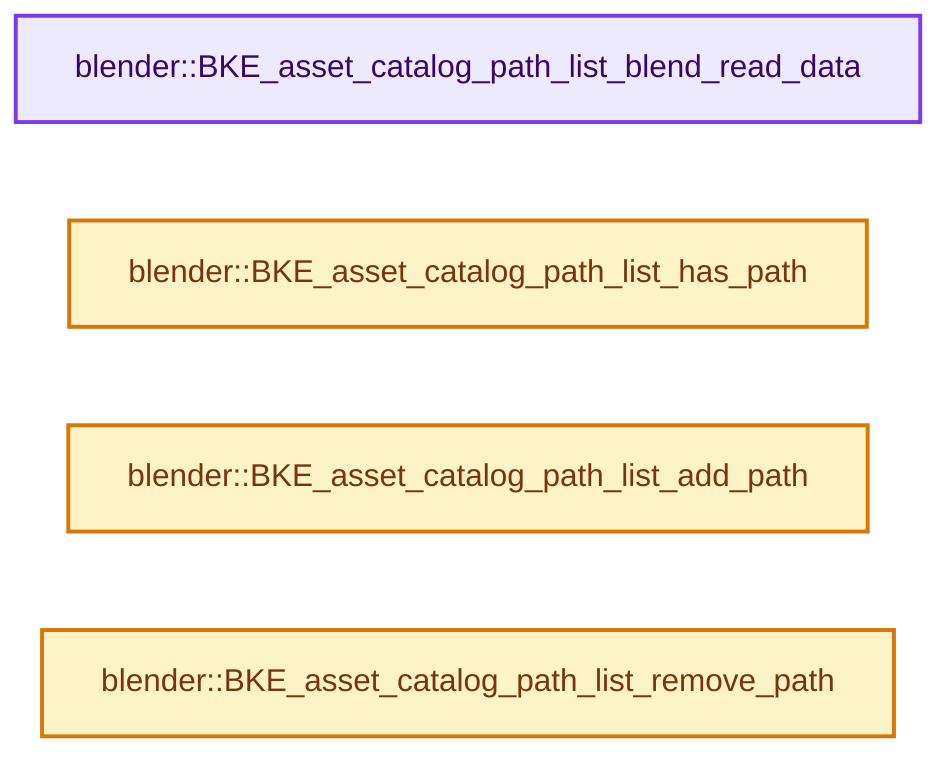
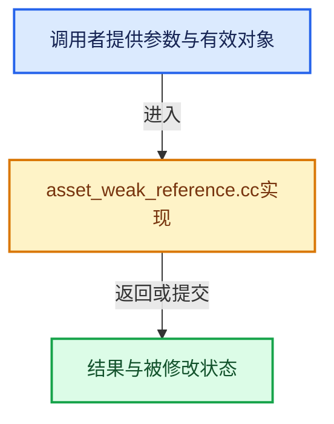

# 实现依赖专题：source/blender/blenkernel/intern/asset_weak_reference.cc

[实现依赖导航](../../README.md) · [符号索引](../../../00-课程指南/02-源码与提交索引/符号依赖与实现索引.md)

本专题从正文实际调用进入，集中保存共享实现。函数有稳定锚点，可从调用处直接跳到对应完整函数；递归与互相调用通过回链组织。

## 本文件的实现关系






## 完整成员与函数实现

<a id="f-3065ac6524bd4461"></a>

### `blender::BKE_asset_catalog_path_list_blend_read_data`

实现位置：[source/blender/blenkernel/intern/asset_weak_reference.cc](../../../../../../../source/blender/blenkernel/intern/asset_weak_reference.cc) · L177—L184。

接口参数：

- `BlendDataReader *reader`
- `ListBaseT<AssetCatalogPathLink> &catalog_path_list`

**教学注释版**

<!-- annotated:28731f31ddb870 -->

```cpp
void BKE_asset_catalog_path_list_blend_read_data(
    BlendDataReader *reader, ListBaseT<AssetCatalogPathLink> &catalog_path_list)
{
  BLO_read_struct_list(reader, AssetCatalogPathLink, &catalog_path_list);
  for (AssetCatalogPathLink &catalog_path : catalog_path_list) {
    BLO_read_string(reader, &catalog_path.path);
  }
}
```

<details>
<summary>核对原始源码：source/blender/blenkernel/intern/asset_weak_reference.cc · L177—L184</summary>

<!-- original:28731f31ddb870:source/blender/blenkernel/intern/asset_weak_reference.cc:177:184 -->

```cpp
void BKE_asset_catalog_path_list_blend_read_data(
    BlendDataReader *reader, ListBaseT<AssetCatalogPathLink> &catalog_path_list)
{
  BLO_read_struct_list(reader, AssetCatalogPathLink, &catalog_path_list);
  for (AssetCatalogPathLink &catalog_path : catalog_path_list) {
    BLO_read_string(reader, &catalog_path.path);
  }
}
```

</details>

**继续追踪实现**

- `BLO_read_struct_list` → [BLO_read_struct_list · L542](../../08-其他Blender模块/blenloader/BLO_read_write.hh.md#m-7f0b2171679f)。宏定义由构建条件选择。
- `BLO_read_string` → [BLO_read_string · L6348](../../08-其他Blender模块/blenloader/intern/readfile.cc.md#f-b9cb42e390941235)；[BLO_read_string · L6370](../../08-其他Blender模块/blenloader/intern/readfile.cc.md#f-1bb75b8661d718d2)；[BLO_read_string · L6375](../../08-其他Blender模块/blenloader/intern/readfile.cc.md#f-5714da923b3ad83d)。同名重载需按实参类型选择。

<a id="f-9db508be6eab71e1"></a>

### `blender::BKE_asset_catalog_path_list_has_path`

实现位置：[source/blender/blenkernel/intern/asset_weak_reference.cc](../../../../../../../source/blender/blenkernel/intern/asset_weak_reference.cc) · L186—L191。

接口参数：

- `const ListBaseT<AssetCatalogPathLink> &catalog_path_list`
- `const char *catalog_path`

**教学注释版**

<!-- annotated:d51b94c5830421 -->

```cpp
bool BKE_asset_catalog_path_list_has_path(const ListBaseT<AssetCatalogPathLink> &catalog_path_list,
                                          const char *catalog_path)
{
  return BLI_findstring_ptr(
             &catalog_path_list, catalog_path, offsetof(AssetCatalogPathLink, path)) != nullptr;
}
```

<details>
<summary>核对原始源码：source/blender/blenkernel/intern/asset_weak_reference.cc · L186—L191</summary>

<!-- original:d51b94c5830421:source/blender/blenkernel/intern/asset_weak_reference.cc:186:191 -->

```cpp
bool BKE_asset_catalog_path_list_has_path(const ListBaseT<AssetCatalogPathLink> &catalog_path_list,
                                          const char *catalog_path)
{
  return BLI_findstring_ptr(
             &catalog_path_list, catalog_path, offsetof(AssetCatalogPathLink, path)) != nullptr;
}
```

</details>

**结果出口**

- `return BLI_findstring_ptr(`

**继续追踪实现**

- `BLI_findstring_ptr` → [blender::BLI_findstring_ptr · L658](../../01-BLI基础库/intern/listbase.cc.md#f-0d8dced905b325f3)。

<a id="f-447a2c485db78c77"></a>

### `blender::BKE_asset_catalog_path_list_add_path`

实现位置：[source/blender/blenkernel/intern/asset_weak_reference.cc](../../../../../../../source/blender/blenkernel/intern/asset_weak_reference.cc) · L193—L199。

接口参数：

- `ListBaseT<AssetCatalogPathLink> &catalog_path_list`
- `const char *catalog_path`

**教学注释版**

<!-- annotated:6192325585973b -->

```cpp
void BKE_asset_catalog_path_list_add_path(ListBaseT<AssetCatalogPathLink> &catalog_path_list,
                                          const char *catalog_path)
{
  AssetCatalogPathLink *new_path = MEM_new<AssetCatalogPathLink>(__func__);
  new_path->path = BLI_strdup(catalog_path);
  BLI_addtail(&catalog_path_list, new_path);
}
```

<details>
<summary>核对原始源码：source/blender/blenkernel/intern/asset_weak_reference.cc · L193—L199</summary>

<!-- original:6192325585973b:source/blender/blenkernel/intern/asset_weak_reference.cc:193:199 -->

```cpp
void BKE_asset_catalog_path_list_add_path(ListBaseT<AssetCatalogPathLink> &catalog_path_list,
                                          const char *catalog_path)
{
  AssetCatalogPathLink *new_path = MEM_new<AssetCatalogPathLink>(__func__);
  new_path->path = BLI_strdup(catalog_path);
  BLI_addtail(&catalog_path_list, new_path);
}
```

</details>

**沿实际写入检查状态**

- `new_path->path = BLI_strdup(catalog_path);`

**继续追踪实现**

- `MEM_new<AssetCatalogPathLink>` → [MEM_new · L351](../../07-Intern运行时与平台/guardedalloc/MEM_guardedalloc.h.md#f-115f9b6784f89912)。
- `BLI_strdup` → [blender::BLI_strdup · L43](../../01-BLI基础库/intern/string.cc.md#f-7e6d5c696c20c0e1)。
- `BLI_addtail` → [blender::BLI_addtail · L118](../../01-BLI基础库/intern/listbase.cc.md#f-4fb027713fa3115b)。

<a id="f-3f39c272e3c7d5fb"></a>

### `blender::BKE_asset_catalog_path_list_remove_path`

实现位置：[source/blender/blenkernel/intern/asset_weak_reference.cc](../../../../../../../source/blender/blenkernel/intern/asset_weak_reference.cc) · L201—L216。

接口参数：

- `ListBaseT<AssetCatalogPathLink> &catalog_path_list`
- `const char *catalog_path`

**教学注释版**

<!-- annotated:bff732902629ff -->

```cpp
bool BKE_asset_catalog_path_list_remove_path(ListBaseT<AssetCatalogPathLink> &catalog_path_list,
                                             const char *catalog_path)
{
  bool changed = false;

  for (AssetCatalogPathLink &path_link : catalog_path_list.items_mutable()) {
    if (!STREQ(path_link.path, catalog_path)) {
      continue;
    }
    MEM_delete(path_link.path);
    BLI_freelinkN(&catalog_path_list, &path_link);
    changed = true;
  }

  return changed;
}
```

<details>
<summary>核对原始源码：source/blender/blenkernel/intern/asset_weak_reference.cc · L201—L216</summary>

<!-- original:bff732902629ff:source/blender/blenkernel/intern/asset_weak_reference.cc:201:216 -->

```cpp
bool BKE_asset_catalog_path_list_remove_path(ListBaseT<AssetCatalogPathLink> &catalog_path_list,
                                             const char *catalog_path)
{
  bool changed = false;

  for (AssetCatalogPathLink &path_link : catalog_path_list.items_mutable()) {
    if (!STREQ(path_link.path, catalog_path)) {
      continue;
    }
    MEM_delete(path_link.path);
    BLI_freelinkN(&catalog_path_list, &path_link);
    changed = true;
  }

  return changed;
}
```

</details>

**沿实际写入检查状态**

- `changed = true;`

**结果出口**

- `return changed;`

**继续追踪实现**

- `catalog_path_list.items_mutable` → [blender::ListBaseT::items_mutable · L163](../../08-其他Blender模块/makesdna/DNA_listBase.h.md#f-cc603252f543d4ad)。
- `STREQ` → [STREQ · L112](../../07-Intern运行时与平台/ghost/intern/GHOST_utildefines.hh.md#m-9549fb6aafd2)；[STREQ · L451](../../01-BLI基础库/BLI_utildefines.hh.md#m-c7b745bcfad2)；[STREQ · L55](../../07-Intern运行时与平台/clog/clog.cc.md#m-96e78f386894)。宏定义由构建条件选择。
- `MEM_delete` → [MEM_delete · L400](../../07-Intern运行时与平台/guardedalloc/MEM_guardedalloc.h.md#f-9049ffdd1682887c)。
- `BLI_freelinkN` → [blender::BLI_freelinkN · L277](../../01-BLI基础库/intern/listbase.cc.md#f-c7719591852af7da)。
