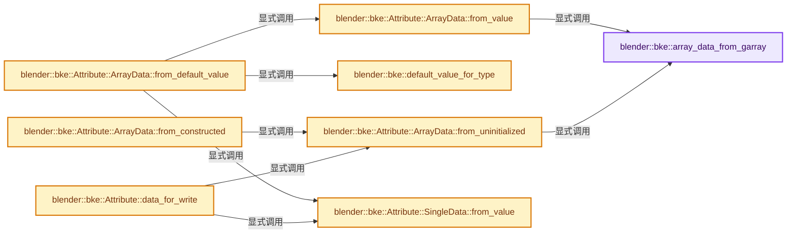
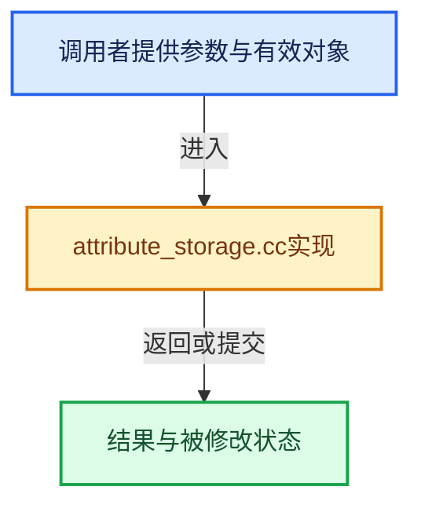

# 实现依赖专题：source/blender/blenkernel/intern/attribute_storage.cc

[实现依赖导航](../../README.md) · [符号索引](../../../00-课程指南/02-源码与提交索引/符号依赖与实现索引.md)

本专题从正文实际调用进入，集中保存共享实现。函数有稳定锚点，可从调用处直接跳到对应完整函数；递归与互相调用通过回链组织。

## 本文件的实现关系






## 完整成员与函数实现

<a id="f-d682d7fffc621fe3"></a>

### `blender::bke::array_data_from_garray`

实现位置：[source/blender/blenkernel/intern/attribute_storage.cc](../../../../../../../source/blender/blenkernel/intern/attribute_storage.cc) · L46—L54。

接口参数：

- `GArray<> array`

**教学注释版**

<!-- annotated:4ea6185e9acb9f -->

```cpp
static Attribute::ArrayData array_data_from_garray(GArray<> array)
{
  // [讲解] std::move：把表达式转换成可供移动重载选择的值类别；不保证真的移动，不结束源对象寿命，对const值可能选择复制。
  auto *sharing_info = new ImplicitSharedValue<GArray<>>(std::move(array));
  Attribute::ArrayData data{};
  data.data = sharing_info->data.data();
  data.size = sharing_info->data.size();
  data.sharing_info = ImplicitSharingPtr<>(sharing_info);
  return data;
}
```

<details>
<summary>核对原始源码：source/blender/blenkernel/intern/attribute_storage.cc · L46—L54</summary>

<!-- original:4ea6185e9acb9f:source/blender/blenkernel/intern/attribute_storage.cc:46:54 -->

```cpp
static Attribute::ArrayData array_data_from_garray(GArray<> array)
{
  auto *sharing_info = new ImplicitSharedValue<GArray<>>(std::move(array));
  Attribute::ArrayData data{};
  data.data = sharing_info->data.data();
  data.size = sharing_info->data.size();
  data.sharing_info = ImplicitSharingPtr<>(sharing_info);
  return data;
}
```

</details>

**沿实际写入检查状态**

- `data.data = sharing_info->data.data();`
- `data.size = sharing_info->data.size();`
- `data.sharing_info = ImplicitSharingPtr<>(sharing_info);`

**结果出口**

- `return data;`

**继续追踪实现**

- `std::move` → [外部契约](https://eel.is/c++draft/utility.forward)：把表达式转换成可供移动重载选择的值类别；不保证真的移动，不结束源对象寿命，对const值可能选择复制。
- `sharing_info->data.data` → [调用协议](../../../00-课程指南/01-路线与规范/模板宏与动态分派协议.md)：接收对象类型依赖auto、返回值或模板实例；不按同名猜测目标。调用位置L50。
- `sharing_info->data.size` → [调用协议](../../../00-课程指南/01-路线与规范/模板宏与动态分派协议.md)：接收对象类型依赖auto、返回值或模板实例；不按同名猜测目标。调用位置L51。
- `ImplicitSharingPtr<>` → [blender::ImplicitSharingPtr::ImplicitSharingPtr · L32](../../../06-隐式共享与缓存系统/03-Mixin与共享指针封装.md#f-d28a43dbb5ed8c05)；[blender::ImplicitSharingPtr::ImplicitSharingPtr · L34](../../../06-隐式共享与缓存系统/03-Mixin与共享指针封装.md#f-d27d5ebf676e244a)；[blender::ImplicitSharingPtr::ImplicitSharingPtr · L37](../../../06-隐式共享与缓存系统/03-Mixin与共享指针封装.md#f-17d0c5fe2b03a664)；[blender::ImplicitSharingPtr::ImplicitSharingPtr · L39](../../../06-隐式共享与缓存系统/03-Mixin与共享指针封装.md#f-1c8729ae57532370)；[blender::ImplicitSharingPtr::ImplicitSharingPtr · L44](../../../06-隐式共享与缓存系统/03-Mixin与共享指针封装.md#f-0b6be0142b98009e)；[blender::ImplicitSharingPtr::ImplicitSharingPtr · L49](../../../06-隐式共享与缓存系统/03-Mixin与共享指针封装.md#f-90c601ed9ed99045)；[blender::ImplicitSharingPtr::ImplicitSharingPtr · L57](../../../06-隐式共享与缓存系统/03-Mixin与共享指针封装.md#f-1625179ceae7a66d)。同名重载需按实参类型选择。

<a id="f-5e4c12ef59c4ea63"></a>

### `blender::bke::Attribute::ArrayData::from_value`

实现位置：[source/blender/blenkernel/intern/attribute_storage.cc](../../../../../../../source/blender/blenkernel/intern/attribute_storage.cc) · L56—L70。

接口参数：

- `const GPointer &value`
- `const int64_t domain_size`

**教学注释版**

<!-- annotated:f4a542e88c80aa -->

```cpp
Attribute::ArrayData Attribute::ArrayData::from_value(const GPointer &value,
                                                      const int64_t domain_size)
{
  const CPPType &type = *value.type();
  const void *value_ptr = value.get();

  /* Prefer `calloc` to zeroing after allocation since it is faster. */
  if (memory_is_zero(value_ptr, type.size)) {
    void *buffer = MEM_new_array_zeroed_aligned(domain_size, type.size, type.alignment, __func__);
    return array_data_from_garray(GArray<>(type, buffer, domain_size));
  }
  GArray<> array(type, domain_size, NoInitialization());
  type.fill_construct_n(value_ptr, array.data(), domain_size);
  // [讲解] std::move：把表达式转换成可供移动重载选择的值类别；不保证真的移动，不结束源对象寿命，对const值可能选择复制。
  return array_data_from_garray(std::move(array));
}
```

<details>
<summary>核对原始源码：source/blender/blenkernel/intern/attribute_storage.cc · L56—L70</summary>

<!-- original:f4a542e88c80aa:source/blender/blenkernel/intern/attribute_storage.cc:56:70 -->

```cpp
Attribute::ArrayData Attribute::ArrayData::from_value(const GPointer &value,
                                                      const int64_t domain_size)
{
  const CPPType &type = *value.type();
  const void *value_ptr = value.get();

  /* Prefer `calloc` to zeroing after allocation since it is faster. */
  if (memory_is_zero(value_ptr, type.size)) {
    void *buffer = MEM_new_array_zeroed_aligned(domain_size, type.size, type.alignment, __func__);
    return array_data_from_garray(GArray<>(type, buffer, domain_size));
  }
  GArray<> array(type, domain_size, NoInitialization());
  type.fill_construct_n(value_ptr, array.data(), domain_size);
  return array_data_from_garray(std::move(array));
}
```

</details>

**结果出口**

- `return array_data_from_garray(GArray<>(type, buffer, domain_size));`
- `return array_data_from_garray(std::move(array));`

**继续追踪实现**

- `value.type` → [blender::GPointer::type · L122](../../../03-内存分配与运行时类型/12-异构值存储实战.md#f-fab893bd990213d9)。
- `value.get` → [blender::GPointer::get · L117](../../../03-内存分配与运行时类型/12-异构值存储实战.md#f-d98a4f1af4104afe)；[blender::GPointer::get · L127](../../../03-内存分配与运行时类型/12-异构值存储实战.md#f-5cf9e563400cde6b)。同名重载需按实参类型选择。
- `memory_is_zero` → [blender::memory_is_zero · L375](../../01-BLI基础库/BLI_utildefines.hh.md#f-6d4441bb32b741b4)。
- `MEM_new_array_zeroed_aligned` → [调用协议](../../../00-课程指南/01-路线与规范/模板宏与动态分派协议.md)：函数指针、局部可调用对象或未展开的宏；必须结合调用者环境。调用位置L64。
- `array_data_from_garray` → [blender::bke::array_data_from_garray · L46](attribute_storage.cc.md#f-d682d7fffc621fe3)。
- `GArray<>` → [blender::GArray::GArray · L48](../../../03-内存分配与运行时类型/11-GSpan与GArray.md#f-7183420bd41edea3)；[blender::GArray::GArray · L50](../../../03-内存分配与运行时类型/11-GSpan与GArray.md#f-54ba86a04812c90f)；[blender::GArray::GArray · L56](../../../03-内存分配与运行时类型/11-GSpan与GArray.md#f-18357249324c54dd)；[blender::GArray::GArray · L62](../../../03-内存分配与运行时类型/11-GSpan与GArray.md#f-33241c148b83a171)；[blender::GArray::GArray · L76](../../../03-内存分配与运行时类型/11-GSpan与GArray.md#f-0faafb1b26659ab4)；[blender::GArray::GArray · L85](../../../03-内存分配与运行时类型/11-GSpan与GArray.md#f-2a6391fbc5a71528)；[blender::GArray::GArray · L99](../../../03-内存分配与运行时类型/11-GSpan与GArray.md#f-15ff6ec174e95d5d)；[blender::GArray::GArray · L108](../../../03-内存分配与运行时类型/11-GSpan与GArray.md#f-7fcca6a7a5a969b2)；[blender::GArray::GArray · L113](../../../03-内存分配与运行时类型/11-GSpan与GArray.md#f-b4a6d6139574374a)。同名重载需按实参类型选择。
- `type.fill_construct_n` → [blender::CPPType::fill_construct_n · L688](../../../03-内存分配与运行时类型/09-CPPType复制移动重定位.md#f-705024b9be263717)。
- `array.data` → [blender::GArray::data · L160](../../../03-内存分配与运行时类型/11-GSpan与GArray.md#f-fe965f44840f15ac)；[blender::GArray::data · L164](../../../03-内存分配与运行时类型/11-GSpan与GArray.md#f-831c5c3abf4c5711)。同名重载需按实参类型选择。
- `std::move` → [外部契约](https://eel.is/c++draft/utility.forward)：把表达式转换成可供移动重载选择的值类别；不保证真的移动，不结束源对象寿命，对const值可能选择复制。

<a id="f-d857feb912026ca6"></a>

### `blender::bke::default_value_for_type`

实现位置：[source/blender/blenkernel/intern/attribute_storage.cc](../../../../../../../source/blender/blenkernel/intern/attribute_storage.cc) · L72—L83。

接口参数：

- `const CPPType &type`

**教学注释版**

<!-- annotated:31a9c739c450e1 -->

```cpp
static GPointer default_value_for_type(const CPPType &type)
{
  if (type.is<ColorGeometry4f>()) {
    static constexpr ColorGeometry4f default_color(1.0f, 1.0f, 1.0f, 1.0f);
    return GPointer(type, &default_color);
  }
  if (type.is<ColorGeometry4b>()) {
    static constexpr ColorGeometry4b default_color(255, 255, 255, 255);
    return GPointer(type, &default_color);
  }
  return GPointer(type, type.default_value());
}
```

<details>
<summary>核对原始源码：source/blender/blenkernel/intern/attribute_storage.cc · L72—L83</summary>

<!-- original:31a9c739c450e1:source/blender/blenkernel/intern/attribute_storage.cc:72:83 -->

```cpp
static GPointer default_value_for_type(const CPPType &type)
{
  if (type.is<ColorGeometry4f>()) {
    static constexpr ColorGeometry4f default_color(1.0f, 1.0f, 1.0f, 1.0f);
    return GPointer(type, &default_color);
  }
  if (type.is<ColorGeometry4b>()) {
    static constexpr ColorGeometry4b default_color(255, 255, 255, 255);
    return GPointer(type, &default_color);
  }
  return GPointer(type, type.default_value());
}
```

</details>

**结果出口**

- `return GPointer(type, &default_color);`
- `return GPointer(type, type.default_value());`

**继续追踪实现**

- `type.is<ColorGeometry4f>` → [blender::CPPType::is · L758](../../../03-内存分配与运行时类型/09-CPPType复制移动重定位.md#f-2e2c3ee7602530a4)。
- `GPointer` → [blender::GPointer::GPointer · L93](../../../03-内存分配与运行时类型/12-异构值存储实战.md#f-40f7a024c1e541df)；[blender::GPointer::GPointer · L95](../../../03-内存分配与运行时类型/12-异构值存储实战.md#f-e981128b9c36f9ef)；[blender::GPointer::GPointer · L97](../../../03-内存分配与运行时类型/12-异构值存储实战.md#f-5d3066175455aed0)；[blender::GPointer::GPointer · L103](../../../03-内存分配与运行时类型/12-异构值存储实战.md#f-9194d11793ea4a06)；[blender::GPointer::GPointer · L105](../../../03-内存分配与运行时类型/12-异构值存储实战.md#f-1a9887b65d37a9ca)。同名重载需按实参类型选择。
- `type.is<ColorGeometry4b>` → [blender::CPPType::is · L758](../../../03-内存分配与运行时类型/09-CPPType复制移动重定位.md#f-2e2c3ee7602530a4)。
- `type.default_value` → [blender::CPPType::default_value · L743](../../../03-内存分配与运行时类型/09-CPPType复制移动重定位.md#f-95e76cbe74b383e8)。

<a id="f-c4d7d1fbb3af1423"></a>

### `blender::bke::Attribute::ArrayData::from_default_value`

实现位置：[source/blender/blenkernel/intern/attribute_storage.cc](../../../../../../../source/blender/blenkernel/intern/attribute_storage.cc) · L85—L89。

接口参数：

- `const CPPType &type`
- `const int64_t domain_size`

**教学注释版**

<!-- annotated:b4d8791daaedd4 -->

```cpp
Attribute::ArrayData Attribute::ArrayData::from_default_value(const CPPType &type,
                                                              const int64_t domain_size)
{
  return from_value(default_value_for_type(type), domain_size);
}
```

<details>
<summary>核对原始源码：source/blender/blenkernel/intern/attribute_storage.cc · L85—L89</summary>

<!-- original:b4d8791daaedd4:source/blender/blenkernel/intern/attribute_storage.cc:85:89 -->

```cpp
Attribute::ArrayData Attribute::ArrayData::from_default_value(const CPPType &type,
                                                              const int64_t domain_size)
{
  return from_value(default_value_for_type(type), domain_size);
}
```

</details>

**结果出口**

- `return from_value(default_value_for_type(type), domain_size);`

**继续追踪实现**

- `from_value` → [blender::bke::Attribute::ArrayData::from_value · L56](attribute_storage.cc.md#f-5e4c12ef59c4ea63)；[blender::bke::Attribute::SingleData::from_value · L105](attribute_storage.cc.md#f-f977a7eff1a396a8)。同名重载需按实参类型选择。
- `default_value_for_type` → [blender::bke::default_value_for_type · L72](attribute_storage.cc.md#f-d857feb912026ca6)。

<a id="f-303c463a30d7d1ff"></a>

### `blender::bke::Attribute::ArrayData::from_uninitialized`

实现位置：[source/blender/blenkernel/intern/attribute_storage.cc](../../../../../../../source/blender/blenkernel/intern/attribute_storage.cc) · L91—L95。

接口参数：

- `const CPPType &type`
- `const int64_t domain_size`

**教学注释版**

<!-- annotated:c22988a641c04f -->

```cpp
Attribute::ArrayData Attribute::ArrayData::from_uninitialized(const CPPType &type,
                                                              const int64_t domain_size)
{
  return array_data_from_garray(GArray<>(type, domain_size, NoInitialization()));
}
```

<details>
<summary>核对原始源码：source/blender/blenkernel/intern/attribute_storage.cc · L91—L95</summary>

<!-- original:c22988a641c04f:source/blender/blenkernel/intern/attribute_storage.cc:91:95 -->

```cpp
Attribute::ArrayData Attribute::ArrayData::from_uninitialized(const CPPType &type,
                                                              const int64_t domain_size)
{
  return array_data_from_garray(GArray<>(type, domain_size, NoInitialization()));
}
```

</details>

**结果出口**

- `return array_data_from_garray(GArray<>(type, domain_size, NoInitialization()));`

**继续追踪实现**

- `array_data_from_garray` → [blender::bke::array_data_from_garray · L46](attribute_storage.cc.md#f-d682d7fffc621fe3)。
- `GArray<>` → [blender::GArray::GArray · L48](../../../03-内存分配与运行时类型/11-GSpan与GArray.md#f-7183420bd41edea3)；[blender::GArray::GArray · L50](../../../03-内存分配与运行时类型/11-GSpan与GArray.md#f-54ba86a04812c90f)；[blender::GArray::GArray · L56](../../../03-内存分配与运行时类型/11-GSpan与GArray.md#f-18357249324c54dd)；[blender::GArray::GArray · L62](../../../03-内存分配与运行时类型/11-GSpan与GArray.md#f-33241c148b83a171)；[blender::GArray::GArray · L76](../../../03-内存分配与运行时类型/11-GSpan与GArray.md#f-0faafb1b26659ab4)；[blender::GArray::GArray · L85](../../../03-内存分配与运行时类型/11-GSpan与GArray.md#f-2a6391fbc5a71528)；[blender::GArray::GArray · L99](../../../03-内存分配与运行时类型/11-GSpan与GArray.md#f-15ff6ec174e95d5d)；[blender::GArray::GArray · L108](../../../03-内存分配与运行时类型/11-GSpan与GArray.md#f-7fcca6a7a5a969b2)；[blender::GArray::GArray · L113](../../../03-内存分配与运行时类型/11-GSpan与GArray.md#f-b4a6d6139574374a)。同名重载需按实参类型选择。
- `NoInitialization` → [blender::NoInitialization](../../01-BLI基础库/BLI_memory_utils.hh.md#t-3502e11e3a54)。

<a id="f-8977de43b9b5ba5f"></a>

### `blender::bke::Attribute::ArrayData::from_constructed`

实现位置：[source/blender/blenkernel/intern/attribute_storage.cc](../../../../../../../source/blender/blenkernel/intern/attribute_storage.cc) · L97—L103。

接口参数：

- `const CPPType &type`
- `const int64_t domain_size`

**教学注释版**

<!-- annotated:f05747c98a97bd -->

```cpp
Attribute::ArrayData Attribute::ArrayData::from_constructed(const CPPType &type,
                                                            const int64_t domain_size)
{
  Attribute::ArrayData data = Attribute::ArrayData::from_uninitialized(type, domain_size);
  type.default_construct_n(data.data, domain_size);
  return data;
}
```

<details>
<summary>核对原始源码：source/blender/blenkernel/intern/attribute_storage.cc · L97—L103</summary>

<!-- original:f05747c98a97bd:source/blender/blenkernel/intern/attribute_storage.cc:97:103 -->

```cpp
Attribute::ArrayData Attribute::ArrayData::from_constructed(const CPPType &type,
                                                            const int64_t domain_size)
{
  Attribute::ArrayData data = Attribute::ArrayData::from_uninitialized(type, domain_size);
  type.default_construct_n(data.data, domain_size);
  return data;
}
```

</details>

**结果出口**

- `return data;`

**继续追踪实现**

- `Attribute::ArrayData::from_uninitialized` → [blender::bke::Attribute::ArrayData::from_uninitialized · L91](attribute_storage.cc.md#f-303c463a30d7d1ff)。
- `type.default_construct_n` → [blender::CPPType::default_construct_n · L532](../../../03-内存分配与运行时类型/08-CPPType构造与析构.md#f-ffb51b59521d5579)。

<a id="f-f977a7eff1a396a8"></a>

### `blender::bke::Attribute::SingleData::from_value`

实现位置：[source/blender/blenkernel/intern/attribute_storage.cc](../../../../../../../source/blender/blenkernel/intern/attribute_storage.cc) · L105—L113。

接口参数：

- `const GPointer &value`

**教学注释版**

<!-- annotated:fb2fbf0018ff0c -->

```cpp
Attribute::SingleData Attribute::SingleData::from_value(const GPointer &value)
{
  /* Use an array with a single element to store the value. */
  auto *sharing_info = new ImplicitSharedValue<GArray<>>(GSpan(*value.type(), value.get(), 1));
  Attribute::SingleData data{};
  data.value = sharing_info->data.data();
  data.sharing_info = ImplicitSharingPtr<>(sharing_info);
  return data;
}
```

<details>
<summary>核对原始源码：source/blender/blenkernel/intern/attribute_storage.cc · L105—L113</summary>

<!-- original:fb2fbf0018ff0c:source/blender/blenkernel/intern/attribute_storage.cc:105:113 -->

```cpp
Attribute::SingleData Attribute::SingleData::from_value(const GPointer &value)
{
  /* Use an array with a single element to store the value. */
  auto *sharing_info = new ImplicitSharedValue<GArray<>>(GSpan(*value.type(), value.get(), 1));
  Attribute::SingleData data{};
  data.value = sharing_info->data.data();
  data.sharing_info = ImplicitSharingPtr<>(sharing_info);
  return data;
}
```

</details>

**沿实际写入检查状态**

- `data.value = sharing_info->data.data();`
- `data.sharing_info = ImplicitSharingPtr<>(sharing_info);`

**结果出口**

- `return data;`

**继续追踪实现**

- `GSpan` → [blender::GSpan::GSpan · L26](../../../03-内存分配与运行时类型/11-GSpan与GArray.md#f-9d0c95702007eea6)；[blender::GSpan::GSpan · L28](../../../03-内存分配与运行时类型/11-GSpan与GArray.md#f-6650bd08c7eecc66)；[blender::GSpan::GSpan · L37](../../../03-内存分配与运行时类型/11-GSpan与GArray.md#f-bf180950832673fb)；[blender::GSpan::GSpan · L39](../../../03-内存分配与运行时类型/11-GSpan与GArray.md#f-cf949d5590ea9ab6)；[blender::GSpan::GSpan · L41](../../../03-内存分配与运行时类型/11-GSpan与GArray.md#f-a66ab52ee0842aee)；[blender::GSpan::GSpan · L43](../../../03-内存分配与运行时类型/11-GSpan与GArray.md#f-d9084fa10964390f)；[blender::GSpan::GSpan · L49](../../../03-内存分配与运行时类型/11-GSpan与GArray.md#f-76e3de3cc3d65761)。同名重载需按实参类型选择。
- `value.type` → [blender::GPointer::type · L122](../../../03-内存分配与运行时类型/12-异构值存储实战.md#f-fab893bd990213d9)。
- `value.get` → [blender::GPointer::get · L117](../../../03-内存分配与运行时类型/12-异构值存储实战.md#f-d98a4f1af4104afe)；[blender::GPointer::get · L127](../../../03-内存分配与运行时类型/12-异构值存储实战.md#f-5cf9e563400cde6b)。同名重载需按实参类型选择。
- `sharing_info->data.data` → [调用协议](../../../00-课程指南/01-路线与规范/模板宏与动态分派协议.md)：接收对象类型依赖auto、返回值或模板实例；不按同名猜测目标。调用位置L110。
- `ImplicitSharingPtr<>` → [blender::ImplicitSharingPtr::ImplicitSharingPtr · L32](../../../06-隐式共享与缓存系统/03-Mixin与共享指针封装.md#f-d28a43dbb5ed8c05)；[blender::ImplicitSharingPtr::ImplicitSharingPtr · L34](../../../06-隐式共享与缓存系统/03-Mixin与共享指针封装.md#f-d27d5ebf676e244a)；[blender::ImplicitSharingPtr::ImplicitSharingPtr · L37](../../../06-隐式共享与缓存系统/03-Mixin与共享指针封装.md#f-17d0c5fe2b03a664)；[blender::ImplicitSharingPtr::ImplicitSharingPtr · L39](../../../06-隐式共享与缓存系统/03-Mixin与共享指针封装.md#f-1c8729ae57532370)；[blender::ImplicitSharingPtr::ImplicitSharingPtr · L44](../../../06-隐式共享与缓存系统/03-Mixin与共享指针封装.md#f-0b6be0142b98009e)；[blender::ImplicitSharingPtr::ImplicitSharingPtr · L49](../../../06-隐式共享与缓存系统/03-Mixin与共享指针封装.md#f-90c601ed9ed99045)；[blender::ImplicitSharingPtr::ImplicitSharingPtr · L57](../../../06-隐式共享与缓存系统/03-Mixin与共享指针封装.md#f-1625179ceae7a66d)。同名重载需按实参类型选择。

<a id="f-3afb8286a01d9f05"></a>

### `blender::bke::Attribute::data_for_write`

实现位置：[source/blender/blenkernel/intern/attribute_storage.cc](../../../../../../../source/blender/blenkernel/intern/attribute_storage.cc) · L120—L146。

**教学注释版**

<!-- annotated:beb63d4a85f4fc -->

```cpp
Attribute::DataVariant &Attribute::data_for_write()
{
  if (auto *data = std::get_if<Attribute::ArrayData>(&data_)) {
    if (!data->sharing_info) {
      BLI_assert(data->size == 0);
      return data_;
    }
    if (data->sharing_info->is_mutable()) {
      data->sharing_info->tag_ensured_mutable();
      return data_;
    }
    const CPPType &type = attribute_type_to_cpp_type(type_);
    ArrayData new_data = ArrayData::from_uninitialized(type, data->size);
    array_utils::copy(GVArray::from_span({type, data->data, data->size}),
                      GMutableSpan(type, new_data.data, data->size));
    // [讲解] std::move：把表达式转换成可供移动重载选择的值类别；不保证真的移动，不结束源对象寿命，对const值可能选择复制。
    *data = std::move(new_data);
  }
  else if (auto *data = std::get_if<Attribute::SingleData>(&data_)) {
    if (data->sharing_info->is_mutable()) {
      data->sharing_info->tag_ensured_mutable();
      return data_;
    }
    const CPPType &type = attribute_type_to_cpp_type(type_);
    *data = SingleData::from_value(GPointer(type, data->value));
  }
  return data_;
}
```

<details>
<summary>核对原始源码：source/blender/blenkernel/intern/attribute_storage.cc · L120—L146</summary>

<!-- original:beb63d4a85f4fc:source/blender/blenkernel/intern/attribute_storage.cc:120:146 -->

```cpp
Attribute::DataVariant &Attribute::data_for_write()
{
  if (auto *data = std::get_if<Attribute::ArrayData>(&data_)) {
    if (!data->sharing_info) {
      BLI_assert(data->size == 0);
      return data_;
    }
    if (data->sharing_info->is_mutable()) {
      data->sharing_info->tag_ensured_mutable();
      return data_;
    }
    const CPPType &type = attribute_type_to_cpp_type(type_);
    ArrayData new_data = ArrayData::from_uninitialized(type, data->size);
    array_utils::copy(GVArray::from_span({type, data->data, data->size}),
                      GMutableSpan(type, new_data.data, data->size));
    *data = std::move(new_data);
  }
  else if (auto *data = std::get_if<Attribute::SingleData>(&data_)) {
    if (data->sharing_info->is_mutable()) {
      data->sharing_info->tag_ensured_mutable();
      return data_;
    }
    const CPPType &type = attribute_type_to_cpp_type(type_);
    *data = SingleData::from_value(GPointer(type, data->value));
  }
  return data_;
}
```

</details>

**结果出口**

- `return data_;`

**继续追踪实现**

- `std::get_if<Attribute::ArrayData>` → [外部契约](https://eel.is/c++draft/)：这个边界按实际表达式及所属类型核对参数、返回值、寿命与失败行为。这里提供接口入口，不声称已解释该第三方版本的内部实现。
- `BLI_assert` → [BLI_assert · L48](../../01-BLI基础库/BLI_assert.hh.md#m-57a88495704d)；[BLI_assert · L63](../../01-BLI基础库/BLI_assert.hh.md#m-d07050020cb5)。宏定义由构建条件选择。
- `data->sharing_info->is_mutable` → [调用协议](../../../00-课程指南/01-路线与规范/模板宏与动态分派协议.md)：接收对象类型依赖auto、返回值或模板实例；不按同名猜测目标。调用位置L127。
- `data->sharing_info->tag_ensured_mutable` → [调用协议](../../../00-课程指南/01-路线与规范/模板宏与动态分派协议.md)：接收对象类型依赖auto、返回值或模板实例；不按同名猜测目标。调用位置L128。
- `attribute_type_to_cpp_type` → [blender::bke::attribute_type_to_cpp_type · L44](attribute_access.cc.md#f-69deacfd0fca6244)。
- `ArrayData::from_uninitialized` → [blender::bke::Attribute::ArrayData::from_uninitialized · L91](attribute_storage.cc.md#f-303c463a30d7d1ff)。
- `array_utils::copy` → [blender::array_utils::copy · L54](../../../01-基础容器与现代CPP/20-容器选择与独立实现.md#f-82e21acdac93f91c)；[blender::array_utils::copy · L72](../../../01-基础容器与现代CPP/20-容器选择与独立实现.md#f-ee9c17de026a6c9a)；[blender::array_utils::copy · L98](../../../01-基础容器与现代CPP/20-容器选择与独立实现.md#f-ec9fd099c7280717)；[blender::array_utils::copy · L27](../../01-BLI基础库/intern/array_utils.cc.md#f-245f7c23437cf35f)；[blender::array_utils::copy · L43](../../01-BLI基础库/intern/array_utils.cc.md#f-6170524934215b36)。同名重载需按实参类型选择。
- `GVArray::from_span` → [blender::GVArray::from_span · L895](../../../04-虚拟数组与索引选择/05-GVArray运行时类型.md#f-e8b978ca15febb67)。
- `GMutableSpan` → [blender::GMutableSpan::GMutableSpan · L152](../../../03-内存分配与运行时类型/11-GSpan与GArray.md#f-b4ef5399177eeedd)；[blender::GMutableSpan::GMutableSpan · L154](../../../03-内存分配与运行时类型/11-GSpan与GArray.md#f-6439a40f33c7a2e5)；[blender::GMutableSpan::GMutableSpan · L163](../../../03-内存分配与运行时类型/11-GSpan与GArray.md#f-6054339faadc1405)；[blender::GMutableSpan::GMutableSpan · L167](../../../03-内存分配与运行时类型/11-GSpan与GArray.md#f-d1333b42c7982310)；[blender::GMutableSpan::GMutableSpan · L169](../../../03-内存分配与运行时类型/11-GSpan与GArray.md#f-3584f997d0fe9a96)；[blender::GMutableSpan::GMutableSpan · L171](../../../03-内存分配与运行时类型/11-GSpan与GArray.md#f-3074afdbe5232417)。同名重载需按实参类型选择。
- `std::move` → [外部契约](https://eel.is/c++draft/utility.forward)：把表达式转换成可供移动重载选择的值类别；不保证真的移动，不结束源对象寿命，对const值可能选择复制。
- `std::get_if<Attribute::SingleData>` → [外部契约](https://eel.is/c++draft/)：这个边界按实际表达式及所属类型核对参数、返回值、寿命与失败行为。这里提供接口入口，不声称已解释该第三方版本的内部实现。
- `SingleData::from_value` → [blender::bke::Attribute::SingleData::from_value · L105](attribute_storage.cc.md#f-f977a7eff1a396a8)。
- `GPointer` → [blender::GPointer::GPointer · L93](../../../03-内存分配与运行时类型/12-异构值存储实战.md#f-40f7a024c1e541df)；[blender::GPointer::GPointer · L95](../../../03-内存分配与运行时类型/12-异构值存储实战.md#f-e981128b9c36f9ef)；[blender::GPointer::GPointer · L97](../../../03-内存分配与运行时类型/12-异构值存储实战.md#f-5d3066175455aed0)；[blender::GPointer::GPointer · L103](../../../03-内存分配与运行时类型/12-异构值存储实战.md#f-9194d11793ea4a06)；[blender::GPointer::GPointer · L105](../../../03-内存分配与运行时类型/12-异构值存储实战.md#f-1a9887b65d37a9ca)。同名重载需按实参类型选择。

<a id="f-e5c702d5ffb065f8"></a>

### `blender::bke::AttributeStorage::AttributeStorage`

实现位置：[source/blender/blenkernel/intern/attribute_storage.cc](../../../../../../../source/blender/blenkernel/intern/attribute_storage.cc) · L148—L154。

**教学注释版**

<!-- annotated:f80a1f39413121 -->

```cpp
AttributeStorage::AttributeStorage()
{
  this->dna_attributes = nullptr;
  this->dna_attributes_num = 0;
  // [讲解] memset：填充字节，不调用T构造函数，也不保证任意类型的全零表示是合法或期望值。
  memset(this->_pad, 0, sizeof(this->_pad));
  this->runtime = MEM_new<AttributeStorageRuntime>(__func__);
}
```

<details>
<summary>核对原始源码：source/blender/blenkernel/intern/attribute_storage.cc · L148—L154</summary>

<!-- original:f80a1f39413121:source/blender/blenkernel/intern/attribute_storage.cc:148:154 -->

```cpp
AttributeStorage::AttributeStorage()
{
  this->dna_attributes = nullptr;
  this->dna_attributes_num = 0;
  memset(this->_pad, 0, sizeof(this->_pad));
  this->runtime = MEM_new<AttributeStorageRuntime>(__func__);
}
```

</details>

**沿实际写入检查状态**

- `this->dna_attributes = nullptr;`
- `this->dna_attributes_num = 0;`
- `this->runtime = MEM_new<AttributeStorageRuntime>(__func__);`

**继续追踪实现**

- `memset` → [外部契约](https://eel.is/c++draft/cstring.syn)：填充字节，不调用T构造函数，也不保证任意类型的全零表示是合法或期望值。
- `MEM_new<AttributeStorageRuntime>` → [MEM_new · L351](../../07-Intern运行时与平台/guardedalloc/MEM_guardedalloc.h.md#f-115f9b6784f89912)。

<a id="f-bab78cd4e1ffd63e"></a>

### `blender::bke::AttributeStorage::AttributeStorage`

实现位置：[source/blender/blenkernel/intern/attribute_storage.cc](../../../../../../../source/blender/blenkernel/intern/attribute_storage.cc) · L156—L165。

接口参数：

- `const AttributeStorage &other`

**教学注释版**

<!-- annotated:bc5ecfdab13fdd -->

```cpp
AttributeStorage::AttributeStorage(const AttributeStorage &other)
{
  this->dna_attributes = nullptr;
  this->dna_attributes_num = 0;
  this->runtime = MEM_new<AttributeStorageRuntime>(__func__);
  this->runtime->attributes.reserve(other.runtime->attributes.size());
  for (const Attribute &attribute : other) {
    // [讲解] std::make_unique<Attribute>：创建独占拥有的对象，拥有关系可移动，get返回的借用指针不自动延长寿命。
    this->runtime->attributes.add_new(std::make_unique<Attribute>(attribute));
  }
}
```

<details>
<summary>核对原始源码：source/blender/blenkernel/intern/attribute_storage.cc · L156—L165</summary>

<!-- original:bc5ecfdab13fdd:source/blender/blenkernel/intern/attribute_storage.cc:156:165 -->

```cpp
AttributeStorage::AttributeStorage(const AttributeStorage &other)
{
  this->dna_attributes = nullptr;
  this->dna_attributes_num = 0;
  this->runtime = MEM_new<AttributeStorageRuntime>(__func__);
  this->runtime->attributes.reserve(other.runtime->attributes.size());
  for (const Attribute &attribute : other) {
    this->runtime->attributes.add_new(std::make_unique<Attribute>(attribute));
  }
}
```

</details>

**沿实际写入检查状态**

- `this->dna_attributes = nullptr;`
- `this->dna_attributes_num = 0;`
- `this->runtime = MEM_new<AttributeStorageRuntime>(__func__);`

**继续追踪实现**

- `MEM_new<AttributeStorageRuntime>` → [MEM_new · L351](../../07-Intern运行时与平台/guardedalloc/MEM_guardedalloc.h.md#f-115f9b6784f89912)。
- `this->runtime->attributes.reserve` → [调用协议](../../../00-课程指南/01-路线与规范/模板宏与动态分派协议.md)：接收对象类型依赖auto、返回值或模板实例；不按同名猜测目标。调用位置L161。
- `other.runtime->attributes.size` → [调用协议](../../../00-课程指南/01-路线与规范/模板宏与动态分派协议.md)：接收对象类型依赖auto、返回值或模板实例；不按同名猜测目标。调用位置L161。
- `this->runtime->attributes.add_new` → [调用协议](../../../00-课程指南/01-路线与规范/模板宏与动态分派协议.md)：接收对象类型依赖auto、返回值或模板实例；不按同名猜测目标。调用位置L163。
- `std::make_unique<Attribute>` → [外部契约](https://eel.is/c++draft/unique.ptr.create)：创建独占拥有的对象，拥有关系可移动，get返回的借用指针不自动延长寿命。

<a id="f-3e357248d6c93d6d"></a>

### `blender::bke::AttributeStorage::AttributeStorage`

实现位置：[source/blender/blenkernel/intern/attribute_storage.cc](../../../../../../../source/blender/blenkernel/intern/attribute_storage.cc) · L177—L182。

接口参数：

- `AttributeStorage &&other`

**教学注释版**

<!-- annotated:fb074041335705 -->

```cpp
AttributeStorage::AttributeStorage(AttributeStorage &&other)
{
  this->dna_attributes = nullptr;
  this->dna_attributes_num = 0;
  // [讲解] std::move：把表达式转换成可供移动重载选择的值类别；不保证真的移动，不结束源对象寿命，对const值可能选择复制。
  this->runtime = MEM_new<AttributeStorageRuntime>(__func__, std::move(*other.runtime));
}
```

<details>
<summary>核对原始源码：source/blender/blenkernel/intern/attribute_storage.cc · L177—L182</summary>

<!-- original:fb074041335705:source/blender/blenkernel/intern/attribute_storage.cc:177:182 -->

```cpp
AttributeStorage::AttributeStorage(AttributeStorage &&other)
{
  this->dna_attributes = nullptr;
  this->dna_attributes_num = 0;
  this->runtime = MEM_new<AttributeStorageRuntime>(__func__, std::move(*other.runtime));
}
```

</details>

**沿实际写入检查状态**

- `this->dna_attributes = nullptr;`
- `this->dna_attributes_num = 0;`
- `this->runtime = MEM_new<AttributeStorageRuntime>(__func__, std::move(*other.runtime));`

**继续追踪实现**

- `MEM_new<AttributeStorageRuntime>` → [MEM_new · L351](../../07-Intern运行时与平台/guardedalloc/MEM_guardedalloc.h.md#f-115f9b6784f89912)。
- `std::move` → [外部契约](https://eel.is/c++draft/utility.forward)：把表达式转换成可供移动重载选择的值类别；不保证真的移动，不结束源对象寿命，对const值可能选择复制。

<a id="f-8dbc7ddfc61d3be8"></a>

### `blender::bke::AttributeStorage::count`

实现位置：[source/blender/blenkernel/intern/attribute_storage.cc](../../../../../../../source/blender/blenkernel/intern/attribute_storage.cc) · L199—L202。

**教学注释版**

<!-- annotated:3201267b91c5a3 -->

```cpp
int AttributeStorage::count() const
{
  return this->runtime->attributes.size();
}
```

<details>
<summary>核对原始源码：source/blender/blenkernel/intern/attribute_storage.cc · L199—L202</summary>

<!-- original:3201267b91c5a3:source/blender/blenkernel/intern/attribute_storage.cc:199:202 -->

```cpp
int AttributeStorage::count() const
{
  return this->runtime->attributes.size();
}
```

</details>

**结果出口**

- `return this->runtime->attributes.size();`

**继续追踪实现**

- `this->runtime->attributes.size` → [调用协议](../../../00-课程指南/01-路线与规范/模板宏与动态分派协议.md)：接收对象类型依赖auto、返回值或模板实例；不按同名猜测目标。调用位置L201。

<a id="f-0f9935746248e24f"></a>

### `blender::bke::AttributeStorage::at_index`

实现位置：[source/blender/blenkernel/intern/attribute_storage.cc](../../../../../../../source/blender/blenkernel/intern/attribute_storage.cc) · L204—L207。

接口参数：

- `int index`

**教学注释版**

<!-- annotated:cf5219fd02866e -->

```cpp
Attribute &AttributeStorage::at_index(int index)
{
  return *this->runtime->attributes[index];
}
```

<details>
<summary>核对原始源码：source/blender/blenkernel/intern/attribute_storage.cc · L204—L207</summary>

<!-- original:cf5219fd02866e:source/blender/blenkernel/intern/attribute_storage.cc:204:207 -->

```cpp
Attribute &AttributeStorage::at_index(int index)
{
  return *this->runtime->attributes[index];
}
```

</details>

**结果出口**

- `return *this->runtime->attributes[index];`

**继续追踪实现**

本实现没有需要继续展开的显式调用；检查返回表达式、对象转换和调用者前置条件。

<a id="f-e93bf2ca146aec6b"></a>

### `blender::bke::AttributeStorage::at_index`

实现位置：[source/blender/blenkernel/intern/attribute_storage.cc](../../../../../../../source/blender/blenkernel/intern/attribute_storage.cc) · L208—L211。

接口参数：

- `int index`

**教学注释版**

<!-- annotated:20ee3dd17b0619 -->

```cpp
const Attribute &AttributeStorage::at_index(int index) const
{
  return *this->runtime->attributes[index];
}
```

<details>
<summary>核对原始源码：source/blender/blenkernel/intern/attribute_storage.cc · L208—L211</summary>

<!-- original:20ee3dd17b0619:source/blender/blenkernel/intern/attribute_storage.cc:208:211 -->

```cpp
const Attribute &AttributeStorage::at_index(int index) const
{
  return *this->runtime->attributes[index];
}
```

</details>

**结果出口**

- `return *this->runtime->attributes[index];`

**继续追踪实现**

本实现没有需要继续展开的显式调用；检查返回表达式、对象转换和调用者前置条件。

<a id="f-fa3e64941d37bbe2"></a>

### `blender::bke::AttributeStorage::index_of`

实现位置：[source/blender/blenkernel/intern/attribute_storage.cc](../../../../../../../source/blender/blenkernel/intern/attribute_storage.cc) · L213—L216。

接口参数：

- `StringRef name`

**教学注释版**

<!-- annotated:42b33911a566f4 -->

```cpp
int AttributeStorage::index_of(StringRef name) const
{
  return this->runtime->attributes.index_of_try_as(name);
}
```

<details>
<summary>核对原始源码：source/blender/blenkernel/intern/attribute_storage.cc · L213—L216</summary>

<!-- original:42b33911a566f4:source/blender/blenkernel/intern/attribute_storage.cc:213:216 -->

```cpp
int AttributeStorage::index_of(StringRef name) const
{
  return this->runtime->attributes.index_of_try_as(name);
}
```

</details>

**结果出口**

- `return this->runtime->attributes.index_of_try_as(name);`

**继续追踪实现**

- `this->runtime->attributes.index_of_try_as` → [调用协议](../../../00-课程指南/01-路线与规范/模板宏与动态分派协议.md)：接收对象类型依赖auto、返回值或模板实例；不按同名猜测目标。调用位置L215。

<a id="f-7fdc83fb77004833"></a>

### `blender::bke::AttributeStorage::lookup`

实现位置：[source/blender/blenkernel/intern/attribute_storage.cc](../../../../../../../source/blender/blenkernel/intern/attribute_storage.cc) · L218—L226。

接口参数：

- `const StringRef name`

**教学注释版**

<!-- annotated:a0ecf73beddfb6 -->

```cpp
const Attribute *AttributeStorage::lookup(const StringRef name) const
{
  const std::unique_ptr<bke::Attribute> *attribute = this->runtime->attributes.lookup_key_ptr_as(
      name);
  if (!attribute) {
    return nullptr;
  }
  return attribute->get();
}
```

<details>
<summary>核对原始源码：source/blender/blenkernel/intern/attribute_storage.cc · L218—L226</summary>

<!-- original:a0ecf73beddfb6:source/blender/blenkernel/intern/attribute_storage.cc:218:226 -->

```cpp
const Attribute *AttributeStorage::lookup(const StringRef name) const
{
  const std::unique_ptr<bke::Attribute> *attribute = this->runtime->attributes.lookup_key_ptr_as(
      name);
  if (!attribute) {
    return nullptr;
  }
  return attribute->get();
}
```

</details>

**结果出口**

- `return nullptr;`
- `return attribute->get();`

**继续追踪实现**

- `this->runtime->attributes.lookup_key_ptr_as` → [调用协议](../../../00-课程指南/01-路线与规范/模板宏与动态分派协议.md)：接收对象类型依赖auto、返回值或模板实例；不按同名猜测目标。调用位置L220。
- `attribute->get` → [外部契约](https://eel.is/c++draft/)：这个边界按实际表达式及所属类型核对参数、返回值、寿命与失败行为。这里提供接口入口，不声称已解释该第三方版本的内部实现。

<a id="f-4c9ec35a31afcd06"></a>

### `blender::bke::AttributeStorage::lookup`

实现位置：[source/blender/blenkernel/intern/attribute_storage.cc](../../../../../../../source/blender/blenkernel/intern/attribute_storage.cc) · L228—L236。

接口参数：

- `const StringRef name`

**教学注释版**

<!-- annotated:9acce3ec4328f2 -->

```cpp
Attribute *AttributeStorage::lookup(const StringRef name)
{
  const std::unique_ptr<bke::Attribute> *attribute = this->runtime->attributes.lookup_key_ptr_as(
      name);
  if (!attribute) {
    return nullptr;
  }
  return attribute->get();
}
```

<details>
<summary>核对原始源码：source/blender/blenkernel/intern/attribute_storage.cc · L228—L236</summary>

<!-- original:9acce3ec4328f2:source/blender/blenkernel/intern/attribute_storage.cc:228:236 -->

```cpp
Attribute *AttributeStorage::lookup(const StringRef name)
{
  const std::unique_ptr<bke::Attribute> *attribute = this->runtime->attributes.lookup_key_ptr_as(
      name);
  if (!attribute) {
    return nullptr;
  }
  return attribute->get();
}
```

</details>

**结果出口**

- `return nullptr;`
- `return attribute->get();`

**继续追踪实现**

- `this->runtime->attributes.lookup_key_ptr_as` → [调用协议](../../../00-课程指南/01-路线与规范/模板宏与动态分派协议.md)：接收对象类型依赖auto、返回值或模板实例；不按同名猜测目标。调用位置L230。
- `attribute->get` → [外部契约](https://eel.is/c++draft/)：这个边界按实际表达式及所属类型核对参数、返回值、寿命与失败行为。这里提供接口入口，不声称已解释该第三方版本的内部实现。

<a id="f-b78aa43de4dafd5f"></a>

### `blender::bke::AttributeStorage::add`

实现位置：[source/blender/blenkernel/intern/attribute_storage.cc](../../../../../../../source/blender/blenkernel/intern/attribute_storage.cc) · L238—L253。

接口参数：

- `std::string name`
- `const AttrDomain domain`
- `const AttrType data_type`
- `Attribute::DataVariant data`

**教学注释版**

<!-- annotated:302da8b0d307db -->

```cpp
Attribute &AttributeStorage::add(std::string name,
                                 const AttrDomain domain,
                                 const AttrType data_type,
                                 Attribute::DataVariant data)
{
  BLI_assert(!name.empty());
  BLI_assert(!this->lookup(name));
  // [讲解] std::make_unique<Attribute>：创建独占拥有的对象，拥有关系可移动，get返回的借用指针不自动延长寿命。
  std::unique_ptr<Attribute> ptr = std::make_unique<Attribute>();
  Attribute &attribute = *ptr;
  // [讲解] std::move：把表达式转换成可供移动重载选择的值类别；不保证真的移动，不结束源对象寿命，对const值可能选择复制。
  attribute.name_ = std::move(name);
  attribute.domain_ = domain;
  attribute.type_ = data_type;
  attribute.data_ = std::move(data);
  this->runtime->attributes.add_new(std::move(ptr));
  return attribute;
}
```

<details>
<summary>核对原始源码：source/blender/blenkernel/intern/attribute_storage.cc · L238—L253</summary>

<!-- original:302da8b0d307db:source/blender/blenkernel/intern/attribute_storage.cc:238:253 -->

```cpp
Attribute &AttributeStorage::add(std::string name,
                                 const AttrDomain domain,
                                 const AttrType data_type,
                                 Attribute::DataVariant data)
{
  BLI_assert(!name.empty());
  BLI_assert(!this->lookup(name));
  std::unique_ptr<Attribute> ptr = std::make_unique<Attribute>();
  Attribute &attribute = *ptr;
  attribute.name_ = std::move(name);
  attribute.domain_ = domain;
  attribute.type_ = data_type;
  attribute.data_ = std::move(data);
  this->runtime->attributes.add_new(std::move(ptr));
  return attribute;
}
```

</details>

**沿实际写入检查状态**

- `attribute.name_ = std::move(name);`
- `attribute.domain_ = domain;`
- `attribute.type_ = data_type;`
- `attribute.data_ = std::move(data);`

**结果出口**

- `return attribute;`

**继续追踪实现**

- `BLI_assert` → [BLI_assert · L48](../../01-BLI基础库/BLI_assert.hh.md#m-57a88495704d)；[BLI_assert · L63](../../01-BLI基础库/BLI_assert.hh.md#m-d07050020cb5)。宏定义由构建条件选择。
- `name.empty` → [外部契约](https://eel.is/c++draft/)：这个边界按实际表达式及所属类型核对参数、返回值、寿命与失败行为。这里提供接口入口，不声称已解释该第三方版本的内部实现。
- `this->lookup` → [blender::bke::AttributeStorage::lookup · L218](attribute_storage.cc.md#f-7fdc83fb77004833)；[blender::bke::AttributeStorage::lookup · L228](attribute_storage.cc.md#f-4c9ec35a31afcd06)。同名重载需按实参类型选择。
- `std::make_unique<Attribute>` → [外部契约](https://eel.is/c++draft/unique.ptr.create)：创建独占拥有的对象，拥有关系可移动，get返回的借用指针不自动延长寿命。
- `std::move` → [外部契约](https://eel.is/c++draft/utility.forward)：把表达式转换成可供移动重载选择的值类别；不保证真的移动，不结束源对象寿命，对const值可能选择复制。
- `this->runtime->attributes.add_new` → [调用协议](../../../00-课程指南/01-路线与规范/模板宏与动态分派协议.md)：接收对象类型依赖auto、返回值或模板实例；不按同名猜测目标。调用位置L251。

<a id="f-65b1c61b542236ae"></a>

### `blender::bke::AttributeStorage::remove`

实现位置：[source/blender/blenkernel/intern/attribute_storage.cc](../../../../../../../source/blender/blenkernel/intern/attribute_storage.cc) · L255—L268。

接口参数：

- `const StringRef name`

**教学注释版**

<!-- annotated:20555df6408ab8 -->

```cpp
bool AttributeStorage::remove(const StringRef name)
{
  const int index = this->runtime->attributes.index_of_try_as(name);
  if (index == -1) {
    return false;
  }
  Vector<std::unique_ptr<Attribute>> old_vector = this->runtime->attributes.extract_vector();
  // [讲解] old_vector.remove：结束被移除元素寿命，并维护剩余有效区间。
  old_vector.remove(index);
  // [讲解] old_vector.size：用end_减begin_得到活元素数量。
  this->runtime->attributes.reserve(old_vector.size());
  for (std::unique_ptr<Attribute> &attribute : old_vector) {
    // [讲解] std::move：把表达式转换成可供移动重载选择的值类别；不保证真的移动，不结束源对象寿命，对const值可能选择复制。
    this->runtime->attributes.add_new(std::move(attribute));
  }
  return true;
}
```

<details>
<summary>核对原始源码：source/blender/blenkernel/intern/attribute_storage.cc · L255—L268</summary>

<!-- original:20555df6408ab8:source/blender/blenkernel/intern/attribute_storage.cc:255:268 -->

```cpp
bool AttributeStorage::remove(const StringRef name)
{
  const int index = this->runtime->attributes.index_of_try_as(name);
  if (index == -1) {
    return false;
  }
  Vector<std::unique_ptr<Attribute>> old_vector = this->runtime->attributes.extract_vector();
  old_vector.remove(index);
  this->runtime->attributes.reserve(old_vector.size());
  for (std::unique_ptr<Attribute> &attribute : old_vector) {
    this->runtime->attributes.add_new(std::move(attribute));
  }
  return true;
}
```

</details>

**结果出口**

- `return false;`
- `return true;`

**继续追踪实现**

- `this->runtime->attributes.index_of_try_as` → [调用协议](../../../00-课程指南/01-路线与规范/模板宏与动态分派协议.md)：接收对象类型依赖auto、返回值或模板实例；不按同名猜测目标。调用位置L257。
- `this->runtime->attributes.extract_vector` → [调用协议](../../../00-课程指南/01-路线与规范/模板宏与动态分派协议.md)：接收对象类型依赖auto、返回值或模板实例；不按同名猜测目标。调用位置L261。
- `old_vector.remove` → [blender::Vector::remove · L860](../../../01-基础容器与现代CPP/11-Vector插入删除与重排.md#f-d289325ebb7646a6)；[blender::Vector::remove · L879](../../../01-基础容器与现代CPP/11-Vector插入删除与重排.md#f-25b0f2d5f71c417f)。同名重载需按实参类型选择。
- `this->runtime->attributes.reserve` → [调用协议](../../../00-课程指南/01-路线与规范/模板宏与动态分派协议.md)：接收对象类型依赖auto、返回值或模板实例；不按同名猜测目标。调用位置L263。
- `old_vector.size` → [blender::Vector::size · L780](../../../01-基础容器与现代CPP/11-Vector插入删除与重排.md#f-714773731767349c)。
- `this->runtime->attributes.add_new` → [调用协议](../../../00-课程指南/01-路线与规范/模板宏与动态分派协议.md)：接收对象类型依赖auto、返回值或模板实例；不按同名猜测目标。调用位置L265。
- `std::move` → [外部契约](https://eel.is/c++draft/utility.forward)：把表达式转换成可供移动重载选择的值类别；不保证真的移动，不结束源对象寿命，对const值可能选择复制。

<a id="f-10bfcc160f8e979a"></a>

### `blender::bke::AttributeStorage::remove`

实现位置：[source/blender/blenkernel/intern/attribute_storage.cc](../../../../../../../source/blender/blenkernel/intern/attribute_storage.cc) · L270—L275。

接口参数：

- `const Set<StringRef> &names`

**教学注释版**

<!-- annotated:d82ad309eae396 -->

```cpp
bool AttributeStorage::remove(const Set<StringRef> &names)
{
  const int removed_num = this->runtime->attributes.remove_if(
      // [讲解] names.contains：查询活项数量或键是否存在。
      [&](const std::unique_ptr<Attribute> &attr) { return names.contains(attr->name()); });
  return removed_num > 0;
}
```

<details>
<summary>核对原始源码：source/blender/blenkernel/intern/attribute_storage.cc · L270—L275</summary>

<!-- original:d82ad309eae396:source/blender/blenkernel/intern/attribute_storage.cc:270:275 -->

```cpp
bool AttributeStorage::remove(const Set<StringRef> &names)
{
  const int removed_num = this->runtime->attributes.remove_if(
      [&](const std::unique_ptr<Attribute> &attr) { return names.contains(attr->name()); });
  return removed_num > 0;
}
```

</details>

**结果出口**

- `return removed_num > 0;`

**继续追踪实现**

- `this->runtime->attributes.remove_if` → [调用协议](../../../00-课程指南/01-路线与规范/模板宏与动态分派协议.md)：接收对象类型依赖auto、返回值或模板实例；不按同名猜测目标。调用位置L272。
- `names.contains` → [blender::Set::contains · L310](../../../02-哈希表与关联数据结构/08-Set与集合语义.md#f-af7099799494350e)。
- `attr->name` → [外部契约](https://eel.is/c++draft/)：这个边界按实际表达式及所属类型核对参数、返回值、寿命与失败行为。这里提供接口入口，不声称已解释该第三方版本的内部实现。

<a id="f-be56394a344a175b"></a>

### `blender::bke::AttributeStorage::remove`

实现位置：[source/blender/blenkernel/intern/attribute_storage.cc](../../../../../../../source/blender/blenkernel/intern/attribute_storage.cc) · L277—L290。

接口参数：

- `const Set<const Attribute *> &attributes`

**教学注释版**

<!-- annotated:8eba4fab259385 -->

```cpp
bool AttributeStorage::remove(const Set<const Attribute *> &attributes)
{
#ifndef NDEBUG
  for (const Attribute *attr : attributes) {
    BLI_assert(this->runtime->attributes.lookup_key_as(attr->name()).get() == attr);
  }
#endif
  // [讲解] attributes.is_empty：查询活项数量或键是否存在。
  if (attributes.is_empty()) {
    return false;
  }
  const int removed_num = this->runtime->attributes.remove_if(
      // [讲解] attributes.contains：查询活项数量或键是否存在。
      [&](const std::unique_ptr<Attribute> &attr) { return attributes.contains(attr.get()); });
  return removed_num > 0;
}
```

<details>
<summary>核对原始源码：source/blender/blenkernel/intern/attribute_storage.cc · L277—L290</summary>

<!-- original:8eba4fab259385:source/blender/blenkernel/intern/attribute_storage.cc:277:290 -->

```cpp
bool AttributeStorage::remove(const Set<const Attribute *> &attributes)
{
#ifndef NDEBUG
  for (const Attribute *attr : attributes) {
    BLI_assert(this->runtime->attributes.lookup_key_as(attr->name()).get() == attr);
  }
#endif
  if (attributes.is_empty()) {
    return false;
  }
  const int removed_num = this->runtime->attributes.remove_if(
      [&](const std::unique_ptr<Attribute> &attr) { return attributes.contains(attr.get()); });
  return removed_num > 0;
}
```

</details>

**结果出口**

- `return false;`
- `return removed_num > 0;`

**继续追踪实现**

- `BLI_assert` → [BLI_assert · L48](../../01-BLI基础库/BLI_assert.hh.md#m-57a88495704d)；[BLI_assert · L63](../../01-BLI基础库/BLI_assert.hh.md#m-d07050020cb5)。宏定义由构建条件选择。
- `this->runtime->attributes.lookup_key_as(attr->name()).get` → [调用协议](../../../00-课程指南/01-路线与规范/模板宏与动态分派协议.md)：接收对象类型依赖auto、返回值或模板实例；不按同名猜测目标。调用位置L281。
- `this->runtime->attributes.lookup_key_as` → [调用协议](../../../00-课程指南/01-路线与规范/模板宏与动态分派协议.md)：接收对象类型依赖auto、返回值或模板实例；不按同名猜测目标。调用位置L281。
- `attr->name` → [外部契约](https://eel.is/c++draft/)：这个边界按实际表达式及所属类型核对参数、返回值、寿命与失败行为。这里提供接口入口，不声称已解释该第三方版本的内部实现。
- `attributes.is_empty` → [blender::Set::is_empty · L614](../../../02-哈希表与关联数据结构/08-Set与集合语义.md#f-5f91040461f7120c)。
- `this->runtime->attributes.remove_if` → [调用协议](../../../00-课程指南/01-路线与规范/模板宏与动态分派协议.md)：接收对象类型依赖auto、返回值或模板实例；不按同名猜测目标。调用位置L287。
- `attributes.contains` → [blender::Set::contains · L310](../../../02-哈希表与关联数据结构/08-Set与集合语义.md#f-af7099799494350e)。
- `attr.get` → [外部契约](https://eel.is/c++draft/)：这个边界按实际表达式及所属类型核对参数、返回值、寿命与失败行为。这里提供接口入口，不声称已解释该第三方版本的内部实现。

<a id="f-629d4fb141fc76c1"></a>

### `blender::bke::AttributeStorage::unique_name_calc`

实现位置：[source/blender/blenkernel/intern/attribute_storage.cc](../../../../../../../source/blender/blenkernel/intern/attribute_storage.cc) · L292—L299。

接口参数：

- `const StringRef name`

**教学注释版**

<!-- annotated:2af86559ec99d7 -->

```cpp
std::string AttributeStorage::unique_name_calc(const StringRef name) const
{
  const StringRef name_final = name.is_empty() ? DATA_("Attribute") : name;
  return BLI_uniquename_cb(
      [&](const StringRef check_name) { return this->lookup(check_name) != nullptr; },
      '.',
      name_final);
}
```

<details>
<summary>核对原始源码：source/blender/blenkernel/intern/attribute_storage.cc · L292—L299</summary>

<!-- original:2af86559ec99d7:source/blender/blenkernel/intern/attribute_storage.cc:292:299 -->

```cpp
std::string AttributeStorage::unique_name_calc(const StringRef name) const
{
  const StringRef name_final = name.is_empty() ? DATA_("Attribute") : name;
  return BLI_uniquename_cb(
      [&](const StringRef check_name) { return this->lookup(check_name) != nullptr; },
      '.',
      name_final);
}
```

</details>

**结果出口**

- `return BLI_uniquename_cb(`

**继续追踪实现**

- `name.is_empty` → [blender::bke::GeometryComponent::is_empty · L91](../../../06-隐式共享与缓存系统/05-GeometrySet读写与复制.md#f-b4b017a3f04968a2)；[blender::bke::GeometrySet::is_empty · L421](../../../06-隐式共享与缓存系统/05-GeometrySet读写与复制.md#f-20c815c1f8a499ee)；[blender::bke::PointCloudComponent::is_empty · L92](geometry_component_pointcloud.cc.md#f-e0104f6194e87181)；[blender::bke::MeshComponent::is_empty · L93](geometry_component_mesh.cc.md#f-eac7c7f83e51b70f)；[blender::bke::InstancesComponent::is_empty · L49](geometry_component_instances.cc.md#f-e7b62928c3e1cb2c)；[blender::bke::GreasePencilComponent::is_empty · L87](geometry_component_grease_pencil.cc.md#f-10b636a364f1ebd9)；[blender::bke::CurveComponent::is_empty · L100](geometry_component_curves.cc.md#f-73f54f029c3003d3)。同名重载需按实参类型选择。
- `DATA_` → [DATA_ · L52](../../08-其他Blender模块/blentranslation/BLT_translation.hh.md#m-178736083f83)。宏定义由构建条件选择。
- `BLI_uniquename_cb` → [blender::BLI_uniquename_cb · L421](../../01-BLI基础库/intern/string_utils.cc.md#f-651b82b9010ddef4)；[blender::BLI_uniquename_cb · L459](../../01-BLI基础库/intern/string_utils.cc.md#f-0e0b6725b5b90a92)。同名重载需按实参类型选择。
- `this->lookup` → [blender::bke::AttributeStorage::lookup · L218](attribute_storage.cc.md#f-7fdc83fb77004833)；[blender::bke::AttributeStorage::lookup · L228](attribute_storage.cc.md#f-4c9ec35a31afcd06)。同名重载需按实参类型选择。

<a id="f-ac71d0d2dcdbc522"></a>

### `blender::bke::AttributeStorage::rename`

实现位置：[source/blender/blenkernel/intern/attribute_storage.cc](../../../../../../../source/blender/blenkernel/intern/attribute_storage.cc) · L301—L315。

接口参数：

- `Attribute &attr`
- `std::string new_name`

**教学注释版**

<!-- annotated:5d3a5d4566d173 -->

```cpp
void AttributeStorage::rename(Attribute &attr, std::string new_name)
{
  BLI_assert(!new_name.empty());
  /* The VectorSet must be rebuilt from scratch because the data used to create the hash is
   * changed. */
  Vector<std::unique_ptr<Attribute>> old_vector = this->runtime->attributes.extract_vector();
  // [讲解] std::move：把表达式转换成可供移动重载选择的值类别；不保证真的移动，不结束源对象寿命，对const值可能选择复制。
  attr.name_ = std::move(new_name);
  // [讲解] old_vector.size：用end_减begin_得到活元素数量。
  this->runtime->attributes.reserve(old_vector.size());
  for (std::unique_ptr<Attribute> &attribute : old_vector) {
    if (attribute->name() == attr.name_ && attribute.get() != &attr) {
      continue;
    }
    this->runtime->attributes.add_new(std::move(attribute));
  }
}
```

<details>
<summary>核对原始源码：source/blender/blenkernel/intern/attribute_storage.cc · L301—L315</summary>

<!-- original:5d3a5d4566d173:source/blender/blenkernel/intern/attribute_storage.cc:301:315 -->

```cpp
void AttributeStorage::rename(Attribute &attr, std::string new_name)
{
  BLI_assert(!new_name.empty());
  /* The VectorSet must be rebuilt from scratch because the data used to create the hash is
   * changed. */
  Vector<std::unique_ptr<Attribute>> old_vector = this->runtime->attributes.extract_vector();
  attr.name_ = std::move(new_name);
  this->runtime->attributes.reserve(old_vector.size());
  for (std::unique_ptr<Attribute> &attribute : old_vector) {
    if (attribute->name() == attr.name_ && attribute.get() != &attr) {
      continue;
    }
    this->runtime->attributes.add_new(std::move(attribute));
  }
}
```

</details>

**沿实际写入检查状态**

- `attr.name_ = std::move(new_name);`

**继续追踪实现**

- `BLI_assert` → [BLI_assert · L48](../../01-BLI基础库/BLI_assert.hh.md#m-57a88495704d)；[BLI_assert · L63](../../01-BLI基础库/BLI_assert.hh.md#m-d07050020cb5)。宏定义由构建条件选择。
- `new_name.empty` → [外部契约](https://eel.is/c++draft/)：这个边界按实际表达式及所属类型核对参数、返回值、寿命与失败行为。这里提供接口入口，不声称已解释该第三方版本的内部实现。
- `this->runtime->attributes.extract_vector` → [调用协议](../../../00-课程指南/01-路线与规范/模板宏与动态分派协议.md)：接收对象类型依赖auto、返回值或模板实例；不按同名猜测目标。调用位置L306。
- `std::move` → [外部契约](https://eel.is/c++draft/utility.forward)：把表达式转换成可供移动重载选择的值类别；不保证真的移动，不结束源对象寿命，对const值可能选择复制。
- `this->runtime->attributes.reserve` → [调用协议](../../../00-课程指南/01-路线与规范/模板宏与动态分派协议.md)：接收对象类型依赖auto、返回值或模板实例；不按同名猜测目标。调用位置L308。
- `old_vector.size` → [blender::Vector::size · L780](../../../01-基础容器与现代CPP/11-Vector插入删除与重排.md#f-714773731767349c)。
- `attribute->name` → [调用协议](../../../00-课程指南/01-路线与规范/模板宏与动态分派协议.md)：接收对象类型依赖auto、返回值或模板实例；不按同名猜测目标。调用位置L310。
- `attribute.get` → [调用协议](../../../00-课程指南/01-路线与规范/模板宏与动态分派协议.md)：接收对象类型依赖auto、返回值或模板实例；不按同名猜测目标。调用位置L310。
- `this->runtime->attributes.add_new` → [调用协议](../../../00-课程指南/01-路线与规范/模板宏与动态分派协议.md)：接收对象类型依赖auto、返回值或模板实例；不按同名猜测目标。调用位置L313。

<a id="f-637d8ab5acac09ae"></a>

### `blender::bke::AttributeStorage::rename`

实现位置：[source/blender/blenkernel/intern/attribute_storage.cc](../../../../../../../source/blender/blenkernel/intern/attribute_storage.cc) · L317—L321。

接口参数：

- `const StringRef old_name`
- `std::string new_name`

**教学注释版**

<!-- annotated:551961309cd868 -->

```cpp
void AttributeStorage::rename(const StringRef old_name, std::string new_name)
{
  BLI_assert(this->lookup(old_name) != nullptr);
  // [讲解] std::move：把表达式转换成可供移动重载选择的值类别；不保证真的移动，不结束源对象寿命，对const值可能选择复制。
  this->rename(*this->lookup(old_name), std::move(new_name));
}
```

<details>
<summary>核对原始源码：source/blender/blenkernel/intern/attribute_storage.cc · L317—L321</summary>

<!-- original:551961309cd868:source/blender/blenkernel/intern/attribute_storage.cc:317:321 -->

```cpp
void AttributeStorage::rename(const StringRef old_name, std::string new_name)
{
  BLI_assert(this->lookup(old_name) != nullptr);
  this->rename(*this->lookup(old_name), std::move(new_name));
}
```

</details>

**继续追踪实现**

- `BLI_assert` → [BLI_assert · L48](../../01-BLI基础库/BLI_assert.hh.md#m-57a88495704d)；[BLI_assert · L63](../../01-BLI基础库/BLI_assert.hh.md#m-d07050020cb5)。宏定义由构建条件选择。
- `this->lookup` → [blender::bke::AttributeStorage::lookup · L218](attribute_storage.cc.md#f-7fdc83fb77004833)；[blender::bke::AttributeStorage::lookup · L228](attribute_storage.cc.md#f-4c9ec35a31afcd06)。同名重载需按实参类型选择。
- `this->rename` → [blender::bke::AttributeStorage::rename · L301](attribute_storage.cc.md#f-ac71d0d2dcdbc522)；[blender::bke::AttributeStorage::rename · L317](attribute_storage.cc.md#f-637d8ab5acac09ae)；[blender::bke::AttributeStorage::rename · L323](attribute_storage.cc.md#f-987fabbecd92e15f)。同名重载需按实参类型选择。
- `std::move` → [外部契约](https://eel.is/c++draft/utility.forward)：把表达式转换成可供移动重载选择的值类别；不保证真的移动，不结束源对象寿命，对const值可能选择复制。

<a id="f-987fabbecd92e15f"></a>

### `blender::bke::AttributeStorage::rename`

实现位置：[source/blender/blenkernel/intern/attribute_storage.cc](../../../../../../../source/blender/blenkernel/intern/attribute_storage.cc) · L323—L346。

接口参数：

- `const Map<Attribute *, StringRef> &renames`

**教学注释版**

<!-- annotated:23a30f54b7d404 -->

```cpp
void AttributeStorage::rename(const Map<Attribute *, StringRef> &renames)
{
  /* All the attributes need to be contained in this #AttributeStorage. */
  BLI_assert(std::all_of(renames.keys().begin(), renames.keys().end(), [&](const Attribute *attr) {
    return std::any_of(this->runtime->attributes.begin(),
                       this->runtime->attributes.end(),
                       [&](const std::unique_ptr<Attribute> &a) { return a.get() == attr; });
  }));
  // [讲解] renames.is_empty：查询活项数量或键是否存在。
  if (renames.is_empty()) {
    return;
  }
  Vector<std::unique_ptr<Attribute>, 16> renamed;
  // [讲解] renamed.reserve：确保可容纳至少min_capacity个元素；当前size和已有元素值不因容量请求本身而增加。
  renamed.reserve(this->runtime->attributes.size());
  while (!this->runtime->attributes.is_empty()) {
    std::unique_ptr<Attribute> attr = this->runtime->attributes.pop();
    if (const std::optional<StringRef> name = renames.lookup_try(attr.get())) {
      attr->name_ = *name;
    }
    // [讲解] renamed.append_unchecked：在调用者已保证容量足够的条件下扩展尾部。
    renamed.append_unchecked(std::move(attr));
  }
  for (std::unique_ptr<Attribute> &attribute : renamed | std::views::reverse) {
    // [讲解] std::move：把表达式转换成可供移动重载选择的值类别；不保证真的移动，不结束源对象寿命，对const值可能选择复制。
    this->runtime->attributes.add_new(std::move(attribute));
  }
}
```

<details>
<summary>核对原始源码：source/blender/blenkernel/intern/attribute_storage.cc · L323—L346</summary>

<!-- original:23a30f54b7d404:source/blender/blenkernel/intern/attribute_storage.cc:323:346 -->

```cpp
void AttributeStorage::rename(const Map<Attribute *, StringRef> &renames)
{
  /* All the attributes need to be contained in this #AttributeStorage. */
  BLI_assert(std::all_of(renames.keys().begin(), renames.keys().end(), [&](const Attribute *attr) {
    return std::any_of(this->runtime->attributes.begin(),
                       this->runtime->attributes.end(),
                       [&](const std::unique_ptr<Attribute> &a) { return a.get() == attr; });
  }));
  if (renames.is_empty()) {
    return;
  }
  Vector<std::unique_ptr<Attribute>, 16> renamed;
  renamed.reserve(this->runtime->attributes.size());
  while (!this->runtime->attributes.is_empty()) {
    std::unique_ptr<Attribute> attr = this->runtime->attributes.pop();
    if (const std::optional<StringRef> name = renames.lookup_try(attr.get())) {
      attr->name_ = *name;
    }
    renamed.append_unchecked(std::move(attr));
  }
  for (std::unique_ptr<Attribute> &attribute : renamed | std::views::reverse) {
    this->runtime->attributes.add_new(std::move(attribute));
  }
}
```

</details>

**沿实际写入检查状态**

- `attr->name_ = *name;`

**结果出口**

- `return std::any_of(this->runtime->attributes.begin(),`

**继续追踪实现**

- `BLI_assert` → [BLI_assert · L48](../../01-BLI基础库/BLI_assert.hh.md#m-57a88495704d)；[BLI_assert · L63](../../01-BLI基础库/BLI_assert.hh.md#m-d07050020cb5)。宏定义由构建条件选择。
- `std::all_of` → [外部契约](https://eel.is/c++draft/)：这个边界按实际表达式及所属类型核对参数、返回值、寿命与失败行为。这里提供接口入口，不声称已解释该第三方版本的内部实现。
- `renames.keys().begin` → [调用协议](../../../00-课程指南/01-路线与规范/模板宏与动态分派协议.md)：接收对象类型依赖auto、返回值或模板实例；不按同名猜测目标。调用位置L326。
- `renames.keys` → [blender::Map::keys · L875](../../../02-哈希表与关联数据结构/06-删除墓碑与值销毁.md#f-03712192091336cc)；[blender::Map::keys · L923](../../../02-哈希表与关联数据结构/06-删除墓碑与值销毁.md#f-94cdd669fbc1a03d)。同名重载需按实参类型选择。
- `renames.keys().end` → [调用协议](../../../00-课程指南/01-路线与规范/模板宏与动态分派协议.md)：接收对象类型依赖auto、返回值或模板实例；不按同名猜测目标。调用位置L326。
- `std::any_of` → [外部契约](https://eel.is/c++draft/)：这个边界按实际表达式及所属类型核对参数、返回值、寿命与失败行为。这里提供接口入口，不声称已解释该第三方版本的内部实现。
- `this->runtime->attributes.begin` → [调用协议](../../../00-课程指南/01-路线与规范/模板宏与动态分派协议.md)：接收对象类型依赖auto、返回值或模板实例；不按同名猜测目标。调用位置L327。
- `this->runtime->attributes.end` → [调用协议](../../../00-课程指南/01-路线与规范/模板宏与动态分派协议.md)：接收对象类型依赖auto、返回值或模板实例；不按同名猜测目标。调用位置L328。
- `a.get` → [外部契约](https://eel.is/c++draft/)：这个边界按实际表达式及所属类型核对参数、返回值、寿命与失败行为。这里提供接口入口，不声称已解释该第三方版本的内部实现。
- `renames.is_empty` → [blender::Map::is_empty · L986](../../../02-哈希表与关联数据结构/06-删除墓碑与值销毁.md#f-1f8d9e6725234656)。
- `renamed.reserve` → [blender::Vector::reserve · L405](../../../01-基础容器与现代CPP/10-Vector扩容与增长.md#f-4cf9c0f00e01102e)。
- `this->runtime->attributes.size` → [调用协议](../../../00-课程指南/01-路线与规范/模板宏与动态分派协议.md)：接收对象类型依赖auto、返回值或模板实例；不按同名猜测目标。调用位置L335。
- `this->runtime->attributes.is_empty` → [调用协议](../../../00-课程指南/01-路线与规范/模板宏与动态分派协议.md)：接收对象类型依赖auto、返回值或模板实例；不按同名猜测目标。调用位置L336。
- `this->runtime->attributes.pop` → [调用协议](../../../00-课程指南/01-路线与规范/模板宏与动态分派协议.md)：接收对象类型依赖auto、返回值或模板实例；不按同名猜测目标。调用位置L337。
- `renames.lookup_try` → [blender::Map::lookup_try · L531](../../../02-哈希表与关联数据结构/04-Map查找与键访问.md#f-665dd73b209925d1)。
- `attr.get` → [外部契约](https://eel.is/c++draft/)：这个边界按实际表达式及所属类型核对参数、返回值、寿命与失败行为。这里提供接口入口，不声称已解释该第三方版本的内部实现。
- `renamed.append_unchecked` → [blender::Vector::append_unchecked · L549](../../../01-基础容器与现代CPP/11-Vector插入删除与重排.md#f-b24d60bc615a7ccd)；[blender::Vector::append_unchecked · L553](../../../01-基础容器与现代CPP/11-Vector插入删除与重排.md#f-415919ea0bfd674a)。同名重载需按实参类型选择。
- `std::move` → [外部契约](https://eel.is/c++draft/utility.forward)：把表达式转换成可供移动重载选择的值类别；不保证真的移动，不结束源对象寿命，对const值可能选择复制。
- `this->runtime->attributes.add_new` → [调用协议](../../../00-课程指南/01-路线与规范/模板宏与动态分派协议.md)：接收对象类型依赖auto、返回值或模板实例；不按同名猜测目标。调用位置L344。

<a id="f-4cc74c04f88b3aee"></a>

### `blender::bke::attribute_storage_blend_write_prepare`

实现位置：[source/blender/blenkernel/intern/attribute_storage.cc](../../../../../../../source/blender/blenkernel/intern/attribute_storage.cc) · L599—L656。

接口参数：

- `AttributeStorage &data`
- `const bool use_5_0_compatibility`
- `FunctionRef<int(AttrDomain)> get_domain_size`
- `AttrDomain`
- `AttributeStorage::BlendWriteData &write_data`

**教学注释版**

<!-- annotated:6b8f2d5b3b748d -->

```cpp
void attribute_storage_blend_write_prepare(AttributeStorage &data,
                                           const bool use_5_0_compatibility,
                                           FunctionRef<int(AttrDomain)> get_domain_size,
                                           AttributeStorage::BlendWriteData &write_data)
{
  for (Attribute &attr : data) {
    blender::Attribute attribute_dna{};
    attribute_dna.name = attr.name().c_str();
    attribute_dna.data_type = int16_t(attr.data_type());
    attribute_dna.domain = int8_t(attr.domain());

    /* The idea is to use a separate DNA struct for each #AttrStorageType. They each need to have a
     * unique address (while writing a specific ID anyway) in order to be identified when
     * reading the file, so we add them to the resource scope which outlives this function call.
     * Using a #ResourceScope is a simple way to get pointer stability when adding every new data
     * struct without the cost of many small allocations or unnecessary overhead of storing a full
     * array for every storage type. */
    const auto create_dna_array = [&](const Attribute::ArrayData &array_data) -> AttributeArray & {
      auto &array_dna = write_data.scope.construct<AttributeArray>();
      array_dna.data = array_data.data;
      array_dna.sharing_info = array_data.sharing_info.get();
      array_dna.size = array_data.size;
      return array_dna;
    };

    if (const auto *data = std::get_if<Attribute::ArrayData>(&attr.data())) {
      attribute_dna.storage_type = int8_t(AttrStorageType::Array);
      attribute_dna.data = &create_dna_array(*data);
    }
    else if (const auto *data = std::get_if<Attribute::SingleData>(&attr.data())) {
      if (use_5_0_compatibility) {
        attribute_dna.storage_type = int8_t(AttrStorageType::Array);
        /* Convert single value storage to array storage for forward compatibility.
         * See #AttributeArray::is_single comment for more details. */
        const CPPType &cpp_type = attribute_type_to_cpp_type(attr.data_type());
        const GPointer value(cpp_type, data->value);
        const int domain_size = get_domain_size(attr.domain());
        auto &array_data = write_data.scope.construct<Attribute::ArrayData>(
            Attribute::ArrayData::from_value(value, domain_size));

        auto &array_dna = create_dna_array(array_data);
        array_dna.is_single = true;
        attribute_dna.data = &array_dna;
      }
      else {
        attribute_dna.storage_type = int8_t(AttrStorageType::Single);
        auto &single_dna = write_data.scope.construct<blender::AttributeSingle>();
        single_dna.data = data->value;
        single_dna.sharing_info = data->sharing_info.get();
        attribute_dna.data = &single_dna;
      }
    }

    write_data.attributes.append(attribute_dna);
    write_data.writer->generated_pointer_tag(attribute_dna.data);
  }
  data.runtime = nullptr;
}
```

<details>
<summary>核对原始源码：source/blender/blenkernel/intern/attribute_storage.cc · L599—L656</summary>

<!-- original:6b8f2d5b3b748d:source/blender/blenkernel/intern/attribute_storage.cc:599:656 -->

```cpp
void attribute_storage_blend_write_prepare(AttributeStorage &data,
                                           const bool use_5_0_compatibility,
                                           FunctionRef<int(AttrDomain)> get_domain_size,
                                           AttributeStorage::BlendWriteData &write_data)
{
  for (Attribute &attr : data) {
    blender::Attribute attribute_dna{};
    attribute_dna.name = attr.name().c_str();
    attribute_dna.data_type = int16_t(attr.data_type());
    attribute_dna.domain = int8_t(attr.domain());

    /* The idea is to use a separate DNA struct for each #AttrStorageType. They each need to have a
     * unique address (while writing a specific ID anyway) in order to be identified when
     * reading the file, so we add them to the resource scope which outlives this function call.
     * Using a #ResourceScope is a simple way to get pointer stability when adding every new data
     * struct without the cost of many small allocations or unnecessary overhead of storing a full
     * array for every storage type. */
    const auto create_dna_array = [&](const Attribute::ArrayData &array_data) -> AttributeArray & {
      auto &array_dna = write_data.scope.construct<AttributeArray>();
      array_dna.data = array_data.data;
      array_dna.sharing_info = array_data.sharing_info.get();
      array_dna.size = array_data.size;
      return array_dna;
    };

    if (const auto *data = std::get_if<Attribute::ArrayData>(&attr.data())) {
      attribute_dna.storage_type = int8_t(AttrStorageType::Array);
      attribute_dna.data = &create_dna_array(*data);
    }
    else if (const auto *data = std::get_if<Attribute::SingleData>(&attr.data())) {
      if (use_5_0_compatibility) {
        attribute_dna.storage_type = int8_t(AttrStorageType::Array);
        /* Convert single value storage to array storage for forward compatibility.
         * See #AttributeArray::is_single comment for more details. */
        const CPPType &cpp_type = attribute_type_to_cpp_type(attr.data_type());
        const GPointer value(cpp_type, data->value);
        const int domain_size = get_domain_size(attr.domain());
        auto &array_data = write_data.scope.construct<Attribute::ArrayData>(
            Attribute::ArrayData::from_value(value, domain_size));

        auto &array_dna = create_dna_array(array_data);
        array_dna.is_single = true;
        attribute_dna.data = &array_dna;
      }
      else {
        attribute_dna.storage_type = int8_t(AttrStorageType::Single);
        auto &single_dna = write_data.scope.construct<blender::AttributeSingle>();
        single_dna.data = data->value;
        single_dna.sharing_info = data->sharing_info.get();
        attribute_dna.data = &single_dna;
      }
    }

    write_data.attributes.append(attribute_dna);
    write_data.writer->generated_pointer_tag(attribute_dna.data);
  }
  data.runtime = nullptr;
}
```

</details>

**沿实际写入检查状态**

- `attribute_dna.name = attr.name().c_str();`
- `attribute_dna.data_type = int16_t(attr.data_type());`
- `attribute_dna.domain = int8_t(attr.domain());`
- `array_dna.data = array_data.data;`
- `array_dna.sharing_info = array_data.sharing_info.get();`
- `array_dna.size = array_data.size;`
- `attribute_dna.storage_type = int8_t(AttrStorageType::Array);`
- `attribute_dna.data = &create_dna_array(*data);`
- `array_dna.is_single = true;`
- `attribute_dna.data = &array_dna;`
- `attribute_dna.storage_type = int8_t(AttrStorageType::Single);`
- `single_dna.data = data->value;`
- `single_dna.sharing_info = data->sharing_info.get();`
- `attribute_dna.data = &single_dna;`
- `data.runtime = nullptr;`

**结果出口**

- `return array_dna;`

**继续追踪实现**

- `attr.name().c_str` → [调用协议](../../../00-课程指南/01-路线与规范/模板宏与动态分派协议.md)：接收对象类型依赖auto、返回值或模板实例；不按同名猜测目标。调用位置L606。
- `attr.name` → [调用协议](../../../00-课程指南/01-路线与规范/模板宏与动态分派协议.md)：接收对象类型依赖auto、返回值或模板实例；不按同名猜测目标。调用位置L606。
- `attr.data_type` → [调用协议](../../../00-课程指南/01-路线与规范/模板宏与动态分派协议.md)：接收对象类型依赖auto、返回值或模板实例；不按同名猜测目标。调用位置L607。
- `attr.domain` → [调用协议](../../../00-课程指南/01-路线与规范/模板宏与动态分派协议.md)：接收对象类型依赖auto、返回值或模板实例；不按同名猜测目标。调用位置L608。
- `write_data.scope.construct<AttributeArray>` → [调用协议](../../../00-课程指南/01-路线与规范/模板宏与动态分派协议.md)：接收对象类型依赖auto、返回值或模板实例；不按同名猜测目标。调用位置L617。
- `array_data.sharing_info.get` → [调用协议](../../../00-课程指南/01-路线与规范/模板宏与动态分派协议.md)：接收对象类型依赖auto、返回值或模板实例；不按同名猜测目标。调用位置L619。
- `std::get_if<Attribute::ArrayData>` → [外部契约](https://eel.is/c++draft/)：这个边界按实际表达式及所属类型核对参数、返回值、寿命与失败行为。这里提供接口入口，不声称已解释该第三方版本的内部实现。
- `attr.data` → [调用协议](../../../00-课程指南/01-路线与规范/模板宏与动态分派协议.md)：接收对象类型依赖auto、返回值或模板实例；不按同名猜测目标。调用位置L624。
- `create_dna_array` → [调用协议](../../../00-课程指南/01-路线与规范/模板宏与动态分派协议.md)：局部可调用对象，须结合其初始化与捕获环境。调用位置L626。
- `std::get_if<Attribute::SingleData>` → [外部契约](https://eel.is/c++draft/)：这个边界按实际表达式及所属类型核对参数、返回值、寿命与失败行为。这里提供接口入口，不声称已解释该第三方版本的内部实现。
- `attribute_type_to_cpp_type` → [blender::bke::attribute_type_to_cpp_type · L44](attribute_access.cc.md#f-69deacfd0fca6244)。
- `get_domain_size` → [调用协议](../../../00-课程指南/01-路线与规范/模板宏与动态分派协议.md)：局部可调用对象，须结合其初始化与捕获环境。调用位置L635。
- `write_data.scope.construct<Attribute::ArrayData>` → [调用协议](../../../00-课程指南/01-路线与规范/模板宏与动态分派协议.md)：接收对象类型依赖auto、返回值或模板实例；不按同名猜测目标。调用位置L636。
- `Attribute::ArrayData::from_value` → [blender::bke::Attribute::ArrayData::from_value · L56](attribute_storage.cc.md#f-5e4c12ef59c4ea63)。
- `write_data.scope.construct<blender::AttributeSingle>` → [调用协议](../../../00-课程指南/01-路线与规范/模板宏与动态分派协议.md)：接收对象类型依赖auto、返回值或模板实例；不按同名猜测目标。调用位置L645。
- `data->sharing_info.get` → [调用协议](../../../00-课程指南/01-路线与规范/模板宏与动态分派协议.md)：接收对象类型依赖auto、返回值或模板实例；不按同名猜测目标。调用位置L647。
- `write_data.attributes.append` → [调用协议](../../../00-课程指南/01-路线与规范/模板宏与动态分派协议.md)：接收对象类型依赖auto、返回值或模板实例；不按同名猜测目标。调用位置L652。
- `write_data.writer->generated_pointer_tag` → [调用协议](../../../00-课程指南/01-路线与规范/模板宏与动态分派协议.md)：接收对象类型依赖auto、返回值或模板实例；不按同名猜测目标。调用位置L653。
