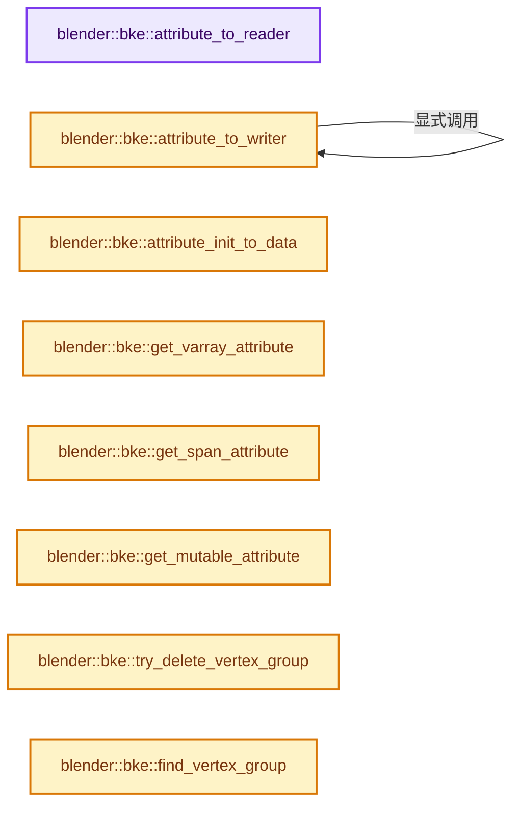
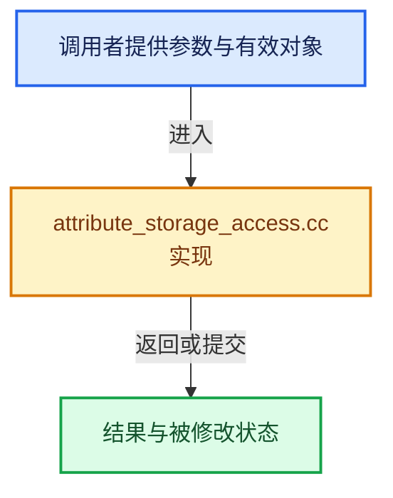

# 实现依赖专题：source/blender/blenkernel/intern/attribute_storage_access.cc

[实现依赖导航](../../README.md) · [符号索引](../../../00-课程指南/02-源码与提交索引/符号依赖与实现索引.md)

本专题从正文实际调用进入，集中保存共享实现。函数有稳定锚点，可从调用处直接跳到对应完整函数；递归与互相调用通过回链组织。

## 本文件的实现关系






## 完整成员与函数实现

<a id="f-163d13c9de0f1d4b"></a>

### `blender::bke::attribute_to_reader`

实现位置：[source/blender/blenkernel/intern/attribute_storage_access.cc](../../../../../../../source/blender/blenkernel/intern/attribute_storage_access.cc) · L21—L42。

接口参数：

- `const Attribute &attribute`
- `const AttrDomain domain`
- `const int64_t domain_size`

**教学注释版**

<!-- annotated:e94711c8f91217 -->

```cpp
GAttributeReader attribute_to_reader(const Attribute &attribute,
                                     const AttrDomain domain,
                                     const int64_t domain_size)
{
  const CPPType &cpp_type = attribute_type_to_cpp_type(attribute.data_type());
  switch (attribute.storage_type()) {
    case AttrStorageType::Array: {
      const auto &data = std::get<Attribute::ArrayData>(attribute.data());
      return GAttributeReader{GVArray::from_span(GSpan(cpp_type, data.data, data.size)),
                              domain,
                              data.sharing_info.get()};
    }
    case AttrStorageType::Single: {
      const auto &data = std::get<Attribute::SingleData>(attribute.data());
      return GAttributeReader{GVArray::from_single_ref(cpp_type, domain_size, data.value),
                              domain,
                              data.sharing_info.get()};
    }
  }
  BLI_assert_unreachable();
  return {};
}
```

<details>
<summary>核对原始源码：source/blender/blenkernel/intern/attribute_storage_access.cc · L21—L42</summary>

<!-- original:e94711c8f91217:source/blender/blenkernel/intern/attribute_storage_access.cc:21:42 -->

```cpp
GAttributeReader attribute_to_reader(const Attribute &attribute,
                                     const AttrDomain domain,
                                     const int64_t domain_size)
{
  const CPPType &cpp_type = attribute_type_to_cpp_type(attribute.data_type());
  switch (attribute.storage_type()) {
    case AttrStorageType::Array: {
      const auto &data = std::get<Attribute::ArrayData>(attribute.data());
      return GAttributeReader{GVArray::from_span(GSpan(cpp_type, data.data, data.size)),
                              domain,
                              data.sharing_info.get()};
    }
    case AttrStorageType::Single: {
      const auto &data = std::get<Attribute::SingleData>(attribute.data());
      return GAttributeReader{GVArray::from_single_ref(cpp_type, domain_size, data.value),
                              domain,
                              data.sharing_info.get()};
    }
  }
  BLI_assert_unreachable();
  return {};
}
```

</details>

**结果出口**

- `return GAttributeReader{GVArray::from_span(GSpan(cpp_type, data.data, data.size)),`
- `return GAttributeReader{GVArray::from_single_ref(cpp_type, domain_size, data.value),`
- `return {};`

**继续追踪实现**

- `attribute_type_to_cpp_type` → [blender::bke::attribute_type_to_cpp_type · L44](attribute_access.cc.md#f-69deacfd0fca6244)。
- `attribute.data_type` → [blender::bke::Attribute::data_type · L291](../../../05-几何存储与拓扑映射/10-布局兼容与几何实战.md#f-d86548da166fa237)。
- `attribute.storage_type` → [blender::bke::Attribute::storage_type · L301](../../../05-几何存储与拓扑映射/10-布局兼容与几何实战.md#f-e08ee0374bedc01d)。
- `std::get<Attribute::ArrayData>` → [外部契约](https://eel.is/c++draft/)：这个边界按实际表达式及所属类型核对参数、返回值、寿命与失败行为。这里提供接口入口，不声称已解释该第三方版本的内部实现。
- `attribute.data` → [blender::bke::Attribute::data · L296](../../../05-几何存储与拓扑映射/10-布局兼容与几何实战.md#f-1d913000744fef94)。
- `GVArray::from_span` → [blender::GVArray::from_span · L895](../../../04-虚拟数组与索引选择/05-GVArray运行时类型.md#f-e8b978ca15febb67)。
- `GSpan` → [blender::GSpan::GSpan · L26](../../../03-内存分配与运行时类型/11-GSpan与GArray.md#f-9d0c95702007eea6)；[blender::GSpan::GSpan · L28](../../../03-内存分配与运行时类型/11-GSpan与GArray.md#f-6650bd08c7eecc66)；[blender::GSpan::GSpan · L37](../../../03-内存分配与运行时类型/11-GSpan与GArray.md#f-bf180950832673fb)；[blender::GSpan::GSpan · L39](../../../03-内存分配与运行时类型/11-GSpan与GArray.md#f-cf949d5590ea9ab6)；[blender::GSpan::GSpan · L41](../../../03-内存分配与运行时类型/11-GSpan与GArray.md#f-a66ab52ee0842aee)；[blender::GSpan::GSpan · L43](../../../03-内存分配与运行时类型/11-GSpan与GArray.md#f-d9084fa10964390f)；[blender::GSpan::GSpan · L49](../../../03-内存分配与运行时类型/11-GSpan与GArray.md#f-76e3de3cc3d65761)。同名重载需按实参类型选择。
- `data.sharing_info.get` → [调用协议](../../../00-课程指南/01-路线与规范/模板宏与动态分派协议.md)：接收对象类型依赖auto、返回值或模板实例；不按同名猜测目标。调用位置L31。
- `std::get<Attribute::SingleData>` → [外部契约](https://eel.is/c++draft/)：这个边界按实际表达式及所属类型核对参数、返回值、寿命与失败行为。这里提供接口入口，不声称已解释该第三方版本的内部实现。
- `GVArray::from_single_ref` → [blender::GVArray::from_single_ref · L885](../../../04-虚拟数组与索引选择/05-GVArray运行时类型.md#f-8208f854554701e4)。
- `BLI_assert_unreachable` → [BLI_assert_unreachable · L77](../../01-BLI基础库/BLI_assert.hh.md#m-7a2d91a67d8e)。宏定义由构建条件选择。

<a id="f-75cf114d7fc03fa8"></a>

### `blender::bke::attribute_to_writer`

实现位置：[source/blender/blenkernel/intern/attribute_storage_access.cc](../../../../../../../source/blender/blenkernel/intern/attribute_storage_access.cc) · L44—L78。

接口参数：

- `void *owner`
- `const Map<StringRef, AttrUpdateOnChange> &changed_tags`
- `const int64_t domain_size`
- `Attribute &attribute`

**教学注释版**

<!-- annotated:ac721e0471d515 -->

```cpp
GAttributeWriter attribute_to_writer(void *owner,
                                     const Map<StringRef, AttrUpdateOnChange> &changed_tags,
                                     const int64_t domain_size,
                                     Attribute &attribute)
{
  const CPPType &cpp_type = attribute_type_to_cpp_type(attribute.data_type());
  switch (attribute.storage_type()) {
    case AttrStorageType::Array: {
      auto &data = std::get<Attribute::ArrayData>(attribute.data_for_write());
      BLI_assert(data.size == domain_size);

      std::function<void()> tag_modified_fn;
      // [讲解] changed_tags.lookup_default：按键查找对应项。
      if (const AttrUpdateOnChange update_fn = changed_tags.lookup_default(attribute.name(),
                                                                           nullptr))
      {
        tag_modified_fn = [owner, update_fn]() { update_fn(owner); };
      };

      return GAttributeWriter{
          GVMutableArray::from_span(GMutableSpan(cpp_type, data.data, domain_size)),
          attribute.domain(),
          // [讲解] std::move：把表达式转换成可供移动重载选择的值类别；不保证真的移动，不结束源对象寿命，对const值可能选择复制。
          std::move(tag_modified_fn)};
    }
    case AttrStorageType::Single: {
      /* Just convert the stored type to an array for modification. It might not make sense to
       * implement editing of single values at this level. */
      const auto &data = std::get<Attribute::SingleData>(attribute.data());
      const GPointer value(cpp_type, data.value);
      attribute.assign_data(Attribute::ArrayData::from_value(value, domain_size));
      return attribute_to_writer(owner, changed_tags, domain_size, attribute);
    }
  }
  BLI_assert_unreachable();
  return {};
}
```

<details>
<summary>核对原始源码：source/blender/blenkernel/intern/attribute_storage_access.cc · L44—L78</summary>

<!-- original:ac721e0471d515:source/blender/blenkernel/intern/attribute_storage_access.cc:44:78 -->

```cpp
GAttributeWriter attribute_to_writer(void *owner,
                                     const Map<StringRef, AttrUpdateOnChange> &changed_tags,
                                     const int64_t domain_size,
                                     Attribute &attribute)
{
  const CPPType &cpp_type = attribute_type_to_cpp_type(attribute.data_type());
  switch (attribute.storage_type()) {
    case AttrStorageType::Array: {
      auto &data = std::get<Attribute::ArrayData>(attribute.data_for_write());
      BLI_assert(data.size == domain_size);

      std::function<void()> tag_modified_fn;
      if (const AttrUpdateOnChange update_fn = changed_tags.lookup_default(attribute.name(),
                                                                           nullptr))
      {
        tag_modified_fn = [owner, update_fn]() { update_fn(owner); };
      };

      return GAttributeWriter{
          GVMutableArray::from_span(GMutableSpan(cpp_type, data.data, domain_size)),
          attribute.domain(),
          std::move(tag_modified_fn)};
    }
    case AttrStorageType::Single: {
      /* Just convert the stored type to an array for modification. It might not make sense to
       * implement editing of single values at this level. */
      const auto &data = std::get<Attribute::SingleData>(attribute.data());
      const GPointer value(cpp_type, data.value);
      attribute.assign_data(Attribute::ArrayData::from_value(value, domain_size));
      return attribute_to_writer(owner, changed_tags, domain_size, attribute);
    }
  }
  BLI_assert_unreachable();
  return {};
}
```

</details>

**沿实际写入检查状态**

- `tag_modified_fn = [owner, update_fn]() { update_fn(owner); };`

**结果出口**

- `return GAttributeWriter{`
- `return attribute_to_writer(owner, changed_tags, domain_size, attribute);`
- `return {};`

**继续追踪实现**

- `attribute_type_to_cpp_type` → [blender::bke::attribute_type_to_cpp_type · L44](attribute_access.cc.md#f-69deacfd0fca6244)。
- `attribute.data_type` → [blender::bke::Attribute::data_type · L291](../../../05-几何存储与拓扑映射/10-布局兼容与几何实战.md#f-d86548da166fa237)。
- `attribute.storage_type` → [blender::bke::Attribute::storage_type · L301](../../../05-几何存储与拓扑映射/10-布局兼容与几何实战.md#f-e08ee0374bedc01d)。
- `std::get<Attribute::ArrayData>` → [外部契约](https://eel.is/c++draft/)：这个边界按实际表达式及所属类型核对参数、返回值、寿命与失败行为。这里提供接口入口，不声称已解释该第三方版本的内部实现。
- `attribute.data_for_write` → [blender::bke::Attribute::data_for_write · L120](attribute_storage.cc.md#f-3afb8286a01d9f05)。
- `BLI_assert` → [BLI_assert · L48](../../01-BLI基础库/BLI_assert.hh.md#m-57a88495704d)；[BLI_assert · L63](../../01-BLI基础库/BLI_assert.hh.md#m-d07050020cb5)。宏定义由构建条件选择。
- `changed_tags.lookup_default` → [blender::Map::lookup_default · L570](../../../02-哈希表与关联数据结构/05-Map插入与回调.md#f-40294aaf345f6a8b)。
- `attribute.name` → [blender::bke::Attribute::name · L281](../../../05-几何存储与拓扑映射/10-布局兼容与几何实战.md#f-673c10c3082f9df5)。
- `update_fn` → [调用协议](../../../00-课程指南/01-路线与规范/模板宏与动态分派协议.md)：局部可调用对象，须结合其初始化与捕获环境。调用位置L59。
- `GVMutableArray::from_span` → [blender::GVMutableArray::from_span · L679](../../../04-虚拟数组与索引选择/05-GVArray运行时类型.md#f-ad97783cbbc9da66)。
- `GMutableSpan` → [blender::GMutableSpan::GMutableSpan · L152](../../../03-内存分配与运行时类型/11-GSpan与GArray.md#f-b4ef5399177eeedd)；[blender::GMutableSpan::GMutableSpan · L154](../../../03-内存分配与运行时类型/11-GSpan与GArray.md#f-6439a40f33c7a2e5)；[blender::GMutableSpan::GMutableSpan · L163](../../../03-内存分配与运行时类型/11-GSpan与GArray.md#f-6054339faadc1405)；[blender::GMutableSpan::GMutableSpan · L167](../../../03-内存分配与运行时类型/11-GSpan与GArray.md#f-d1333b42c7982310)；[blender::GMutableSpan::GMutableSpan · L169](../../../03-内存分配与运行时类型/11-GSpan与GArray.md#f-3584f997d0fe9a96)；[blender::GMutableSpan::GMutableSpan · L171](../../../03-内存分配与运行时类型/11-GSpan与GArray.md#f-3074afdbe5232417)。同名重载需按实参类型选择。
- `attribute.domain` → [blender::bke::Attribute::domain · L286](../../../05-几何存储与拓扑映射/10-布局兼容与几何实战.md#f-03667cd47954e9ff)。
- `std::move` → [外部契约](https://eel.is/c++draft/utility.forward)：把表达式转换成可供移动重载选择的值类别；不保证真的移动，不结束源对象寿命，对const值可能选择复制。
- `std::get<Attribute::SingleData>` → [外部契约](https://eel.is/c++draft/)：这个边界按实际表达式及所属类型核对参数、返回值、寿命与失败行为。这里提供接口入口，不声称已解释该第三方版本的内部实现。
- `attribute.data` → [blender::bke::Attribute::data · L296](../../../05-几何存储与拓扑映射/10-布局兼容与几何实战.md#f-1d913000744fef94)。
- `attribute.assign_data` → [blender::bke::Attribute::assign_data · L312](../../../05-几何存储与拓扑映射/10-布局兼容与几何实战.md#f-9fcff5d02b6d8c44)。
- `Attribute::ArrayData::from_value` → [blender::bke::Attribute::ArrayData::from_value · L56](attribute_storage.cc.md#f-5e4c12ef59c4ea63)。
- `attribute_to_writer` → [blender::bke::attribute_to_writer · L44](attribute_storage_access.cc.md#f-75cf114d7fc03fa8)。
- `BLI_assert_unreachable` → [BLI_assert_unreachable · L77](../../01-BLI基础库/BLI_assert.hh.md#m-7a2d91a67d8e)。宏定义由构建条件选择。

<a id="f-34e72146abce4b23"></a>

### `blender::bke::attribute_init_to_data`

实现位置：[source/blender/blenkernel/intern/attribute_storage_access.cc](../../../../../../../source/blender/blenkernel/intern/attribute_storage_access.cc) · L80—L129。

接口参数：

- `const bke::AttrType data_type`
- `const int64_t domain_size`
- `const AttributeInit &initializer`
- `const bool require_array_data`

**教学注释版**

<!-- annotated:80b077fad3826d -->

```cpp
Attribute::DataVariant attribute_init_to_data(const bke::AttrType data_type,
                                              const int64_t domain_size,
                                              const AttributeInit &initializer,
                                              const bool require_array_data)
{
  switch (initializer.type) {
    case AttributeInit::Type::Construct: {
      const CPPType &type = bke::attribute_type_to_cpp_type(data_type);
      return Attribute::ArrayData::from_constructed(type, domain_size);
    }
    case AttributeInit::Type::Value: {
      const auto &init = static_cast<const AttributeInitValue &>(initializer);
      BLI_assert(*init.value.type() == bke::attribute_type_to_cpp_type(data_type));
      if (require_array_data) {
        return Attribute::ArrayData::from_value(init.value, domain_size);
      }
      return Attribute::SingleData::from_value(init.value);
    }
    case AttributeInit::Type::DefaultValue: {
      const CPPType &type = bke::attribute_type_to_cpp_type(data_type);
      return Attribute::ArrayData::from_default_value(type, domain_size);
    }
    case AttributeInit::Type::VArray: {
      const auto &init = static_cast<const AttributeInitVArray &>(initializer);
      const GVArray &varray = init.varray;
      BLI_assert(varray.size() == domain_size);
      if (!require_array_data) {
        const CommonVArrayInfo &info = varray.common_info();
        if (info.type == CommonVArrayInfo::Type::Single) {
          return Attribute::SingleData::from_value(GPointer(varray.type(), info.data));
        }
      }
      const CPPType &type = varray.type();
      Attribute::ArrayData data = Attribute::ArrayData::from_uninitialized(type, domain_size);
      varray.materialize_to_uninitialized(varray.index_range(), data.data);
      return data;
    }
    case AttributeInit::Type::Shared: {
      const auto &init = static_cast<const AttributeInitShared &>(initializer);
      Attribute::ArrayData data;
      data.data = const_cast<void *>(init.data);
      data.size = domain_size;
      data.sharing_info = ImplicitSharingPtr<>(init.sharing_info);
      data.sharing_info->add_user();
      return data;
    }
  }
  BLI_assert_unreachable();
  return {};
}
```

<details>
<summary>核对原始源码：source/blender/blenkernel/intern/attribute_storage_access.cc · L80—L129</summary>

<!-- original:80b077fad3826d:source/blender/blenkernel/intern/attribute_storage_access.cc:80:129 -->

```cpp
Attribute::DataVariant attribute_init_to_data(const bke::AttrType data_type,
                                              const int64_t domain_size,
                                              const AttributeInit &initializer,
                                              const bool require_array_data)
{
  switch (initializer.type) {
    case AttributeInit::Type::Construct: {
      const CPPType &type = bke::attribute_type_to_cpp_type(data_type);
      return Attribute::ArrayData::from_constructed(type, domain_size);
    }
    case AttributeInit::Type::Value: {
      const auto &init = static_cast<const AttributeInitValue &>(initializer);
      BLI_assert(*init.value.type() == bke::attribute_type_to_cpp_type(data_type));
      if (require_array_data) {
        return Attribute::ArrayData::from_value(init.value, domain_size);
      }
      return Attribute::SingleData::from_value(init.value);
    }
    case AttributeInit::Type::DefaultValue: {
      const CPPType &type = bke::attribute_type_to_cpp_type(data_type);
      return Attribute::ArrayData::from_default_value(type, domain_size);
    }
    case AttributeInit::Type::VArray: {
      const auto &init = static_cast<const AttributeInitVArray &>(initializer);
      const GVArray &varray = init.varray;
      BLI_assert(varray.size() == domain_size);
      if (!require_array_data) {
        const CommonVArrayInfo &info = varray.common_info();
        if (info.type == CommonVArrayInfo::Type::Single) {
          return Attribute::SingleData::from_value(GPointer(varray.type(), info.data));
        }
      }
      const CPPType &type = varray.type();
      Attribute::ArrayData data = Attribute::ArrayData::from_uninitialized(type, domain_size);
      varray.materialize_to_uninitialized(varray.index_range(), data.data);
      return data;
    }
    case AttributeInit::Type::Shared: {
      const auto &init = static_cast<const AttributeInitShared &>(initializer);
      Attribute::ArrayData data;
      data.data = const_cast<void *>(init.data);
      data.size = domain_size;
      data.sharing_info = ImplicitSharingPtr<>(init.sharing_info);
      data.sharing_info->add_user();
      return data;
    }
  }
  BLI_assert_unreachable();
  return {};
}
```

</details>

**沿实际写入检查状态**

- `data.data = const_cast<void *>(init.data);`
- `data.size = domain_size;`
- `data.sharing_info = ImplicitSharingPtr<>(init.sharing_info);`

**结果出口**

- `return Attribute::ArrayData::from_constructed(type, domain_size);`
- `return Attribute::ArrayData::from_value(init.value, domain_size);`
- `return Attribute::SingleData::from_value(init.value);`
- `return Attribute::ArrayData::from_default_value(type, domain_size);`
- `return Attribute::SingleData::from_value(GPointer(varray.type(), info.data));`
- `return data;`
- `return {};`

**继续追踪实现**

- `bke::attribute_type_to_cpp_type` → [blender::bke::attribute_type_to_cpp_type · L44](attribute_access.cc.md#f-69deacfd0fca6244)。
- `Attribute::ArrayData::from_constructed` → [blender::bke::Attribute::ArrayData::from_constructed · L97](attribute_storage.cc.md#f-8977de43b9b5ba5f)。
- `BLI_assert` → [BLI_assert · L48](../../01-BLI基础库/BLI_assert.hh.md#m-57a88495704d)；[BLI_assert · L63](../../01-BLI基础库/BLI_assert.hh.md#m-d07050020cb5)。宏定义由构建条件选择。
- `init.value.type` → [调用协议](../../../00-课程指南/01-路线与规范/模板宏与动态分派协议.md)：接收对象类型依赖auto、返回值或模板实例；不按同名猜测目标。调用位置L92。
- `Attribute::ArrayData::from_value` → [blender::bke::Attribute::ArrayData::from_value · L56](attribute_storage.cc.md#f-5e4c12ef59c4ea63)。
- `Attribute::SingleData::from_value` → [blender::bke::Attribute::SingleData::from_value · L105](attribute_storage.cc.md#f-f977a7eff1a396a8)。
- `Attribute::ArrayData::from_default_value` → [blender::bke::Attribute::ArrayData::from_default_value · L85](attribute_storage.cc.md#f-c4d7d1fbb3af1423)。
- `varray.size` → [调用协议](../../../00-课程指南/01-路线与规范/模板宏与动态分派协议.md)：由接收对象具体类型或运行时策略提供实现。调用位置L105。
- `varray.common_info` → [调用协议](../../../00-课程指南/01-路线与规范/模板宏与动态分派协议.md)：由接收对象具体类型或运行时策略提供实现。调用位置L107。
- `GPointer` → [blender::GPointer::GPointer · L93](../../../03-内存分配与运行时类型/12-异构值存储实战.md#f-40f7a024c1e541df)；[blender::GPointer::GPointer · L95](../../../03-内存分配与运行时类型/12-异构值存储实战.md#f-e981128b9c36f9ef)；[blender::GPointer::GPointer · L97](../../../03-内存分配与运行时类型/12-异构值存储实战.md#f-5d3066175455aed0)；[blender::GPointer::GPointer · L103](../../../03-内存分配与运行时类型/12-异构值存储实战.md#f-9194d11793ea4a06)；[blender::GPointer::GPointer · L105](../../../03-内存分配与运行时类型/12-异构值存储实战.md#f-1a9887b65d37a9ca)。同名重载需按实参类型选择。
- `varray.type` → [blender::bke::GeometryComponent::type · L86](../../../06-隐式共享与缓存系统/05-GeometrySet读写与复制.md#f-f73336c224943890)。
- `Attribute::ArrayData::from_uninitialized` → [blender::bke::Attribute::ArrayData::from_uninitialized · L91](attribute_storage.cc.md#f-303c463a30d7d1ff)。
- `varray.materialize_to_uninitialized` → [调用协议](../../../00-课程指南/01-路线与规范/模板宏与动态分派协议.md)：由接收对象具体类型或运行时策略提供实现。调用位置L114。
- `varray.index_range` → [调用协议](../../../00-课程指南/01-路线与规范/模板宏与动态分派协议.md)：由接收对象具体类型或运行时策略提供实现。调用位置L114。
- `ImplicitSharingPtr<>` → [blender::ImplicitSharingPtr::ImplicitSharingPtr · L32](../../../06-隐式共享与缓存系统/03-Mixin与共享指针封装.md#f-d28a43dbb5ed8c05)；[blender::ImplicitSharingPtr::ImplicitSharingPtr · L34](../../../06-隐式共享与缓存系统/03-Mixin与共享指针封装.md#f-d27d5ebf676e244a)；[blender::ImplicitSharingPtr::ImplicitSharingPtr · L37](../../../06-隐式共享与缓存系统/03-Mixin与共享指针封装.md#f-17d0c5fe2b03a664)；[blender::ImplicitSharingPtr::ImplicitSharingPtr · L39](../../../06-隐式共享与缓存系统/03-Mixin与共享指针封装.md#f-1c8729ae57532370)；[blender::ImplicitSharingPtr::ImplicitSharingPtr · L44](../../../06-隐式共享与缓存系统/03-Mixin与共享指针封装.md#f-0b6be0142b98009e)；[blender::ImplicitSharingPtr::ImplicitSharingPtr · L49](../../../06-隐式共享与缓存系统/03-Mixin与共享指针封装.md#f-90c601ed9ed99045)；[blender::ImplicitSharingPtr::ImplicitSharingPtr · L57](../../../06-隐式共享与缓存系统/03-Mixin与共享指针封装.md#f-1625179ceae7a66d)。同名重载需按实参类型选择。
- `data.sharing_info->add_user` → [调用协议](../../../00-课程指南/01-路线与规范/模板宏与动态分派协议.md)：接收对象类型依赖auto、返回值或模板实例；不按同名猜测目标。调用位置L123。
- `BLI_assert_unreachable` → [BLI_assert_unreachable · L77](../../01-BLI基础库/BLI_assert.hh.md#m-7a2d91a67d8e)。宏定义由构建条件选择。

<a id="f-f83c3184952b0870"></a>

### `blender::bke::get_varray_attribute`

实现位置：[source/blender/blenkernel/intern/attribute_storage_access.cc](../../../../../../../source/blender/blenkernel/intern/attribute_storage_access.cc) · L131—L165。

接口参数：

- `const AttributeStorage &storage`
- `AttrDomain domain`
- `const CPPType &cpp_type`
- `StringRef name`
- `int64_t domain_size`
- `const void *default_value`

**教学注释版**

<!-- annotated:e47c0fee0dbb37 -->

```cpp
GVArray get_varray_attribute(const AttributeStorage &storage,
                             AttrDomain domain,
                             const CPPType &cpp_type,
                             StringRef name,
                             int64_t domain_size,
                             const void *default_value)
{
  const bke::Attribute *attr = storage.wrap().lookup(name);

  const auto return_default = [&]() {
    return GVArray::from_single(cpp_type, domain_size, default_value);
  };

  if (!attr) {
    return return_default();
  }
  if (attr->domain() != domain) {
    return return_default();
  }
  if (attr->data_type() != cpp_type_to_attribute_type(cpp_type)) {
    return return_default();
  }
  switch (attr->storage_type()) {
    case bke::AttrStorageType::Array: {
      const auto &data = std::get<bke::Attribute::ArrayData>(attr->data());
      const GSpan span(cpp_type, data.data, data.size);
      return GVArray::from_span(span);
    }
    case bke::AttrStorageType::Single: {
      const auto &data = std::get<bke::Attribute::SingleData>(attr->data());
      return GVArray::from_single(cpp_type, domain_size, data.value);
    }
  }
  return return_default();
}
```

<details>
<summary>核对原始源码：source/blender/blenkernel/intern/attribute_storage_access.cc · L131—L165</summary>

<!-- original:e47c0fee0dbb37:source/blender/blenkernel/intern/attribute_storage_access.cc:131:165 -->

```cpp
GVArray get_varray_attribute(const AttributeStorage &storage,
                             AttrDomain domain,
                             const CPPType &cpp_type,
                             StringRef name,
                             int64_t domain_size,
                             const void *default_value)
{
  const bke::Attribute *attr = storage.wrap().lookup(name);

  const auto return_default = [&]() {
    return GVArray::from_single(cpp_type, domain_size, default_value);
  };

  if (!attr) {
    return return_default();
  }
  if (attr->domain() != domain) {
    return return_default();
  }
  if (attr->data_type() != cpp_type_to_attribute_type(cpp_type)) {
    return return_default();
  }
  switch (attr->storage_type()) {
    case bke::AttrStorageType::Array: {
      const auto &data = std::get<bke::Attribute::ArrayData>(attr->data());
      const GSpan span(cpp_type, data.data, data.size);
      return GVArray::from_span(span);
    }
    case bke::AttrStorageType::Single: {
      const auto &data = std::get<bke::Attribute::SingleData>(attr->data());
      return GVArray::from_single(cpp_type, domain_size, data.value);
    }
  }
  return return_default();
}
```

</details>

**结果出口**

- `return GVArray::from_single(cpp_type, domain_size, default_value);`
- `return return_default();`
- `return GVArray::from_span(span);`
- `return GVArray::from_single(cpp_type, domain_size, data.value);`

**继续追踪实现**

- `storage.wrap().lookup` → [调用协议](../../../00-课程指南/01-路线与规范/模板宏与动态分派协议.md)：接收对象类型依赖auto、返回值或模板实例；不按同名猜测目标。调用位置L138。
- `storage.wrap` → [blender::AttributeStorage::wrap · L343](../../../05-几何存储与拓扑映射/10-布局兼容与几何实战.md#f-dcd2d04d6f92ca8c)；[blender::AttributeStorage::wrap · L347](../../../05-几何存储与拓扑映射/10-布局兼容与几何实战.md#f-9ad0fac9bae8a380)。同名重载需按实参类型选择。
- `GVArray::from_single` → [blender::GVArray::from_single · L880](../../../04-虚拟数组与索引选择/05-GVArray运行时类型.md#f-1c85e09520e47c5a)。
- `return_default` → [调用协议](../../../00-课程指南/01-路线与规范/模板宏与动态分派协议.md)：局部可调用对象，须结合其初始化与捕获环境。调用位置L145。
- `attr->domain` → [blender::bke::Attribute::domain · L286](../../../05-几何存储与拓扑映射/10-布局兼容与几何实战.md#f-03667cd47954e9ff)。
- `attr->data_type` → [blender::bke::Attribute::data_type · L291](../../../05-几何存储与拓扑映射/10-布局兼容与几何实战.md#f-d86548da166fa237)。
- `cpp_type_to_attribute_type` → [blender::bke::cpp_type_to_attribute_type · L80](attribute_access.cc.md#f-6ce44c9d2f385cb5)。
- `attr->storage_type` → [blender::bke::Attribute::storage_type · L301](../../../05-几何存储与拓扑映射/10-布局兼容与几何实战.md#f-e08ee0374bedc01d)。
- `std::get<bke::Attribute::ArrayData>` → [外部契约](https://eel.is/c++draft/)：这个边界按实际表达式及所属类型核对参数、返回值、寿命与失败行为。这里提供接口入口，不声称已解释该第三方版本的内部实现。
- `attr->data` → [blender::bke::Attribute::data · L296](../../../05-几何存储与拓扑映射/10-布局兼容与几何实战.md#f-1d913000744fef94)。
- `GVArray::from_span` → [blender::GVArray::from_span · L895](../../../04-虚拟数组与索引选择/05-GVArray运行时类型.md#f-e8b978ca15febb67)。
- `std::get<bke::Attribute::SingleData>` → [外部契约](https://eel.is/c++draft/)：这个边界按实际表达式及所属类型核对参数、返回值、寿命与失败行为。这里提供接口入口，不声称已解释该第三方版本的内部实现。

<a id="f-043f0c9c1fd78c2f"></a>

### `blender::bke::get_span_attribute`

实现位置：[source/blender/blenkernel/intern/attribute_storage_access.cc](../../../../../../../source/blender/blenkernel/intern/attribute_storage_access.cc) · L167—L186。

接口参数：

- `const AttributeStorage &storage`
- `const AttrDomain domain`
- `const CPPType &cpp_type`
- `const StringRef name`
- `const int64_t domain_size`

**教学注释版**

<!-- annotated:17b98d893f3df2 -->

```cpp
std::optional<GSpan> get_span_attribute(const AttributeStorage &storage,
                                        const AttrDomain domain,
                                        const CPPType &cpp_type,
                                        const StringRef name,
                                        const int64_t domain_size)
{
  const bke::Attribute *attr = storage.wrap().lookup(name);
  if (!attr) {
    return {};
  }
  if (attr->domain() != domain) {
    return {};
  }
  if (const auto *array_data = std::get_if<bke::Attribute::ArrayData>(&attr->data())) {
    BLI_assert(array_data->size == domain_size);
    UNUSED_VARS_NDEBUG(domain_size);
    return GSpan(cpp_type, array_data->data, array_data->size);
  }
  return {};
}
```

<details>
<summary>核对原始源码：source/blender/blenkernel/intern/attribute_storage_access.cc · L167—L186</summary>

<!-- original:17b98d893f3df2:source/blender/blenkernel/intern/attribute_storage_access.cc:167:186 -->

```cpp
std::optional<GSpan> get_span_attribute(const AttributeStorage &storage,
                                        const AttrDomain domain,
                                        const CPPType &cpp_type,
                                        const StringRef name,
                                        const int64_t domain_size)
{
  const bke::Attribute *attr = storage.wrap().lookup(name);
  if (!attr) {
    return {};
  }
  if (attr->domain() != domain) {
    return {};
  }
  if (const auto *array_data = std::get_if<bke::Attribute::ArrayData>(&attr->data())) {
    BLI_assert(array_data->size == domain_size);
    UNUSED_VARS_NDEBUG(domain_size);
    return GSpan(cpp_type, array_data->data, array_data->size);
  }
  return {};
}
```

</details>

**结果出口**

- `return {};`
- `return GSpan(cpp_type, array_data->data, array_data->size);`

**继续追踪实现**

- `storage.wrap().lookup` → [调用协议](../../../00-课程指南/01-路线与规范/模板宏与动态分派协议.md)：接收对象类型依赖auto、返回值或模板实例；不按同名猜测目标。调用位置L173。
- `storage.wrap` → [blender::AttributeStorage::wrap · L343](../../../05-几何存储与拓扑映射/10-布局兼容与几何实战.md#f-dcd2d04d6f92ca8c)；[blender::AttributeStorage::wrap · L347](../../../05-几何存储与拓扑映射/10-布局兼容与几何实战.md#f-9ad0fac9bae8a380)。同名重载需按实参类型选择。
- `attr->domain` → [blender::bke::Attribute::domain · L286](../../../05-几何存储与拓扑映射/10-布局兼容与几何实战.md#f-03667cd47954e9ff)。
- `std::get_if<bke::Attribute::ArrayData>` → [外部契约](https://eel.is/c++draft/)：这个边界按实际表达式及所属类型核对参数、返回值、寿命与失败行为。这里提供接口入口，不声称已解释该第三方版本的内部实现。
- `attr->data` → [blender::bke::Attribute::data · L296](../../../05-几何存储与拓扑映射/10-布局兼容与几何实战.md#f-1d913000744fef94)。
- `BLI_assert` → [BLI_assert · L48](../../01-BLI基础库/BLI_assert.hh.md#m-57a88495704d)；[BLI_assert · L63](../../01-BLI基础库/BLI_assert.hh.md#m-d07050020cb5)。宏定义由构建条件选择。
- `UNUSED_VARS_NDEBUG` → [UNUSED_VARS_NDEBUG · L526](../../01-BLI基础库/BLI_utildefines.hh.md#m-fea439f7d366)；[UNUSED_VARS_NDEBUG · L528](../../01-BLI基础库/BLI_utildefines.hh.md#m-a8f8cfac06c0)。宏定义由构建条件选择。
- `GSpan` → [blender::GSpan::GSpan · L26](../../../03-内存分配与运行时类型/11-GSpan与GArray.md#f-9d0c95702007eea6)；[blender::GSpan::GSpan · L28](../../../03-内存分配与运行时类型/11-GSpan与GArray.md#f-6650bd08c7eecc66)；[blender::GSpan::GSpan · L37](../../../03-内存分配与运行时类型/11-GSpan与GArray.md#f-bf180950832673fb)；[blender::GSpan::GSpan · L39](../../../03-内存分配与运行时类型/11-GSpan与GArray.md#f-cf949d5590ea9ab6)；[blender::GSpan::GSpan · L41](../../../03-内存分配与运行时类型/11-GSpan与GArray.md#f-a66ab52ee0842aee)；[blender::GSpan::GSpan · L43](../../../03-内存分配与运行时类型/11-GSpan与GArray.md#f-d9084fa10964390f)；[blender::GSpan::GSpan · L49](../../../03-内存分配与运行时类型/11-GSpan与GArray.md#f-76e3de3cc3d65761)。同名重载需按实参类型选择。

<a id="f-1dc04fa7db8e0dd3"></a>

### `blender::bke::get_mutable_attribute`

实现位置：[source/blender/blenkernel/intern/attribute_storage_access.cc](../../../../../../../source/blender/blenkernel/intern/attribute_storage_access.cc) · L188—L223。

接口参数：

- `AttributeStorage &storage`
- `const AttrDomain domain`
- `const CPPType &cpp_type`
- `const StringRef name`
- `const int64_t domain_size`
- `const void *custom_default_value`

**教学注释版**

<!-- annotated:7ef7e9a07ad652 -->

```cpp
GMutableSpan get_mutable_attribute(AttributeStorage &storage,
                                   const AttrDomain domain,
                                   const CPPType &cpp_type,
                                   const StringRef name,
                                   const int64_t domain_size,
                                   const void *custom_default_value)
{
  if (domain_size <= 0) {
    return {};
  }
  const bke::AttrType type = bke::cpp_type_to_attribute_type(cpp_type);
  if (bke::Attribute *attr = storage.wrap().lookup(name)) {
    if (attr->data_type() == type) {
      if (const auto *single_data = std::get_if<bke::Attribute::SingleData>(&attr->data())) {
        /* Convert single value storage to array storage. */
        const GPointer g_value(cpp_type, single_data->value);
        attr->assign_data(bke::Attribute::ArrayData::from_value(g_value, domain_size));
      }
      auto &array_data = std::get<bke::Attribute::ArrayData>(attr->data_for_write());
      return GMutableSpan(cpp_type, array_data.data, domain_size);
    }
    /* The attribute has the wrong type. This shouldn't happen for builtin attributes, but just
     * in case, remove it. */
    storage.wrap().remove(name);
  }
  const void *default_value = custom_default_value ? custom_default_value :
                                                     cpp_type.default_value();
  bke::Attribute &attr = storage.wrap().add(
      name,
      domain,
      type,
      bke::Attribute::ArrayData::from_value({cpp_type, default_value}, domain_size));
  auto &array_data = std::get<bke::Attribute::ArrayData>(attr.data_for_write());
  BLI_assert(array_data.size == domain_size);
  return GMutableSpan(cpp_type, array_data.data, domain_size);
}
```

<details>
<summary>核对原始源码：source/blender/blenkernel/intern/attribute_storage_access.cc · L188—L223</summary>

<!-- original:7ef7e9a07ad652:source/blender/blenkernel/intern/attribute_storage_access.cc:188:223 -->

```cpp
GMutableSpan get_mutable_attribute(AttributeStorage &storage,
                                   const AttrDomain domain,
                                   const CPPType &cpp_type,
                                   const StringRef name,
                                   const int64_t domain_size,
                                   const void *custom_default_value)
{
  if (domain_size <= 0) {
    return {};
  }
  const bke::AttrType type = bke::cpp_type_to_attribute_type(cpp_type);
  if (bke::Attribute *attr = storage.wrap().lookup(name)) {
    if (attr->data_type() == type) {
      if (const auto *single_data = std::get_if<bke::Attribute::SingleData>(&attr->data())) {
        /* Convert single value storage to array storage. */
        const GPointer g_value(cpp_type, single_data->value);
        attr->assign_data(bke::Attribute::ArrayData::from_value(g_value, domain_size));
      }
      auto &array_data = std::get<bke::Attribute::ArrayData>(attr->data_for_write());
      return GMutableSpan(cpp_type, array_data.data, domain_size);
    }
    /* The attribute has the wrong type. This shouldn't happen for builtin attributes, but just
     * in case, remove it. */
    storage.wrap().remove(name);
  }
  const void *default_value = custom_default_value ? custom_default_value :
                                                     cpp_type.default_value();
  bke::Attribute &attr = storage.wrap().add(
      name,
      domain,
      type,
      bke::Attribute::ArrayData::from_value({cpp_type, default_value}, domain_size));
  auto &array_data = std::get<bke::Attribute::ArrayData>(attr.data_for_write());
  BLI_assert(array_data.size == domain_size);
  return GMutableSpan(cpp_type, array_data.data, domain_size);
}
```

</details>

**结果出口**

- `return {};`
- `return GMutableSpan(cpp_type, array_data.data, domain_size);`

**继续追踪实现**

- `bke::cpp_type_to_attribute_type` → [blender::bke::cpp_type_to_attribute_type · L80](attribute_access.cc.md#f-6ce44c9d2f385cb5)。
- `storage.wrap().lookup` → [调用协议](../../../00-课程指南/01-路线与规范/模板宏与动态分派协议.md)：接收对象类型依赖auto、返回值或模板实例；不按同名猜测目标。调用位置L199。
- `storage.wrap` → [blender::AttributeStorage::wrap · L343](../../../05-几何存储与拓扑映射/10-布局兼容与几何实战.md#f-dcd2d04d6f92ca8c)；[blender::AttributeStorage::wrap · L347](../../../05-几何存储与拓扑映射/10-布局兼容与几何实战.md#f-9ad0fac9bae8a380)。同名重载需按实参类型选择。
- `attr->data_type` → [blender::bke::Attribute::data_type · L291](../../../05-几何存储与拓扑映射/10-布局兼容与几何实战.md#f-d86548da166fa237)。
- `std::get_if<bke::Attribute::SingleData>` → [外部契约](https://eel.is/c++draft/)：这个边界按实际表达式及所属类型核对参数、返回值、寿命与失败行为。这里提供接口入口，不声称已解释该第三方版本的内部实现。
- `attr->data` → [blender::bke::Attribute::data · L296](../../../05-几何存储与拓扑映射/10-布局兼容与几何实战.md#f-1d913000744fef94)。
- `attr->assign_data` → [blender::bke::Attribute::assign_data · L312](../../../05-几何存储与拓扑映射/10-布局兼容与几何实战.md#f-9fcff5d02b6d8c44)。
- `bke::Attribute::ArrayData::from_value` → [blender::bke::Attribute::ArrayData::from_value · L56](attribute_storage.cc.md#f-5e4c12ef59c4ea63)。
- `std::get<bke::Attribute::ArrayData>` → [外部契约](https://eel.is/c++draft/)：这个边界按实际表达式及所属类型核对参数、返回值、寿命与失败行为。这里提供接口入口，不声称已解释该第三方版本的内部实现。
- `attr->data_for_write` → [blender::bke::Attribute::data_for_write · L120](attribute_storage.cc.md#f-3afb8286a01d9f05)。
- `GMutableSpan` → [blender::GMutableSpan::GMutableSpan · L152](../../../03-内存分配与运行时类型/11-GSpan与GArray.md#f-b4ef5399177eeedd)；[blender::GMutableSpan::GMutableSpan · L154](../../../03-内存分配与运行时类型/11-GSpan与GArray.md#f-6439a40f33c7a2e5)；[blender::GMutableSpan::GMutableSpan · L163](../../../03-内存分配与运行时类型/11-GSpan与GArray.md#f-6054339faadc1405)；[blender::GMutableSpan::GMutableSpan · L167](../../../03-内存分配与运行时类型/11-GSpan与GArray.md#f-d1333b42c7982310)；[blender::GMutableSpan::GMutableSpan · L169](../../../03-内存分配与运行时类型/11-GSpan与GArray.md#f-3584f997d0fe9a96)；[blender::GMutableSpan::GMutableSpan · L171](../../../03-内存分配与运行时类型/11-GSpan与GArray.md#f-3074afdbe5232417)。同名重载需按实参类型选择。
- `storage.wrap().remove` → [调用协议](../../../00-课程指南/01-路线与规范/模板宏与动态分派协议.md)：接收对象类型依赖auto、返回值或模板实例；不按同名猜测目标。调用位置L211。
- `cpp_type.default_value` → [blender::CPPType::default_value · L743](../../../03-内存分配与运行时类型/09-CPPType复制移动重定位.md#f-95e76cbe74b383e8)。
- `storage.wrap().add` → [调用协议](../../../00-课程指南/01-路线与规范/模板宏与动态分派协议.md)：接收对象类型依赖auto、返回值或模板实例；不按同名猜测目标。调用位置L215。
- `attr.data_for_write` → [blender::bke::Attribute::data_for_write · L120](attribute_storage.cc.md#f-3afb8286a01d9f05)。
- `BLI_assert` → [BLI_assert · L48](../../01-BLI基础库/BLI_assert.hh.md#m-57a88495704d)；[BLI_assert · L63](../../01-BLI基础库/BLI_assert.hh.md#m-d07050020cb5)。宏定义由构建条件选择。

<a id="f-24633f19fddba82e"></a>

### `blender::bke::try_delete_vertex_group`

实现位置：[source/blender/blenkernel/intern/attribute_storage_access.cc](../../../../../../../source/blender/blenkernel/intern/attribute_storage_access.cc) · L225—L242。

接口参数：

- `ListBaseT<bDeformGroup> &vertex_groups`
- `const StringRef name`
- `FunctionRef<MutableSpan<MDeformVert>()> get_mutable_dverts`

**教学注释版**

<!-- annotated:ddb5411afccc3c -->

```cpp
bool try_delete_vertex_group(ListBaseT<bDeformGroup> &vertex_groups,
                             const StringRef name,
                             FunctionRef<MutableSpan<MDeformVert>()> get_mutable_dverts)
{
  int index;
  bDeformGroup *group;
  if (!BKE_defgroup_listbase_name_find(&vertex_groups, name, &index, &group)) {
    return false;
  }
  BLI_remlink(&vertex_groups, group);
  MEM_delete(group);
  MutableSpan<MDeformVert> dverts = get_mutable_dverts();
  // [讲解] dverts.is_empty：查询视图长度或生成对应有效索引区间。
  if (dverts.is_empty()) {
    return true;
  }
  remove_defgroup_index(dverts, index);
  return true;
}
```

<details>
<summary>核对原始源码：source/blender/blenkernel/intern/attribute_storage_access.cc · L225—L242</summary>

<!-- original:ddb5411afccc3c:source/blender/blenkernel/intern/attribute_storage_access.cc:225:242 -->

```cpp
bool try_delete_vertex_group(ListBaseT<bDeformGroup> &vertex_groups,
                             const StringRef name,
                             FunctionRef<MutableSpan<MDeformVert>()> get_mutable_dverts)
{
  int index;
  bDeformGroup *group;
  if (!BKE_defgroup_listbase_name_find(&vertex_groups, name, &index, &group)) {
    return false;
  }
  BLI_remlink(&vertex_groups, group);
  MEM_delete(group);
  MutableSpan<MDeformVert> dverts = get_mutable_dverts();
  if (dverts.is_empty()) {
    return true;
  }
  remove_defgroup_index(dverts, index);
  return true;
}
```

</details>

**结果出口**

- `return false;`
- `return true;`

**继续追踪实现**

- `BKE_defgroup_listbase_name_find` → [blender::BKE_defgroup_listbase_name_find · L562](deform.cc.md#f-0b0203eeb86c4a39)。
- `BLI_remlink` → [blender::BLI_remlink · L138](../../01-BLI基础库/intern/listbase.cc.md#f-120d80f281ca4cb7)。
- `MEM_delete` → [MEM_delete · L400](../../07-Intern运行时与平台/guardedalloc/MEM_guardedalloc.h.md#f-9049ffdd1682887c)。
- `get_mutable_dverts` → [调用协议](../../../00-课程指南/01-路线与规范/模板宏与动态分派协议.md)：局部可调用对象，须结合其初始化与捕获环境。调用位置L236。
- `dverts.is_empty` → [blender::MutableSpan::is_empty · L515](../../../01-基础容器与现代CPP/06-MutableSpan可写视图.md#f-be88df1422757437)。
- `remove_defgroup_index` → [blender::bke::remove_defgroup_index · L1758](deform.cc.md#f-42eb2479d5254ae6)。

<a id="f-506601d78c697edd"></a>

### `blender::bke::find_vertex_group`

实现位置：[source/blender/blenkernel/intern/attribute_storage_access.cc](../../../../../../../source/blender/blenkernel/intern/attribute_storage_access.cc) · L244—L253。

接口参数：

- `ListBaseT<bDeformGroup> &vertex_groups`
- `const StringRef name`

**教学注释版**

<!-- annotated:9e597cd64e44e6 -->

```cpp
static bDeformGroup *find_vertex_group(ListBaseT<bDeformGroup> &vertex_groups,
                                       const StringRef name)
{
  for (bDeformGroup &group : vertex_groups) {
    if (group.name == name) {
      return &group;
    }
  }
  return nullptr;
}
```

<details>
<summary>核对原始源码：source/blender/blenkernel/intern/attribute_storage_access.cc · L244—L253</summary>

<!-- original:9e597cd64e44e6:source/blender/blenkernel/intern/attribute_storage_access.cc:244:253 -->

```cpp
static bDeformGroup *find_vertex_group(ListBaseT<bDeformGroup> &vertex_groups,
                                       const StringRef name)
{
  for (bDeformGroup &group : vertex_groups) {
    if (group.name == name) {
      return &group;
    }
  }
  return nullptr;
}
```

</details>

**结果出口**

- `return &group;`
- `return nullptr;`

**继续追踪实现**

本实现没有需要继续展开的显式调用；检查返回表达式、对象转换和调用者前置条件。

<a id="f-3f725e8530434574"></a>

### `blender::bke::ensure_array_storage`

实现位置：[source/blender/blenkernel/intern/attribute_storage_access.cc](../../../../../../../source/blender/blenkernel/intern/attribute_storage_access.cc) · L255—L268。

接口参数：

- `Attribute &attr`
- `const FunctionRef<int(AttrDomain)> domain_size_fn`
- `AttrDomain`

**教学注释版**

<!-- annotated:076b401253fd52 -->

```cpp
static void ensure_array_storage(Attribute &attr,
                                 const FunctionRef<int(AttrDomain)> domain_size_fn)
{
  switch (attr.storage_type()) {
    case AttrStorageType::Single: {
      const auto &data = std::get<Attribute::SingleData>(attr.data());
      const GPointer value(attribute_type_to_cpp_type(attr.data_type()), data.value);
      attr.assign_data(Attribute::ArrayData::from_value(value, domain_size_fn(attr.domain())));
      break;
    }
    case AttrStorageType::Array:
      break;
  }
}
```

<details>
<summary>核对原始源码：source/blender/blenkernel/intern/attribute_storage_access.cc · L255—L268</summary>

<!-- original:076b401253fd52:source/blender/blenkernel/intern/attribute_storage_access.cc:255:268 -->

```cpp
static void ensure_array_storage(Attribute &attr,
                                 const FunctionRef<int(AttrDomain)> domain_size_fn)
{
  switch (attr.storage_type()) {
    case AttrStorageType::Single: {
      const auto &data = std::get<Attribute::SingleData>(attr.data());
      const GPointer value(attribute_type_to_cpp_type(attr.data_type()), data.value);
      attr.assign_data(Attribute::ArrayData::from_value(value, domain_size_fn(attr.domain())));
      break;
    }
    case AttrStorageType::Array:
      break;
  }
}
```

</details>

**继续追踪实现**

- `attr.storage_type` → [blender::bke::Attribute::storage_type · L301](../../../05-几何存储与拓扑映射/10-布局兼容与几何实战.md#f-e08ee0374bedc01d)。
- `std::get<Attribute::SingleData>` → [外部契约](https://eel.is/c++draft/)：这个边界按实际表达式及所属类型核对参数、返回值、寿命与失败行为。这里提供接口入口，不声称已解释该第三方版本的内部实现。
- `attr.data` → [blender::bke::Attribute::data · L296](../../../05-几何存储与拓扑映射/10-布局兼容与几何实战.md#f-1d913000744fef94)。
- `attribute_type_to_cpp_type` → [blender::bke::attribute_type_to_cpp_type · L44](attribute_access.cc.md#f-69deacfd0fca6244)。
- `attr.data_type` → [blender::bke::Attribute::data_type · L291](../../../05-几何存储与拓扑映射/10-布局兼容与几何实战.md#f-d86548da166fa237)。
- `attr.assign_data` → [blender::bke::Attribute::assign_data · L312](../../../05-几何存储与拓扑映射/10-布局兼容与几何实战.md#f-9fcff5d02b6d8c44)。
- `Attribute::ArrayData::from_value` → [blender::bke::Attribute::ArrayData::from_value · L56](attribute_storage.cc.md#f-5e4c12ef59c4ea63)。
- `domain_size_fn` → [调用协议](../../../00-课程指南/01-路线与规范/模板宏与动态分派协议.md)：局部可调用对象，须结合其初始化与捕获环境。调用位置L262。
- `attr.domain` → [blender::bke::Attribute::domain · L286](../../../05-几何存储与拓扑映射/10-布局兼容与几何实战.md#f-03667cd47954e9ff)。

<a id="f-7ca337b600fe248e"></a>

### `blender::bke::find_attr_or_group`

实现位置：[source/blender/blenkernel/intern/attribute_storage_access.cc](../../../../../../../source/blender/blenkernel/intern/attribute_storage_access.cc) · L270—L284。

接口参数：

- `AttributeStorage &storage`
- `std::optional<ListBaseT<bDeformGroup> *> vertex_groups`
- `const StringRef name`

**教学注释版**

<!-- annotated:0f481d1932646e -->

```cpp
static std::variant<std::monostate, Attribute *, bDeformGroup *> find_attr_or_group(
    AttributeStorage &storage,
    std::optional<ListBaseT<bDeformGroup> *> vertex_groups,
    const StringRef name)
{
  if (Attribute *attr = storage.lookup(name)) {
    return attr;
  }
  if (vertex_groups) {
    if (bDeformGroup *group = find_vertex_group(**vertex_groups, name)) {
      return group;
    }
  }
  return std::monostate();
}
```

<details>
<summary>核对原始源码：source/blender/blenkernel/intern/attribute_storage_access.cc · L270—L284</summary>

<!-- original:0f481d1932646e:source/blender/blenkernel/intern/attribute_storage_access.cc:270:284 -->

```cpp
static std::variant<std::monostate, Attribute *, bDeformGroup *> find_attr_or_group(
    AttributeStorage &storage,
    std::optional<ListBaseT<bDeformGroup> *> vertex_groups,
    const StringRef name)
{
  if (Attribute *attr = storage.lookup(name)) {
    return attr;
  }
  if (vertex_groups) {
    if (bDeformGroup *group = find_vertex_group(**vertex_groups, name)) {
      return group;
    }
  }
  return std::monostate();
}
```

</details>

**结果出口**

- `return attr;`
- `return group;`
- `return std::monostate();`

**继续追踪实现**

- `storage.lookup` → [blender::bke::AttributeStorage::lookup · L218](attribute_storage.cc.md#f-7fdc83fb77004833)；[blender::bke::AttributeStorage::lookup · L228](attribute_storage.cc.md#f-4c9ec35a31afcd06)。同名重载需按实参类型选择。
- `find_vertex_group` → [blender::bke::find_vertex_group · L244](attribute_storage_access.cc.md#f-506601d78c697edd)。
- `std::monostate` → [外部契约](https://eel.is/c++draft/)：这个边界按实际表达式及所属类型核对参数、返回值、寿命与失败行为。这里提供接口入口，不声称已解释该第三方版本的内部实现。

<a id="f-3b17282afd84c493"></a>

### `blender::bke::rename_attributes`

实现位置：[source/blender/blenkernel/intern/attribute_storage_access.cc](../../../../../../../source/blender/blenkernel/intern/attribute_storage_access.cc) · L286—L384。

接口参数：

- `AttributeStorage &storage`
- `const Map<StringRef, StringRef> &name_map`
- `const bool overwrite`
- `const Map<StringRef, AttrBuiltinInfo> &builtin_attributes`
- `const Set<StringRef> &array_storage_required`
- `const FunctionRef<int(AttrDomain)> domain_size_fn`
- `AttrDomain`
- `std::optional<ListBaseT<bDeformGroup> *> vertex_groups`
- `FunctionRef<MutableSpan<MDeformVert>()> get_mutable_dverts`

**教学注释版**

<!-- annotated:bc8be77674bc34 -->

```cpp
Set<StringRef> rename_attributes(AttributeStorage &storage,
                                 const Map<StringRef, StringRef> &name_map,
                                 const bool overwrite,
                                 const Map<StringRef, AttrBuiltinInfo> &builtin_attributes,
                                 const Set<StringRef> &array_storage_required,
                                 const FunctionRef<int(AttrDomain)> domain_size_fn,
                                 std::optional<ListBaseT<bDeformGroup> *> vertex_groups,
                                 FunctionRef<MutableSpan<MDeformVert>()> get_mutable_dverts)
{
  Set<StringRef> names_to_remove;
  Set<StringRef> failed;
  Map<Attribute *, StringRef> map;
  Map<bDeformGroup *, StringRef> vertex_group_map;
  // [讲解] map.reserve：重新组织槽位或准备容量。
  map.reserve(name_map.size());
  for (const auto &[old_name, new_name] : name_map.items()) {
    if (new_name.is_empty()) {
      // [讲解] failed.add_new：按哈希与相等关系加入键或键值。
      failed.add_new(old_name);
      continue;
    }
    const std::variant<std::monostate, Attribute *, bDeformGroup *> old_attr = find_attr_or_group(
        storage, vertex_groups, old_name);
    if (std::holds_alternative<std::monostate>(old_attr)) {
      failed.add_new(old_name);
      continue;
    }
    const bke::AttrDomain old_domain = std::holds_alternative<Attribute *>(old_attr) ?
                                           std::get<Attribute *>(old_attr)->domain() :
                                           bke::AttrDomain::Point;
    const bke::AttrType old_type = std::holds_alternative<Attribute *>(old_attr) ?
                                       std::get<Attribute *>(old_attr)->data_type() :
                                       bke::AttrType::Float;

    // [讲解] builtin_attributes.lookup_ptr：按键查找对应项。
    if (const AttrBuiltinInfo *old_info = builtin_attributes.lookup_ptr(old_name)) {
      if (!old_info->deletable) {
        failed.add_new(old_name);
        continue;
      }
    }
    if (const AttrBuiltinInfo *new_info = builtin_attributes.lookup_ptr(new_name)) {
      if (new_info->domain != old_domain || new_info->type != old_type) {
        failed.add_new(old_name);
        continue;
      }
    }
    // [讲解] array_storage_required.contains：查询活项数量或键是否存在。
    if (array_storage_required.contains(new_name)) {
      if (std::holds_alternative<Attribute *>(old_attr)) {
        ensure_array_storage(*std::get<Attribute *>(old_attr), domain_size_fn);
      }
      else {
        /* Converting vertex groups to real attributes remains unsupported here. */
        failed.add_new(old_name);
        continue;
      }
    }
    if (overwrite) {
      names_to_remove.add_new(new_name);
    }
    else {
      const std::variant<std::monostate, Attribute *, bDeformGroup *> new_attr =
          find_attr_or_group(storage, vertex_groups, new_name);
      if (!std::holds_alternative<std::monostate>(new_attr)) {
        failed.add_new(old_name);
        continue;
      }
    }

    if (std::holds_alternative<Attribute *>(old_attr)) {
      map.add_new(std::get<Attribute *>(old_attr), new_name);
    }
    else {
      vertex_group_map.add_new(std::get<bDeformGroup *>(old_attr), new_name);
    }
  }

  // [讲解] names_to_remove.is_empty：查询活项数量或键是否存在。
  if (!names_to_remove.is_empty()) {
    const int start_attrs_num = storage.count();
    storage.remove(names_to_remove);
    // [讲解] names_to_remove.size：查询活项数量或键是否存在。
    if (vertex_groups && (start_attrs_num - storage.count()) != names_to_remove.size()) {
      /* Also remove vertex groups if names weren't all removed as attributes. */
      for (bDeformGroup &defgroup : (*vertex_groups)->items_mutable()) {
        // [讲解] names_to_remove.contains_as：查询活项数量或键是否存在。
        if (names_to_remove.contains_as(defgroup.name)) {
          try_delete_vertex_group(**vertex_groups, defgroup.name, get_mutable_dverts);
        }
      }
    }
  }

  if (!map.is_empty()) {
    storage.rename(map);
  }
  if (vertex_groups && !vertex_group_map.is_empty()) {
    for (bDeformGroup &defgroup : **vertex_groups) {
      if (const std::optional<StringRef> name = vertex_group_map.lookup_try(&defgroup)) {
        name->copy_utf8_truncated(defgroup.name);
      }
    }
  }
  return failed;
}
```

<details>
<summary>核对原始源码：source/blender/blenkernel/intern/attribute_storage_access.cc · L286—L384</summary>

<!-- original:bc8be77674bc34:source/blender/blenkernel/intern/attribute_storage_access.cc:286:384 -->

```cpp
Set<StringRef> rename_attributes(AttributeStorage &storage,
                                 const Map<StringRef, StringRef> &name_map,
                                 const bool overwrite,
                                 const Map<StringRef, AttrBuiltinInfo> &builtin_attributes,
                                 const Set<StringRef> &array_storage_required,
                                 const FunctionRef<int(AttrDomain)> domain_size_fn,
                                 std::optional<ListBaseT<bDeformGroup> *> vertex_groups,
                                 FunctionRef<MutableSpan<MDeformVert>()> get_mutable_dverts)
{
  Set<StringRef> names_to_remove;
  Set<StringRef> failed;
  Map<Attribute *, StringRef> map;
  Map<bDeformGroup *, StringRef> vertex_group_map;
  map.reserve(name_map.size());
  for (const auto &[old_name, new_name] : name_map.items()) {
    if (new_name.is_empty()) {
      failed.add_new(old_name);
      continue;
    }
    const std::variant<std::monostate, Attribute *, bDeformGroup *> old_attr = find_attr_or_group(
        storage, vertex_groups, old_name);
    if (std::holds_alternative<std::monostate>(old_attr)) {
      failed.add_new(old_name);
      continue;
    }
    const bke::AttrDomain old_domain = std::holds_alternative<Attribute *>(old_attr) ?
                                           std::get<Attribute *>(old_attr)->domain() :
                                           bke::AttrDomain::Point;
    const bke::AttrType old_type = std::holds_alternative<Attribute *>(old_attr) ?
                                       std::get<Attribute *>(old_attr)->data_type() :
                                       bke::AttrType::Float;

    if (const AttrBuiltinInfo *old_info = builtin_attributes.lookup_ptr(old_name)) {
      if (!old_info->deletable) {
        failed.add_new(old_name);
        continue;
      }
    }
    if (const AttrBuiltinInfo *new_info = builtin_attributes.lookup_ptr(new_name)) {
      if (new_info->domain != old_domain || new_info->type != old_type) {
        failed.add_new(old_name);
        continue;
      }
    }
    if (array_storage_required.contains(new_name)) {
      if (std::holds_alternative<Attribute *>(old_attr)) {
        ensure_array_storage(*std::get<Attribute *>(old_attr), domain_size_fn);
      }
      else {
        /* Converting vertex groups to real attributes remains unsupported here. */
        failed.add_new(old_name);
        continue;
      }
    }
    if (overwrite) {
      names_to_remove.add_new(new_name);
    }
    else {
      const std::variant<std::monostate, Attribute *, bDeformGroup *> new_attr =
          find_attr_or_group(storage, vertex_groups, new_name);
      if (!std::holds_alternative<std::monostate>(new_attr)) {
        failed.add_new(old_name);
        continue;
      }
    }

    if (std::holds_alternative<Attribute *>(old_attr)) {
      map.add_new(std::get<Attribute *>(old_attr), new_name);
    }
    else {
      vertex_group_map.add_new(std::get<bDeformGroup *>(old_attr), new_name);
    }
  }

  if (!names_to_remove.is_empty()) {
    const int start_attrs_num = storage.count();
    storage.remove(names_to_remove);
    if (vertex_groups && (start_attrs_num - storage.count()) != names_to_remove.size()) {
      /* Also remove vertex groups if names weren't all removed as attributes. */
      for (bDeformGroup &defgroup : (*vertex_groups)->items_mutable()) {
        if (names_to_remove.contains_as(defgroup.name)) {
          try_delete_vertex_group(**vertex_groups, defgroup.name, get_mutable_dverts);
        }
      }
    }
  }

  if (!map.is_empty()) {
    storage.rename(map);
  }
  if (vertex_groups && !vertex_group_map.is_empty()) {
    for (bDeformGroup &defgroup : **vertex_groups) {
      if (const std::optional<StringRef> name = vertex_group_map.lookup_try(&defgroup)) {
        name->copy_utf8_truncated(defgroup.name);
      }
    }
  }
  return failed;
}
```

</details>

**结果出口**

- `return failed;`

**继续追踪实现**

- `map.reserve` → [blender::Map::reserve · L1028](../../../02-哈希表与关联数据结构/06-删除墓碑与值销毁.md#f-03761191d90c03e9)。
- `name_map.size` → [blender::Map::size · L976](../../../02-哈希表与关联数据结构/06-删除墓碑与值销毁.md#f-ac1e466c97fbbebe)。
- `name_map.items` → [blender::Map::items · L902](../../../02-哈希表与关联数据结构/06-删除墓碑与值销毁.md#f-9ef4f6f70cba8f81)；[blender::Map::items · L913](../../../02-哈希表与关联数据结构/06-删除墓碑与值销毁.md#f-0a69f4e73db8973e)；[blender::Map::items · L926](../../../02-哈希表与关联数据结构/06-删除墓碑与值销毁.md#f-092add737130dcfb)；[blender::Map::items · L927](../../../02-哈希表与关联数据结构/06-删除墓碑与值销毁.md#f-4bfc999f60cdede4)。同名重载需按实参类型选择。
- `new_name.is_empty` → [调用协议](../../../00-课程指南/01-路线与规范/模板宏与动态分派协议.md)：接收对象类型依赖auto、返回值或模板实例；不按同名猜测目标。调用位置L301。
- `failed.add_new` → [blender::Set::add_new · L233](../../../02-哈希表与关联数据结构/08-Set与集合语义.md#f-12f4dd65a3abaaac)；[blender::Set::add_new · L237](../../../02-哈希表与关联数据结构/08-Set与集合语义.md#f-9c46c167cdd9bb73)。同名重载需按实参类型选择。
- `find_attr_or_group` → [blender::bke::find_attr_or_group · L270](attribute_storage_access.cc.md#f-7ca337b600fe248e)。
- `std::holds_alternative<std::monostate>` → [外部契约](https://eel.is/c++draft/)：这个边界按实际表达式及所属类型核对参数、返回值、寿命与失败行为。这里提供接口入口，不声称已解释该第三方版本的内部实现。
- `std::holds_alternative<Attribute *>` → [外部契约](https://eel.is/c++draft/)：这个边界按实际表达式及所属类型核对参数、返回值、寿命与失败行为。这里提供接口入口，不声称已解释该第三方版本的内部实现。
- `std::get<Attribute *>(old_attr)->domain` → [外部契约](https://eel.is/c++draft/)：这个边界按实际表达式及所属类型核对参数、返回值、寿命与失败行为。这里提供接口入口，不声称已解释该第三方版本的内部实现。
- `std::get<Attribute *>` → [外部契约](https://eel.is/c++draft/)：这个边界按实际表达式及所属类型核对参数、返回值、寿命与失败行为。这里提供接口入口，不声称已解释该第三方版本的内部实现。
- `std::get<Attribute *>(old_attr)->data_type` → [外部契约](https://eel.is/c++draft/)：这个边界按实际表达式及所属类型核对参数、返回值、寿命与失败行为。这里提供接口入口，不声称已解释该第三方版本的内部实现。
- `builtin_attributes.lookup_ptr` → [blender::Map::lookup_ptr · L508](../../../02-哈希表与关联数据结构/04-Map查找与键访问.md#f-90844510a761dcb2)；[blender::Map::lookup_ptr · L512](../../../02-哈希表与关联数据结构/04-Map查找与键访问.md#f-ce017485b88f4b2c)。同名重载需按实参类型选择。
- `array_storage_required.contains` → [blender::Set::contains · L310](../../../02-哈希表与关联数据结构/08-Set与集合语义.md#f-af7099799494350e)。
- `ensure_array_storage` → [blender::bke::ensure_array_storage · L255](attribute_storage_access.cc.md#f-3f725e8530434574)。
- `names_to_remove.add_new` → [blender::Set::add_new · L233](../../../02-哈希表与关联数据结构/08-Set与集合语义.md#f-12f4dd65a3abaaac)；[blender::Set::add_new · L237](../../../02-哈希表与关联数据结构/08-Set与集合语义.md#f-9c46c167cdd9bb73)。同名重载需按实参类型选择。
- `map.add_new` → [blender::Map::add_new · L265](../../../02-哈希表与关联数据结构/02-Map总体布局.md#f-521ff0865e8229d0)；[blender::Map::add_new · L269](../../../02-哈希表与关联数据结构/02-Map总体布局.md#f-d89cee0e3d2848a0)；[blender::Map::add_new · L273](../../../02-哈希表与关联数据结构/02-Map总体布局.md#f-c13142c32e703ebd)；[blender::Map::add_new · L277](../../../02-哈希表与关联数据结构/04-Map查找与键访问.md#f-da1e537f229db040)。同名重载需按实参类型选择。
- `vertex_group_map.add_new` → [blender::Map::add_new · L265](../../../02-哈希表与关联数据结构/02-Map总体布局.md#f-521ff0865e8229d0)；[blender::Map::add_new · L269](../../../02-哈希表与关联数据结构/02-Map总体布局.md#f-d89cee0e3d2848a0)；[blender::Map::add_new · L273](../../../02-哈希表与关联数据结构/02-Map总体布局.md#f-c13142c32e703ebd)；[blender::Map::add_new · L277](../../../02-哈希表与关联数据结构/04-Map查找与键访问.md#f-da1e537f229db040)。同名重载需按实参类型选择。
- `std::get<bDeformGroup *>` → [外部契约](https://eel.is/c++draft/)：这个边界按实际表达式及所属类型核对参数、返回值、寿命与失败行为。这里提供接口入口，不声称已解释该第三方版本的内部实现。
- `names_to_remove.is_empty` → [blender::Set::is_empty · L614](../../../02-哈希表与关联数据结构/08-Set与集合语义.md#f-5f91040461f7120c)。
- `storage.count` → [blender::bke::AttributeStorage::count · L199](attribute_storage.cc.md#f-8dbc7ddfc61d3be8)。
- `storage.remove` → [blender::bke::AttributeStorage::remove · L255](attribute_storage.cc.md#f-65b1c61b542236ae)；[blender::bke::AttributeStorage::remove · L270](attribute_storage.cc.md#f-10bfcc160f8e979a)；[blender::bke::AttributeStorage::remove · L277](attribute_storage.cc.md#f-be56394a344a175b)。同名重载需按实参类型选择。
- `names_to_remove.size` → [blender::Set::size · L606](../../../02-哈希表与关联数据结构/08-Set与集合语义.md#f-4f8f88fffeb44b15)。
- `(*vertex_groups)->items_mutable` → [调用协议](../../../00-课程指南/01-路线与规范/模板宏与动态分派协议.md)：接收对象类型依赖auto、返回值或模板实例；不按同名猜测目标。调用位置L365。
- `names_to_remove.contains_as` → [blender::Set::contains_as · L314](../../../02-哈希表与关联数据结构/08-Set与集合语义.md#f-cfb34e01adf42d3a)。
- `try_delete_vertex_group` → [blender::bke::try_delete_vertex_group · L225](attribute_storage_access.cc.md#f-24633f19fddba82e)。
- `map.is_empty` → [blender::Map::is_empty · L986](../../../02-哈希表与关联数据结构/06-删除墓碑与值销毁.md#f-1f8d9e6725234656)。
- `storage.rename` → [blender::bke::AttributeStorage::rename · L301](attribute_storage.cc.md#f-ac71d0d2dcdbc522)；[blender::bke::AttributeStorage::rename · L317](attribute_storage.cc.md#f-637d8ab5acac09ae)；[blender::bke::AttributeStorage::rename · L323](attribute_storage.cc.md#f-987fabbecd92e15f)。同名重载需按实参类型选择。
- `vertex_group_map.is_empty` → [blender::Map::is_empty · L986](../../../02-哈希表与关联数据结构/06-删除墓碑与值销毁.md#f-1f8d9e6725234656)。
- `vertex_group_map.lookup_try` → [blender::Map::lookup_try · L531](../../../02-哈希表与关联数据结构/04-Map查找与键访问.md#f-665dd73b209925d1)。
- `name->copy_utf8_truncated` → [外部契约](https://eel.is/c++draft/)：这个边界按实际表达式及所属类型核对参数、返回值、寿命与失败行为。这里提供接口入口，不声称已解释该第三方版本的内部实现。
