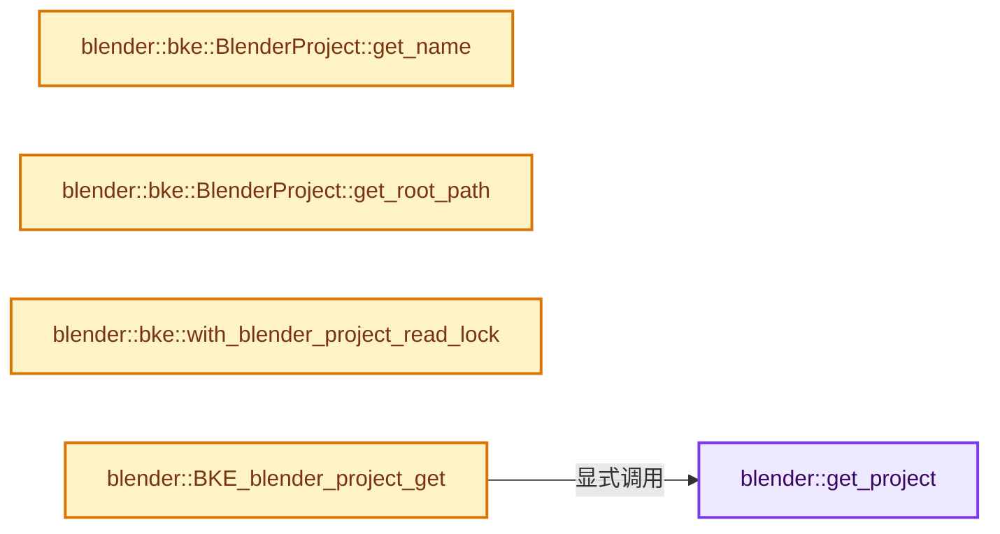

# 实现依赖专题：source/blender/blenkernel/intern/blender_project.cc

[实现依赖导航](../../README.md) · [符号索引](../../../00-课程指南/02-源码与提交索引/符号依赖与实现索引.md)

本专题从正文实际调用进入，集中保存共享实现。函数有稳定锚点，可从调用处直接跳到对应完整函数；递归与互相调用通过回链组织。

## 本文件的实现关系




## 完整成员与函数实现

<a id="f-961acac6d08a25d2"></a>

### `blender::get_project`

实现位置：[source/blender/blenkernel/intern/blender_project.cc](../../../../../../../source/blender/blenkernel/intern/blender_project.cc) · L46—L52。

**教学注释版**

<!-- annotated:81936d40a09466 -->

```cpp
static std::optional<bke::BlenderProject> &get_project()
{
  /* Construct on First Use idiom. */
  static std::optional<bke::BlenderProject> project;

  return project;
}
```

<details>
<summary>核对原始源码：source/blender/blenkernel/intern/blender_project.cc · L46—L52</summary>

<!-- original:81936d40a09466:source/blender/blenkernel/intern/blender_project.cc:46:52 -->

```cpp
static std::optional<bke::BlenderProject> &get_project()
{
  /* Construct on First Use idiom. */
  static std::optional<bke::BlenderProject> project;

  return project;
}
```

</details>

**结果出口**

- `return project;`

**继续追踪实现**

本实现没有需要继续展开的显式调用；检查返回表达式、对象转换和调用者前置条件。

<a id="f-bd4599b340d15751"></a>

### `blender::bke::BlenderProject::get_name`

实现位置：[source/blender/blenkernel/intern/blender_project.cc](../../../../../../../source/blender/blenkernel/intern/blender_project.cc) · L221—L224。

**教学注释版**

<!-- annotated:cac87bb9621f4c -->

```cpp
StringRefNull BlenderProject::get_name() const
{
  return StringRefNull(this->name_);
}
```

<details>
<summary>核对原始源码：source/blender/blenkernel/intern/blender_project.cc · L221—L224</summary>

<!-- original:cac87bb9621f4c:source/blender/blenkernel/intern/blender_project.cc:221:224 -->

```cpp
StringRefNull BlenderProject::get_name() const
{
  return StringRefNull(this->name_);
}
```

</details>

**结果出口**

- `return StringRefNull(this->name_);`

**继续追踪实现**

- `StringRefNull` → [blender::StringRefNull::StringRefNull · L149](../../../01-基础容器与现代CPP/15-StringRef字符串视图.md#f-ebc6ee5f8fc16390)；[blender::StringRefNull::StringRefNull · L496](../../../01-基础容器与现代CPP/15-StringRef字符串视图.md#f-936c98fc0d9ae39e)；[blender::StringRefNull::StringRefNull · L502](../../../01-基础容器与现代CPP/15-StringRef字符串视图.md#f-cf03ac0c28007ee0)；[blender::StringRefNull::StringRefNull · L512](../../../01-基础容器与现代CPP/15-StringRef字符串视图.md#f-8a14273318bc57e1)；[blender::StringRefNull::StringRefNull · L523](../../../01-基础容器与现代CPP/15-StringRef字符串视图.md#f-e1cc63a4ff92775b)。同名重载需按实参类型选择。

<a id="f-1dbabb7417a309ae"></a>

### `blender::bke::BlenderProject::get_root_path`

实现位置：[source/blender/blenkernel/intern/blender_project.cc](../../../../../../../source/blender/blenkernel/intern/blender_project.cc) · L226—L229。

**教学注释版**

<!-- annotated:af9356b5c9a20e -->

```cpp
StringRefNull BlenderProject::get_root_path() const
{
  return StringRefNull(this->root_path_);
}
```

<details>
<summary>核对原始源码：source/blender/blenkernel/intern/blender_project.cc · L226—L229</summary>

<!-- original:af9356b5c9a20e:source/blender/blenkernel/intern/blender_project.cc:226:229 -->

```cpp
StringRefNull BlenderProject::get_root_path() const
{
  return StringRefNull(this->root_path_);
}
```

</details>

**结果出口**

- `return StringRefNull(this->root_path_);`

**继续追踪实现**

- `StringRefNull` → [blender::StringRefNull::StringRefNull · L149](../../../01-基础容器与现代CPP/15-StringRef字符串视图.md#f-ebc6ee5f8fc16390)；[blender::StringRefNull::StringRefNull · L496](../../../01-基础容器与现代CPP/15-StringRef字符串视图.md#f-936c98fc0d9ae39e)；[blender::StringRefNull::StringRefNull · L502](../../../01-基础容器与现代CPP/15-StringRef字符串视图.md#f-cf03ac0c28007ee0)；[blender::StringRefNull::StringRefNull · L512](../../../01-基础容器与现代CPP/15-StringRef字符串视图.md#f-8a14273318bc57e1)；[blender::StringRefNull::StringRefNull · L523](../../../01-基础容器与现代CPP/15-StringRef字符串视图.md#f-e1cc63a4ff92775b)。同名重载需按实参类型选择。

<a id="f-480700c04011f700"></a>

### `blender::bke::with_blender_project_read_lock`

实现位置：[source/blender/blenkernel/intern/blender_project.cc](../../../../../../../source/blender/blenkernel/intern/blender_project.cc) · L339—L343。

接口参数：

- `FunctionRef<void()> lambda`

**教学注释版**

<!-- annotated:d35903ab6a6036 -->

```cpp
void with_blender_project_read_lock(FunctionRef<void()> lambda)
{
  std::shared_lock<std::shared_mutex> lock(get_project_mutex());
  lambda();
}
```

<details>
<summary>核对原始源码：source/blender/blenkernel/intern/blender_project.cc · L339—L343</summary>

<!-- original:d35903ab6a6036:source/blender/blenkernel/intern/blender_project.cc:339:343 -->

```cpp
void with_blender_project_read_lock(FunctionRef<void()> lambda)
{
  std::shared_lock<std::shared_mutex> lock(get_project_mutex());
  lambda();
}
```

</details>

**继续追踪实现**

- `lambda` → [调用协议](../../../00-课程指南/01-路线与规范/模板宏与动态分派协议.md)：局部可调用对象，须结合其初始化与捕获环境。调用位置L342。

<a id="f-66d938c7a8df448b"></a>

### `blender::BKE_blender_project_get`

实现位置：[source/blender/blenkernel/intern/blender_project.cc](../../../../../../../source/blender/blenkernel/intern/blender_project.cc) · L392—L404。

接口参数：

- `const Main *bmain`

**教学注释版**

<!-- annotated:a7ffeae73e858f -->

```cpp
bke::BlenderProject *BKE_blender_project_get(const Main *bmain)
{
  if (bmain == nullptr || !bmain->is_part_of_project) {
    return nullptr;
  }

  std::optional<bke::BlenderProject> &project = get_project();
  if (!project.has_value()) {
    return nullptr;
  }

  return &*project;
}
```

<details>
<summary>核对原始源码：source/blender/blenkernel/intern/blender_project.cc · L392—L404</summary>

<!-- original:a7ffeae73e858f:source/blender/blenkernel/intern/blender_project.cc:392:404 -->

```cpp
bke::BlenderProject *BKE_blender_project_get(const Main *bmain)
{
  if (bmain == nullptr || !bmain->is_part_of_project) {
    return nullptr;
  }

  std::optional<bke::BlenderProject> &project = get_project();
  if (!project.has_value()) {
    return nullptr;
  }

  return &*project;
}
```

</details>

**结果出口**

- `return nullptr;`
- `return &*project;`

**继续追踪实现**

- `get_project` → [blender::get_project · L46](blender_project.cc.md#f-961acac6d08a25d2)。
- `project.has_value` → [外部契约](https://eel.is/c++draft/)：这个边界按实际表达式及所属类型核对参数、返回值、寿命与失败行为。这里提供接口入口，不声称已解释该第三方版本的内部实现。
