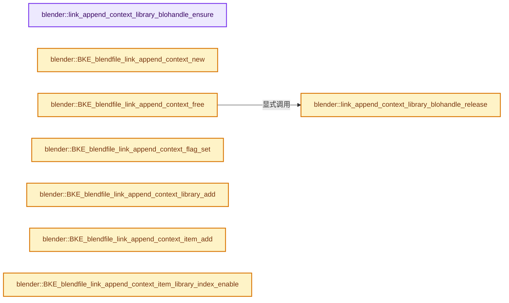
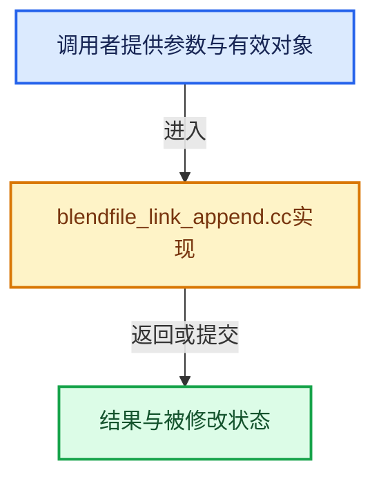

# 实现依赖专题：source/blender/blenkernel/intern/blendfile_link_append.cc

[实现依赖导航](../../README.md) · [符号索引](../../../00-课程指南/02-源码与提交索引/符号依赖与实现索引.md)

本专题从正文实际调用进入，集中保存共享实现。函数有稳定锚点，可从调用处直接跳到对应完整函数；递归与互相调用通过回链组织。

## 本文件的实现关系






## 完整成员与函数实现

<a id="f-264f48fe89ca4c13"></a>

### `blender::link_append_context_library_blohandle_ensure`

实现位置：[source/blender/blenkernel/intern/blendfile_link_append.cc](../../../../../../../source/blender/blenkernel/intern/blendfile_link_append.cc) · L102—L127。

接口参数：

- `BlendfileLinkAppendContext &lapp_context`
- `BlendfileLinkAppendContextLibrary &lib_context`
- `ReportList *reports`

**教学注释版**

<!-- annotated:a0d203c4a4f3d4 -->

```cpp
static BlendHandle *link_append_context_library_blohandle_ensure(
    BlendfileLinkAppendContext &lapp_context,
    BlendfileLinkAppendContextLibrary &lib_context,
    ReportList *reports)
{
  if (reports != nullptr) {
    lib_context.bf_reports.reports = reports;
  }

  const StringRefNull libname = lib_context.path;
  BlendHandle *blo_handle = lib_context.blo_handle;
  if (blo_handle == nullptr) {
    if (libname == BLO_EMBEDDED_STARTUP_BLEND) {
      blo_handle = BLO_blendhandle_from_memory(lapp_context.blendfile_mem,
                                               int(lapp_context.blendfile_memsize),
                                               &lib_context.bf_reports);
    }
    else {
      blo_handle = BLO_blendhandle_from_file(libname.c_str(), &lib_context.bf_reports);
    }
    lib_context.blo_handle = blo_handle;
    lib_context.blo_handle_is_owned = true;
  }

  return blo_handle;
}
```

<details>
<summary>核对原始源码：source/blender/blenkernel/intern/blendfile_link_append.cc · L102—L127</summary>

<!-- original:a0d203c4a4f3d4:source/blender/blenkernel/intern/blendfile_link_append.cc:102:127 -->

```cpp
static BlendHandle *link_append_context_library_blohandle_ensure(
    BlendfileLinkAppendContext &lapp_context,
    BlendfileLinkAppendContextLibrary &lib_context,
    ReportList *reports)
{
  if (reports != nullptr) {
    lib_context.bf_reports.reports = reports;
  }

  const StringRefNull libname = lib_context.path;
  BlendHandle *blo_handle = lib_context.blo_handle;
  if (blo_handle == nullptr) {
    if (libname == BLO_EMBEDDED_STARTUP_BLEND) {
      blo_handle = BLO_blendhandle_from_memory(lapp_context.blendfile_mem,
                                               int(lapp_context.blendfile_memsize),
                                               &lib_context.bf_reports);
    }
    else {
      blo_handle = BLO_blendhandle_from_file(libname.c_str(), &lib_context.bf_reports);
    }
    lib_context.blo_handle = blo_handle;
    lib_context.blo_handle_is_owned = true;
  }

  return blo_handle;
}
```

</details>

**沿实际写入检查状态**

- `lib_context.bf_reports.reports = reports;`
- `blo_handle = BLO_blendhandle_from_memory(lapp_context.blendfile_mem,`
- `blo_handle = BLO_blendhandle_from_file(libname.c_str(), &lib_context.bf_reports);`
- `lib_context.blo_handle = blo_handle;`
- `lib_context.blo_handle_is_owned = true;`

**结果出口**

- `return blo_handle;`

**继续追踪实现**

- `BLO_blendhandle_from_memory` → [blender::BLO_blendhandle_from_memory · L70](../../08-其他Blender模块/blenloader/intern/readblenentry.cc.md#f-30126a0defb78ce4)。
- `BLO_blendhandle_from_file` → [blender::BLO_blendhandle_from_file · L61](../../08-其他Blender模块/blenloader/intern/readblenentry.cc.md#f-829b88c9d3187dde)。
- `libname.c_str` → [blender::StringRefNull::c_str · L544](../../../01-基础容器与现代CPP/15-StringRef字符串视图.md#f-4a8bbfe1e6d00757)。

<a id="f-57fa29993fc75432"></a>

### `blender::link_append_context_library_blohandle_release`

实现位置：[source/blender/blenkernel/intern/blendfile_link_append.cc](../../../../../../../source/blender/blenkernel/intern/blendfile_link_append.cc) · L129—L136。

接口参数：

- `BlendfileLinkAppendContext &`
- `BlendfileLinkAppendContextLibrary &lib_context`

**教学注释版**

<!-- annotated:4e99de690697e8 -->

```cpp
static void link_append_context_library_blohandle_release(
    BlendfileLinkAppendContext & /*lapp_context*/, BlendfileLinkAppendContextLibrary &lib_context)
{
  if (lib_context.blo_handle_is_owned && lib_context.blo_handle != nullptr) {
    BLO_blendhandle_close(lib_context.blo_handle);
    lib_context.blo_handle = nullptr;
  }
}
```

<details>
<summary>核对原始源码：source/blender/blenkernel/intern/blendfile_link_append.cc · L129—L136</summary>

<!-- original:4e99de690697e8:source/blender/blenkernel/intern/blendfile_link_append.cc:129:136 -->

```cpp
static void link_append_context_library_blohandle_release(
    BlendfileLinkAppendContext & /*lapp_context*/, BlendfileLinkAppendContextLibrary &lib_context)
{
  if (lib_context.blo_handle_is_owned && lib_context.blo_handle != nullptr) {
    BLO_blendhandle_close(lib_context.blo_handle);
    lib_context.blo_handle = nullptr;
  }
}
```

</details>

**沿实际写入检查状态**

- `lib_context.blo_handle = nullptr;`

**继续追踪实现**

- `BLO_blendhandle_close` → [blender::BLO_blendhandle_close · L339](../../08-其他Blender模块/blenloader/intern/readblenentry.cc.md#f-033840da4970db23)。

<a id="f-f1888d6439608a20"></a>

### `blender::BKE_blendfile_link_append_context_new`

实现位置：[source/blender/blenkernel/intern/blendfile_link_append.cc](../../../../../../../source/blender/blenkernel/intern/blendfile_link_append.cc) · L138—L144。

接口参数：

- `LibraryLink_Params *params`

**教学注释版**

<!-- annotated:20528815be2bc1 -->

```cpp
BlendfileLinkAppendContext *BKE_blendfile_link_append_context_new(LibraryLink_Params *params)
{
  BlendfileLinkAppendContext *lapp_context = MEM_new<BlendfileLinkAppendContext>(__func__);
  lapp_context->params = params;
  lapp_context->process_stage = BlendfileLinkAppendContext::ProcessStage::Init;
  return lapp_context;
}
```

<details>
<summary>核对原始源码：source/blender/blenkernel/intern/blendfile_link_append.cc · L138—L144</summary>

<!-- original:20528815be2bc1:source/blender/blenkernel/intern/blendfile_link_append.cc:138:144 -->

```cpp
BlendfileLinkAppendContext *BKE_blendfile_link_append_context_new(LibraryLink_Params *params)
{
  BlendfileLinkAppendContext *lapp_context = MEM_new<BlendfileLinkAppendContext>(__func__);
  lapp_context->params = params;
  lapp_context->process_stage = BlendfileLinkAppendContext::ProcessStage::Init;
  return lapp_context;
}
```

</details>

**沿实际写入检查状态**

- `lapp_context->params = params;`
- `lapp_context->process_stage = BlendfileLinkAppendContext::ProcessStage::Init;`

**结果出口**

- `return lapp_context;`

**继续追踪实现**

- `MEM_new<BlendfileLinkAppendContext>` → [MEM_new · L351](../../07-Intern运行时与平台/guardedalloc/MEM_guardedalloc.h.md#f-115f9b6784f89912)。

<a id="f-f79572a63c23e09f"></a>

### `blender::BKE_blendfile_link_append_context_free`

实现位置：[source/blender/blenkernel/intern/blendfile_link_append.cc](../../../../../../../source/blender/blenkernel/intern/blendfile_link_append.cc) · L146—L155。

接口参数：

- `BlendfileLinkAppendContext *lapp_context`

**教学注释版**

<!-- annotated:fb260a67ca3b59 -->

```cpp
void BKE_blendfile_link_append_context_free(BlendfileLinkAppendContext *lapp_context)
{
  for (BlendfileLinkAppendContextLibrary &lib_context : lapp_context->libraries) {
    link_append_context_library_blohandle_release(*lapp_context, lib_context);
  }

  BLI_assert(lapp_context->library_weak_reference_mapping == nullptr);

  MEM_delete(lapp_context);
}
```

<details>
<summary>核对原始源码：source/blender/blenkernel/intern/blendfile_link_append.cc · L146—L155</summary>

<!-- original:fb260a67ca3b59:source/blender/blenkernel/intern/blendfile_link_append.cc:146:155 -->

```cpp
void BKE_blendfile_link_append_context_free(BlendfileLinkAppendContext *lapp_context)
{
  for (BlendfileLinkAppendContextLibrary &lib_context : lapp_context->libraries) {
    link_append_context_library_blohandle_release(*lapp_context, lib_context);
  }

  BLI_assert(lapp_context->library_weak_reference_mapping == nullptr);

  MEM_delete(lapp_context);
}
```

</details>

**继续追踪实现**

- `link_append_context_library_blohandle_release` → [blender::link_append_context_library_blohandle_release · L129](blendfile_link_append.cc.md#f-57fa29993fc75432)。
- `BLI_assert` → [BLI_assert · L48](../../01-BLI基础库/BLI_assert.hh.md#m-57a88495704d)；[BLI_assert · L63](../../01-BLI基础库/BLI_assert.hh.md#m-d07050020cb5)。宏定义由构建条件选择。
- `MEM_delete` → [MEM_delete · L400](../../07-Intern运行时与平台/guardedalloc/MEM_guardedalloc.h.md#f-9049ffdd1682887c)。

<a id="f-4d547fb13153748c"></a>

### `blender::BKE_blendfile_link_append_context_flag_set`

实现位置：[source/blender/blenkernel/intern/blendfile_link_append.cc](../../../../../../../source/blender/blenkernel/intern/blendfile_link_append.cc) · L157—L167。

接口参数：

- `BlendfileLinkAppendContext *lapp_context`
- `const int flag`
- `const bool do_set`

**教学注释版**

<!-- annotated:d2b0a2f8596281 -->

```cpp
void BKE_blendfile_link_append_context_flag_set(BlendfileLinkAppendContext *lapp_context,
                                                const int flag,
                                                const bool do_set)
{
  if (do_set) {
    lapp_context->params->flag |= flag;
  }
  else {
    lapp_context->params->flag &= ~flag;
  }
}
```

<details>
<summary>核对原始源码：source/blender/blenkernel/intern/blendfile_link_append.cc · L157—L167</summary>

<!-- original:d2b0a2f8596281:source/blender/blenkernel/intern/blendfile_link_append.cc:157:167 -->

```cpp
void BKE_blendfile_link_append_context_flag_set(BlendfileLinkAppendContext *lapp_context,
                                                const int flag,
                                                const bool do_set)
{
  if (do_set) {
    lapp_context->params->flag |= flag;
  }
  else {
    lapp_context->params->flag &= ~flag;
  }
}
```

</details>

**沿实际写入检查状态**

- `lapp_context->params->flag |= flag;`
- `lapp_context->params->flag &= ~flag;`

**继续追踪实现**

本实现没有需要继续展开的显式调用；检查返回表达式、对象转换和调用者前置条件。

<a id="f-452e4163f0747170"></a>

### `blender::BKE_blendfile_link_append_context_library_add`

实现位置：[source/blender/blenkernel/intern/blendfile_link_append.cc](../../../../../../../source/blender/blenkernel/intern/blendfile_link_append.cc) · L186—L202。

接口参数：

- `BlendfileLinkAppendContext *lapp_context`
- `const char *libname`
- `BlendHandle *blo_handle`

**教学注释版**

<!-- annotated:e249fdc50bce9b -->

```cpp
void BKE_blendfile_link_append_context_library_add(BlendfileLinkAppendContext *lapp_context,
                                                   const char *libname,
                                                   BlendHandle *blo_handle)
{
  BLI_assert(lapp_context->items.empty());
  BLI_assert(lapp_context->process_stage == BlendfileLinkAppendContext::ProcessStage::Init);

  BlendfileLinkAppendContextLibrary lib_context = {};

  lib_context.path = libname;
  lib_context.blo_handle = blo_handle;
  /* Always steal the ownership on the blendfile handle, as it may be freed by readfile code in
   * case of endianness conversion. */
  lib_context.blo_handle_is_owned = true;

  lapp_context->libraries.append(lib_context);
}
```

<details>
<summary>核对原始源码：source/blender/blenkernel/intern/blendfile_link_append.cc · L186—L202</summary>

<!-- original:e249fdc50bce9b:source/blender/blenkernel/intern/blendfile_link_append.cc:186:202 -->

```cpp
void BKE_blendfile_link_append_context_library_add(BlendfileLinkAppendContext *lapp_context,
                                                   const char *libname,
                                                   BlendHandle *blo_handle)
{
  BLI_assert(lapp_context->items.empty());
  BLI_assert(lapp_context->process_stage == BlendfileLinkAppendContext::ProcessStage::Init);

  BlendfileLinkAppendContextLibrary lib_context = {};

  lib_context.path = libname;
  lib_context.blo_handle = blo_handle;
  /* Always steal the ownership on the blendfile handle, as it may be freed by readfile code in
   * case of endianness conversion. */
  lib_context.blo_handle_is_owned = true;

  lapp_context->libraries.append(lib_context);
}
```

</details>

**沿实际写入检查状态**

- `lib_context.path = libname;`
- `lib_context.blo_handle = blo_handle;`
- `lib_context.blo_handle_is_owned = true;`

**继续追踪实现**

- `BLI_assert` → [BLI_assert · L48](../../01-BLI基础库/BLI_assert.hh.md#m-57a88495704d)；[BLI_assert · L63](../../01-BLI基础库/BLI_assert.hh.md#m-d07050020cb5)。宏定义由构建条件选择。
- `lapp_context->items.empty` → [调用协议](../../../00-课程指南/01-路线与规范/模板宏与动态分派协议.md)：接收对象类型依赖auto、返回值或模板实例；不按同名猜测目标。调用位置L190。
- `lapp_context->libraries.append` → [调用协议](../../../00-课程指南/01-路线与规范/模板宏与动态分派协议.md)：接收对象类型依赖auto、返回值或模板实例；不按同名猜测目标。调用位置L201。

<a id="f-17397f10d24e27a1"></a>

### `blender::BKE_blendfile_link_append_context_item_add`

实现位置：[source/blender/blenkernel/intern/blendfile_link_append.cc](../../../../../../../source/blender/blenkernel/intern/blendfile_link_append.cc) · L204—L225。

接口参数：

- `BlendfileLinkAppendContext *lapp_context`
- `const char *idname`
- `const short idcode`
- `void *userdata`

**教学注释版**

<!-- annotated:af98f27c597007 -->

```cpp
BlendfileLinkAppendContextItem *BKE_blendfile_link_append_context_item_add(
    BlendfileLinkAppendContext *lapp_context,
    const char *idname,
    const short idcode,
    void *userdata)
{
  BlendfileLinkAppendContextItem item = {};

  item.lapp_context = lapp_context;

  item.name = idname;
  item.idcode = idcode;
  item.libraries = BitVector<>(lapp_context->libraries.size(), false);

  item.new_id = nullptr;
  item.action = LINK_APPEND_ACT_UNSET;
  item.userdata = userdata;

  lapp_context->items.push_back(item);

  return &lapp_context->items.back();
}
```

<details>
<summary>核对原始源码：source/blender/blenkernel/intern/blendfile_link_append.cc · L204—L225</summary>

<!-- original:af98f27c597007:source/blender/blenkernel/intern/blendfile_link_append.cc:204:225 -->

```cpp
BlendfileLinkAppendContextItem *BKE_blendfile_link_append_context_item_add(
    BlendfileLinkAppendContext *lapp_context,
    const char *idname,
    const short idcode,
    void *userdata)
{
  BlendfileLinkAppendContextItem item = {};

  item.lapp_context = lapp_context;

  item.name = idname;
  item.idcode = idcode;
  item.libraries = BitVector<>(lapp_context->libraries.size(), false);

  item.new_id = nullptr;
  item.action = LINK_APPEND_ACT_UNSET;
  item.userdata = userdata;

  lapp_context->items.push_back(item);

  return &lapp_context->items.back();
}
```

</details>

**沿实际写入检查状态**

- `item.lapp_context = lapp_context;`
- `item.name = idname;`
- `item.idcode = idcode;`
- `item.libraries = BitVector<>(lapp_context->libraries.size(), false);`
- `item.new_id = nullptr;`
- `item.action = LINK_APPEND_ACT_UNSET;`
- `item.userdata = userdata;`

**结果出口**

- `return &lapp_context->items.back();`

**继续追踪实现**

- `BitVector<>` → [blender::bits::BitVector::BitVector · L89](../../../01-基础容器与现代CPP/19-BitSpan与BitVector.md#f-90975b5628d14a10)；[blender::bits::BitVector::BitVector · L97](../../../01-基础容器与现代CPP/19-BitSpan与BitVector.md#f-9f2d13628c1fd34c)；[blender::bits::BitVector::BitVector · L99](../../../01-基础容器与现代CPP/19-BitSpan与BitVector.md#f-6370d12fe2a8e1a6)；[blender::bits::BitVector::BitVector · L117](../../../01-基础容器与现代CPP/19-BitSpan与BitVector.md#f-1775d911682b513c)；[blender::bits::BitVector::BitVector · L122](../../../01-基础容器与现代CPP/19-BitSpan与BitVector.md#f-dfea00b77bfa0a09)；[blender::bits::BitVector::BitVector · L152](../../../01-基础容器与现代CPP/19-BitSpan与BitVector.md#f-2504a5a062cfd92b)；[blender::bits::BitVector::BitVector · L161](../../../01-基础容器与现代CPP/19-BitSpan与BitVector.md#f-bde2d7db9a78cc54)。同名重载需按实参类型选择。
- `lapp_context->libraries.size` → [调用协议](../../../00-课程指南/01-路线与规范/模板宏与动态分派协议.md)：接收对象类型依赖auto、返回值或模板实例；不按同名猜测目标。调用位置L216。
- `lapp_context->items.push_back` → [调用协议](../../../00-课程指南/01-路线与规范/模板宏与动态分派协议.md)：接收对象类型依赖auto、返回值或模板实例；不按同名猜测目标。调用位置L222。
- `lapp_context->items.back` → [调用协议](../../../00-课程指南/01-路线与规范/模板宏与动态分派协议.md)：接收对象类型依赖auto、返回值或模板实例；不按同名猜测目标。调用位置L224。

<a id="f-80f9951cc3753ce2"></a>

### `blender::BKE_blendfile_link_append_context_item_library_index_enable`

实现位置：[source/blender/blenkernel/intern/blendfile_link_append.cc](../../../../../../../source/blender/blenkernel/intern/blendfile_link_append.cc) · L279—L287。

接口参数：

- `BlendfileLinkAppendContext *lapp_context`
- `BlendfileLinkAppendContextItem *item`
- `const int library_index`

**教学注释版**

<!-- annotated:a256c420dccd14 -->

```cpp
void BKE_blendfile_link_append_context_item_library_index_enable(
    BlendfileLinkAppendContext *lapp_context,
    BlendfileLinkAppendContextItem *item,
    const int library_index)
{
  BLI_assert(lapp_context->process_stage == BlendfileLinkAppendContext::ProcessStage::Init);
  UNUSED_VARS_NDEBUG(lapp_context);
  item->libraries[library_index].set();
}
```

<details>
<summary>核对原始源码：source/blender/blenkernel/intern/blendfile_link_append.cc · L279—L287</summary>

<!-- original:a256c420dccd14:source/blender/blenkernel/intern/blendfile_link_append.cc:279:287 -->

```cpp
void BKE_blendfile_link_append_context_item_library_index_enable(
    BlendfileLinkAppendContext *lapp_context,
    BlendfileLinkAppendContextItem *item,
    const int library_index)
{
  BLI_assert(lapp_context->process_stage == BlendfileLinkAppendContext::ProcessStage::Init);
  UNUSED_VARS_NDEBUG(lapp_context);
  item->libraries[library_index].set();
}
```

</details>

**继续追踪实现**

- `BLI_assert` → [BLI_assert · L48](../../01-BLI基础库/BLI_assert.hh.md#m-57a88495704d)；[BLI_assert · L63](../../01-BLI基础库/BLI_assert.hh.md#m-d07050020cb5)。宏定义由构建条件选择。
- `UNUSED_VARS_NDEBUG` → [UNUSED_VARS_NDEBUG · L526](../../01-BLI基础库/BLI_utildefines.hh.md#m-fea439f7d366)；[UNUSED_VARS_NDEBUG · L528](../../01-BLI基础库/BLI_utildefines.hh.md#m-a8f8cfac06c0)。宏定义由构建条件选择。
- `item->libraries[library_index].set` → [调用协议](../../../00-课程指南/01-路线与规范/模板宏与动态分派协议.md)：接收对象类型依赖auto、返回值或模板实例；不按同名猜测目标。调用位置L286。

<a id="f-5edb3f4195ff9e68"></a>

### `blender::BKE_blendfile_link_append_context_item_newid_get`

实现位置：[source/blender/blenkernel/intern/blendfile_link_append.cc](../../../../../../../source/blender/blenkernel/intern/blendfile_link_append.cc) · L300—L306。

接口参数：

- `BlendfileLinkAppendContext *lapp_context`
- `BlendfileLinkAppendContextItem *item`

**教学注释版**

<!-- annotated:b8314445e2f9d3 -->

```cpp
ID *BKE_blendfile_link_append_context_item_newid_get(BlendfileLinkAppendContext *lapp_context,
                                                     BlendfileLinkAppendContextItem *item)
{
  BLI_assert(lapp_context->process_stage != BlendfileLinkAppendContext::ProcessStage::Init);
  UNUSED_VARS_NDEBUG(lapp_context);
  return item->new_id;
}
```

<details>
<summary>核对原始源码：source/blender/blenkernel/intern/blendfile_link_append.cc · L300—L306</summary>

<!-- original:b8314445e2f9d3:source/blender/blenkernel/intern/blendfile_link_append.cc:300:306 -->

```cpp
ID *BKE_blendfile_link_append_context_item_newid_get(BlendfileLinkAppendContext *lapp_context,
                                                     BlendfileLinkAppendContextItem *item)
{
  BLI_assert(lapp_context->process_stage != BlendfileLinkAppendContext::ProcessStage::Init);
  UNUSED_VARS_NDEBUG(lapp_context);
  return item->new_id;
}
```

</details>

**结果出口**

- `return item->new_id;`

**继续追踪实现**

- `BLI_assert` → [BLI_assert · L48](../../01-BLI基础库/BLI_assert.hh.md#m-57a88495704d)；[BLI_assert · L63](../../01-BLI基础库/BLI_assert.hh.md#m-d07050020cb5)。宏定义由构建条件选择。
- `UNUSED_VARS_NDEBUG` → [UNUSED_VARS_NDEBUG · L526](../../01-BLI基础库/BLI_utildefines.hh.md#m-fea439f7d366)；[UNUSED_VARS_NDEBUG · L528](../../01-BLI基础库/BLI_utildefines.hh.md#m-a8f8cfac06c0)。宏定义由构建条件选择。

<a id="f-5977db5e43af62fb"></a>

### `blender::BKE_blendfile_link_append_context_item_newid_set`

实现位置：[source/blender/blenkernel/intern/blendfile_link_append.cc](../../../../../../../source/blender/blenkernel/intern/blendfile_link_append.cc) · L308—L326。

接口参数：

- `BlendfileLinkAppendContext *lapp_context`
- `BlendfileLinkAppendContextItem *item`
- `ID *new_id`

**教学注释版**

<!-- annotated:c85f7283803c11 -->

```cpp
void BKE_blendfile_link_append_context_item_newid_set(BlendfileLinkAppendContext *lapp_context,
                                                      BlendfileLinkAppendContextItem *item,
                                                      ID *new_id)
{
  BLI_assert(lapp_context->process_stage != BlendfileLinkAppendContext::ProcessStage::Init);
  BLI_assert(item->new_id);
  BLI_assert(!item->liboverride_id);
  /* The only cases where library pointers should be different is when:
   * - A linked ID is replaced by a matching local ID (append case).
   * - A linked ID is replaced by a matching linked packed ID. */
  BLI_assert(new_id->lib == item->new_id->lib ||
             (ID_IS_LINKED(item->new_id) && !ID_IS_LINKED(new_id)) ||
             (ID_IS_PACKED(new_id) && new_id->lib->archive_parent_library == item->new_id->lib));
  BLI_assert(!lapp_context->new_id_to_item.contains(new_id));

  lapp_context->new_id_to_item.remove(item->new_id);
  item->new_id = new_id;
  lapp_context->new_id_to_item.add(new_id, item);
}
```

<details>
<summary>核对原始源码：source/blender/blenkernel/intern/blendfile_link_append.cc · L308—L326</summary>

<!-- original:c85f7283803c11:source/blender/blenkernel/intern/blendfile_link_append.cc:308:326 -->

```cpp
void BKE_blendfile_link_append_context_item_newid_set(BlendfileLinkAppendContext *lapp_context,
                                                      BlendfileLinkAppendContextItem *item,
                                                      ID *new_id)
{
  BLI_assert(lapp_context->process_stage != BlendfileLinkAppendContext::ProcessStage::Init);
  BLI_assert(item->new_id);
  BLI_assert(!item->liboverride_id);
  /* The only cases where library pointers should be different is when:
   * - A linked ID is replaced by a matching local ID (append case).
   * - A linked ID is replaced by a matching linked packed ID. */
  BLI_assert(new_id->lib == item->new_id->lib ||
             (ID_IS_LINKED(item->new_id) && !ID_IS_LINKED(new_id)) ||
             (ID_IS_PACKED(new_id) && new_id->lib->archive_parent_library == item->new_id->lib));
  BLI_assert(!lapp_context->new_id_to_item.contains(new_id));

  lapp_context->new_id_to_item.remove(item->new_id);
  item->new_id = new_id;
  lapp_context->new_id_to_item.add(new_id, item);
}
```

</details>

**沿实际写入检查状态**

- `item->new_id = new_id;`

**继续追踪实现**

- `BLI_assert` → [BLI_assert · L48](../../01-BLI基础库/BLI_assert.hh.md#m-57a88495704d)；[BLI_assert · L63](../../01-BLI基础库/BLI_assert.hh.md#m-d07050020cb5)。宏定义由构建条件选择。
- `ID_IS_LINKED` → [ID_IS_LINKED · L697](../../08-其他Blender模块/makesdna/DNA_ID.h.md#m-7e1e1e9b20e6)。宏定义由构建条件选择。
- `ID_IS_PACKED` → [ID_IS_PACKED · L703](../../08-其他Blender模块/makesdna/DNA_ID.h.md#m-48f895e65dc3)。宏定义由构建条件选择。
- `lapp_context->new_id_to_item.contains` → [调用协议](../../../00-课程指南/01-路线与规范/模板宏与动态分派协议.md)：接收对象类型依赖auto、返回值或模板实例；不按同名猜测目标。调用位置L321。
- `lapp_context->new_id_to_item.remove` → [调用协议](../../../00-课程指南/01-路线与规范/模板宏与动态分派协议.md)：接收对象类型依赖auto、返回值或模板实例；不按同名猜测目标。调用位置L323。
- `lapp_context->new_id_to_item.add` → [调用协议](../../../00-课程指南/01-路线与规范/模板宏与动态分派协议.md)：接收对象类型依赖auto、返回值或模板实例；不按同名猜测目标。调用位置L325。

<a id="f-77b1a5eb5d068ea7"></a>

### `blender::BKE_blendfile_link_append_context_item_foreach`

实现位置：[source/blender/blenkernel/intern/blendfile_link_append.cc](../../../../../../../source/blender/blenkernel/intern/blendfile_link_append.cc) · L342—L364。

接口参数：

- `BlendfileLinkAppendContext *lapp_context`
- `FunctionRef<bool(BlendfileLinkAppendContext *lapp_context,
                      BlendfileLinkAppendContextItem *item)> callback_function`
- `BlendfileLinkAppendContext *lapp_context`
- `BlendfileLinkAppendContextItem *item`
- `const eBlendfileLinkAppendForeachItemFlag flag`

**教学注释版**

<!-- annotated:bdaf956616d544 -->

```cpp
void BKE_blendfile_link_append_context_item_foreach(
    BlendfileLinkAppendContext *lapp_context,
    FunctionRef<bool(BlendfileLinkAppendContext *lapp_context,
                     BlendfileLinkAppendContextItem *item)> callback_function,
    const eBlendfileLinkAppendForeachItemFlag flag)
{
  for (BlendfileLinkAppendContextItem &item : lapp_context->items) {
    if ((flag & BKE_BLENDFILE_LINK_APPEND_FOREACH_ITEM_FLAG_DO_DIRECT) == 0 &&
        (item.tag & LINK_APPEND_TAG_INDIRECT) == 0)
    {
      continue;
    }
    if ((flag & BKE_BLENDFILE_LINK_APPEND_FOREACH_ITEM_FLAG_DO_INDIRECT) == 0 &&
        (item.tag & LINK_APPEND_TAG_INDIRECT) != 0)
    {
      continue;
    }

    if (!callback_function(lapp_context, &item)) {
      break;
    }
  }
}
```

<details>
<summary>核对原始源码：source/blender/blenkernel/intern/blendfile_link_append.cc · L342—L364</summary>

<!-- original:bdaf956616d544:source/blender/blenkernel/intern/blendfile_link_append.cc:342:364 -->

```cpp
void BKE_blendfile_link_append_context_item_foreach(
    BlendfileLinkAppendContext *lapp_context,
    FunctionRef<bool(BlendfileLinkAppendContext *lapp_context,
                     BlendfileLinkAppendContextItem *item)> callback_function,
    const eBlendfileLinkAppendForeachItemFlag flag)
{
  for (BlendfileLinkAppendContextItem &item : lapp_context->items) {
    if ((flag & BKE_BLENDFILE_LINK_APPEND_FOREACH_ITEM_FLAG_DO_DIRECT) == 0 &&
        (item.tag & LINK_APPEND_TAG_INDIRECT) == 0)
    {
      continue;
    }
    if ((flag & BKE_BLENDFILE_LINK_APPEND_FOREACH_ITEM_FLAG_DO_INDIRECT) == 0 &&
        (item.tag & LINK_APPEND_TAG_INDIRECT) != 0)
    {
      continue;
    }

    if (!callback_function(lapp_context, &item)) {
      break;
    }
  }
}
```

</details>

**继续追踪实现**

- `callback_function` → [调用协议](../../../00-课程指南/01-路线与规范/模板宏与动态分派协议.md)：局部可调用对象，须结合其初始化与捕获环境。调用位置L360。

<a id="f-c97bb95371872cec"></a>

### `blender::BKE_blendfile_link_append_context_init_done`

实现位置：[source/blender/blenkernel/intern/blendfile_link_append.cc](../../../../../../../source/blender/blenkernel/intern/blendfile_link_append.cc) · L366—L373。

接口参数：

- `BlendfileLinkAppendContext *lapp_context`

**教学注释版**

<!-- annotated:ab957b7f778536 -->

```cpp
void BKE_blendfile_link_append_context_init_done(BlendfileLinkAppendContext *lapp_context)
{
  BLI_assert(lapp_context->process_stage == BlendfileLinkAppendContext::ProcessStage::Init);

  PointerRNA ctx_ptr = RNA_pointer_create_discrete(nullptr, RNA_BlendImportContext, lapp_context);
  PointerRNA *pointers[1] = {&ctx_ptr};
  BKE_callback_exec(lapp_context->params->bmain, pointers, 1, BKE_CB_EVT_BLENDIMPORT_PRE);
}
```

<details>
<summary>核对原始源码：source/blender/blenkernel/intern/blendfile_link_append.cc · L366—L373</summary>

<!-- original:ab957b7f778536:source/blender/blenkernel/intern/blendfile_link_append.cc:366:373 -->

```cpp
void BKE_blendfile_link_append_context_init_done(BlendfileLinkAppendContext *lapp_context)
{
  BLI_assert(lapp_context->process_stage == BlendfileLinkAppendContext::ProcessStage::Init);

  PointerRNA ctx_ptr = RNA_pointer_create_discrete(nullptr, RNA_BlendImportContext, lapp_context);
  PointerRNA *pointers[1] = {&ctx_ptr};
  BKE_callback_exec(lapp_context->params->bmain, pointers, 1, BKE_CB_EVT_BLENDIMPORT_PRE);
}
```

</details>

**继续追踪实现**

- `BLI_assert` → [BLI_assert · L48](../../01-BLI基础库/BLI_assert.hh.md#m-57a88495704d)；[BLI_assert · L63](../../01-BLI基础库/BLI_assert.hh.md#m-d07050020cb5)。宏定义由构建条件选择。
- `RNA_pointer_create_discrete` → [blender::RNA_pointer_create_discrete · L181](../../08-其他Blender模块/makesrna/intern/rna_access.cc.md#f-592a276e869c6d94)。
- `BKE_callback_exec` → [blender::BKE_callback_exec · L29](callbacks.cc.md#f-01f505d7da87953f)。

<a id="f-be7d55990ef1398e"></a>

### `blender::BKE_blendfile_link_append_context_finalize`

实现位置：[source/blender/blenkernel/intern/blendfile_link_append.cc](../../../../../../../source/blender/blenkernel/intern/blendfile_link_append.cc) · L375—L404。

接口参数：

- `BlendfileLinkAppendContext *lapp_context`

**教学注释版**

<!-- annotated:fafb8caaac4bad -->

```cpp
void BKE_blendfile_link_append_context_finalize(BlendfileLinkAppendContext *lapp_context)
{
  BLI_assert(ELEM(lapp_context->process_stage,
                  BlendfileLinkAppendContext::ProcessStage::Linking,
                  BlendfileLinkAppendContext::ProcessStage::Appending,
                  BlendfileLinkAppendContext::ProcessStage::Instantiating));
  lapp_context->process_stage = BlendfileLinkAppendContext::ProcessStage::Done;

  /* Linking may have changed some data link status.
   * Further more, some versioning code can leave some ID link status tags in invalid state, due to
   * low-level manipulations of these instead of using API like `id_lib_extern`, which will be also
   * fixed by this call. */
  BKE_main_id_indirect_linked_update(*lapp_context->params->bmain);

  /* Tag node trees to update generated RNA with potentially updated session uid values from
   * data-block defaults in interfaces. This is only necessary because RNA types were already
   * generated before these data-blocks were local; theoretically that shouldn't be necessary. */
  for (ID *id : lapp_context->new_id_to_item.keys()) {
    if (id->id_type() == ID_NT) {
      bNodeTree *ntree = id_cast<bNodeTree *>(id);
      BKE_ntree_update_tag_all(ntree);
    }
  }

  BKE_main_ensure_invariants(*lapp_context->params->bmain);

  PointerRNA ctx_ptr = RNA_pointer_create_discrete(nullptr, RNA_BlendImportContext, lapp_context);
  PointerRNA *pointers[1] = {&ctx_ptr};
  BKE_callback_exec(lapp_context->params->bmain, pointers, 1, BKE_CB_EVT_BLENDIMPORT_POST);
}
```

<details>
<summary>核对原始源码：source/blender/blenkernel/intern/blendfile_link_append.cc · L375—L404</summary>

<!-- original:fafb8caaac4bad:source/blender/blenkernel/intern/blendfile_link_append.cc:375:404 -->

```cpp
void BKE_blendfile_link_append_context_finalize(BlendfileLinkAppendContext *lapp_context)
{
  BLI_assert(ELEM(lapp_context->process_stage,
                  BlendfileLinkAppendContext::ProcessStage::Linking,
                  BlendfileLinkAppendContext::ProcessStage::Appending,
                  BlendfileLinkAppendContext::ProcessStage::Instantiating));
  lapp_context->process_stage = BlendfileLinkAppendContext::ProcessStage::Done;

  /* Linking may have changed some data link status.
   * Further more, some versioning code can leave some ID link status tags in invalid state, due to
   * low-level manipulations of these instead of using API like `id_lib_extern`, which will be also
   * fixed by this call. */
  BKE_main_id_indirect_linked_update(*lapp_context->params->bmain);

  /* Tag node trees to update generated RNA with potentially updated session uid values from
   * data-block defaults in interfaces. This is only necessary because RNA types were already
   * generated before these data-blocks were local; theoretically that shouldn't be necessary. */
  for (ID *id : lapp_context->new_id_to_item.keys()) {
    if (id->id_type() == ID_NT) {
      bNodeTree *ntree = id_cast<bNodeTree *>(id);
      BKE_ntree_update_tag_all(ntree);
    }
  }

  BKE_main_ensure_invariants(*lapp_context->params->bmain);

  PointerRNA ctx_ptr = RNA_pointer_create_discrete(nullptr, RNA_BlendImportContext, lapp_context);
  PointerRNA *pointers[1] = {&ctx_ptr};
  BKE_callback_exec(lapp_context->params->bmain, pointers, 1, BKE_CB_EVT_BLENDIMPORT_POST);
}
```

</details>

**沿实际写入检查状态**

- `lapp_context->process_stage = BlendfileLinkAppendContext::ProcessStage::Done;`

**继续追踪实现**

- `BLI_assert` → [BLI_assert · L48](../../01-BLI基础库/BLI_assert.hh.md#m-57a88495704d)；[BLI_assert · L63](../../01-BLI基础库/BLI_assert.hh.md#m-d07050020cb5)。宏定义由构建条件选择。
- `ELEM` → [ELEM · L88](../../07-Intern运行时与平台/ghost/intern/GHOST_utildefines.hh.md#m-d28724a15928)；[ELEM · L135](../../01-BLI基础库/BLI_utildefines.hh.md#m-d6572de7cae0)。宏定义由构建条件选择。
- `BKE_main_id_indirect_linked_update` → [blender::BKE_main_id_indirect_linked_update · L2211](lib_id.cc.md#f-0ce19ed07aabf656)。
- `lapp_context->new_id_to_item.keys` → [调用协议](../../../00-课程指南/01-路线与规范/模板宏与动态分派协议.md)：接收对象类型依赖auto、返回值或模板实例；不按同名猜测目标。调用位置L392。
- `id->id_type` → [调用协议](../../../00-课程指南/01-路线与规范/模板宏与动态分派协议.md)：接收对象类型依赖auto、返回值或模板实例；不按同名猜测目标。调用位置L393。
- `id_cast<bNodeTree *>` → [blender::id_cast · L1417](../../08-其他Blender模块/makesdna/DNA_ID.h.md#f-6c8ac6412850ac5a)。
- `BKE_ntree_update_tag_all` → [blender::BKE_ntree_update_tag_all · L2269](node_tree_update.cc.md#f-e1505dd42d1a4cca)。
- `BKE_main_ensure_invariants` → [blender::BKE_main_ensure_invariants · L83](main_invariants.cc.md#f-d000e07611ba6e47)；[blender::BKE_main_ensure_invariants · L88](main_invariants.cc.md#f-72ec2a2d72c96f20)。同名重载需按实参类型选择。
- `RNA_pointer_create_discrete` → [blender::RNA_pointer_create_discrete · L181](../../08-其他Blender模块/makesrna/intern/rna_access.cc.md#f-592a276e869c6d94)。
- `BKE_callback_exec` → [blender::BKE_callback_exec · L29](callbacks.cc.md#f-01f505d7da87953f)。

<a id="f-0da9af778addef2b"></a>

### `blender::BKE_blendfile_link`

实现位置：[source/blender/blenkernel/intern/blendfile_link_append.cc](../../../../../../../source/blender/blenkernel/intern/blendfile_link_append.cc) · L1798—L1878。

接口参数：

- `BlendfileLinkAppendContext *lapp_context`
- `ReportList *reports`

**教学注释版**

<!-- annotated:ea172494f0e11a -->

```cpp
void BKE_blendfile_link(BlendfileLinkAppendContext *lapp_context, ReportList *reports)
{
  BLI_assert(lapp_context->process_stage == BlendfileLinkAppendContext::ProcessStage::Init);
  lapp_context->process_stage = BlendfileLinkAppendContext::ProcessStage::Linking;

  if (lapp_context->items.empty()) {
    /* Nothing to be linked. */
    return;
  }

  BLI_assert(!lapp_context->libraries.is_empty());

  Main *mainl;
  Library *lib;

  for (const int lib_idx : lapp_context->libraries.index_range()) {
    BlendfileLinkAppendContextLibrary &lib_context = lapp_context->libraries[lib_idx];
    const char *libname = lib_context.path.c_str();

    if (!link_append_context_library_blohandle_ensure(*lapp_context, lib_context, reports)) {
      /* Unlikely since we just browsed it, but possible
       * Error reports will have been made by BLO_blendhandle_from_file() */
      continue;
    }

    /* here appending/linking starts */

    mainl = BLO_library_link_begin(&lib_context.blo_handle, libname, lapp_context->params);
    lib = mainl->curlib;
    BLI_assert(lib != nullptr);
    /* In case lib was already existing but not found originally, see #99820. */
    lib->id.tag &= ~ID_TAG_MISSING;

    if (mainl->versionfile < 250) {
      BKE_reportf(reports,
                  RPT_WARNING,
                  "Linking or appending from a very old .blend file format (%d.%d), no animation "
                  "conversion will "
                  "be done! You may want to re-save your lib file with current Blender",
                  mainl->versionfile,
                  mainl->subversionfile);
    }

    /* For each lib file, we try to link all items belonging to that lib,
     * and tag those successful to not try to load them again with the other libraries. */
    for (BlendfileLinkAppendContextItem &item : lapp_context->items) {
      ID *new_id;

      if (!item.libraries[lib_idx]) {
        continue;
      }

      new_id = BLO_library_link_named_part(
          mainl, &lib_context.blo_handle, item.idcode, item.name.c_str(), lapp_context->params);

      if (new_id) {
        /* If the link is successful, clear item's libraries 'todo' flags.
         * This avoids trying to link same item with other libraries to come. */
        item.libraries.fill(false);
        item.new_id = new_id;
        item.source_library = new_id->lib;
      }
    }

    BLO_library_link_end(mainl, &lib_context.blo_handle, lapp_context->params, reports);
    link_append_context_library_blohandle_release(*lapp_context, lib_context);
  }

  /* In linking case finalizing process (ensuring all data is valid, instantiating loose
   * collections or objects, etc.) can be done here directly.
   *
   * In append case, the finalizing process is much more complex and requires and additional call
   * to #BKE_blendfile_append for caller code. */
  if (lapp_context->params->flag & FILE_LINK) {
    BlendFileReadReport bf_reports{};
    bf_reports.reports = reports;
    BLO_read_do_version_after_setup(lapp_context->params->bmain, lapp_context, &bf_reports);

    BLO_readfile_id_runtime_data_free_all(*lapp_context->params->bmain);
  }
}
```

<details>
<summary>核对原始源码：source/blender/blenkernel/intern/blendfile_link_append.cc · L1798—L1878</summary>

<!-- original:ea172494f0e11a:source/blender/blenkernel/intern/blendfile_link_append.cc:1798:1878 -->

```cpp
void BKE_blendfile_link(BlendfileLinkAppendContext *lapp_context, ReportList *reports)
{
  BLI_assert(lapp_context->process_stage == BlendfileLinkAppendContext::ProcessStage::Init);
  lapp_context->process_stage = BlendfileLinkAppendContext::ProcessStage::Linking;

  if (lapp_context->items.empty()) {
    /* Nothing to be linked. */
    return;
  }

  BLI_assert(!lapp_context->libraries.is_empty());

  Main *mainl;
  Library *lib;

  for (const int lib_idx : lapp_context->libraries.index_range()) {
    BlendfileLinkAppendContextLibrary &lib_context = lapp_context->libraries[lib_idx];
    const char *libname = lib_context.path.c_str();

    if (!link_append_context_library_blohandle_ensure(*lapp_context, lib_context, reports)) {
      /* Unlikely since we just browsed it, but possible
       * Error reports will have been made by BLO_blendhandle_from_file() */
      continue;
    }

    /* here appending/linking starts */

    mainl = BLO_library_link_begin(&lib_context.blo_handle, libname, lapp_context->params);
    lib = mainl->curlib;
    BLI_assert(lib != nullptr);
    /* In case lib was already existing but not found originally, see #99820. */
    lib->id.tag &= ~ID_TAG_MISSING;

    if (mainl->versionfile < 250) {
      BKE_reportf(reports,
                  RPT_WARNING,
                  "Linking or appending from a very old .blend file format (%d.%d), no animation "
                  "conversion will "
                  "be done! You may want to re-save your lib file with current Blender",
                  mainl->versionfile,
                  mainl->subversionfile);
    }

    /* For each lib file, we try to link all items belonging to that lib,
     * and tag those successful to not try to load them again with the other libraries. */
    for (BlendfileLinkAppendContextItem &item : lapp_context->items) {
      ID *new_id;

      if (!item.libraries[lib_idx]) {
        continue;
      }

      new_id = BLO_library_link_named_part(
          mainl, &lib_context.blo_handle, item.idcode, item.name.c_str(), lapp_context->params);

      if (new_id) {
        /* If the link is successful, clear item's libraries 'todo' flags.
         * This avoids trying to link same item with other libraries to come. */
        item.libraries.fill(false);
        item.new_id = new_id;
        item.source_library = new_id->lib;
      }
    }

    BLO_library_link_end(mainl, &lib_context.blo_handle, lapp_context->params, reports);
    link_append_context_library_blohandle_release(*lapp_context, lib_context);
  }

  /* In linking case finalizing process (ensuring all data is valid, instantiating loose
   * collections or objects, etc.) can be done here directly.
   *
   * In append case, the finalizing process is much more complex and requires and additional call
   * to #BKE_blendfile_append for caller code. */
  if (lapp_context->params->flag & FILE_LINK) {
    BlendFileReadReport bf_reports{};
    bf_reports.reports = reports;
    BLO_read_do_version_after_setup(lapp_context->params->bmain, lapp_context, &bf_reports);

    BLO_readfile_id_runtime_data_free_all(*lapp_context->params->bmain);
  }
}
```

</details>

**沿实际写入检查状态**

- `lapp_context->process_stage = BlendfileLinkAppendContext::ProcessStage::Linking;`
- `mainl = BLO_library_link_begin(&lib_context.blo_handle, libname, lapp_context->params);`
- `lib = mainl->curlib;`
- `lib->id.tag &= ~ID_TAG_MISSING;`
- `new_id = BLO_library_link_named_part(`
- `item.new_id = new_id;`
- `item.source_library = new_id->lib;`
- `bf_reports.reports = reports;`

**继续追踪实现**

- `BLI_assert` → [BLI_assert · L48](../../01-BLI基础库/BLI_assert.hh.md#m-57a88495704d)；[BLI_assert · L63](../../01-BLI基础库/BLI_assert.hh.md#m-d07050020cb5)。宏定义由构建条件选择。
- `lapp_context->items.empty` → [调用协议](../../../00-课程指南/01-路线与规范/模板宏与动态分派协议.md)：接收对象类型依赖auto、返回值或模板实例；不按同名猜测目标。调用位置L1803。
- `lapp_context->libraries.is_empty` → [调用协议](../../../00-课程指南/01-路线与规范/模板宏与动态分派协议.md)：接收对象类型依赖auto、返回值或模板实例；不按同名猜测目标。调用位置L1808。
- `lapp_context->libraries.index_range` → [调用协议](../../../00-课程指南/01-路线与规范/模板宏与动态分派协议.md)：接收对象类型依赖auto、返回值或模板实例；不按同名猜测目标。调用位置L1813。
- `lib_context.path.c_str` → [调用协议](../../../00-课程指南/01-路线与规范/模板宏与动态分派协议.md)：接收对象类型依赖auto、返回值或模板实例；不按同名猜测目标。调用位置L1815。
- `link_append_context_library_blohandle_ensure` → [blender::link_append_context_library_blohandle_ensure · L102](blendfile_link_append.cc.md#f-264f48fe89ca4c13)。
- `BLO_library_link_begin` → [BLO_library_link_begin · L5592](../../08-其他Blender模块/blenloader/intern/readfile.cc.md#f-5ee23e909bbcd1ba)。
- `BKE_reportf` → [blender::BKE_reportf · L191](report.cc.md#f-e776fc632ffb42b3)。
- `BLO_library_link_named_part` → [BLO_library_link_named_part · L5496](../../08-其他Blender模块/blenloader/intern/readfile.cc.md#f-fa12c81acc36ea00)。
- `item.name.c_str` → [调用协议](../../../00-课程指南/01-路线与规范/模板宏与动态分派协议.md)：接收对象类型依赖auto、返回值或模板实例；不按同名猜测目标。调用位置L1851。
- `item.libraries.fill` → [调用协议](../../../00-课程指南/01-路线与规范/模板宏与动态分派协议.md)：接收对象类型依赖auto、返回值或模板实例；不按同名猜测目标。调用位置L1856。
- `BLO_library_link_end` → [BLO_library_link_end · L5752](../../08-其他Blender模块/blenloader/intern/readfile.cc.md#f-b7452cfede01b582)。
- `link_append_context_library_blohandle_release` → [blender::link_append_context_library_blohandle_release · L129](blendfile_link_append.cc.md#f-57fa29993fc75432)。
- `BLO_read_do_version_after_setup` → [blender::BLO_read_do_version_after_setup · L463](../../08-其他Blender模块/blenloader/intern/readblenentry.cc.md#f-57e6642e7d216aa5)。
- `BLO_readfile_id_runtime_data_free_all` → [BLO_readfile_id_runtime_data_free_all · L2239](../../08-其他Blender模块/blenloader/intern/readfile.cc.md#f-9b76995cddf7b159)。
