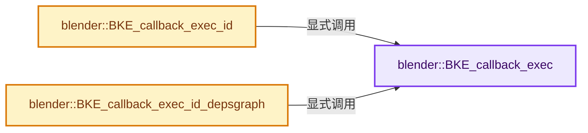
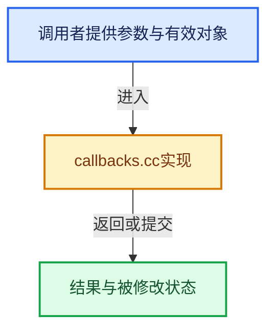

# 实现依赖专题：source/blender/blenkernel/intern/callbacks.cc

[实现依赖导航](../../README.md) · [符号索引](../../../00-课程指南/02-源码与提交索引/符号依赖与实现索引.md)

本专题从正文实际调用进入，集中保存共享实现。函数有稳定锚点，可从调用处直接跳到对应完整函数；递归与互相调用通过回链组织。

## 本文件的实现关系






<a id="m-2e44aea24695"></a>

## 宏 `ASSERT_CALLBACKS_INITIALIZED`

<!-- annotated:b7d25ca0c07e37 -->

```cpp
#define ASSERT_CALLBACKS_INITIALIZED() \
  BLI_assert_msg(callbacks_initialized, \
                 "Callbacks should be initialized with BKE_callback_global_init() before using " \
                 "the callback system.")

```

<details>
<summary>核对原始源码：source/blender/blenkernel/intern/callbacks.cc · L24—L28</summary>

<!-- original:b7d25ca0c07e37:source/blender/blenkernel/intern/callbacks.cc:24:28 -->

```cpp
#define ASSERT_CALLBACKS_INITIALIZED() \
  BLI_assert_msg(callbacks_initialized, \
                 "Callbacks should be initialized with BKE_callback_global_init() before using " \
                 "the callback system.")

```

</details>

宏在预处理阶段展开，参数替换、重复求值和条件编译应直接从该定义检查。与普通函数不同，宏不会自动提供参数类型检查；构建配置选择哪个定义需结合外围条件。

## 完整成员与函数实现

<a id="f-01f505d7da87953f"></a>

### `blender::BKE_callback_exec`

实现位置：[source/blender/blenkernel/intern/callbacks.cc](../../../../../../../source/blender/blenkernel/intern/callbacks.cc) · L29—L38。

接口参数：

- `Main *bmain`
- `PointerRNA **pointers`
- `const int pointers_num`
- `eCbEvent evt`

**教学注释版**

<!-- annotated:f1e753d37b4b80 -->

```cpp
void BKE_callback_exec(Main *bmain, PointerRNA **pointers, const int pointers_num, eCbEvent evt)
{
  ASSERT_CALLBACKS_INITIALIZED();

  /* Use mutable iteration so handlers are able to remove themselves. */
  ListBaseT<bCallbackFuncStore> *lb = &callback_slots[evt];
  for (bCallbackFuncStore &funcstore : lb->items_mutable()) {
    funcstore.func(bmain, pointers, pointers_num, funcstore.arg);
  }
}
```

<details>
<summary>核对原始源码：source/blender/blenkernel/intern/callbacks.cc · L29—L38</summary>

<!-- original:f1e753d37b4b80:source/blender/blenkernel/intern/callbacks.cc:29:38 -->

```cpp
void BKE_callback_exec(Main *bmain, PointerRNA **pointers, const int pointers_num, eCbEvent evt)
{
  ASSERT_CALLBACKS_INITIALIZED();

  /* Use mutable iteration so handlers are able to remove themselves. */
  ListBaseT<bCallbackFuncStore> *lb = &callback_slots[evt];
  for (bCallbackFuncStore &funcstore : lb->items_mutable()) {
    funcstore.func(bmain, pointers, pointers_num, funcstore.arg);
  }
}
```

</details>

**继续追踪实现**

- `ASSERT_CALLBACKS_INITIALIZED` → [ASSERT_CALLBACKS_INITIALIZED · L24](callbacks.cc.md#m-2e44aea24695)。宏定义由构建条件选择。
- `lb->items_mutable` → [blender::ListBaseT::items_mutable · L163](../../08-其他Blender模块/makesdna/DNA_listBase.h.md#f-cc603252f543d4ad)。
- `funcstore.func` → [调用协议](../../../00-课程指南/01-路线与规范/模板宏与动态分派协议.md)：接收对象类型依赖auto、返回值或模板实例；不按同名猜测目标。调用位置L36。

<a id="f-e8d8375e78975c0b"></a>

### `blender::BKE_callback_exec_id`

实现位置：[source/blender/blenkernel/intern/callbacks.cc](../../../../../../../source/blender/blenkernel/intern/callbacks.cc) · L45—L52。

接口参数：

- `Main *bmain`
- `ID *id`
- `eCbEvent evt`

**教学注释版**

<!-- annotated:5c2b7b0b66fdcd -->

```cpp
void BKE_callback_exec_id(Main *bmain, ID *id, eCbEvent evt)
{
  PointerRNA id_ptr = RNA_id_pointer_create(id);

  PointerRNA *pointers[1] = {&id_ptr};

  BKE_callback_exec(bmain, pointers, ARRAY_SIZE(pointers), evt);
}
```

<details>
<summary>核对原始源码：source/blender/blenkernel/intern/callbacks.cc · L45—L52</summary>

<!-- original:5c2b7b0b66fdcd:source/blender/blenkernel/intern/callbacks.cc:45:52 -->

```cpp
void BKE_callback_exec_id(Main *bmain, ID *id, eCbEvent evt)
{
  PointerRNA id_ptr = RNA_id_pointer_create(id);

  PointerRNA *pointers[1] = {&id_ptr};

  BKE_callback_exec(bmain, pointers, ARRAY_SIZE(pointers), evt);
}
```

</details>

**继续追踪实现**

- `RNA_id_pointer_create` → [blender::RNA_id_pointer_create · L170](../../08-其他Blender模块/makesrna/intern/rna_access.cc.md#f-d41a2d612ae3a7b6)。
- `BKE_callback_exec` → [blender::BKE_callback_exec · L29](callbacks.cc.md#f-01f505d7da87953f)。
- `ARRAY_SIZE` → [blender::ARRAY_SIZE · L608](../../01-BLI基础库/BLI_utildefines.hh.md#f-eaec3a7e47b85c7c)。

<a id="f-dc1249b08da9bc27"></a>

### `blender::BKE_callback_exec_id_depsgraph`

实现位置：[source/blender/blenkernel/intern/callbacks.cc](../../../../../../../source/blender/blenkernel/intern/callbacks.cc) · L54—L63。

接口参数：

- `Main *bmain`
- `ID *id`
- `Depsgraph *depsgraph`
- `eCbEvent evt`

**教学注释版**

<!-- annotated:72faf35b303ebc -->

```cpp
void BKE_callback_exec_id_depsgraph(Main *bmain, ID *id, Depsgraph *depsgraph, eCbEvent evt)
{
  PointerRNA id_ptr = RNA_id_pointer_create(id);

  PointerRNA depsgraph_ptr = RNA_pointer_create_discrete(nullptr, RNA_Depsgraph, depsgraph);

  PointerRNA *pointers[2] = {&id_ptr, &depsgraph_ptr};

  BKE_callback_exec(bmain, pointers, ARRAY_SIZE(pointers), evt);
}
```

<details>
<summary>核对原始源码：source/blender/blenkernel/intern/callbacks.cc · L54—L63</summary>

<!-- original:72faf35b303ebc:source/blender/blenkernel/intern/callbacks.cc:54:63 -->

```cpp
void BKE_callback_exec_id_depsgraph(Main *bmain, ID *id, Depsgraph *depsgraph, eCbEvent evt)
{
  PointerRNA id_ptr = RNA_id_pointer_create(id);

  PointerRNA depsgraph_ptr = RNA_pointer_create_discrete(nullptr, RNA_Depsgraph, depsgraph);

  PointerRNA *pointers[2] = {&id_ptr, &depsgraph_ptr};

  BKE_callback_exec(bmain, pointers, ARRAY_SIZE(pointers), evt);
}
```

</details>

**继续追踪实现**

- `RNA_id_pointer_create` → [blender::RNA_id_pointer_create · L170](../../08-其他Blender模块/makesrna/intern/rna_access.cc.md#f-d41a2d612ae3a7b6)。
- `RNA_pointer_create_discrete` → [blender::RNA_pointer_create_discrete · L181](../../08-其他Blender模块/makesrna/intern/rna_access.cc.md#f-592a276e869c6d94)。
- `BKE_callback_exec` → [blender::BKE_callback_exec · L29](callbacks.cc.md#f-01f505d7da87953f)。
- `ARRAY_SIZE` → [blender::ARRAY_SIZE · L608](../../01-BLI基础库/BLI_utildefines.hh.md#f-eaec3a7e47b85c7c)。
