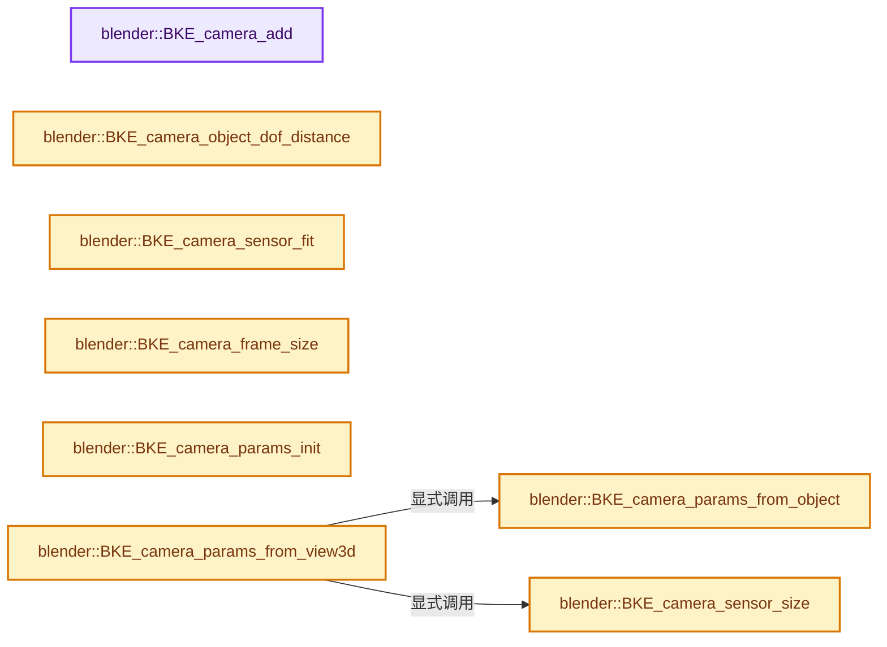
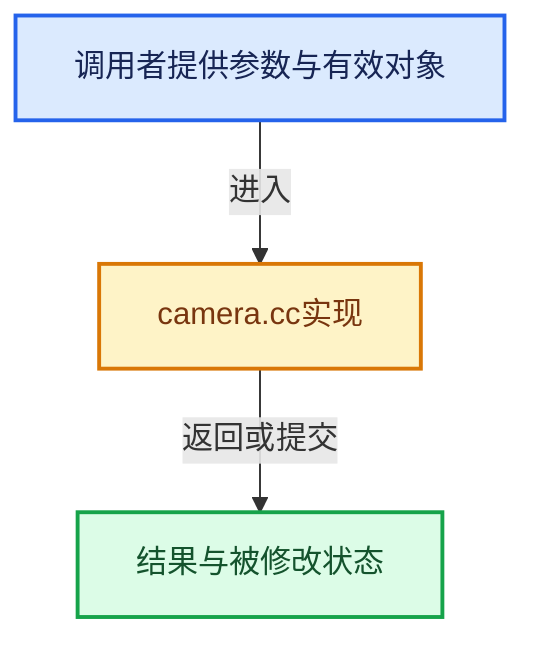

# 实现依赖专题：source/blender/blenkernel/intern/camera.cc

[实现依赖导航](../../README.md) · [符号索引](../../../00-课程指南/02-源码与提交索引/符号依赖与实现索引.md)

本专题从正文实际调用进入，集中保存共享实现。函数有稳定锚点，可从调用处直接跳到对应完整函数；递归与互相调用通过回链组织。

## 本文件的实现关系






## 完整成员与函数实现

<a id="f-db6d702bac3d60df"></a>

### `blender::BKE_camera_add`

实现位置：[source/blender/blenkernel/intern/camera.cc](../../../../../../../source/blender/blenkernel/intern/camera.cc) · L294—L301。

接口参数：

- `Main *bmain`
- `const char *name`

**教学注释版**

<!-- annotated:83d522f06fce3d -->

```cpp
Camera *BKE_camera_add(Main *bmain, const char *name)
{
  Camera *cam;

  cam = BKE_id_new<Camera>(bmain, name);

  return cam;
}
```

<details>
<summary>核对原始源码：source/blender/blenkernel/intern/camera.cc · L294—L301</summary>

<!-- original:83d522f06fce3d:source/blender/blenkernel/intern/camera.cc:294:301 -->

```cpp
Camera *BKE_camera_add(Main *bmain, const char *name)
{
  Camera *cam;

  cam = BKE_id_new<Camera>(bmain, name);

  return cam;
}
```

</details>

**沿实际写入检查状态**

- `cam = BKE_id_new<Camera>(bmain, name);`

**结果出口**

- `return cam;`

**继续追踪实现**

- `BKE_id_new<Camera>` → [blender::BKE_id_new · L1612](lib_id.cc.md#f-5335c97ce0a8fbc8)。

<a id="f-ec120fa2e635e647"></a>

### `blender::BKE_camera_object_dof_distance`

实现位置：[source/blender/blenkernel/intern/camera.cc](../../../../../../../source/blender/blenkernel/intern/camera.cc) · L303—L327。

接口参数：

- `const Object *ob`

**教学注释版**

<!-- annotated:4f62f644e2a066 -->

```cpp
float BKE_camera_object_dof_distance(const Object *ob)
{
  const Camera *cam = id_cast<const Camera *>(ob->data);
  if (ob->type != OB_CAMERA) {
    return 0.0f;
  }
  if (cam->dof.focus_object) {
    float view_dir[3], dof_dir[3];
    normalize_v3_v3(view_dir, ob->object_to_world().ptr()[2]);
    bPoseChannel *pchan = BKE_pose_channel_find_name(cam->dof.focus_object->pose,
                                                     cam->dof.focus_subtarget);
    if (pchan) {
      float posemat[4][4];
      mul_m4_m4m4(posemat, cam->dof.focus_object->object_to_world().ptr(), pchan->pose_mat);
      sub_v3_v3v3(dof_dir, ob->object_to_world().location(), posemat[3]);
    }
    else {
      sub_v3_v3v3(dof_dir,
                  ob->object_to_world().location(),
                  cam->dof.focus_object->object_to_world().location());
    }
    return fmax(fabsf(dot_v3v3(view_dir, dof_dir)), 1e-5f);
  }
  return fmax(cam->dof.focus_distance, 1e-5f);
}
```

<details>
<summary>核对原始源码：source/blender/blenkernel/intern/camera.cc · L303—L327</summary>

<!-- original:4f62f644e2a066:source/blender/blenkernel/intern/camera.cc:303:327 -->

```cpp
float BKE_camera_object_dof_distance(const Object *ob)
{
  const Camera *cam = id_cast<const Camera *>(ob->data);
  if (ob->type != OB_CAMERA) {
    return 0.0f;
  }
  if (cam->dof.focus_object) {
    float view_dir[3], dof_dir[3];
    normalize_v3_v3(view_dir, ob->object_to_world().ptr()[2]);
    bPoseChannel *pchan = BKE_pose_channel_find_name(cam->dof.focus_object->pose,
                                                     cam->dof.focus_subtarget);
    if (pchan) {
      float posemat[4][4];
      mul_m4_m4m4(posemat, cam->dof.focus_object->object_to_world().ptr(), pchan->pose_mat);
      sub_v3_v3v3(dof_dir, ob->object_to_world().location(), posemat[3]);
    }
    else {
      sub_v3_v3v3(dof_dir,
                  ob->object_to_world().location(),
                  cam->dof.focus_object->object_to_world().location());
    }
    return fmax(fabsf(dot_v3v3(view_dir, dof_dir)), 1e-5f);
  }
  return fmax(cam->dof.focus_distance, 1e-5f);
}
```

</details>

**结果出口**

- `return 0.0f;`
- `return fmax(fabsf(dot_v3v3(view_dir, dof_dir)), 1e-5f);`
- `return fmax(cam->dof.focus_distance, 1e-5f);`

**继续追踪实现**

- `id_cast<const Camera *>` → [blender::id_cast · L1417](../../08-其他Blender模块/makesdna/DNA_ID.h.md#f-6c8ac6412850ac5a)。
- `normalize_v3_v3` → [blender::normalize_v3_v3 · L895](../../01-BLI基础库/intern/math_vector_inline.cc.md#f-ebb89b456f034ce2)。
- `ob->object_to_world().ptr` → [调用协议](../../../00-课程指南/01-路线与规范/模板宏与动态分派协议.md)：接收对象类型依赖auto、返回值或模板实例；不按同名猜测目标。调用位置L311。
- `ob->object_to_world` → [blender::Object::object_to_world · L5761](object.cc.md#f-12fc20026327d50c)。
- `BKE_pose_channel_find_name` → [blender::BKE_pose_channel_find_name · L895](action.cc.md#f-5997206551bfc9f9)。
- `mul_m4_m4m4` → [blender::mul_m4_m4m4 · L217](../../01-BLI基础库/intern/math_matrix_c.cc.md#f-b5272136b543b73b)。
- `cam->dof.focus_object->object_to_world().ptr` → [调用协议](../../../00-课程指南/01-路线与规范/模板宏与动态分派协议.md)：接收对象类型依赖auto、返回值或模板实例；不按同名猜测目标。调用位置L316。
- `cam->dof.focus_object->object_to_world` → [调用协议](../../../00-课程指南/01-路线与规范/模板宏与动态分派协议.md)：接收对象类型依赖auto、返回值或模板实例；不按同名猜测目标。调用位置L316。
- `sub_v3_v3v3` → [blender::sub_v3_v3v3 · L360](../../01-BLI基础库/intern/math_vector_inline.cc.md#f-23781c252db8b30c)。
- `ob->object_to_world().location` → [调用协议](../../../00-课程指南/01-路线与规范/模板宏与动态分派协议.md)：接收对象类型依赖auto、返回值或模板实例；不按同名猜测目标。调用位置L317。
- `cam->dof.focus_object->object_to_world().location` → [调用协议](../../../00-课程指南/01-路线与规范/模板宏与动态分派协议.md)：接收对象类型依赖auto、返回值或模板实例；不按同名猜测目标。调用位置L322。
- `fmax` → [调用协议](../../../00-课程指南/01-路线与规范/模板宏与动态分派协议.md)：函数指针、局部可调用对象或未展开的宏；必须结合调用者环境。调用位置L324。
- `fabsf` → [fabsf · L21](../../07-Intern运行时与平台/cycles/kernel/svm/radial_tiling_shared.h.md#m-02cc4c69cfb3)；[fabsf · L43](../../07-Intern运行时与平台/cycles/kernel/svm/radial_tiling_shared.h.md#m-04effe61803b)；[fabsf · L74](../../07-Intern运行时与平台/cycles/kernel/svm/radial_tiling_shared.h.md#m-927dd4eba7dc)；[fabsf · L25](../../01-BLI基础库/intern/radial_tiling_shared.hh.md#m-8348d6b3d08f)；[fabsf · L47](../../01-BLI基础库/intern/radial_tiling_shared.hh.md#m-13b7e0b6d84f)；[fabsf · L78](../../01-BLI基础库/intern/radial_tiling_shared.hh.md#m-326c83464a0d)；[fabsf · L21](../../07-Intern运行时与平台/cycles/kernel/osl/shaders/node_radial_tiling_shared.h.md#m-7c3ee12fc119)；[fabsf · L43](../../07-Intern运行时与平台/cycles/kernel/osl/shaders/node_radial_tiling_shared.h.md#m-9112db0e2dd1)；[fabsf · L74](../../07-Intern运行时与平台/cycles/kernel/osl/shaders/node_radial_tiling_shared.h.md#m-ee4e61908a6f)；[fabsf · L167](../../07-Intern运行时与平台/cycles/kernel/device/oneapi/compat.h.md#m-b039ee6c1601)；[fabsf · L265](../../07-Intern运行时与平台/cycles/kernel/device/metal/compat.h.md#m-6b21869e9f3f)。宏定义由构建条件选择。
- `dot_v3v3` → [blender::dot_v3v3 · L646](../../01-BLI基础库/intern/math_vector_inline.cc.md#f-c88befa67d07591a)。

<a id="f-af96630710d3f019"></a>

### `blender::BKE_camera_sensor_size`

实现位置：[source/blender/blenkernel/intern/camera.cc](../../../../../../../source/blender/blenkernel/intern/camera.cc) · L329—L337。

接口参数：

- `int sensor_fit`
- `float sensor_x`
- `float sensor_y`

**教学注释版**

<!-- annotated:0f139a1f8d0c41 -->

```cpp
float BKE_camera_sensor_size(int sensor_fit, float sensor_x, float sensor_y)
{
  /* sensor size used to fit to. for auto, sensor_x is both x and y. */
  if (sensor_fit == CAMERA_SENSOR_FIT_VERT) {
    return sensor_y;
  }

  return sensor_x;
}
```

<details>
<summary>核对原始源码：source/blender/blenkernel/intern/camera.cc · L329—L337</summary>

<!-- original:0f139a1f8d0c41:source/blender/blenkernel/intern/camera.cc:329:337 -->

```cpp
float BKE_camera_sensor_size(int sensor_fit, float sensor_x, float sensor_y)
{
  /* sensor size used to fit to. for auto, sensor_x is both x and y. */
  if (sensor_fit == CAMERA_SENSOR_FIT_VERT) {
    return sensor_y;
  }

  return sensor_x;
}
```

</details>

**结果出口**

- `return sensor_y;`
- `return sensor_x;`

**继续追踪实现**

本实现没有需要继续展开的显式调用；检查返回表达式、对象转换和调用者前置条件。

<a id="f-a3bfa9ad26d0b8ba"></a>

### `blender::BKE_camera_sensor_fit`

实现位置：[source/blender/blenkernel/intern/camera.cc](../../../../../../../source/blender/blenkernel/intern/camera.cc) · L339—L350。

接口参数：

- `int sensor_fit`
- `float sizex`
- `float sizey`

**教学注释版**

<!-- annotated:679d122f6b9c2d -->

```cpp
int BKE_camera_sensor_fit(int sensor_fit, float sizex, float sizey)
{
  if (sensor_fit == CAMERA_SENSOR_FIT_AUTO) {
    if (sizex >= sizey) {
      return CAMERA_SENSOR_FIT_HOR;
    }

    return CAMERA_SENSOR_FIT_VERT;
  }

  return sensor_fit;
}
```

<details>
<summary>核对原始源码：source/blender/blenkernel/intern/camera.cc · L339—L350</summary>

<!-- original:679d122f6b9c2d:source/blender/blenkernel/intern/camera.cc:339:350 -->

```cpp
int BKE_camera_sensor_fit(int sensor_fit, float sizex, float sizey)
{
  if (sensor_fit == CAMERA_SENSOR_FIT_AUTO) {
    if (sizex >= sizey) {
      return CAMERA_SENSOR_FIT_HOR;
    }

    return CAMERA_SENSOR_FIT_VERT;
  }

  return sensor_fit;
}
```

</details>

**结果出口**

- `return CAMERA_SENSOR_FIT_HOR;`
- `return CAMERA_SENSOR_FIT_VERT;`
- `return sensor_fit;`

**继续追踪实现**

本实现没有需要继续展开的显式调用；检查返回表达式、对象转换和调用者前置条件。

<a id="f-718d469495ae46b2"></a>

### `blender::BKE_camera_frame_size`

实现位置：[source/blender/blenkernel/intern/camera.cc](../../../../../../../source/blender/blenkernel/intern/camera.cc) · L352—L357。

接口参数：

- `const float winx`
- `const float winy`
- `const float frame_aspect`

**教学注释版**

<!-- annotated:2b2dda2a120831 -->

```cpp
float2 BKE_camera_frame_size(const float winx, const float winy, const float frame_aspect)
{
  const float frame_x = math::min(winx, winy / frame_aspect);

  return float2(frame_x, frame_x * frame_aspect);
}
```

<details>
<summary>核对原始源码：source/blender/blenkernel/intern/camera.cc · L352—L357</summary>

<!-- original:2b2dda2a120831:source/blender/blenkernel/intern/camera.cc:352:357 -->

```cpp
float2 BKE_camera_frame_size(const float winx, const float winy, const float frame_aspect)
{
  const float frame_x = math::min(winx, winy / frame_aspect);

  return float2(frame_x, frame_x * frame_aspect);
}
```

</details>

**结果出口**

- `return float2(frame_x, frame_x * frame_aspect);`

**继续追踪实现**

- `math::min` → [blender::math::min · L56](../../01-BLI基础库/BLI_math_vector.hh.md#f-ee6ead51e4bb3364)；[blender::math::min · L65](../../01-BLI基础库/BLI_math_vector.hh.md#f-f65ce48b3051cce3)；[blender::math::min · L81](../../01-BLI基础库/BLI_math_vector.hh.md#f-9c602d29fab41795)；[blender::math::min · L43](../../01-BLI基础库/BLI_math_base.hh.md#f-72ff0c229e6c09b0)。同名重载需按实参类型选择。
- `float2` → [float2::float2 · L45](../../07-Intern运行时与平台/sky/source/sky_math.h.md#f-04c2783f21f996aa)；[float2::float2 · L47](../../07-Intern运行时与平台/sky/source/sky_math.h.md#f-dba79c4c10e5ea46)；[float2::float2 · L49](../../07-Intern运行时与平台/sky/source/sky_math.h.md#f-920ca90efa37bf0b)；[float2::float2 · L51](../../07-Intern运行时与平台/sky/source/sky_math.h.md#f-4b3fbf848d719a63)；[float2::float2 · L53](../../07-Intern运行时与平台/sky/source/sky_math.h.md#f-9b2acd8475cc2843)；[float2::float2 · L55](../../07-Intern运行时与平台/sky/source/sky_math.h.md#f-1e9233a9a231be51)。同名重载需按实参类型选择。

<a id="f-01921b9d54f56ab2"></a>

### `blender::BKE_camera_params_init`

实现位置：[source/blender/blenkernel/intern/camera.cc](../../../../../../../source/blender/blenkernel/intern/camera.cc) · L365—L379。

接口参数：

- `CameraParams *params`

**教学注释版**

<!-- annotated:2b027b077dab83 -->

```cpp
void BKE_camera_params_init(CameraParams *params)
{
  *params = CameraParams();

  /* defaults */
  params->sensor_x = DEFAULT_SENSOR_WIDTH;
  params->sensor_y = DEFAULT_SENSOR_HEIGHT;
  params->sensor_fit = CAMERA_SENSOR_FIT_AUTO;

  params->zoom = 1.0f;

  /* fallback for non camera objects */
  params->clip_start = 0.1f;
  params->clip_end = 100.0f;
}
```

<details>
<summary>核对原始源码：source/blender/blenkernel/intern/camera.cc · L365—L379</summary>

<!-- original:2b027b077dab83:source/blender/blenkernel/intern/camera.cc:365:379 -->

```cpp
void BKE_camera_params_init(CameraParams *params)
{
  *params = CameraParams();

  /* defaults */
  params->sensor_x = DEFAULT_SENSOR_WIDTH;
  params->sensor_y = DEFAULT_SENSOR_HEIGHT;
  params->sensor_fit = CAMERA_SENSOR_FIT_AUTO;

  params->zoom = 1.0f;

  /* fallback for non camera objects */
  params->clip_start = 0.1f;
  params->clip_end = 100.0f;
}
```

</details>

**沿实际写入检查状态**

- `params->sensor_x = DEFAULT_SENSOR_WIDTH;`
- `params->sensor_y = DEFAULT_SENSOR_HEIGHT;`
- `params->sensor_fit = CAMERA_SENSOR_FIT_AUTO;`
- `params->zoom = 1.0f;`
- `params->clip_start = 0.1f;`
- `params->clip_end = 100.0f;`

**继续追踪实现**

- `CameraParams` → [blender::CameraParams](../BKE_camera.h.md#t-a4fed3f56b70)；[blender::CameraParams](../BKE_camera.h.md#t-0ec3f453a6f6)。

<a id="f-8105a1058cdbd883"></a>

### `blender::BKE_camera_params_from_object`

实现位置：[source/blender/blenkernel/intern/camera.cc](../../../../../../../source/blender/blenkernel/intern/camera.cc) · L381—L423。

接口参数：

- `CameraParams *params`
- `const Object *cam_ob`

**教学注释版**

<!-- annotated:847f1799115c63 -->

```cpp
void BKE_camera_params_from_object(CameraParams *params, const Object *cam_ob)
{
  if (!cam_ob) {
    return;
  }

  if (cam_ob->type == OB_CAMERA) {
    /* camera object */
    const Camera *cam = id_cast<const Camera *>(cam_ob->data);

    if (cam->type == CAM_ORTHO) {
      params->is_ortho = true;
    }
    params->lens = cam->lens;
    params->ortho_scale = cam->ortho_scale;

    params->shiftx = cam->shiftx;
    params->shifty = cam->shifty;

    params->sensor_x = cam->sensor_x;
    params->sensor_y = cam->sensor_y;
    params->sensor_fit = cam->sensor_fit;

    params->clip_start = cam->clip_start;
    params->clip_end = cam->clip_end;
  }
  else if (cam_ob->type == OB_LAMP) {
    /* light object */
    Light *la = id_cast<Light *>(cam_ob->data);
    params->lens = 16.0f / tanf(la->spotsize * 0.5f);
    if (params->lens == 0.0f) {
      params->lens = 35.0f;
    }
  }
  else {
    params->lens = 35.0f;
  }

  /* Ensure it's possible to compute a valid projection matrix. */
  params->lens = math::max(params->lens, 1e-9f);
  params->ortho_scale = math::max(params->ortho_scale, 1e-9f);
  params->clip_end = math::max(params->clip_end, params->clip_start + 1e-3f);
}
```

<details>
<summary>核对原始源码：source/blender/blenkernel/intern/camera.cc · L381—L423</summary>

<!-- original:847f1799115c63:source/blender/blenkernel/intern/camera.cc:381:423 -->

```cpp
void BKE_camera_params_from_object(CameraParams *params, const Object *cam_ob)
{
  if (!cam_ob) {
    return;
  }

  if (cam_ob->type == OB_CAMERA) {
    /* camera object */
    const Camera *cam = id_cast<const Camera *>(cam_ob->data);

    if (cam->type == CAM_ORTHO) {
      params->is_ortho = true;
    }
    params->lens = cam->lens;
    params->ortho_scale = cam->ortho_scale;

    params->shiftx = cam->shiftx;
    params->shifty = cam->shifty;

    params->sensor_x = cam->sensor_x;
    params->sensor_y = cam->sensor_y;
    params->sensor_fit = cam->sensor_fit;

    params->clip_start = cam->clip_start;
    params->clip_end = cam->clip_end;
  }
  else if (cam_ob->type == OB_LAMP) {
    /* light object */
    Light *la = id_cast<Light *>(cam_ob->data);
    params->lens = 16.0f / tanf(la->spotsize * 0.5f);
    if (params->lens == 0.0f) {
      params->lens = 35.0f;
    }
  }
  else {
    params->lens = 35.0f;
  }

  /* Ensure it's possible to compute a valid projection matrix. */
  params->lens = math::max(params->lens, 1e-9f);
  params->ortho_scale = math::max(params->ortho_scale, 1e-9f);
  params->clip_end = math::max(params->clip_end, params->clip_start + 1e-3f);
}
```

</details>

**沿实际写入检查状态**

- `params->is_ortho = true;`
- `params->lens = cam->lens;`
- `params->ortho_scale = cam->ortho_scale;`
- `params->shiftx = cam->shiftx;`
- `params->shifty = cam->shifty;`
- `params->sensor_x = cam->sensor_x;`
- `params->sensor_y = cam->sensor_y;`
- `params->sensor_fit = cam->sensor_fit;`
- `params->clip_start = cam->clip_start;`
- `params->clip_end = cam->clip_end;`
- `params->lens = 16.0f / tanf(la->spotsize * 0.5f);`
- `params->lens = 35.0f;`
- `params->lens = math::max(params->lens, 1e-9f);`
- `params->ortho_scale = math::max(params->ortho_scale, 1e-9f);`
- `params->clip_end = math::max(params->clip_end, params->clip_start + 1e-3f);`

**继续追踪实现**

- `id_cast<const Camera *>` → [blender::id_cast · L1417](../../08-其他Blender模块/makesdna/DNA_ID.h.md#f-6c8ac6412850ac5a)。
- `id_cast<Light *>` → [blender::id_cast · L1417](../../08-其他Blender模块/makesdna/DNA_ID.h.md#f-6c8ac6412850ac5a)。
- `tanf` → [tanf · L30](../../07-Intern运行时与平台/cycles/kernel/svm/radial_tiling_shared.h.md#m-59a434b9184c)；[tanf · L52](../../07-Intern运行时与平台/cycles/kernel/svm/radial_tiling_shared.h.md#m-96d07165eab2)；[tanf · L83](../../07-Intern运行时与平台/cycles/kernel/svm/radial_tiling_shared.h.md#m-7663637581d9)；[tanf · L34](../../01-BLI基础库/intern/radial_tiling_shared.hh.md#m-8b35fd329650)；[tanf · L56](../../01-BLI基础库/intern/radial_tiling_shared.hh.md#m-9e153fc2f61f)；[tanf · L87](../../01-BLI基础库/intern/radial_tiling_shared.hh.md#m-8eb7d6521f7a)；[tanf · L30](../../07-Intern运行时与平台/cycles/kernel/osl/shaders/node_radial_tiling_shared.h.md#m-d7bdd765eeff)；[tanf · L52](../../07-Intern运行时与平台/cycles/kernel/osl/shaders/node_radial_tiling_shared.h.md#m-2b90b7f17f04)；[tanf · L83](../../07-Intern运行时与平台/cycles/kernel/osl/shaders/node_radial_tiling_shared.h.md#m-39bfd36efdd8)；[tanf · L189](../../07-Intern运行时与平台/cycles/kernel/device/oneapi/compat.h.md#m-2c0993e4c930)；[tanf · L289](../../07-Intern运行时与平台/cycles/kernel/device/metal/compat.h.md#m-377fea82ecaa)；[tanf · L96](../../07-Intern运行时与平台/cycles/kernel/device/hip/compat.h.md#m-bf249a5884aa)；[tanf · L94](../../07-Intern运行时与平台/cycles/kernel/device/cuda/compat.h.md#m-789daa70cab8)；[tanf · L45](../../08-其他Blender模块/gpu/GPU_shader_shared_utils.hh.md#m-47237e652f9a)；[tanf · L66](../../08-其他Blender模块/gpu/GPU_shader_shared_utils.hh.md#m-ec729c327d58)。宏定义由构建条件选择。
- `math::max` → [blender::math::max · L87](../../01-BLI基础库/BLI_math_vector.hh.md#f-9be564a293777d6b)；[blender::math::max · L96](../../01-BLI基础库/BLI_math_vector.hh.md#f-ce32dff37d0af3bc)；[blender::math::max · L112](../../01-BLI基础库/BLI_math_vector.hh.md#f-668eb1fcf1fa8292)；[blender::math::max · L49](../../01-BLI基础库/BLI_math_base.hh.md#f-a6991ca3d12937e1)。同名重载需按实参类型选择。

<a id="f-d5d48392327338ee"></a>

### `blender::BKE_camera_params_from_view3d`

实现位置：[source/blender/blenkernel/intern/camera.cc](../../../../../../../source/blender/blenkernel/intern/camera.cc) · L425—L481。

接口参数：

- `CameraParams *params`
- `const Depsgraph *depsgraph`
- `const View3D *v3d`
- `const RegionView3D *rv3d`

**教学注释版**

<!-- annotated:4cd077cc3d855d -->

```cpp
void BKE_camera_params_from_view3d(CameraParams *params,
                                   const Depsgraph *depsgraph,
                                   const View3D *v3d,
                                   const RegionView3D *rv3d)
{
  /* common */
  params->lens = v3d->lens;
  params->clip_start = v3d->clip_start;
  params->clip_end = v3d->clip_end;

  if (rv3d->persp == RV3D_CAMOB) {
    /* camera view */
    const Object *ob_camera_eval = DEG_get_evaluated(depsgraph, v3d->camera);
    BKE_camera_params_from_object(params, ob_camera_eval);

    /* Override the aspect, so change in viewport framing is minimized when camera parameters
     * change. */
    const Scene *scene = DEG_get_evaluated_scene(depsgraph);
    params->use_aspect_override = true;
    params->aspect_override = (float(scene->r.ysch) * scene->r.yasp) /
                              (float(scene->r.xsch) * scene->r.xasp);

    params->zoom = BKE_screen_view3d_zoom_to_fac(rv3d->camzoom);

    params->offsetx = 2.0f * rv3d->camdx * params->zoom;
    params->offsety = 2.0f * rv3d->camdy * params->zoom;
    params->roll = rv3d->camroll;
    params->is_flipped_x = (rv3d->rflag & RV3D_FLIP_X) != 0;

    params->shiftx *= params->zoom;
    params->shifty *= params->zoom;

    params->zoom = CAMERA_PARAM_ZOOM_INIT_CAMOB / params->zoom;
  }
  else if (rv3d->persp == RV3D_ORTHO) {
    /* orthographic view */
    float sensor_size = BKE_camera_sensor_size(
        params->sensor_fit, params->sensor_x, params->sensor_y);
    /* Halve, otherwise too extreme low Z-buffer quality. */
    params->clip_end *= 0.5f;
    params->clip_start = -params->clip_end;

    params->is_ortho = true;
    /* make sure any changes to this match ED_view3d_radius_to_dist_ortho() */
    params->ortho_scale = rv3d->dist * sensor_size / v3d->lens;
    params->zoom = CAMERA_PARAM_ZOOM_INIT_PERSP;
  }
  else {
    /* perspective view */
    params->zoom = CAMERA_PARAM_ZOOM_INIT_PERSP;
  }

  /* Ensure it's possible to compute a valid projection matrix. */
  params->lens = math::max(params->lens, 1e-9f);
  params->ortho_scale = math::max(params->ortho_scale, 1e-9f);
  params->clip_end = math::max(params->clip_end, params->clip_start + 1e-3f);
}
```

<details>
<summary>核对原始源码：source/blender/blenkernel/intern/camera.cc · L425—L481</summary>

<!-- original:4cd077cc3d855d:source/blender/blenkernel/intern/camera.cc:425:481 -->

```cpp
void BKE_camera_params_from_view3d(CameraParams *params,
                                   const Depsgraph *depsgraph,
                                   const View3D *v3d,
                                   const RegionView3D *rv3d)
{
  /* common */
  params->lens = v3d->lens;
  params->clip_start = v3d->clip_start;
  params->clip_end = v3d->clip_end;

  if (rv3d->persp == RV3D_CAMOB) {
    /* camera view */
    const Object *ob_camera_eval = DEG_get_evaluated(depsgraph, v3d->camera);
    BKE_camera_params_from_object(params, ob_camera_eval);

    /* Override the aspect, so change in viewport framing is minimized when camera parameters
     * change. */
    const Scene *scene = DEG_get_evaluated_scene(depsgraph);
    params->use_aspect_override = true;
    params->aspect_override = (float(scene->r.ysch) * scene->r.yasp) /
                              (float(scene->r.xsch) * scene->r.xasp);

    params->zoom = BKE_screen_view3d_zoom_to_fac(rv3d->camzoom);

    params->offsetx = 2.0f * rv3d->camdx * params->zoom;
    params->offsety = 2.0f * rv3d->camdy * params->zoom;
    params->roll = rv3d->camroll;
    params->is_flipped_x = (rv3d->rflag & RV3D_FLIP_X) != 0;

    params->shiftx *= params->zoom;
    params->shifty *= params->zoom;

    params->zoom = CAMERA_PARAM_ZOOM_INIT_CAMOB / params->zoom;
  }
  else if (rv3d->persp == RV3D_ORTHO) {
    /* orthographic view */
    float sensor_size = BKE_camera_sensor_size(
        params->sensor_fit, params->sensor_x, params->sensor_y);
    /* Halve, otherwise too extreme low Z-buffer quality. */
    params->clip_end *= 0.5f;
    params->clip_start = -params->clip_end;

    params->is_ortho = true;
    /* make sure any changes to this match ED_view3d_radius_to_dist_ortho() */
    params->ortho_scale = rv3d->dist * sensor_size / v3d->lens;
    params->zoom = CAMERA_PARAM_ZOOM_INIT_PERSP;
  }
  else {
    /* perspective view */
    params->zoom = CAMERA_PARAM_ZOOM_INIT_PERSP;
  }

  /* Ensure it's possible to compute a valid projection matrix. */
  params->lens = math::max(params->lens, 1e-9f);
  params->ortho_scale = math::max(params->ortho_scale, 1e-9f);
  params->clip_end = math::max(params->clip_end, params->clip_start + 1e-3f);
}
```

</details>

**沿实际写入检查状态**

- `params->lens = v3d->lens;`
- `params->clip_start = v3d->clip_start;`
- `params->clip_end = v3d->clip_end;`
- `params->use_aspect_override = true;`
- `params->aspect_override = (float(scene->r.ysch) * scene->r.yasp) /`
- `params->zoom = BKE_screen_view3d_zoom_to_fac(rv3d->camzoom);`
- `params->offsetx = 2.0f * rv3d->camdx * params->zoom;`
- `params->offsety = 2.0f * rv3d->camdy * params->zoom;`
- `params->roll = rv3d->camroll;`
- `params->is_flipped_x = (rv3d->rflag & RV3D_FLIP_X) != 0;`
- `params->shiftx *= params->zoom;`
- `params->shifty *= params->zoom;`
- `params->zoom = CAMERA_PARAM_ZOOM_INIT_CAMOB / params->zoom;`
- `params->clip_end *= 0.5f;`
- `params->clip_start = -params->clip_end;`
- `params->is_ortho = true;`
- `params->ortho_scale = rv3d->dist * sensor_size / v3d->lens;`
- `params->zoom = CAMERA_PARAM_ZOOM_INIT_PERSP;`
- `params->lens = math::max(params->lens, 1e-9f);`
- `params->ortho_scale = math::max(params->ortho_scale, 1e-9f);`
- `params->clip_end = math::max(params->clip_end, params->clip_start + 1e-3f);`

**继续追踪实现**

- `DEG_get_evaluated` → [blender::DEG_get_evaluated · L106](../../06-Depsgraph依赖图/DEG_depsgraph_query.hh.md#f-e70143fa875363bf)；[blender::DEG_get_evaluated · L112](../../06-Depsgraph依赖图/DEG_depsgraph_query.hh.md#f-129df72cfb5a1bad)。同名重载需按实参类型选择。
- `BKE_camera_params_from_object` → [blender::BKE_camera_params_from_object · L381](camera.cc.md#f-8105a1058cdbd883)。
- `DEG_get_evaluated_scene` → [blender::DEG_get_evaluated_scene · L212](../../06-Depsgraph依赖图/intern/depsgraph_query.cc.md#f-be7729d26a71d3fd)。
- `BKE_screen_view3d_zoom_to_fac` → [blender::BKE_screen_view3d_zoom_to_fac · L1281](screen.cc.md#f-607d94e31dd1fbb7)。
- `BKE_camera_sensor_size` → [blender::BKE_camera_sensor_size · L329](camera.cc.md#f-af96630710d3f019)。
- `math::max` → [blender::math::max · L87](../../01-BLI基础库/BLI_math_vector.hh.md#f-9be564a293777d6b)；[blender::math::max · L96](../../01-BLI基础库/BLI_math_vector.hh.md#f-ce32dff37d0af3bc)；[blender::math::max · L112](../../01-BLI基础库/BLI_math_vector.hh.md#f-668eb1fcf1fa8292)；[blender::math::max · L49](../../01-BLI基础库/BLI_math_base.hh.md#f-a6991ca3d12937e1)。同名重载需按实参类型选择。

<a id="f-27e265da4ca74d77"></a>

### `blender::BKE_camera_params_compute_viewplane`

实现位置：[source/blender/blenkernel/intern/camera.cc](../../../../../../../source/blender/blenkernel/intern/camera.cc) · L483—L540。

接口参数：

- `CameraParams *params`
- `int winx`
- `int winy`
- `float aspx`
- `float aspy`

**教学注释版**

<!-- annotated:30ed702d4056e1 -->

```cpp
void BKE_camera_params_compute_viewplane(
    CameraParams *params, int winx, int winy, float aspx, float aspy)
{
  rctf viewplane;
  float pixsize, viewfac, sensor_size;
  int sensor_fit;

  params->ycor = aspy / aspx;

  const float winy_cor = params->ycor * float(winy);
  const float frame_aspect = params->use_aspect_override ? params->aspect_override :
                                                           winy_cor / float(winx);
  const float2 frame_size = BKE_camera_frame_size(float(winx), winy_cor, frame_aspect);

  if (params->is_ortho) {
    /* orthographic camera */
    /* scale == 1.0 means exact 1 to 1 mapping */
    pixsize = params->ortho_scale;
  }
  else {
    /* perspective camera */
    sensor_size = BKE_camera_sensor_size(params->sensor_fit, params->sensor_x, params->sensor_y);
    pixsize = (sensor_size * params->clip_start) / params->lens;
  }

  /* determine sensor fit */
  sensor_fit = BKE_camera_sensor_fit(params->sensor_fit, 1.0f, frame_aspect);

  viewfac = (sensor_fit == CAMERA_SENSOR_FIT_HOR) ? frame_size.x : frame_size.y;

  pixsize /= viewfac;

  /* extra zoom factor */
  pixsize *= params->zoom;

  /* compute view plane:
   * Fully centered, Z-buffer fills in jittered between `-.5` and `+.5`. */
  viewplane.xmin = -0.5f * float(winx);
  viewplane.ymin = -0.5f * params->ycor * float(winy);
  viewplane.xmax = 0.5f * float(winx);
  viewplane.ymax = 0.5f * params->ycor * float(winy);

  /* Lens shift and offset. */
  float2 dxy(params->shiftx * viewfac + winx * params->offsetx,
             params->shifty * viewfac + winy * params->offsety);
  dxy = BKE_camera_viewplane_offset_transform(params->roll, params->is_flipped_x, dxy);
  BLI_rctf_translate(&viewplane, dxy.x, dxy.y);

  /* the window matrix is used for clipping, and not changed during OSA steps */
  /* using an offset of +0.5 here would give clip errors on edges */
  BLI_rctf_mul(&viewplane, pixsize);

  /* Used for rendering (offset by near-clip with perspective views), passed to RE_SetPixelSize.
   * For viewport drawing 'RegionView3D.pixsize'. */
  params->viewdx = pixsize;
  params->viewdy = params->ycor * pixsize;
  params->viewplane = viewplane;
}
```

<details>
<summary>核对原始源码：source/blender/blenkernel/intern/camera.cc · L483—L540</summary>

<!-- original:30ed702d4056e1:source/blender/blenkernel/intern/camera.cc:483:540 -->

```cpp
void BKE_camera_params_compute_viewplane(
    CameraParams *params, int winx, int winy, float aspx, float aspy)
{
  rctf viewplane;
  float pixsize, viewfac, sensor_size;
  int sensor_fit;

  params->ycor = aspy / aspx;

  const float winy_cor = params->ycor * float(winy);
  const float frame_aspect = params->use_aspect_override ? params->aspect_override :
                                                           winy_cor / float(winx);
  const float2 frame_size = BKE_camera_frame_size(float(winx), winy_cor, frame_aspect);

  if (params->is_ortho) {
    /* orthographic camera */
    /* scale == 1.0 means exact 1 to 1 mapping */
    pixsize = params->ortho_scale;
  }
  else {
    /* perspective camera */
    sensor_size = BKE_camera_sensor_size(params->sensor_fit, params->sensor_x, params->sensor_y);
    pixsize = (sensor_size * params->clip_start) / params->lens;
  }

  /* determine sensor fit */
  sensor_fit = BKE_camera_sensor_fit(params->sensor_fit, 1.0f, frame_aspect);

  viewfac = (sensor_fit == CAMERA_SENSOR_FIT_HOR) ? frame_size.x : frame_size.y;

  pixsize /= viewfac;

  /* extra zoom factor */
  pixsize *= params->zoom;

  /* compute view plane:
   * Fully centered, Z-buffer fills in jittered between `-.5` and `+.5`. */
  viewplane.xmin = -0.5f * float(winx);
  viewplane.ymin = -0.5f * params->ycor * float(winy);
  viewplane.xmax = 0.5f * float(winx);
  viewplane.ymax = 0.5f * params->ycor * float(winy);

  /* Lens shift and offset. */
  float2 dxy(params->shiftx * viewfac + winx * params->offsetx,
             params->shifty * viewfac + winy * params->offsety);
  dxy = BKE_camera_viewplane_offset_transform(params->roll, params->is_flipped_x, dxy);
  BLI_rctf_translate(&viewplane, dxy.x, dxy.y);

  /* the window matrix is used for clipping, and not changed during OSA steps */
  /* using an offset of +0.5 here would give clip errors on edges */
  BLI_rctf_mul(&viewplane, pixsize);

  /* Used for rendering (offset by near-clip with perspective views), passed to RE_SetPixelSize.
   * For viewport drawing 'RegionView3D.pixsize'. */
  params->viewdx = pixsize;
  params->viewdy = params->ycor * pixsize;
  params->viewplane = viewplane;
}
```

</details>

**沿实际写入检查状态**

- `params->ycor = aspy / aspx;`
- `pixsize = params->ortho_scale;`
- `sensor_size = BKE_camera_sensor_size(params->sensor_fit, params->sensor_x, params->sensor_y);`
- `pixsize = (sensor_size * params->clip_start) / params->lens;`
- `sensor_fit = BKE_camera_sensor_fit(params->sensor_fit, 1.0f, frame_aspect);`
- `viewfac = (sensor_fit == CAMERA_SENSOR_FIT_HOR) ? frame_size.x : frame_size.y;`
- `pixsize *= params->zoom;`
- `viewplane.xmin = -0.5f * float(winx);`
- `viewplane.ymin = -0.5f * params->ycor * float(winy);`
- `viewplane.xmax = 0.5f * float(winx);`
- `viewplane.ymax = 0.5f * params->ycor * float(winy);`
- `dxy = BKE_camera_viewplane_offset_transform(params->roll, params->is_flipped_x, dxy);`
- `params->viewdx = pixsize;`
- `params->viewdy = params->ycor * pixsize;`
- `params->viewplane = viewplane;`

**继续追踪实现**

- `BKE_camera_frame_size` → [blender::BKE_camera_frame_size · L352](camera.cc.md#f-718d469495ae46b2)。
- `BKE_camera_sensor_size` → [blender::BKE_camera_sensor_size · L329](camera.cc.md#f-af96630710d3f019)。
- `BKE_camera_sensor_fit` → [blender::BKE_camera_sensor_fit · L339](camera.cc.md#f-a3bfa9ad26d0b8ba)。
- `BKE_camera_viewplane_offset_transform` → [blender::BKE_camera_viewplane_offset_transform · L542](camera.cc.md#f-055c7129a9d415f0)。
- `BLI_rctf_translate` → [blender::BLI_rctf_translate · L587](../../01-BLI基础库/intern/rct.cc.md#f-529284313e4063a1)。
- `BLI_rctf_mul` → [blender::BLI_rctf_mul · L602](../../01-BLI基础库/intern/rct.cc.md#f-999a441fd59980bf)。

<a id="f-055c7129a9d415f0"></a>

### `blender::BKE_camera_viewplane_offset_transform`

实现位置：[source/blender/blenkernel/intern/camera.cc](../../../../../../../source/blender/blenkernel/intern/camera.cc) · L542—L553。

接口参数：

- `const float roll`
- `const bool is_flipped_x`
- `const float2 offset`

**教学注释版**

<!-- annotated:167cb2061974c9 -->

```cpp
float2 BKE_camera_viewplane_offset_transform(const float roll,
                                             const bool is_flipped_x,
                                             const float2 offset)
{
  float2 result = math::from_rotation<float2x2>(math::AngleRadian(roll)) * offset;

  if (is_flipped_x) {
    result.x = -result.x;
  }

  return result;
}
```

<details>
<summary>核对原始源码：source/blender/blenkernel/intern/camera.cc · L542—L553</summary>

<!-- original:167cb2061974c9:source/blender/blenkernel/intern/camera.cc:542:553 -->

```cpp
float2 BKE_camera_viewplane_offset_transform(const float roll,
                                             const bool is_flipped_x,
                                             const float2 offset)
{
  float2 result = math::from_rotation<float2x2>(math::AngleRadian(roll)) * offset;

  if (is_flipped_x) {
    result.x = -result.x;
  }

  return result;
}
```

</details>

**沿实际写入检查状态**

- `result.x = -result.x;`

**结果出口**

- `return result;`

**继续追踪实现**

- `math::from_rotation<float2x2>` → [调用协议](../../../00-课程指南/01-路线与规范/模板宏与动态分派协议.md)：函数指针、局部可调用对象或未展开的宏；必须结合调用者环境。调用位置L546。
- `math::AngleRadian` → [AngleRadian](../../08-其他Blender模块/gpu/shaders/common/gpu_shader_math_angle.bsl.hh.md#t-f41e68e4720c)。

<a id="f-b7c25e1f7e6601c3"></a>

### `blender::BKE_camera_params_compute_matrix`

实现位置：[source/blender/blenkernel/intern/camera.cc](../../../../../../../source/blender/blenkernel/intern/camera.cc) · L567—L590。

接口参数：

- `CameraParams *params`

**教学注释版**

<!-- annotated:c3ebc487242ff2 -->

```cpp
void BKE_camera_params_compute_matrix(CameraParams *params)
{
  rctf viewplane = params->viewplane;

  /* compute projection matrix */
  if (params->is_ortho) {
    orthographic_m4(params->winmat,
                    viewplane.xmin,
                    viewplane.xmax,
                    viewplane.ymin,
                    viewplane.ymax,
                    params->clip_start,
                    params->clip_end);
  }
  else {
    perspective_m4(params->winmat,
                   viewplane.xmin,
                   viewplane.xmax,
                   viewplane.ymin,
                   viewplane.ymax,
                   params->clip_start,
                   params->clip_end);
  }
}
```

<details>
<summary>核对原始源码：source/blender/blenkernel/intern/camera.cc · L567—L590</summary>

<!-- original:c3ebc487242ff2:source/blender/blenkernel/intern/camera.cc:567:590 -->

```cpp
void BKE_camera_params_compute_matrix(CameraParams *params)
{
  rctf viewplane = params->viewplane;

  /* compute projection matrix */
  if (params->is_ortho) {
    orthographic_m4(params->winmat,
                    viewplane.xmin,
                    viewplane.xmax,
                    viewplane.ymin,
                    viewplane.ymax,
                    params->clip_start,
                    params->clip_end);
  }
  else {
    perspective_m4(params->winmat,
                   viewplane.xmin,
                   viewplane.xmax,
                   viewplane.ymin,
                   viewplane.ymax,
                   params->clip_start,
                   params->clip_end);
  }
}
```

</details>

**继续追踪实现**

- `orthographic_m4` → [blender::orthographic_m4 · L4712](../../01-BLI基础库/intern/math_geom.cc.md#f-d52906a632ea05bc)。
- `perspective_m4` → [blender::perspective_m4 · L4737](../../01-BLI基础库/intern/math_geom.cc.md#f-ceddb2e0fbd76e4b)。

<a id="f-69b39f6e817ab77e"></a>

### `blender::BKE_camera_view_border`

实现位置：[source/blender/blenkernel/intern/camera.cc](../../../../../../../source/blender/blenkernel/intern/camera.cc) · L598—L646。

接口参数：

- `const Scene *scene`
- `const Depsgraph *depsgraph`
- `const View3D *v3d`
- `const RegionView3D *rv3d`
- `const int winx`
- `const int winy`
- `const bool no_shift`
- `const bool no_zoom`
- `const bool no_roll`

**教学注释版**

<!-- annotated:f4a16671b00d1d -->

```cpp
rctf BKE_camera_view_border(const Scene *scene,
                            const Depsgraph *depsgraph,
                            const View3D *v3d,
                            const RegionView3D *rv3d,
                            const int winx,
                            const int winy,
                            const bool no_shift,
                            const bool no_zoom,
                            const bool no_roll)
{
  CameraParams params;
  rctf rect_view, rect_camera;
  const Object *camera_eval = DEG_get_evaluated(depsgraph, v3d->camera);

  /* Get viewport view plane. */
  BKE_camera_params_init(&params);
  BKE_camera_params_from_view3d(&params, depsgraph, v3d, rv3d);
  if (no_zoom) {
    params.zoom = 1.0f;
  }
  if (no_roll) {
    params.roll = 0.0f;
    params.is_flipped_x = false;
  }
  BKE_camera_params_compute_viewplane(&params, winx, winy, 1.0f, 1.0f);
  rect_view = params.viewplane;

  /* Get camera view plane. */
  BKE_camera_params_init(&params);
  params.clip_start = v3d->clip_start;
  params.clip_end = v3d->clip_end;
  BKE_camera_params_from_object(&params, camera_eval);
  if (no_shift) {
    params.shiftx = 0.0f;
    params.shifty = 0.0f;
  }
  BKE_camera_params_compute_viewplane(
      &params, scene->r.xsch, scene->r.ysch, scene->r.xasp, scene->r.yasp);
  rect_camera = params.viewplane;

  /* Get camera border within viewport. */
  rctf border;
  border.xmin = ((rect_camera.xmin - rect_view.xmin) / BLI_rctf_size_x(&rect_view)) * winx;
  border.xmax = ((rect_camera.xmax - rect_view.xmin) / BLI_rctf_size_x(&rect_view)) * winx;
  border.ymin = ((rect_camera.ymin - rect_view.ymin) / BLI_rctf_size_y(&rect_view)) * winy;
  border.ymax = ((rect_camera.ymax - rect_view.ymin) / BLI_rctf_size_y(&rect_view)) * winy;

  return border;
}
```

<details>
<summary>核对原始源码：source/blender/blenkernel/intern/camera.cc · L598—L646</summary>

<!-- original:f4a16671b00d1d:source/blender/blenkernel/intern/camera.cc:598:646 -->

```cpp
rctf BKE_camera_view_border(const Scene *scene,
                            const Depsgraph *depsgraph,
                            const View3D *v3d,
                            const RegionView3D *rv3d,
                            const int winx,
                            const int winy,
                            const bool no_shift,
                            const bool no_zoom,
                            const bool no_roll)
{
  CameraParams params;
  rctf rect_view, rect_camera;
  const Object *camera_eval = DEG_get_evaluated(depsgraph, v3d->camera);

  /* Get viewport view plane. */
  BKE_camera_params_init(&params);
  BKE_camera_params_from_view3d(&params, depsgraph, v3d, rv3d);
  if (no_zoom) {
    params.zoom = 1.0f;
  }
  if (no_roll) {
    params.roll = 0.0f;
    params.is_flipped_x = false;
  }
  BKE_camera_params_compute_viewplane(&params, winx, winy, 1.0f, 1.0f);
  rect_view = params.viewplane;

  /* Get camera view plane. */
  BKE_camera_params_init(&params);
  params.clip_start = v3d->clip_start;
  params.clip_end = v3d->clip_end;
  BKE_camera_params_from_object(&params, camera_eval);
  if (no_shift) {
    params.shiftx = 0.0f;
    params.shifty = 0.0f;
  }
  BKE_camera_params_compute_viewplane(
      &params, scene->r.xsch, scene->r.ysch, scene->r.xasp, scene->r.yasp);
  rect_camera = params.viewplane;

  /* Get camera border within viewport. */
  rctf border;
  border.xmin = ((rect_camera.xmin - rect_view.xmin) / BLI_rctf_size_x(&rect_view)) * winx;
  border.xmax = ((rect_camera.xmax - rect_view.xmin) / BLI_rctf_size_x(&rect_view)) * winx;
  border.ymin = ((rect_camera.ymin - rect_view.ymin) / BLI_rctf_size_y(&rect_view)) * winy;
  border.ymax = ((rect_camera.ymax - rect_view.ymin) / BLI_rctf_size_y(&rect_view)) * winy;

  return border;
}
```

</details>

**沿实际写入检查状态**

- `params.zoom = 1.0f;`
- `params.roll = 0.0f;`
- `params.is_flipped_x = false;`
- `rect_view = params.viewplane;`
- `params.clip_start = v3d->clip_start;`
- `params.clip_end = v3d->clip_end;`
- `params.shiftx = 0.0f;`
- `params.shifty = 0.0f;`
- `rect_camera = params.viewplane;`
- `border.xmin = ((rect_camera.xmin - rect_view.xmin) / BLI_rctf_size_x(&rect_view)) * winx;`
- `border.xmax = ((rect_camera.xmax - rect_view.xmin) / BLI_rctf_size_x(&rect_view)) * winx;`
- `border.ymin = ((rect_camera.ymin - rect_view.ymin) / BLI_rctf_size_y(&rect_view)) * winy;`
- `border.ymax = ((rect_camera.ymax - rect_view.ymin) / BLI_rctf_size_y(&rect_view)) * winy;`

**结果出口**

- `return border;`

**继续追踪实现**

- `DEG_get_evaluated` → [blender::DEG_get_evaluated · L106](../../06-Depsgraph依赖图/DEG_depsgraph_query.hh.md#f-e70143fa875363bf)；[blender::DEG_get_evaluated · L112](../../06-Depsgraph依赖图/DEG_depsgraph_query.hh.md#f-129df72cfb5a1bad)。同名重载需按实参类型选择。
- `BKE_camera_params_init` → [blender::BKE_camera_params_init · L365](camera.cc.md#f-01921b9d54f56ab2)。
- `BKE_camera_params_from_view3d` → [blender::BKE_camera_params_from_view3d · L425](camera.cc.md#f-d5d48392327338ee)。
- `BKE_camera_params_compute_viewplane` → [blender::BKE_camera_params_compute_viewplane · L483](camera.cc.md#f-27e265da4ca74d77)。
- `BKE_camera_params_from_object` → [blender::BKE_camera_params_from_object · L381](camera.cc.md#f-8105a1058cdbd883)。
- `BLI_rctf_size_x` → [blender::BLI_rctf_size_x · L211](../../01-BLI基础库/BLI_rect.hh.md#f-017b86a9d189e3ba)。
- `BLI_rctf_size_y` → [blender::BLI_rctf_size_y · L215](../../01-BLI基础库/BLI_rect.hh.md#f-6d179bc3c1b71b0e)。

<a id="f-8e616028ea20827b"></a>

### `blender::camera_passepartout_is_opaque`

实现位置：[source/blender/blenkernel/intern/camera.cc](../../../../../../../source/blender/blenkernel/intern/camera.cc) · L650—L661。

接口参数：

- `const View3D *v3d`

**教学注释版**

<!-- annotated:6c7a5464b5bbf8 -->

```cpp
static bool camera_passepartout_is_opaque(const View3D *v3d)
{
  if ((v3d->flag2 & V3D_SHOW_CAMERA_PASSEPARTOUT) == 0) {
    return false;
  }
  if (v3d->camera->type != OB_CAMERA) {
    return false;
  }

  const Camera *camera = id_cast<const Camera *>(v3d->camera->data);
  return (camera->flag & CAM_SHOWPASSEPARTOUT) && camera->passepartalpha == 1.0f;
}
```

<details>
<summary>核对原始源码：source/blender/blenkernel/intern/camera.cc · L650—L661</summary>

<!-- original:6c7a5464b5bbf8:source/blender/blenkernel/intern/camera.cc:650:661 -->

```cpp
static bool camera_passepartout_is_opaque(const View3D *v3d)
{
  if ((v3d->flag2 & V3D_SHOW_CAMERA_PASSEPARTOUT) == 0) {
    return false;
  }
  if (v3d->camera->type != OB_CAMERA) {
    return false;
  }

  const Camera *camera = id_cast<const Camera *>(v3d->camera->data);
  return (camera->flag & CAM_SHOWPASSEPARTOUT) && camera->passepartalpha == 1.0f;
}
```

</details>

**结果出口**

- `return false;`
- `return (camera->flag & CAM_SHOWPASSEPARTOUT) && camera->passepartalpha == 1.0f;`

**继续追踪实现**

- `id_cast<const Camera *>` → [blender::id_cast · L1417](../../08-其他Blender模块/makesdna/DNA_ID.h.md#f-6c8ac6412850ac5a)。

<a id="f-6454046bc03b034d"></a>

### `blender::BKE_camera_view_render_border`

实现位置：[source/blender/blenkernel/intern/camera.cc](../../../../../../../source/blender/blenkernel/intern/camera.cc) · L663—L730。

接口参数：

- `const Scene *scene`
- `const Depsgraph *depsgraph`
- `const View3D *v3d`
- `const RegionView3D *rv3d`
- `const int winx`
- `const int winy`
- `rctf *r_border`
- `rctf *r_unrolled_border`

**教学注释版**

<!-- annotated:8e9be5afd4e013 -->

```cpp
bool BKE_camera_view_render_border(const Scene *scene,
                                   const Depsgraph *depsgraph,
                                   const View3D *v3d,
                                   const RegionView3D *rv3d,
                                   const int winx,
                                   const int winy,
                                   rctf *r_border,
                                   rctf *r_unrolled_border)
{
  const bool is_camera_view = (rv3d->persp == RV3D_CAMOB) && (v3d->camera != nullptr);
  rctf border;

  if (is_camera_view) {
    const bool use_camera_frame = camera_passepartout_is_opaque(v3d);

    if ((scene->r.mode & R_BORDER) == 0 && !use_camera_frame) {
      return false;
    }

    /* The border is relative to the camera frame, which is not rolled. */
    const rctf viewborder = BKE_camera_view_border(
        scene, depsgraph, v3d, rv3d, winx, winy, false, false, true);

    if (scene->r.mode & R_BORDER) {
      border.xmin = viewborder.xmin + scene->r.border.xmin * BLI_rctf_size_x(&viewborder);
      border.ymin = viewborder.ymin + scene->r.border.ymin * BLI_rctf_size_y(&viewborder);
      border.xmax = viewborder.xmin + scene->r.border.xmax * BLI_rctf_size_x(&viewborder);
      border.ymax = viewborder.ymin + scene->r.border.ymax * BLI_rctf_size_y(&viewborder);
    }
    else {
      border = viewborder;
    }

    if ((rv3d->rflag & RV3D_FLIP_X) != 0) {
      std::swap(border.xmin, border.xmax);
      border.xmin = winx - border.xmin;
      border.xmax = winx - border.xmax;
    }
  }
  else {
    if ((v3d->flag2 & V3D_RENDER_BORDER) == 0) {
      return false;
    }

    border.xmin = v3d->render_border.xmin * winx;
    border.ymin = v3d->render_border.ymin * winy;
    border.xmax = v3d->render_border.xmax * winx;
    border.ymax = v3d->render_border.ymax * winy;
  }

  if (r_unrolled_border) {
    *r_unrolled_border = border;
  }

  /* The camera view roll rotates the border around the center of the viewport. */
  if (is_camera_view && rv3d->camroll != 0.0f) {
    const float pivot[2] = {winx / 2.0f, winy / 2.0f};
    if ((rv3d->rflag & RV3D_FLIP_X) != 0) {
      BLI_rctf_rotate_expand_around(&border, &border, pivot, -rv3d->camroll);
    }
    else {
      BLI_rctf_rotate_expand_around(&border, &border, pivot, rv3d->camroll);
    }
  }

  *r_border = border;
  return true;
}
```

<details>
<summary>核对原始源码：source/blender/blenkernel/intern/camera.cc · L663—L730</summary>

<!-- original:8e9be5afd4e013:source/blender/blenkernel/intern/camera.cc:663:730 -->

```cpp
bool BKE_camera_view_render_border(const Scene *scene,
                                   const Depsgraph *depsgraph,
                                   const View3D *v3d,
                                   const RegionView3D *rv3d,
                                   const int winx,
                                   const int winy,
                                   rctf *r_border,
                                   rctf *r_unrolled_border)
{
  const bool is_camera_view = (rv3d->persp == RV3D_CAMOB) && (v3d->camera != nullptr);
  rctf border;

  if (is_camera_view) {
    const bool use_camera_frame = camera_passepartout_is_opaque(v3d);

    if ((scene->r.mode & R_BORDER) == 0 && !use_camera_frame) {
      return false;
    }

    /* The border is relative to the camera frame, which is not rolled. */
    const rctf viewborder = BKE_camera_view_border(
        scene, depsgraph, v3d, rv3d, winx, winy, false, false, true);

    if (scene->r.mode & R_BORDER) {
      border.xmin = viewborder.xmin + scene->r.border.xmin * BLI_rctf_size_x(&viewborder);
      border.ymin = viewborder.ymin + scene->r.border.ymin * BLI_rctf_size_y(&viewborder);
      border.xmax = viewborder.xmin + scene->r.border.xmax * BLI_rctf_size_x(&viewborder);
      border.ymax = viewborder.ymin + scene->r.border.ymax * BLI_rctf_size_y(&viewborder);
    }
    else {
      border = viewborder;
    }

    if ((rv3d->rflag & RV3D_FLIP_X) != 0) {
      std::swap(border.xmin, border.xmax);
      border.xmin = winx - border.xmin;
      border.xmax = winx - border.xmax;
    }
  }
  else {
    if ((v3d->flag2 & V3D_RENDER_BORDER) == 0) {
      return false;
    }

    border.xmin = v3d->render_border.xmin * winx;
    border.ymin = v3d->render_border.ymin * winy;
    border.xmax = v3d->render_border.xmax * winx;
    border.ymax = v3d->render_border.ymax * winy;
  }

  if (r_unrolled_border) {
    *r_unrolled_border = border;
  }

  /* The camera view roll rotates the border around the center of the viewport. */
  if (is_camera_view && rv3d->camroll != 0.0f) {
    const float pivot[2] = {winx / 2.0f, winy / 2.0f};
    if ((rv3d->rflag & RV3D_FLIP_X) != 0) {
      BLI_rctf_rotate_expand_around(&border, &border, pivot, -rv3d->camroll);
    }
    else {
      BLI_rctf_rotate_expand_around(&border, &border, pivot, rv3d->camroll);
    }
  }

  *r_border = border;
  return true;
}
```

</details>

**沿实际写入检查状态**

- `border.xmin = viewborder.xmin + scene->r.border.xmin * BLI_rctf_size_x(&viewborder);`
- `border.ymin = viewborder.ymin + scene->r.border.ymin * BLI_rctf_size_y(&viewborder);`
- `border.xmax = viewborder.xmin + scene->r.border.xmax * BLI_rctf_size_x(&viewborder);`
- `border.ymax = viewborder.ymin + scene->r.border.ymax * BLI_rctf_size_y(&viewborder);`
- `border = viewborder;`
- `border.xmin = winx - border.xmin;`
- `border.xmax = winx - border.xmax;`
- `border.xmin = v3d->render_border.xmin * winx;`
- `border.ymin = v3d->render_border.ymin * winy;`
- `border.xmax = v3d->render_border.xmax * winx;`
- `border.ymax = v3d->render_border.ymax * winy;`

**结果出口**

- `return false;`
- `return true;`

**继续追踪实现**

- `camera_passepartout_is_opaque` → [blender::camera_passepartout_is_opaque · L650](camera.cc.md#f-8e616028ea20827b)。
- `BKE_camera_view_border` → [blender::BKE_camera_view_border · L598](camera.cc.md#f-69b39f6e817ab77e)。
- `BLI_rctf_size_x` → [blender::BLI_rctf_size_x · L211](../../01-BLI基础库/BLI_rect.hh.md#f-017b86a9d189e3ba)。
- `BLI_rctf_size_y` → [blender::BLI_rctf_size_y · L215](../../01-BLI基础库/BLI_rect.hh.md#f-6d179bc3c1b71b0e)。
- `std::swap` → [外部契约](https://eel.is/c++draft/)：这个边界按实际表达式及所属类型核对参数、返回值、寿命与失败行为。这里提供接口入口，不声称已解释该第三方版本的内部实现。
- `BLI_rctf_rotate_expand_around` → [blender::BLI_rctf_rotate_expand_around · L1145](../../01-BLI基础库/intern/rct.cc.md#f-a5cb9fe904176439)。

<a id="f-af95ef9598daf444"></a>

### `blender::camera_frame_fit_data_init`

实现位置：[source/blender/blenkernel/intern/camera.cc](../../../../../../../source/blender/blenkernel/intern/camera.cc) · L882—L940。

接口参数：

- `const Scene *scene`
- `const Object *ob`
- `const bool do_clip_dists`
- `CameraParams *params`
- `CameraViewFrameData *data`

**教学注释版**

<!-- annotated:3bac7a1db182ba -->

```cpp
static void camera_frame_fit_data_init(const Scene *scene,
                                       const Object *ob,
                                       const bool do_clip_dists,
                                       CameraParams *params,
                                       CameraViewFrameData *data)
{
  float camera_rotmat_transposed_inversed[4][4];

  /* setup parameters */
  BKE_camera_params_init(params);
  BKE_camera_params_from_object(params, ob);

  /* Compute matrix, view-plane, etc. */
  if (scene) {
    BKE_camera_params_compute_viewplane(
        params, scene->r.xsch, scene->r.ysch, scene->r.xasp, scene->r.yasp);
  }
  else {
    BKE_camera_params_compute_viewplane(params, 1, 1, 1.0f, 1.0f);
  }
  BKE_camera_params_compute_matrix(params);

  /* initialize callback data */
  copy_m3_m4(data->camera_rotmat, const_cast<float (*)[4]>(ob->object_to_world().ptr()));
  normalize_m3(data->camera_rotmat);
  /* To transform a plane which is in its homogeneous representation (4d vector),
   * we need the inverse of the transpose of the transform matrix... */
  copy_m4_m3(camera_rotmat_transposed_inversed, data->camera_rotmat);
  transpose_m4(camera_rotmat_transposed_inversed);
  invert_m4(camera_rotmat_transposed_inversed);

  /* Extract frustum planes from projection matrix. */
  planes_from_projmat(params->winmat,
                      data->plane_tx[Y_MIN],
                      data->plane_tx[Y_MAX],
                      data->plane_tx[Z_MIN],
                      data->plane_tx[Z_MAX],
                      nullptr,
                      nullptr);

  /* Rotate planes and get normals from them */
  for (uint i = 0; i < CAMERA_VIEWFRAME_NUM_PLANES; i++) {
    mul_m4_v4(camera_rotmat_transposed_inversed, data->plane_tx[i]);
    /* Normalize. */
    data->plane_tx[i][3] /= normalize_v3(data->plane_tx[i]);

    data->dist_vals[i] = FLT_MAX;
  }

  data->tot = 0;
  data->do_zrange = params->is_ortho || do_clip_dists;

  if (data->do_zrange) {
    /* We want (0, 0, -1) transformed by camera_rotmat, this is a quicker shortcut. */
    negate_v3_v3(data->camera_no, data->camera_rotmat[2]);
    data->z_range[0] = FLT_MAX;
    data->z_range[1] = -FLT_MAX;
  }
}
```

<details>
<summary>核对原始源码：source/blender/blenkernel/intern/camera.cc · L882—L940</summary>

<!-- original:3bac7a1db182ba:source/blender/blenkernel/intern/camera.cc:882:940 -->

```cpp
static void camera_frame_fit_data_init(const Scene *scene,
                                       const Object *ob,
                                       const bool do_clip_dists,
                                       CameraParams *params,
                                       CameraViewFrameData *data)
{
  float camera_rotmat_transposed_inversed[4][4];

  /* setup parameters */
  BKE_camera_params_init(params);
  BKE_camera_params_from_object(params, ob);

  /* Compute matrix, view-plane, etc. */
  if (scene) {
    BKE_camera_params_compute_viewplane(
        params, scene->r.xsch, scene->r.ysch, scene->r.xasp, scene->r.yasp);
  }
  else {
    BKE_camera_params_compute_viewplane(params, 1, 1, 1.0f, 1.0f);
  }
  BKE_camera_params_compute_matrix(params);

  /* initialize callback data */
  copy_m3_m4(data->camera_rotmat, const_cast<float (*)[4]>(ob->object_to_world().ptr()));
  normalize_m3(data->camera_rotmat);
  /* To transform a plane which is in its homogeneous representation (4d vector),
   * we need the inverse of the transpose of the transform matrix... */
  copy_m4_m3(camera_rotmat_transposed_inversed, data->camera_rotmat);
  transpose_m4(camera_rotmat_transposed_inversed);
  invert_m4(camera_rotmat_transposed_inversed);

  /* Extract frustum planes from projection matrix. */
  planes_from_projmat(params->winmat,
                      data->plane_tx[Y_MIN],
                      data->plane_tx[Y_MAX],
                      data->plane_tx[Z_MIN],
                      data->plane_tx[Z_MAX],
                      nullptr,
                      nullptr);

  /* Rotate planes and get normals from them */
  for (uint i = 0; i < CAMERA_VIEWFRAME_NUM_PLANES; i++) {
    mul_m4_v4(camera_rotmat_transposed_inversed, data->plane_tx[i]);
    /* Normalize. */
    data->plane_tx[i][3] /= normalize_v3(data->plane_tx[i]);

    data->dist_vals[i] = FLT_MAX;
  }

  data->tot = 0;
  data->do_zrange = params->is_ortho || do_clip_dists;

  if (data->do_zrange) {
    /* We want (0, 0, -1) transformed by camera_rotmat, this is a quicker shortcut. */
    negate_v3_v3(data->camera_no, data->camera_rotmat[2]);
    data->z_range[0] = FLT_MAX;
    data->z_range[1] = -FLT_MAX;
  }
}
```

</details>

**沿实际写入检查状态**

- `data->dist_vals[i] = FLT_MAX;`
- `data->tot = 0;`
- `data->do_zrange = params->is_ortho || do_clip_dists;`
- `data->z_range[0] = FLT_MAX;`
- `data->z_range[1] = -FLT_MAX;`

**继续追踪实现**

- `BKE_camera_params_init` → [blender::BKE_camera_params_init · L365](camera.cc.md#f-01921b9d54f56ab2)。
- `BKE_camera_params_from_object` → [blender::BKE_camera_params_from_object · L381](camera.cc.md#f-8105a1058cdbd883)。
- `BKE_camera_params_compute_viewplane` → [blender::BKE_camera_params_compute_viewplane · L483](camera.cc.md#f-27e265da4ca74d77)。
- `BKE_camera_params_compute_matrix` → [blender::BKE_camera_params_compute_matrix · L567](camera.cc.md#f-b7c25e1f7e6601c3)。
- `copy_m3_m4` → [blender::copy_m3_m4 · L94](../../01-BLI基础库/intern/math_matrix_c.cc.md#f-1141cb3624c754b0)。
- `ob->object_to_world().ptr` → [调用协议](../../../00-课程指南/01-路线与规范/模板宏与动态分派协议.md)：接收对象类型依赖auto、返回值或模板实例；不按同名猜测目标。调用位置L905。
- `ob->object_to_world` → [blender::Object::object_to_world · L5761](object.cc.md#f-12fc20026327d50c)。
- `normalize_m3` → [blender::normalize_m3 · L1753](../../01-BLI基础库/intern/math_matrix_c.cc.md#f-4e593667eb71952f)。
- `copy_m4_m3` → [blender::copy_m4_m3 · L109](../../01-BLI基础库/intern/math_matrix_c.cc.md#f-6915e4040afabeb8)。
- `transpose_m4` → [blender::transpose_m4 · L1244](../../01-BLI基础库/intern/math_matrix_c.cc.md#f-21ae38279292b2d6)。
- `invert_m4` → [blender::invert_m4 · L1069](../../01-BLI基础库/intern/math_matrix_c.cc.md#f-db172dd1e3ce5867)。
- `planes_from_projmat` → [blender::planes_from_projmat · L4810](../../01-BLI基础库/intern/math_geom.cc.md#f-e558e2042a8e78ec)。
- `mul_m4_v4` → [blender::mul_m4_v4 · L810](../../01-BLI基础库/intern/math_matrix_c.cc.md#f-aaa7c69c4ac12b2b)。
- `normalize_v3` → [blender::normalize_v3 · L933](../../01-BLI基础库/intern/math_vector_inline.cc.md#f-5f3257e657ef732c)。
- `negate_v3_v3` → [blender::negate_v3_v3 · L578](../../01-BLI基础库/intern/math_vector_inline.cc.md#f-b680e10c32373391)。

<a id="f-74d5d3b66acfaf42"></a>

### `blender::camera_frame_fit_calc_from_data`

实现位置：[source/blender/blenkernel/intern/camera.cc](../../../../../../../source/blender/blenkernel/intern/camera.cc) · L942—L1044。

接口参数：

- `CameraParams *params`
- `CameraViewFrameData *data`
- `float r_co[3]`
- `float *r_scale`
- `float *r_clip_start`
- `float *r_clip_end`

**教学注释版**

<!-- annotated:6de139574903ce -->

```cpp
static bool camera_frame_fit_calc_from_data(CameraParams *params,
                                            CameraViewFrameData *data,
                                            float r_co[3],
                                            float *r_scale,
                                            float *r_clip_start,
                                            float *r_clip_end)
{
  float plane_tx[CAMERA_VIEWFRAME_NUM_PLANES][4];

  if (data->tot <= 1) {
    return false;
  }

  if (params->is_ortho) {
    const float *cam_axis_x = data->camera_rotmat[0];
    const float *cam_axis_y = data->camera_rotmat[1];
    const float *cam_axis_z = data->camera_rotmat[2];
    const float *dists = data->dist_vals;
    const float dist_span_y = dists[Y_MIN] + dists[Y_MAX];
    const float dist_span_z = dists[Z_MIN] + dists[Z_MAX];
    const float dist_mid_y = (dists[Y_MIN] - dists[Y_MAX]) * 0.5f;
    const float dist_mid_z = (dists[Z_MIN] - dists[Z_MAX]) * 0.5f;
    const float scale_diff = (dist_span_z < dist_span_y) ?
                                 (dist_span_z * (BLI_rctf_size_x(&params->viewplane) /
                                                 BLI_rctf_size_y(&params->viewplane))) :
                                 (dist_span_y * (BLI_rctf_size_y(&params->viewplane) /
                                                 BLI_rctf_size_x(&params->viewplane)));

    *r_scale = params->ortho_scale - scale_diff;

    zero_v3(r_co);
    madd_v3_v3fl(r_co, cam_axis_x, dist_mid_y + (params->shiftx * scale_diff));
    madd_v3_v3fl(r_co, cam_axis_y, dist_mid_z + (params->shifty * scale_diff));
    madd_v3_v3fl(r_co, cam_axis_z, -(data->z_range[0] - 1.0f - params->clip_start));
  }
  else {
    float plane_isect_1[3], plane_isect_1_no[3], plane_isect_1_other[3];
    float plane_isect_2[3], plane_isect_2_no[3], plane_isect_2_other[3];

    float plane_isect_pt_1[3], plane_isect_pt_2[3];

    /* apply the dist-from-plane's to the transformed plane points */
    for (int i = 0; i < CAMERA_VIEWFRAME_NUM_PLANES; i++) {
      float co[3];
      mul_v3_v3fl(co, data->plane_tx[i], data->dist_vals[i]);
      plane_from_point_normal_v3(plane_tx[i], co, data->plane_tx[i]);
    }

    if (!isect_plane_plane_v3(plane_tx[Y_MIN], plane_tx[Y_MAX], plane_isect_1, plane_isect_1_no) ||
        !isect_plane_plane_v3(plane_tx[Z_MIN], plane_tx[Z_MAX], plane_isect_2, plane_isect_2_no))
    {
      return false;
    }

    add_v3_v3v3(plane_isect_1_other, plane_isect_1, plane_isect_1_no);
    add_v3_v3v3(plane_isect_2_other, plane_isect_2, plane_isect_2_no);

    if (!isect_line_line_v3(plane_isect_1,
                            plane_isect_1_other,
                            plane_isect_2,
                            plane_isect_2_other,
                            plane_isect_pt_1,
                            plane_isect_pt_2))
    {
      return false;
    }

    float cam_plane_no[3];
    float plane_isect_delta[3];

    const float shift_fac = BKE_camera_sensor_size(
                                params->sensor_fit, params->sensor_x, params->sensor_y) /
                            params->lens;

    /* we want (0, 0, -1) transformed by camera_rotmat, this is a quicker shortcut. */
    negate_v3_v3(cam_plane_no, data->camera_rotmat[2]);

    sub_v3_v3v3(plane_isect_delta, plane_isect_pt_2, plane_isect_pt_1);
    const float plane_isect_delta_len = len_v3(plane_isect_delta);

    if (dot_v3v3(plane_isect_delta, cam_plane_no) > 0.0f) {
      copy_v3_v3(r_co, plane_isect_pt_1);

      /* offset shift */
      normalize_v3(plane_isect_1_no);
      madd_v3_v3fl(r_co, plane_isect_1_no, params->shifty * plane_isect_delta_len * shift_fac);
    }
    else {
      copy_v3_v3(r_co, plane_isect_pt_2);

      /* offset shift */
      normalize_v3(plane_isect_2_no);
      madd_v3_v3fl(r_co, plane_isect_2_no, params->shiftx * plane_isect_delta_len * shift_fac);
    }
  }

  if (r_clip_start && r_clip_end) {
    const float z_offs = dot_v3v3(r_co, data->camera_no);
    *r_clip_start = data->z_range[0] - z_offs;
    *r_clip_end = data->z_range[1] - z_offs;
  }
  return true;
}
```

<details>
<summary>核对原始源码：source/blender/blenkernel/intern/camera.cc · L942—L1044</summary>

<!-- original:6de139574903ce:source/blender/blenkernel/intern/camera.cc:942:1044 -->

```cpp
static bool camera_frame_fit_calc_from_data(CameraParams *params,
                                            CameraViewFrameData *data,
                                            float r_co[3],
                                            float *r_scale,
                                            float *r_clip_start,
                                            float *r_clip_end)
{
  float plane_tx[CAMERA_VIEWFRAME_NUM_PLANES][4];

  if (data->tot <= 1) {
    return false;
  }

  if (params->is_ortho) {
    const float *cam_axis_x = data->camera_rotmat[0];
    const float *cam_axis_y = data->camera_rotmat[1];
    const float *cam_axis_z = data->camera_rotmat[2];
    const float *dists = data->dist_vals;
    const float dist_span_y = dists[Y_MIN] + dists[Y_MAX];
    const float dist_span_z = dists[Z_MIN] + dists[Z_MAX];
    const float dist_mid_y = (dists[Y_MIN] - dists[Y_MAX]) * 0.5f;
    const float dist_mid_z = (dists[Z_MIN] - dists[Z_MAX]) * 0.5f;
    const float scale_diff = (dist_span_z < dist_span_y) ?
                                 (dist_span_z * (BLI_rctf_size_x(&params->viewplane) /
                                                 BLI_rctf_size_y(&params->viewplane))) :
                                 (dist_span_y * (BLI_rctf_size_y(&params->viewplane) /
                                                 BLI_rctf_size_x(&params->viewplane)));

    *r_scale = params->ortho_scale - scale_diff;

    zero_v3(r_co);
    madd_v3_v3fl(r_co, cam_axis_x, dist_mid_y + (params->shiftx * scale_diff));
    madd_v3_v3fl(r_co, cam_axis_y, dist_mid_z + (params->shifty * scale_diff));
    madd_v3_v3fl(r_co, cam_axis_z, -(data->z_range[0] - 1.0f - params->clip_start));
  }
  else {
    float plane_isect_1[3], plane_isect_1_no[3], plane_isect_1_other[3];
    float plane_isect_2[3], plane_isect_2_no[3], plane_isect_2_other[3];

    float plane_isect_pt_1[3], plane_isect_pt_2[3];

    /* apply the dist-from-plane's to the transformed plane points */
    for (int i = 0; i < CAMERA_VIEWFRAME_NUM_PLANES; i++) {
      float co[3];
      mul_v3_v3fl(co, data->plane_tx[i], data->dist_vals[i]);
      plane_from_point_normal_v3(plane_tx[i], co, data->plane_tx[i]);
    }

    if (!isect_plane_plane_v3(plane_tx[Y_MIN], plane_tx[Y_MAX], plane_isect_1, plane_isect_1_no) ||
        !isect_plane_plane_v3(plane_tx[Z_MIN], plane_tx[Z_MAX], plane_isect_2, plane_isect_2_no))
    {
      return false;
    }

    add_v3_v3v3(plane_isect_1_other, plane_isect_1, plane_isect_1_no);
    add_v3_v3v3(plane_isect_2_other, plane_isect_2, plane_isect_2_no);

    if (!isect_line_line_v3(plane_isect_1,
                            plane_isect_1_other,
                            plane_isect_2,
                            plane_isect_2_other,
                            plane_isect_pt_1,
                            plane_isect_pt_2))
    {
      return false;
    }

    float cam_plane_no[3];
    float plane_isect_delta[3];

    const float shift_fac = BKE_camera_sensor_size(
                                params->sensor_fit, params->sensor_x, params->sensor_y) /
                            params->lens;

    /* we want (0, 0, -1) transformed by camera_rotmat, this is a quicker shortcut. */
    negate_v3_v3(cam_plane_no, data->camera_rotmat[2]);

    sub_v3_v3v3(plane_isect_delta, plane_isect_pt_2, plane_isect_pt_1);
    const float plane_isect_delta_len = len_v3(plane_isect_delta);

    if (dot_v3v3(plane_isect_delta, cam_plane_no) > 0.0f) {
      copy_v3_v3(r_co, plane_isect_pt_1);

      /* offset shift */
      normalize_v3(plane_isect_1_no);
      madd_v3_v3fl(r_co, plane_isect_1_no, params->shifty * plane_isect_delta_len * shift_fac);
    }
    else {
      copy_v3_v3(r_co, plane_isect_pt_2);

      /* offset shift */
      normalize_v3(plane_isect_2_no);
      madd_v3_v3fl(r_co, plane_isect_2_no, params->shiftx * plane_isect_delta_len * shift_fac);
    }
  }

  if (r_clip_start && r_clip_end) {
    const float z_offs = dot_v3v3(r_co, data->camera_no);
    *r_clip_start = data->z_range[0] - z_offs;
    *r_clip_end = data->z_range[1] - z_offs;
  }
  return true;
}
```

</details>

**结果出口**

- `return false;`
- `return true;`

**继续追踪实现**

- `BLI_rctf_size_x` → [blender::BLI_rctf_size_x · L211](../../01-BLI基础库/BLI_rect.hh.md#f-017b86a9d189e3ba)。
- `BLI_rctf_size_y` → [blender::BLI_rctf_size_y · L215](../../01-BLI基础库/BLI_rect.hh.md#f-6d179bc3c1b71b0e)。
- `zero_v3` → [blender::zero_v3 · L26](../../01-BLI基础库/intern/math_vector_inline.cc.md#f-13235b08fdecb098)。
- `madd_v3_v3fl` → [blender::madd_v3_v3fl · L501](../../01-BLI基础库/intern/math_vector_inline.cc.md#f-4f81667c5d595c80)。
- `mul_v3_v3fl` → [blender::mul_v3_v3fl · L428](../../01-BLI基础库/intern/math_vector_inline.cc.md#f-c3cb822497b967a8)。
- `plane_from_point_normal_v3` → [blender::plane_from_point_normal_v3 · L225](../../01-BLI基础库/intern/math_geom.cc.md#f-bf2050728f0916e7)。
- `isect_plane_plane_v3` → [blender::isect_plane_plane_v3 · L2304](../../01-BLI基础库/intern/math_geom.cc.md#f-1e7a740390de51d9)。
- `add_v3_v3v3` → [blender::add_v3_v3v3 · L300](../../01-BLI基础库/intern/math_vector_inline.cc.md#f-7343b459d0d3db69)。
- `isect_line_line_v3` → [blender::isect_line_line_v3 · L3113](../../01-BLI基础库/intern/math_geom.cc.md#f-527fc62f3440b4a6)。
- `BKE_camera_sensor_size` → [blender::BKE_camera_sensor_size · L329](camera.cc.md#f-af96630710d3f019)。
- `negate_v3_v3` → [blender::negate_v3_v3 · L578](../../01-BLI基础库/intern/math_vector_inline.cc.md#f-b680e10c32373391)。
- `sub_v3_v3v3` → [blender::sub_v3_v3v3 · L360](../../01-BLI基础库/intern/math_vector_inline.cc.md#f-23781c252db8b30c)。
- `len_v3` → [blender::len_v3 · L781](../../01-BLI基础库/intern/math_vector_inline.cc.md#f-4ad88eb0aa8d70ab)。
- `dot_v3v3` → [blender::dot_v3v3 · L646](../../01-BLI基础库/intern/math_vector_inline.cc.md#f-c88befa67d07591a)。
- `copy_v3_v3` → [blender::copy_v3_v3 · L47](../../01-BLI基础库/intern/math_vector_inline.cc.md#f-037a0d5fa5060bd6)。
- `normalize_v3` → [blender::normalize_v3 · L933](../../01-BLI基础库/intern/math_vector_inline.cc.md#f-5f3257e657ef732c)。

<a id="f-acbfd199ed544ec9"></a>

### `blender::BKE_camera_view_frame_fit_to_scene`

实现位置：[source/blender/blenkernel/intern/camera.cc](../../../../../../../source/blender/blenkernel/intern/camera.cc) · L1051—L1072。

接口参数：

- `Depsgraph *depsgraph`
- `const Scene *scene`
- `Object *camera_ob`
- `float r_co[3]`
- `float *r_scale`
- `float *r_clip_start`
- `float *r_clip_end`

**教学注释版**

<!-- annotated:9c9c93f1d28124 -->

```cpp
bool BKE_camera_view_frame_fit_to_scene(Depsgraph *depsgraph,
                                        const Scene *scene,
                                        Object *camera_ob,
                                        float r_co[3],
                                        float *r_scale,
                                        float *r_clip_start,
                                        float *r_clip_end)
{
  CameraParams params;
  CameraViewFrameData data_cb;

  /* just in case */
  *r_scale = 1.0f;

  camera_frame_fit_data_init(scene, camera_ob, r_clip_start && r_clip_end, &params, &data_cb);

  /* run callback on all visible points */
  BKE_scene_foreach_display_point(depsgraph, camera_to_frame_view_cb, &data_cb);

  return camera_frame_fit_calc_from_data(
      &params, &data_cb, r_co, r_scale, r_clip_start, r_clip_end);
}
```

<details>
<summary>核对原始源码：source/blender/blenkernel/intern/camera.cc · L1051—L1072</summary>

<!-- original:9c9c93f1d28124:source/blender/blenkernel/intern/camera.cc:1051:1072 -->

```cpp
bool BKE_camera_view_frame_fit_to_scene(Depsgraph *depsgraph,
                                        const Scene *scene,
                                        Object *camera_ob,
                                        float r_co[3],
                                        float *r_scale,
                                        float *r_clip_start,
                                        float *r_clip_end)
{
  CameraParams params;
  CameraViewFrameData data_cb;

  /* just in case */
  *r_scale = 1.0f;

  camera_frame_fit_data_init(scene, camera_ob, r_clip_start && r_clip_end, &params, &data_cb);

  /* run callback on all visible points */
  BKE_scene_foreach_display_point(depsgraph, camera_to_frame_view_cb, &data_cb);

  return camera_frame_fit_calc_from_data(
      &params, &data_cb, r_co, r_scale, r_clip_start, r_clip_end);
}
```

</details>

**结果出口**

- `return camera_frame_fit_calc_from_data(`

**继续追踪实现**

- `camera_frame_fit_data_init` → [blender::camera_frame_fit_data_init · L882](camera.cc.md#f-af95ef9598daf444)。
- `BKE_scene_foreach_display_point` → [blender::BKE_scene_foreach_display_point · L4103](object.cc.md#f-6aba465c06c9d556)。
- `camera_frame_fit_calc_from_data` → [blender::camera_frame_fit_calc_from_data · L942](camera.cc.md#f-74d5d3b66acfaf42)。

<a id="f-f911f69491269424"></a>

### `blender::camera_model_matrix`

实现位置：[source/blender/blenkernel/intern/camera.cc](../../../../../../../source/blender/blenkernel/intern/camera.cc) · L1105—L1108。

接口参数：

- `const Object *camera`
- `float r_modelmat[4][4]`

**教学注释版**

<!-- annotated:23ded5e374f4c1 -->

```cpp
static void camera_model_matrix(const Object *camera, float r_modelmat[4][4])
{
  copy_m4_m4(r_modelmat, camera->object_to_world().ptr());
}
```

<details>
<summary>核对原始源码：source/blender/blenkernel/intern/camera.cc · L1105—L1108</summary>

<!-- original:23ded5e374f4c1:source/blender/blenkernel/intern/camera.cc:1105:1108 -->

```cpp
static void camera_model_matrix(const Object *camera, float r_modelmat[4][4])
{
  copy_m4_m4(r_modelmat, camera->object_to_world().ptr());
}
```

</details>

**继续追踪实现**

- `copy_m4_m4` → [blender::copy_m4_m4 · L84](../../01-BLI基础库/intern/math_matrix_c.cc.md#f-b4390cf8c94710f5)。
- `camera->object_to_world().ptr` → [调用协议](../../../00-课程指南/01-路线与规范/模板宏与动态分派协议.md)：接收对象类型依赖auto、返回值或模板实例；不按同名猜测目标。调用位置L1107。
- `camera->object_to_world` → [blender::Object::object_to_world · L5761](object.cc.md#f-12fc20026327d50c)。

<a id="f-04f9e63c265df76e"></a>

### `blender::camera_stereo3d_model_matrix`

实现位置：[source/blender/blenkernel/intern/camera.cc](../../../../../../../source/blender/blenkernel/intern/camera.cc) · L1110—L1205。

接口参数：

- `const Object *camera`
- `const bool is_left`
- `float r_modelmat[4][4]`

**教学注释版**

<!-- annotated:4c550576189e3d -->

```cpp
static void camera_stereo3d_model_matrix(const Object *camera,
                                         const bool is_left,
                                         float r_modelmat[4][4])
{
  const Camera *data = id_cast<const Camera *>(camera->data);
  float interocular_distance, convergence_distance;
  short convergence_mode, pivot;
  float sizemat[4][4];

  float fac = 1.0f;
  float fac_signed;

  interocular_distance = data->stereo.interocular_distance;
  convergence_distance = data->stereo.convergence_distance;
  convergence_mode = data->stereo.convergence_mode;
  pivot = data->stereo.pivot;

  if (((pivot == CAM_S3D_PIVOT_LEFT) && is_left) || ((pivot == CAM_S3D_PIVOT_RIGHT) && !is_left)) {
    camera_model_matrix(camera, r_modelmat);
    return;
  }

  float size[3];
  mat4_to_size(size, camera->object_to_world().ptr());
  size_to_mat4(sizemat, size);

  if (pivot == CAM_S3D_PIVOT_CENTER) {
    fac = 0.5f;
  }

  fac_signed = is_left ? fac : -fac;

  /* rotation */
  if (convergence_mode == CAM_S3D_TOE) {
    float angle;
    float angle_sin, angle_cos;
    float toeinmat[4][4];
    float rotmat[4][4];

    unit_m4(rotmat);

    if (pivot == CAM_S3D_PIVOT_CENTER) {
      fac = -fac;
      fac_signed = -fac_signed;
    }

    angle = atanf((interocular_distance * 0.5f) / convergence_distance) / fac;

    angle_cos = cosf(angle * fac_signed);
    angle_sin = sinf(angle * fac_signed);

    rotmat[0][0] = angle_cos;
    rotmat[2][0] = -angle_sin;
    rotmat[0][2] = angle_sin;
    rotmat[2][2] = angle_cos;

    if (pivot == CAM_S3D_PIVOT_CENTER) {
      /* set the rotation */
      copy_m4_m4(toeinmat, rotmat);
      /* set the translation */
      toeinmat[3][0] = interocular_distance * fac_signed;

      /* transform */
      normalize_m4_m4(r_modelmat, camera->object_to_world().ptr());
      mul_m4_m4m4(r_modelmat, r_modelmat, toeinmat);

      /* scale back to the original size */
      mul_m4_m4m4(r_modelmat, r_modelmat, sizemat);
    }
    else { /* CAM_S3D_PIVOT_LEFT, CAM_S3D_PIVOT_RIGHT */
      /* rotate perpendicular to the interocular line */
      normalize_m4_m4(r_modelmat, camera->object_to_world().ptr());
      mul_m4_m4m4(r_modelmat, r_modelmat, rotmat);

      /* translate along the interocular line */
      unit_m4(toeinmat);
      toeinmat[3][0] = -interocular_distance * fac_signed;
      mul_m4_m4m4(r_modelmat, r_modelmat, toeinmat);

      /* rotate to toe-in angle */
      mul_m4_m4m4(r_modelmat, r_modelmat, rotmat);

      /* scale back to the original size */
      mul_m4_m4m4(r_modelmat, r_modelmat, sizemat);
    }
  }
  else {
    normalize_m4_m4(r_modelmat, camera->object_to_world().ptr());

    /* translate - no rotation in CAM_S3D_OFFAXIS, CAM_S3D_PARALLEL */
    translate_m4(r_modelmat, -interocular_distance * fac_signed, 0.0f, 0.0f);

    /* scale back to the original size */
    mul_m4_m4m4(r_modelmat, r_modelmat, sizemat);
  }
}
```

<details>
<summary>核对原始源码：source/blender/blenkernel/intern/camera.cc · L1110—L1205</summary>

<!-- original:4c550576189e3d:source/blender/blenkernel/intern/camera.cc:1110:1205 -->

```cpp
static void camera_stereo3d_model_matrix(const Object *camera,
                                         const bool is_left,
                                         float r_modelmat[4][4])
{
  const Camera *data = id_cast<const Camera *>(camera->data);
  float interocular_distance, convergence_distance;
  short convergence_mode, pivot;
  float sizemat[4][4];

  float fac = 1.0f;
  float fac_signed;

  interocular_distance = data->stereo.interocular_distance;
  convergence_distance = data->stereo.convergence_distance;
  convergence_mode = data->stereo.convergence_mode;
  pivot = data->stereo.pivot;

  if (((pivot == CAM_S3D_PIVOT_LEFT) && is_left) || ((pivot == CAM_S3D_PIVOT_RIGHT) && !is_left)) {
    camera_model_matrix(camera, r_modelmat);
    return;
  }

  float size[3];
  mat4_to_size(size, camera->object_to_world().ptr());
  size_to_mat4(sizemat, size);

  if (pivot == CAM_S3D_PIVOT_CENTER) {
    fac = 0.5f;
  }

  fac_signed = is_left ? fac : -fac;

  /* rotation */
  if (convergence_mode == CAM_S3D_TOE) {
    float angle;
    float angle_sin, angle_cos;
    float toeinmat[4][4];
    float rotmat[4][4];

    unit_m4(rotmat);

    if (pivot == CAM_S3D_PIVOT_CENTER) {
      fac = -fac;
      fac_signed = -fac_signed;
    }

    angle = atanf((interocular_distance * 0.5f) / convergence_distance) / fac;

    angle_cos = cosf(angle * fac_signed);
    angle_sin = sinf(angle * fac_signed);

    rotmat[0][0] = angle_cos;
    rotmat[2][0] = -angle_sin;
    rotmat[0][2] = angle_sin;
    rotmat[2][2] = angle_cos;

    if (pivot == CAM_S3D_PIVOT_CENTER) {
      /* set the rotation */
      copy_m4_m4(toeinmat, rotmat);
      /* set the translation */
      toeinmat[3][0] = interocular_distance * fac_signed;

      /* transform */
      normalize_m4_m4(r_modelmat, camera->object_to_world().ptr());
      mul_m4_m4m4(r_modelmat, r_modelmat, toeinmat);

      /* scale back to the original size */
      mul_m4_m4m4(r_modelmat, r_modelmat, sizemat);
    }
    else { /* CAM_S3D_PIVOT_LEFT, CAM_S3D_PIVOT_RIGHT */
      /* rotate perpendicular to the interocular line */
      normalize_m4_m4(r_modelmat, camera->object_to_world().ptr());
      mul_m4_m4m4(r_modelmat, r_modelmat, rotmat);

      /* translate along the interocular line */
      unit_m4(toeinmat);
      toeinmat[3][0] = -interocular_distance * fac_signed;
      mul_m4_m4m4(r_modelmat, r_modelmat, toeinmat);

      /* rotate to toe-in angle */
      mul_m4_m4m4(r_modelmat, r_modelmat, rotmat);

      /* scale back to the original size */
      mul_m4_m4m4(r_modelmat, r_modelmat, sizemat);
    }
  }
  else {
    normalize_m4_m4(r_modelmat, camera->object_to_world().ptr());

    /* translate - no rotation in CAM_S3D_OFFAXIS, CAM_S3D_PARALLEL */
    translate_m4(r_modelmat, -interocular_distance * fac_signed, 0.0f, 0.0f);

    /* scale back to the original size */
    mul_m4_m4m4(r_modelmat, r_modelmat, sizemat);
  }
}
```

</details>

**沿实际写入检查状态**

- `interocular_distance = data->stereo.interocular_distance;`
- `convergence_distance = data->stereo.convergence_distance;`
- `convergence_mode = data->stereo.convergence_mode;`
- `pivot = data->stereo.pivot;`
- `fac = 0.5f;`
- `fac_signed = is_left ? fac : -fac;`
- `fac = -fac;`
- `fac_signed = -fac_signed;`
- `angle = atanf((interocular_distance * 0.5f) / convergence_distance) / fac;`
- `angle_cos = cosf(angle * fac_signed);`
- `angle_sin = sinf(angle * fac_signed);`
- `rotmat[0][0] = angle_cos;`
- `rotmat[2][0] = -angle_sin;`
- `rotmat[0][2] = angle_sin;`
- `rotmat[2][2] = angle_cos;`
- `toeinmat[3][0] = interocular_distance * fac_signed;`
- `toeinmat[3][0] = -interocular_distance * fac_signed;`

**继续追踪实现**

- `id_cast<const Camera *>` → [blender::id_cast · L1417](../../08-其他Blender模块/makesdna/DNA_ID.h.md#f-6c8ac6412850ac5a)。
- `camera_model_matrix` → [blender::camera_model_matrix · L1105](camera.cc.md#f-f911f69491269424)。
- `mat4_to_size` → [blender::mat4_to_size · L1973](../../01-BLI基础库/intern/math_matrix_c.cc.md#f-1a66af933c403533)。
- `camera->object_to_world().ptr` → [调用协议](../../../00-课程指南/01-路线与规范/模板宏与动态分派协议.md)：接收对象类型依赖auto、返回值或模板实例；不按同名猜测目标。调用位置L1133。
- `camera->object_to_world` → [blender::Object::object_to_world · L5761](object.cc.md#f-12fc20026327d50c)。
- `size_to_mat4` → [blender::size_to_mat4 · L1946](../../01-BLI基础库/intern/math_matrix_c.cc.md#f-1a37b62a40d1fae2)。
- `unit_m4` → [blender::unit_m4 · L55](../../01-BLI基础库/intern/math_matrix_c.cc.md#f-e6cd812aae119176)。
- `atanf` → [atanf · L17](../../07-Intern运行时与平台/cycles/kernel/svm/radial_tiling_shared.h.md#m-b0b88656637a)；[atanf · L39](../../07-Intern运行时与平台/cycles/kernel/svm/radial_tiling_shared.h.md#m-506bd97c52ec)；[atanf · L70](../../07-Intern运行时与平台/cycles/kernel/svm/radial_tiling_shared.h.md#m-f423567b08e4)；[atanf · L21](../../01-BLI基础库/intern/radial_tiling_shared.hh.md#m-4dfefa39d9e9)；[atanf · L43](../../01-BLI基础库/intern/radial_tiling_shared.hh.md#m-4271cb81cd13)；[atanf · L74](../../01-BLI基础库/intern/radial_tiling_shared.hh.md#m-f82cd410ea0a)；[atanf · L17](../../07-Intern运行时与平台/cycles/kernel/osl/shaders/node_radial_tiling_shared.h.md#m-f6de2a0fc473)；[atanf · L39](../../07-Intern运行时与平台/cycles/kernel/osl/shaders/node_radial_tiling_shared.h.md#m-b7ee5082bb01)；[atanf · L70](../../07-Intern运行时与平台/cycles/kernel/osl/shaders/node_radial_tiling_shared.h.md#m-ec33435831ce)；[atanf · L171](../../07-Intern运行时与平台/cycles/kernel/device/oneapi/compat.h.md#m-caeefe73fc01)；[atanf · L269](../../07-Intern运行时与平台/cycles/kernel/device/metal/compat.h.md#m-da3e3271f62f)；[atanf · L48](../../08-其他Blender模块/gpu/GPU_shader_shared_utils.hh.md#m-1866f68d50ab)；[atanf · L69](../../08-其他Blender模块/gpu/GPU_shader_shared_utils.hh.md#m-37b533001f22)。宏定义由构建条件选择。
- `cosf` → [cosf · L20](../../07-Intern运行时与平台/cycles/kernel/svm/radial_tiling_shared.h.md#m-cee9ebf67d86)；[cosf · L42](../../07-Intern运行时与平台/cycles/kernel/svm/radial_tiling_shared.h.md#m-346533627567)；[cosf · L73](../../07-Intern运行时与平台/cycles/kernel/svm/radial_tiling_shared.h.md#m-e01b94a43b72)；[cosf · L24](../../01-BLI基础库/intern/radial_tiling_shared.hh.md#m-c317cb08dec6)；[cosf · L46](../../01-BLI基础库/intern/radial_tiling_shared.hh.md#m-93325b515297)；[cosf · L77](../../01-BLI基础库/intern/radial_tiling_shared.hh.md#m-d3058af0b490)；[cosf · L20](../../07-Intern运行时与平台/cycles/kernel/osl/shaders/node_radial_tiling_shared.h.md#m-4c6aea22a560)；[cosf · L42](../../07-Intern运行时与平台/cycles/kernel/osl/shaders/node_radial_tiling_shared.h.md#m-1fd6a5414477)；[cosf · L73](../../07-Intern运行时与平台/cycles/kernel/osl/shaders/node_radial_tiling_shared.h.md#m-de2402f85270)；[cosf · L186](../../07-Intern运行时与平台/cycles/kernel/device/oneapi/compat.h.md#m-7fdbd99009e0)；[cosf · L288](../../07-Intern运行时与平台/cycles/kernel/device/metal/compat.h.md#m-68fe984e8b68)；[cosf · L93](../../07-Intern运行时与平台/cycles/kernel/device/hip/compat.h.md#m-21bb557a23f1)；[cosf · L91](../../07-Intern运行时与平台/cycles/kernel/device/cuda/compat.h.md#m-7721be419a49)；[cosf · L43](../../08-其他Blender模块/gpu/GPU_shader_shared_utils.hh.md#m-25d02fd11b3b)；[cosf · L64](../../08-其他Blender模块/gpu/GPU_shader_shared_utils.hh.md#m-698fc51ccda3)。宏定义由构建条件选择。
- `sinf` → [sinf · L27](../../07-Intern运行时与平台/cycles/kernel/svm/radial_tiling_shared.h.md#m-40547e913688)；[sinf · L49](../../07-Intern运行时与平台/cycles/kernel/svm/radial_tiling_shared.h.md#m-8908e5f49833)；[sinf · L80](../../07-Intern运行时与平台/cycles/kernel/svm/radial_tiling_shared.h.md#m-71130f6adcc4)；[sinf · L31](../../01-BLI基础库/intern/radial_tiling_shared.hh.md#m-a51a6c88deca)；[sinf · L53](../../01-BLI基础库/intern/radial_tiling_shared.hh.md#m-9a4db95358ff)；[sinf · L84](../../01-BLI基础库/intern/radial_tiling_shared.hh.md#m-d26cdafe5b93)；[sinf · L27](../../07-Intern运行时与平台/cycles/kernel/osl/shaders/node_radial_tiling_shared.h.md#m-9f80b4d363af)；[sinf · L49](../../07-Intern运行时与平台/cycles/kernel/osl/shaders/node_radial_tiling_shared.h.md#m-f52c29b37ed1)；[sinf · L80](../../07-Intern运行时与平台/cycles/kernel/osl/shaders/node_radial_tiling_shared.h.md#m-7f1f234ef9ec)；[sinf · L187](../../07-Intern运行时与平台/cycles/kernel/device/oneapi/compat.h.md#m-aab07e522dda)；[sinf · L287](../../07-Intern运行时与平台/cycles/kernel/device/metal/compat.h.md#m-7009b99c07ca)；[sinf · L94](../../07-Intern运行时与平台/cycles/kernel/device/hip/compat.h.md#m-4a1f5d760325)；[sinf · L92](../../07-Intern运行时与平台/cycles/kernel/device/cuda/compat.h.md#m-e63872738f13)；[sinf · L44](../../08-其他Blender模块/gpu/GPU_shader_shared_utils.hh.md#m-a916f31e38c4)；[sinf · L65](../../08-其他Blender模块/gpu/GPU_shader_shared_utils.hh.md#m-268edbf6d41e)。宏定义由构建条件选择。
- `copy_m4_m4` → [blender::copy_m4_m4 · L84](../../01-BLI基础库/intern/math_matrix_c.cc.md#f-b4390cf8c94710f5)。
- `normalize_m4_m4` → [blender::normalize_m4_m4 · L1790](../../01-BLI基础库/intern/math_matrix_c.cc.md#f-e2367d2fa1b43ad2)。
- `mul_m4_m4m4` → [blender::mul_m4_m4m4 · L217](../../01-BLI基础库/intern/math_matrix_c.cc.md#f-b5272136b543b73b)。
- `translate_m4` → [blender::translate_m4 · L2108](../../01-BLI基础库/intern/math_matrix_c.cc.md#f-e05a7854c4f638e6)。

<a id="f-8c54efade1498c6d"></a>

### `blender::BKE_camera_multiview_view_matrix`

实现位置：[source/blender/blenkernel/intern/camera.cc](../../../../../../../source/blender/blenkernel/intern/camera.cc) · L1207—L1215。

接口参数：

- `const RenderData *rd`
- `const Object *camera`
- `const bool is_left`
- `float r_viewmat[4][4]`

**教学注释版**

<!-- annotated:66bfe41dd02612 -->

```cpp
void BKE_camera_multiview_view_matrix(const RenderData *rd,
                                      const Object *camera,
                                      const bool is_left,
                                      float r_viewmat[4][4])
{
  BKE_camera_multiview_model_matrix(
      rd, camera, is_left ? STEREO_LEFT_NAME : STEREO_RIGHT_NAME, r_viewmat);
  invert_m4(r_viewmat);
}
```

<details>
<summary>核对原始源码：source/blender/blenkernel/intern/camera.cc · L1207—L1215</summary>

<!-- original:66bfe41dd02612:source/blender/blenkernel/intern/camera.cc:1207:1215 -->

```cpp
void BKE_camera_multiview_view_matrix(const RenderData *rd,
                                      const Object *camera,
                                      const bool is_left,
                                      float r_viewmat[4][4])
{
  BKE_camera_multiview_model_matrix(
      rd, camera, is_left ? STEREO_LEFT_NAME : STEREO_RIGHT_NAME, r_viewmat);
  invert_m4(r_viewmat);
}
```

</details>

**继续追踪实现**

- `BKE_camera_multiview_model_matrix` → [blender::BKE_camera_multiview_model_matrix · L1226](camera.cc.md#f-4a6d6e4c219db253)。
- `invert_m4` → [blender::invert_m4 · L1069](../../01-BLI基础库/intern/math_matrix_c.cc.md#f-db172dd1e3ce5867)。

<a id="f-e7e406e83725b96d"></a>

### `blender::camera_is_left`

实现位置：[source/blender/blenkernel/intern/camera.cc](../../../../../../../source/blender/blenkernel/intern/camera.cc) · L1218—L1224。

接口参数：

- `const char *viewname`

**教学注释版**

<!-- annotated:c728b8d50abc16 -->

```cpp
static bool camera_is_left(const char *viewname)
{
  if (viewname && viewname[0] != '\0') {
    return !STREQ(viewname, STEREO_RIGHT_NAME);
  }
  return true;
}
```

<details>
<summary>核对原始源码：source/blender/blenkernel/intern/camera.cc · L1218—L1224</summary>

<!-- original:c728b8d50abc16:source/blender/blenkernel/intern/camera.cc:1218:1224 -->

```cpp
static bool camera_is_left(const char *viewname)
{
  if (viewname && viewname[0] != '\0') {
    return !STREQ(viewname, STEREO_RIGHT_NAME);
  }
  return true;
}
```

</details>

**结果出口**

- `return !STREQ(viewname, STEREO_RIGHT_NAME);`
- `return true;`

**继续追踪实现**

- `STREQ` → [STREQ · L112](../../07-Intern运行时与平台/ghost/intern/GHOST_utildefines.hh.md#m-9549fb6aafd2)；[STREQ · L451](../../01-BLI基础库/BLI_utildefines.hh.md#m-c7b745bcfad2)；[STREQ · L55](../../07-Intern运行时与平台/clog/clog.cc.md#m-96e78f386894)。宏定义由构建条件选择。

<a id="f-4a6d6e4c219db253"></a>

### `blender::BKE_camera_multiview_model_matrix`

实现位置：[source/blender/blenkernel/intern/camera.cc](../../../../../../../source/blender/blenkernel/intern/camera.cc) · L1226—L1233。

接口参数：

- `const RenderData *rd`
- `const Object *camera`
- `const char *viewname`
- `float r_modelmat[4][4]`

**教学注释版**

<!-- annotated:6c1b00c18d573f -->

```cpp
void BKE_camera_multiview_model_matrix(const RenderData *rd,
                                       const Object *camera,
                                       const char *viewname,
                                       float r_modelmat[4][4])
{
  BKE_camera_multiview_model_matrix_scaled(rd, camera, viewname, r_modelmat);
  normalize_m4(r_modelmat);
}
```

<details>
<summary>核对原始源码：source/blender/blenkernel/intern/camera.cc · L1226—L1233</summary>

<!-- original:6c1b00c18d573f:source/blender/blenkernel/intern/camera.cc:1226:1233 -->

```cpp
void BKE_camera_multiview_model_matrix(const RenderData *rd,
                                       const Object *camera,
                                       const char *viewname,
                                       float r_modelmat[4][4])
{
  BKE_camera_multiview_model_matrix_scaled(rd, camera, viewname, r_modelmat);
  normalize_m4(r_modelmat);
}
```

</details>

**继续追踪实现**

- `BKE_camera_multiview_model_matrix_scaled` → [blender::BKE_camera_multiview_model_matrix_scaled · L1235](camera.cc.md#f-ead9e3ac12fabf36)。
- `normalize_m4` → [blender::normalize_m4 · L1779](../../01-BLI基础库/intern/math_matrix_c.cc.md#f-55c35f5c5d7d4719)。

<a id="f-ead9e3ac12fabf36"></a>

### `blender::BKE_camera_multiview_model_matrix_scaled`

实现位置：[source/blender/blenkernel/intern/camera.cc](../../../../../../../source/blender/blenkernel/intern/camera.cc) · L1235—L1252。

接口参数：

- `const RenderData *rd`
- `const Object *camera`
- `const char *viewname`
- `float r_modelmat[4][4]`

**教学注释版**

<!-- annotated:4dd55480cb8775 -->

```cpp
void BKE_camera_multiview_model_matrix_scaled(const RenderData *rd,
                                              const Object *camera,
                                              const char *viewname,
                                              float r_modelmat[4][4])
{
  const bool is_multiview = (rd && rd->scemode & R_MULTIVIEW) != 0;

  if (!is_multiview) {
    camera_model_matrix(camera, r_modelmat);
  }
  else if (rd->views_format == SCE_VIEWS_FORMAT_MULTIVIEW) {
    camera_model_matrix(camera, r_modelmat);
  }
  else { /* SCE_VIEWS_SETUP_BASIC */
    const bool is_left = camera_is_left(viewname);
    camera_stereo3d_model_matrix(camera, is_left, r_modelmat);
  }
}
```

<details>
<summary>核对原始源码：source/blender/blenkernel/intern/camera.cc · L1235—L1252</summary>

<!-- original:4dd55480cb8775:source/blender/blenkernel/intern/camera.cc:1235:1252 -->

```cpp
void BKE_camera_multiview_model_matrix_scaled(const RenderData *rd,
                                              const Object *camera,
                                              const char *viewname,
                                              float r_modelmat[4][4])
{
  const bool is_multiview = (rd && rd->scemode & R_MULTIVIEW) != 0;

  if (!is_multiview) {
    camera_model_matrix(camera, r_modelmat);
  }
  else if (rd->views_format == SCE_VIEWS_FORMAT_MULTIVIEW) {
    camera_model_matrix(camera, r_modelmat);
  }
  else { /* SCE_VIEWS_SETUP_BASIC */
    const bool is_left = camera_is_left(viewname);
    camera_stereo3d_model_matrix(camera, is_left, r_modelmat);
  }
}
```

</details>

**继续追踪实现**

- `camera_model_matrix` → [blender::camera_model_matrix · L1105](camera.cc.md#f-f911f69491269424)。
- `camera_is_left` → [blender::camera_is_left · L1218](camera.cc.md#f-e7e406e83725b96d)。
- `camera_stereo3d_model_matrix` → [blender::camera_stereo3d_model_matrix · L1110](camera.cc.md#f-04f9e63c265df76e)。

<a id="f-e816111d683ffd43"></a>

### `blender::camera_multiview_advanced`

实现位置：[source/blender/blenkernel/intern/camera.cc](../../../../../../../source/blender/blenkernel/intern/camera.cc) · L1297—L1331。

接口参数：

- `const Main &bmain`
- `const Scene *scene`
- `Object *camera`
- `const char *suffix`

**教学注释版**

<!-- annotated:d5045eb8bc524f -->

```cpp
static Object *camera_multiview_advanced(const Main &bmain,
                                         const Scene *scene,
                                         Object *camera,
                                         const char *suffix)
{
  char name[MAX_NAME];
  const char *camera_name = camera->id.name + 2;
  const int len_name = strlen(camera_name);
  int len_suffix_max = -1;

  name[0] = '\0';

  /* we need to take the better match, thus the len_suffix_max test */
  for (const SceneRenderView &srv : scene->r.views) {
    const int len_suffix = strlen(srv.suffix);

    if ((len_suffix < len_suffix_max) || (len_name < len_suffix)) {
      continue;
    }

    if (STREQ(camera_name + (len_name - len_suffix), srv.suffix)) {
      SNPRINTF(name, "%.*s%s", (len_name - len_suffix), camera_name, suffix);
      len_suffix_max = len_suffix;
    }
  }

  if (name[0] != '\0') {
    Object *ob = BKE_scene_object_find_by_name(bmain, scene, name);
    if (ob != nullptr) {
      return ob;
    }
  }

  return camera;
}
```

<details>
<summary>核对原始源码：source/blender/blenkernel/intern/camera.cc · L1297—L1331</summary>

<!-- original:d5045eb8bc524f:source/blender/blenkernel/intern/camera.cc:1297:1331 -->

```cpp
static Object *camera_multiview_advanced(const Main &bmain,
                                         const Scene *scene,
                                         Object *camera,
                                         const char *suffix)
{
  char name[MAX_NAME];
  const char *camera_name = camera->id.name + 2;
  const int len_name = strlen(camera_name);
  int len_suffix_max = -1;

  name[0] = '\0';

  /* we need to take the better match, thus the len_suffix_max test */
  for (const SceneRenderView &srv : scene->r.views) {
    const int len_suffix = strlen(srv.suffix);

    if ((len_suffix < len_suffix_max) || (len_name < len_suffix)) {
      continue;
    }

    if (STREQ(camera_name + (len_name - len_suffix), srv.suffix)) {
      SNPRINTF(name, "%.*s%s", (len_name - len_suffix), camera_name, suffix);
      len_suffix_max = len_suffix;
    }
  }

  if (name[0] != '\0') {
    Object *ob = BKE_scene_object_find_by_name(bmain, scene, name);
    if (ob != nullptr) {
      return ob;
    }
  }

  return camera;
}
```

</details>

**沿实际写入检查状态**

- `name[0] = '\0';`
- `len_suffix_max = len_suffix;`

**结果出口**

- `return ob;`
- `return camera;`

**继续追踪实现**

- `strlen` → [外部契约](https://eel.is/c++draft/)：这个边界按实际表达式及所属类型核对参数、返回值、寿命与失败行为。这里提供接口入口，不声称已解释该第三方版本的内部实现。
- `STREQ` → [STREQ · L112](../../07-Intern运行时与平台/ghost/intern/GHOST_utildefines.hh.md#m-9549fb6aafd2)；[STREQ · L451](../../01-BLI基础库/BLI_utildefines.hh.md#m-c7b745bcfad2)；[STREQ · L55](../../07-Intern运行时与平台/clog/clog.cc.md#m-96e78f386894)。宏定义由构建条件选择。
- `SNPRINTF` → [SNPRINTF · L601](../../01-BLI基础库/BLI_string.hh.md#m-6193d55b5ab8)。宏定义由构建条件选择。
- `BKE_scene_object_find_by_name` → [blender::BKE_scene_object_find_by_name · L2230](scene.cc.md#f-76cf849136526934)。

<a id="f-73007bf40bc5a706"></a>

### `blender::BKE_camera_multiview_render`

实现位置：[source/blender/blenkernel/intern/camera.cc](../../../../../../../source/blender/blenkernel/intern/camera.cc) · L1333—L1349。

接口参数：

- `const Main &bmain`
- `const Scene *scene`
- `Object *camera`
- `const char *viewname`

**教学注释版**

<!-- annotated:7252383bcaed7b -->

```cpp
Object *BKE_camera_multiview_render(const Main &bmain,
                                    const Scene *scene,
                                    Object *camera,
                                    const char *viewname)
{
  const bool is_multiview = (camera != nullptr) && (scene->r.scemode & R_MULTIVIEW) != 0;

  if (!is_multiview) {
    return camera;
  }
  if (scene->r.views_format == SCE_VIEWS_FORMAT_STEREO_3D) {
    return camera;
  }
  /* SCE_VIEWS_FORMAT_MULTIVIEW */
  const char *suffix = BKE_scene_multiview_view_suffix_get(&scene->r, viewname);
  return camera_multiview_advanced(bmain, scene, camera, suffix);
}
```

<details>
<summary>核对原始源码：source/blender/blenkernel/intern/camera.cc · L1333—L1349</summary>

<!-- original:7252383bcaed7b:source/blender/blenkernel/intern/camera.cc:1333:1349 -->

```cpp
Object *BKE_camera_multiview_render(const Main &bmain,
                                    const Scene *scene,
                                    Object *camera,
                                    const char *viewname)
{
  const bool is_multiview = (camera != nullptr) && (scene->r.scemode & R_MULTIVIEW) != 0;

  if (!is_multiview) {
    return camera;
  }
  if (scene->r.views_format == SCE_VIEWS_FORMAT_STEREO_3D) {
    return camera;
  }
  /* SCE_VIEWS_FORMAT_MULTIVIEW */
  const char *suffix = BKE_scene_multiview_view_suffix_get(&scene->r, viewname);
  return camera_multiview_advanced(bmain, scene, camera, suffix);
}
```

</details>

**结果出口**

- `return camera;`
- `return camera_multiview_advanced(bmain, scene, camera, suffix);`

**继续追踪实现**

- `BKE_scene_multiview_view_suffix_get` → [blender::BKE_scene_multiview_view_suffix_get · L3400](scene.cc.md#f-c7d649f1d7317fac)。
- `camera_multiview_advanced` → [blender::camera_multiview_advanced · L1297](camera.cc.md#f-e816111d683ffd43)。

<a id="f-bf59cf7c6e52539a"></a>

### `blender::camera_stereo3d_shift_x`

实现位置：[source/blender/blenkernel/intern/camera.cc](../../../../../../../source/blender/blenkernel/intern/camera.cc) · L1351—L1388。

接口参数：

- `const Object *camera`
- `const char *viewname`

**教学注释版**

<!-- annotated:8bcd96359a9d4f -->

```cpp
static float camera_stereo3d_shift_x(const Object *camera, const char *viewname)
{
  const Camera *data = id_cast<const Camera *>(camera->data);
  float shift = data->shiftx;
  float interocular_distance, convergence_distance;
  short convergence_mode, pivot;
  bool is_left = true;

  float fac = 1.0f;
  float fac_signed;

  if (viewname && viewname[0]) {
    is_left = STREQ(viewname, STEREO_LEFT_NAME);
  }

  interocular_distance = data->stereo.interocular_distance;
  convergence_distance = data->stereo.convergence_distance;
  convergence_mode = data->stereo.convergence_mode;
  pivot = data->stereo.pivot;

  if (convergence_mode != CAM_S3D_OFFAXIS) {
    return shift;
  }

  if (((pivot == CAM_S3D_PIVOT_LEFT) && is_left) || ((pivot == CAM_S3D_PIVOT_RIGHT) && !is_left)) {
    return shift;
  }

  if (pivot == CAM_S3D_PIVOT_CENTER) {
    fac = 0.5f;
  }

  fac_signed = is_left ? fac : -fac;
  shift += ((interocular_distance / data->sensor_x) * (data->lens / convergence_distance)) *
           fac_signed;

  return shift;
}
```

<details>
<summary>核对原始源码：source/blender/blenkernel/intern/camera.cc · L1351—L1388</summary>

<!-- original:8bcd96359a9d4f:source/blender/blenkernel/intern/camera.cc:1351:1388 -->

```cpp
static float camera_stereo3d_shift_x(const Object *camera, const char *viewname)
{
  const Camera *data = id_cast<const Camera *>(camera->data);
  float shift = data->shiftx;
  float interocular_distance, convergence_distance;
  short convergence_mode, pivot;
  bool is_left = true;

  float fac = 1.0f;
  float fac_signed;

  if (viewname && viewname[0]) {
    is_left = STREQ(viewname, STEREO_LEFT_NAME);
  }

  interocular_distance = data->stereo.interocular_distance;
  convergence_distance = data->stereo.convergence_distance;
  convergence_mode = data->stereo.convergence_mode;
  pivot = data->stereo.pivot;

  if (convergence_mode != CAM_S3D_OFFAXIS) {
    return shift;
  }

  if (((pivot == CAM_S3D_PIVOT_LEFT) && is_left) || ((pivot == CAM_S3D_PIVOT_RIGHT) && !is_left)) {
    return shift;
  }

  if (pivot == CAM_S3D_PIVOT_CENTER) {
    fac = 0.5f;
  }

  fac_signed = is_left ? fac : -fac;
  shift += ((interocular_distance / data->sensor_x) * (data->lens / convergence_distance)) *
           fac_signed;

  return shift;
}
```

</details>

**沿实际写入检查状态**

- `is_left = STREQ(viewname, STEREO_LEFT_NAME);`
- `interocular_distance = data->stereo.interocular_distance;`
- `convergence_distance = data->stereo.convergence_distance;`
- `convergence_mode = data->stereo.convergence_mode;`
- `pivot = data->stereo.pivot;`
- `fac = 0.5f;`
- `fac_signed = is_left ? fac : -fac;`
- `shift += ((interocular_distance / data->sensor_x) * (data->lens / convergence_distance)) *`

**结果出口**

- `return shift;`

**继续追踪实现**

- `id_cast<const Camera *>` → [blender::id_cast · L1417](../../08-其他Blender模块/makesdna/DNA_ID.h.md#f-6c8ac6412850ac5a)。
- `STREQ` → [STREQ · L112](../../07-Intern运行时与平台/ghost/intern/GHOST_utildefines.hh.md#m-9549fb6aafd2)；[STREQ · L451](../../01-BLI基础库/BLI_utildefines.hh.md#m-c7b745bcfad2)；[STREQ · L55](../../07-Intern运行时与平台/clog/clog.cc.md#m-96e78f386894)。宏定义由构建条件选择。

<a id="f-1103245cfc0552b0"></a>

### `blender::BKE_camera_multiview_shift_x`

实现位置：[source/blender/blenkernel/intern/camera.cc](../../../../../../../source/blender/blenkernel/intern/camera.cc) · L1390—L1410。

接口参数：

- `const RenderData *rd`
- `const Object *camera`
- `const char *viewname`

**教学注释版**

<!-- annotated:e8c0a08912b7eb -->

```cpp
float BKE_camera_multiview_shift_x(const RenderData *rd,
                                   const Object *camera,
                                   const char *viewname)
{
  const bool is_multiview = (rd && rd->scemode & R_MULTIVIEW) != 0;
  const Camera *data = id_cast<const Camera *>(camera->data);

  BLI_assert(camera->type == OB_CAMERA);

  if (!is_multiview) {
    return data->shiftx;
  }
  if (rd->views_format == SCE_VIEWS_FORMAT_MULTIVIEW) {
    return data->shiftx;
  }
  if (data->type == CAM_PANO) {
    return data->shiftx;
  }
  /* SCE_VIEWS_SETUP_BASIC */
  return camera_stereo3d_shift_x(camera, viewname);
}
```

<details>
<summary>核对原始源码：source/blender/blenkernel/intern/camera.cc · L1390—L1410</summary>

<!-- original:e8c0a08912b7eb:source/blender/blenkernel/intern/camera.cc:1390:1410 -->

```cpp
float BKE_camera_multiview_shift_x(const RenderData *rd,
                                   const Object *camera,
                                   const char *viewname)
{
  const bool is_multiview = (rd && rd->scemode & R_MULTIVIEW) != 0;
  const Camera *data = id_cast<const Camera *>(camera->data);

  BLI_assert(camera->type == OB_CAMERA);

  if (!is_multiview) {
    return data->shiftx;
  }
  if (rd->views_format == SCE_VIEWS_FORMAT_MULTIVIEW) {
    return data->shiftx;
  }
  if (data->type == CAM_PANO) {
    return data->shiftx;
  }
  /* SCE_VIEWS_SETUP_BASIC */
  return camera_stereo3d_shift_x(camera, viewname);
}
```

</details>

**结果出口**

- `return data->shiftx;`
- `return camera_stereo3d_shift_x(camera, viewname);`

**继续追踪实现**

- `id_cast<const Camera *>` → [blender::id_cast · L1417](../../08-其他Blender模块/makesdna/DNA_ID.h.md#f-6c8ac6412850ac5a)。
- `BLI_assert` → [BLI_assert · L48](../../01-BLI基础库/BLI_assert.hh.md#m-57a88495704d)；[BLI_assert · L63](../../01-BLI基础库/BLI_assert.hh.md#m-d07050020cb5)。宏定义由构建条件选择。
- `camera_stereo3d_shift_x` → [blender::camera_stereo3d_shift_x · L1351](camera.cc.md#f-bf59cf7c6e52539a)。

<a id="f-56bf04ed9486a614"></a>

### `blender::BKE_camera_multiview_params`

实现位置：[source/blender/blenkernel/intern/camera.cc](../../../../../../../source/blender/blenkernel/intern/camera.cc) · L1412—L1420。

接口参数：

- `const RenderData *rd`
- `CameraParams *params`
- `const Object *camera`
- `const char *viewname`

**教学注释版**

<!-- annotated:42267bd1ccc153 -->

```cpp
void BKE_camera_multiview_params(const RenderData *rd,
                                 CameraParams *params,
                                 const Object *camera,
                                 const char *viewname)
{
  if (camera->type == OB_CAMERA) {
    params->shiftx = BKE_camera_multiview_shift_x(rd, camera, viewname);
  }
}
```

<details>
<summary>核对原始源码：source/blender/blenkernel/intern/camera.cc · L1412—L1420</summary>

<!-- original:42267bd1ccc153:source/blender/blenkernel/intern/camera.cc:1412:1420 -->

```cpp
void BKE_camera_multiview_params(const RenderData *rd,
                                 CameraParams *params,
                                 const Object *camera,
                                 const char *viewname)
{
  if (camera->type == OB_CAMERA) {
    params->shiftx = BKE_camera_multiview_shift_x(rd, camera, viewname);
  }
}
```

</details>

**沿实际写入检查状态**

- `params->shiftx = BKE_camera_multiview_shift_x(rd, camera, viewname);`

**继续追踪实现**

- `BKE_camera_multiview_shift_x` → [blender::BKE_camera_multiview_shift_x · L1390](camera.cc.md#f-1103245cfc0552b0)。
