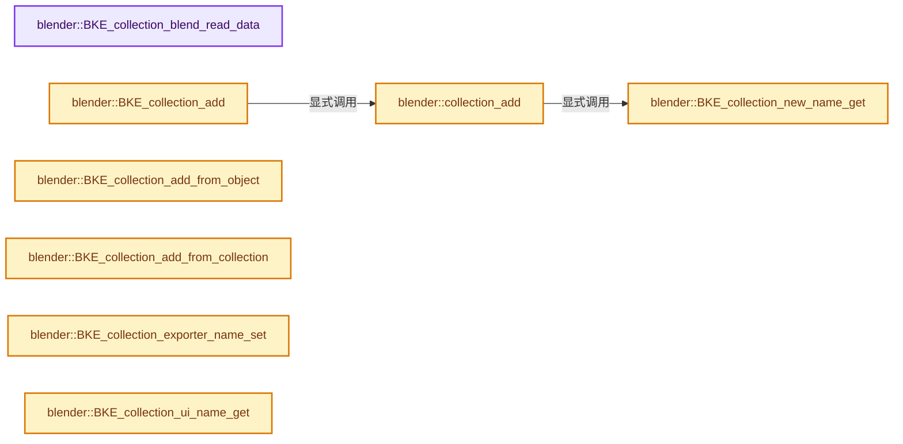
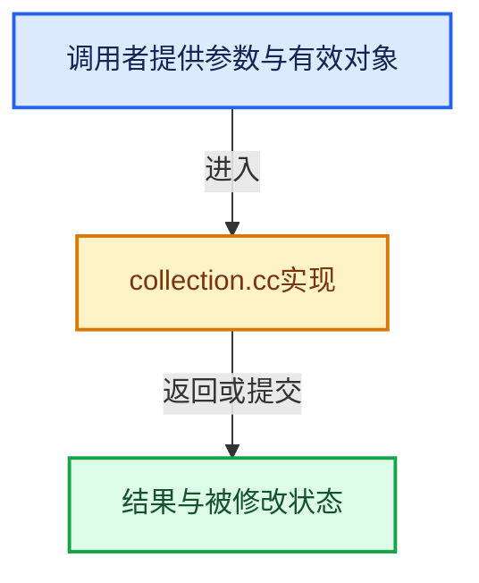

# 实现依赖专题：source/blender/blenkernel/intern/collection.cc

[实现依赖导航](../../README.md) · [符号索引](../../../00-课程指南/02-源码与提交索引/符号依赖与实现索引.md)

本专题从正文实际调用进入，集中保存共享实现。函数有稳定锚点，可从调用处直接跳到对应完整函数；递归与互相调用通过回链组织。

## 本文件的实现关系






## 完整成员与函数实现

<a id="f-e16e53b29c3d8b83"></a>

### `blender::BKE_collection_blend_read_data`

实现位置：[source/blender/blenkernel/intern/collection.cc](../../../../../../../source/blender/blenkernel/intern/collection.cc) · L335—L392。

接口参数：

- `BlendDataReader *reader`
- `Collection *collection`
- `ID *owner_id`

**教学注释版**

<!-- annotated:2b1bc898c1d7a4 -->

```cpp
void BKE_collection_blend_read_data(BlendDataReader *reader, Collection *collection, ID *owner_id)
{
  /* Special case for this pointer, do not rely on regular `lib_link` process here. Avoids needs
   * for do_versioning, and ensures coherence of data in any case.
   *
   * NOTE: Old versions are very often 'broken' here, just fix it silently in these cases.
   */
  if (BLO_read_fileversion_get(reader) > 300) {
    BLI_assert((collection->id.flag & ID_FLAG_EMBEDDED_DATA) != 0 || owner_id == nullptr);
  }
  BLI_assert(owner_id == nullptr || owner_id->lib == collection->id.lib);
  if (owner_id != nullptr && (collection->id.flag & ID_FLAG_EMBEDDED_DATA) == 0) {
    /* This is unfortunate, but currently a lot of existing files (including startup ones) have
     * missing `ID_FLAG_EMBEDDED_DATA` flag.
     *
     * NOTE: Using do_version is not a solution here, since this code will be called before any
     * do_version takes place. Keeping it here also ensures future (or unknown existing) similar
     * bugs won't go easily unnoticed. */
    if (BLO_read_fileversion_get(reader) > 300) {
      CLOG_WARN(&LOG,
                "Fixing root node tree '%s' owned by '%s' missing EMBEDDED tag, please consider "
                "re-saving your (startup) file",
                collection->id.name,
                owner_id->name);
    }
    collection->id.flag |= ID_FLAG_EMBEDDED_DATA;
  }

  collection->runtime = MEM_new<bke::CollectionRuntime>(__func__);
  collection->flag &= ~COLLECTION_FLAG_ALL_RUNTIME;

  collection->owner_id = owner_id;

  BLO_read_struct_list(reader, CollectionObject, &collection->gobject);
  BLO_read_struct_list(reader, CollectionChild, &collection->children);

  BLO_read_struct(reader, CollectionImport, &collection->importer);
  if (collection->importer) {
    collection->importer->runtime = MEM_new<bke::CollectionImportRuntime>(
        "CollectionImportRuntime");

    BLO_read_struct(reader, IDProperty, &collection->importer->import_properties);
    IDP_BlendDataRead(reader, &collection->importer->import_properties);
  }

  BLO_read_struct_list(reader, CollectionExport, &collection->exporters);
  for (CollectionExport &data : collection->exporters) {
    BLO_read_struct(reader, IDProperty, &data.export_properties);
    IDP_BlendDataRead(reader, &data.export_properties);
    BLO_read_struct_list(reader, LayoutPanelState, &data.layout_panel_states);
    for (LayoutPanelState &state : data.layout_panel_states) {
      BLO_read_string(reader, &state.idname);
    }
  }

  BLO_read_struct(reader, PreviewImage, &collection->preview);
  BKE_previewimg_blend_read(reader, collection->preview);
}
```

<details>
<summary>核对原始源码：source/blender/blenkernel/intern/collection.cc · L335—L392</summary>

<!-- original:2b1bc898c1d7a4:source/blender/blenkernel/intern/collection.cc:335:392 -->

```cpp
void BKE_collection_blend_read_data(BlendDataReader *reader, Collection *collection, ID *owner_id)
{
  /* Special case for this pointer, do not rely on regular `lib_link` process here. Avoids needs
   * for do_versioning, and ensures coherence of data in any case.
   *
   * NOTE: Old versions are very often 'broken' here, just fix it silently in these cases.
   */
  if (BLO_read_fileversion_get(reader) > 300) {
    BLI_assert((collection->id.flag & ID_FLAG_EMBEDDED_DATA) != 0 || owner_id == nullptr);
  }
  BLI_assert(owner_id == nullptr || owner_id->lib == collection->id.lib);
  if (owner_id != nullptr && (collection->id.flag & ID_FLAG_EMBEDDED_DATA) == 0) {
    /* This is unfortunate, but currently a lot of existing files (including startup ones) have
     * missing `ID_FLAG_EMBEDDED_DATA` flag.
     *
     * NOTE: Using do_version is not a solution here, since this code will be called before any
     * do_version takes place. Keeping it here also ensures future (or unknown existing) similar
     * bugs won't go easily unnoticed. */
    if (BLO_read_fileversion_get(reader) > 300) {
      CLOG_WARN(&LOG,
                "Fixing root node tree '%s' owned by '%s' missing EMBEDDED tag, please consider "
                "re-saving your (startup) file",
                collection->id.name,
                owner_id->name);
    }
    collection->id.flag |= ID_FLAG_EMBEDDED_DATA;
  }

  collection->runtime = MEM_new<bke::CollectionRuntime>(__func__);
  collection->flag &= ~COLLECTION_FLAG_ALL_RUNTIME;

  collection->owner_id = owner_id;

  BLO_read_struct_list(reader, CollectionObject, &collection->gobject);
  BLO_read_struct_list(reader, CollectionChild, &collection->children);

  BLO_read_struct(reader, CollectionImport, &collection->importer);
  if (collection->importer) {
    collection->importer->runtime = MEM_new<bke::CollectionImportRuntime>(
        "CollectionImportRuntime");

    BLO_read_struct(reader, IDProperty, &collection->importer->import_properties);
    IDP_BlendDataRead(reader, &collection->importer->import_properties);
  }

  BLO_read_struct_list(reader, CollectionExport, &collection->exporters);
  for (CollectionExport &data : collection->exporters) {
    BLO_read_struct(reader, IDProperty, &data.export_properties);
    IDP_BlendDataRead(reader, &data.export_properties);
    BLO_read_struct_list(reader, LayoutPanelState, &data.layout_panel_states);
    for (LayoutPanelState &state : data.layout_panel_states) {
      BLO_read_string(reader, &state.idname);
    }
  }

  BLO_read_struct(reader, PreviewImage, &collection->preview);
  BKE_previewimg_blend_read(reader, collection->preview);
}
```

</details>

**沿实际写入检查状态**

- `collection->id.flag |= ID_FLAG_EMBEDDED_DATA;`
- `collection->runtime = MEM_new<bke::CollectionRuntime>(__func__);`
- `collection->flag &= ~COLLECTION_FLAG_ALL_RUNTIME;`
- `collection->owner_id = owner_id;`
- `collection->importer->runtime = MEM_new<bke::CollectionImportRuntime>(`

**继续追踪实现**

- `BLO_read_fileversion_get` → [BLO_read_fileversion_get · L6323](../../08-其他Blender模块/blenloader/intern/readfile.cc.md#f-f0f8200b859972e0)。
- `BLI_assert` → [BLI_assert · L48](../../01-BLI基础库/BLI_assert.hh.md#m-57a88495704d)；[BLI_assert · L63](../../01-BLI基础库/BLI_assert.hh.md#m-d07050020cb5)。宏定义由构建条件选择。
- `CLOG_WARN` → [CLOG_WARN · L189](../../07-Intern运行时与平台/clog/CLG_log.h.md#m-9da21a06cdbe)。宏定义由构建条件选择。
- `MEM_new<bke::CollectionRuntime>` → [MEM_new · L351](../../07-Intern运行时与平台/guardedalloc/MEM_guardedalloc.h.md#f-115f9b6784f89912)。
- `BLO_read_struct_list` → [BLO_read_struct_list · L542](../../08-其他Blender模块/blenloader/BLO_read_write.hh.md#m-7f0b2171679f)。宏定义由构建条件选择。
- `BLO_read_struct` → [BLO_read_struct · L477](../../08-其他Blender模块/blenloader/BLO_read_write.hh.md#m-d307fd6f7c0e)。宏定义由构建条件选择。
- `MEM_new<bke::CollectionImportRuntime>` → [MEM_new · L351](../../07-Intern运行时与平台/guardedalloc/MEM_guardedalloc.h.md#f-115f9b6784f89912)。
- `IDP_BlendDataRead` → [IDP_BlendDataRead · L430](../BKE_idprop.hh.md#m-8b058cdaeb74)。宏定义由构建条件选择。
- `BLO_read_string` → [BLO_read_string · L6348](../../08-其他Blender模块/blenloader/intern/readfile.cc.md#f-b9cb42e390941235)；[BLO_read_string · L6370](../../08-其他Blender模块/blenloader/intern/readfile.cc.md#f-1bb75b8661d718d2)；[BLO_read_string · L6375](../../08-其他Blender模块/blenloader/intern/readfile.cc.md#f-5714da923b3ad83d)。同名重载需按实参类型选择。
- `BKE_previewimg_blend_read` → [blender::BKE_previewimg_blend_read · L608](preview_image.cc.md#f-a81c208a9956b7d4)。

<a id="f-7e0b119604fe8e68"></a>

### `blender::collection_add`

实现位置：[source/blender/blenkernel/intern/collection.cc](../../../../../../../source/blender/blenkernel/intern/collection.cc) · L469—L496。

接口参数：

- `Main *bmain`
- `Collection *collection_parent`
- `const char *name_custom`

**教学注释版**

<!-- annotated:6377453edaf6db -->

```cpp
static Collection *collection_add(Main *bmain,
                                  Collection *collection_parent,
                                  const char *name_custom)
{
  /* Determine new collection name. */
  char name[MAX_ID_NAME - 2];

  if (name_custom) {
    STRNCPY_UTF8(name, name_custom);
  }
  else {
    BKE_collection_new_name_get(collection_parent, name);
  }

  /* Create new collection. */
  Collection *collection = BKE_id_new<Collection>(bmain, name);

  /* We increase collection user count when linking to Collections. */
  id_us_min(&collection->id);

  /* Optionally add to parent collection. */
  if (collection_parent) {
    collection_child_add(bmain, collection_parent, collection, nullptr, 0, true);
    collection->color_tag = collection_parent->color_tag;
  }

  return collection;
}
```

<details>
<summary>核对原始源码：source/blender/blenkernel/intern/collection.cc · L469—L496</summary>

<!-- original:6377453edaf6db:source/blender/blenkernel/intern/collection.cc:469:496 -->

```cpp
static Collection *collection_add(Main *bmain,
                                  Collection *collection_parent,
                                  const char *name_custom)
{
  /* Determine new collection name. */
  char name[MAX_ID_NAME - 2];

  if (name_custom) {
    STRNCPY_UTF8(name, name_custom);
  }
  else {
    BKE_collection_new_name_get(collection_parent, name);
  }

  /* Create new collection. */
  Collection *collection = BKE_id_new<Collection>(bmain, name);

  /* We increase collection user count when linking to Collections. */
  id_us_min(&collection->id);

  /* Optionally add to parent collection. */
  if (collection_parent) {
    collection_child_add(bmain, collection_parent, collection, nullptr, 0, true);
    collection->color_tag = collection_parent->color_tag;
  }

  return collection;
}
```

</details>

**沿实际写入检查状态**

- `collection->color_tag = collection_parent->color_tag;`

**结果出口**

- `return collection;`

**继续追踪实现**

- `STRNCPY_UTF8` → [STRNCPY_UTF8 · L335](../../01-BLI基础库/BLI_string_utf8.hh.md#m-222967f0ab6a)。宏定义由构建条件选择。
- `BKE_collection_new_name_get` → [blender::BKE_collection_new_name_get · L864](collection.cc.md#f-d9ad6f1dece34c13)。
- `BKE_id_new<Collection>` → [blender::BKE_id_new · L1612](lib_id.cc.md#f-5335c97ce0a8fbc8)。
- `id_us_min` → [blender::id_us_min · L441](lib_id.cc.md#f-c5e5246a79962257)。
- `collection_child_add` → [blender::collection_child_add · L2102](collection.cc.md#f-2b277883bc77c81e)。

<a id="f-c43a1a4e94784fc1"></a>

### `blender::BKE_collection_add`

实现位置：[source/blender/blenkernel/intern/collection.cc](../../../../../../../source/blender/blenkernel/intern/collection.cc) · L498—L503。

接口参数：

- `Main *bmain`
- `Collection *collection_parent`
- `const char *name_custom`

**教学注释版**

<!-- annotated:5d10cc5f687e40 -->

```cpp
Collection *BKE_collection_add(Main *bmain, Collection *collection_parent, const char *name_custom)
{
  Collection *collection = collection_add(bmain, collection_parent, name_custom);
  BKE_main_collection_sync(bmain);
  return collection;
}
```

<details>
<summary>核对原始源码：source/blender/blenkernel/intern/collection.cc · L498—L503</summary>

<!-- original:5d10cc5f687e40:source/blender/blenkernel/intern/collection.cc:498:503 -->

```cpp
Collection *BKE_collection_add(Main *bmain, Collection *collection_parent, const char *name_custom)
{
  Collection *collection = collection_add(bmain, collection_parent, name_custom);
  BKE_main_collection_sync(bmain);
  return collection;
}
```

</details>

**结果出口**

- `return collection;`

**继续追踪实现**

- `collection_add` → [blender::collection_add · L469](collection.cc.md#f-7e0b119604fe8e68)。
- `BKE_main_collection_sync` → [blender::BKE_main_collection_sync · L1495](layer.cc.md#f-b8bf5a4c8231e380)。

<a id="f-d89e1c240f7736ee"></a>

### `blender::BKE_collection_add_from_object`

实现位置：[source/blender/blenkernel/intern/collection.cc](../../../../../../../source/blender/blenkernel/intern/collection.cc) · L505—L527。

接口参数：

- `Main *bmain`
- `Scene *scene`
- `const Object *ob_src`
- `Collection *collection_dst`

**教学注释版**

<!-- annotated:61ce8425f1242c -->

```cpp
void BKE_collection_add_from_object(Main *bmain,
                                    Scene *scene,
                                    const Object *ob_src,
                                    Collection *collection_dst)
{
  bool is_instantiated = false;

  FOREACH_SCENE_COLLECTION_BEGIN (scene, collection) {
    if (!ID_IS_LINKED(collection) && !ID_IS_OVERRIDABLE_LIBRARY(collection) &&
        BKE_collection_has_object(collection, ob_src))
    {
      collection_child_add(bmain, collection, collection_dst, nullptr, 0, true);
      is_instantiated = true;
    }
  }
  FOREACH_SCENE_COLLECTION_END;

  if (!is_instantiated) {
    collection_child_add(bmain, scene->master_collection, collection_dst, nullptr, 0, true);
  }

  BKE_main_collection_sync(bmain);
}
```

<details>
<summary>核对原始源码：source/blender/blenkernel/intern/collection.cc · L505—L527</summary>

<!-- original:61ce8425f1242c:source/blender/blenkernel/intern/collection.cc:505:527 -->

```cpp
void BKE_collection_add_from_object(Main *bmain,
                                    Scene *scene,
                                    const Object *ob_src,
                                    Collection *collection_dst)
{
  bool is_instantiated = false;

  FOREACH_SCENE_COLLECTION_BEGIN (scene, collection) {
    if (!ID_IS_LINKED(collection) && !ID_IS_OVERRIDABLE_LIBRARY(collection) &&
        BKE_collection_has_object(collection, ob_src))
    {
      collection_child_add(bmain, collection, collection_dst, nullptr, 0, true);
      is_instantiated = true;
    }
  }
  FOREACH_SCENE_COLLECTION_END;

  if (!is_instantiated) {
    collection_child_add(bmain, scene->master_collection, collection_dst, nullptr, 0, true);
  }

  BKE_main_collection_sync(bmain);
}
```

</details>

**沿实际写入检查状态**

- `is_instantiated = true;`

**继续追踪实现**

- `ID_IS_LINKED` → [ID_IS_LINKED · L697](../../08-其他Blender模块/makesdna/DNA_ID.h.md#m-7e1e1e9b20e6)。宏定义由构建条件选择。
- `ID_IS_OVERRIDABLE_LIBRARY` → [ID_IS_OVERRIDABLE_LIBRARY · L721](../../08-其他Blender模块/makesdna/DNA_ID.h.md#m-c4870a0c3949)。宏定义由构建条件选择。
- `BKE_collection_has_object` → [blender::BKE_collection_has_object · L1122](collection.cc.md#f-22c8bdbe882d79a1)。
- `collection_child_add` → [blender::collection_child_add · L2102](collection.cc.md#f-2b277883bc77c81e)。
- `BKE_main_collection_sync` → [blender::BKE_main_collection_sync · L1495](layer.cc.md#f-b8bf5a4c8231e380)。

<a id="f-6bf0dcaf127626e0"></a>

### `blender::BKE_collection_add_from_collection`

实现位置：[source/blender/blenkernel/intern/collection.cc](../../../../../../../source/blender/blenkernel/intern/collection.cc) · L529—L556。

接口参数：

- `Main *bmain`
- `Scene *scene`
- `Collection *collection_src`
- `Collection *collection_dst`

**教学注释版**

<!-- annotated:ddf0ddcbdb5523 -->

```cpp
void BKE_collection_add_from_collection(Main *bmain,
                                        Scene *scene,
                                        Collection *collection_src,
                                        Collection *collection_dst)
{
  bool is_instantiated = false;

  FOREACH_SCENE_COLLECTION_BEGIN (scene, collection) {
    if (BKE_collection_is_content_editable(collection) &&
        BKE_collection_child_find(collection, collection_src))
    {
      collection_child_add(bmain, collection, collection_dst, nullptr, 0, true);
      is_instantiated = true;
    }
    else if (!is_instantiated && BKE_collection_child_find(collection, collection_dst)) {
      /* If given collection_dst is already instantiated in scene, even if its 'model'
       * collection_src one is not, do not add it to master scene collection. */
      is_instantiated = true;
    }
  }
  FOREACH_SCENE_COLLECTION_END;

  if (!is_instantiated) {
    collection_child_add(bmain, scene->master_collection, collection_dst, nullptr, 0, true);
  }

  BKE_main_collection_sync(bmain);
}
```

<details>
<summary>核对原始源码：source/blender/blenkernel/intern/collection.cc · L529—L556</summary>

<!-- original:ddf0ddcbdb5523:source/blender/blenkernel/intern/collection.cc:529:556 -->

```cpp
void BKE_collection_add_from_collection(Main *bmain,
                                        Scene *scene,
                                        Collection *collection_src,
                                        Collection *collection_dst)
{
  bool is_instantiated = false;

  FOREACH_SCENE_COLLECTION_BEGIN (scene, collection) {
    if (BKE_collection_is_content_editable(collection) &&
        BKE_collection_child_find(collection, collection_src))
    {
      collection_child_add(bmain, collection, collection_dst, nullptr, 0, true);
      is_instantiated = true;
    }
    else if (!is_instantiated && BKE_collection_child_find(collection, collection_dst)) {
      /* If given collection_dst is already instantiated in scene, even if its 'model'
       * collection_src one is not, do not add it to master scene collection. */
      is_instantiated = true;
    }
  }
  FOREACH_SCENE_COLLECTION_END;

  if (!is_instantiated) {
    collection_child_add(bmain, scene->master_collection, collection_dst, nullptr, 0, true);
  }

  BKE_main_collection_sync(bmain);
}
```

</details>

**沿实际写入检查状态**

- `is_instantiated = true;`

**继续追踪实现**

- `BKE_collection_is_content_editable` → [blender::BKE_collection_is_content_editable · L1575](collection.cc.md#f-962f81cbebe4769c)。
- `BKE_collection_child_find` → [blender::BKE_collection_child_find · L2070](collection.cc.md#f-688e234b4426ca90)。
- `collection_child_add` → [blender::collection_child_add · L2102](collection.cc.md#f-2b277883bc77c81e)。
- `BKE_main_collection_sync` → [blender::BKE_main_collection_sync · L1495](layer.cc.md#f-b8bf5a4c8231e380)。

<a id="f-eb880465a2d9b572"></a>

### `blender::BKE_collection_exporter_name_set`

实现位置：[source/blender/blenkernel/intern/collection.cc](../../../../../../../source/blender/blenkernel/intern/collection.cc) · L570—L582。

接口参数：

- `const ListBaseT<CollectionExport> *exporters`
- `CollectionExport *data`
- `const char *newname`

**教学注释版**

<!-- annotated:43d04ac2a1913e -->

```cpp
void BKE_collection_exporter_name_set(const ListBaseT<CollectionExport> *exporters,
                                      CollectionExport *data,
                                      const char *newname)
{
  /* Only use the new name if it's not empty. */
  if (newname && newname[0] != '\0') {
    ListBaseT<CollectionExport> list = exporters ? *exporters : BLI_listbase_from_link(data);

    STRNCPY(data->name, newname);
    BLI_uniquename(
        &list, data, newname, '.', offsetof(CollectionExport, name), sizeof(data->name));
  }
}
```

<details>
<summary>核对原始源码：source/blender/blenkernel/intern/collection.cc · L570—L582</summary>

<!-- original:43d04ac2a1913e:source/blender/blenkernel/intern/collection.cc:570:582 -->

```cpp
void BKE_collection_exporter_name_set(const ListBaseT<CollectionExport> *exporters,
                                      CollectionExport *data,
                                      const char *newname)
{
  /* Only use the new name if it's not empty. */
  if (newname && newname[0] != '\0') {
    ListBaseT<CollectionExport> list = exporters ? *exporters : BLI_listbase_from_link(data);

    STRNCPY(data->name, newname);
    BLI_uniquename(
        &list, data, newname, '.', offsetof(CollectionExport, name), sizeof(data->name));
  }
}
```

</details>

**继续追踪实现**

- `BLI_listbase_from_link` → [blender::BLI_listbase_from_link · L814](../../01-BLI基础库/intern/listbase.cc.md#f-54d83055e6f726c5)；[blender::BLI_listbase_from_link · L44](../../01-BLI基础库/BLI_listbase.hh.md#f-c2fa8aa0bf6b15f7)。同名重载需按实参类型选择。
- `STRNCPY` → [blender::STRNCPY · L690](../../01-BLI基础库/BLI_string.hh.md#f-6b2d861724026be6)。
- `BLI_uniquename` → [blender::BLI_uniquename · L491](../../01-BLI基础库/intern/string_utils.cc.md#f-bcf1a000dbfb87d1)。

<a id="f-d9ad6f1dece34c13"></a>

### `blender::BKE_collection_new_name_get`

实现位置：[source/blender/blenkernel/intern/collection.cc](../../../../../../../source/blender/blenkernel/intern/collection.cc) · L864—L882。

接口参数：

- `Collection *collection_parent`
- `char r_name[MAX_ID_NAME - 2]`

**教学注释版**

<!-- annotated:f3c8fbad96ab7b -->

```cpp
void BKE_collection_new_name_get(Collection *collection_parent, char r_name[MAX_ID_NAME - 2])
{
  const size_t name_maxncpy = MAX_ID_NAME - 2;
  if (!collection_parent) {
    BLI_strncpy_utf8(r_name, DATA_("Collection"), name_maxncpy);
  }
  else if (collection_parent->flag & COLLECTION_IS_MASTER) {
    BLI_snprintf_utf8(
        r_name, name_maxncpy, DATA_("Collection %d"), collection_parent->children.count() + 1);
  }
  else {
    const int number = collection_parent->children.count() + 1;
    const int digits = integer_digits_i(number);
    const size_t name_part_maxncpy = name_maxncpy - (1 + digits);
    const size_t name_part_len = BLI_strncpy_utf8_rlen(
        r_name, collection_parent->id.name + 2, name_part_maxncpy);
    BLI_snprintf(r_name + name_part_len, name_maxncpy - name_part_len, " %d", number);
  }
}
```

<details>
<summary>核对原始源码：source/blender/blenkernel/intern/collection.cc · L864—L882</summary>

<!-- original:f3c8fbad96ab7b:source/blender/blenkernel/intern/collection.cc:864:882 -->

```cpp
void BKE_collection_new_name_get(Collection *collection_parent, char r_name[MAX_ID_NAME - 2])
{
  const size_t name_maxncpy = MAX_ID_NAME - 2;
  if (!collection_parent) {
    BLI_strncpy_utf8(r_name, DATA_("Collection"), name_maxncpy);
  }
  else if (collection_parent->flag & COLLECTION_IS_MASTER) {
    BLI_snprintf_utf8(
        r_name, name_maxncpy, DATA_("Collection %d"), collection_parent->children.count() + 1);
  }
  else {
    const int number = collection_parent->children.count() + 1;
    const int digits = integer_digits_i(number);
    const size_t name_part_maxncpy = name_maxncpy - (1 + digits);
    const size_t name_part_len = BLI_strncpy_utf8_rlen(
        r_name, collection_parent->id.name + 2, name_part_maxncpy);
    BLI_snprintf(r_name + name_part_len, name_maxncpy - name_part_len, " %d", number);
  }
}
```

</details>

**继续追踪实现**

- `BLI_strncpy_utf8` → [blender::BLI_strncpy_utf8 · L404](../../01-BLI基础库/intern/string_utf8.cc.md#f-ff7c5f28742085a0)。
- `DATA_` → [DATA_ · L52](../../08-其他Blender模块/blentranslation/BLT_translation.hh.md#m-178736083f83)。宏定义由构建条件选择。
- `BLI_snprintf_utf8` → [blender::BLI_snprintf_utf8 · L597](../../01-BLI基础库/intern/string_utf8.cc.md#f-47c5b052ec665ff6)。
- `collection_parent->children.count` → [调用协议](../../../00-课程指南/01-路线与规范/模板宏与动态分派协议.md)：接收对象类型依赖auto、返回值或模板实例；不按同名猜测目标。调用位置L872。
- `integer_digits_i` → [blender::integer_digits_i · L573](../../01-BLI基础库/intern/math_base_inline.cc.md#f-a7d8671edfaf2e45)。
- `BLI_strncpy_utf8_rlen` → [blender::BLI_strncpy_utf8_rlen · L414](../../01-BLI基础库/intern/string_utf8.cc.md#f-7e04b018fd7a0802)。
- `BLI_snprintf` → [blender::BLI_snprintf · L201](../../01-BLI基础库/intern/string.cc.md#f-c4de2f0e81459332)。

<a id="f-9cd01b0353acc5c1"></a>

### `blender::BKE_collection_ui_name_get`

实现位置：[source/blender/blenkernel/intern/collection.cc](../../../../../../../source/blender/blenkernel/intern/collection.cc) · L884—L891。

接口参数：

- `Collection *collection`

**教学注释版**

<!-- annotated:a811a6be519bd9 -->

```cpp
const char *BKE_collection_ui_name_get(Collection *collection)
{
  if (collection->flag & COLLECTION_IS_MASTER) {
    return IFACE_("Scene Collection");
  }

  return collection->id.name + 2;
}
```

<details>
<summary>核对原始源码：source/blender/blenkernel/intern/collection.cc · L884—L891</summary>

<!-- original:a811a6be519bd9:source/blender/blenkernel/intern/collection.cc:884:891 -->

```cpp
const char *BKE_collection_ui_name_get(Collection *collection)
{
  if (collection->flag & COLLECTION_IS_MASTER) {
    return IFACE_("Scene Collection");
  }

  return collection->id.name + 2;
}
```

</details>

**结果出口**

- `return IFACE_("Scene Collection");`
- `return collection->id.name + 2;`

**继续追踪实现**

- `IFACE_` → [IFACE_ · L49](../../08-其他Blender模块/blentranslation/BLT_translation.hh.md#m-378ed115fdc8)。宏定义由构建条件选择。

<a id="f-9e24961fda2f50c7"></a>

### `blender::collection_object_cache_fill`

实现位置：[source/blender/blenkernel/intern/collection.cc](../../../../../../../source/blender/blenkernel/intern/collection.cc) · L899—L933。

接口参数：

- `ListBaseT<Base> *lb`
- `Collection *collection`
- `int parent_restrict`
- `bool with_instances`

**教学注释版**

<!-- annotated:c5c5d92ebb8ca2 -->

```cpp
static void collection_object_cache_fill(ListBaseT<Base> *lb,
                                         Collection *collection,
                                         int parent_restrict,
                                         bool with_instances)
{
  int child_restrict = collection->flag | parent_restrict;

  for (CollectionObject &cob : collection->gobject) {
    Base *base = static_cast<Base *>(BLI_findptr(lb, cob.ob, offsetof(Base, object)));

    if (base == nullptr) {
      base = MEM_new<Base>("Object Base");
      base->object = cob.ob;
      BLI_addtail(lb, base);
      if (with_instances && cob.ob->instance_collection) {
        collection_object_cache_fill(
            lb, cob.ob->instance_collection, child_restrict, with_instances);
      }
    }

    /* Only collection flags are checked here currently, object restrict flag is checked
     * in FOREACH_COLLECTION_VISIBLE_OBJECT_RECURSIVE_BEGIN since it can be animated
     * without updating the cache. */
    if ((child_restrict & COLLECTION_HIDE_VIEWPORT) == 0) {
      base->flag |= BASE_ENABLED_VIEWPORT;
    }
    if ((child_restrict & COLLECTION_HIDE_RENDER) == 0) {
      base->flag |= BASE_ENABLED_RENDER;
    }
  }

  for (CollectionChild &child : collection->children) {
    collection_object_cache_fill(lb, child.collection, child_restrict, with_instances);
  }
}
```

<details>
<summary>核对原始源码：source/blender/blenkernel/intern/collection.cc · L899—L933</summary>

<!-- original:c5c5d92ebb8ca2:source/blender/blenkernel/intern/collection.cc:899:933 -->

```cpp
static void collection_object_cache_fill(ListBaseT<Base> *lb,
                                         Collection *collection,
                                         int parent_restrict,
                                         bool with_instances)
{
  int child_restrict = collection->flag | parent_restrict;

  for (CollectionObject &cob : collection->gobject) {
    Base *base = static_cast<Base *>(BLI_findptr(lb, cob.ob, offsetof(Base, object)));

    if (base == nullptr) {
      base = MEM_new<Base>("Object Base");
      base->object = cob.ob;
      BLI_addtail(lb, base);
      if (with_instances && cob.ob->instance_collection) {
        collection_object_cache_fill(
            lb, cob.ob->instance_collection, child_restrict, with_instances);
      }
    }

    /* Only collection flags are checked here currently, object restrict flag is checked
     * in FOREACH_COLLECTION_VISIBLE_OBJECT_RECURSIVE_BEGIN since it can be animated
     * without updating the cache. */
    if ((child_restrict & COLLECTION_HIDE_VIEWPORT) == 0) {
      base->flag |= BASE_ENABLED_VIEWPORT;
    }
    if ((child_restrict & COLLECTION_HIDE_RENDER) == 0) {
      base->flag |= BASE_ENABLED_RENDER;
    }
  }

  for (CollectionChild &child : collection->children) {
    collection_object_cache_fill(lb, child.collection, child_restrict, with_instances);
  }
}
```

</details>

**沿实际写入检查状态**

- `base = MEM_new<Base>("Object Base");`
- `base->object = cob.ob;`
- `base->flag |= BASE_ENABLED_VIEWPORT;`
- `base->flag |= BASE_ENABLED_RENDER;`

**继续追踪实现**

- `BLI_findptr` → [blender::BLI_findptr · L710](../../01-BLI基础库/intern/listbase.cc.md#f-3093e95bd403c099)。
- `MEM_new<Base>` → [MEM_new · L351](../../07-Intern运行时与平台/guardedalloc/MEM_guardedalloc.h.md#f-115f9b6784f89912)。
- `BLI_addtail` → [blender::BLI_addtail · L118](../../01-BLI基础库/intern/listbase.cc.md#f-4fb027713fa3115b)。
- `collection_object_cache_fill` → [blender::collection_object_cache_fill · L899](collection.cc.md#f-9e24961fda2f50c7)。

<a id="f-4f2e28565d808887"></a>

### `blender::BKE_collection_object_cache_get`

实现位置：[source/blender/blenkernel/intern/collection.cc](../../../../../../../source/blender/blenkernel/intern/collection.cc) · L935—L948。

接口参数：

- `Collection *collection`

**教学注释版**

<!-- annotated:36745c2a5933cd -->

```cpp
ListBaseT<Base> BKE_collection_object_cache_get(Collection *collection)
{
  if (!(collection->flag & COLLECTION_HAS_OBJECT_CACHE)) {
    static Mutex cache_lock;

    std::scoped_lock lock(cache_lock);
    if (!(collection->flag & COLLECTION_HAS_OBJECT_CACHE)) {
      collection_object_cache_fill(&collection->runtime->object_cache, collection, 0, false);
      collection->flag |= COLLECTION_HAS_OBJECT_CACHE;
    }
  }

  return collection->runtime->object_cache;
}
```

<details>
<summary>核对原始源码：source/blender/blenkernel/intern/collection.cc · L935—L948</summary>

<!-- original:36745c2a5933cd:source/blender/blenkernel/intern/collection.cc:935:948 -->

```cpp
ListBaseT<Base> BKE_collection_object_cache_get(Collection *collection)
{
  if (!(collection->flag & COLLECTION_HAS_OBJECT_CACHE)) {
    static Mutex cache_lock;

    std::scoped_lock lock(cache_lock);
    if (!(collection->flag & COLLECTION_HAS_OBJECT_CACHE)) {
      collection_object_cache_fill(&collection->runtime->object_cache, collection, 0, false);
      collection->flag |= COLLECTION_HAS_OBJECT_CACHE;
    }
  }

  return collection->runtime->object_cache;
}
```

</details>

**沿实际写入检查状态**

- `collection->flag |= COLLECTION_HAS_OBJECT_CACHE;`

**结果出口**

- `return collection->runtime->object_cache;`

**继续追踪实现**

- `collection_object_cache_fill` → [blender::collection_object_cache_fill · L899](collection.cc.md#f-9e24961fda2f50c7)。

<a id="f-0c1e94c26fac6c83"></a>

### `blender::BKE_collection_object_cache_instanced_get`

实现位置：[source/blender/blenkernel/intern/collection.cc](../../../../../../../source/blender/blenkernel/intern/collection.cc) · L950—L964。

接口参数：

- `Collection *collection`

**教学注释版**

<!-- annotated:4a8c76d7e6c25b -->

```cpp
ListBaseT<Base> BKE_collection_object_cache_instanced_get(Collection *collection)
{
  if (!(collection->flag & COLLECTION_HAS_OBJECT_CACHE_INSTANCED)) {
    static Mutex cache_lock;

    std::scoped_lock lock(cache_lock);
    if (!(collection->flag & COLLECTION_HAS_OBJECT_CACHE_INSTANCED)) {
      collection_object_cache_fill(
          &collection->runtime->object_cache_instanced, collection, 0, true);
      collection->flag |= COLLECTION_HAS_OBJECT_CACHE_INSTANCED;
    }
  }

  return collection->runtime->object_cache_instanced;
}
```

<details>
<summary>核对原始源码：source/blender/blenkernel/intern/collection.cc · L950—L964</summary>

<!-- original:4a8c76d7e6c25b:source/blender/blenkernel/intern/collection.cc:950:964 -->

```cpp
ListBaseT<Base> BKE_collection_object_cache_instanced_get(Collection *collection)
{
  if (!(collection->flag & COLLECTION_HAS_OBJECT_CACHE_INSTANCED)) {
    static Mutex cache_lock;

    std::scoped_lock lock(cache_lock);
    if (!(collection->flag & COLLECTION_HAS_OBJECT_CACHE_INSTANCED)) {
      collection_object_cache_fill(
          &collection->runtime->object_cache_instanced, collection, 0, true);
      collection->flag |= COLLECTION_HAS_OBJECT_CACHE_INSTANCED;
    }
  }

  return collection->runtime->object_cache_instanced;
}
```

</details>

**沿实际写入检查状态**

- `collection->flag |= COLLECTION_HAS_OBJECT_CACHE_INSTANCED;`

**结果出口**

- `return collection->runtime->object_cache_instanced;`

**继续追踪实现**

- `collection_object_cache_fill` → [blender::collection_object_cache_fill · L899](collection.cc.md#f-9e24961fda2f50c7)。

<a id="f-58f838d8a1e938b7"></a>

### `blender::collection_object_cache_free`

实现位置：[source/blender/blenkernel/intern/collection.cc](../../../../../../../source/blender/blenkernel/intern/collection.cc) · L966—L989。

接口参数：

- `const Main *bmain`
- `Collection *collection`
- `const int id_create_flag`
- `const uint id_recalc_flag`

**教学注释版**

<!-- annotated:d97361e443e6a4 -->

```cpp
static void collection_object_cache_free(const Main *bmain,
                                         Collection *collection,
                                         const int id_create_flag,
                                         const uint id_recalc_flag)
{
  collection->flag &= ~(COLLECTION_HAS_OBJECT_CACHE | COLLECTION_HAS_OBJECT_CACHE_INSTANCED);
  collection->runtime->object_cache.free_no_destruct();
  collection->runtime->object_cache_instanced.free_no_destruct();

  /* Although it may seem abusive to call depsgraph updates from this utility function,
   * it is called from any code-path modifying the collections hierarchy and/or their objects.
   * Including the reversed-hierarchy walked by #collection_object_cache_free_parent_recursive.
   *
   * Plus, the main reason to tag the hierarchy of parents for deg update is because their object
   * caches are being freed.
   *
   * Having this code here avoids the need for another utility tagging function processing the
   * parent hierarchy as well. */
  if (id_recalc_flag && (id_create_flag & (LIB_ID_CREATE_NO_MAIN | LIB_ID_CREATE_NO_DEG_TAG)) == 0)
  {
    BLI_assert(bmain != nullptr);
    DEG_id_tag_update_ex(const_cast<Main *>(bmain), &collection->id, id_recalc_flag);
  }
}
```

<details>
<summary>核对原始源码：source/blender/blenkernel/intern/collection.cc · L966—L989</summary>

<!-- original:d97361e443e6a4:source/blender/blenkernel/intern/collection.cc:966:989 -->

```cpp
static void collection_object_cache_free(const Main *bmain,
                                         Collection *collection,
                                         const int id_create_flag,
                                         const uint id_recalc_flag)
{
  collection->flag &= ~(COLLECTION_HAS_OBJECT_CACHE | COLLECTION_HAS_OBJECT_CACHE_INSTANCED);
  collection->runtime->object_cache.free_no_destruct();
  collection->runtime->object_cache_instanced.free_no_destruct();

  /* Although it may seem abusive to call depsgraph updates from this utility function,
   * it is called from any code-path modifying the collections hierarchy and/or their objects.
   * Including the reversed-hierarchy walked by #collection_object_cache_free_parent_recursive.
   *
   * Plus, the main reason to tag the hierarchy of parents for deg update is because their object
   * caches are being freed.
   *
   * Having this code here avoids the need for another utility tagging function processing the
   * parent hierarchy as well. */
  if (id_recalc_flag && (id_create_flag & (LIB_ID_CREATE_NO_MAIN | LIB_ID_CREATE_NO_DEG_TAG)) == 0)
  {
    BLI_assert(bmain != nullptr);
    DEG_id_tag_update_ex(const_cast<Main *>(bmain), &collection->id, id_recalc_flag);
  }
}
```

</details>

**沿实际写入检查状态**

- `collection->flag &= ~(COLLECTION_HAS_OBJECT_CACHE | COLLECTION_HAS_OBJECT_CACHE_INSTANCED);`

**继续追踪实现**

- `collection->runtime->object_cache.free_no_destruct` → [调用协议](../../../00-课程指南/01-路线与规范/模板宏与动态分派协议.md)：接收对象类型依赖auto、返回值或模板实例；不按同名猜测目标。调用位置L972。
- `collection->runtime->object_cache_instanced.free_no_destruct` → [调用协议](../../../00-课程指南/01-路线与规范/模板宏与动态分派协议.md)：接收对象类型依赖auto、返回值或模板实例；不按同名猜测目标。调用位置L973。
- `BLI_assert` → [BLI_assert · L48](../../01-BLI基础库/BLI_assert.hh.md#m-57a88495704d)；[BLI_assert · L63](../../01-BLI基础库/BLI_assert.hh.md#m-d07050020cb5)。宏定义由构建条件选择。
- `DEG_id_tag_update_ex` → [blender::DEG_id_tag_update_ex · L849](../../06-Depsgraph依赖图/intern/depsgraph_tag.cc.md#f-6396e6eeab36fb34)。

<a id="f-cca8e3416adc43be"></a>

### `blender::collection_object_cache_free_parent_recursive`

实现位置：[source/blender/blenkernel/intern/collection.cc](../../../../../../../source/blender/blenkernel/intern/collection.cc) · L992—L1010。

接口参数：

- `const Main *bmain`
- `Collection *collection`
- `const int id_create_flag`
- `const uint id_recalc_flag`

**教学注释版**

<!-- annotated:ad20b44576c562 -->

```cpp
static void collection_object_cache_free_parent_recursive(const Main *bmain,
                                                          Collection *collection,
                                                          const int id_create_flag,
                                                          const uint id_recalc_flag)
{
  collection_object_cache_free(bmain, collection, id_create_flag, id_recalc_flag);

  /* Clear cache in all parents recursively, since those are affected by changes as well. */
  for (CollectionParent &parent : collection->runtime->parents) {
    /* In theory there should be no nullptr pointer here. However, this code can be called from
     * non-valid temporary states (e.g. indirectly from #BKE_collections_object_remove_invalids
     * as part of ID remapping process). */
    if (parent.collection == nullptr) {
      continue;
    }
    collection_object_cache_free_parent_recursive(
        bmain, parent.collection, id_create_flag, id_recalc_flag);
  }
}
```

<details>
<summary>核对原始源码：source/blender/blenkernel/intern/collection.cc · L992—L1010</summary>

<!-- original:ad20b44576c562:source/blender/blenkernel/intern/collection.cc:992:1010 -->

```cpp
static void collection_object_cache_free_parent_recursive(const Main *bmain,
                                                          Collection *collection,
                                                          const int id_create_flag,
                                                          const uint id_recalc_flag)
{
  collection_object_cache_free(bmain, collection, id_create_flag, id_recalc_flag);

  /* Clear cache in all parents recursively, since those are affected by changes as well. */
  for (CollectionParent &parent : collection->runtime->parents) {
    /* In theory there should be no nullptr pointer here. However, this code can be called from
     * non-valid temporary states (e.g. indirectly from #BKE_collections_object_remove_invalids
     * as part of ID remapping process). */
    if (parent.collection == nullptr) {
      continue;
    }
    collection_object_cache_free_parent_recursive(
        bmain, parent.collection, id_create_flag, id_recalc_flag);
  }
}
```

</details>

**继续追踪实现**

- `collection_object_cache_free` → [blender::collection_object_cache_free · L966](collection.cc.md#f-58f838d8a1e938b7)。
- `collection_object_cache_free_parent_recursive` → [blender::collection_object_cache_free_parent_recursive · L992](collection.cc.md#f-cca8e3416adc43be)。

<a id="f-ff1944b999586b5a"></a>

### `blender::BKE_collection_object_cache_free`

实现位置：[source/blender/blenkernel/intern/collection.cc](../../../../../../../source/blender/blenkernel/intern/collection.cc) · L1012—L1019。

接口参数：

- `const Main *bmain`
- `Collection *collection`
- `const int id_create_flag`

**教学注释版**

<!-- annotated:f4a9d582feb79f -->

```cpp
void BKE_collection_object_cache_free(const Main *bmain,
                                      Collection *collection,
                                      const int id_create_flag)
{
  BLI_assert(collection != nullptr);
  collection_object_cache_free_parent_recursive(
      bmain, collection, id_create_flag, ID_RECALC_HIERARCHY | ID_RECALC_GEOMETRY);
}
```

<details>
<summary>核对原始源码：source/blender/blenkernel/intern/collection.cc · L1012—L1019</summary>

<!-- original:f4a9d582feb79f:source/blender/blenkernel/intern/collection.cc:1012:1019 -->

```cpp
void BKE_collection_object_cache_free(const Main *bmain,
                                      Collection *collection,
                                      const int id_create_flag)
{
  BLI_assert(collection != nullptr);
  collection_object_cache_free_parent_recursive(
      bmain, collection, id_create_flag, ID_RECALC_HIERARCHY | ID_RECALC_GEOMETRY);
}
```

</details>

**继续追踪实现**

- `BLI_assert` → [BLI_assert · L48](../../01-BLI基础库/BLI_assert.hh.md#m-57a88495704d)；[BLI_assert · L63](../../01-BLI基础库/BLI_assert.hh.md#m-d07050020cb5)。宏定义由构建条件选择。
- `collection_object_cache_free_parent_recursive` → [blender::collection_object_cache_free_parent_recursive · L992](collection.cc.md#f-cca8e3416adc43be)。

<a id="f-4e352a1948181e87"></a>

### `blender::BKE_main_collections_object_cache_free`

实现位置：[source/blender/blenkernel/intern/collection.cc](../../../../../../../source/blender/blenkernel/intern/collection.cc) · L1021—L1035。

接口参数：

- `const Main *bmain`

**教学注释版**

<!-- annotated:85f3df307b57f8 -->

```cpp
void BKE_main_collections_object_cache_free(const Main *bmain)
{
  for (Scene *scene = bmain->scenes.first(); scene != nullptr;
       scene = static_cast<Scene *>(scene->id.next))
  {
    collection_object_cache_free(
        bmain, scene->master_collection, 0, ID_RECALC_HIERARCHY | ID_RECALC_GEOMETRY);
  }

  for (Collection *collection = bmain->collections.first(); collection != nullptr;
       collection = static_cast<Collection *>(collection->id.next))
  {
    collection_object_cache_free(bmain, collection, 0, ID_RECALC_HIERARCHY | ID_RECALC_GEOMETRY);
  }
}
```

<details>
<summary>核对原始源码：source/blender/blenkernel/intern/collection.cc · L1021—L1035</summary>

<!-- original:85f3df307b57f8:source/blender/blenkernel/intern/collection.cc:1021:1035 -->

```cpp
void BKE_main_collections_object_cache_free(const Main *bmain)
{
  for (Scene *scene = bmain->scenes.first(); scene != nullptr;
       scene = static_cast<Scene *>(scene->id.next))
  {
    collection_object_cache_free(
        bmain, scene->master_collection, 0, ID_RECALC_HIERARCHY | ID_RECALC_GEOMETRY);
  }

  for (Collection *collection = bmain->collections.first(); collection != nullptr;
       collection = static_cast<Collection *>(collection->id.next))
  {
    collection_object_cache_free(bmain, collection, 0, ID_RECALC_HIERARCHY | ID_RECALC_GEOMETRY);
  }
}
```

</details>

**沿实际写入检查状态**

- `scene = static_cast<Scene *>(scene->id.next))`
- `collection = static_cast<Collection *>(collection->id.next))`

**继续追踪实现**

- `bmain->scenes.first` → [调用协议](../../../00-课程指南/01-路线与规范/模板宏与动态分派协议.md)：接收对象类型依赖auto、返回值或模板实例；不按同名猜测目标。调用位置L1023。
- `collection_object_cache_free` → [blender::collection_object_cache_free · L966](collection.cc.md#f-58f838d8a1e938b7)。
- `bmain->collections.first` → [调用协议](../../../00-课程指南/01-路线与规范/模板宏与动态分派协议.md)：接收对象类型依赖auto、返回值或模板实例；不按同名猜测目标。调用位置L1030。

<a id="f-6cc69d7a817742df"></a>

### `blender::BKE_collection_or_layer_objects`

实现位置：[source/blender/blenkernel/intern/collection.cc](../../../../../../../source/blender/blenkernel/intern/collection.cc) · L1037—L1047。

接口参数：

- `const Main &bmain`
- `const Scene *scene`
- `ViewLayer *view_layer`
- `Collection *collection`

**教学注释版**

<!-- annotated:1ea1932a17e7b6 -->

```cpp
Base *BKE_collection_or_layer_objects(const Main &bmain,
                                      const Scene *scene,
                                      ViewLayer *view_layer,
                                      Collection *collection)
{
  if (collection) {
    return BKE_collection_object_cache_get(collection).first();
  }
  BKE_view_layer_synced_ensure(bmain, scene, view_layer);
  return BKE_view_layer_object_bases_get(view_layer)->first();
}
```

<details>
<summary>核对原始源码：source/blender/blenkernel/intern/collection.cc · L1037—L1047</summary>

<!-- original:1ea1932a17e7b6:source/blender/blenkernel/intern/collection.cc:1037:1047 -->

```cpp
Base *BKE_collection_or_layer_objects(const Main &bmain,
                                      const Scene *scene,
                                      ViewLayer *view_layer,
                                      Collection *collection)
{
  if (collection) {
    return BKE_collection_object_cache_get(collection).first();
  }
  BKE_view_layer_synced_ensure(bmain, scene, view_layer);
  return BKE_view_layer_object_bases_get(view_layer)->first();
}
```

</details>

**结果出口**

- `return BKE_collection_object_cache_get(collection).first();`
- `return BKE_view_layer_object_bases_get(view_layer)->first();`

**继续追踪实现**

- `BKE_collection_object_cache_get(collection).first` → [调用协议](../../../00-课程指南/01-路线与规范/模板宏与动态分派协议.md)：接收对象类型依赖auto、返回值或模板实例；不按同名猜测目标。调用位置L1043。
- `BKE_collection_object_cache_get` → [blender::BKE_collection_object_cache_get · L935](collection.cc.md#f-4f2e28565d808887)。
- `BKE_view_layer_synced_ensure` → [blender::BKE_view_layer_synced_ensure · L1035](layer.cc.md#f-602c088654ebcb63)。
- `BKE_view_layer_object_bases_get(view_layer)->first` → [调用协议](../../../00-课程指南/01-路线与规范/模板宏与动态分派协议.md)：接收对象类型依赖auto、返回值或模板实例；不按同名猜测目标。调用位置L1046。
- `BKE_view_layer_object_bases_get` → [blender::BKE_view_layer_object_bases_get · L202](layer_utils.cc.md#f-f7b3adc8941172e4)。

<a id="f-3609b5667bfda9df"></a>

### `blender::BKE_collection_master_add`

实现位置：[source/blender/blenkernel/intern/collection.cc](../../../../../../../source/blender/blenkernel/intern/collection.cc) · L1055—L1071。

接口参数：

- `Scene *scene`

**教学注释版**

<!-- annotated:af936511b2ee6b -->

```cpp
Collection *BKE_collection_master_add(Scene *scene)
{
  BLI_assert(scene != nullptr && scene->master_collection == nullptr);

  /* Not an actual datablock, but owned by scene. */
  Collection *master_collection = static_cast<Collection *>(BKE_libblock_alloc_in_lib(
      nullptr, scene->id.lib, ID_GR, BKE_SCENE_COLLECTION_NAME, LIB_ID_CREATE_NO_MAIN));
  master_collection->id.flag |= ID_FLAG_EMBEDDED_DATA;
  master_collection->owner_id = &scene->id;
  master_collection->flag |= COLLECTION_IS_MASTER;
  master_collection->color_tag = COLLECTION_COLOR_NONE;

  BLI_assert(scene->id.lib == master_collection->id.lib);
  master_collection->runtime = MEM_new<bke::CollectionRuntime>(__func__);

  return master_collection;
}
```

<details>
<summary>核对原始源码：source/blender/blenkernel/intern/collection.cc · L1055—L1071</summary>

<!-- original:af936511b2ee6b:source/blender/blenkernel/intern/collection.cc:1055:1071 -->

```cpp
Collection *BKE_collection_master_add(Scene *scene)
{
  BLI_assert(scene != nullptr && scene->master_collection == nullptr);

  /* Not an actual datablock, but owned by scene. */
  Collection *master_collection = static_cast<Collection *>(BKE_libblock_alloc_in_lib(
      nullptr, scene->id.lib, ID_GR, BKE_SCENE_COLLECTION_NAME, LIB_ID_CREATE_NO_MAIN));
  master_collection->id.flag |= ID_FLAG_EMBEDDED_DATA;
  master_collection->owner_id = &scene->id;
  master_collection->flag |= COLLECTION_IS_MASTER;
  master_collection->color_tag = COLLECTION_COLOR_NONE;

  BLI_assert(scene->id.lib == master_collection->id.lib);
  master_collection->runtime = MEM_new<bke::CollectionRuntime>(__func__);

  return master_collection;
}
```

</details>

**沿实际写入检查状态**

- `master_collection->id.flag |= ID_FLAG_EMBEDDED_DATA;`
- `master_collection->owner_id = &scene->id;`
- `master_collection->flag |= COLLECTION_IS_MASTER;`
- `master_collection->color_tag = COLLECTION_COLOR_NONE;`
- `master_collection->runtime = MEM_new<bke::CollectionRuntime>(__func__);`

**结果出口**

- `return master_collection;`

**继续追踪实现**

- `BLI_assert` → [BLI_assert · L48](../../01-BLI基础库/BLI_assert.hh.md#m-57a88495704d)；[BLI_assert · L63](../../01-BLI基础库/BLI_assert.hh.md#m-d07050020cb5)。宏定义由构建条件选择。
- `BKE_libblock_alloc_in_lib` → [blender::BKE_libblock_alloc_in_lib · L1439](lib_id.cc.md#f-99744a3c9002e827)。
- `MEM_new<bke::CollectionRuntime>` → [MEM_new · L351](../../07-Intern运行时与平台/guardedalloc/MEM_guardedalloc.h.md#f-115f9b6784f89912)。

<a id="f-22c8bdbe882d79a1"></a>

### `blender::BKE_collection_has_object`

实现位置：[source/blender/blenkernel/intern/collection.cc](../../../../../../../source/blender/blenkernel/intern/collection.cc) · L1122—L1129。

接口参数：

- `Collection *collection`
- `const Object *ob`

**教学注释版**

<!-- annotated:8f337db8e756dc -->

```cpp
bool BKE_collection_has_object(Collection *collection, const Object *ob)
{
  if (ELEM(nullptr, collection, ob)) {
    return false;
  }
  collection_gobject_hash_ensure(collection);
  return collection->runtime->gobject_hash->contains(ob);
}
```

<details>
<summary>核对原始源码：source/blender/blenkernel/intern/collection.cc · L1122—L1129</summary>

<!-- original:8f337db8e756dc:source/blender/blenkernel/intern/collection.cc:1122:1129 -->

```cpp
bool BKE_collection_has_object(Collection *collection, const Object *ob)
{
  if (ELEM(nullptr, collection, ob)) {
    return false;
  }
  collection_gobject_hash_ensure(collection);
  return collection->runtime->gobject_hash->contains(ob);
}
```

</details>

**结果出口**

- `return false;`
- `return collection->runtime->gobject_hash->contains(ob);`

**继续追踪实现**

- `ELEM` → [ELEM · L88](../../07-Intern运行时与平台/ghost/intern/GHOST_utildefines.hh.md#m-d28724a15928)；[ELEM · L135](../../01-BLI基础库/BLI_utildefines.hh.md#m-d6572de7cae0)。宏定义由构建条件选择。
- `collection_gobject_hash_ensure` → [blender::collection_gobject_hash_ensure · L1258](collection.cc.md#f-2d2feac671fe1c64)。
- `collection->runtime->gobject_hash->contains` → [调用协议](../../../00-课程指南/01-路线与规范/模板宏与动态分派协议.md)：接收对象类型依赖auto、返回值或模板实例；不按同名猜测目标。调用位置L1128。

<a id="f-76920cc4fbcd22f6"></a>

### `blender::BKE_collection_has_object_recursive`

实现位置：[source/blender/blenkernel/intern/collection.cc](../../../../../../../source/blender/blenkernel/intern/collection.cc) · L1131—L1139。

接口参数：

- `Collection *collection`
- `Object *ob`

**教学注释版**

<!-- annotated:749452fd629c5c -->

```cpp
bool BKE_collection_has_object_recursive(Collection *collection, Object *ob)
{
  if (ELEM(nullptr, collection, ob)) {
    return false;
  }

  const ListBaseT<Base> objects = BKE_collection_object_cache_get(collection);
  return BLI_findptr(&objects, ob, offsetof(Base, object));
}
```

<details>
<summary>核对原始源码：source/blender/blenkernel/intern/collection.cc · L1131—L1139</summary>

<!-- original:749452fd629c5c:source/blender/blenkernel/intern/collection.cc:1131:1139 -->

```cpp
bool BKE_collection_has_object_recursive(Collection *collection, Object *ob)
{
  if (ELEM(nullptr, collection, ob)) {
    return false;
  }

  const ListBaseT<Base> objects = BKE_collection_object_cache_get(collection);
  return BLI_findptr(&objects, ob, offsetof(Base, object));
}
```

</details>

**结果出口**

- `return false;`
- `return BLI_findptr(&objects, ob, offsetof(Base, object));`

**继续追踪实现**

- `ELEM` → [ELEM · L88](../../07-Intern运行时与平台/ghost/intern/GHOST_utildefines.hh.md#m-d28724a15928)；[ELEM · L135](../../01-BLI基础库/BLI_utildefines.hh.md#m-d6572de7cae0)。宏定义由构建条件选择。
- `BKE_collection_object_cache_get` → [blender::BKE_collection_object_cache_get · L935](collection.cc.md#f-4f2e28565d808887)。
- `BLI_findptr` → [blender::BLI_findptr · L710](../../01-BLI基础库/intern/listbase.cc.md#f-3093e95bd403c099)。

<a id="f-eceb12ee5ea6570c"></a>

### `blender::BKE_collection_has_object_recursive_instanced`

实现位置：[source/blender/blenkernel/intern/collection.cc](../../../../../../../source/blender/blenkernel/intern/collection.cc) · L1141—L1149。

接口参数：

- `Collection *collection`
- `Object *ob`

**教学注释版**

<!-- annotated:da6e3b3a4ee282 -->

```cpp
bool BKE_collection_has_object_recursive_instanced(Collection *collection, Object *ob)
{
  if (ELEM(nullptr, collection, ob)) {
    return false;
  }

  const ListBaseT<Base> objects = BKE_collection_object_cache_instanced_get(collection);
  return BLI_findptr(&objects, ob, offsetof(Base, object));
}
```

<details>
<summary>核对原始源码：source/blender/blenkernel/intern/collection.cc · L1141—L1149</summary>

<!-- original:da6e3b3a4ee282:source/blender/blenkernel/intern/collection.cc:1141:1149 -->

```cpp
bool BKE_collection_has_object_recursive_instanced(Collection *collection, Object *ob)
{
  if (ELEM(nullptr, collection, ob)) {
    return false;
  }

  const ListBaseT<Base> objects = BKE_collection_object_cache_instanced_get(collection);
  return BLI_findptr(&objects, ob, offsetof(Base, object));
}
```

</details>

**结果出口**

- `return false;`
- `return BLI_findptr(&objects, ob, offsetof(Base, object));`

**继续追踪实现**

- `ELEM` → [ELEM · L88](../../07-Intern运行时与平台/ghost/intern/GHOST_utildefines.hh.md#m-d28724a15928)；[ELEM · L135](../../01-BLI基础库/BLI_utildefines.hh.md#m-d6572de7cae0)。宏定义由构建条件选择。
- `BKE_collection_object_cache_instanced_get` → [blender::BKE_collection_object_cache_instanced_get · L950](collection.cc.md#f-0c1e94c26fac6c83)。
- `BLI_findptr` → [blender::BLI_findptr · L710](../../01-BLI基础库/intern/listbase.cc.md#f-3093e95bd403c099)。

<a id="f-ccc933fad39c0090"></a>

### `blender::BKE_collection_contains_geometry_recursive`

实现位置：[source/blender/blenkernel/intern/collection.cc](../../../../../../../source/blender/blenkernel/intern/collection.cc) · L1165—L1186。

接口参数：

- `const Collection *collection`

**教学注释版**

<!-- annotated:024e40b5134d3f -->

```cpp
bool BKE_collection_contains_geometry_recursive(const Collection *collection)
{
  for (CollectionObject &col_ob : collection->gobject) {
    if (col_ob.ob->visibility_flag & OB_HIDE_RENDER) {
      continue;
    }
    if (DEG_object_has_geometry_component(col_ob.ob)) {
      return true;
    }
  }

  for (CollectionChild &child_col : collection->children) {
    if (child_col.collection->flag & COLLECTION_HIDE_RENDER) {
      continue;
    }
    if (BKE_collection_contains_geometry_recursive(child_col.collection)) {
      return true;
    }
  }

  return false;
}
```

<details>
<summary>核对原始源码：source/blender/blenkernel/intern/collection.cc · L1165—L1186</summary>

<!-- original:024e40b5134d3f:source/blender/blenkernel/intern/collection.cc:1165:1186 -->

```cpp
bool BKE_collection_contains_geometry_recursive(const Collection *collection)
{
  for (CollectionObject &col_ob : collection->gobject) {
    if (col_ob.ob->visibility_flag & OB_HIDE_RENDER) {
      continue;
    }
    if (DEG_object_has_geometry_component(col_ob.ob)) {
      return true;
    }
  }

  for (CollectionChild &child_col : collection->children) {
    if (child_col.collection->flag & COLLECTION_HIDE_RENDER) {
      continue;
    }
    if (BKE_collection_contains_geometry_recursive(child_col.collection)) {
      return true;
    }
  }

  return false;
}
```

</details>

**结果出口**

- `return true;`
- `return false;`

**继续追踪实现**

- `DEG_object_has_geometry_component` → [blender::DEG_object_has_geometry_component · L134](../../06-Depsgraph依赖图/intern/depsgraph_build.cc.md#f-90c525c04e91dcf7)。
- `BKE_collection_contains_geometry_recursive` → [blender::BKE_collection_contains_geometry_recursive · L1165](collection.cc.md#f-ccc933fad39c0090)。

<a id="f-7ff31123ec8c9a85"></a>

### `blender::BKE_collection_is_empty`

实现位置：[source/blender/blenkernel/intern/collection.cc](../../../../../../../source/blender/blenkernel/intern/collection.cc) · L1221—L1224。

接口参数：

- `const Collection *collection`

**教学注释版**

<!-- annotated:dba85e2b6884c7 -->

```cpp
bool BKE_collection_is_empty(const Collection *collection)
{
  return collection->gobject.is_empty() && collection->children.is_empty();
}
```

<details>
<summary>核对原始源码：source/blender/blenkernel/intern/collection.cc · L1221—L1224</summary>

<!-- original:dba85e2b6884c7:source/blender/blenkernel/intern/collection.cc:1221:1224 -->

```cpp
bool BKE_collection_is_empty(const Collection *collection)
{
  return collection->gobject.is_empty() && collection->children.is_empty();
}
```

</details>

**结果出口**

- `return collection->gobject.is_empty() && collection->children.is_empty();`

**继续追踪实现**

- `collection->gobject.is_empty` → [调用协议](../../../00-课程指南/01-路线与规范/模板宏与动态分派协议.md)：接收对象类型依赖auto、返回值或模板实例；不按同名猜测目标。调用位置L1223。
- `collection->children.is_empty` → [调用协议](../../../00-课程指南/01-路线与规范/模板宏与动态分派协议.md)：接收对象类型依赖auto、返回值或模板实例；不按同名猜测目标。调用位置L1223。

<a id="f-429257c7d9b9067d"></a>

### `blender::collection_gobject_hash_alloc`

实现位置：[source/blender/blenkernel/intern/collection.cc](../../../../../../../source/blender/blenkernel/intern/collection.cc) · L1235—L1240。

接口参数：

- `const Collection *collection`

**教学注释版**

<!-- annotated:eae75e08c36594 -->

```cpp
static CollectionObjectMap *collection_gobject_hash_alloc(const Collection *collection)
{
  auto *gobject_hash = MEM_new<CollectionObjectMap>(__func__);
  gobject_hash->reserve(collection->gobject.count());
  return gobject_hash;
}
```

<details>
<summary>核对原始源码：source/blender/blenkernel/intern/collection.cc · L1235—L1240</summary>

<!-- original:eae75e08c36594:source/blender/blenkernel/intern/collection.cc:1235:1240 -->

```cpp
static CollectionObjectMap *collection_gobject_hash_alloc(const Collection *collection)
{
  auto *gobject_hash = MEM_new<CollectionObjectMap>(__func__);
  gobject_hash->reserve(collection->gobject.count());
  return gobject_hash;
}
```

</details>

**结果出口**

- `return gobject_hash;`

**继续追踪实现**

- `MEM_new<CollectionObjectMap>` → [MEM_new · L351](../../07-Intern运行时与平台/guardedalloc/MEM_guardedalloc.h.md#f-115f9b6784f89912)。
- `gobject_hash->reserve` → [调用协议](../../../00-课程指南/01-路线与规范/模板宏与动态分派协议.md)：接收对象类型依赖auto、返回值或模板实例；不按同名猜测目标。调用位置L1238。
- `collection->gobject.count` → [调用协议](../../../00-课程指南/01-路线与规范/模板宏与动态分派协议.md)：接收对象类型依赖auto、返回值或模板实例；不按同名猜测目标。调用位置L1238。

<a id="f-2a7d8661f7a255cf"></a>

### `blender::collection_gobject_hash_create`

实现位置：[source/blender/blenkernel/intern/collection.cc](../../../../../../../source/blender/blenkernel/intern/collection.cc) · L1242—L1256。

接口参数：

- `Collection *collection`

**教学注释版**

<!-- annotated:9f662f26480283 -->

```cpp
static void collection_gobject_hash_create(Collection *collection)
{
  CollectionObjectMap *gobject_hash = collection_gobject_hash_alloc(collection);
  for (CollectionObject &cob : collection->gobject) {
    if (cob.ob == nullptr) [[unlikely]] {
      BLI_assert(collection->runtime->tag & COLLECTION_TAG_COLLECTION_OBJECT_DIRTY);
      continue;
    }
    /* Do not overwrite an already existing entry. */
    if (!gobject_hash->add(cob.ob, &cob)) {
      BLI_assert(collection->runtime->tag & COLLECTION_TAG_COLLECTION_OBJECT_DIRTY);
    }
  }
  collection->runtime->gobject_hash = gobject_hash;
}
```

<details>
<summary>核对原始源码：source/blender/blenkernel/intern/collection.cc · L1242—L1256</summary>

<!-- original:9f662f26480283:source/blender/blenkernel/intern/collection.cc:1242:1256 -->

```cpp
static void collection_gobject_hash_create(Collection *collection)
{
  CollectionObjectMap *gobject_hash = collection_gobject_hash_alloc(collection);
  for (CollectionObject &cob : collection->gobject) {
    if (cob.ob == nullptr) [[unlikely]] {
      BLI_assert(collection->runtime->tag & COLLECTION_TAG_COLLECTION_OBJECT_DIRTY);
      continue;
    }
    /* Do not overwrite an already existing entry. */
    if (!gobject_hash->add(cob.ob, &cob)) {
      BLI_assert(collection->runtime->tag & COLLECTION_TAG_COLLECTION_OBJECT_DIRTY);
    }
  }
  collection->runtime->gobject_hash = gobject_hash;
}
```

</details>

**沿实际写入检查状态**

- `collection->runtime->gobject_hash = gobject_hash;`

**继续追踪实现**

- `collection_gobject_hash_alloc` → [blender::collection_gobject_hash_alloc · L1235](collection.cc.md#f-429257c7d9b9067d)。
- `BLI_assert` → [BLI_assert · L48](../../01-BLI基础库/BLI_assert.hh.md#m-57a88495704d)；[BLI_assert · L63](../../01-BLI基础库/BLI_assert.hh.md#m-d07050020cb5)。宏定义由构建条件选择。
- `gobject_hash->add` → [blender::ResourceScope::add · L158](../../../03-内存分配与运行时类型/05-ResourceScope销毁责任.md#f-ea50aaeb75a3ae88)；[blender::ResourceScope::add · L171](../../../03-内存分配与运行时类型/05-ResourceScope销毁责任.md#f-69a0755cd9372e60)；[blender::ResourceScope::add · L181](../../../03-内存分配与运行时类型/05-ResourceScope销毁责任.md#f-af785bf57d715c47)；[blender::ResourceScope::add · L199](../../../03-内存分配与运行时类型/05-ResourceScope销毁责任.md#f-bd09b45cee23317d)；[blender::add · L222](../../08-其他Blender模块/blentranslation/msgfmt/msgfmt.cc.md#f-7292fc7e06488a67)。同名重载需按实参类型选择。

<a id="f-2d2feac671fe1c64"></a>

### `blender::collection_gobject_hash_ensure`

实现位置：[source/blender/blenkernel/intern/collection.cc](../../../../../../../source/blender/blenkernel/intern/collection.cc) · L1258—L1270。

接口参数：

- `Collection *collection`

**教学注释版**

<!-- annotated:bdcaf66b973d2b -->

```cpp
static void collection_gobject_hash_ensure(Collection *collection)
{
  if (collection->runtime->gobject_hash) {
#ifdef USE_DEBUG_EXTRA_GOBJECT_ASSERT
    collection_gobject_assert_internal_consistency(collection, true);
#endif
    return;
  }

  collection_gobject_hash_create(collection);

  collection_gobject_assert_internal_consistency(collection, true);
}
```

<details>
<summary>核对原始源码：source/blender/blenkernel/intern/collection.cc · L1258—L1270</summary>

<!-- original:bdcaf66b973d2b:source/blender/blenkernel/intern/collection.cc:1258:1270 -->

```cpp
static void collection_gobject_hash_ensure(Collection *collection)
{
  if (collection->runtime->gobject_hash) {
#ifdef USE_DEBUG_EXTRA_GOBJECT_ASSERT
    collection_gobject_assert_internal_consistency(collection, true);
#endif
    return;
  }

  collection_gobject_hash_create(collection);

  collection_gobject_assert_internal_consistency(collection, true);
}
```

</details>

**继续追踪实现**

- `collection_gobject_assert_internal_consistency` → [blender::collection_gobject_assert_internal_consistency · L1372](collection.cc.md#f-8630b3d9ab095797)。
- `collection_gobject_hash_create` → [blender::collection_gobject_hash_create · L1242](collection.cc.md#f-2a7d8661f7a255cf)。

<a id="f-3748e650a021ca04"></a>

### `blender::collection_gobject_hash_ensure_fix`

实现位置：[source/blender/blenkernel/intern/collection.cc](../../../../../../../source/blender/blenkernel/intern/collection.cc) · L1276—L1315。

接口参数：

- `Main *bmain`
- `Collection *collection`

**教学注释版**

<!-- annotated:8576a50d39eff1 -->

```cpp
static void collection_gobject_hash_ensure_fix(Main *bmain, Collection *collection)
{
  bool changed = false;

  if ((collection->runtime->tag & COLLECTION_TAG_COLLECTION_OBJECT_DIRTY) == 0) {
#ifdef USE_DEBUG_EXTRA_GOBJECT_ASSERT
    collection_gobject_assert_internal_consistency(collection, true);
#endif
    return;
  }

  CollectionObjectMap *gobject_hash = collection->runtime->gobject_hash;
  if (gobject_hash) {
    gobject_hash->clear_and_keep_capacity();
  }
  else {
    collection->runtime->gobject_hash = gobject_hash = collection_gobject_hash_alloc(collection);
  }

  for (CollectionObject &cob : collection->gobject.items_mutable()) {
    if (cob.ob == nullptr) {
      BLI_freelinkN(&collection->gobject, &cob);
      changed = true;
      continue;
    }

    if (!gobject_hash->add(cob.ob, &cob)) {
      BLI_freelinkN(&collection->gobject, &cob);
      changed = true;
      continue;
    }
  }

  if (changed) {
    BKE_collection_object_cache_free(bmain, collection, 0);
  }

  collection->runtime->tag &= ~COLLECTION_TAG_COLLECTION_OBJECT_DIRTY;
  collection_gobject_assert_internal_consistency(collection, true);
}
```

<details>
<summary>核对原始源码：source/blender/blenkernel/intern/collection.cc · L1276—L1315</summary>

<!-- original:8576a50d39eff1:source/blender/blenkernel/intern/collection.cc:1276:1315 -->

```cpp
static void collection_gobject_hash_ensure_fix(Main *bmain, Collection *collection)
{
  bool changed = false;

  if ((collection->runtime->tag & COLLECTION_TAG_COLLECTION_OBJECT_DIRTY) == 0) {
#ifdef USE_DEBUG_EXTRA_GOBJECT_ASSERT
    collection_gobject_assert_internal_consistency(collection, true);
#endif
    return;
  }

  CollectionObjectMap *gobject_hash = collection->runtime->gobject_hash;
  if (gobject_hash) {
    gobject_hash->clear_and_keep_capacity();
  }
  else {
    collection->runtime->gobject_hash = gobject_hash = collection_gobject_hash_alloc(collection);
  }

  for (CollectionObject &cob : collection->gobject.items_mutable()) {
    if (cob.ob == nullptr) {
      BLI_freelinkN(&collection->gobject, &cob);
      changed = true;
      continue;
    }

    if (!gobject_hash->add(cob.ob, &cob)) {
      BLI_freelinkN(&collection->gobject, &cob);
      changed = true;
      continue;
    }
  }

  if (changed) {
    BKE_collection_object_cache_free(bmain, collection, 0);
  }

  collection->runtime->tag &= ~COLLECTION_TAG_COLLECTION_OBJECT_DIRTY;
  collection_gobject_assert_internal_consistency(collection, true);
}
```

</details>

**沿实际写入检查状态**

- `collection->runtime->gobject_hash = gobject_hash = collection_gobject_hash_alloc(collection);`
- `changed = true;`
- `collection->runtime->tag &= ~COLLECTION_TAG_COLLECTION_OBJECT_DIRTY;`

**继续追踪实现**

- `collection_gobject_assert_internal_consistency` → [blender::collection_gobject_assert_internal_consistency · L1372](collection.cc.md#f-8630b3d9ab095797)。
- `gobject_hash->clear_and_keep_capacity` → [调用协议](../../../00-课程指南/01-路线与规范/模板宏与动态分派协议.md)：由接收对象具体类型或运行时策略提供实现。调用位置L1289。
- `collection_gobject_hash_alloc` → [blender::collection_gobject_hash_alloc · L1235](collection.cc.md#f-429257c7d9b9067d)。
- `collection->gobject.items_mutable` → [调用协议](../../../00-课程指南/01-路线与规范/模板宏与动态分派协议.md)：接收对象类型依赖auto、返回值或模板实例；不按同名猜测目标。调用位置L1295。
- `BLI_freelinkN` → [blender::BLI_freelinkN · L277](../../01-BLI基础库/intern/listbase.cc.md#f-c7719591852af7da)。
- `gobject_hash->add` → [blender::ResourceScope::add · L158](../../../03-内存分配与运行时类型/05-ResourceScope销毁责任.md#f-ea50aaeb75a3ae88)；[blender::ResourceScope::add · L171](../../../03-内存分配与运行时类型/05-ResourceScope销毁责任.md#f-69a0755cd9372e60)；[blender::ResourceScope::add · L181](../../../03-内存分配与运行时类型/05-ResourceScope销毁责任.md#f-af785bf57d715c47)；[blender::ResourceScope::add · L199](../../../03-内存分配与运行时类型/05-ResourceScope销毁责任.md#f-bd09b45cee23317d)；[blender::add · L222](../../08-其他Blender模块/blentranslation/msgfmt/msgfmt.cc.md#f-7292fc7e06488a67)。同名重载需按实参类型选择。
- `BKE_collection_object_cache_free` → [blender::BKE_collection_object_cache_free · L1012](collection.cc.md#f-ff1944b999586b5a)。

<a id="f-8630b3d9ab095797"></a>

### `blender::collection_gobject_assert_internal_consistency`

实现位置：[source/blender/blenkernel/intern/collection.cc](../../../../../../../source/blender/blenkernel/intern/collection.cc) · L1372—L1394。

接口参数：

- `Collection *collection`
- `const bool do_extensive_check`

**教学注释版**

<!-- annotated:1b01b8d83068de -->

```cpp
static void collection_gobject_assert_internal_consistency(Collection *collection,
                                                           const bool do_extensive_check)
{
  BLI_assert((collection->runtime->tag & COLLECTION_TAG_COLLECTION_OBJECT_DIRTY) == 0);
  if (!do_extensive_check) {
    return;
  }

  if (collection->runtime->gobject_hash == nullptr) {
    /* NOTE: If the `ghash` does not exist yet, it's creation will assert on errors,
     * so in theory the second loop below could be skipped. */
    collection_gobject_hash_create(collection);
  }
#ifndef NDEBUG
  CollectionObjectMap *gobject_hash = collection->runtime->gobject_hash;
  for (CollectionObject &cob : collection->gobject) {
    BLI_assert(cob.ob != nullptr);
    /* If there are more than one #CollectionObject for the same object,
     * at most one of them will pass this test. */
    // [讲解] gobject_hash->lookup_default：按键查找对应项。
    BLI_assert(gobject_hash->lookup_default(cob.ob, nullptr) == &cob);
  }
#endif
}
```

<details>
<summary>核对原始源码：source/blender/blenkernel/intern/collection.cc · L1372—L1394</summary>

<!-- original:1b01b8d83068de:source/blender/blenkernel/intern/collection.cc:1372:1394 -->

```cpp
static void collection_gobject_assert_internal_consistency(Collection *collection,
                                                           const bool do_extensive_check)
{
  BLI_assert((collection->runtime->tag & COLLECTION_TAG_COLLECTION_OBJECT_DIRTY) == 0);
  if (!do_extensive_check) {
    return;
  }

  if (collection->runtime->gobject_hash == nullptr) {
    /* NOTE: If the `ghash` does not exist yet, it's creation will assert on errors,
     * so in theory the second loop below could be skipped. */
    collection_gobject_hash_create(collection);
  }
#ifndef NDEBUG
  CollectionObjectMap *gobject_hash = collection->runtime->gobject_hash;
  for (CollectionObject &cob : collection->gobject) {
    BLI_assert(cob.ob != nullptr);
    /* If there are more than one #CollectionObject for the same object,
     * at most one of them will pass this test. */
    BLI_assert(gobject_hash->lookup_default(cob.ob, nullptr) == &cob);
  }
#endif
}
```

</details>

**继续追踪实现**

- `BLI_assert` → [BLI_assert · L48](../../01-BLI基础库/BLI_assert.hh.md#m-57a88495704d)；[BLI_assert · L63](../../01-BLI基础库/BLI_assert.hh.md#m-d07050020cb5)。宏定义由构建条件选择。
- `collection_gobject_hash_create` → [blender::collection_gobject_hash_create · L1242](collection.cc.md#f-2a7d8661f7a255cf)。
- `gobject_hash->lookup_default` → [blender::Map::lookup_default · L570](../../../02-哈希表与关联数据结构/05-Map插入与回调.md#f-40294aaf345f6a8b)。

<a id="f-626cfafa85b82af7"></a>

### `blender::collection_is_editable_in_viewlayer`

实现位置：[source/blender/blenkernel/intern/collection.cc](../../../../../../../source/blender/blenkernel/intern/collection.cc) · L1404—L1428。

接口参数：

- `const ViewLayer *view_layer`
- `Collection *collection`
- `bool &r_is_in_viewlayer`

**教学注释版**

<!-- annotated:6b84537f3e3c1f -->

```cpp
static bool collection_is_editable_in_viewlayer(const ViewLayer *view_layer,
                                                Collection *collection,
                                                bool &r_is_in_viewlayer)
{
  LayerCollection *layer_collection = view_layer ?
                                          BKE_layer_collection_first_from_scene_collection(
                                              view_layer, collection) :
                                          nullptr;
  r_is_in_viewlayer = layer_collection != nullptr;

  if (!BKE_collection_is_content_editable(collection)) {
    return false;
  }
  if (!view_layer) {
    return true;
  }

  if (!layer_collection) {
    return false;
  }
  if (layer_collection->flag & LAYER_COLLECTION_EXCLUDE) {
    return false;
  }
  return true;
}
```

<details>
<summary>核对原始源码：source/blender/blenkernel/intern/collection.cc · L1404—L1428</summary>

<!-- original:6b84537f3e3c1f:source/blender/blenkernel/intern/collection.cc:1404:1428 -->

```cpp
static bool collection_is_editable_in_viewlayer(const ViewLayer *view_layer,
                                                Collection *collection,
                                                bool &r_is_in_viewlayer)
{
  LayerCollection *layer_collection = view_layer ?
                                          BKE_layer_collection_first_from_scene_collection(
                                              view_layer, collection) :
                                          nullptr;
  r_is_in_viewlayer = layer_collection != nullptr;

  if (!BKE_collection_is_content_editable(collection)) {
    return false;
  }
  if (!view_layer) {
    return true;
  }

  if (!layer_collection) {
    return false;
  }
  if (layer_collection->flag & LAYER_COLLECTION_EXCLUDE) {
    return false;
  }
  return true;
}
```

</details>

**沿实际写入检查状态**

- `r_is_in_viewlayer = layer_collection != nullptr;`

**结果出口**

- `return false;`
- `return true;`

**继续追踪实现**

- `BKE_layer_collection_first_from_scene_collection` → [blender::BKE_layer_collection_first_from_scene_collection · L2078](layer.cc.md#f-1775bdef03181cb8)。
- `BKE_collection_is_content_editable` → [blender::BKE_collection_is_content_editable · L1575](collection.cc.md#f-962f81cbebe4769c)。

<a id="f-8895ddc7316a865a"></a>

### `blender::BKE_collection_parent_editable_find_recursive`

实现位置：[source/blender/blenkernel/intern/collection.cc](../../../../../../../source/blender/blenkernel/intern/collection.cc) · L1430—L1456。

接口参数：

- `const ViewLayer *view_layer`
- `Collection *collection`

**教学注释版**

<!-- annotated:ed4124bd8d97f4 -->

```cpp
Collection *BKE_collection_parent_editable_find_recursive(const ViewLayer *view_layer,
                                                          Collection *collection)
{
  bool is_in_viewlayer = false;
  if (collection_is_editable_in_viewlayer(view_layer, collection, is_in_viewlayer)) {
    return collection;
  }
  if (view_layer && !is_in_viewlayer) {
    /* In case the collection is not in given view_layer, there is no point in searching in its
     * ancestors either. */
    return nullptr;
  }

  if (collection->flag & COLLECTION_IS_MASTER) {
    return nullptr;
  }

  for (CollectionParent &collection_parent : collection->runtime->parents) {
    Collection *editable_collection = BKE_collection_parent_editable_find_recursive(
        view_layer, collection_parent.collection);
    if (editable_collection) {
      return editable_collection;
    }
  }

  return nullptr;
}
```

<details>
<summary>核对原始源码：source/blender/blenkernel/intern/collection.cc · L1430—L1456</summary>

<!-- original:ed4124bd8d97f4:source/blender/blenkernel/intern/collection.cc:1430:1456 -->

```cpp
Collection *BKE_collection_parent_editable_find_recursive(const ViewLayer *view_layer,
                                                          Collection *collection)
{
  bool is_in_viewlayer = false;
  if (collection_is_editable_in_viewlayer(view_layer, collection, is_in_viewlayer)) {
    return collection;
  }
  if (view_layer && !is_in_viewlayer) {
    /* In case the collection is not in given view_layer, there is no point in searching in its
     * ancestors either. */
    return nullptr;
  }

  if (collection->flag & COLLECTION_IS_MASTER) {
    return nullptr;
  }

  for (CollectionParent &collection_parent : collection->runtime->parents) {
    Collection *editable_collection = BKE_collection_parent_editable_find_recursive(
        view_layer, collection_parent.collection);
    if (editable_collection) {
      return editable_collection;
    }
  }

  return nullptr;
}
```

</details>

**结果出口**

- `return collection;`
- `return nullptr;`
- `return editable_collection;`

**继续追踪实现**

- `collection_is_editable_in_viewlayer` → [blender::collection_is_editable_in_viewlayer · L1404](collection.cc.md#f-626cfafa85b82af7)。
- `BKE_collection_parent_editable_find_recursive` → [blender::BKE_collection_parent_editable_find_recursive · L1430](collection.cc.md#f-8895ddc7316a865a)。

<a id="f-cef0e65da93eac62"></a>

### `blender::collection_object_add`

实现位置：[source/blender/blenkernel/intern/collection.cc](../../../../../../../source/blender/blenkernel/intern/collection.cc) · L1496—L1539。

接口参数：

- `Main *bmain`
- `Collection *collection`
- `Object *ob`
- `CollectionLightLinking *light_linking`
- `const int id_create_flag`
- `const bool add_us`

**教学注释版**

<!-- annotated:a257d6b707fa78 -->

```cpp
static bool collection_object_add(Main *bmain,
                                  Collection *collection,
                                  Object *ob,
                                  CollectionLightLinking *light_linking,
                                  const int id_create_flag,
                                  const bool add_us)
{
  /* Cyclic dependency check. */
  if (ob->instance_collection) {
    if ((ob->instance_collection == collection) ||
        collection_find_child_recursive(ob->instance_collection, collection))
    {
      return false;
    }
  }

  collection_gobject_hash_ensure(collection);

  bool newly_added = false;
  CollectionObject *cob = collection->runtime->gobject_hash->lookup_or_add_cb(ob, [&]() {
    newly_added = true;
    return MEM_new<CollectionObject>("collection_object_add");
  });
  if (!newly_added) {
    return false;
  }

  cob->ob = ob;
  if (light_linking) {
    cob->light_linking = *light_linking;
  }
  BLI_addtail(&collection->gobject, cob);
  BKE_collection_object_cache_free(bmain, collection, id_create_flag);

  if (add_us && (id_create_flag & LIB_ID_CREATE_NO_USER_REFCOUNT) == 0) {
    id_us_plus(&ob->id);
  }

  if ((id_create_flag & LIB_ID_CREATE_NO_MAIN) == 0) {
    BKE_rigidbody_main_collection_object_add(bmain, collection, ob);
  }

  return true;
}
```

<details>
<summary>核对原始源码：source/blender/blenkernel/intern/collection.cc · L1496—L1539</summary>

<!-- original:a257d6b707fa78:source/blender/blenkernel/intern/collection.cc:1496:1539 -->

```cpp
static bool collection_object_add(Main *bmain,
                                  Collection *collection,
                                  Object *ob,
                                  CollectionLightLinking *light_linking,
                                  const int id_create_flag,
                                  const bool add_us)
{
  /* Cyclic dependency check. */
  if (ob->instance_collection) {
    if ((ob->instance_collection == collection) ||
        collection_find_child_recursive(ob->instance_collection, collection))
    {
      return false;
    }
  }

  collection_gobject_hash_ensure(collection);

  bool newly_added = false;
  CollectionObject *cob = collection->runtime->gobject_hash->lookup_or_add_cb(ob, [&]() {
    newly_added = true;
    return MEM_new<CollectionObject>("collection_object_add");
  });
  if (!newly_added) {
    return false;
  }

  cob->ob = ob;
  if (light_linking) {
    cob->light_linking = *light_linking;
  }
  BLI_addtail(&collection->gobject, cob);
  BKE_collection_object_cache_free(bmain, collection, id_create_flag);

  if (add_us && (id_create_flag & LIB_ID_CREATE_NO_USER_REFCOUNT) == 0) {
    id_us_plus(&ob->id);
  }

  if ((id_create_flag & LIB_ID_CREATE_NO_MAIN) == 0) {
    BKE_rigidbody_main_collection_object_add(bmain, collection, ob);
  }

  return true;
}
```

</details>

**沿实际写入检查状态**

- `newly_added = true;`
- `cob->ob = ob;`
- `cob->light_linking = *light_linking;`

**结果出口**

- `return false;`
- `return MEM_new<CollectionObject>("collection_object_add");`
- `return true;`

**继续追踪实现**

- `collection_find_child_recursive` → [blender::collection_find_child_recursive · L2076](collection.cc.md#f-7bb5fdf55dca6123)。
- `collection_gobject_hash_ensure` → [blender::collection_gobject_hash_ensure · L1258](collection.cc.md#f-2d2feac671fe1c64)。
- `collection->runtime->gobject_hash->lookup_or_add_cb` → [调用协议](../../../00-课程指南/01-路线与规范/模板宏与动态分派协议.md)：接收对象类型依赖auto、返回值或模板实例；不按同名猜测目标。调用位置L1515。
- `MEM_new<CollectionObject>` → [MEM_new · L351](../../07-Intern运行时与平台/guardedalloc/MEM_guardedalloc.h.md#f-115f9b6784f89912)。
- `BLI_addtail` → [blender::BLI_addtail · L118](../../01-BLI基础库/intern/listbase.cc.md#f-4fb027713fa3115b)。
- `BKE_collection_object_cache_free` → [blender::BKE_collection_object_cache_free · L1012](collection.cc.md#f-ff1944b999586b5a)。
- `id_us_plus` → [blender::id_us_plus · L433](lib_id.cc.md#f-1b90ef7608c4f32e)。
- `BKE_rigidbody_main_collection_object_add` → [blender::BKE_rigidbody_main_collection_object_add · L1369](rigidbody.cc.md#f-7b2f721619ccb5e8)；[blender::BKE_rigidbody_main_collection_object_add · L2364](rigidbody.cc.md#f-a5ae0cd440fe9f1d)。同名重载需按实参类型选择。

<a id="f-5712ac582505cd54"></a>

### `blender::collection_object_remove_no_gobject_hash`

实现位置：[source/blender/blenkernel/intern/collection.cc](../../../../../../../source/blender/blenkernel/intern/collection.cc) · L1545—L1561。

接口参数：

- `Main *bmain`
- `Collection *collection`
- `CollectionObject *cob`
- `const int id_create_flag`
- `const bool free_us`

**教学注释版**

<!-- annotated:5c6c489a7b50fd -->

```cpp
static void collection_object_remove_no_gobject_hash(Main *bmain,
                                                     Collection *collection,
                                                     CollectionObject *cob,
                                                     const int id_create_flag,
                                                     const bool free_us)
{
  Object *ob = cob->ob;
  BLI_freelinkN(&collection->gobject, cob);
  BKE_collection_object_cache_free(bmain, collection, id_create_flag);

  if (free_us) {
    BKE_id_free_us(bmain, ob);
  }
  else {
    id_us_min(&ob->id);
  }
}
```

<details>
<summary>核对原始源码：source/blender/blenkernel/intern/collection.cc · L1545—L1561</summary>

<!-- original:5c6c489a7b50fd:source/blender/blenkernel/intern/collection.cc:1545:1561 -->

```cpp
static void collection_object_remove_no_gobject_hash(Main *bmain,
                                                     Collection *collection,
                                                     CollectionObject *cob,
                                                     const int id_create_flag,
                                                     const bool free_us)
{
  Object *ob = cob->ob;
  BLI_freelinkN(&collection->gobject, cob);
  BKE_collection_object_cache_free(bmain, collection, id_create_flag);

  if (free_us) {
    BKE_id_free_us(bmain, ob);
  }
  else {
    id_us_min(&ob->id);
  }
}
```

</details>

**继续追踪实现**

- `BLI_freelinkN` → [blender::BLI_freelinkN · L277](../../01-BLI基础库/intern/listbase.cc.md#f-c7719591852af7da)。
- `BKE_collection_object_cache_free` → [blender::BKE_collection_object_cache_free · L1012](collection.cc.md#f-ff1944b999586b5a)。
- `BKE_id_free_us` → [blender::BKE_id_free_us · L229](lib_id_delete.cc.md#f-18b9afe22c9e1f2d)。
- `id_us_min` → [blender::id_us_min · L441](lib_id.cc.md#f-c5e5246a79962257)。

<a id="f-33ab26a39288bee6"></a>

### `blender::collection_object_remove`

实现位置：[source/blender/blenkernel/intern/collection.cc](../../../../../../../source/blender/blenkernel/intern/collection.cc) · L1563—L1573。

接口参数：

- `Main *bmain`
- `Collection *collection`
- `Object *ob`
- `const int id_create_flag`
- `const bool free_us`

**教学注释版**

<!-- annotated:3a7b5381ed4cbf -->

```cpp
static bool collection_object_remove(
    Main *bmain, Collection *collection, Object *ob, const int id_create_flag, const bool free_us)
{
  collection_gobject_hash_ensure(collection);
  CollectionObject *cob = collection->runtime->gobject_hash->pop_default(ob, nullptr);
  if (cob == nullptr) {
    return false;
  }
  collection_object_remove_no_gobject_hash(bmain, collection, cob, id_create_flag, free_us);
  return true;
}
```

<details>
<summary>核对原始源码：source/blender/blenkernel/intern/collection.cc · L1563—L1573</summary>

<!-- original:3a7b5381ed4cbf:source/blender/blenkernel/intern/collection.cc:1563:1573 -->

```cpp
static bool collection_object_remove(
    Main *bmain, Collection *collection, Object *ob, const int id_create_flag, const bool free_us)
{
  collection_gobject_hash_ensure(collection);
  CollectionObject *cob = collection->runtime->gobject_hash->pop_default(ob, nullptr);
  if (cob == nullptr) {
    return false;
  }
  collection_object_remove_no_gobject_hash(bmain, collection, cob, id_create_flag, free_us);
  return true;
}
```

</details>

**结果出口**

- `return false;`
- `return true;`

**继续追踪实现**

- `collection_gobject_hash_ensure` → [blender::collection_gobject_hash_ensure · L1258](collection.cc.md#f-2d2feac671fe1c64)。
- `collection->runtime->gobject_hash->pop_default` → [调用协议](../../../00-课程指南/01-路线与规范/模板宏与动态分派协议.md)：接收对象类型依赖auto、返回值或模板实例；不按同名猜测目标。调用位置L1567。
- `collection_object_remove_no_gobject_hash` → [blender::collection_object_remove_no_gobject_hash · L1545](collection.cc.md#f-5712ac582505cd54)。

<a id="f-962f81cbebe4769c"></a>

### `blender::BKE_collection_is_content_editable`

实现位置：[source/blender/blenkernel/intern/collection.cc](../../../../../../../source/blender/blenkernel/intern/collection.cc) · L1575—L1603。

接口参数：

- `const Collection *collection`
- `std::string *r_reason`

**教学注释版**

<!-- annotated:b61d5d2fc65b6a -->

```cpp
bool BKE_collection_is_content_editable(const Collection *collection, std::string *r_reason)
{
  if (ID_IS_OVERRIDE_LIBRARY(collection)) {
    if (r_reason) {
      *r_reason = fmt::format(fmt::runtime(RPT_("Collection '{}' is overridden.")),
                              collection->id.name + 2);
    }
    return false;
  }

  if (!ID_IS_EDITABLE(collection)) {
    if (r_reason) {
      *r_reason = fmt::format(fmt::runtime(RPT_("Collection '{}' is linked.")),
                              collection->id.name + 2);
    }
    return false;
  }

  if (collection->importer != nullptr) {
    if (r_reason) {
      *r_reason = fmt::format(
          fmt::runtime(RPT_("Collection '{}' belongs to a collection importer.")),
          collection->id.name + 2);
    }
    return false;
  }

  return true;
}
```

<details>
<summary>核对原始源码：source/blender/blenkernel/intern/collection.cc · L1575—L1603</summary>

<!-- original:b61d5d2fc65b6a:source/blender/blenkernel/intern/collection.cc:1575:1603 -->

```cpp
bool BKE_collection_is_content_editable(const Collection *collection, std::string *r_reason)
{
  if (ID_IS_OVERRIDE_LIBRARY(collection)) {
    if (r_reason) {
      *r_reason = fmt::format(fmt::runtime(RPT_("Collection '{}' is overridden.")),
                              collection->id.name + 2);
    }
    return false;
  }

  if (!ID_IS_EDITABLE(collection)) {
    if (r_reason) {
      *r_reason = fmt::format(fmt::runtime(RPT_("Collection '{}' is linked.")),
                              collection->id.name + 2);
    }
    return false;
  }

  if (collection->importer != nullptr) {
    if (r_reason) {
      *r_reason = fmt::format(
          fmt::runtime(RPT_("Collection '{}' belongs to a collection importer.")),
          collection->id.name + 2);
    }
    return false;
  }

  return true;
}
```

</details>

**结果出口**

- `return false;`
- `return true;`

**继续追踪实现**

- `ID_IS_OVERRIDE_LIBRARY` → [ID_IS_OVERRIDE_LIBRARY · L736](../../08-其他Blender模块/makesdna/DNA_ID.h.md#m-c84b86cfb14f)。宏定义由构建条件选择。
- `fmt::format` → [外部契约](https://fmt.dev/latest/api/)：按fmt接口的格式字符串与参数类型契约使用，格式化不改变被格式化对象的拥有关系。
- `fmt::runtime` → [外部契约](https://fmt.dev/latest/api/)：按fmt接口的格式字符串与参数类型契约使用，格式化不改变被格式化对象的拥有关系。
- `RPT_` → [RPT_ · L51](../../08-其他Blender模块/blentranslation/BLT_translation.hh.md#m-c13f94a1a934)。宏定义由构建条件选择。
- `ID_IS_EDITABLE` → [ID_IS_EDITABLE · L708](../../08-其他Blender模块/makesdna/DNA_ID.h.md#m-57579f93767f)。宏定义由构建条件选择。

<a id="f-86086d90e5866e8e"></a>

### `blender::BKE_collection_object_add_notest`

实现位置：[source/blender/blenkernel/intern/collection.cc](../../../../../../../source/blender/blenkernel/intern/collection.cc) · L1695—L1718。

接口参数：

- `Main *bmain`
- `Collection *collection`
- `Object *ob`

**教学注释版**

<!-- annotated:6e805daea002ba -->

```cpp
bool BKE_collection_object_add_notest(Main *bmain, Collection *collection, Object *ob)
{
  if (ob == nullptr) {
    return false;
  }

  /* Only case where this pointer can be nullptr is when scene itself is linked, this case should
   * never be reached. */
  BLI_assert(collection != nullptr);
  if (collection == nullptr) {
    return false;
  }

  const int id_create_flag = (collection->id.tag & ID_TAG_NO_MAIN) ? LIB_ID_CREATE_NO_MAIN : 0;
  if (!collection_object_add(bmain, collection, ob, nullptr, id_create_flag, true)) {
    return false;
  }

  if (BKE_collection_is_in_scene(collection)) {
    BKE_main_collection_sync(bmain);
  }

  return true;
}
```

<details>
<summary>核对原始源码：source/blender/blenkernel/intern/collection.cc · L1695—L1718</summary>

<!-- original:6e805daea002ba:source/blender/blenkernel/intern/collection.cc:1695:1718 -->

```cpp
bool BKE_collection_object_add_notest(Main *bmain, Collection *collection, Object *ob)
{
  if (ob == nullptr) {
    return false;
  }

  /* Only case where this pointer can be nullptr is when scene itself is linked, this case should
   * never be reached. */
  BLI_assert(collection != nullptr);
  if (collection == nullptr) {
    return false;
  }

  const int id_create_flag = (collection->id.tag & ID_TAG_NO_MAIN) ? LIB_ID_CREATE_NO_MAIN : 0;
  if (!collection_object_add(bmain, collection, ob, nullptr, id_create_flag, true)) {
    return false;
  }

  if (BKE_collection_is_in_scene(collection)) {
    BKE_main_collection_sync(bmain);
  }

  return true;
}
```

</details>

**结果出口**

- `return false;`
- `return true;`

**继续追踪实现**

- `BLI_assert` → [BLI_assert · L48](../../01-BLI基础库/BLI_assert.hh.md#m-57a88495704d)；[BLI_assert · L63](../../01-BLI基础库/BLI_assert.hh.md#m-d07050020cb5)。宏定义由构建条件选择。
- `collection_object_add` → [blender::collection_object_add · L1496](collection.cc.md#f-cef0e65da93eac62)。
- `BKE_collection_is_in_scene` → [blender::BKE_collection_is_in_scene · L1949](collection.cc.md#f-0eca90651484154b)。
- `BKE_main_collection_sync` → [blender::BKE_main_collection_sync · L1495](layer.cc.md#f-b8bf5a4c8231e380)。

<a id="f-4424453676b90bc1"></a>

### `blender::BKE_collection_object_add`

实现位置：[source/blender/blenkernel/intern/collection.cc](../../../../../../../source/blender/blenkernel/intern/collection.cc) · L1720—L1723。

接口参数：

- `Main *bmain`
- `Collection *collection`
- `Object *ob`

**教学注释版**

<!-- annotated:add61ff6a236f8 -->

```cpp
bool BKE_collection_object_add(Main *bmain, Collection *collection, Object *ob)
{
  return BKE_collection_viewlayer_object_add(bmain, nullptr, collection, ob);
}
```

<details>
<summary>核对原始源码：source/blender/blenkernel/intern/collection.cc · L1720—L1723</summary>

<!-- original:add61ff6a236f8:source/blender/blenkernel/intern/collection.cc:1720:1723 -->

```cpp
bool BKE_collection_object_add(Main *bmain, Collection *collection, Object *ob)
{
  return BKE_collection_viewlayer_object_add(bmain, nullptr, collection, ob);
}
```

</details>

**结果出口**

- `return BKE_collection_viewlayer_object_add(bmain, nullptr, collection, ob);`

**继续追踪实现**

- `BKE_collection_viewlayer_object_add` → [blender::BKE_collection_viewlayer_object_add · L1725](collection.cc.md#f-5c8d3b5a2c375085)。

<a id="f-5c8d3b5a2c375085"></a>

### `blender::BKE_collection_viewlayer_object_add`

实现位置：[source/blender/blenkernel/intern/collection.cc](../../../../../../../source/blender/blenkernel/intern/collection.cc) · L1725—L1741。

接口参数：

- `Main *bmain`
- `const ViewLayer *view_layer`
- `Collection *collection`
- `Object *ob`

**教学注释版**

<!-- annotated:9a85b697a8ffff -->

```cpp
bool BKE_collection_viewlayer_object_add(Main *bmain,
                                         const ViewLayer *view_layer,
                                         Collection *collection,
                                         Object *ob)
{
  if (collection == nullptr) {
    return false;
  }

  collection = BKE_collection_parent_editable_find_recursive(view_layer, collection);

  if (collection == nullptr) {
    return false;
  }

  return BKE_collection_object_add_notest(bmain, collection, ob);
}
```

<details>
<summary>核对原始源码：source/blender/blenkernel/intern/collection.cc · L1725—L1741</summary>

<!-- original:9a85b697a8ffff:source/blender/blenkernel/intern/collection.cc:1725:1741 -->

```cpp
bool BKE_collection_viewlayer_object_add(Main *bmain,
                                         const ViewLayer *view_layer,
                                         Collection *collection,
                                         Object *ob)
{
  if (collection == nullptr) {
    return false;
  }

  collection = BKE_collection_parent_editable_find_recursive(view_layer, collection);

  if (collection == nullptr) {
    return false;
  }

  return BKE_collection_object_add_notest(bmain, collection, ob);
}
```

</details>

**沿实际写入检查状态**

- `collection = BKE_collection_parent_editable_find_recursive(view_layer, collection);`

**结果出口**

- `return false;`
- `return BKE_collection_object_add_notest(bmain, collection, ob);`

**继续追踪实现**

- `BKE_collection_parent_editable_find_recursive` → [blender::BKE_collection_parent_editable_find_recursive · L1430](collection.cc.md#f-8895ddc7316a865a)。
- `BKE_collection_object_add_notest` → [blender::BKE_collection_object_add_notest · L1695](collection.cc.md#f-86086d90e5866e8e)。

<a id="f-0ac46c7014f419ca"></a>

### `blender::BKE_collection_object_add_from`

实现位置：[source/blender/blenkernel/intern/collection.cc](../../../../../../../source/blender/blenkernel/intern/collection.cc) · L1743—L1764。

接口参数：

- `Main *bmain`
- `Scene *scene`
- `Object *ob_src`
- `Object *ob_dst`

**教学注释版**

<!-- annotated:8a905e71b71647 -->

```cpp
void BKE_collection_object_add_from(Main *bmain, Scene *scene, Object *ob_src, Object *ob_dst)
{
  bool is_instantiated = false;

  FOREACH_SCENE_COLLECTION_BEGIN (scene, collection) {
    if (BKE_collection_is_content_editable(collection) &&
        BKE_collection_has_object(collection, ob_src))
    {
      collection_object_add(bmain, collection, ob_dst, nullptr, 0, true);
      is_instantiated = true;
    }
  }
  FOREACH_SCENE_COLLECTION_END;

  if (!is_instantiated) {
    /* In case we could not find any non-linked collections in which instantiate our ob_dst,
     * fall back to scene's master collection... */
    collection_object_add(bmain, scene->master_collection, ob_dst, nullptr, 0, true);
  }

  BKE_main_collection_sync(bmain);
}
```

<details>
<summary>核对原始源码：source/blender/blenkernel/intern/collection.cc · L1743—L1764</summary>

<!-- original:8a905e71b71647:source/blender/blenkernel/intern/collection.cc:1743:1764 -->

```cpp
void BKE_collection_object_add_from(Main *bmain, Scene *scene, Object *ob_src, Object *ob_dst)
{
  bool is_instantiated = false;

  FOREACH_SCENE_COLLECTION_BEGIN (scene, collection) {
    if (BKE_collection_is_content_editable(collection) &&
        BKE_collection_has_object(collection, ob_src))
    {
      collection_object_add(bmain, collection, ob_dst, nullptr, 0, true);
      is_instantiated = true;
    }
  }
  FOREACH_SCENE_COLLECTION_END;

  if (!is_instantiated) {
    /* In case we could not find any non-linked collections in which instantiate our ob_dst,
     * fall back to scene's master collection... */
    collection_object_add(bmain, scene->master_collection, ob_dst, nullptr, 0, true);
  }

  BKE_main_collection_sync(bmain);
}
```

</details>

**沿实际写入检查状态**

- `is_instantiated = true;`

**继续追踪实现**

- `BKE_collection_is_content_editable` → [blender::BKE_collection_is_content_editable · L1575](collection.cc.md#f-962f81cbebe4769c)。
- `BKE_collection_has_object` → [blender::BKE_collection_has_object · L1122](collection.cc.md#f-22c8bdbe882d79a1)。
- `collection_object_add` → [blender::collection_object_add · L1496](collection.cc.md#f-cef0e65da93eac62)。
- `BKE_main_collection_sync` → [blender::BKE_main_collection_sync · L1495](layer.cc.md#f-b8bf5a4c8231e380)。

<a id="f-16338aae950cf383"></a>

### `blender::BKE_collection_object_remove`

实现位置：[source/blender/blenkernel/intern/collection.cc](../../../../../../../source/blender/blenkernel/intern/collection.cc) · L1766—L1785。

接口参数：

- `Main *bmain`
- `Collection *collection`
- `Object *ob`
- `const bool free_us`

**教学注释版**

<!-- annotated:c22de91cb15a37 -->

```cpp
bool BKE_collection_object_remove(Main *bmain,
                                  Collection *collection,
                                  Object *ob,
                                  const bool free_us)
{
  if (ELEM(nullptr, collection, ob)) {
    return false;
  }

  const int id_create_flag = (collection->id.tag & ID_TAG_NO_MAIN) ? LIB_ID_CREATE_NO_MAIN : 0;
  if (!collection_object_remove(bmain, collection, ob, id_create_flag, free_us)) {
    return false;
  }

  if (BKE_collection_is_in_scene(collection)) {
    BKE_main_collection_sync(bmain);
  }

  return true;
}
```

<details>
<summary>核对原始源码：source/blender/blenkernel/intern/collection.cc · L1766—L1785</summary>

<!-- original:c22de91cb15a37:source/blender/blenkernel/intern/collection.cc:1766:1785 -->

```cpp
bool BKE_collection_object_remove(Main *bmain,
                                  Collection *collection,
                                  Object *ob,
                                  const bool free_us)
{
  if (ELEM(nullptr, collection, ob)) {
    return false;
  }

  const int id_create_flag = (collection->id.tag & ID_TAG_NO_MAIN) ? LIB_ID_CREATE_NO_MAIN : 0;
  if (!collection_object_remove(bmain, collection, ob, id_create_flag, free_us)) {
    return false;
  }

  if (BKE_collection_is_in_scene(collection)) {
    BKE_main_collection_sync(bmain);
  }

  return true;
}
```

</details>

**结果出口**

- `return false;`
- `return true;`

**继续追踪实现**

- `ELEM` → [ELEM · L88](../../07-Intern运行时与平台/ghost/intern/GHOST_utildefines.hh.md#m-d28724a15928)；[ELEM · L135](../../01-BLI基础库/BLI_utildefines.hh.md#m-d6572de7cae0)。宏定义由构建条件选择。
- `collection_object_remove` → [blender::collection_object_remove · L1563](collection.cc.md#f-33ab26a39288bee6)。
- `BKE_collection_is_in_scene` → [blender::BKE_collection_is_in_scene · L1949](collection.cc.md#f-0eca90651484154b)。
- `BKE_main_collection_sync` → [blender::BKE_main_collection_sync · L1495](layer.cc.md#f-b8bf5a4c8231e380)。

<a id="f-aa186263df363137"></a>

### `blender::scene_collections_object_remove`

实现位置：[source/blender/blenkernel/intern/collection.cc](../../../../../../../source/blender/blenkernel/intern/collection.cc) · L1821—L1848。

接口参数：

- `Main *bmain`
- `Scene *scene`
- `Object *ob`
- `const bool free_us`
- `Collection *collection_skip`

**教学注释版**

<!-- annotated:b83b6b77cad052 -->

```cpp
static bool scene_collections_object_remove(
    Main *bmain, Scene *scene, Object *ob, const bool free_us, Collection *collection_skip)
{
  bool removed = false;
  const int id_create_flag = (scene->id.tag & ID_TAG_NO_MAIN) ? LIB_ID_CREATE_NO_MAIN : 0;

  /* If given object is removed from all collections in given scene, then it can also be safely
   * removed from rigidbody world for given scene. */
  if (collection_skip == nullptr) {
    BKE_scene_remove_rigidbody_object(bmain, scene, ob, free_us);
  }

  FOREACH_SCENE_COLLECTION_BEGIN (scene, collection) {
    if (!BKE_collection_is_content_editable(collection)) {
      continue;
    }
    if (collection == collection_skip) {
      continue;
    }

    removed |= collection_object_remove(bmain, collection, ob, id_create_flag, free_us);
  }
  FOREACH_SCENE_COLLECTION_END;

  BKE_main_collection_sync(bmain);

  return removed;
}
```

<details>
<summary>核对原始源码：source/blender/blenkernel/intern/collection.cc · L1821—L1848</summary>

<!-- original:b83b6b77cad052:source/blender/blenkernel/intern/collection.cc:1821:1848 -->

```cpp
static bool scene_collections_object_remove(
    Main *bmain, Scene *scene, Object *ob, const bool free_us, Collection *collection_skip)
{
  bool removed = false;
  const int id_create_flag = (scene->id.tag & ID_TAG_NO_MAIN) ? LIB_ID_CREATE_NO_MAIN : 0;

  /* If given object is removed from all collections in given scene, then it can also be safely
   * removed from rigidbody world for given scene. */
  if (collection_skip == nullptr) {
    BKE_scene_remove_rigidbody_object(bmain, scene, ob, free_us);
  }

  FOREACH_SCENE_COLLECTION_BEGIN (scene, collection) {
    if (!BKE_collection_is_content_editable(collection)) {
      continue;
    }
    if (collection == collection_skip) {
      continue;
    }

    removed |= collection_object_remove(bmain, collection, ob, id_create_flag, free_us);
  }
  FOREACH_SCENE_COLLECTION_END;

  BKE_main_collection_sync(bmain);

  return removed;
}
```

</details>

**沿实际写入检查状态**

- `removed |= collection_object_remove(bmain, collection, ob, id_create_flag, free_us);`

**结果出口**

- `return removed;`

**继续追踪实现**

- `BKE_scene_remove_rigidbody_object` → [blender::BKE_scene_remove_rigidbody_object · L2557](scene.cc.md#f-16426b326e9ae547)。
- `BKE_collection_is_content_editable` → [blender::BKE_collection_is_content_editable · L1575](collection.cc.md#f-962f81cbebe4769c)。
- `collection_object_remove` → [blender::collection_object_remove · L1563](collection.cc.md#f-33ab26a39288bee6)。
- `BKE_main_collection_sync` → [blender::BKE_main_collection_sync · L1495](layer.cc.md#f-b8bf5a4c8231e380)。

<a id="f-eca0a6c3a34ee1dd"></a>

### `blender::BKE_scene_collections_object_remove`

实现位置：[source/blender/blenkernel/intern/collection.cc](../../../../../../../source/blender/blenkernel/intern/collection.cc) · L1850—L1853。

接口参数：

- `Main *bmain`
- `Scene *scene`
- `Object *ob`
- `const bool free_us`

**教学注释版**

<!-- annotated:bd266980c996b7 -->

```cpp
bool BKE_scene_collections_object_remove(Main *bmain, Scene *scene, Object *ob, const bool free_us)
{
  return scene_collections_object_remove(bmain, scene, ob, free_us, nullptr);
}
```

<details>
<summary>核对原始源码：source/blender/blenkernel/intern/collection.cc · L1850—L1853</summary>

<!-- original:bd266980c996b7:source/blender/blenkernel/intern/collection.cc:1850:1853 -->

```cpp
bool BKE_scene_collections_object_remove(Main *bmain, Scene *scene, Object *ob, const bool free_us)
{
  return scene_collections_object_remove(bmain, scene, ob, free_us, nullptr);
}
```

</details>

**结果出口**

- `return scene_collections_object_remove(bmain, scene, ob, free_us, nullptr);`

**继续追踪实现**

- `scene_collections_object_remove` → [blender::scene_collections_object_remove · L1821](collection.cc.md#f-aa186263df363137)。

<a id="f-04670febcb6be8b7"></a>

### `blender::BKE_collections_object_remove_invalids`

实现位置：[source/blender/blenkernel/intern/collection.cc](../../../../../../../source/blender/blenkernel/intern/collection.cc) · L1855—L1864。

接口参数：

- `Main *bmain`

**教学注释版**

<!-- annotated:e90cefd4e364bc -->

```cpp
void BKE_collections_object_remove_invalids(Main *bmain)
{
  for (Scene &scene : bmain->scenes) {
    collection_gobject_hash_ensure_fix(bmain, scene.master_collection);
  }

  for (Collection &collection : bmain->collections) {
    collection_gobject_hash_ensure_fix(bmain, &collection);
  }
}
```

<details>
<summary>核对原始源码：source/blender/blenkernel/intern/collection.cc · L1855—L1864</summary>

<!-- original:e90cefd4e364bc:source/blender/blenkernel/intern/collection.cc:1855:1864 -->

```cpp
void BKE_collections_object_remove_invalids(Main *bmain)
{
  for (Scene &scene : bmain->scenes) {
    collection_gobject_hash_ensure_fix(bmain, scene.master_collection);
  }

  for (Collection &collection : bmain->collections) {
    collection_gobject_hash_ensure_fix(bmain, &collection);
  }
}
```

</details>

**继续追踪实现**

- `collection_gobject_hash_ensure_fix` → [blender::collection_gobject_hash_ensure_fix · L1276](collection.cc.md#f-3748e650a021ca04)。

<a id="f-24329d8d2780cf7b"></a>

### `blender::collection_null_children_remove`

实现位置：[source/blender/blenkernel/intern/collection.cc](../../../../../../../source/blender/blenkernel/intern/collection.cc) · L1866—L1873。

接口参数：

- `Collection *collection`

**教学注释版**

<!-- annotated:58f85f5f1e7ab5 -->

```cpp
static void collection_null_children_remove(Collection *collection)
{
  for (CollectionChild &child : collection->children.items_mutable()) {
    if (child.collection == nullptr) {
      BLI_freelinkN(&collection->children, &child);
    }
  }
}
```

<details>
<summary>核对原始源码：source/blender/blenkernel/intern/collection.cc · L1866—L1873</summary>

<!-- original:58f85f5f1e7ab5:source/blender/blenkernel/intern/collection.cc:1866:1873 -->

```cpp
static void collection_null_children_remove(Collection *collection)
{
  for (CollectionChild &child : collection->children.items_mutable()) {
    if (child.collection == nullptr) {
      BLI_freelinkN(&collection->children, &child);
    }
  }
}
```

</details>

**继续追踪实现**

- `collection->children.items_mutable` → [调用协议](../../../00-课程指南/01-路线与规范/模板宏与动态分派协议.md)：接收对象类型依赖auto、返回值或模板实例；不按同名猜测目标。调用位置L1868。
- `BLI_freelinkN` → [blender::BLI_freelinkN · L277](../../01-BLI基础库/intern/listbase.cc.md#f-c7719591852af7da)。

<a id="f-3f31c7d66e158708"></a>

### `blender::collection_missing_parents_remove`

实现位置：[source/blender/blenkernel/intern/collection.cc](../../../../../../../source/blender/blenkernel/intern/collection.cc) · L1875—L1884。

接口参数：

- `Collection *collection`

**教学注释版**

<!-- annotated:db93e73275e62e -->

```cpp
static void collection_missing_parents_remove(Collection *collection)
{
  for (CollectionParent &parent : collection->runtime->parents.items_mutable()) {
    if ((parent.collection == nullptr) ||
        !BKE_collection_child_find(parent.collection, collection))
    {
      BLI_freelinkN(&collection->runtime->parents, &parent);
    }
  }
}
```

<details>
<summary>核对原始源码：source/blender/blenkernel/intern/collection.cc · L1875—L1884</summary>

<!-- original:db93e73275e62e:source/blender/blenkernel/intern/collection.cc:1875:1884 -->

```cpp
static void collection_missing_parents_remove(Collection *collection)
{
  for (CollectionParent &parent : collection->runtime->parents.items_mutable()) {
    if ((parent.collection == nullptr) ||
        !BKE_collection_child_find(parent.collection, collection))
    {
      BLI_freelinkN(&collection->runtime->parents, &parent);
    }
  }
}
```

</details>

**继续追踪实现**

- `collection->runtime->parents.items_mutable` → [调用协议](../../../00-课程指南/01-路线与规范/模板宏与动态分派协议.md)：接收对象类型依赖auto、返回值或模板实例；不按同名猜测目标。调用位置L1877。
- `BKE_collection_child_find` → [blender::BKE_collection_child_find · L2070](collection.cc.md#f-688e234b4426ca90)。
- `BLI_freelinkN` → [blender::BLI_freelinkN · L277](../../01-BLI基础库/intern/listbase.cc.md#f-c7719591852af7da)。

<a id="f-bef35d7c41c9d632"></a>

### `blender::BKE_collections_child_remove_nulls`

实现位置：[source/blender/blenkernel/intern/collection.cc](../../../../../../../source/blender/blenkernel/intern/collection.cc) · L1886—L1923。

接口参数：

- `Main *bmain`
- `Collection *parent_collection`
- `Collection *child_collection`

**教学注释版**

<!-- annotated:6c64e13c2501f4 -->

```cpp
void BKE_collections_child_remove_nulls(Main *bmain,
                                        Collection *parent_collection,
                                        Collection *child_collection)
{
  if (child_collection == nullptr) {
    if (parent_collection != nullptr) {
      collection_null_children_remove(parent_collection);
    }
    else {
      /* We need to do the checks in two steps when more than one collection may be involved,
       * otherwise we can miss some cases...
       * Also, master collections are not in bmain, so we also need to loop over scenes.
       */
      for (Collection &collection : bmain->collections) {
        collection_null_children_remove(&collection);
      }
      for (Scene &scene : bmain->scenes) {
        collection_null_children_remove(scene.master_collection);
      }
    }

    for (Collection &collection : bmain->collections) {
      collection_missing_parents_remove(&collection);
    }
    for (Scene &scene : bmain->scenes) {
      collection_missing_parents_remove(scene.master_collection);
    }
  }
  else {
    for (CollectionParent &parent : child_collection->runtime->parents.items_mutable()) {
      collection_null_children_remove(parent.collection);

      if (!BKE_collection_child_find(parent.collection, child_collection)) {
        BLI_freelinkN(&child_collection->runtime->parents, &parent);
      }
    }
  }
}
```

<details>
<summary>核对原始源码：source/blender/blenkernel/intern/collection.cc · L1886—L1923</summary>

<!-- original:6c64e13c2501f4:source/blender/blenkernel/intern/collection.cc:1886:1923 -->

```cpp
void BKE_collections_child_remove_nulls(Main *bmain,
                                        Collection *parent_collection,
                                        Collection *child_collection)
{
  if (child_collection == nullptr) {
    if (parent_collection != nullptr) {
      collection_null_children_remove(parent_collection);
    }
    else {
      /* We need to do the checks in two steps when more than one collection may be involved,
       * otherwise we can miss some cases...
       * Also, master collections are not in bmain, so we also need to loop over scenes.
       */
      for (Collection &collection : bmain->collections) {
        collection_null_children_remove(&collection);
      }
      for (Scene &scene : bmain->scenes) {
        collection_null_children_remove(scene.master_collection);
      }
    }

    for (Collection &collection : bmain->collections) {
      collection_missing_parents_remove(&collection);
    }
    for (Scene &scene : bmain->scenes) {
      collection_missing_parents_remove(scene.master_collection);
    }
  }
  else {
    for (CollectionParent &parent : child_collection->runtime->parents.items_mutable()) {
      collection_null_children_remove(parent.collection);

      if (!BKE_collection_child_find(parent.collection, child_collection)) {
        BLI_freelinkN(&child_collection->runtime->parents, &parent);
      }
    }
  }
}
```

</details>

**继续追踪实现**

- `collection_null_children_remove` → [blender::collection_null_children_remove · L1866](collection.cc.md#f-24329d8d2780cf7b)。
- `collection_missing_parents_remove` → [blender::collection_missing_parents_remove · L1875](collection.cc.md#f-3f31c7d66e158708)。
- `child_collection->runtime->parents.items_mutable` → [调用协议](../../../00-课程指南/01-路线与规范/模板宏与动态分派协议.md)：接收对象类型依赖auto、返回值或模板实例；不按同名猜测目标。调用位置L1915。
- `BKE_collection_child_find` → [blender::BKE_collection_child_find · L2070](collection.cc.md#f-688e234b4426ca90)。
- `BLI_freelinkN` → [blender::BLI_freelinkN · L277](../../01-BLI基础库/intern/listbase.cc.md#f-c7719591852af7da)。

<a id="f-0eca90651484154b"></a>

### `blender::BKE_collection_is_in_scene`

实现位置：[source/blender/blenkernel/intern/collection.cc](../../../../../../../source/blender/blenkernel/intern/collection.cc) · L1949—L1962。

接口参数：

- `Collection *collection`

**教学注释版**

<!-- annotated:41eca77148b730 -->

```cpp
bool BKE_collection_is_in_scene(Collection *collection)
{
  if (collection->flag & COLLECTION_IS_MASTER) {
    return true;
  }

  for (CollectionParent &cparent : collection->runtime->parents) {
    if (BKE_collection_is_in_scene(cparent.collection)) {
      return true;
    }
  }

  return false;
}
```

<details>
<summary>核对原始源码：source/blender/blenkernel/intern/collection.cc · L1949—L1962</summary>

<!-- original:41eca77148b730:source/blender/blenkernel/intern/collection.cc:1949:1962 -->

```cpp
bool BKE_collection_is_in_scene(Collection *collection)
{
  if (collection->flag & COLLECTION_IS_MASTER) {
    return true;
  }

  for (CollectionParent &cparent : collection->runtime->parents) {
    if (BKE_collection_is_in_scene(cparent.collection)) {
      return true;
    }
  }

  return false;
}
```

</details>

**结果出口**

- `return true;`
- `return false;`

**继续追踪实现**

- `BKE_collection_is_in_scene` → [blender::BKE_collection_is_in_scene · L1949](collection.cc.md#f-0eca90651484154b)。

<a id="f-ecbd2ed1e24939fc"></a>

### `blender::BKE_collections_after_lib_link`

实现位置：[source/blender/blenkernel/intern/collection.cc](../../../../../../../source/blender/blenkernel/intern/collection.cc) · L1964—L1970。

接口参数：

- `Main *bmain`

**教学注释版**

<!-- annotated:a9babada777a3b -->

```cpp
void BKE_collections_after_lib_link(Main *bmain)
{
  /* Need to update layer collections because objects might have changed
   * in linked files, and because undo push does not include updated base
   * flags since those are refreshed after the operator completes. */
  BKE_main_collection_sync(bmain);
}
```

<details>
<summary>核对原始源码：source/blender/blenkernel/intern/collection.cc · L1964—L1970</summary>

<!-- original:a9babada777a3b:source/blender/blenkernel/intern/collection.cc:1964:1970 -->

```cpp
void BKE_collections_after_lib_link(Main *bmain)
{
  /* Need to update layer collections because objects might have changed
   * in linked files, and because undo push does not include updated base
   * flags since those are refreshed after the operator completes. */
  BKE_main_collection_sync(bmain);
}
```

</details>

**继续追踪实现**

- `BKE_main_collection_sync` → [blender::BKE_main_collection_sync · L1495](layer.cc.md#f-b8bf5a4c8231e380)。

<a id="f-37359a497fa1360e"></a>

### `blender::collection_instance_find_recursive`

实现位置：[source/blender/blenkernel/intern/collection.cc](../../../../../../../source/blender/blenkernel/intern/collection.cc) · L1978—L1999。

接口参数：

- `Collection *collection`
- `Collection *instance_collection`

**教学注释版**

<!-- annotated:76a9a33f6097dd -->

```cpp
static bool collection_instance_find_recursive(Collection *collection,
                                               Collection *instance_collection)
{
  for (CollectionObject &collection_object : collection->gobject) {
    if (collection_object.ob != nullptr &&
        /* Object from a given collection should never instantiate that collection either. */
        ELEM(collection_object.ob->instance_collection, instance_collection, collection))
    {
      return true;
    }
  }

  for (CollectionChild &collection_child : collection->children) {
    if (collection_child.collection != nullptr &&
        collection_instance_find_recursive(collection_child.collection, instance_collection))
    {
      return true;
    }
  }

  return false;
}
```

<details>
<summary>核对原始源码：source/blender/blenkernel/intern/collection.cc · L1978—L1999</summary>

<!-- original:76a9a33f6097dd:source/blender/blenkernel/intern/collection.cc:1978:1999 -->

```cpp
static bool collection_instance_find_recursive(Collection *collection,
                                               Collection *instance_collection)
{
  for (CollectionObject &collection_object : collection->gobject) {
    if (collection_object.ob != nullptr &&
        /* Object from a given collection should never instantiate that collection either. */
        ELEM(collection_object.ob->instance_collection, instance_collection, collection))
    {
      return true;
    }
  }

  for (CollectionChild &collection_child : collection->children) {
    if (collection_child.collection != nullptr &&
        collection_instance_find_recursive(collection_child.collection, instance_collection))
    {
      return true;
    }
  }

  return false;
}
```

</details>

**结果出口**

- `return true;`
- `return false;`

**继续追踪实现**

- `ELEM` → [ELEM · L88](../../07-Intern运行时与平台/ghost/intern/GHOST_utildefines.hh.md#m-d28724a15928)；[ELEM · L135](../../01-BLI基础库/BLI_utildefines.hh.md#m-d6572de7cae0)。宏定义由构建条件选择。
- `collection_instance_find_recursive` → [blender::collection_instance_find_recursive · L1978](collection.cc.md#f-37359a497fa1360e)。

<a id="f-2eaaa61c7ff8b651"></a>

### `blender::BKE_collection_cycle_find`

实现位置：[source/blender/blenkernel/intern/collection.cc](../../../../../../../source/blender/blenkernel/intern/collection.cc) · L2001—L2020。

接口参数：

- `Collection *new_ancestor`
- `Collection *collection`

**教学注释版**

<!-- annotated:3ed90821583480 -->

```cpp
bool BKE_collection_cycle_find(Collection *new_ancestor, Collection *collection)
{
  if (collection == new_ancestor) {
    return true;
  }

  if (collection == nullptr) {
    collection = new_ancestor;
  }

  for (CollectionParent &parent : new_ancestor->runtime->parents) {
    if (BKE_collection_cycle_find(parent.collection, collection)) {
      return true;
    }
  }

  /* Find possible objects in collection or its children, that would instantiate the given ancestor
   * collection (that would also make a fully invalid cycle of dependencies). */
  return collection_instance_find_recursive(collection, new_ancestor);
}
```

<details>
<summary>核对原始源码：source/blender/blenkernel/intern/collection.cc · L2001—L2020</summary>

<!-- original:3ed90821583480:source/blender/blenkernel/intern/collection.cc:2001:2020 -->

```cpp
bool BKE_collection_cycle_find(Collection *new_ancestor, Collection *collection)
{
  if (collection == new_ancestor) {
    return true;
  }

  if (collection == nullptr) {
    collection = new_ancestor;
  }

  for (CollectionParent &parent : new_ancestor->runtime->parents) {
    if (BKE_collection_cycle_find(parent.collection, collection)) {
      return true;
    }
  }

  /* Find possible objects in collection or its children, that would instantiate the given ancestor
   * collection (that would also make a fully invalid cycle of dependencies). */
  return collection_instance_find_recursive(collection, new_ancestor);
}
```

</details>

**沿实际写入检查状态**

- `collection = new_ancestor;`

**结果出口**

- `return true;`
- `return collection_instance_find_recursive(collection, new_ancestor);`

**继续追踪实现**

- `BKE_collection_cycle_find` → [blender::BKE_collection_cycle_find · L2001](collection.cc.md#f-2eaaa61c7ff8b651)。
- `collection_instance_find_recursive` → [blender::collection_instance_find_recursive · L1978](collection.cc.md#f-37359a497fa1360e)。

<a id="f-131918244f4b5900"></a>

### `blender::collection_instance_fix_recursive`

实现位置：[source/blender/blenkernel/intern/collection.cc](../../../../../../../source/blender/blenkernel/intern/collection.cc) · L2022—L2043。

接口参数：

- `Collection *parent_collection`
- `Collection *collection`

**教学注释版**

<!-- annotated:8fd96f9ea582d1 -->

```cpp
static bool collection_instance_fix_recursive(Collection *parent_collection,
                                              Collection *collection)
{
  bool cycles_found = false;

  for (CollectionObject &collection_object : parent_collection->gobject) {
    if (collection_object.ob != nullptr && collection_object.ob->instance_collection == collection)
    {
      id_us_min(&collection->id);
      collection_object.ob->instance_collection = nullptr;
      cycles_found = true;
    }
  }

  for (CollectionChild &collection_child : parent_collection->children) {
    if (collection_instance_fix_recursive(collection_child.collection, collection)) {
      cycles_found = true;
    }
  }

  return cycles_found;
}
```

<details>
<summary>核对原始源码：source/blender/blenkernel/intern/collection.cc · L2022—L2043</summary>

<!-- original:8fd96f9ea582d1:source/blender/blenkernel/intern/collection.cc:2022:2043 -->

```cpp
static bool collection_instance_fix_recursive(Collection *parent_collection,
                                              Collection *collection)
{
  bool cycles_found = false;

  for (CollectionObject &collection_object : parent_collection->gobject) {
    if (collection_object.ob != nullptr && collection_object.ob->instance_collection == collection)
    {
      id_us_min(&collection->id);
      collection_object.ob->instance_collection = nullptr;
      cycles_found = true;
    }
  }

  for (CollectionChild &collection_child : parent_collection->children) {
    if (collection_instance_fix_recursive(collection_child.collection, collection)) {
      cycles_found = true;
    }
  }

  return cycles_found;
}
```

</details>

**沿实际写入检查状态**

- `collection_object.ob->instance_collection = nullptr;`
- `cycles_found = true;`

**结果出口**

- `return cycles_found;`

**继续追踪实现**

- `id_us_min` → [blender::id_us_min · L441](lib_id.cc.md#f-c5e5246a79962257)。
- `collection_instance_fix_recursive` → [blender::collection_instance_fix_recursive · L2022](collection.cc.md#f-131918244f4b5900)。

<a id="f-32f4c8ed7ed804fe"></a>

### `blender::collection_cycle_fix_recursive`

实现位置：[source/blender/blenkernel/intern/collection.cc](../../../../../../../source/blender/blenkernel/intern/collection.cc) · L2045—L2062。

接口参数：

- `Main *bmain`
- `Collection *parent_collection`
- `Collection *collection`

**教学注释版**

<!-- annotated:88f282aa6ba96d -->

```cpp
static bool collection_cycle_fix_recursive(Main *bmain,
                                           Collection *parent_collection,
                                           Collection *collection)
{
  bool cycles_found = false;

  for (CollectionParent &parent : parent_collection->runtime->parents.items_mutable()) {
    if (BKE_collection_cycle_find(parent.collection, collection)) {
      BKE_collection_child_remove(bmain, parent.collection, parent_collection);
      cycles_found = true;
    }
    else if (collection_cycle_fix_recursive(bmain, parent.collection, collection)) {
      cycles_found = true;
    }
  }

  return cycles_found;
}
```

<details>
<summary>核对原始源码：source/blender/blenkernel/intern/collection.cc · L2045—L2062</summary>

<!-- original:88f282aa6ba96d:source/blender/blenkernel/intern/collection.cc:2045:2062 -->

```cpp
static bool collection_cycle_fix_recursive(Main *bmain,
                                           Collection *parent_collection,
                                           Collection *collection)
{
  bool cycles_found = false;

  for (CollectionParent &parent : parent_collection->runtime->parents.items_mutable()) {
    if (BKE_collection_cycle_find(parent.collection, collection)) {
      BKE_collection_child_remove(bmain, parent.collection, parent_collection);
      cycles_found = true;
    }
    else if (collection_cycle_fix_recursive(bmain, parent.collection, collection)) {
      cycles_found = true;
    }
  }

  return cycles_found;
}
```

</details>

**沿实际写入检查状态**

- `cycles_found = true;`

**结果出口**

- `return cycles_found;`

**继续追踪实现**

- `parent_collection->runtime->parents.items_mutable` → [调用协议](../../../00-课程指南/01-路线与规范/模板宏与动态分派协议.md)：接收对象类型依赖auto、返回值或模板实例；不按同名猜测目标。调用位置L2051。
- `BKE_collection_cycle_find` → [blender::BKE_collection_cycle_find · L2001](collection.cc.md#f-2eaaa61c7ff8b651)。
- `BKE_collection_child_remove` → [blender::BKE_collection_child_remove · L2176](collection.cc.md#f-8e296bbc1df8835c)。
- `collection_cycle_fix_recursive` → [blender::collection_cycle_fix_recursive · L2045](collection.cc.md#f-32f4c8ed7ed804fe)。

<a id="f-88542284809fe2a5"></a>

### `blender::BKE_collection_cycles_fix`

实现位置：[source/blender/blenkernel/intern/collection.cc](../../../../../../../source/blender/blenkernel/intern/collection.cc) · L2064—L2068。

接口参数：

- `Main *bmain`
- `Collection *collection`

**教学注释版**

<!-- annotated:6e9ccc2f54a2c9 -->

```cpp
bool BKE_collection_cycles_fix(Main *bmain, Collection *collection)
{
  return collection_cycle_fix_recursive(bmain, collection, collection) ||
         collection_instance_fix_recursive(collection, collection);
}
```

<details>
<summary>核对原始源码：source/blender/blenkernel/intern/collection.cc · L2064—L2068</summary>

<!-- original:6e9ccc2f54a2c9:source/blender/blenkernel/intern/collection.cc:2064:2068 -->

```cpp
bool BKE_collection_cycles_fix(Main *bmain, Collection *collection)
{
  return collection_cycle_fix_recursive(bmain, collection, collection) ||
         collection_instance_fix_recursive(collection, collection);
}
```

</details>

**结果出口**

- `return collection_cycle_fix_recursive(bmain, collection, collection) ||`

**继续追踪实现**

- `collection_cycle_fix_recursive` → [blender::collection_cycle_fix_recursive · L2045](collection.cc.md#f-32f4c8ed7ed804fe)。
- `collection_instance_fix_recursive` → [blender::collection_instance_fix_recursive · L2022](collection.cc.md#f-131918244f4b5900)。

<a id="f-688e234b4426ca90"></a>

### `blender::BKE_collection_child_find`

实现位置：[source/blender/blenkernel/intern/collection.cc](../../../../../../../source/blender/blenkernel/intern/collection.cc) · L2070—L2074。

接口参数：

- `Collection *parent`
- `Collection *collection`

**教学注释版**

<!-- annotated:3638e6357ca719 -->

```cpp
CollectionChild *BKE_collection_child_find(Collection *parent, Collection *collection)
{
  return static_cast<CollectionChild *>(
      BLI_findptr(&parent->children, collection, offsetof(CollectionChild, collection)));
}
```

<details>
<summary>核对原始源码：source/blender/blenkernel/intern/collection.cc · L2070—L2074</summary>

<!-- original:3638e6357ca719:source/blender/blenkernel/intern/collection.cc:2070:2074 -->

```cpp
CollectionChild *BKE_collection_child_find(Collection *parent, Collection *collection)
{
  return static_cast<CollectionChild *>(
      BLI_findptr(&parent->children, collection, offsetof(CollectionChild, collection)));
}
```

</details>

**结果出口**

- `return static_cast<CollectionChild *>(`

**继续追踪实现**

- `BLI_findptr` → [blender::BLI_findptr · L710](../../01-BLI基础库/intern/listbase.cc.md#f-3093e95bd403c099)。

<a id="f-7bb5fdf55dca6123"></a>

### `blender::collection_find_child_recursive`

实现位置：[source/blender/blenkernel/intern/collection.cc](../../../../../../../source/blender/blenkernel/intern/collection.cc) · L2076—L2089。

接口参数：

- `const Collection *parent`
- `const Collection *collection`

**教学注释版**

<!-- annotated:ff7b46d2289ce4 -->

```cpp
static bool collection_find_child_recursive(const Collection *parent, const Collection *collection)
{
  for (const CollectionChild &child : parent->children) {
    if (child.collection == collection) {
      return true;
    }

    if (collection_find_child_recursive(child.collection, collection)) {
      return true;
    }
  }

  return false;
}
```

<details>
<summary>核对原始源码：source/blender/blenkernel/intern/collection.cc · L2076—L2089</summary>

<!-- original:ff7b46d2289ce4:source/blender/blenkernel/intern/collection.cc:2076:2089 -->

```cpp
static bool collection_find_child_recursive(const Collection *parent, const Collection *collection)
{
  for (const CollectionChild &child : parent->children) {
    if (child.collection == collection) {
      return true;
    }

    if (collection_find_child_recursive(child.collection, collection)) {
      return true;
    }
  }

  return false;
}
```

</details>

**结果出口**

- `return true;`
- `return false;`

**继续追踪实现**

- `collection_find_child_recursive` → [blender::collection_find_child_recursive · L2076](collection.cc.md#f-7bb5fdf55dca6123)。

<a id="f-146b2998ad24797c"></a>

### `blender::BKE_collection_has_collection`

实现位置：[source/blender/blenkernel/intern/collection.cc](../../../../../../../source/blender/blenkernel/intern/collection.cc) · L2091—L2094。

接口参数：

- `const Collection *parent`
- `const Collection *collection`

**教学注释版**

<!-- annotated:31cca864353554 -->

```cpp
bool BKE_collection_has_collection(const Collection *parent, const Collection *collection)
{
  return collection_find_child_recursive(parent, collection);
}
```

<details>
<summary>核对原始源码：source/blender/blenkernel/intern/collection.cc · L2091—L2094</summary>

<!-- original:31cca864353554:source/blender/blenkernel/intern/collection.cc:2091:2094 -->

```cpp
bool BKE_collection_has_collection(const Collection *parent, const Collection *collection)
{
  return collection_find_child_recursive(parent, collection);
}
```

</details>

**结果出口**

- `return collection_find_child_recursive(parent, collection);`

**继续追踪实现**

- `collection_find_child_recursive` → [blender::collection_find_child_recursive · L2076](collection.cc.md#f-7bb5fdf55dca6123)。

<a id="f-c8769c114d71bd3d"></a>

### `blender::collection_find_parent`

实现位置：[source/blender/blenkernel/intern/collection.cc](../../../../../../../source/blender/blenkernel/intern/collection.cc) · L2096—L2100。

接口参数：

- `Collection *child`
- `Collection *collection`

**教学注释版**

<!-- annotated:efa8749352717e -->

```cpp
static CollectionParent *collection_find_parent(Collection *child, Collection *collection)
{
  return static_cast<CollectionParent *>(
      BLI_findptr(&child->runtime->parents, collection, offsetof(CollectionParent, collection)));
}
```

<details>
<summary>核对原始源码：source/blender/blenkernel/intern/collection.cc · L2096—L2100</summary>

<!-- original:efa8749352717e:source/blender/blenkernel/intern/collection.cc:2096:2100 -->

```cpp
static CollectionParent *collection_find_parent(Collection *child, Collection *collection)
{
  return static_cast<CollectionParent *>(
      BLI_findptr(&child->runtime->parents, collection, offsetof(CollectionParent, collection)));
}
```

</details>

**结果出口**

- `return static_cast<CollectionParent *>(`

**继续追踪实现**

- `BLI_findptr` → [blender::BLI_findptr · L710](../../01-BLI基础库/intern/listbase.cc.md#f-3093e95bd403c099)。

<a id="f-2b277883bc77c81e"></a>

### `blender::collection_child_add`

实现位置：[source/blender/blenkernel/intern/collection.cc](../../../../../../../source/blender/blenkernel/intern/collection.cc) · L2102—L2138。

接口参数：

- `Main *bmain`
- `Collection *parent`
- `Collection *collection`
- `const CollectionLightLinking *light_linking`
- `const int id_create_flag`
- `const bool add_us`

**教学注释版**

<!-- annotated:99f2548d2288f9 -->

```cpp
static bool collection_child_add(Main *bmain,
                                 Collection *parent,
                                 Collection *collection,
                                 const CollectionLightLinking *light_linking,
                                 const int id_create_flag,
                                 const bool add_us)
{
  CollectionChild *child = BKE_collection_child_find(parent, collection);
  if (child) {
    return false;
  }
  if (BKE_collection_cycle_find(parent, collection)) {
    return false;
  }

  child = MEM_new<CollectionChild>("CollectionChild");
  child->collection = collection;
  if (light_linking) {
    child->light_linking = *light_linking;
  }
  BLI_addtail(&parent->children, child);

  /* Don't add parent links for depsgraph datablocks, these are not kept in sync. */
  if ((id_create_flag & LIB_ID_CREATE_NO_MAIN) == 0) {
    CollectionParent *cparent = MEM_new_zeroed<CollectionParent>("CollectionParent");
    cparent->collection = parent;
    BLI_addtail(&collection->runtime->parents, cparent);
  }

  if (add_us) {
    id_us_plus(&collection->id);
  }

  BKE_collection_object_cache_free(bmain, parent, id_create_flag);

  return true;
}
```

<details>
<summary>核对原始源码：source/blender/blenkernel/intern/collection.cc · L2102—L2138</summary>

<!-- original:99f2548d2288f9:source/blender/blenkernel/intern/collection.cc:2102:2138 -->

```cpp
static bool collection_child_add(Main *bmain,
                                 Collection *parent,
                                 Collection *collection,
                                 const CollectionLightLinking *light_linking,
                                 const int id_create_flag,
                                 const bool add_us)
{
  CollectionChild *child = BKE_collection_child_find(parent, collection);
  if (child) {
    return false;
  }
  if (BKE_collection_cycle_find(parent, collection)) {
    return false;
  }

  child = MEM_new<CollectionChild>("CollectionChild");
  child->collection = collection;
  if (light_linking) {
    child->light_linking = *light_linking;
  }
  BLI_addtail(&parent->children, child);

  /* Don't add parent links for depsgraph datablocks, these are not kept in sync. */
  if ((id_create_flag & LIB_ID_CREATE_NO_MAIN) == 0) {
    CollectionParent *cparent = MEM_new_zeroed<CollectionParent>("CollectionParent");
    cparent->collection = parent;
    BLI_addtail(&collection->runtime->parents, cparent);
  }

  if (add_us) {
    id_us_plus(&collection->id);
  }

  BKE_collection_object_cache_free(bmain, parent, id_create_flag);

  return true;
}
```

</details>

**沿实际写入检查状态**

- `child = MEM_new<CollectionChild>("CollectionChild");`
- `child->collection = collection;`
- `child->light_linking = *light_linking;`
- `cparent->collection = parent;`

**结果出口**

- `return false;`
- `return true;`

**继续追踪实现**

- `BKE_collection_child_find` → [blender::BKE_collection_child_find · L2070](collection.cc.md#f-688e234b4426ca90)。
- `BKE_collection_cycle_find` → [blender::BKE_collection_cycle_find · L2001](collection.cc.md#f-2eaaa61c7ff8b651)。
- `MEM_new<CollectionChild>` → [MEM_new · L351](../../07-Intern运行时与平台/guardedalloc/MEM_guardedalloc.h.md#f-115f9b6784f89912)。
- `BLI_addtail` → [blender::BLI_addtail · L118](../../01-BLI基础库/intern/listbase.cc.md#f-4fb027713fa3115b)。
- `MEM_new_zeroed<CollectionParent>` → [MEM_new_zeroed · L550](../../07-Intern运行时与平台/guardedalloc/MEM_guardedalloc.h.md#f-eeb1e2a7f57dd231)；[MEM_new_zeroed · L114](../../07-Intern运行时与平台/guardedalloc/intern/mallocn.cc.md#f-e04cf01c64c8b180)。同名重载需按实参类型选择。
- `id_us_plus` → [blender::id_us_plus · L433](lib_id.cc.md#f-1b90ef7608c4f32e)。
- `BKE_collection_object_cache_free` → [blender::BKE_collection_object_cache_free · L1012](collection.cc.md#f-ff1944b999586b5a)。

<a id="f-7edfd012b3e8423f"></a>

### `blender::collection_child_remove`

实现位置：[source/blender/blenkernel/intern/collection.cc](../../../../../../../source/blender/blenkernel/intern/collection.cc) · L2140—L2159。

接口参数：

- `Main *bmain`
- `Collection *parent`
- `Collection *collection`
- `const int id_create_flag`

**教学注释版**

<!-- annotated:64308ea076a0e8 -->

```cpp
static bool collection_child_remove(Main *bmain,
                                    Collection *parent,
                                    Collection *collection,
                                    const int id_create_flag)
{
  CollectionChild *child = BKE_collection_child_find(parent, collection);
  if (child == nullptr) {
    return false;
  }

  CollectionParent *cparent = collection_find_parent(collection, parent);
  BLI_freelinkN(&collection->runtime->parents, cparent);
  BLI_freelinkN(&parent->children, child);

  id_us_min(&collection->id);

  BKE_collection_object_cache_free(bmain, parent, id_create_flag);

  return true;
}
```

<details>
<summary>核对原始源码：source/blender/blenkernel/intern/collection.cc · L2140—L2159</summary>

<!-- original:64308ea076a0e8:source/blender/blenkernel/intern/collection.cc:2140:2159 -->

```cpp
static bool collection_child_remove(Main *bmain,
                                    Collection *parent,
                                    Collection *collection,
                                    const int id_create_flag)
{
  CollectionChild *child = BKE_collection_child_find(parent, collection);
  if (child == nullptr) {
    return false;
  }

  CollectionParent *cparent = collection_find_parent(collection, parent);
  BLI_freelinkN(&collection->runtime->parents, cparent);
  BLI_freelinkN(&parent->children, child);

  id_us_min(&collection->id);

  BKE_collection_object_cache_free(bmain, parent, id_create_flag);

  return true;
}
```

</details>

**结果出口**

- `return false;`
- `return true;`

**继续追踪实现**

- `BKE_collection_child_find` → [blender::BKE_collection_child_find · L2070](collection.cc.md#f-688e234b4426ca90)。
- `collection_find_parent` → [blender::collection_find_parent · L2096](collection.cc.md#f-c8769c114d71bd3d)。
- `BLI_freelinkN` → [blender::BLI_freelinkN · L277](../../01-BLI基础库/intern/listbase.cc.md#f-c7719591852af7da)。
- `id_us_min` → [blender::id_us_min · L441](lib_id.cc.md#f-c5e5246a79962257)。
- `BKE_collection_object_cache_free` → [blender::BKE_collection_object_cache_free · L1012](collection.cc.md#f-ff1944b999586b5a)。

<a id="f-8e296bbc1df8835c"></a>

### `blender::BKE_collection_child_remove`

实现位置：[source/blender/blenkernel/intern/collection.cc](../../../../../../../source/blender/blenkernel/intern/collection.cc) · L2176—L2184。

接口参数：

- `Main *bmain`
- `Collection *parent`
- `Collection *child`

**教学注释版**

<!-- annotated:34dafe262dbe82 -->

```cpp
bool BKE_collection_child_remove(Main *bmain, Collection *parent, Collection *child)
{
  if (!collection_child_remove(bmain, parent, child, 0)) {
    return false;
  }

  BKE_main_collection_sync(bmain);
  return true;
}
```

<details>
<summary>核对原始源码：source/blender/blenkernel/intern/collection.cc · L2176—L2184</summary>

<!-- original:34dafe262dbe82:source/blender/blenkernel/intern/collection.cc:2176:2184 -->

```cpp
bool BKE_collection_child_remove(Main *bmain, Collection *parent, Collection *child)
{
  if (!collection_child_remove(bmain, parent, child, 0)) {
    return false;
  }

  BKE_main_collection_sync(bmain);
  return true;
}
```

</details>

**结果出口**

- `return false;`
- `return true;`

**继续追踪实现**

- `collection_child_remove` → [blender::collection_child_remove · L2140](collection.cc.md#f-7edfd012b3e8423f)。
- `BKE_main_collection_sync` → [blender::BKE_main_collection_sync · L1495](layer.cc.md#f-b8bf5a4c8231e380)。

<a id="f-55ed0d832b9e46b0"></a>

### `blender::BKE_collection_parent_relations_rebuild`

实现位置：[source/blender/blenkernel/intern/collection.cc](../../../../../../../source/blender/blenkernel/intern/collection.cc) · L2186—L2213。

接口参数：

- `Collection *collection`

**教学注释版**

<!-- annotated:2abce2c88f40b7 -->

```cpp
void BKE_collection_parent_relations_rebuild(Collection *collection)
{
  for (CollectionChild &child : collection->children.items_mutable()) {
    /* Check for duplicated children (can happen with remapping e.g.). */
    CollectionChild *other_child = BKE_collection_child_find(collection, child.collection);
    if (other_child != &child) {
      BLI_freelinkN(&collection->children, &child);
      continue;
    }

    /* Invalid child, either without a collection, or because it creates a dependency cycle. */
    if (child.collection == nullptr || BKE_collection_cycle_find(collection, child.collection)) {
      BLI_freelinkN(&collection->children, &child);
      continue;
    }

    /* Can happen when remapping data partially out-of-Main (during advanced ID management
     * operations like lib-override resync e.g.). */
    if ((child.collection->id.tag & (ID_TAG_NO_MAIN | ID_TAG_COPIED_ON_EVAL)) != 0) {
      continue;
    }

    BLI_assert(collection_find_parent(child.collection, collection) == nullptr);
    CollectionParent *cparent = MEM_new_zeroed<CollectionParent>(__func__);
    cparent->collection = collection;
    BLI_addtail(&child.collection->runtime->parents, cparent);
  }
}
```

<details>
<summary>核对原始源码：source/blender/blenkernel/intern/collection.cc · L2186—L2213</summary>

<!-- original:2abce2c88f40b7:source/blender/blenkernel/intern/collection.cc:2186:2213 -->

```cpp
void BKE_collection_parent_relations_rebuild(Collection *collection)
{
  for (CollectionChild &child : collection->children.items_mutable()) {
    /* Check for duplicated children (can happen with remapping e.g.). */
    CollectionChild *other_child = BKE_collection_child_find(collection, child.collection);
    if (other_child != &child) {
      BLI_freelinkN(&collection->children, &child);
      continue;
    }

    /* Invalid child, either without a collection, or because it creates a dependency cycle. */
    if (child.collection == nullptr || BKE_collection_cycle_find(collection, child.collection)) {
      BLI_freelinkN(&collection->children, &child);
      continue;
    }

    /* Can happen when remapping data partially out-of-Main (during advanced ID management
     * operations like lib-override resync e.g.). */
    if ((child.collection->id.tag & (ID_TAG_NO_MAIN | ID_TAG_COPIED_ON_EVAL)) != 0) {
      continue;
    }

    BLI_assert(collection_find_parent(child.collection, collection) == nullptr);
    CollectionParent *cparent = MEM_new_zeroed<CollectionParent>(__func__);
    cparent->collection = collection;
    BLI_addtail(&child.collection->runtime->parents, cparent);
  }
}
```

</details>

**沿实际写入检查状态**

- `cparent->collection = collection;`

**继续追踪实现**

- `collection->children.items_mutable` → [调用协议](../../../00-课程指南/01-路线与规范/模板宏与动态分派协议.md)：接收对象类型依赖auto、返回值或模板实例；不按同名猜测目标。调用位置L2188。
- `BKE_collection_child_find` → [blender::BKE_collection_child_find · L2070](collection.cc.md#f-688e234b4426ca90)。
- `BLI_freelinkN` → [blender::BLI_freelinkN · L277](../../01-BLI基础库/intern/listbase.cc.md#f-c7719591852af7da)。
- `BKE_collection_cycle_find` → [blender::BKE_collection_cycle_find · L2001](collection.cc.md#f-2eaaa61c7ff8b651)。
- `BLI_assert` → [BLI_assert · L48](../../01-BLI基础库/BLI_assert.hh.md#m-57a88495704d)；[BLI_assert · L63](../../01-BLI基础库/BLI_assert.hh.md#m-d07050020cb5)。宏定义由构建条件选择。
- `collection_find_parent` → [blender::collection_find_parent · L2096](collection.cc.md#f-c8769c114d71bd3d)。
- `MEM_new_zeroed<CollectionParent>` → [MEM_new_zeroed · L550](../../07-Intern运行时与平台/guardedalloc/MEM_guardedalloc.h.md#f-eeb1e2a7f57dd231)；[MEM_new_zeroed · L114](../../07-Intern运行时与平台/guardedalloc/intern/mallocn.cc.md#f-e04cf01c64c8b180)。同名重载需按实参类型选择。
- `BLI_addtail` → [blender::BLI_addtail · L118](../../01-BLI基础库/intern/listbase.cc.md#f-4fb027713fa3115b)。

<a id="f-fb3f63e8d9b3f688"></a>

### `blender::collection_parents_rebuild_recursive`

实现位置：[source/blender/blenkernel/intern/collection.cc](../../../../../../../source/blender/blenkernel/intern/collection.cc) · L2215—L2232。

接口参数：

- `Collection *collection`

**教学注释版**

<!-- annotated:0a629c817caf12 -->

```cpp
static void collection_parents_rebuild_recursive(Collection *collection)
{
  /* A same collection may be child of several others, no need to process it more than once. */
  if ((collection->runtime->tag & COLLECTION_TAG_RELATION_REBUILD) == 0) {
    return;
  }

  BKE_collection_parent_relations_rebuild(collection);
  collection->runtime->tag &= ~COLLECTION_TAG_RELATION_REBUILD;

  for (CollectionChild &child : collection->children) {
    /* See comment above in `BKE_collection_parent_relations_rebuild`. */
    if ((child.collection->id.tag & (ID_TAG_NO_MAIN | ID_TAG_COPIED_ON_EVAL)) != 0) {
      continue;
    }
    collection_parents_rebuild_recursive(child.collection);
  }
}
```

<details>
<summary>核对原始源码：source/blender/blenkernel/intern/collection.cc · L2215—L2232</summary>

<!-- original:0a629c817caf12:source/blender/blenkernel/intern/collection.cc:2215:2232 -->

```cpp
static void collection_parents_rebuild_recursive(Collection *collection)
{
  /* A same collection may be child of several others, no need to process it more than once. */
  if ((collection->runtime->tag & COLLECTION_TAG_RELATION_REBUILD) == 0) {
    return;
  }

  BKE_collection_parent_relations_rebuild(collection);
  collection->runtime->tag &= ~COLLECTION_TAG_RELATION_REBUILD;

  for (CollectionChild &child : collection->children) {
    /* See comment above in `BKE_collection_parent_relations_rebuild`. */
    if ((child.collection->id.tag & (ID_TAG_NO_MAIN | ID_TAG_COPIED_ON_EVAL)) != 0) {
      continue;
    }
    collection_parents_rebuild_recursive(child.collection);
  }
}
```

</details>

**沿实际写入检查状态**

- `collection->runtime->tag &= ~COLLECTION_TAG_RELATION_REBUILD;`

**继续追踪实现**

- `BKE_collection_parent_relations_rebuild` → [blender::BKE_collection_parent_relations_rebuild · L2186](collection.cc.md#f-55ed0d832b9e46b0)。
- `collection_parents_rebuild_recursive` → [blender::collection_parents_rebuild_recursive · L2215](collection.cc.md#f-fb3f63e8d9b3f688)。

<a id="f-8e4df560b39c6dd5"></a>

### `blender::BKE_main_collections_parent_relations_rebuild`

实现位置：[source/blender/blenkernel/intern/collection.cc](../../../../../../../source/blender/blenkernel/intern/collection.cc) · L2234—L2266。

接口参数：

- `Main *bmain`

**教学注释版**

<!-- annotated:1c93690aff3c52 -->

```cpp
void BKE_main_collections_parent_relations_rebuild(Main *bmain)
{
  /* Only collections not in bmain (master ones in scenes) have no parent... */
  for (Collection &collection : bmain->collections) {
    collection.runtime->parents.free_no_destruct();

    collection.runtime->tag |= COLLECTION_TAG_RELATION_REBUILD;
  }

  /* Scene's master collections will be 'root' parent of most of our collections, so start with
   * them. */
  for (Scene &scene : bmain->scenes) {
    /* This function can be called from `readfile.cc`, when this pointer is not guaranteed to be
     * nullptr.
     */
    if (scene.master_collection != nullptr) {
      BLI_assert(scene.master_collection->runtime->parents.is_empty());
      scene.master_collection->runtime->tag |= COLLECTION_TAG_RELATION_REBUILD;
      collection_parents_rebuild_recursive(scene.master_collection);
    }
  }

  /* We may have parent chains outside of scene's master_collection context? At least, readfile's
   * #collection_blend_read_after_liblink() seems to assume that, so do the same here. */
  for (Collection &collection : bmain->collections) {
    if (collection.runtime->tag & COLLECTION_TAG_RELATION_REBUILD) {
      /* NOTE: we do not have easy access to 'which collections is root' info in that case, which
       * means test for cycles in collection relationships may fail here. I don't think that is an
       * issue in practice here, but worth keeping in mind... */
      collection_parents_rebuild_recursive(&collection);
    }
  }
}
```

<details>
<summary>核对原始源码：source/blender/blenkernel/intern/collection.cc · L2234—L2266</summary>

<!-- original:1c93690aff3c52:source/blender/blenkernel/intern/collection.cc:2234:2266 -->

```cpp
void BKE_main_collections_parent_relations_rebuild(Main *bmain)
{
  /* Only collections not in bmain (master ones in scenes) have no parent... */
  for (Collection &collection : bmain->collections) {
    collection.runtime->parents.free_no_destruct();

    collection.runtime->tag |= COLLECTION_TAG_RELATION_REBUILD;
  }

  /* Scene's master collections will be 'root' parent of most of our collections, so start with
   * them. */
  for (Scene &scene : bmain->scenes) {
    /* This function can be called from `readfile.cc`, when this pointer is not guaranteed to be
     * nullptr.
     */
    if (scene.master_collection != nullptr) {
      BLI_assert(scene.master_collection->runtime->parents.is_empty());
      scene.master_collection->runtime->tag |= COLLECTION_TAG_RELATION_REBUILD;
      collection_parents_rebuild_recursive(scene.master_collection);
    }
  }

  /* We may have parent chains outside of scene's master_collection context? At least, readfile's
   * #collection_blend_read_after_liblink() seems to assume that, so do the same here. */
  for (Collection &collection : bmain->collections) {
    if (collection.runtime->tag & COLLECTION_TAG_RELATION_REBUILD) {
      /* NOTE: we do not have easy access to 'which collections is root' info in that case, which
       * means test for cycles in collection relationships may fail here. I don't think that is an
       * issue in practice here, but worth keeping in mind... */
      collection_parents_rebuild_recursive(&collection);
    }
  }
}
```

</details>

**沿实际写入检查状态**

- `collection.runtime->tag |= COLLECTION_TAG_RELATION_REBUILD;`
- `scene.master_collection->runtime->tag |= COLLECTION_TAG_RELATION_REBUILD;`

**继续追踪实现**

- `collection.runtime->parents.free_no_destruct` → [调用协议](../../../00-课程指南/01-路线与规范/模板宏与动态分派协议.md)：接收对象类型依赖auto、返回值或模板实例；不按同名猜测目标。调用位置L2238。
- `BLI_assert` → [BLI_assert · L48](../../01-BLI基础库/BLI_assert.hh.md#m-57a88495704d)；[BLI_assert · L63](../../01-BLI基础库/BLI_assert.hh.md#m-d07050020cb5)。宏定义由构建条件选择。
- `scene.master_collection->runtime->parents.is_empty` → [调用协议](../../../00-课程指南/01-路线与规范/模板宏与动态分派协议.md)：接收对象类型依赖auto、返回值或模板实例；不按同名猜测目标。调用位置L2250。
- `collection_parents_rebuild_recursive` → [blender::collection_parents_rebuild_recursive · L2215](collection.cc.md#f-fb3f63e8d9b3f688)。

<a id="f-10beed699ddb048c"></a>

### `blender::scene_collection_callback`

实现位置：[source/blender/blenkernel/intern/collection.cc](../../../../../../../source/blender/blenkernel/intern/collection.cc) · L2412—L2421。

接口参数：

- `Collection *collection`
- `BKE_scene_collections_Cb callback`
- `void *data`

**教学注释版**

<!-- annotated:c381f1f75260fd -->

```cpp
static void scene_collection_callback(Collection *collection,
                                      BKE_scene_collections_Cb callback,
                                      void *data)
{
  callback(collection, data);

  for (CollectionChild &child : collection->children) {
    scene_collection_callback(child.collection, callback, data);
  }
}
```

<details>
<summary>核对原始源码：source/blender/blenkernel/intern/collection.cc · L2412—L2421</summary>

<!-- original:c381f1f75260fd:source/blender/blenkernel/intern/collection.cc:2412:2421 -->

```cpp
static void scene_collection_callback(Collection *collection,
                                      BKE_scene_collections_Cb callback,
                                      void *data)
{
  callback(collection, data);

  for (CollectionChild &child : collection->children) {
    scene_collection_callback(child.collection, callback, data);
  }
}
```

</details>

**继续追踪实现**

- `callback` → [调用协议](../../../00-课程指南/01-路线与规范/模板宏与动态分派协议.md)：局部可调用对象，须结合其初始化与捕获环境。调用位置L2416。
- `scene_collection_callback` → [blender::scene_collection_callback · L2412](collection.cc.md#f-10beed699ddb048c)。

<a id="f-4eca65162de1ec4e"></a>

### `blender::scene_collections_array`

实现位置：[source/blender/blenkernel/intern/collection.cc](../../../../../../../source/blender/blenkernel/intern/collection.cc) · L2436—L2457。

接口参数：

- `Scene *scene`
- `Collection ***r_collections_array`
- `int *r_collections_array_len`

**教学注释版**

<!-- annotated:55277a44f80e4a -->

```cpp
static void scene_collections_array(Scene *scene,
                                    Collection ***r_collections_array,
                                    int *r_collections_array_len)
{
  *r_collections_array = nullptr;
  *r_collections_array_len = 0;

  if (scene == nullptr) {
    return;
  }

  Collection *collection = scene->master_collection;
  BLI_assert(collection != nullptr);
  scene_collection_callback(collection, scene_collections_count, r_collections_array_len);

  BLI_assert(*r_collections_array_len > 0);

  Collection **array = MEM_new_array_uninitialized<Collection *>(size_t(*r_collections_array_len),
                                                                 "CollectionArray");
  *r_collections_array = array;
  scene_collection_callback(collection, scene_collections_build_array, &array);
}
```

<details>
<summary>核对原始源码：source/blender/blenkernel/intern/collection.cc · L2436—L2457</summary>

<!-- original:55277a44f80e4a:source/blender/blenkernel/intern/collection.cc:2436:2457 -->

```cpp
static void scene_collections_array(Scene *scene,
                                    Collection ***r_collections_array,
                                    int *r_collections_array_len)
{
  *r_collections_array = nullptr;
  *r_collections_array_len = 0;

  if (scene == nullptr) {
    return;
  }

  Collection *collection = scene->master_collection;
  BLI_assert(collection != nullptr);
  scene_collection_callback(collection, scene_collections_count, r_collections_array_len);

  BLI_assert(*r_collections_array_len > 0);

  Collection **array = MEM_new_array_uninitialized<Collection *>(size_t(*r_collections_array_len),
                                                                 "CollectionArray");
  *r_collections_array = array;
  scene_collection_callback(collection, scene_collections_build_array, &array);
}
```

</details>

**继续追踪实现**

- `BLI_assert` → [BLI_assert · L48](../../01-BLI基础库/BLI_assert.hh.md#m-57a88495704d)；[BLI_assert · L63](../../01-BLI基础库/BLI_assert.hh.md#m-d07050020cb5)。宏定义由构建条件选择。
- `scene_collection_callback` → [blender::scene_collection_callback · L2412](collection.cc.md#f-10beed699ddb048c)。
- `MEM_new_array_uninitialized<Collection *>` → [MEM_new_array_uninitialized · L608](../../07-Intern运行时与平台/guardedalloc/MEM_guardedalloc.h.md#f-b7103eae8eb57b05)；[MEM_new_array_uninitialized · L129](../../07-Intern运行时与平台/guardedalloc/intern/mallocn.cc.md#f-bf6ef4ddcfb6e5df)。同名重载需按实参类型选择。

<a id="f-8a47a60e3ee45fab"></a>

### `blender::BKE_scene_collections_iterator_begin`

实现位置：[source/blender/blenkernel/intern/collection.cc](../../../../../../../source/blender/blenkernel/intern/collection.cc) · L2459—L2474。

接口参数：

- `BLI_Iterator *iter`
- `void *data_in`

**教学注释版**

<!-- annotated:5f192ba3e57ad2 -->

```cpp
void BKE_scene_collections_iterator_begin(BLI_Iterator *iter, void *data_in)
{
  Scene *scene = static_cast<Scene *>(data_in);
  CollectionsIteratorData *data = MEM_new_zeroed<CollectionsIteratorData>(__func__);

  data->scene = scene;

  BLI_ITERATOR_INIT(iter);
  iter->data = data;

  scene_collections_array(scene, reinterpret_cast<Collection ***>(&data->array), &data->tot);
  BLI_assert(data->tot != 0);

  data->cur = 0;
  iter->current = data->array[data->cur];
}
```

<details>
<summary>核对原始源码：source/blender/blenkernel/intern/collection.cc · L2459—L2474</summary>

<!-- original:5f192ba3e57ad2:source/blender/blenkernel/intern/collection.cc:2459:2474 -->

```cpp
void BKE_scene_collections_iterator_begin(BLI_Iterator *iter, void *data_in)
{
  Scene *scene = static_cast<Scene *>(data_in);
  CollectionsIteratorData *data = MEM_new_zeroed<CollectionsIteratorData>(__func__);

  data->scene = scene;

  BLI_ITERATOR_INIT(iter);
  iter->data = data;

  scene_collections_array(scene, reinterpret_cast<Collection ***>(&data->array), &data->tot);
  BLI_assert(data->tot != 0);

  data->cur = 0;
  iter->current = data->array[data->cur];
}
```

</details>

**沿实际写入检查状态**

- `data->scene = scene;`
- `iter->data = data;`
- `data->cur = 0;`
- `iter->current = data->array[data->cur];`

**继续追踪实现**

- `MEM_new_zeroed<CollectionsIteratorData>` → [MEM_new_zeroed · L550](../../07-Intern运行时与平台/guardedalloc/MEM_guardedalloc.h.md#f-eeb1e2a7f57dd231)；[MEM_new_zeroed · L114](../../07-Intern运行时与平台/guardedalloc/intern/mallocn.cc.md#f-e04cf01c64c8b180)。同名重载需按实参类型选择。
- `BLI_ITERATOR_INIT` → [BLI_ITERATOR_INIT · L25](../../01-BLI基础库/BLI_iterator.hh.md#m-e21eb7156e48)。宏定义由构建条件选择。
- `scene_collections_array` → [blender::scene_collections_array · L2436](collection.cc.md#f-4eca65162de1ec4e)。
- `BLI_assert` → [BLI_assert · L48](../../01-BLI基础库/BLI_assert.hh.md#m-57a88495704d)；[BLI_assert · L63](../../01-BLI基础库/BLI_assert.hh.md#m-d07050020cb5)。宏定义由构建条件选择。

<a id="f-c3f603346845ba6c"></a>

### `blender::BKE_scene_collections_iterator_next`

实现位置：[source/blender/blenkernel/intern/collection.cc](../../../../../../../source/blender/blenkernel/intern/collection.cc) · L2476—L2486。

接口参数：

- `BLI_Iterator *iter`

**教学注释版**

<!-- annotated:118f851b445532 -->

```cpp
void BKE_scene_collections_iterator_next(BLI_Iterator *iter)
{
  CollectionsIteratorData *data = static_cast<CollectionsIteratorData *>(iter->data);

  if (++data->cur < data->tot) {
    iter->current = data->array[data->cur];
  }
  else {
    iter->valid = false;
  }
}
```

<details>
<summary>核对原始源码：source/blender/blenkernel/intern/collection.cc · L2476—L2486</summary>

<!-- original:118f851b445532:source/blender/blenkernel/intern/collection.cc:2476:2486 -->

```cpp
void BKE_scene_collections_iterator_next(BLI_Iterator *iter)
{
  CollectionsIteratorData *data = static_cast<CollectionsIteratorData *>(iter->data);

  if (++data->cur < data->tot) {
    iter->current = data->array[data->cur];
  }
  else {
    iter->valid = false;
  }
}
```

</details>

**沿实际写入检查状态**

- `iter->current = data->array[data->cur];`
- `iter->valid = false;`

**继续追踪实现**

本实现没有需要继续展开的显式调用；检查返回表达式、对象转换和调用者前置条件。

<a id="f-0286d1dfc2c2fef0"></a>

### `blender::BKE_scene_collections_iterator_end`

实现位置：[source/blender/blenkernel/intern/collection.cc](../../../../../../../source/blender/blenkernel/intern/collection.cc) · L2488—L2499。

接口参数：

- `BLI_Iterator *iter`

**教学注释版**

<!-- annotated:7472d0e3b8857b -->

```cpp
void BKE_scene_collections_iterator_end(BLI_Iterator *iter)
{
  CollectionsIteratorData *data = static_cast<CollectionsIteratorData *>(iter->data);

  if (data) {
    if (data->array) {
      MEM_delete(data->array);
    }
    MEM_delete(data);
  }
  iter->valid = false;
}
```

<details>
<summary>核对原始源码：source/blender/blenkernel/intern/collection.cc · L2488—L2499</summary>

<!-- original:7472d0e3b8857b:source/blender/blenkernel/intern/collection.cc:2488:2499 -->

```cpp
void BKE_scene_collections_iterator_end(BLI_Iterator *iter)
{
  CollectionsIteratorData *data = static_cast<CollectionsIteratorData *>(iter->data);

  if (data) {
    if (data->array) {
      MEM_delete(data->array);
    }
    MEM_delete(data);
  }
  iter->valid = false;
}
```

</details>

**沿实际写入检查状态**

- `iter->valid = false;`

**继续追踪实现**

- `MEM_delete` → [MEM_delete · L400](../../07-Intern运行时与平台/guardedalloc/MEM_guardedalloc.h.md#f-9049ffdd1682887c)。

<a id="f-b12f251c1ebd7506"></a>

### `blender::scene_objects_iterator_begin`

实现位置：[source/blender/blenkernel/intern/collection.cc](../../../../../../../source/blender/blenkernel/intern/collection.cc) · L2509—L2533。

接口参数：

- `BLI_Iterator *iter`
- `Scene *scene`
- `Set<Object *> *visited_objects`

**教学注释版**

<!-- annotated:238d5e2b3253e6 -->

```cpp
static void scene_objects_iterator_begin(BLI_Iterator *iter,
                                         Scene *scene,
                                         Set<Object *> *visited_objects)
{
  SceneObjectsIteratorData *data = MEM_new_zeroed<SceneObjectsIteratorData>(__func__);

  BLI_ITERATOR_INIT(iter);
  iter->data = data;

  /* Lookup list to make sure that each object is only processed once. */
  if (visited_objects != nullptr) {
    data->visited = visited_objects;
  }
  else {
    data->visited = MEM_new<Set<Object *>>(__func__);
  }

  /* We wrap the scene-collection iterator here to go over the scene collections. */
  BKE_scene_collections_iterator_begin(&data->scene_collection_iter, scene);

  Collection *collection = static_cast<Collection *>(data->scene_collection_iter.current);
  data->cob_next = collection->gobject.first();

  BKE_scene_objects_iterator_next(iter);
}
```

<details>
<summary>核对原始源码：source/blender/blenkernel/intern/collection.cc · L2509—L2533</summary>

<!-- original:238d5e2b3253e6:source/blender/blenkernel/intern/collection.cc:2509:2533 -->

```cpp
static void scene_objects_iterator_begin(BLI_Iterator *iter,
                                         Scene *scene,
                                         Set<Object *> *visited_objects)
{
  SceneObjectsIteratorData *data = MEM_new_zeroed<SceneObjectsIteratorData>(__func__);

  BLI_ITERATOR_INIT(iter);
  iter->data = data;

  /* Lookup list to make sure that each object is only processed once. */
  if (visited_objects != nullptr) {
    data->visited = visited_objects;
  }
  else {
    data->visited = MEM_new<Set<Object *>>(__func__);
  }

  /* We wrap the scene-collection iterator here to go over the scene collections. */
  BKE_scene_collections_iterator_begin(&data->scene_collection_iter, scene);

  Collection *collection = static_cast<Collection *>(data->scene_collection_iter.current);
  data->cob_next = collection->gobject.first();

  BKE_scene_objects_iterator_next(iter);
}
```

</details>

**沿实际写入检查状态**

- `iter->data = data;`
- `data->visited = visited_objects;`
- `data->visited = MEM_new<Set<Object *>>(__func__);`
- `data->cob_next = collection->gobject.first();`

**继续追踪实现**

- `MEM_new_zeroed<SceneObjectsIteratorData>` → [MEM_new_zeroed · L550](../../07-Intern运行时与平台/guardedalloc/MEM_guardedalloc.h.md#f-eeb1e2a7f57dd231)；[MEM_new_zeroed · L114](../../07-Intern运行时与平台/guardedalloc/intern/mallocn.cc.md#f-e04cf01c64c8b180)。同名重载需按实参类型选择。
- `BLI_ITERATOR_INIT` → [BLI_ITERATOR_INIT · L25](../../01-BLI基础库/BLI_iterator.hh.md#m-e21eb7156e48)。宏定义由构建条件选择。
- `MEM_new<Set<Object *>>` → [MEM_new · L351](../../07-Intern运行时与平台/guardedalloc/MEM_guardedalloc.h.md#f-115f9b6784f89912)。
- `BKE_scene_collections_iterator_begin` → [blender::BKE_scene_collections_iterator_begin · L2459](collection.cc.md#f-8a47a60e3ee45fab)。
- `collection->gobject.first` → [调用协议](../../../00-课程指南/01-路线与规范/模板宏与动态分派协议.md)：接收对象类型依赖auto、返回值或模板实例；不按同名猜测目标。调用位置L2530。
- `BKE_scene_objects_iterator_next` → [blender::BKE_scene_objects_iterator_next · L2616](collection.cc.md#f-ea99dd49771ca054)。

<a id="f-a7efd3851d178e84"></a>

### `blender::object_base_unique`

实现位置：[source/blender/blenkernel/intern/collection.cc](../../../../../../../source/blender/blenkernel/intern/collection.cc) · L2606—L2614。

接口参数：

- `Set<Object *> &gs`
- `CollectionObject *cob`

**教学注释版**

<!-- annotated:68ec355070dcee -->

```cpp
static CollectionObject *object_base_unique(Set<Object *> &gs, CollectionObject *cob)
{
  for (; cob != nullptr; cob = cob->next) {
    // [讲解] gs.add：按哈希与相等关系加入键或键值。
    if (gs.add(cob->ob)) {
      return cob;
    }
  }
  return nullptr;
}
```

<details>
<summary>核对原始源码：source/blender/blenkernel/intern/collection.cc · L2606—L2614</summary>

<!-- original:68ec355070dcee:source/blender/blenkernel/intern/collection.cc:2606:2614 -->

```cpp
static CollectionObject *object_base_unique(Set<Object *> &gs, CollectionObject *cob)
{
  for (; cob != nullptr; cob = cob->next) {
    if (gs.add(cob->ob)) {
      return cob;
    }
  }
  return nullptr;
}
```

</details>

**结果出口**

- `return cob;`
- `return nullptr;`

**继续追踪实现**

- `gs.add` → [blender::Set::add · L248](../../../02-哈希表与关联数据结构/08-Set与集合语义.md#f-c7498809c2327fba)；[blender::Set::add · L252](../../../02-哈希表与关联数据结构/08-Set与集合语义.md#f-e3ac8d1c52c03c2b)。同名重载需按实参类型选择。

<a id="f-ea99dd49771ca054"></a>

### `blender::BKE_scene_objects_iterator_next`

实现位置：[source/blender/blenkernel/intern/collection.cc](../../../../../../../source/blender/blenkernel/intern/collection.cc) · L2616—L2646。

接口参数：

- `BLI_Iterator *iter`

**教学注释版**

<!-- annotated:577d974a4f70ce -->

```cpp
void BKE_scene_objects_iterator_next(BLI_Iterator *iter)
{
  SceneObjectsIteratorData *data = static_cast<SceneObjectsIteratorData *>(iter->data);
  CollectionObject *cob = data->cob_next ? object_base_unique(*data->visited, data->cob_next) :
                                           nullptr;

  if (cob) {
    data->cob_next = cob->next;
    iter->current = cob->ob;
  }
  else {
    /* if this is the last object of this ListBaseT look at the next Collection */
    Collection *collection;
    BKE_scene_collections_iterator_next(&data->scene_collection_iter);
    do {
      collection = static_cast<Collection *>(data->scene_collection_iter.current);
      /* get the first unique object of this collection */
      CollectionObject *new_cob = object_base_unique(*data->visited, collection->gobject.first());
      if (new_cob) {
        data->cob_next = new_cob->next;
        iter->current = new_cob->ob;
        return;
      }
      BKE_scene_collections_iterator_next(&data->scene_collection_iter);
    } while (data->scene_collection_iter.valid);

    if (!data->scene_collection_iter.valid) {
      iter->valid = false;
    }
  }
}
```

<details>
<summary>核对原始源码：source/blender/blenkernel/intern/collection.cc · L2616—L2646</summary>

<!-- original:577d974a4f70ce:source/blender/blenkernel/intern/collection.cc:2616:2646 -->

```cpp
void BKE_scene_objects_iterator_next(BLI_Iterator *iter)
{
  SceneObjectsIteratorData *data = static_cast<SceneObjectsIteratorData *>(iter->data);
  CollectionObject *cob = data->cob_next ? object_base_unique(*data->visited, data->cob_next) :
                                           nullptr;

  if (cob) {
    data->cob_next = cob->next;
    iter->current = cob->ob;
  }
  else {
    /* if this is the last object of this ListBaseT look at the next Collection */
    Collection *collection;
    BKE_scene_collections_iterator_next(&data->scene_collection_iter);
    do {
      collection = static_cast<Collection *>(data->scene_collection_iter.current);
      /* get the first unique object of this collection */
      CollectionObject *new_cob = object_base_unique(*data->visited, collection->gobject.first());
      if (new_cob) {
        data->cob_next = new_cob->next;
        iter->current = new_cob->ob;
        return;
      }
      BKE_scene_collections_iterator_next(&data->scene_collection_iter);
    } while (data->scene_collection_iter.valid);

    if (!data->scene_collection_iter.valid) {
      iter->valid = false;
    }
  }
}
```

</details>

**沿实际写入检查状态**

- `data->cob_next = cob->next;`
- `iter->current = cob->ob;`
- `collection = static_cast<Collection *>(data->scene_collection_iter.current);`
- `data->cob_next = new_cob->next;`
- `iter->current = new_cob->ob;`
- `iter->valid = false;`

**继续追踪实现**

- `object_base_unique` → [blender::object_base_unique · L2606](collection.cc.md#f-a7efd3851d178e84)。
- `BKE_scene_collections_iterator_next` → [blender::BKE_scene_collections_iterator_next · L2476](collection.cc.md#f-c3f603346845ba6c)。
- `collection->gobject.first` → [调用协议](../../../00-课程指南/01-路线与规范/模板宏与动态分派协议.md)：接收对象类型依赖auto、返回值或模板实例；不按同名猜测目标。调用位置L2633。

<a id="f-e9293ecbe09ac0f0"></a>

### `blender::BKE_scene_objects_iterator_end`

实现位置：[source/blender/blenkernel/intern/collection.cc](../../../../../../../source/blender/blenkernel/intern/collection.cc) · L2648—L2658。

接口参数：

- `BLI_Iterator *iter`

**教学注释版**

<!-- annotated:95e1115c225518 -->

```cpp
void BKE_scene_objects_iterator_end(BLI_Iterator *iter)
{
  SceneObjectsIteratorData *data = static_cast<SceneObjectsIteratorData *>(iter->data);
  if (data) {
    BKE_scene_collections_iterator_end(&data->scene_collection_iter);
    if (data->visited != nullptr) {
      MEM_delete(data->visited);
    }
    MEM_delete(data);
  }
}
```

<details>
<summary>核对原始源码：source/blender/blenkernel/intern/collection.cc · L2648—L2658</summary>

<!-- original:95e1115c225518:source/blender/blenkernel/intern/collection.cc:2648:2658 -->

```cpp
void BKE_scene_objects_iterator_end(BLI_Iterator *iter)
{
  SceneObjectsIteratorData *data = static_cast<SceneObjectsIteratorData *>(iter->data);
  if (data) {
    BKE_scene_collections_iterator_end(&data->scene_collection_iter);
    if (data->visited != nullptr) {
      MEM_delete(data->visited);
    }
    MEM_delete(data);
  }
}
```

</details>

**继续追踪实现**

- `BKE_scene_collections_iterator_end` → [blender::BKE_scene_collections_iterator_end · L2488](collection.cc.md#f-0286d1dfc2c2fef0)。
- `MEM_delete` → [MEM_delete · L400](../../07-Intern运行时与平台/guardedalloc/MEM_guardedalloc.h.md#f-9049ffdd1682887c)。

<a id="f-ff1ec0eaf999751b"></a>

### `blender::BKE_scene_objects_as_set`

实现位置：[source/blender/blenkernel/intern/collection.cc](../../../../../../../source/blender/blenkernel/intern/collection.cc) · L2660—L2676。

接口参数：

- `Scene *scene`
- `Set<Object *> *objects_set`

**教学注释版**

<!-- annotated:d99a07c077bac4 -->

```cpp
Set<Object *> *BKE_scene_objects_as_set(Scene *scene, Set<Object *> *objects_set)
{
  BLI_Iterator iter;
  scene_objects_iterator_begin(&iter, scene, objects_set);
  while (iter.valid) {
    BKE_scene_objects_iterator_next(&iter);
  }

  /* `return_set` is either given `objects_set` (if non-nullptr), or the Set allocated by the
   * iterator. Either way, we want to get it back, and prevent `BKE_scene_objects_iterator_end`
   * from freeing it. */
  Set<Object *> *return_set = (static_cast<SceneObjectsIteratorData *>(iter.data))->visited;
  (static_cast<SceneObjectsIteratorData *>(iter.data))->visited = nullptr;
  BKE_scene_objects_iterator_end(&iter);

  return return_set;
}
```

<details>
<summary>核对原始源码：source/blender/blenkernel/intern/collection.cc · L2660—L2676</summary>

<!-- original:d99a07c077bac4:source/blender/blenkernel/intern/collection.cc:2660:2676 -->

```cpp
Set<Object *> *BKE_scene_objects_as_set(Scene *scene, Set<Object *> *objects_set)
{
  BLI_Iterator iter;
  scene_objects_iterator_begin(&iter, scene, objects_set);
  while (iter.valid) {
    BKE_scene_objects_iterator_next(&iter);
  }

  /* `return_set` is either given `objects_set` (if non-nullptr), or the Set allocated by the
   * iterator. Either way, we want to get it back, and prevent `BKE_scene_objects_iterator_end`
   * from freeing it. */
  Set<Object *> *return_set = (static_cast<SceneObjectsIteratorData *>(iter.data))->visited;
  (static_cast<SceneObjectsIteratorData *>(iter.data))->visited = nullptr;
  BKE_scene_objects_iterator_end(&iter);

  return return_set;
}
```

</details>

**结果出口**

- `return return_set;`

**继续追踪实现**

- `scene_objects_iterator_begin` → [blender::scene_objects_iterator_begin · L2509](collection.cc.md#f-b12f251c1ebd7506)。
- `BKE_scene_objects_iterator_next` → [blender::BKE_scene_objects_iterator_next · L2616](collection.cc.md#f-ea99dd49771ca054)。
- `BKE_scene_objects_iterator_end` → [blender::BKE_scene_objects_iterator_end · L2648](collection.cc.md#f-e9293ecbe09ac0f0)。
